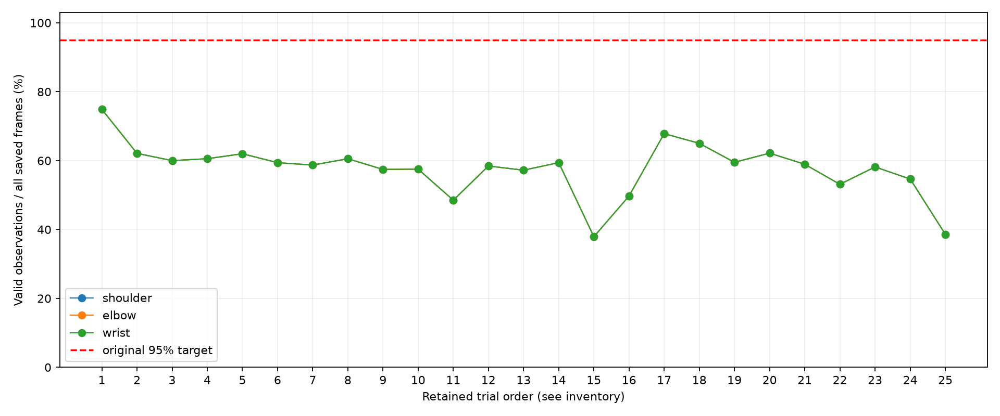
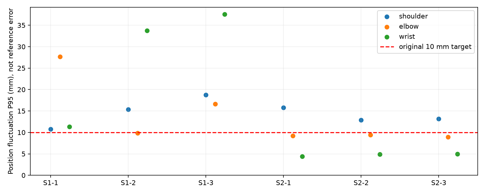

# D435i 四问任务包：收尾复核与修订结论

保留 **25 个试次、29,938 对 RGB/对齐深度、18,310 条分析记录**；1 名参与者，四次按用户要求排除。保留不等于测量有效。

原结题报告的“四包全PASS、正式验收通过”不受当前证据支持，本修订版撤回该结论。

|任务包|复核裁决|已有工作|未达标／阻塞|
|---|---|---|---|
|[TP-D435I-01 三维关键点](result.md)|**FAIL**|真实采集、契约表、原始波动与有效性统计|原阈值可用性/稳定性存在FAIL；独立准确性BLOCKED|
|[TP-D435I-02 腕关节轨迹](../../../TP-D435I-02/closeout_review_v1/review_20261001_v1/result.md)|**BLOCKED**|腕/手点轨迹、候选角及操作记录|解剖角、独立参考/计数/方向验证BLOCKED|
|[TP-D435I-03 肩肘代偿](../../../TP-D435I-03/closeout_review_v1/review_20261001_v1/result.md)|**BLOCKED**|双通道观测、未知覆盖和首警时刻|独立标签、测试划分、真正事件延迟BLOCKED|
|[TP-D435I-04 运动质量](../../../TP-D435I-04/closeout_review_v1/review_20261001_v1/result.md)|**BLOCKED**|A/C/S/Q有效性、观测门控、只读监督回放|数据门控FAIL；评分和效度/端到端延迟BLOCKED|

## 纠正的关键问题

1. 原始保留帧由29,938对独立复数确认，替换30,774硬编码；四个排除编号不重新纳入。

2. 恢复原目标：各轴SD≤5mm、位置P95≤10mm、有效率≥95%、最长失效≤0.2s；不以更松RMS/失效目标宣布PASS。

3. 指令条件不是真值，试次多数类别不是零误报证据；灵敏度/特异度/事件延迟待独立标注。

4. 候选角不能当解剖FE/RU或ROM；缺失不补默认角度、平滑分或可靠性0.6。

5. p=0.001345 >0.001；单人反复试次不是独立受试者群体，撤回临床分离效度和机器人控制安全证明。

## 图表与复核范围

原始清单 SHA-256 校验范围：all raw manifest files；已校验文件 59,976。契约/键/关联检查覆盖25个保留试次，结构问题见 `summary.json`，不将文件完整性当运动性能。

本版本结论可用于真实工程阶段汇报，不能作为四包正式通过或临床/机器人闭环验收。实际执行和交付缺口见 `execution.json`、`deliverable_checklist.md`。

观测覆盖图三条曲线重合：采集程序的 `valid_for_analysis` 对肩肘腕使用共同上肢几何门控；75项是25×3的检查项，不是75个独立样本。未分析的保存帧是观测缺失，不能等同于原始摄像头文件丢帧。

重复试次的P95均值/离散见 `within_P001_repeat_description.csv`，这是单人重复描述，不是独立群体置信区间或测量真值误差。摆位、参考、健康/患者类型等未确认元信息保持未知；不能追认固定45°布局或健康受试者。

收尾记录：[2026-10-01 严谨性修订](../../../../../05_进展日志/2026-10-01_四问收尾复核与严谨性修订.md)。

[修订材料检查评分表](coverage_scorecard.md)（报告质量检查，与实验性能验收区分）。
