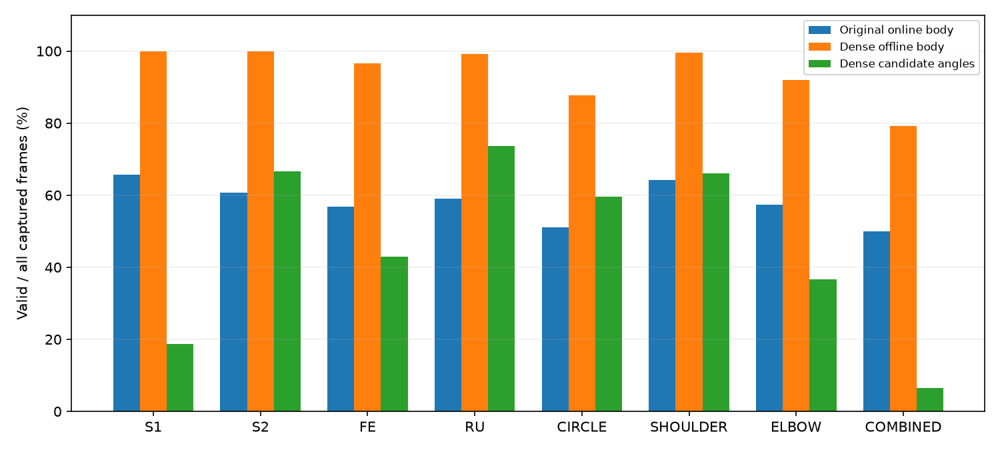
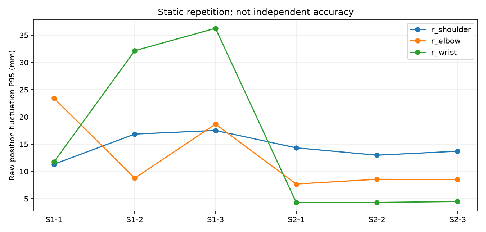

# 现有25试次离线重分析：三维点位、腕轨迹与肩肘参与

## 结论

- **三维点位具备初步能力**：逐帧连续性明显改善，但各关节毫米级稳定性并不一致。
- **腕/手位置轨迹与候选角度可以获得**：解剖FE/RU、ROM及可靠计数仍未建立。
- **明显肩肘额外运动可以产生提示**：旧基线和通道语义影响归因，尚不支持可靠临床代偿分类。

本轮覆盖25个保留试次、29938组RGB/对齐深度，单一P001。结论适用于当前录像和布置，不等于D435i普遍硬件极限、正式准确性或临床效度。本轮不修改实时服务，不覆盖原片和旧输出。

## 方法

逐试次新建VIDEO跟踪器，所有捕获帧按原时间顺序推理，不跳帧、不补点、不套实时超时。复用原模型、深度窗口/门控、候选角及规则，存储基线为主结果；暂停/方向切换按事件回放。全部帧上下文与原实时序列不同，覆盖改善不能全部归因于跳帧单一因素，也不证明实时性能已达标。

独立点位测量与肩肘腕组合几何门控分别报告。深度表面点不等于已验证解剖中心；处理耗时不是同步端到端延迟。

原在线组合有效 **17313/29938（57.8%）**，离线组合有效 **28369/29938（94.8%）**。

|任务|次数|捕获帧|在线组合可用|离线组合可用|离线候选角可用|
|---|---:|---:|---:|---:|---:|
|S1|3|2700|65.7%|100.0%|18.6%|
|S2|3|2699|60.7%|100.0%|66.7%|
|FE|4|7022|56.7%|96.5%|43.0%|
|RU|3|5167|59.0%|99.1%|73.6%|
|回转|3|2962|51.1%|87.8%|59.5%|
|肩诱导|3|2825|64.2%|99.6%|66.0%|
|肘诱导|3|3611|57.4%|92.0%|36.6%|
|共同诱导|3|2952|49.9%|79.1%|6.6%|

## 静止稳定性

全试次原始坐标，无滤波、无独立参考。动态波动不能解释为传感器噪声。

|试次|关节|独立点可用率|X/Y/Z标准差毫米|位置波动P95毫米|
|---|---|---:|---|---:|
|eight_S1_20261001_131959_59d5ec91|r_shoulder|100.0%|2.1/2.2/5.6|11.3|
|eight_S1_20261001_131959_59d5ec91|r_elbow|100.0%|12.6/2.3/3.1|23.4|
|eight_S1_20261001_131959_59d5ec91|r_wrist|100.0%|6.5/1.2/1.5|11.7|
|eight_S1_20261001_132059_bc0d3f66|r_shoulder|100.0%|3.4/2.1/7.3|16.9|
|eight_S1_20261001_132059_bc0d3f66|r_elbow|100.0%|3.9/1.9/2.0|8.8|
|eight_S1_20261001_132059_bc0d3f66|r_wrist|100.0%|13.9/2.1/3.7|32.2|
|eight_S1_20261001_132148_b0ac2f4c|r_shoulder|100.0%|3.7/3.4/7.4|17.5|
|eight_S1_20261001_132148_b0ac2f4c|r_elbow|100.0%|6.6/5.0/1.7|18.7|
|eight_S1_20261001_132148_b0ac2f4c|r_wrist|100.0%|21.7/2.9/5.5|36.3|
|eight_S2_20261001_132239_ea3010e2|r_shoulder|100.0%|2.4/2.2/6.5|14.3|
|eight_S2_20261001_132239_ea3010e2|r_elbow|100.0%|2.6/2.8/2.3|7.7|
|eight_S2_20261001_132239_ea3010e2|r_wrist|100.0%|1.8/0.9/1.4|4.3|
|eight_S2_20261001_132326_343e7896|r_shoulder|100.0%|2.1/2.1/6.2|13.0|
|eight_S2_20261001_132326_343e7896|r_elbow|100.0%|2.9/3.5/2.2|8.6|
|eight_S2_20261001_132326_343e7896|r_wrist|100.0%|1.9/0.8/1.4|4.3|
|eight_S2_20261001_132413_dedfd30f|r_shoulder|100.0%|2.2/1.8/6.5|13.7|
|eight_S2_20261001_132413_dedfd30f|r_elbow|100.0%|3.1/2.7/2.3|8.5|
|eight_S2_20261001_132413_dedfd30f|r_wrist|100.0%|2.2/1.1/1.6|4.5|

首个S1肘点X标准差12.6mm、Z标准差3.1mm、U像素SD8.6px；固定深度的XY敏感度SD约12.3mm。腕点Z标准差约1.5mm，XY像素变化对应约6.5mm。这是代数敏感度对照，不是独立方差分解；支持定位漂移/人体微动影响横向坐标，不能称为纯相机噪声。

## 清晰片段合理性检查

按10秒窗口的身体/候选角可用率选片，检查六帧叠加画面和信号。该选择偏向清晰案例，不能替代全体性能。11段AVI是15fps捕获时间可视化重采样，所有统计仍来自全量原始帧。未建立独立完整逐事件标签。

- **eight_S1_20261001_131959_59d5ec91，2.0–12.0s**：静止且关键点位置基本贴合画面，未触发额外参与提示合理；部分手点深度无效。 [叠加回放](analysis_20261001_v1/cases/eight_S1_20261001_131959_59d5ec91/overlay_clip.avi)，[六帧](analysis_20261001_v1/cases/eight_S1_20261001_131959_59d5ec91/contact_sheet.jpg)，[信号](analysis_20261001_v1/cases/eight_S1_20261001_131959_59d5ec91/signals.png)。
- **eight_S1_20261001_132059_bc0d3f66，2.0–12.0s**：采样画面姿态基本稳定却持续combined；旧基线与重新摆位不匹配的证据强，不能视为持续真实代偿。 [叠加回放](analysis_20261001_v1/cases/eight_S1_20261001_132059_bc0d3f66/overlay_clip.avi)，[六帧](analysis_20261001_v1/cases/eight_S1_20261001_132059_bc0d3f66/contact_sheet.jpg)，[信号](analysis_20261001_v1/cases/eight_S1_20261001_132059_bc0d3f66/signals.png)。
- **eight_S1_20261001_132148_b0ac2f4c，2.0–12.0s**：采样画面基本静止，旧基线持续combined；试次局部基线反事实不再报警，但尚未改实时服务。 [叠加回放](analysis_20261001_v1/cases/eight_S1_20261001_132148_b0ac2f4c/overlay_clip.avi)，[六帧](analysis_20261001_v1/cases/eight_S1_20261001_132148_b0ac2f4c/contact_sheet.jpg)，[信号](analysis_20261001_v1/cases/eight_S1_20261001_132148_b0ac2f4c/signals.png)。
- **eight_S2_20261001_132239_ea3010e2，2.0–12.0s**：握杯时大关节点仍可见；原存储身体基线/手掌基准缺失导致unknown/角无效，不是三维点未采到。 [叠加回放](analysis_20261001_v1/cases/eight_S2_20261001_132239_ea3010e2/overlay_clip.avi)，[六帧](analysis_20261001_v1/cases/eight_S2_20261001_132239_ea3010e2/contact_sheet.jpg)，[信号](analysis_20261001_v1/cases/eight_S2_20261001_132239_ea3010e2/signals.png)。
- **eight_FE_20261001_133658_73162b96，13.0–23.0s**：手姿态变化且前臂较稳定，点位追踪大致合理；FE/RU候选都明显变化与偏零，不能证明轴分离或计数正确。 [叠加回放](analysis_20261001_v1/cases/eight_FE_20261001_133658_73162b96/overlay_clip.avi)，[六帧](analysis_20261001_v1/cases/eight_FE_20261001_133658_73162b96/contact_sheet.jpg)，[信号](analysis_20261001_v1/cases/eight_FE_20261001_133658_73162b96/signals.png)。
- **eight_RU_20261001_133347_d19a29ac，24.0–34.0s**：该试次候选角可用96.96%，周期变化清楚，但RU候选一直偏负、主周期也出现在另一候选通道；只能证明存在可提取运动信号，不能以指令名判定轴准确。 [叠加回放](analysis_20261001_v1/cases/eight_RU_20261001_133347_d19a29ac/overlay_clip.avi)，[六帧](analysis_20261001_v1/cases/eight_RU_20261001_133347_d19a29ac/contact_sheet.jpg)，[信号](analysis_20261001_v1/cases/eight_RU_20261001_133347_d19a29ac/signals.png)。
- **eight_RU_20261001_133130_b225807d，15.0–25.0s**：手方向变化可见，指根深度间歇无效；候选RU偏零且缺失，不能证明可靠计数。 [叠加回放](analysis_20261001_v1/cases/eight_RU_20261001_133130_b225807d/overlay_clip.avi)，[六帧](analysis_20261001_v1/cases/eight_RU_20261001_133130_b225807d/contact_sheet.jpg)，[信号](analysis_20261001_v1/cases/eight_RU_20261001_133130_b225807d/signals.png)。
- **eight_CIRCLE_20261001_134353_ece4c4e8，29.0–39.0s**：肘支撑时手朝向变化可见；未触发额外参与大致合理；六帧不能独立确认圈数或真实方向。 [叠加回放](analysis_20261001_v1/cases/eight_CIRCLE_20261001_134353_ece4c4e8/overlay_clip.avi)，[六帧](analysis_20261001_v1/cases/eight_CIRCLE_20261001_134353_ece4c4e8/contact_sheet.jpg)，[信号](analysis_20261001_v1/cases/eight_CIRCLE_20261001_134353_ece4c4e8/signals.png)。
- **eight_SHOULDER_20261001_134728_5cedac08，2.0–12.0s**：肩/上臂姿态变化与肩通道提示有可观测联系；归因仍受基线影响，不能证明临床原因。 [叠加回放](analysis_20261001_v1/cases/eight_SHOULDER_20261001_134728_5cedac08/overlay_clip.avi)，[六帧](analysis_20261001_v1/cases/eight_SHOULDER_20261001_134728_5cedac08/contact_sheet.jpg)，[信号](analysis_20261001_v1/cases/eight_SHOULDER_20261001_134728_5cedac08/signals.png)。
- **eight_ELBOW_20261001_135236_ac256f5f，3.0–13.0s**：明显外展和肘运动可见；原肩通道包含上臂摆动，因此combined可解释，但不证明同时耸肩。 [叠加回放](analysis_20261001_v1/cases/eight_ELBOW_20261001_135236_ac256f5f/overlay_clip.avi)，[六帧](analysis_20261001_v1/cases/eight_ELBOW_20261001_135236_ac256f5f/contact_sheet.jpg)，[信号](analysis_20261001_v1/cases/eight_ELBOW_20261001_135236_ac256f5f/signals.png)。
- **eight_COMBINED_20261001_135607_5bb6b817，10.0–20.0s**：手臂与躯干/肩姿态变化可见，混合提示有迹象；部分帧因观测/几何失效进入unknown。 [叠加回放](analysis_20261001_v1/cases/eight_COMBINED_20261001_135607_5bb6b817/overlay_clip.avi)，[六帧](analysis_20261001_v1/cases/eight_COMBINED_20261001_135607_5bb6b817/contact_sheet.jpg)，[信号](analysis_20261001_v1/cases/eight_COMBINED_20261001_135607_5bb6b817/signals.png)。

## 主要诊断

**旧基线**：S1第二/第三试次沿用第一个试次之前的基线；本轮原基线报警均约99.3%，首2秒试次局部基线诊断为0%，采样画面稳定。支持基线不匹配，不能解释为持续真实代偿。局部重置只作反事实，动态试次开头可能已运动，不能一概用首2秒自动纠正。

**腕角与计数**：固定中立手掌法向且缺前臂轴向参考，候选角会偏零/串扰。指根深度窗口易碰到手缘、背景及空洞；缺任一点使角度无效。原计数需连续跨正负阈值，缺角重置半周期；逐帧后计数仍为0，问题不只实时跳帧。

**肩肘语义**：肩通道包含上臂摆动，飞肘会同时触发肩通道。combined是两条规则同时触发，不能直接说看到了耸肩。normal仅表示未触发当前运动规则，不证明腕训练完成。

**点位正确性**：一致的背景深度可能通过局部窗口门控；需要RGB/深度对照及几何检查。小手点和大关节点的可用性不能混为一谈。

边界图依次为FE手缘深度分散、飞肘时候选角超软件可观测范围、共同动作中身体几何/点位失效。最后一种需结合同帧坐标进一步归因，不能只凭unknown称硬件损坏。伪彩深度仅供位置对照，颜色不是误差真值。

## 设备边界与下一步

当前支持大关节点的连续表面点位、部分腕轨迹及明显额外运动筛查；手部边缘/遮挡、前臂轴向旋转、重新摆位和大幅动作是已发现的系统边界。0.35–2.5m范围、7×7窗口、50mm/15deg阈值都是软件参数，不是硬件极限。

没有多距离/多视角和独立参考，无法估计D435i普遍最近/最远可靠距离、解剖中心误差或全部条件保证。应先改进检测/深度目标所属/基线/角度轴，再判断是否需要改变硬件。

[原理与官方依据](PRINCIPLES_AND_BOUNDARIES.md)；[改进顺序](NEXT_ACTIONS.md)。

本轮18项静止关节点统计的位置波动P95为4.3–36.3mm，不能对所有关节保证毫米级稳定。回转第二次及共同动作第三次的组合可用率约66.3%，最长组合缺失分别约1.57/1.17s，是已观察到的失效工况。各试次肩肘腕有效采样Z中位范围约0.63–1.25m，表示光学轴深度，不是独立标定的相机到受试者距离或极限范围。

S2第一试次四个手部点本轮全部有效，但原存储身体基线与手掌基准均缺失，所以整段没有候选角；另两次S2候选角可用率均为100%。这说明“握杯一定看不到手”不符合本数据，标定状态也会造成输出不可用。

轨迹和筛查已按任务包另存：[50份逐帧CSV索引](trajectory_and_screening_exports.json)，TP02包含腕/手点XYZ、独立有效性和候选角；TP03包含肩位移、上臂摆动、肘角变化与规则状态。

## 复现与证据

- [输入、模型和代码哈希](dense_20261001_v1/execution.json)
- [25试次指标](analysis_20261001_v1/trial_metrics.csv)、[175条关节诊断](analysis_20261001_v1/joint_metrics.csv)
- [逐帧记录目录](dense_20261001_v1/runs/)
- [分析伴随笔记本](analysis_companion.ipynb)、[核验记录](verification.json)

原正式FAIL/BLOCKED复核保持历史口径；本轮回答初步能力与当前布置边界，没有改变验收阈值。
