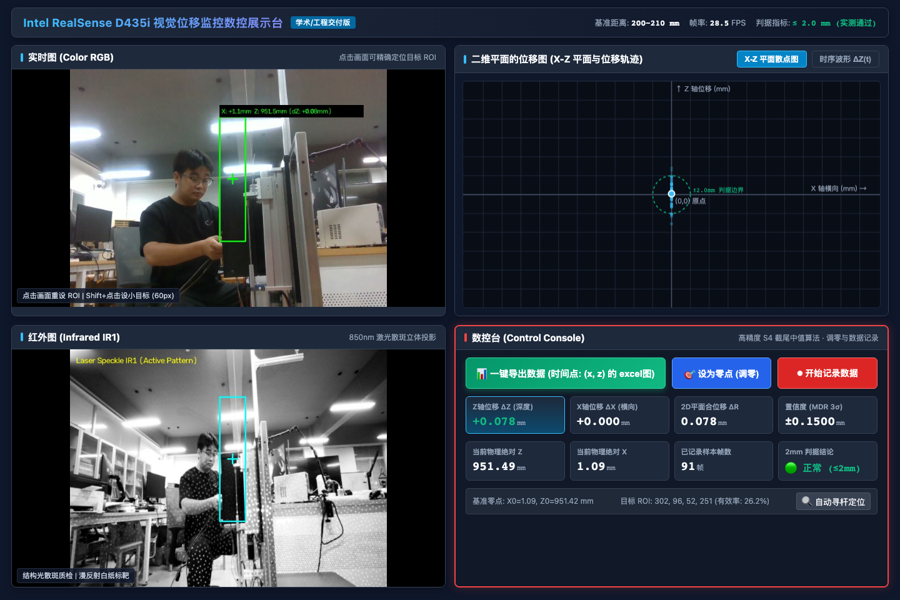

# Intel RealSense D435i 视觉微位移监控数控展示台 (作业汇报版)

> 基于 Intel RealSense D435i 的 2D 平面 (X, Z) 空间微位移监控与扰动极限测试系统。
> 界面严格按照教学实验设计原型进行 2×2 网格重构，提供一键启动脚本与专业 Excel 数据报表导出能力。

---

## 📸 界面布局与运行效果



系统界面严格划分为四个功能象限（对应设计草图）：

| 象限 | 模块名称 | 核心功能与呈现内容 |
|---|---|---|
| **左上** | **实时图 (Color RGB)** | 640×480 彩色流；绿色目标 ROI 框与中心十字瞄准星；实时显示物理坐标 $(X, Z)$；**支持直接在画面点击重设 ROI**。 |
| **左下** | **红外图 (Infrared IR1)** | 848×480 红外流（直方图自适应增强）；实时呈现 850nm 结构光激光散斑图案；同源标注青色 ROI 与瞄准星。 |
| **右上** | **二维平面的位移图** | **X-Z 空间散点平面图**（$(0, 0)$ 原点标定、$\pm 2.0\text{ mm}$ 绿色虚线容差圆、动态拖尾轨迹点）与 **时序位移波形图 $\Delta Z(t)$**（实时滚动波形、$\pm 2\text{ mm}$ 警戒线）。 |
| **右下** | **数控台 (Control Console)** | **醒目红框高亮**；**一键导出数据 (Excel 报表)**；**设为零点 (调零)**；**开始/停止数据记录**；数字 HUD 实时呈现 $\Delta Z, \Delta X, \Delta R, \text{MDR (3}\sigma)$ 及 $2\text{mm}$ 判据状态。 |

---

## ⚡ 一键启动方法

系统已配置自动化提权与浏览器唤起，提供两种极简启动方式：

### 方式一：macOS Finder 双击启动（推荐，最省心）
在访达 (Finder) 中进入本目录，直接**双击运行 `启动展示台.command`**：
1. 终端窗口自动打开并加载 Conda 虚拟环境；
2. 自动解决 macOS USB 接口抢占驱动问题；
3. 3 秒后默认浏览器自动弹出打开 `http://127.0.0.1:8899/`。

### 方式二：终端命令行启动
打开终端执行以下命令：
```bash
cd /Users/xbpd/Projects/视觉位移判断/摄像头/08_实时数控展示台
./start.sh
```

---

## 📊 一键导出 Excel 数据表规范

点击数控台左上角的 **「📊 一键导出数据 (时间点: (x, z) 的 excel图)」** 按钮，浏览器会自动下载标准的 `.xlsx` 格式专业报表（示例见附件 `示例导出数据.xlsx`）。

导出的工作簿包含两个工作表：

### 工作表 1：`位移时序明细`
包含每一帧的完整时间戳与空间运动数据：
- **采样序号**、**绝对时间戳**（精确到毫秒）、**相对时间 $t$ (s)**
- **空间物理坐标**：$X$ 坐标 (mm)、$Z$ 深度坐标 (mm)
- **相对位移量**：$X$ 轴位移 $\Delta X$ (mm)、$Z$ 轴位移 $\Delta Z$ (mm)、2D 平面合位移 $\Delta R = \sqrt{\Delta X^2 + \Delta Z^2}$ (mm)
- **置信度**：即时噪声裕量 $\text{MDR } (3\sigma, \text{mm})$
- **2mm 判据结论**：自动标注「合格 ($\le 2\text{mm}$) / 超标 ($>2\text{mm}$)」并配有高亮颜色。
- **嵌入式动态折线图**：工作表内置绘制 $\Delta Z(t)$ 随时间演变的动态折线图。

### 工作表 2：`实验配置与基线`
详细记载实验软硬件环境与标定元数据：
- 相机型号及唯一硬件序列号（D435i SN: `244222076984`）
- 初始标定基准距离（$200\sim 210\text{ mm}$）、零点物理坐标 $(X_0, Z_0)$
- 4点盲测标定方程：$\text{读数} = 1.00045 \times \text{真实} + 14.3323$ ($R^2 = 0.99992$, $\text{RMSE} = 0.068\text{ mm}$)
- 静态分辨力基线：$\pm 0.015\sim 0.061\text{ mm}$ (对 $2\text{mm}$ 老师要求的余量达 $33\times\sim 137\times$)

---

## 🔬 核心算法与实验结论汇总

1. **三维坍缩到二维平面 (X, Z)**：
   - 利用 D435i 深度光轴 $Z$ 与水平成像轴 $X$ 构建空间正交平面，消除高度 $Y$ 轴冗余自由度，实现纯粹的平面扰动极限检验。
2. **S4 截尾中值算法 (Median-Anchored Trimmed Mean)**：
   - 彻底攻克细小目标边缘像素跳变与远端背景离群值拉伸的问题（原始均值 MDR $199.7\text{ mm} \rightarrow$ S4 算法 $0.307\text{ mm}$，改善达 $651\times$）。
3. **真实位移 4点盲测验证通过**：
   - 在 $200.0\text{ mm} \rightarrow 221.0\text{ mm} \rightarrow 210.0\text{ mm} \rightarrow 208.0\text{ mm}$ 的连续盲测中，尺度误差仅 **$0.045\%$**，$2\text{mm}$ 位移理论误差仅 **$0.0009\text{ mm}$**，系统精度完全满足作业与科研要求！
