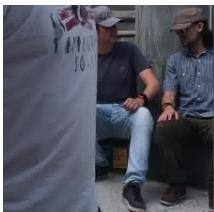
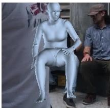
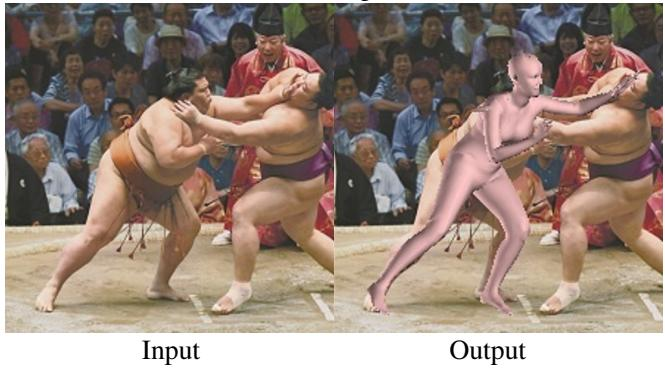
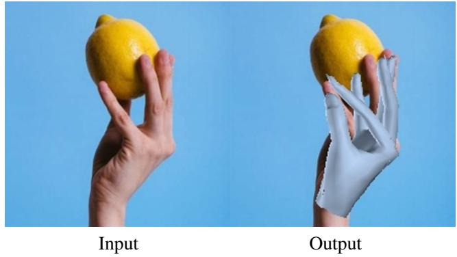
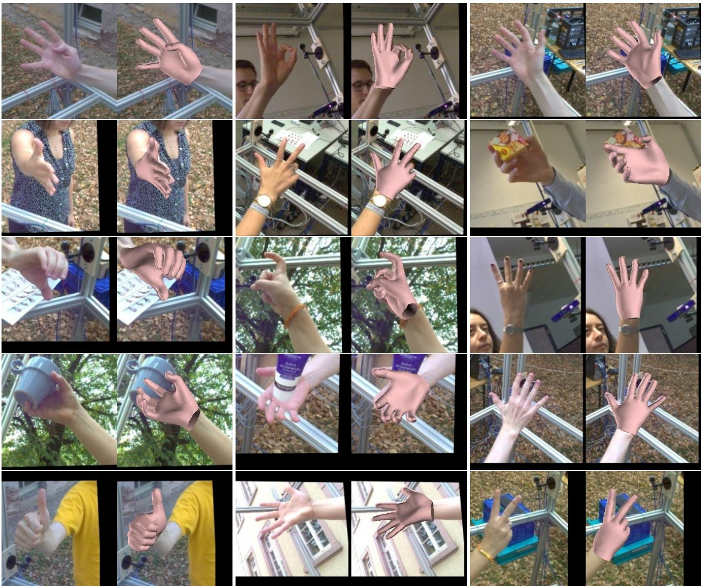

# 端到端人体姿态与网格重建的 Transformer 方法

Kevin Lin　Lijuan Wang　Zicheng Liu

Microsoft

{keli, lijuanw, zliu}@microsoft.com

## 摘要

我们提出了一种新方法，称为 METRO（MEsh TRansfOrmer，网格变换器），用于从单张图像重建三维人体姿态和网格顶点。我们的方法采用 Transformer 编码器来联合建模顶点–顶点以及顶点–关节之间的交互，并同时输出三维关节坐标和网格顶点。与现有回归姿态和形状参数的方法相比，METRO 不依赖于 SMPL 等任何参数化网格模型，因此可以方便地扩展到其他对象，例如手部。我们进一步放宽了对网格拓扑的限制，允许 Transformer 自注意力机制在任意两个顶点之间自由地进行注意力计算，从而能够学习网格顶点与关节之间的非局部关系。通过所提出的掩码顶点建模（masked vertex modeling），我们的方法在处理诸如部分遮挡等具有挑战性的场景时更加鲁棒和有效。METRO 在公开的 Human3.6M 和 3DPW 数据集上取得了人体网格重建方面新的最先进结果。此外，我们还展示了 METRO 在野外三维手部重建任务上的泛化能力，在 FreiHAND 数据集上超越了现有的最先进方法。代码与预训练模型可在 https://github.com/microsoft/MeshTransformer 获取。

## 1. 引言

从单张图像进行三维人体姿态和网格重建受到了广泛关注，因为它在虚拟现实、体育运动分析、神经退行性疾病诊断等诸多领域都有重要应用。由于人体具有复杂的关节运动以及遮挡现象，该问题具有很大的挑战性。

该领域的现有工作大致可以分为两类。第一类方法使用诸如 SMPL [29] 之类的参数化模型，并学习预测形状和姿态系数 [14, 26, 39, 22, 24, 34, 44, 23]。这类方法取得了巨大的成功。参数化模型中编码的强先验使其对环境变化具有较强的鲁棒性。该方法的不足之处在于，姿态和形状空间受到用于构建参数化模型的有限样本的限制。为了克服这一局限，第二类方法不使用任何参数化模型 [25, 8, 32]。这些方法要么使用图卷积神经网络来建模邻域内的顶点–顶点交互 [25, 8]，要么使用一维热图来回归顶点坐标 [32]。这些方法的一个局限在于，它们在建模非局部的顶点–顶点交互时效率较低。

  

请提供需要翻译的英文论文内容。仅 "(a)" 不是完整的待翻译文本，请您粘贴论文段落、章节或整篇 Markdown。

  

(b)

  

图 1：METRO 学习人体关节与网格顶点之间的非局部交互，用于人体网格重建。给定 (a) 中的输入图像，METRO 通过考虑非局部交互来预测人体网格。(b) 展示了被遮挡的腕关节与网格顶点之间的注意力，颜色越亮表示注意力越强。(c) 为重建后的网格。

研究人员已经证明，非局部顶点之间存在强相关性，这些顶点可能属于身体的不同部位（例如手和脚）[55]。在计算机图形学和机器人学中，已经开发出逆运动学方法 [2]，用于在给定末端执行器（如手尖）位置的情况下估计关节图内部的关节位置。我们认为，学习身体关节和网格顶点之间的相关性（包括短程相关性和长程相关性），对于应对身体形状重建中的挑战性姿态和遮挡问题具有重要价值。在本文中，我们提出了一种简单而有效的框架来建模全局的顶点—顶点交互。我们的框架的核心组件是一个 Transformer。

最近的研究表明，Transformer [53] 显著提升了自然语言处理中各项任务的性能 [4, 9, 40, 41]。其成功主要归功于 Transformer 的自注意力机制，该机制在建模输入和输出中各元素之间的依赖关系（或交互关系）时尤为有效，且不受它们之间距离的影响。给定这些依赖关系，Transformer 能够软搜索相关 token，并基于这些重要特征进行预测 [4, 53]。

在本工作中，我们提出了 METRO——一种具有渐进式维度缩减的多层 Transformer 编码器，用于同时从给定输入图像重建 3D 身体关节和网格顶点。我们设计了 Masked Vertex Modeling（掩码顶点建模）目标函数，并采用 Transformer 编码器架构，以增强关节和顶点之间的交互。如图 1 所示，METRO 学会发现身体关节和网格顶点之间的短程和长程交互，这有助于更好地重建具有大幅姿态变化和遮挡的 3D 人体形状。

在多个公开数据集上的实验结果表明，METRO 在学习顶点—顶点和顶点—关节交互方面是有效的，因此在人体网格重建任务上以较大优势超越了已有工作。据我们所知，METRO 是首个利用 Transformer 编码器架构，从单张输入图像联合学习 3D 人体姿态和网格重建的方法。此外，METRO 是一个通用框架，可以方便地应用于预测不同的 3D 网格，例如从输入图像重建 3D 手部。

总之，我们做出以下贡献。

• 我们提出了一种新的基于 Transformer 的方法，命名为 METRO，用于从单张图像进行 3D 人体姿态和网格重建。

• 我们设计了 Masked Vertex Modeling（掩码顶点建模）目标函数，并采用多层 Transformer 编码器，对顶点—顶点和顶点—关节的交互进行建模，以实现更好的重建效果。

• METRO 在大规模基准 Human3.6M 和具有挑战性的 3DPW 数据集上取得了新的最先进性能。

- METRO 是一个多功能框架，可以轻松实现以预测不同类型的 3D 网格，例如在实验中所展示的 3D 手部。在论文提交时，METRO 在 FreiHAND 排行榜上取得了第一名。

## 2. 相关工作

人体网格重建（Human Mesh Reconstruction, HMR）：HMR 是一项重建 3D 人体形状的任务，是近年来的活跃研究方向。尽管早期工作已经展示了使用各种传感器（例如深度传感器 [33, 48] 或惯性测量单元 [20, 54]）进行的令人印象深刻的重建，但研究人员正在探索使用更为高效便捷的单目相机设置。然而，由于复杂的姿态变化、遮挡以及有限的 3D 训练数据，从单张图像进行 HMR 十分困难。

先前的研究提出采用预训练的参数化人体模型，即 SMPL [29]、STAR [35]、MANO [43]，并估计参数化模型的姿态与形状系数以用于 HMR。由于直接从输入图像回归姿态与形状系数具有相当的挑战性，最近的工作进一步提出利用各种人体先验，例如人体骨骼 [26, 39] 或分割图 [34]，并探索不同的优化策略 [24, 22, 51, 14] 以及时间信息 [23] 以改进重建。

另一方面，研究人员也提出了不从输入图像直接回归 3D 人体形状的方法，而非采用参数化人体模型。例如，研究人员探索了使用 3D 网格 [25, 8]、体素空间 [52] 或占据场 [46, 47] 来表示人体。每项先前的工作都针对其目标应用处理特定的输出表示。在这些文献中，相关的研究是 GraphCMR [25]，它旨在使用图卷积神经网络（Graph Convolutional Neural Networks, GCNN）回归 3D 网格顶点。此外，最近提出的 Pose2Mesh [8] 是一个使用 GCNN 的级联模型。Pose2Mesh 基于给定的人体姿态表示来重建人体网格。

尽管基于 GCNN 的方法 [8, 25] 旨在基于预先指定的网格拓扑对邻域内的顶点—顶点交互进行建模，但在建模更长距离的交互方面效率较低。相比之下，METRO 对关节点与网格顶点之间的全局交互进行建模，且不受任何网格拓扑的限制。此外，我们的方法通过自注意力机制进行学习，这与先前的研究 [8, 25] 不同。

注意力机制与 Transformer：近期研究 [36, 28, 53] 表明，注意力机制能够提升在多种语言任务上的表现。其核心洞见在于学习对相关输入进行软搜索（soft-search），从而识别出对预测输出至关重要的部分 [4]。Vaswani 等人 [53] 进一步提出了完全基于注意力机制的 Transformer 架构。Transformer 利用多头自注意力实现了高度并行化，从而支持高效的训练与推理，并在 BERT [9] 与 GPT [40, 41, 5] 等大规模语言建模任务中取得了卓越的表现。

受神经语言领域近期成功经验的启发，越来越多的研究开始探索将 Transformer 架构应用于各类视觉任务，例如学习用于图像生成 [7, 37] 与分类 [7, 10] 的像素分布，或将目标检测简化为集合预测问题 [6]。然而，三维人体重建尚未沿这一方向展开探索。

  

图2：所提出框架的概述。给定一张输入图像，我们使用卷积神经网络（CNN）提取一个图像特征向量。我们通过将图像特征与每个身体关节 $i$ 的三维坐标 $( x _ { i } , y _ { i } , z _ { i } )$ 以及每个网格顶点 $j$ 的三维坐标 $( x _ { j } , y _ { j } , z _ { j } )$ 进行拼接，从而将一个模板人体网格加到图像特征向量上以执行位置编码。给定一组关节查询（joint queries）和顶点查询（vertex queries），我们通过一个 Transformer 编码器的多层自注意力机制，并行地回归出身体关节和网格顶点的三维坐标。我们采用一种渐进式降维架构（右图），在层与层之间逐步降低隐藏嵌入的维度。最后一层中的每个标记（token）输出一个关节或网格顶点的三维坐标。每个编码器块包含 4 层和 4 个注意力头。$H$ 表示图像特征向量的维度。

在本研究中，我们提出了一种具有渐进式维度缩减的多层 Transformer 架构，用于回归关节和顶点的三维坐标。

## 3. 方法

图 2 是我们所提框架的概览。它以一张尺寸为 224 × 224 的图像作为输入，并预测一组人体关节 J 和网格顶点 V。所提框架由两个模块组成：卷积神经网络（Convolutional Neural Network）与多层 Transformer 编码器（Multi-Layer Transformer Encoder）。首先，我们使用 CNN 从输入图像中提取图像特征向量。接下来，多层 Transformer 编码器以该特征向量作为输入，并并行输出人体关节和网格顶点的三维坐标。下面我们详细描述每个模块。

## 3.1. 卷积神经网络

在我们框架的第一个模块中，我们采用卷积神经网络（CNN）进行特征提取。该 CNN 在 ImageNet 分类任务 [45] 上进行了预训练。具体而言，我们从最后一个隐藏层提取一个特征向量 X。所提取的特征向量 X 的维度通常为 2048。我们将该特征向量 X 输入到 Transformer 中以执行回归任务。

借助这种通用设计，它支持对人体姿态与网格重建进行端到端训练。此外，Transformer 还可以便捷地受益于大规模预训练 CNN，例如 HRNets [56]。在我们的实验中，我们对输入特征进行了分析，并发现高分辨率图像特征有利于 Transformer 回归人体关节和网格顶点的三维坐标。

## 3.2. 具有渐进式维度缩减的多层 Transformer 编码器

由于我们需要输出三维坐标，我们不能直接采用现有的 Transformer 编码器架构 [10, 6]，因为它们在所有 Transformer 层中对隐藏嵌入均使用恒定的维度。受 [18] 通过多个块逐步执行维度缩减的启发，我们设计了一种采用渐进式维度缩减方案的新架构。如图 2 右所示，我们使用线性投影在每个编码器层之后降低隐藏嵌入的维度。通过堆叠多个编码器层，模型被视为以交替的方式执行自注意力计算与维度缩减。我们 Transformer 编码器的最终输出向量即为人体关节和网格顶点的三维坐标。

如图 2 左侧所示，Transformer 编码器的输入是人体关节点查询与网格顶点查询。与位置编码（positional encoding）[53, 25, 13] 的思路相同，我们使用一个模板人体网格来保留输入序列中每个查询的位置信息。具体而言，我们将图像特征向量 $X \in \mathbb { R } ^ { 2 \bar { 0 } 4 8 \times 1 }$ 与每个身体关节点 i 的 3D 坐标 $( x _ { i } , y _ { i } , z _ { i } )$ 进行拼接。这构成了一个关节点查询集合 $\dot { Q _ { J } } = \{ q _ { 1 } ^ { J } , q _ { 2 } ^ { J } , . . . , q _ { n } ^ { J } \}$，其中 $q _ { i } ^ { J } \in \mathbb { R } ^ { 2 0 5 1 \times 1 }$。类似地，我们对每个网格顶点 $j$ 进行相同的位置编码，并构成一个顶点查询集合 $\mathsf { \bar { Q } } _ { V } = \{ q _ { 1 } ^ { \dot { V } } , q _ { 2 } ^ { V } , \hdots , q _ { m } ^ { V } \}$，其中 $q _ { j } ^ { V } \in \mathbb { R } ^ { 2 0 5 1 \times 1 }$。

## 3.3. 掩码顶点建模（Masked Vertex Modeling）

先前的工作 [9, 49] 使用掩码语言建模（Masked Language Modeling, MLM）来学习训练语料的语言特性。然而，MLM 的目标是恢复被遮蔽的输入，这无法直接应用于我们的回归任务。

为了充分激活 Transformer 编码器中的双向注意力，我们为回归任务设计了一种掩码顶点建模（Masked Vertex Modeling, MVM）。我们随机遮蔽一定比例的输入查询。与 MLM [9] 恢复被遮蔽输入的做法不同，我们让 Transformer 回归所有关节点和顶点。

为了预测与缺失查询相对应的输出，模型将不得不借助其他相关的查询。这在精神上类似于模拟部分身体部位不可见时的遮挡情况。因此，MVM 强制 Transformer 通过综合考虑其他相关的顶点和关节点来回归 3D 坐标，而不必顾及它们之间的距离和网格拓扑。这有助于关节点与顶点之间的短程和长程交互，从而实现更好的人体建模。

## 3.4. 训练

为了训练 Transformer 编码器，我们在 Transformer 的输出之上应用损失函数，并最小化预测值与真实值之间的误差。给定一个数据集 $D = \{ I ^ { i } , \bar { V } _ { 3 D } ^ { i } , \bar { J } _ { 3 D } ^ { i } , \bar { J } _ { 2 D } ^ { i } \} _ { i = 1 } ^ { T }$，其中 T 是训练图像的总数。$\boldsymbol { I } \in \mathbb { R } ^ { w \times h \times 3 }$ 表示一张 RGB 图像。$\bar { V } _ { 3 D } \in \mathbf { \mathbb { R } } ^ { M \times \bar { 3 } }$ 表示网格顶点的真实 3D 坐标，M 是顶点的数量。$\bar { J } _ { 3 D } \in \mathbb { R } ^ { K \times 3 }$ 表示人体关节点的真实 3D 坐标，K 是一个人的关节点数量。类似地，$\bar { J } _ { 2 D } \in \mathbb { R } ^ { K \times 2 }$ 表示人体关节点的真实 2D 坐标。

设 $V_{3D}$ 表示输出的顶点位置，$J_{3D}$ 表示输出的关节点位置，我们使用 $L_{1}$ 损失来最小化预测值与真实值之间的误差：

$$
\mathcal { L } _ { V } = \frac { 1 } { M } \sum _ { i = 1 } ^ { M } \big | \big | V _ { 3 D } - \bar { V } _ { 3 D } \big | \big | _ { 1 } ,\tag{1}
$$

$$
\mathcal { L } _ { J } = \frac { 1 } { K } \sum _ { i = 1 } ^ { K } \big | \big | J _ { 3 D } - \bar { J } _ { 3 D } \big | \big | _ { 1 } .\tag{2}
$$

值得注意的是，3D 关节点也可以从预测的网格中计算得到。遵循文献 [8, 22, 25, 24] 中的常见做法，我们使用一个预定义的回归矩阵 $G \in \mathbb { R } ^ { K \times M }$，并通过 $J _ { 3 D } ^ { r e g } = G V _ { 3 D }$ 得到回归得到的 3D 关节点。与已有工作类似，我们使用 $L_{1}$ 损失来优化 $J _ { 3 D } ^ { r e g }$：

$$
\mathcal { L } _ { J } ^ { r e g } = \frac { 1 } { K } \sum _ { i = 1 } ^ { K } \left| \left| J _ { 3 D } ^ { r e g } - \bar { J } _ { 3 D } \right| \right| _ { 1 } .\tag{3}
$$

2D 重投影已被广泛用于增强图像与网格之间的对齐 [22, 25, 24]，同时也便于在图像中可视化重建结果。受已有工作启发，我们使用估计得到的相机参数将 3D 关节点投影到 2D 空间，并最小化 2D 投影与 2D 真实值之间的误差：

$$
\mathcal { L } _ { J } ^ { p r o j } = \frac { 1 } { K } \sum _ { i = 1 } ^ { K } \left| \left| J _ { 2 D } - \bar { J } _ { 2 D } \right| \right| _ { 1 } ,\tag{4}
$$

其中相机参数通过在 Transformer 编码器（transformer encoder）输出之上添加一个线性层学习得到。

为了进行大规模训练，充分利用 2D 和 3D 训练数据集以获得更好的泛化能力是极其理想的。正如文献 [34, 22, 25, 24, 23, 8, 32] 所探讨的，我们采用混合训练策略，利用不同的训练数据集，无论其是否包含配对的图像—网格标注。我们整体的优化目标如下：

$$
\mathcal { L } = \alpha \times ( \mathcal { L } _ { V } + \mathcal { L } _ { J } + \mathcal { L } _ { J } ^ { r e g } ) + \beta \times \mathcal { L } _ { J } ^ { p r o j } ,\tag{5}
$$

其中 $\alpha$ 和 $\beta$ 是每个训练样本的二元标志位，分别表示该样本是否具有 3D 和 2D 真实值标注。

## 3.5. 实现细节（Implementation Details）

我们的方法能够处理任意尺寸的网格。然而，受当前硬件的内存限制所限，我们的 Transformer 处理的是粗网格：（1）我们使用一个粗模板网格（431 个顶点）进行位置编码，并由 Transformer 输出一个粗网格；（2）我们使用可学习的多层感知机（Multi-Layer Perceptrons, MLPs）将粗网格上采样到原始网格（SMPL 人体网格拓扑对应 6890 个顶点）；（3）Transformer 和 MLPs 以端到端方式进行训练；需要说明的是，粗网格是使用一种采样算法 [42] 对原始网格进行两次子采样至 431 个顶点而得到的。正如文献 [25] 所讨论的，先学习粗网格再上采样的实现方式有助于降低计算量。它还有助于避免原始网格中的冗余（由于顶点的空间局部性所致），从而使训练更加高效。

## 4. 实验结果

我们首先在 Human3.6M 和 3DPW 数据集上展示我们的方法优于以往最先进的人体网格重建方法。然后，我们提供消融

<table><tr><td rowspan="2">Method</td><td colspan="3">3DPW</td><td colspan="2">Human3.6M</td></tr><tr><td>MPVE↓</td><td>MPJPE↓</td><td>PA-MPJPE↓</td><td>MPJPE↓</td><td>PA-MPJPE↓</td></tr><tr><td>HMR [22]</td><td>一</td><td>一</td><td>81.3</td><td>88.0</td><td>56.8</td></tr><tr><td>GraphCMR [25]</td><td></td><td>一</td><td>70.2</td><td>一</td><td>50.1</td></tr><tr><td>SPIN [24]</td><td>116.4</td><td></td><td>59.2</td><td>一</td><td>41.1</td></tr><tr><td>Pose2Mesh [8]</td><td>一</td><td>89.2</td><td>58.9</td><td>64.9</td><td>47.0</td></tr><tr><td>I2LMeshNet [32]</td><td>一</td><td>93.2</td><td>57.7</td><td>55.7</td><td>41.1</td></tr><tr><td>VIBE [23]</td><td>99.1</td><td>82.0</td><td>51.9</td><td>65.6</td><td>41.4</td></tr><tr><td>METRO (Ours)</td><td>88.2</td><td>77.1</td><td>47.9</td><td>54.0</td><td>36.7</td></tr></table>

表 1：在 3DPW 和 Human3.6M 数据集上与最先进方法的性能对比。

为非局部交互和模型设计提供研究与洞见。最后，我们展示了模型在手部重建任务上的泛化能力。

## 4.1. 数据集

遵循文献 [34, 22, 25, 24, 23, 8, 32] 的做法，我们使用 3D 和 2D 训练数据进行混合训练。下面分别介绍每个数据集。

Human3.6M [21] 是一个具有 2D 和 3D 标注的大规模数据集。每张图像中都有一个受试者执行不同的动作。由于许可问题，3D 真值网格不可用。因此，我们使用 [8, 32] 中提供的伪 3D 网格进行训练。这些伪标签是通过 SMPLify-X [38] 进行模型拟合得到的。为了公平比较，评估时我们使用 Human3.6M 中提供的真实 3D 姿态标签。遵循常见设置 [50, 25, 22]，我们使用受试者 S1、S5、S6、S7 和 S8 的数据进行模型训练，并使用受试者 S9 和 S11 的数据进行模型测试。

3DPW [54] 是一个具有 2D 和 3D 标注的室外图像数据集。训练集包含 22K 张图像，测试集包含 35K 张图像。遵循此前最先进方法 [23] 的做法，在 3DPW 上进行实验时，我们使用 3DPW 的训练数据。

UP-3D [26] 是一个室外图像数据集。其 3D 标注通过模型拟合生成。训练集包含 7K 张图像。

MuCo-3DHP [31] 是基于 MPI-INF-3DHP 数据集 [30] 合成的数据集。它将训练数据与多种真实世界背景图像进行合成。该数据集包含 200K 张训练图像。

COCO [27] 是一个具有 2D 标注的大规模数据集。我们还使用了 [24] 中提供的伪 3D 网格标签，这些标签由 SMPLify-X [38] 拟合得到。

MPII [1] 是一个具有 2D 姿态标签的室外图像数据集。训练集包含 14K 张图像。

FreiHAND [61] 是一个 3D 手部数据集。训练集包含 130K 张图像，测试集包含 4K 张图像。

我们在该数据集上展示模型的泛化能力。我们使用其提供的训练集进行训练，并在其在线服务器上进行评估。

## 4.2. 评估指标

我们使用以下三个标准指标来报告结果。这三个指标的单位均为毫米（mm）。

MPJPE：平均关节位置误差（Mean-Per-Joint-Position-Error, MPJPE）[21] 是用于评估人体 3D 姿态的指标 [22, 24, 8]。MPJPE 衡量真实关节点与预测关节点之间的欧氏距离。

PA-MPJPE：PA-MPJPE，也称为重建误差（Reconstruction Error）[60]，是该任务的另一个指标。它首先使用 Procrustes 分析（PA）[12] 进行 3D 对齐，然后计算 MPJPE。PA-MPJPE 常用于评估 3D 重建 [60]，因为它衡量的是重建结构本身的误差，而不考虑尺度和刚性姿态（即平移和旋转）。

MPVE：平均顶点误差（Mean-Per-Vertex-Error, MPVE）[39] 衡量真实顶点与预测顶点之间的欧氏距离。

## 4.3. 主要结果

我们在 3DPW 和 Human3.6M 数据集上将 METRO 与以往的最先进方法进行比较。遵循文献 [23, 24, 22, 25] 的做法，我们使用 3D 和 2D 训练数据进行混合训练。结果如表 1 所示。我们的方法在这两个数据集上都优于以往的工作。

首先，我们关心 Transformer 在 3DPW 真实场景重建中的表现。如表 1 左三列所示，我们的方法优于该数据集上的最先进方法 VIBE [23]。值得注意的是，VIBE 是一种基于视频的方法，而我们的方法是一种基于图像的方法。

此外，我们在 Human3.6M 的室内场景下评估性能。我们遵循先前工作 [24, 32] 的设置，在不使用 3DPW 数据的情况下训练我们的模型。

  

图 3：我们方法的定性结果。给定输入图像（左），METRO 在人体网格重建（右）中将关节点与顶点之间的非局部交互纳入考量。我们可视化了指定关节点与所有其他顶点之间的自注意力，颜色越亮表示注意力越强。我们观察到 METRO 在关节点和顶点之间发现了丰富的、依赖于输入的交互。

结果如表 1 右侧两列所示。我们的方法取得了更好的重建性能，尤其是在 PA-MPJPE 指标上。

Human3.6M 和 3DPW 这两个数据集具有不同的挑战。3DPW 中的场景存在更严重的遮挡。Human3.6 中的场景较为简单，挑战更多地在于如何准确地估计人体形状。METRO 在这两个数据集上均表现良好，这一事实证明它既能应对遮挡，又能进行精确的人体形状回归。

## 4.4. 消融实验

Masked Vertex Modeling 的有效性：由于我们为 Transformer 设计了一个 Masked Vertex Modeling 目标，一个有趣的问题是该目标是否有用。表 2 展示了在 Human3.6M 上的消融实验结果。我们观察到，Masked Vertex Modeling 显著提升了结果。此外，我们研究了应对多少比例的查询标记（query token）进行掩码。我们改变最大掩码比例，表 3 展示了对比结果。随着训练中掩码查询数量的增加，性能有所提升。但如果掩码超过 30% 的输入查询，提升效果则变得不那么显著。这是因为大量缺失的查询会使训练变得更加困难。

<table><tr><td></td><td>MPJPE↓</td><td>PA-MPJPE↓</td></tr><tr><td>w/o MVM</td><td>61.0</td><td>39.1</td></tr><tr><td>w/MVM</td><td>54.0</td><td>36.7</td></tr></table>

表 2：在 Human3.6M 上评估的掩码顶点建模（Masked Vertex Modeling, MVM）目标的消融研究。

<table><tr><td>Max Percentage</td><td>0%</td><td>10%</td><td>20%</td><td>30%</td><td>40%</td><td>50%</td></tr><tr><td>PA-MPJPE</td><td>39.1</td><td>37.6</td><td>37.5</td><td>36.7</td><td>38.2</td><td>37.3</td></tr></table>

表 3：使用不同百分比的掩码查询对掩码顶点建模（Masked Vertex Modeling）目标进行的消融研究，在 Human3.6M 上进行评估。变量 n% 表示我们从 0% 到 n% 的输入查询中随机进行掩码。

<table><tr><td>Method</td><td>PA-MPVPE↓</td><td>PA-MPJPE↓</td><td>F@5 mm ↑</td><td>F@15 mm ↑</td></tr><tr><td>Hasson et al [22]</td><td>13.2</td><td></td><td>0.436</td><td>0.908</td></tr><tr><td>Boukhayma et al. [25]</td><td>13.0</td><td></td><td>0.435</td><td>0.898</td></tr><tr><td>FreiHAND [24]</td><td>10.7</td><td></td><td>0.529</td><td>0.935</td></tr><tr><td>Pose2Mesh [8]</td><td>7.8</td><td>7.7</td><td>0.674</td><td>0.969</td></tr><tr><td>I2LMeshNet [32]</td><td>7.6</td><td>7.4</td><td>0.681</td><td>0.973</td></tr><tr><td>METRO (Ours)</td><td>6.3</td><td>6.5</td><td>0.731</td><td>0.984</td></tr></table>

表 4：在 FreiHAND 在线服务器上评估的与最先进方法的性能比较。METRO 以大幅优势超越了以往的最先进方法。

非局部交互（Non-local Interactions）：为了进一步理解 METRO 在学习关节点与网格顶点之间交互方面的效果，我们对 Transformer 中的自注意力进行了分析。

图 3 展示了自注意力与网格重建的可视化结果。对于图 3 中的每一行，我们展示了输入图像，以及某个指定关节点与所有网格顶点之间的自注意力。颜色越亮表示注意力越强。在第一行中，主体被严重遮挡，右侧身体部位不可见。在预测右手腕位置时，METRO 会关注相关的非局部顶点，尤其是头部和左手上的顶点。在最下面一行中，主体大幅弯曲。对于头部位置的预测，METRO 关注脚部和手部（最下面一行的第 6 列）。这在直觉上是合理的，因为手和脚的位置为身体姿态以及随后的头部位置提供了强烈线索。此外，我们观察到模型会根据输入图像进行自注意力计算。如图 3 第二行所示，在预测右手腕位置时，METRO 更关注右脚，这与其它三行中的注意力分布不同。

我们进一步对非局部交互进行了定量分析。我们从 3DPW 测试集中随机采样 5000 张图像，并估计一个总体的自注意力图。它是最后一个 Transformer 层中所有注意力头的平均注意力权重。我们在图 4 中可视化了 14 个身体关节点与 431 个网格顶点之间的交互。每一个像素显示了自注意力的强度，颜色越深表示注意力越强。请注意，前 14 列是身体关节点，其余表示网格顶点。我们观察到 METRO 对前臂和小腿上的顶点给予了较强的注意力。这与逆运动学文献 [2] 一致，即连杆模型中的内部关节点可以从末端执行器的位置估计得出。

输入表示（Input Representations）：我们通过使用不同的 CNN 主干网络来研究 Transformer 架构的行为。本实验使用了 ResNet50 [16] 和 HRNet [56] 的若干变体。所有主干网络均在 ImageNet [45] 的 1000 类图像分类任务上进行了预训练。对于每个主干网络，我们提取一个全局图像特征向量 X ∈ R2048×1，并将其输入到 Transformer 中。在表 5 中，我们观察到当使用 ResNet50 主干网络时，我们的 Transformer 仍能达到具有竞争力的性能。随着我们增加 HRNet 中高分辨率特征图的通道数，我们观察到性能进一步提升。

图 4：身体关节与网格顶点之间自注意力机制的可视化。其中 x 轴与 y 轴分别对应查询（query）与预测输出（predicted output）。从左侧起的前 14 列对应身体关节，其余列对应网格顶点。每一行展示了第 j 个查询对第 i 个输出的注意力权重 $w _ { i , j }$。颜色越深表示注意力越强。

<table><tr><td>Backbone</td><td>MPJPE↓</td><td>PA-MPJPE↓</td></tr><tr><td>ResNet50</td><td>56.5</td><td>40.6</td></tr><tr><td>HRNet-W40</td><td>55.9</td><td>38.5</td></tr><tr><td>HRNet-W64</td><td>54.0</td><td>36.7</td></tr></table>

表 5：在 Human3.6M 上对不同骨干网络（backbone）的分析。所有骨干网络均在 ImageNet 上进行了预训练。我们观察到，增加 HRNet 高分辨率特征图中的滤波器数量有利于网格回归。

  

图 5：我们的方法在 FreiHAND 测试集上的定性结果。我们可视化了一个指定关节与所有网格顶点之间的自注意力，其中颜色越亮表示注意力越强。METRO 是一个多功能框架，可以轻松扩展到三维手部重建。

泛化到野外 3D 手部：METRO 能够预测任意关节点和网格顶点，无需依赖邻接矩阵和参数化系数。因此，METRO 在其他物体的网格重建中具有高度的灵活性和通用性。为了展示这一能力，我们在 FreiHAND [61] 上进行了实验。我们从零开始训练 FreiHAND 数据集，并在 FreiHAND 在线服务器上评估结果。表 4 给出了与先前工作的对比。METRO 以大幅优势超越了之前的最先进方法。在不使用任何外部训练数据的情况下，METRO 在论文提交时1取得了 FreiHAND 排行榜的第一名。

图 5 展示了我们的定性结果及其非局部交互。在附录中，我们对 3D 手部关节点进行了进一步分析，并表明 METRO 中学习的自注意力与逆运动学 [2] 是一致的。

## 5. 结论

我们提出了一个简单而有效的网格 Transformer 框架，用于从单张输入图像重建人体姿态和网格。我们提出了掩码顶点建模（Masked Vertex Modeling）目标来学习身体关节点和网格顶点之间的非局部交互。实验结果表明，我们的方法在 3DPW、Human3.6M 和 FreiHAND 数据集上推进了最先进的性能。

详细的分析表明，性能的提升主要归功于 METRO 中学习到的与输入相关的非局部交互，这使得模型能够基于重要的关节点和顶点进行预测，而不受网格拓扑结构的限制。我们进一步展示了所提方法在 3D 手部重建任务上的泛化能力。

## 参考文献

[1] Mykhaylo Andriluka, Leonid Pishchulin, Peter Gehler, and Bernt Schiele. 2d human pose estimation: New benchmark and state of the art analysis. In CVPR, 2014. 5

[2] Andreas Aristidou, Joan Lasenby, Yiorgos Chrysanthou, and Ariel Shamir. Inverse kinematics techniques in computer graphics: A survey. In Computer Graphics Forum, 2018. 1, 7, 8, 12

[3] Anurag Arnab, Carl Doersch, and Andrew Zisserman. Exploiting temporal context for 3d human pose estimation in the wild. In CVPR, 2019. 11

[4] Dzmitry Bahdanau, Kyunghyun Cho, and Yoshua Bengio. Neural machine translation by jointly learning to align and translate. In ICLR, 2015. 2

[5] Tom B Brown, Benjamin Mann, Nick Ryder, Melanie Subbiah, Jared Kaplan, Prafulla Dhariwal, Arvind Neelakantan, Pranav Shyam, Girish Sastry, Amanda Askell, et al. Language models are few-shot learners. arXiv preprint arXiv:2005.14165, 2020. 2

[6] Nicolas Carion, Francisco Massa, Gabriel Synnaeve, Nicolas Usunier, Alexander Kirillov, and Sergey Zagoruyko. End-to-end object detection with transformers. In ECCV, 2020. 3

[7] Mark Chen, Alec Radford, Rewon Child, Jeff Wu, Heewoo Jun, Prafulla Dhariwal, David Luan, and Ilya Sutskever. Generative pretraining from pixels. In ICML, 2020. 2

[8] Hongsuk Choi, Gyeongsik Moon, Kyoung Mu Lee. Pose2mesh：基于图卷积网络从二维人体姿态恢复三维人体姿态与网格. 载于ECCV, 2020. 1, 2, 4, 5, 7, 11, 17

[9] Jacob Devlin, Ming-Wei Chang, Kenton Lee, Kristina Toutanova. BERT：面向语言理解的深度双向变换器预训练. 载于NAACL, 2019. 2, 4, 11

[10] Alexey Dosovitskiy, Lucas Beyer, Alexander Kolesnikov, Dirk Weissenborn, Xiaohua Zhai, Thomas Unterthiner, Mostafa Dehghani, Matthias Minderer, Georg Heigold, Sylvain Gelly, 等. 一幅图像值16×16个词：用于大规模图像识别的变换器. arXiv预印本 arXiv:2010.11929, 2020. 2, 3

[11] Georgios Georgakis, Ren Li, Srikrishna Karanam, Terrence Chen, Jana Kosecka, Ziyan Wu. 分层运动学人体网格恢复. ECCV, 2020. 11

[12] John C Gower. 广义Procrustes分析. Psychometrika, 1975. 5, 13

[13] Thibault Groueix, Matthew Fisher, Vladimir G Kim, Bryan C Russell, Mathieu Aubry. 3D-Coded：通过深度形变建立三维对应关系. 载于ECCV, 2018. 3

[14] Peng Guan, Alexander Weiss, Alexandru O Balan, Michael J Black. 从单张图像估计人体形状与姿态. 载于ICCV, 2009. 1, 2

[15] Riza Alp Guler, Iasonas Kokkinos. HoloPose：野外场景下的整体式三维人体重建. 载于CVPR, 2019. 11

[16] Kaiming He, Xiangyu Zhang, Shaoqing Ren, Jian Sun. 用于图像识别的深度残差学习. 载于CVPR, 2016. 7

[17] Yihui He, Rui Yan, Katerina Fragkiadaki, Shoou-I Yu. 对极变换器. 载于CVPR, 2020. 11

[18] Geoffrey E Hinton, Ruslan R Salakhutdinov. 利用神经网络进行数据降维. Science, 2006. 3, 12

[19] Lin Huang, Jianchao Tan, Ji Liu, Junsong Yuan. HandTransformer：面向三维手部姿态估计的非自回归结构化建模. 载于ECCV, 2020. 11

[20] Yinghao Huang, Manuel Kaufmann, Emre Aksan, Michael J. Black, Otmar Hilliges, Gerard Pons-Moll. 深度惯性姿态估计：从稀疏惯性测量实时学习重建人体姿态. ACM Transactions on Graphics, 37(6):185:1–185:15, 2018年11月. 2

[21] Catalin Ionescu, Dragos Papava, Vlad Olaru, Cristian Sminchisescu. Human3.6M：面向自然环境三维人体感知的大规模数据集与预测方法. IEEE Transactions on Pattern Analysis and Machine Intelligence, 36(7):1325–1339, 2014. 5

[22] Angjoo Kanazawa, Michael J Black, David W Jacobs, Jitendra Malik. 人体形状与姿态的端到端恢复. 载于CVPR, 2018. 1, 2, 4, 5, 7, 11

[23] Muhammed Kocabas, Nikos Athanasiou, Michael J. Black. VIBE：用于人体姿态与形状估计的视频推断. 载于CVPR, 2020. 1, 2, 4, 5, 11

[24] Nikos Kolotouros, Georgios Pavlakos, Michael J Black, Kostas Daniilidis. 通过循环内模型拟合学习重建三维人体姿态与形状. 载于ICCV, 2019. 1, 2, 4, 5, 7, 11

[25] Nikos Kolotouros, Georgios Pavlakos, 和 Kostas Daniilidis. 用于单图像人体形状重建的卷积网格回归（Convolutional mesh regression for single-image human shape reconstruction）. 发表于 CVPR, 2019. 1, 2, 3, 4, 5, 7, 11, 12, 14

[26] Christoph Lassner, Javier Romero, Martin Kiefel, Federica Bogo, Michael J Black, 和 Peter V Gehler. 统一人群：在 3D 与 2D 人体表示之间形成闭环（Unite the people: Closing the loop between 3d and 2d human representations）. 发表于 CVPR, 2017. 1, 2, 5

[27] Tsung-Yi Lin, Michael Maire, Serge Belongie, James Hays, Pietro Perona, Deva Ramanan, Piotr Dollar, 和 C Lawrence´ Zitnick. Microsoft COCO：上下文中的常见物体（Microsoft coco: Common objects in context）. 发表于 ECCV, 2014. 5

[28] Yankai Lin, Shiqi Shen, Zhiyuan Liu, Huanbo Luan, 和 Maosong Sun. 基于实例选择性注意力机制的神经网络关系抽取（Neural relation extraction with selective attention over instances）. 发表于 ACL, 2016. 2

[29] Matthew Loper, Naureen Mahmood, Javier Romero, Gerard Pons-Moll, 和 Michael J Black. SMPL：一种蒙皮多人线性模型（Smpl: A skinned multi-person linear model）. ACM Transactions on Graphics, 34(6):248, 2015. 1, 2

[30] Dushyant Mehta, Helge Rhodin, Dan Casas, Pascal Fua, Oleksandr Sotnychenko, Weipeng Xu, 和 Christian Theobalt. 利用改进的 CNN 监督进行野外单目 3D 人体姿态估计（Monocular 3d human pose estimation in the wild using improved cnn supervision）. 发表于 3DV, 2017. 5

[31] Dushyant Mehta, Oleksandr Sotnychenko, Franziska Mueller, Weipeng Xu, Srinath Sridhar, Gerard Pons-Moll, 和 Christian Theobalt. 基于单目 RGB 的单次多人 3D 姿态估计（Single-shot multi-person 3d pose estimation from monocular rgb）. 发表于 3DV, 2018. 5

[32] Gyeongsik Moon 和 Kyoung Mu Lee. I2L-MeshNet：从单张 RGB 图像进行图像到体素预测以精确估计 3D 人体姿态与网格的网络（I2l-meshnet: Imageto-lixel prediction network for accurate 3d human pose and mesh estimation from a single rgb image）. 发表于 ECCV, 2020. 1, 4, 5, 7, 11, 12, 13, 14

[33] Richard A Newcombe, Shahram Izadi, Otmar Hilliges, David Molyneaux, David Kim, Andrew J Davison, Pushmeet Kohli, Jamie Shotton, Steve Hodges, 和 Andrew W Fitzgibbon. KinectFusion：实时的稠密表面建图与跟踪（Kinectfusion: Real-time dense surface mapping and tracking）. 发表于 ISMAR, 2011. 2

[34] Mohamed Omran, Christoph Lassner, Gerard Pons-Moll, Peter Gehler, 和 Bernt Schiele. 神经人体拟合：统一深度学习与基于模型的人体姿态与形状估计（Neural body fitting: Unifying deep learning and model based human pose and shape estimation）. 发表于 3DV, 2018. 1, 2, 4, 5

[35] Ahmed A A Osman, Timo Bolkart, 和 Michael J. Black. STAR：一种稀疏训练的铰接人体回归器（STAR: A spare trained articulated human body regressor）. 发表于 ECCV, 2020. 2

[36] Ankur P Parikh, Oscar Tackstr ¨ om, Dipanjan Das, 和 Jakob¨ Uszkoreit. 用于自然语言推理的可分解注意力模型（A decomposable attention model for natural language inference）. arXiv 预印本 arXiv:1606.01933, 2016. 2

[37] Niki Parmar, Ashish Vaswani, Jakob Uszkoreit, Lukasz Kaiser, Noam Shazeer, Alexander Ku, 和 Dustin Tran. 图像 Transformer（Image transformer）. 发表于 ICML, 2018. 2

[38] Georgios Pavlakos, Vasileios Choutas, Nima Ghorbani, Timo Bolkart, Ahmed A. A. Osman, Dimitrios Tzionas, 和 Michael J. Black. 富有表现力的人体捕捉：从单张图像重建 3D 手部、面部与身体（Expressive body capture: 3d hands, face, and body from a single image）. 发表于 CVPR, 2019. 5

[39] Georgios Pavlakos, Luyang Zhu, Xiaowei Zhou, 和 Kostas Daniilidis. 从单张彩色图像学习估计 3D 人体姿态与形状（Learning to estimate 3d human pose and shape from a single color image）. 发表于 CVPR, 2018. 1, 2, 5

[40] Alec Radford, Karthik Narasimhan, Tim Salimans, and Ilya Sutskever. 通过生成式预训练提升语言理解能力（Improving language understanding by generative pre-training）。技术报告，2018 年。2

[41] Alec Radford, Jeffrey Wu, Rewon Child, David Luan, Dario Amodei, and Ilya Sutskever. 语言模型是无监督多任务学习者（Language models are unsupervised multitask learners）。技术报告，2019 年。2

[42] Anurag Ranjan, Timo Bolkart, Soubhik Sanyal, and Michael J Black. 使用卷积网格自编码器生成三维人脸（Generating 3d faces using convolutional mesh autoencoders）。发表于 ECCV，2018 年。4

[43] Javier Romero, Dimitrios Tzionas, and Michael J. Black. 具身之手：手与身体的联合建模与捕捉（Embodied hands: Modeling and capturing hands and bodies together）。SIGGRAPH Asia，2017 年。2

[44] Yu Rong, Ziwei Liu, Cheng Li, Kaidi Cao, and Chen Change Loy. 深入探究野外三维人体重建中的混合标注（Delving deep into hybrid annotations for 3d human recovery in the wild）。发表于 ICCV，2019 年。1

[45] Olga Russakovsky, Jia Deng, Hao Su, Jonathan Krause, Sanjeev Satheesh, Sean Ma, Zhiheng Huang, Andrej Karpathy, Aditya Khosla, Michael Bernstein, et al. ImageNet 大规模视觉识别挑战赛（Imagenet large scale visual recognition challenge）。International Journal of Computer Vision，2015 年。3, 8

[46] Shunsuke Saito, Zeng Huang, Ryota Natsume, Shigeo Morishima, Angjoo Kanazawa, and Hao Li. PIFu：用于高分辨率着装人体数字化的像素对齐隐式函数（Pifu: Pixel-aligned implicit function for high-resolution clothed human digitization）。arXiv 预印本 arXiv:1905.05172，2019 年。2

[47] Shunsuke Saito, Tomas Simon, Jason Saragih, and Hanbyul Joo. PIFuHD：用于高分辨率三维人体数字化的多层级像素对齐隐式函数（Pifuhd: Multi-level pixel-aligned implicit function for high-resolution 3d human digitization）。发表于 CVPR，2020 年。2

[48] Daeyun Shin, Zhile Ren, Erik B Sudderth, and Charless C Fowlkes. 使用多层深度与极线变换器的三维场景重建（3d scene reconstruction with multi-layer depth and epipolar transformers）。发表于 ICCV，2019 年。2

[49] Wilson L Taylor. "完形填空程序"：一种衡量可读性的新工具（"cloze procedure": A new tool for measuring readability）。Journalism Quarterly，1953 年。4

[50] Bugra Tekin, Artem Rozantsev, Vincent Lepetit, and Pascal Fua. 从运动补偿序列直接预测三维人体姿态（Direct prediction of 3d body poses from motion compensated sequences）。发表于 CVPR，2016 年。5

[51] Hsiao-Yu Tung, Hsiao-Wei Tung, Ersin Yumer, and Katerina Fragkiadaki. 运动捕捉的自监督学习（Self-supervised learning of motion capture）。发表于 NeurIPS，2017 年。2

[52] Gul Varol, Duygu Ceylan, Bryan Russell, Jimei Yang, Ersin Yumer, Ivan Laptev, and Cordelia Schmid. BodyNet：三维人体形状的体素推断（Bodynet: Volumetric inference of 3d human body shapes）。发表于 ECCV，2018 年。2

[53] Ashish Vaswani, Noam Shazeer, Niki Parmar, Jakob Uszkoreit, Llion Jones, Aidan N Gomez, Łukasz Kaiser, and Illia Polosukhin. 注意力即一切（Attention is all you need）。发表于 NeurIPS，2017 年。1, 2, 3, 12

[54] Timo von Marcard, Roberto Henschel, Michael Black, Bodo Rosenhahn, and Gerard Pons-Moll. 使用 IMU 与移动相机在野外恢复精确的三维人体姿态（Recovering accurate 3d human pose in the wild using imus and a moving camera）。发表于 ECCV，2018 年。2, 5

[55] Jiang Wang, Zicheng Liu, Ying Wu, and Junsong Yuan. 挖掘动作元集合以进行基于深度相机的动作识别（Mining actionlet ensemble for action recognition with depth cameras）。发表于 CVPR，2012 年。1

[56] Jingdong Wang, Ke Sun, Tianheng Cheng, Borui Jiang, Chaorui Deng, Yang Zhao, Dong Liu, Yadong Mu, Mingkui Tan, Xinggang Wang, Wenyu Liu, and Bin Xiao. 用于视觉识别的深度高分辨率表征学习（Deep High-Resolution Representation Learning for Visual Recognition）. *IEEE Transactions on Pattern Analysis and Machine Intelligence*, 2019. 3, 7

[57] Yuanlu Xu, Song-Chun Zhu, and Tony Tung. DenseRaC：通过密集渲染与比较联合估计三维姿态与形状（DenseRaC: Joint 3D Pose and Shape Estimation by Dense Render-and-Compare）. 发表于 ICCV，2019. 11

[58] Wang Zeng, Wanli Ouyang, Ping Luo, Wentao Liu, and Xiaogang Wang. 基于密集对应关系的三维人体网格回归（3D Human Mesh Regression with Dense Correspondence）. 发表于 CVPR，2020. 11

[59] Tianshu Zhang, Buzhen Huang, and Yangang Wang. 单张彩色图像中的物体遮挡下人体形状与姿态估计（Object-Occluded Human Shape and Pose Estimation from a Single Color Image）. 发表于 CVPR，2020. 11

[60] Xiaowei Zhou, Menglong Zhu, Georgios Pavlakos, Spyridon Leonardos, Konstantinos G Derpanis, and Kostas Daniilidis. MonoCap：使用结合几何先验的卷积神经网络进行单目人体运动捕捉（MonoCap: Monocular Human Motion Capture Using a CNN Coupled with a Geometric Prior）. *IEEE Transactions on Pattern Analysis and Machine Intelligence*, 2018. 5

[61] Christian Zimmermann, Duygu Ceylan, Jimei Yang, Bryan Russell, Max Argus, and Thomas Brox. FreiHand：用于从单张 RGB 图像无标记捕捉手部姿态与形状的数据集（FreiHand: A Dataset for Markerless Capture of Hand Pose and Shape from Single RGB Images）. 发表于 ICCV，2019. 5, 8

## 附录（APPENDICES）

<table><tr><td rowspan="2">Method</td><td colspan="3">3DPW</td><td colspan="2">Human3.6M</td></tr><tr><td>MPVE↓</td><td>MPJPE↓</td><td>PA-MPJPE↓</td><td>MPJPE↓</td><td>PA-MPJPE↓</td></tr><tr><td>HMR [22]</td><td>一</td><td>一</td><td>81.3</td><td>88.0</td><td>56.8</td></tr><tr><td>GraphCMR [25]</td><td></td><td>一</td><td>70.2</td><td>一</td><td>50.1</td></tr><tr><td>SPIN [24]</td><td>116.4</td><td>一</td><td>59.2</td><td>一</td><td>41.1</td></tr><tr><td>Pose2Mesh [8]</td><td>一</td><td>89.2</td><td>58.9</td><td>64.9</td><td>47.0</td></tr><tr><td>I2LMeshNet [32]</td><td></td><td>93.2</td><td>57.7</td><td>55.7</td><td>41.1</td></tr><tr><td>VIBE [23]</td><td>99.1</td><td>82.0</td><td>51.9</td><td>65.6</td><td>41.4</td></tr><tr><td>HoloPose [15]</td><td>一</td><td>一</td><td>一</td><td>60.2</td><td>46.5</td></tr><tr><td>Arnab et al. [3]</td><td>一</td><td>一</td><td>72.2</td><td>77.8</td><td>54.3</td></tr><tr><td>DenseRaC [57]</td><td>一</td><td>一</td><td></td><td>一</td><td>48.0</td></tr><tr><td>Zhang et al. [59]</td><td>一</td><td>一</td><td>72.2</td><td>一</td><td>41.7</td></tr><tr><td>Zeng et al. [58]</td><td>一</td><td>一</td><td>一</td><td>60.6</td><td>39.3</td></tr><tr><td>HKMR [11]</td><td>一</td><td>一</td><td>一</td><td>59.6</td><td>43.2</td></tr><tr><td>METRO (Ours)</td><td>88.2</td><td>77.1</td><td>47.9</td><td>54.0</td><td>36.7</td></tr></table>

图 6：在 3DPW 和 Human 3.6M 数据集的比较中添加参考文献（HKMR [11]、Zeng 等 [58]、Zhang 等 [59]、DenseRaC [57]、Arnab 等 [3]、HoloPose [15]）。

## A. 补充参考文献

我们希望补充若干参考文献（HKMR [11]、Arnab 等 [3]、Zeng 等 [58]、Zhang 等 [59]、DenseRaC [57]、HoloPose [15]）。在这些新增参考文献中，HKMR [11] 通过利用预先定义的层级式运动学结构来回归 SMPL 参数，该结构由一条根链和对应于 5 个末端执行器（头、左/右臂、左/右腿）的五条子链组成。HoloPose [15] 估计人体关节的旋转角度，并将其作为先验来指导基于部件的人体网格重建。Zeng 等 [58] 设计了连续的 UV 图以保持网格顶点之间的邻接关系。Zhang 等 [59] 通过将该任务建模为 UV 图补全问题来处理遮挡场景。由于 3DPW 是一个相对较新的基准数据集，多数文献报告了在 Human3.6M 上的结果，而非 3DPW。我们已在表 6 中补充了它们在 Human3.6M 上的结果。可以看出，我们的方法以很大优势优于所有已有方法。

近年来，研究人员正将 Transformer 模型探索应用于其他三维视觉任务，例如多视角人体姿态估计 [17] 以及基于点云的手部姿态估计 [19]。我们鼓励读者开展这些方向的研究以做进一步的探索。

## B. 实现细节与计算资源

我们使用 PyTorch 和 Huggingface Transformer 库开发了 METRO。训练在一台配备 8 块 NVIDIA V100 GPU（32GB 显存）的机器上进行，批大小（batch size）设为 32。每个 epoch 耗时 32 分钟，我们共训练 200 个 epoch。整体训练耗时 5 天。我们使用 Adam 优化器，并采用阶梯式学习率衰减。对于 Transformer 和 CNN 主干网络，初始学习率均设为 $1 \times 1 0 ^ { - 4 }$。学习率在第 100 个 epoch 时衰减为原来的 1/10。我们的多层 Transformer 编码器采用随机初始化，CNN 主干网络则使用 ImageNet 预训练权重进行初始化。按照文献 [25, 24] 的做法，我们在训练期间施加标准的数据增广。

我们在配备单块 NVIDIA P100 GPU（16GB 显存）的机器上评估模型的运行速度。当批大小为 1 时，运行速度约为 12 fps；当批大小为 32 时，运行速度可加速到约 24 fps。表 7 给出了 METRO 中各模块的详细信息。

对于我们的掩码顶点建模，参照 BERT [9] 的做法，我们通过使用一个预定义的特殊 [MASK] 标记（在本任务中为 2051 维的浮点值向量）来替换随机选取的输入查询（query）。

<table><tr><td>Model</td><td>Dimensionality Reduction Scheme</td><td>PA-MPJPE↓</td></tr><tr><td>Transformer [53]</td><td> $( H + 3 )  3$ </td><td>208.7</td></tr><tr><td>METRO</td><td> $( H + 3 )  H / 2  3$ </td><td>192.1</td></tr><tr><td>METRO</td><td> $( H + 3 )  H / 2  H / 4  3$ </td><td>43.8</td></tr><tr><td>METRO</td><td> $( H + 3 )  H / 2  H / 4  H / 8  3$ </td><td>36.7</td></tr></table>

表 6：不同降维方案的性能对比，在 Human3.6M 验证集上评估。请注意，所有 Transformer 变体均具有相同的隐藏层总数（12 层），以保证对比的公平性。$H = 2048$

<table><tr><td colspan="2">CNN (HRNet-W64)</td><td>Transformer</td></tr><tr><td># Parameters</td><td>128M</td><td>102M</td></tr><tr><td>Inference time</td><td>52.05 ms</td><td>28.22 ms</td></tr></table>

表 7：每张图像的参数量与推理时间。运行速度通过采用批量大小为 1 进行估计。

<table><tr><td>Positional Encoding</td><td>PA-MPJPE↓</td></tr><tr><td>Sinusoidal [53]</td><td>37.5</td></tr><tr><td>Ours</td><td>36.7</td></tr></table>

表 8：不同位置编码方案的对比，在 Human3.6M 验证集上进行评估。

## C. 渐进式维度缩减

由于我们在 Transformer 架构中逐步减小隐藏层尺寸，一个有趣的问题是：这种渐进式维度缩减方案是否有用。我们对不同方案进行了消融研究，表 6 给出了对比结果。在表 6 中，"（H+3）→3"这一行对应于使用一次线性投影从 H + 3 到 3 的基线方法。结果较差。行 ${ } ^ { \cdot \cdot } ( \mathrm { H } + 3 ) {  } \mathrm { H } / 2 {  } 3 ^ { \cdot \cdot }$ 是另一个基线方法，它在整个网络中保持一个较小的维度。结果同样较差。我们的发现是：对于 3D 网格回归任务，大步（陡峭）的维度缩减效果不佳。我们的渐进式方案受 [18] 启发，该工作通过多个模块逐步进行维度缩减。

## D. 位置编码

由于我们的位置编码与传统的不同，有人可能会问：如果我们使用正弦函数 [53] 而非模板网格会怎样。我们将我们的方法与使用正弦函数的传统位置编码进行了对比，表 8 展示了结果。我们看到，使用正弦函数的结果略差。这可能是因为直接对坐标进行编码使得学习 3D 坐标回归更加高效。

## E. 定性结果

图 8 展示了在具有挑战性的场景下与之前的基于图像的最先进方法 [32, 25] 的定性对比。这些方法仅使用单帧作为输入。在第一行中，主体正在大幅度弯腰。先前的工作难以重建主体的正确身体形状。相比之下，我们的方法重建了具有正确姿态的合理人体网格。在第二行中，主体被车辆遮挡。我们看到先前的工作对遮挡很敏感，未能生成正确的人体网格。相比之下，我们的方法在这种遮挡场景下表现得更加鲁棒。在最后一行中，主体正坐在椅子上。与之前的最先进方法相比，我们的方法重建了更好的人体网格。

图 9 展示了我们的方法在 3D 手部重建上的定性结果。在不对网络架构进行任何修改的情况下，我们的方法在手部上效果良好，并且对遮挡具有鲁棒性。它展示了我们方法的优势——可以轻松地扩展到其他类型的物体。

## F. 手部关节点的非局部交互

我们进一步对模型所学到的手部关节之间的非局部交互进行定量分析。我们从 FreiHAND 测试集中随机采样 1000 个样本，并估计出一个总体的自注意力图。图 10 展示了 21 个手部关节之间的交互。该图共有 21 行和 21 列，像素 (i, j) 表示手部关节 i 对关节 j 的注意力强度，颜色越深代表注意力越强。我们可以看到，腕关节（第 0 列）受到来自所有关节的强烈关注。直观上，腕关节在手部运动链中扮演着"根节点"的角色。此外，第 4、8、12 和 16 列也受到许多其他关节的强烈关注，这些列分别对应拇指、食指、中指和无名指的指尖。这些指尖是末端执行器 [2]，可以用于在逆运动学中估计内部关节的位置。另一方面，小指的指尖仅受到无名指上各关节的关注，这可能是因为小指不像其他手指那样活跃，其运动相比其他手指与无名指的相关性更高。

<table><tr><td>Method</td><td>PA-MPVPE↓</td><td>PA-MPJPE↓</td><td>F@5 mm↑</td><td>F@15 mm ↑</td></tr><tr><td>I2LMeshNet [32]</td><td>7.6</td><td>7.4</td><td>0.681</td><td>0.973</td></tr><tr><td>METRO</td><td>6.7</td><td>6.8</td><td>0.717</td><td>0.981</td></tr><tr><td>METRO + Test time augmentation</td><td>6.3</td><td>6.5</td><td>0.731</td><td>0.984</td></tr></table>

Table 9: 测试时增强在 FreiHAND 测试集上的有效性。

## G. FreiHAND 的测试时增强

我们在 FreiHAND 实验中探索了测试时增强（test-time augmentation）。在 Human3.6M 和 3DPW 实验中我们未使用测试时增强。给定一张测试图像，我们对其施加不同的旋转和缩放。然后将这些变换后的图像输入到我们的模型中，并将各结果取平均以得到最终的输出网格。为了计算一个平均的 3D 网格，我们执行 3D 对齐（即 Procrustes 分析 [12]）来对输出网格进行归一化。在表 9 中，我们通过实验观察到，这种实现方式有助于在 FreiHAND 测试集上将 PA-MPVPE 提升 0.4。

## H. 局限性

由于 METRO 是一种数据驱动的方法，当测试样本与训练数据差异较大时，其表现可能不佳。我们在图 7 中展示了一些从互联网上下载的测试图像的失败样例。首先，如图 7(a) 所示，我们观察到当目标人体体型与现有训练数据（即 SMPL 风格的数据）差异很大时，我们的方法可能无法忠实地重建出该人物的肌肉。其次，如图 7(b) 所示，由于训练集中没有手套数据，我们的模型无法重建出正确的网格。最后，所提出的方法是一种针对特定网格（mesh-specific）的方法。如果将我们预训练的右手模型应用于左手图像，如图 7(c) 所示，我们的模型将无法很好地工作。如何为不同的 3D 物体开发一个统一的模型是一项有趣的未来工作。

您发送的内容 "(a) Example1" 不完整，似乎只是一段图题或表格片段。请提供完整的英文论文 Markdown 文本，我才能按照规则完整翻译成中文。

您提供的仅是一个图/例的子标题片段 `(b) Example2`，并非完整段落，也没有可翻译的散文正文或上下文。

如需翻译，请提供：
- 完整的论文 Markdown 文本，或
- 包含该子标题所在图（Figure）的图题（caption）全文与正文段落。

这样我才能按照学术翻译规范输出对应中文。

  

图 7：失败案例。当测试样本与训练数据差异较大时，METRO 可能表现不佳。

  

GraphCMR [25]  
I2L-M [32]  
Ours

图 8：我们的方法与其他基于单帧的方法之间的定性对比。我们的方法对挑战性姿态和遮挡更具鲁棒性。

  

图 9：我们的方法在 FreiHAND 测试集上的定性结果。我们的方法可以轻松扩展到三维手部网格的重建。

  

图 10：手部关节之间自注意力的可视化。共有 21 行和 21 列，分别对应 21 个手部关节。像素 (i, j) 表示关节 i 对关节 j 的注意力大小。颜色越深表示注意力越强。21 个关节的定义如图 11 所示。

  

图 11：手部关节定义。插图改编自文献 [8]。