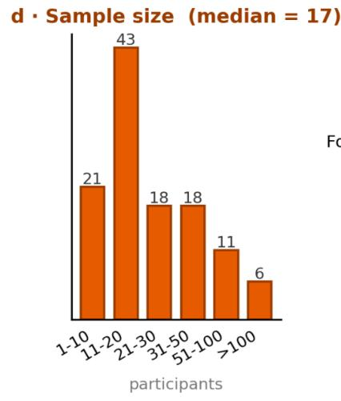
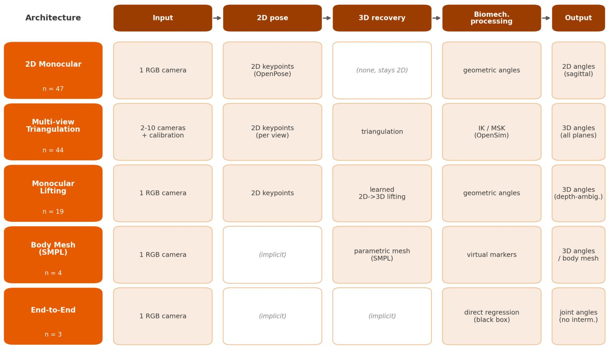
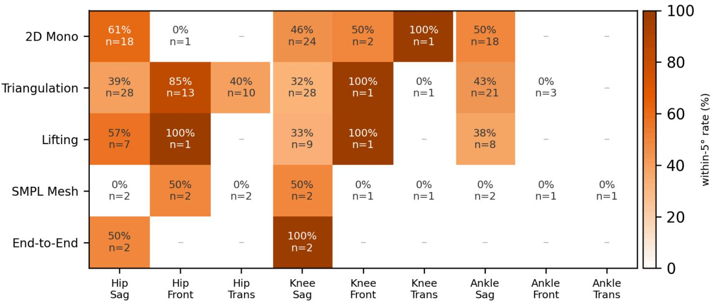

基于视频的无标记运动捕捉在临床与康复生物力学中的应用：关于已验证架构、临床就绪度与新兴方法的 PRISMA-ScR 范围综述

Florian Delaplace florian.delaplace@unice.fr

Laboratoire Motricité Humaine Éducation Sport Santé Elodie Piche Laboratoire Motricité Humaine Éducation Sport Santé

Frédéric Chorin

Centre Hospitalier Universitaire de Nice

Raphael Zory Laboratoire Motricité Humaine Éducation Sport Santé

## 研究论文

关键词：无标记运动捕捉（markerless motion capture）、姿态估计（pose estimation）、生物力学（biomechanics）、步态分析（gait analysis）、深度学习（deep learning）、范围综述（scoping review）、临床转化（clinical translation）、OpenSim

发布日期：2026 年 7 月 31 日

DOI：https://doi.org/10.21203/rs.3.rs-10431606/v1

许可协议：本作品采用 Creative Commons Attribution 4.0 International License（知识共享署名 4.0 国际许可协议）授权。阅读完整许可协议

附加声明：报告无利益冲突。

## 摘要

## 背景。

基于视频的无标记运动捕捉有望在不付出光电式系统的高昂成本、占用空间以及皮肤标记物限制的前提下实现运动分析，在临床与康复场景中具有尤为突出的应用潜力。然而，已验证的处理流程是否已能产出临床可接受的生物力学结果，以及它们与底层计算机视觉研究之间的关联，仍不清晰。

## 方法。

我们按照 PRISMA 范围综述扩展版（PRISMA extension for Scoping Reviews）开展了一项范围综述，已预先注册研究方案，并对 PubMed、Scopus 与 IEEE Xplore 进行了检索（时间范围为 2015 年 1 月至 2026 年 2 月；计算机视觉部分的检索更新至 2026 年 7 月）。我们采用双层设计，将以已验证生物力学研究为主的核心语料库与一个补充性的、经策展且刻意保持非穷尽性的计算机视觉语料库相配合，后者仅用于定性分析。我们对研究特征、处理流程架构、验证方法以及关节角度精度进行了梳理。

## 结果。

我们共纳入 117 项研究，其中大多数发表于 2024 年及以后，且以实验室中健康成人步行为研究场景。处理流程在单目与多摄像机模态下形成了五个架构家族；多数研究仅报告未经生物力学优化的原始关节角度。矢状面下肢的一致性集中在约 5° 至 6°，总体上尚未达到临床可接受水平；而离面运动学、动力学以及病理性或老年人群则很少得到验证。新兴的计算机视觉构件（基础模型网格重建、可微分逆运动学、基于视频的动力学）在已验证研究中几乎缺席。

## 结论。

基于视频的无标记捕捉目前尚不能与基于标记的系统在临床关节运动学中互换使用，而在康复最需要它的地方——老年人群与病患群体、离面运动学以及动力学——其验证仍极为匮乏。将这一证据缺口映射到新兴的计算机视觉进展之上，我们提出了用于生成假设的设计指南（而非一种经过验证的方法），旨在引导下一代流程朝着可及性强、具有临床意义的运动分析方向发展。

## 1. 背景

三维动作捕捉三十多年来一直是生物力学研究与临床步态分析的基石。光电子、基于标记的动作捕捉（marker-based motion capture, MBMC）系统（Vicon、Qualisys 与 OptiTrack）仍是关节运动学测量的实际黄金标准，在受控实验室条件下，其空间精度可达亚毫米级，关节角度精度可达亚度级，并已有文献记录 [1]。然而，其在高预算学术与临床研究实验室之外的推广应用仍受到三重障碍的制约：资金成本（每套系统数万至数十万欧元）、空间需求（配备受控照明的专用捕捉空间）以及运营开销（标记放置、软组织伪影、后处理工作量）。即便是一套调试良好的光电子系统，其精度边界也更多取决于软组织伪影（即皮肤标记相对于骨骼的运动），而非硬件本身 [2–3]；因此，去除皮肤标记正是基于视频方法的吸引力所在。

与此同时，过去十年间，仅基于 RGB 视频进行人体姿态估计的计算机视觉（computer vision, CV）技术——即所谓的"无标记动作捕捉"（markerless motion capture, MMC）范式 [4]——得到了迅速发展。从基础性的二维姿态估计器（OpenPose [5]、BlazePose [6]、HRNet [7]），到多视角三角测量流程（Pose2Sim [8]、OpenCap [9]），再到近期通过深度神经网络实现的单目三维重建（MotionBERT [10]、BioPose [11]、OpenCap Monocular [12]），该领域已产出一整套广泛的算法方法。潜在收益包括设备成本降低一至三个数量级、可在临床或家庭环境中部署，以及兼容科研与常规临床应用的工作流程。

然而，这一技术前景尚未转化为协调一致的临床现实。当前关于生物力学中无标记运动捕捉（Markerless Motion Capture, MMC）的文献表现出显著的异质性：不同的算法家族并存，对于特定临床或研究问题应选用何种架构尚无共识；各研究报告的精度指标跨越一个数量级；具有临床意义的关节平面（冠状面、水平面）相对于矢状面被系统性低报；针对病理群体的验证仍然稀缺。这些不足具有直接的临床意义。冠状面与水平面上的偏差——例如膝外翻、髋内旋、骨盆倾斜、画圈步态与剪刀步——恰恰是常见神经性步态障碍的特征 [13]，因此，即便是一条仅在矢状面上达到五至六度误差的流水线，也可能遗漏康复临床医生实际需要追踪的体征。此外，许多前沿的计算机视觉研究几乎仅出现在预印本平台（arXiv）及计算机视觉会议论文集中。将这些新发表的算法构件整合进流水线、依据参考标准进行验证、再将结果发表，整个过程都需要时间，因此预计在最新的计算机视觉进展抵达经过验证的生物医学文献之前，存在不可忽视的滞后。本综述即对这一预期加以考察。

该证据基础的广度、异质性与快速演进，使得 meta 分析式的综合既不切实际，也可能具有误导性：各研究在研究设计、报告指标、金标准设备及目标人群方面的差异，阻碍了推断性 meta 分析（加权效应量估计）的开展；因此，我们以描述性方式——采用中位数、范围与比例——汇总证据，而非对效应量进行合并。遵循 PRISMA-ScR（系统综述与 meta 分析扩展报告条目——Scoping Reviews 版）与乔安娜·布里格斯研究所（Joanna Briggs Institute, JBI）方法学框架开展的范围综述（Scoping Review），因此成为描绘该证据图景的更为适宜的工具。

以住关于无标记生物力学的综述主要是对各类架构进行编目并报告其精度 [4, 14]；仍存在两方面的缺失：一是缺少关于已通过临床验证的领域如何与日新月异的计算机视觉（computer vision）前沿相衔接的论述（后者将塑造下一代技术），二是缺少超越纯描述、迈向基于证据的具体设计方向的尝试。我们通过有意地搭建两座鲜有交集的文献——临床生物力学与计算机视觉——之间的桥梁，来同时回应这两个缺失。在常规的范围性综述之外，我们提出了双层设计。MACRO 层由对生物医学数据库（PubMed、Scopus、IEEE Xplore）进行的正式 PRISMA 筛选构成，并产出一组研究语料，这些研究已经针对外部生物力学金标准对 MMC 流水线进行了实证验证。MICRO 层则构成一个互补的、经策展的语料，来自两个来源：在系统检索中被筛除的已发表记录（因其仅涉及流水线中的单个组件，而非完整的验证流水线），以及对近期 arXiv 预印本和计算机视觉会议论文集的有针对性扫描，用以揭示支撑下一代 MMC 流水线的技术构件。MICRO 在设计上即不求穷尽，而是定性地加以使用，旨在识别并刻画新兴的技术族系，而非估计其体量，但它明确地弥补了预印本时代的 CV 研究与其最终被生物医学数据库收录之间存在的结构性时滞。

本范围性综述围绕两个研究问题展开。

RQ1（MACRO）：目前已发表的、用于生物力学分析的基于视频的无标记动作捕捉流水线，其架构、验证结果及临床适用性如何？

RQ2（MICRO）：通过刻意非系统的前沿扫描加以刻画，计算机视觉文献（2024–2026）中正在出现的、可能塑造下一代 MMC 流水线但尚未进入同行评审生物医学出版物的技术构件有哪些？

综合两者，我们进而提炼出一套面向临床可部署无标记流水线的、基于证据的设计指南，覆盖两种部署形态（单目、单摄像头、可在诊所或现场部署；以及多摄像头、实验室级），将来自已验证 MACRO 研究的实证经验与来自 MICRO 的技术现状相结合。这第三条主线刻意面向未来：以展望与研究议程的形式呈现，提供扎根于本综述所记录的空白、以启发假说为指向的方向，而非作为一种已验证的方法。

## 2. 方法

## 2.1 研究设计与方案

本范围综述依据 PRISMA-ScR 指南 [15] 以及 JBI 范围综述方法学框架 [16] 实施。综述方案已在开放科学框架（Open Science Framework, OSF, doi: 10.17605/OSF.IO/TBYPC）前瞻性注册；完整的 PRISMA-ScR 检查清单见附加文件 1。选择范围综述而非系统综述基于两点考量：第一，所纳入文献在研究设计、验证方法学以及报告指标方面存在显著异质性，无法进行有意义的荟萃分析合并；其次，本研究的明确目标是描绘并刻画快速演进的证据全景，包括其新兴的技术边缘地带，而非估计合并效应量。

## 2.2 信息来源与检索策略

我们检索了三个生物医学与工程数据库（PubMed、Scopus 和 IEEE Xplore），检索发表时间为 2015 年 1 月至 2026 年 2 月的研究，最后一次数据库检索执行于 2026 年 2 月 4 日。检索策略结合了受控词汇（PubMed 使用 MeSH 主题词）和涵盖无标记运动捕捉、基于视频的姿态估计以及生物力学验证的自由词。完整检索式见附加文件 2（附录 A）。

为补充正式的生物医学检索，我们将系统综述与一项算法地平线扫描相结合：另设一个有意为之、非穷尽性的 MICRO 语料库（MICRO corpus），用于汇集新兴的计算机视觉工作。该语料库有两个来源：系统检索中仅涉及单一流水线组件的筛选记录，以及对近期计算机视觉文献的定向扫描，主要包括 arXiv（主要为 cs.CV 类别）以及主要视觉与学习会议（CVPR、ICCV、ECCV、WACV、NeurIPS）的论文集，时间范围限定在 2024–2026 年，以捕获尚未被生物医学数据库收录的方法。其构建细节见第 2.6 节。MICRO 语料库以定性方式使用，旨在揭示技术构件与新兴方法族，而非估计其流行程度。计算机视觉扫描与系统检索分开进行，并更新至 2026 年 7 月，晚于 2026 年 2 月的生物医学检索截止日期，因此少量近期预印本晚于 MACRO 检索（MACRO search）。

## 2.3 纳入标准

纳入资格采用人群-概念-情境（Population-Concept-Context, PCC）框架进行阐述，并为 MACRO 语料库（MACRO corpus）明确了具体的纳入与排除标准。

## 纳入标准

研究的纳入标准如下：（i）评估了基于视频输入（单目或多目相机）的无标记运动捕捉流程；（ii）报告了相对于外部生物力学参考标准的定量验证（Vicon、Qualisys、OptiTrack、BTS/MIQUS、Motion Analysis、Nokov 或同类光电动作捕捉系统；用于动力学测量的测力台；或在少数情况下的仪器化 IMU 系统）；（iii）报告了经验性的关节角度、时空或动力学精度指标（RMSE、MAE、相关系数或 ICC）；（iv）聚焦于生物力学运动分析，而非通用姿态检测或行为识别。

## 排除标准

应用了八项预先设定的排除标准（A-H）：

1. A. 黑箱系统：商业化或专有流程的姿态估计模型未被识别或披露，例如 Theia3D、Captury 和 KinaTrax。排除这些系统是因为其姿态估计模型无法被刻画或复现，尽管 Theia3D 尤其是在临床上应用最广泛的无标记系统之一；在此项中排除了十一项研究。

2. B. 无现代计算机视觉：仅采用人工数字化或经典（非深度学习）计算机视觉方法。

3. C. 深度传感通道：以深度或 RGB-D 模态（例如 Kinect）作为主要三维机制的研究予以排除，因为本综述关注的是 RGB 视频流程，尽管此类设备在康复门诊中仍然常见。

4. D. 无原始数据的综述：综述类研究，未包含原始数据。

5. E. 非无标记：将附着于身体上的物理标记物作为流程输入的研究。

6. F. 仅以人工方式作为金标准：验证对照为 Kinovea、关节角度计、视频人工标注或同类人工参考。

7. G. 无生物力学输出：仅报告中间指标（平均逐关节位置误差，MPJPE，其评估关键点位置而非关节角度），未报告关节角度、时空参数或动力学指标。

8. H. 无外部金标准：仅报告内部重测信度，未与独立的参考系统进行比较。

无论验证状态如何，只要研究涉及流程处理中的至少一个组件（二维姿态估计、三维提升、三角测量、网格恢复、逆运动学、步态事件检测、时序建模、物理信息方法或信号处理），均会被纳入 MICRO 语料库的考量范围。

## 2.4 研究筛选流程

标题与摘要筛选以及全文评估均依据纳入标准由两名评审者独立完成，使用 Covidence 系统综述软件进行管理。两个阶段的任何分歧均由第三名资深评审者裁决。全文排除被归入宽泛的原因类别（错误的技术、验证、结局、文献类型、研究人群或未能获取报告），而通过全文审查但在数据提取核查阶段未能满足预先设定的 A-H 标准的研究，则在该后续阶段被排除（图 1）。

## 2.5 数据提取

我们在 Microsoft Excel 中开发了一个结构化提取模板，包含 7 个工作表和 90 余个数据字段，分布于六个领域：

一般特征（研究 ID、完整标题、第一作者、年份、论文类型、样本量、受试者人口统计学信息、目标人群、运动任务、衣物）。

视频输入规格（相机数量、布置位置、相机类型、分辨率、采集频率、校准流程、同步方式、环境）。

计算机视觉处理（二维姿态算法、主干网络架构、训练方案、训练数据集、三维重建方法、流程名称、遮挡处理、滤波、标记点增强、实时性能）。

生物力学处理（生物力学软件、运动学方法、骨骼模型、缩放流程、动力学/力的计算）。

全局与时空验证（金标准系统、已验证的结果类别、报告的指标、全局运动学误差与相关性、时空误差、作者结论）。

关节层面验证（逐关节 × 逐平面 RMSE 与相关性：骨盆、髋、膝、踝 × 矢状面、额状面、水平面）。

第七个工作表将各研究的架构分类综合为分析中所用的五大家族分类法。

## LLM 辅助的数据提取

数据提取由作者完成，大语言模型仅作为辅助性的差错浮现步骤使用，而非作为记录的来源。第一作者定义了结构化模板（117 项研究中约 90 个字段）。为加快从异构来源（自由文本、表格、图表、扫描版 PDF）中进行模板首轮填充的速度，每项研究均由一个大语言模型（Claude Opus 4.7）进行处理。随后由来自另一厂商的第二个模型（Google Gemini）独立地重新提取并交叉核对，两位作者针对两者之间的每一处差异，依据源 PDF 进行裁定。在裁定之前，两个模型在约 10,500 个字段中的 156 个字段上存在分歧（117 项研究共涉及约 90 个字段），原始一致率约为 98.5%。未计算单一的概率校正一致性系数，因为模板混合了数值型、分类型和自由文本型字段。在所有核对环节中，共应用了 385 处单元格级别的更正（多于 156 处模型分歧，因为有些错误为两个模型共有，仅在与源 PDF 比对时才被发现），这些更正主要为数值转录错误以及单关节或单平面错位，其中较小比例为架构或金标准的分类错误。另有两处模型引用了所引早期研究中的数值而非本文本身的数值的情况也被识别并更正。作为最终的内部一致性检查，第一作者使用计算机随机数生成器随机选取了 20% 的纳入研究，直接从源文档中手动重新提取数据；该样本中的所有字段均与表格完全一致（数值与分类标签均相同）。此最终环节并非独立于主要提取过程；其独立性依赖于上文所述的跨厂商双模型裁定。因此，所列数值为机器辅助、但经人工核验，且作者对所提取的数据集负责。

## 2.6 数据综合

综合分析按三个层级进行。

## 描述性分析

首先从时间趋势、人群特征、样本量、运动任务以及采集环境等方面对 MACRO 语料库进行了特征描述。

架构映射。117 项 MACRO 研究被归入一个五类架构分类体系：2D 单目（2D Monocular）、多视图三角化（Multi-view Triangulation）、单目 2D 提升至 3D（Monocular Lifting 2D→3D）、人体网格恢复 / SMPL（Body Mesh Recovery/SMPL）、端到端直接法（End-to-End Direct），并附加五个非互斥的叠加变体：+IK/MSK、+标记点增强（Marker Augmentation）、+时序深度学习（Temporal Deep Learning）、+物理（Physics）、仅几何法（Geometric Only）。对每个类别，我们报告其技术构成（骨干网络、姿态估计器、生物力学软件）的分布以及按关节和解剖平面的验证结果。关节角度误差以 McGinley 误差区间（2° 以内可接受，2 至 5° 较为合理，超过 5° 可能产生误导）作为临床相关基准进行汇总。

技术解构。MICRO 语料库分两步构建。首先，在数据库筛选过程中识别出的那些仅描述单一流水线组件、而非经过金标准验证的完整流水线的记录（排除标准 F 和 G）被保留，并归入 17 个流水线步骤分块（3D lifting、mesh recovery、2D pose、physics-informed methods、triangulation、gait events、depth、IK solvers、filtering、motion prediction、marker augmentation、tracking、musculoskeletal modelling、temporal smoothing、foundation models、kinetics 以及 calibration；图 6，第 3.4 节）。其次，我们在每个分块内进一步检索，瞄准近期的 arXiv 预印本和计算机视觉会议论文（2024–2026 年），以捕捉生物医学筛选中缺失的新兴最先进方法；随后将每种新兴方法追溯到它能够升级的 MACRO 架构族。因此，MICRO 语料库是经过精心策划的，并且刻意保持非穷举。arXiv (cs.CV) 和会议检索的截止时间为 2026 年 7 月；完整的记录列表、每个条目的来源以及各分块的计数（Additional file 6）见 Additional file 5。该 MICRO 检索在 PRISMA-ScR 范围之外，后者仅管辖系统性的 MACRO 语料库。完整的构建协议及各分块可复现的查询见 Additional file 7。

最后，MACRO-MICRO 桥接分析针对五个架构族中的每一个，明确了 MICRO 语料库中相应的技术构件，以及经过验证的生物医学文献与新兴 CV 最先进技术之间的主要分歧点（第 3.5 节）。

## 3. 结果

## 3.1 纳入语料库的描述

在三个数据库中识别出的 9,346 条记录中，移除了 2,294 条重复，并对 7,052 条标题和摘要进行了筛选；排除了 6,659 条，并对 393 篇全文报告进行了评估，其中 237 篇在全文阶段被排除，另有 39 篇在针对标准 A-H 的数据提取验证中被排除，最终得到 117 项纳入研究（图 1）。117 项纳入研究的时间跨度为 2015 年 1 月至 2026 年 2 月；各研究的具体特征见 Additional file 3。近期发表速度加快：约六成研究发表于 2024 年及之后（图 2a）。

证据基础较为狭窄。参与者绝大多数为健康成年人。临床或病理人群（卒中、帕金森病、脑瘫、脊髓损伤）仅出现在少数研究中（约 19%），而儿童或老年队列则更为罕见（图 2b）。步态是主要的运动任务，存在于超过一半的语料库中；跑步、坐起、跳落和蹲起占其余的大部分（图 2c）。样本量较小，中位数为 17 名参与者（图 2d）。人口学偏差和较小的样本量限制了个体验证研究的普适性。

验证几乎总是使用光电标记系统（optoelectronic marker-based system）作为参考（约占 83% 的研究；图 2e）。仪器化步道（instrumented walkways）、测力台（force plates）和公开数据集覆盖其余部分。数据采集仍以实验室为基地：117 项研究中有 100 项在实验室进行，16 项在临床运动分析室进行，家庭或户外采集几乎缺失（各为一项研究和零项）。因此，在光学实验室之外进行运动学分析时，缺乏经过验证的证据。

技术配置证实了研究原型阶段（表 1）。45% 的研究使用单相机采集，29% 使用双相机，使用机器视觉相机（machine-vision cameras，40%）或消费级智能手机（consumer smartphones，26%）。近一半的研究（53 项）未进行标定，其余使用棋盘格（checkerboard）标定。二维姿态估计约有半数研究依赖 OpenPose 系列，其中包含 OpenCap 部署，其二维后端（默认使用 OpenPose，或可选 HRNet）通常未被报告。其次是 MediaPipe 和 BlazePose [6]。三维重建在多视图三角测量（multi-view triangulation）和纯二维分析之间几乎平分。单目升维（monocular lifting）、网格拟合（mesh fitting）和端到端回归（end-to-end regression）各占较小份额。63% 的研究使用自定义代码（Python 或 Matlab）进行生物力学处理，略超过四分之一的研究（33 项）使用基于 OpenSim 的建模，其中 13 项使用了即用型 OpenCap 智能手机流程，20 项直接使用 OpenSim。117 项研究中有 8 项（7%）报告了实时运行（realtime operation）。离线后处理（offline post-processing）是常态。

表 1  
纳入文献语料库的技术配置（n = 117）。

<table><tr><td>Variable / category</td><td>n (%)</td></tr><tr><td>Number of cameras</td><td></td></tr><tr><td>1</td><td>53 (45%)</td></tr><tr><td>2</td><td>34 (29%)</td></tr><tr><td>3-4</td><td>13 (11%)</td></tr><tr><td>5-9</td><td>11 (9%)</td></tr><tr><td>&gt;=10</td><td>4 (3%)</td></tr><tr><td>Benchmark / varies</td><td>2 (2%)</td></tr><tr><td>Camera type</td><td></td></tr><tr><td>Industrial / machine-vision</td><td>47 (40%)</td></tr><tr><td>Smartphone</td><td>30 (26%)</td></tr><tr><td>Webcam</td><td>14 (12%)</td></tr><tr><td>Action cam / DSLR / RGB</td><td>16 (14%)</td></tr><tr><td>Other / not reported</td><td>5 (4%)</td></tr><tr><td>Tablet</td><td>5 (4%)</td></tr><tr><td>Calibration</td><td></td></tr><tr><td>None (monocular)</td><td>53 (45%)</td></tr><tr><td>Checkerboard</td><td>38 (32%)</td></tr><tr><td>Other / not specified</td><td>20 (17%)</td></tr><tr><td>Bundle adjustment / dot-matrix</td><td>3 (3%)</td></tr><tr><td>Wand</td><td>3 (3%)</td></tr><tr><td>2D pose estimator</td><td></td></tr><tr><td>OpenPose / OpenCap family</td><td>57 (49%)</td></tr><tr><td>MediaPipe / BlazePose</td><td>17 (15%)</td></tr><tr><td>Other named DL detectors (AlphaPose, YOLO, PifPaf, HRNet, MMPose, Detectron2, ViTPose...)</td><td>17 (15%)</td></tr><tr><td>Custom / unspecified DL</td><td>7 (6%)</td></tr><tr><td>DeepLabCut</td><td>6 (5%)</td></tr></table>

<table><tr><td rowspan=1 colspan=1>Variable / category                                                                                                       n (%)</td></tr><tr><td rowspan=1 colspan=1>None / end-to-end                                                                                                        5 (4%)</td></tr><tr><td rowspan=1 colspan=1>Proprietary / SDK                                                                                                          5 (4%)</td></tr><tr><td rowspan=1 colspan=1>Multi-estimator benchmark                                                                                            3 (3%)</td></tr><tr><td rowspan=1 colspan=1>Architecture (3D recovery)</td></tr><tr><td rowspan=1 colspan=1>2D Monocular (no explicit 3D)                                                                                        47 (40%)</td></tr><tr><td rowspan=1 colspan=1>Multi-view triangulation                                                                                                 44 (38%)</td></tr><tr><td rowspan=1 colspan=1>Monocular lifting (2D-&gt;3D)                                                                                             19 (16%)</td></tr><tr><td rowspan=1 colspan=1>Body mesh / SMPL                                                                                                       4 (3%)</td></tr><tr><td rowspan=1 colspan=1>End-to-end / direct                                                                                                        3 (3%)</td></tr><tr><td rowspan=1 colspan=1>Biomechanical software</td></tr><tr><td rowspan=1 colspan=1>Custom code (Python/Matlab)                                                                                       74 (63%)</td></tr><tr><td rowspan=1 colspan=1>OpenSim-based modelling                                                                                             33 (28%)</td></tr><tr><td rowspan=1 colspan=1>via OpenCap (smartphone app)                                                                                      13 (11%)</td></tr><tr><td rowspan=1 colspan=1>OpenSim directly                                                                                                           20 (17%)</td></tr><tr><td rowspan=1 colspan=1>None (2D angles)                                                                                                          8 (7%)</td></tr><tr><td rowspan=1 colspan=1>Other MSK (Visual3D, CusToM, AnyBody)                                                                        2 (2%)</td></tr><tr><td rowspan=1 colspan=1>Real-time capability</td></tr><tr><td rowspan=1 colspan=1>No (post-process)                                                                                                        192%)</td></tr><tr><td rowspan=1 colspan=1>Yes / near real-time                                                                                                       8 (7%)</td></tr><tr><td rowspan=1 colspan=1>Not specified                                                                                                                2 (2%)</td></tr></table>

## 3.2 核心流水线架构

每条流水线归属于五种互斥的架构族（architectural family）之一，并按部署模态（modality）进行分组（图 3）。全程严格区分三个术语：模态（modality，指从单个视角即单目，或从多个同步视角进行重建）、架构族（family，上述五种架构之一），以及叠加层（overlay，任何架构族都可附加的可选精化模块）。单目模态汇集了四个架构族，它们的主要区别在于如何到达三维：二维单目（2D Monocular）直接从二维关键点计算关节角度（47 项研究，占 40%）[17–63]；单目提升（Monocular Lifting）从这些检测结果回归三维姿态（19 项，占 16%）[64–81, 86]；人体网格恢复（Body Mesh Recovery）则拟合参数化的全身网格而非稀疏骨架（4 项，占 3%）[11, 82–84]，其代表性工作 BioPose [11] 是一篇通过 IEEE Xplore 检索到的、经同行评审的 WACV 2025 论文；端到端直接回归（End-to-End Direct）则直接从图像回归关节角度（3 项，占 3%）[85, 87–88]。多相机模态以多视角三角化（Multi-view Triangulation）为主导，它通过对来自多个已标定相机的射线求交来重建三维关节位置（44 项，占 38%）[8–9, 89– 130]。两种模态在数量上有所不同（73 项对比 44 项研究），更重要的是能力上也存在差异（第 3.3 节）。模态与物理相机数量并不等同。许多单视角流水线仅将额外相机用于对比或标定，而有一项端到端研究使用了多视角输入，因此架构族按架构而非相机数量来划分（表 1）。

二维单目与三角化已得到充分确立，且仍在持续增长（自 2024 年起分别有 27 项和 30 项研究）。单目提升出现在 2021 年之后，并正在持续扩展。网格恢复则是最新的入局者：所有基于 SMPL 的研究都出现在 2024 年或之后。端到端回归曾短暂出现，但未能持续。三角化研究近期的增长得益于 Pose2Sim 与 OpenCap 等即用型多视角工具的发布。

架构（architecture）是一个共享的流程骨架，可以在其上添加可选的精炼模块，而非一个固定的方法。共编码了五种非互斥的叠加层：肌肉骨骼建模驱动的逆运动学（inverse kinematics）、虚拟标记增补（virtual-marker augmentation）、深度学习时序平滑、基于物理的优化，以及动力学输出（地面反作用力或关节力矩）。大多数流程几乎不做精炼。近三分之二（117 项中的 73 项）不使用任何叠加层，仅报告原始几何角度，只有 28 项结合了两种或更多叠加层。精炼主要集中在多视角类中。肌肉骨骼建模驱动的逆运动学是最常见的叠加层（36 项研究，占 31%），并被 44 项三角测量研究中的 27 项所采用，这类研究也几乎囊括了所有虚拟标记增补流程（OpenCap 模式）。相比之下，47 项 2D 单目研究中的 46 项仍仅停留在几何层面，而基于 OpenSim 的使用（包括 OpenCap）几乎仅限于三角测量。因此，严肃的肌肉骨骼建模坐落于多相机一侧，而单目一侧尽管具有最大的部署潜力，却大多止步于原始的二维角度。

## 3.3 计量学验证

## 3.3.1 参考标准

约 83% 的研究以基于光电标记（optoelectronic marker-based）的系统作为参照进行验证，最常用的是 Vicon、Qualisys、OptiTrack、BTS 或 Nokov。少数研究使用了仪器化步道（GAITRite、Zeno/PKMAS）、测力台、公开的动作捕捉数据集，或在极少数情况下使用平面 X 射线摄影。这些参考系统本身并非无误：它们携带软组织伪影（soft-tissue artefact），即皮肤标记相对于骨骼的移动 [2]，这为任何无标记系统与之比对的一致性设定了上限。尽管如此，光电捕获仍然是生物力学的实际参考标准（de facto reference standard）。一项最近的无标记研究甚至发现其自身的不一致性至少与该伪影一样大 [117]，因此这两种范式在精度上无法被干净地分离。

## 3.3.2 关节角度精度与临床阈值

矢状面下肢一致性在髋、膝、踝和骨盆处聚集在约 5 至 $6 ^ { \circ }$ 的中位绝对误差附近，四个关节彼此相差均在约一度以内（表 2）。研究间离散度较大（四分位距约为 3 至 8°）。我们以 McGinley 等人针对三维步态运动学提出的误差范围作为基准：$2 ^ { \circ }$ 及以下的误差通常被认为可接受，2 至 $5 ^ { \circ }$ 的误差属合理范围但在解读时需要加以考量，而 $5 ^ { \circ }$ 以上的误差则可能误导临床判断 [131]。这些指标基于标记点系统的可靠性得出。由于参考系统自身也带有可重复性误差，在矢状面之外其本身误差即可接近 $5 ^ { \circ }$，因此接近此量级的一致性部分上受限于参考系统本身的噪声，应理解为尚未达到基于标记点的可靠性水平，而非临床不可用。可接受误差并非一个固定常数，它取决于临床问题以及所测量偏差的幅度，因此我们报告的是一个区间而非单一阈值。仅在矢状面下肢估计中，约 6% 落入 $2 ^ { \circ }$ 可接受带，约 37% 落入 2 至 $5 ^ { \circ }$ 合理带；而分别来看，约半数矢状面下肢估计仅按均方根误差计算即超过 $5 ^ { \circ }$（中位数 5.0°），约半数仅按平均绝对误差计算亦超过 $5 ^ { \circ }$（中位数 5.0°）。汇总所有报告指标后得到相近的比例（约 57%）。这正是 McGinley 等人所认为的误差可能误导临床判断的临界水平（图 5）。需要关注的并非具体比例，而是这一规律本身：即便在表现最佳的情况下，多数已发表流程仍超出 $5 ^ { \circ }$ 的警戒水平。从康复学角度看，五至六度的误差与临床医师在康复或治疗调整过程中试图追踪的运动学变化处于同一量级，例如脑瘫患儿蹲伏步态的逐步改善，或脑卒中后僵膝与划圈步态的缓解，因此处于此误差水平的仪器可能掩盖真实的临床变化。

## 3.3.3 不同架构的准确性

我们按架构家族（architecture family）绘制了矢状面误差（图 4）。样本量最大的两个家族——二维单目（2D Monocular，$( \mathsf { n } = 4 7 )$）和多视角三角测量（Multi-view Triangulation，n=44）——表现相近，下肢误差中位数约为 4 至 $6 ^ { \circ }$ 。单目提升（Monocular Lifting，n=19）表现较差，下肢误差中位数约为 6 至 $7 ^ { \circ }$ ，且研究间的离散度最大。这与深度歧义性一致：单相机无法完全解析朝向或远离 ${ \mathrm { i t } }$ 的运动，因此从单一视角回归三维位姿本质上难于从多个已标定视角进行三角测量。身体网格恢复（Body Mesh Recovery）和端到端直接法（End to-End Direct）各自仅有四篇或更少的研究，不足以进行比较，仅以描述性方式绘制。没有任何家族在中位数水平上达到 $2 ^ { \circ }$ 的可接受区间，因此临床精度差距是整个领域的共性，而非某一薄弱架构所致。

## 3.3.4 平面覆盖度与矢状面报告偏倚

主要局限既在于所报告的内容，也在于能够测量的内容本身。面外运动学几乎仅由多视角家族提供，原因有二：二维单目家族根本无法恢复面外旋转，因为它不产生三维估计；而单目三维家族与三角测量虽能恢复面外旋转，却大多未予报告。在架构 × 关节 × 平面映射图（Additional file 4）中，额状面与横断面单元格主要由三角测量方法填充（例如髋部额状面 n=13、髋部横断面 n=10），而每个单目家族仅填充单一的矢状面列。报告的不平衡程度显著。以膝关节为例，65 项研究报告了矢状面误差，而额状面仅 5 项、横断面仅 3 项；髋关节（57 / 17 / 12）和踝关节（49 / 4 / 1）也呈现相同模式。即便存在额状面与横断面数值，它们也更稀少且更大（例如踝关节额状面约 9°）。与多项临床问题最相关的平面——包括膝关节内外翻、髋关节旋转以及足部推进——恰恰是验证最少的平面。

## 3.3.5 时空与动力学验证

时空参数（步速、步长、步时）在约三分之一（34%）的研究中得到了验证，且一致性优于关节角度，反映其对关键点噪声的敏感性较低。仅九项研究报告了与测力板相关的动力学验证（地面反作用力或关节力矩）。该领域的验证主要集中在下肢矢状面运动学。面外运动学和动力学在很大程度上仍未得到检验，3.4 节和 3.5 节将进一步展开讨论。

Table 2  
按解剖平面划分的关节角度验证（与光电参考系统的一致性绝对值）。

<table><tr><td>Joint</td><td>Plane</td><td>n studies</td><td>Median (errorl (°)</td><td>IQR (°)</td><td> $\leq 5 ^ { \circ } \left( \% \right)$ </td></tr><tr><td>Pelvis</td><td>Sagittal</td><td>5</td><td>5.2</td><td>3.4-6.1</td><td>40</td></tr><tr><td>Pelvis</td><td>Frontal</td><td>3</td><td>4.0</td><td>2.0-4.9</td><td>一</td></tr><tr><td>Pelvis</td><td>Transverse</td><td>3</td><td>3.1</td><td>2.0-3.3</td><td>一</td></tr><tr><td>Hip</td><td>Sagittal</td><td>57</td><td>5.5</td><td>3.6-7.1</td><td>47</td></tr><tr><td>Hip</td><td>Frontal</td><td>17</td><td>4.3</td><td>3.0-5.2</td><td>76</td></tr><tr><td>Hip</td><td>Transverse</td><td>12</td><td>5.7</td><td>4.4-7.0</td><td>33</td></tr><tr><td>Knee</td><td>Sagittal</td><td>65</td><td>5.6</td><td>3.7-7.0</td><td>40</td></tr><tr><td>Knee</td><td>Frontal</td><td>5</td><td>4.8</td><td>3.1-12.8</td><td>60</td></tr><tr><td>Knee</td><td>Transverse</td><td>3</td><td>5.9</td><td>2.4-9.5</td><td>一</td></tr><tr><td>Ankle</td><td>Sagittal</td><td>49</td><td>5.9</td><td>3.6-8.4</td><td>43</td></tr><tr><td>Ankle</td><td>Frontal</td><td>4</td><td>9.0</td><td>5.9-10.3</td><td></td></tr><tr><td>Ankle</td><td>Transverse</td><td>1</td><td>11.1</td><td>n/a</td><td>一 一</td></tr><tr><td colspan="2">widespread reporting heterogeneity; per-metric breakdowns are provided in Additional file 3. Restricting to the two principal metrics leaves this shortfall unchanged: about half of sagittal lower-limb estimates exceed 5° under root-mean-square error alone (median 5.0°) and under mean absolute error alone</td><td>Note: marked under-reporting outside the sagittal plane (e.g. knee: 65 sagittal vs 5 frontal vs 3 transverse). The final column reports the proportion within the 5° error level (McGinley acceptable-to- reasonable range; see Section 3.3.2). Cells based on fewer than five studies are indicative only. Reported agreement metrics pool bóth root-mean-square error and mean absolute error owing to</td><td></td><td></td><td></td></tr></table>

为识别下一代流程背后的计算机视觉构件，我们组装了包含 572 条 arXiv 与会议记录的互补 MICRO 语料库，并将其归入 17 个流程步骤模块。由于该语料库是经人工策展而非系统性构建的（方法），因此图 6 以相对活跃度（低、中或高）而非原始计数来刻画每个模块，并且我们不给出 MACRO 与 MICRO 的比例。

有一个定性信号值得注意，但仍需谨慎对待。我们筛查到的记录集中在 2024 与 2025 年，而基础模型（foundation model）模块几乎全部出现在 2024 年之后。由于该语料库是经策展并通过反向引用进行种子的，这种时间上的近新性在一定程度上反映了我们的抽样方式，而非领域本身的状况，因此我们仅将其视为一条关于新计算机视觉方法与它们在已验证的生物医学工作中被采用之间存在延迟的粗略、定性线索，而非一个被测度的时间间隔。更明确的证据是这些新兴模块在已验证语料库中的近乎缺席（第 3.5 节）。

若将现有方法视作一个映射到流水线各阶段的工具箱（图7；完整方法列表、各自所针对的环节、所做贡献与成熟度见Additional file 5），则最先进方法几乎为每个模块都提供了候选升级方案[132–150]。在输入环节，单目度量深度（monocular metric-depth）与三维几何模型以及无靶标多相机自标定（multi-camera self-calibration）正在走向成熟[174–176]；借助相机运动、重力或学得的视场线索进行世界坐标系对接（world-grounding），有助于由单个相机以度量尺度确定被试在世界中的位置，这一问题至今仅被部分解决[133, 177]。在二维姿态方面，实时与Transformer主干网络[151–153]正在取代统治MACRO语料库的OpenPose那一代方法。三维恢复领域则有多类方法并存：单目升维（lifting）[10, 154]；基于SMPL家族的foundation-model网格恢复[155–157, 172]，它将流水线围绕一个稠密参数化网格重新组织，并可获得解剖标志点[158]；全身网格到角度（mesh-to-angle）的逆运动学[171]；多人与多视图网格拟合[169, 173]；以及到OpenSim的经典三角化方法[8]。在生物力学桥接环节，虚拟标志点增强（virtual-marker augmentation）[159]与可微分或神经逆运动学（differentiable or neural inverse kinematics）[160–162]，以及缩放与逆动力学（inverse dynamics）[168]正在涌现。动力学模块在姿态估计的下游，通过物理驱动或学习模型估算地面反作用力与关节力矩[163]，其输出是MACRO文献中很少验证的内容。在重建之上，一个包含多模态生物力学基础模型（foundation models）[146]与逐自由度不确定性量化[164]的分析层开始浮现，以满足临床部署的可靠性要求。若干接近完整的流水线组合了上述模块，而非引入新模块：BioPose[11]、OpenCap Monocular[12]以及Portable Biomechanics Laboratory[170]，其中最后一项报告了由手持视频所得、其作者描述为临床可接受的吻合度。

## 3.5 MACRO-MICRO的桥梁

将五个已验证家族映射到新兴模块上（图8），便可逐家族地描绘转化前沿。只有多视图三角化正在主动引入新兴模块：经由OpenCap谱系，它已采纳虚拟标志点增强以及结合肌肉骨骼建模的逆运动学，且有少数研究向视频动力学方向延伸。四个单目家族除了二维姿态估计与直接几何角度计算之外，几乎没有引入新方法。纵观全部五个家族，网格恢复、可微分逆运动学、视频动力学与以人为中心的基础模型（human-centric foundation models）基本上处于缺位状态。因此，该图的右侧近乎空白：那些最有可能改变临床能力的模块恰恰是最未被采纳的。

四个空白板块界定了这一差距。首先，基础模型网格恢复（foundation-model mesh recovery）能够为单目流程提供密集的、具备解剖学可寻址性的表征，但在已验证研究中尚不存在。其次，可微与神经逆运动学（differentiable and neural inverse kinematics）将取代脆弱的事后逆运动学，目前仅在 MICRO 中出现。再次，从视频中获取动力学（kinetics from video）是受关注最少的 MACRO 输出（见第 3.3.5 节），却是 MICRO 中活跃的研究板块。第四，以人为中心的基础模型尚未在已验证工作中使用。这些板块共同构成了一条以网格为中心的单一流程，并界定了第 5 节所提框架的设计空间。

## 4. 讨论

## 4.1 主要发现总结

本范围综述将视频无标记运动捕捉在生物力学领域的已验证文献（MACRO 语料库）与新兴的计算机视觉前沿技术（策展后的 MICRO 语料库）进行了比较。五项发现值得关注。该领域尚处年轻阶段但发展迅速，大多数纳入研究发表于最近两年。其证据基础较为狭窄：受试者多为健康成人，在实验室中以步态为任务开展研究，样本量小，几乎没有实时或实验室外的应用。方法上可归为两大模态（单目与多相机）下的五个架构家族，但大多数流程不进行生物力学细化，仅报告原始几何角度。计量学性能未能达到该领域所宣称的与基于标记方法相当的水平：矢状面下肢一致性通常超过 McGinley 等人所关联的"可能导致临床误判"的误差水平，而离平面运动学与动力学则鲜有验证。最有可能改变这一局面的基础模块——即基础模型网格恢复、可微逆运动学与视频动力学——在计算机视觉中十分活跃，但在已验证的生物力学工作中几乎完全缺失，这与计算机视觉创新与其在生物医学中经过验证的采纳之间存在预期滞后期相符。

## 4.2 按模态划分的成熟度与临床转化

两种模态在部署便捷性与计量学完整性之间存在权衡。多视角三角测量是通向完整三维生物力学更为成熟的路线。它是唯一常规报告额状面与水平面运动学的家族，并集中了逆运动学与肌肉骨骼流程，尤其是使关节角度具有可解释性的 OpenCap 系列方法。它仍局限于实验室，且需要若干台经过同步与标定的相机。单目模态使用单一相机且无需标定，在临床现场具有远为出色的部署性。然而，大多数二维单目研究止步于原始几何角度（第 3.2 节），且单目提升至三维所表现的误差最大（下肢误差中位数约为 6 至 7°）。因此，临床可接受性的差距属于整个领域，而非某一薄弱架构独有。步速等时空参数则高度一致

与参考系统相比较，但论点更狭窄：与基于标记点的关节运动学可互换的论断对于大多数流程而言仍为时过早。

## 4.3 动力学：下一个前沿

经过验证的文献中服务最欠缺的输出是动力学。地面反作用力与关节力矩与关节负荷、平衡及跌倒风险的联系最为直接，但仅有九项研究针对力板对其进行了验证。可以说，动力学比单纯的运动学更具临床可操作性。一个新兴的 MICRO 模块（MICRO block）正好瞄准了这一空白：从视频中以基于物理信息与学习的方法估计力与力矩；生成式基础模型现已能够以接近实验室的准确度从运动学估计地面反作用力 [163]。首批单摄像头到肌肉骨骼动力学的流水线也已出现 [12]。因此，免力板动力学仍是一个早期且尚未经验证的方向。其潜在临床价值高于矢状面关节角度精度的渐进式提升，但验证成本也显著更高，因为它在运动学误差之上又叠加了逆动力学建模误差，并且最难在稳态步态之外进行验证。

## 4.4 经过验证文献中的空白

三大空白界定了转化前沿。其一是平面覆盖度。离平面运动学鲜有报告（以膝关节为例，矢状面 65 项对比冠状面 5 项对比水平面 3 项），因此与许多临床问题最相关的测量反而最缺乏验证，而且即便有报告，其误差也更大。其二是人群。临床与病理性队列少见，老年人与儿童队列更为罕见，尽管这些群体本可从可及的运动分析中获益最多。其三是运行条件。实时分析（7% 的研究）与家庭或现场采集（几乎缺失）在很大程度上仍未得到解决，尽管二者是走出实验室进行分析的前提条件。弥补这些空白比进一步基准化健康成人的矢状面步态更为优先。

## 4.5 本综述的优势与局限

综述具有两个主要优点。它将一份已注册的 PRISMA-ScR 方案与跨三个数据库的广泛检索相结合，并采用双层设计，将经过验证的文献置于其底层计算机视觉研究的演进轨迹之中。该综述亦存在若干局限。根据设计，本综述排除了黑箱商业系统（第 2.3 节），包括临床上部署最广泛的 Theia3D，以及在康复领域仍十分常见的 RGB-D 深度传感器；因此，相关发现刻画的是经过验证的开放架构证据基础，而非完整的已部署临床场景。MICRO 语料库经过人工策展且非穷尽，因此其分块计数反映的是筛查与发表数量，而非生物力学重要性，我们仅以定性方式使用这些计数。数据提取采用了大语言模型辅助的流水线，辅以跨厂商核查与裁决，并通过手工重新提取 20% 的随机纳入研究进行了验证，我们仅报告清洗后的数值，排除了有符号偏差项、速度推导项以及错误度量项。作为范围综述，综合采用结构化叙述形式，而非荟萃分析形式，我们亦未正式评估偏倚风险。我们以 McGinley 等人提出的误差区间作为基准：2° 及以下为可接受，2 至 $5 ^ { \circ }$ 为合理，高于 $5 ^ { \circ }$ 则可能产生误导 [131]；可接受误差最终取决于具体应用，因此该区间分析仅为参考点，而非绝对阈值。

## 4.6 对临床实践与康复研究的启示

当前可用输出取决于具体测量（表 3）。时空参数（如步速、步长与步时）与参考系统一致性较高，适合用于监测、筛查与远程评估；其中步速在老年人中被誉为"第六生命体征" [165]。矢状面关节角度可用于粗略的定性趋势分析，但不适用于需要低于 3 至 5° 分辨率的决策，例如追踪细微的康复变化。额状面与水平面角度及所有动力学指标仍处于研究阶段，尚未获得临床使用的验证。

表 3  
无标记动作捕捉输出的临床就绪程度。

<table><tr><td>Readiness tier</td><td>Outputs</td><td>Appropriate use</td></tr><tr><td>Ready for clinical use</td><td>Spatiotemporal parameters (walking speed, step length, step time)</td><td>Monitoring, screening and remote assessment</td></tr><tr><td>Ready for screening and trends</td><td>Sagittal-plane joint angles (gross flexion-extension)</td><td>Qualitative trend tracking; not decisions needing resolution below three to five degrees</td></tr><tr><td>Research-grade only</td><td>Frontal- and transverse-plane joint angles; force-plate-free kinetics; pathological-gait profiling</td><td>Not to be used for clinical decisions</td></tr></table>

从该领域的结构可得出一个安全方面的要点。部署性最强的工具——单相机单目流水线——反而也是最粗糙的，因为其中 47 项研究中有 46 项仅报告了原始几何角度。因此，部署性与验证成熟度呈反向关系：一款廉价的单目工具之所以能进入临床，恰恰是因为其易得性，而此时它尚未针对其所支撑的临床决策完成验证。

基于健康成人的验证无法迁移到患者身上。病理性步态违反了这些流水线赖以成立的前提：助行器、矫形器与拐杖等辅助器具；非典型体型；震颤、痉挛与运动障碍等不自主运动；以及划圈步态与剪刀步态等严重的离面偏移。5° 的健康成人误差，对偏瘫或蹲伏步态患者而言并非可用的先验。需要的是针对特定人群的验证，而非仅仅增加更多受试者。每一项问题都会破坏某个具体假设：辅助器具与矫形器会遮挡或位移位姿估计所依赖的关键点；不自主运动会违反用于轨迹去噪的时间平滑性先验；病理性偏移最显著的方向恰为额状面与水平面——而这两平面正是这些系统估计精度最差的平面——于是临床信号与测量误差落在了同一平面内。

三项实际风险值得关注。姿态估计的训练与验证数据偏向年轻、消瘦、浅肤色的成年人，这与本综述所记录的偏向相一致；因此在代表性最差的人群中，性能可能更差，这构成公平性问题。临床与居家场景下的视频采集引入了标记点实验室中并不存在的隐私与知情同意问题。此外，治理机制必须确保验证工作先于临床部署。

## 5. 面向临床可部署无标记生物力学的未来设计指南

本节实现第三个目标：将已验证的 MACRO 经验教训与新兴的 MICRO 模块，转化为面向临床可部署流水线的设计指南。这些是产生假设的方向，并非已验证的方法，每一条都与第 3 节和第 4 节中所记录的某一缺口相对应，此处不再重复。一条总原则贯穿所有方向。对于临床目标人群——老年与病理队列——泛化能力必须来自普遍性的东西：解剖学、力学以及一个个体特异性模型，而非来自在排除了这些人群的数据上学到的先验。因此，该方向将成熟的组件（个体特异性 OpenSim 缩放与逆运动学，以及基于物理的精修）与新兴组件（稠密网格恢复；可微分、基于模型的逆运动学；逐自由度不确定性）以及若干在已验证生物力学中尚未测试的内容（多视角网格融合与两层网格到解剖的对应）相结合。任何学习到的先验都被置于一个能够对照图像检查其误差、且该组件可被替换的阶段，从而使最终保真度依赖于个体特异性解剖学与力学。所有组件均来自已发表文献，且代码公开可得。本视角不提出任何专有系统。我们提炼出五条指南（见图 9）。

首先，我们提出一个稠密参数化网格前端：每帧恢复一个稠密参数化人体网格，而非稀疏关键点，并使用在已验证文献库中尚不存在的人体网格基础模型（例如 SAM 3D Body [155] 及其实时变体 [166]——该工作基于 Sapiens 系列 [153]——并由 MedSapiens [167] 实现临床标志点迁移）。稠密网格携带了肢体朝向与离面旋转，这恰恰是已验证的单目类方法很少报告的内容。其估计器继承了来自健康人群的偏差，但此风险是有界的：该估计器是可替换的组件，会随着模型多样化而改进；而且网格误差是局部的、可对照图像检查的，与学习到的运动学模型内部那种静默回归不同。这回应了第 3.5 节的第一个缺口：网格恢复在 MICRO 中存在，却在每一项已验证的 MACRO 研究中缺失。

第二，我们处理从网格到临床定义解剖结构的步骤。参数化网格（parametric mesh）没有临床定义的关节中心，而从固定网格位置读取虚拟标记会将一个通用的、可标定的网格到解剖结构的偏移与个体的小幅变异混为一谈。由于一到两厘米的不精确配准可能引入五到十度的关节角度误差，这对非典型人群最为关键，因为其本身具有临床意义的偏差也很小。我们提出两级对应关系：一个在带标注的参考上标定一次后冻结的通用网格到标志点映射，再加上一个小的、强正则化的受试者特异性残差，其中骨性标志点的约束比软组织标志点更紧。神经定位场（Neural Localizer Fields）[158] 通过允许在网格上查询任意解剖点，使这一方案可行。这弥补了 MICRO 留下的一个空白：虚拟标记从固定位置读取，缺乏非典型人群所需的标定。

第三，运动学推断应当是受试者特异的、基于模型的，而非习得式的。这对于临床转化可以说是最具决定意义的选择。存在三种方案。习得式神经逆运动学从经人群训练的网络预测角度（BioPose [11]、Fast Neural IK [162]），其泛化能力受训练分布所限。可微逆运动学则是将相同的基于模型的求解过程变为可微的，从而使缩放、配准和逆运动学通过梯度下降联合优化（Differentiable Biomechanics [160]、JAX-IK [161]，以及同时求解逆动力学的 AddBiomechanics [168]）；可微并不等于习得。经典基于模型的求解（OpenSim）在解剖约束下逐受试者拟合关节角，不进行人群训练。对于老年人群和病理性人群，这一区分可能具有决定性意义：在健全人运动上学得的逆运动学可能会向其训练模式回归，从而掩盖测量本应捕捉的病理性偏差。因此，我们建议运动学推断应基于受试者特异的、基于模型的逆运动学（可选地设为可微形式），而非基于习得式映射。这弥补了 3.5 节中的第二个空白：在 MICRO 中可微逆运动学与神经逆运动学才刚出现，而习得式求解能否迁移到目标人群仍悬而未决。

第四，我们区分两种部署模式。在单目（monocular）情形下（一个摄像头，最具可部署性），逐帧的网格通过一个固定各环节长度的时间 shapelock（形状锁定）整合为每个试验一种形态；由于软组织伪影同样会使基于标记点的环节长度发生变化，从这一维度看，形状锁定估计的一致性可能接近基于标记点的采集，这是一个可检验的假设 [117]。随后，一个物理基础的细化阶段（足部接触、抗漂移、平滑）用于抑制单目漂移，沿袭 OpenCap Monocular [12] 的路线。在多摄像头情形下，我们不是对稀疏关键点进行三角化，而是通过可见性加权的重投影，将单个网格联合拟合到所有已标定的视角；固定的拓扑结构使跨视角对应关系成为内在特性，并使多个视角能够直接观测环节长度。这一网格融合路线受 MAMMA [169] 启发，在经过验证的生物力学研究中基本上尚未被探索；其假设的收益（遮挡鲁棒性、面外恢复）仍有待测试（第 3.3.4 节与第 4.2 节的空白）。

第五，我们转向输出、动力学与不确定性。两种模式都以所有自由度的关节运动学为目标。在没有测力台的情况下估计动力学是该领域验证最少的输出（第 3.3.5 节），仍是一项遥远的前景：生成式基础模型已经能够从运动学估计地面反作用力 [163]，但其对非典型临床队列的泛化能力尚未得到检验；并且，如同学习型逆运动学一样，要在这些人群中可靠工作，它们也需要涵盖老年人群与病理人群的训练数据。每个自由度的不确定性在经过验证的文献中几乎缺失，却是一项更为即时且在临床上至关重要的补充，因为一项测量是否可靠决定了临床决策；利用规范化流（normalizing flows）进行概率位姿估计（Wehrbein 等 [164]）提供了一条可行路径。二者均属于第 3.3.5 节所识别出的验证最少的输出。

## 6. 结论

基于视频的无标记运动捕捉已快速走向成熟，但现有的验证证据尚不足以支持其与基于标记点的系统在临床关节运动学上的可互换性。与临床生物力学最相关的若干能力——即面外运动学、动力学、以及在真实场景下对病理人群和老年人群的验证——恰恰是发展最不充分的；而计算机视觉领域的若干进展本来可以应对这些能力，却尚未进入经过验证的文献。我们将这些有据可查的局限提炼为基于证据的设计指南，每一条都将一处空白映射到一块对应的、正在涌现的模块，作为有待检验的视角观点，而非一种已验证的方法。未来的进展将依赖于标准化的、以生物力学为根基的评估（其报告关节角度而非关键点位置误差）、对在临床上重要的那些人群与场景进行验证，以及缩短计算机视觉创新与生物医学验证之间的滞后。

## 声明

伦理审批与参与同意。

不适用（对已发表文献的二次分析）。

出版同意。

不适用。

## 竞争利益。

作者声明无竞争利益。

## 资助。

FD 获得法国蔚蓝海岸大学（Université Côte d'Azur）ED SMH（人体运动科学，Sciences du Mouvement Humain）博士学院的博士奖学金支持。本工作部分由 PRESAGE 项目（法国国家科研署，ANR-23-PAVH-0002）资助，该项目资助了综述资源，包括 Covidence 系统综述平台。资助方在本综述的设计、实施、分析或报告中未发挥任何作用。

## 作者贡献

F.D.：构思、方法学、软件、形式分析、调查、数据管理、可视化、撰写 – 初稿。E.P.：调查（在 Covidence 上进行独立、盲法的研究筛选与纳入），撰写 – 审阅与编辑。F.C.：撰写 – 审阅与编辑。R.Z.：验证（筛选冲突的裁决）、监督、经费获取、撰写 – 审阅与编辑。所有作者均阅读并批准了最终稿件。

## 致谢。

不适用。

## 数据可用性

方案及完整提取数据集可在开放科学框架（Open Science Framework）仓库中获取（DOI 10.17605/OSF.IO/TBYPC）；提取表以机器可读的补充数据 1（Supplementary Data 1）文件形式提供。

## 参考文献

1. Windolf M, Götzen N, Morlock M. Systematic accuracy and precision analysis of video motion capturing systems: exemplified on the Vicon-460 system. 视频运动捕捉系统的系统准确度与精密度分析：以 Vicon-460 系统为例。J Biomech. 2008;41(12):2776–80. https://doi.org/10.1016/j.jbiomech.2008.06.024.

2. Leardini A, Chiari L, Della Croce U, Cappozzo A. Human movement analysis using stereophotogrammetry. Part 3: soft tissue artifact assessment and compensation. 使用立体摄影测量法进行人体运动分析。第 3 部分：软组织伪影评估与补偿。Gait Posture. 2005;21(2):212–25. https://doi.org/10.1016/j.gaitpost.2004.05.002.

3. Baker R. Gait analysis methods in rehabilitation. 康复中的步态分析方法。J Neuroeng Rehabil. 2006;3(1):4. https://doi.org/10.1186/1743-0003-3-4.

4. Colyer SL, Evans M, Cosker DP, Salo AIT. A Review of the Evolution of Vision-Based Motion Analysis and the Integration of Advanced Computer Vision Methods Towards Developing a Markerless System. 视觉运动分析的演进回顾及面向无标记系统开发的先进计算机视觉方法整合。Sports Med Open. 2018;4(1):24. https://doi.org/10.1186/s40798-018-0139-y.

5. Cao Z, Hidalgo G, Simon T, Wei SE, Sheikh Y. OpenPose: realtime multi-person 2D pose estimation using part affinity fields. OpenPose：使用部位亲和场的实时多人二维姿态估计。IEEE Trans Pattern Anal Mach Intell. 2021;43(1):172–86. https://doi.org/10.1109/TPAMI.2019.2929257.

6. Bazarevsky V, Grishchenko I, Raveendran K, Zhu T, Zhang F, Grundmann M. BlazePose: on-device real-time body pose tracking. BlazePose：设备端实时人体姿态跟踪。arXiv:2006.10204. 2020.

7. Sun K, Xiao B, Liu D, Wang J. Deep high-resolution representation learning for human pose estimation. 用于人体姿态估计的深度高分辨率表征学习。In: Proceedings of the IEEE/CVF Conference on Computer Vision and Pattern Recognition (CVPR), 2019, pp. 5686–5696. https://doi.org/10.1109/CVPR.2019.00584

8. Pagnon D, Domalain M, Reveret L. Pose2Sim：三维无标记运动生物力学端到端工作流程——第1部分：鲁棒性. Sensors. 2021;21(19):6530. https://doi.org/10.3390/s21196530.

9. Uhlrich SD, Falisse A, Kidzinski L, Muccini J, Ko M, Chaudhari AS, et al. OpenCap：从智能手机视频中获取人体运动动力学. PLoS Comput Biol. 2023;19(10):e1011462. https://doi.org/10.1371/journal.pcbi.1011462.

10. Zhu W, Ma X, Liu Z, Liu L, Wu W, Wang Y, MotionBERT：学习人体运动表征的统一视角. 发表于：2023年IEEE/CVF国际计算机视觉会议（ICCV），2023年，第15039–15053页. https://doi.org/10.1109/iccv51070.2023.01385

11. Koleini F, Saleem MU, Wang P, Xue H, Helmy A, Fenwick A, BioPose：从单目视频中进行生物力学精确的3D姿态估计. 发表于：2025年IEEE/CVF冬季计算机视觉应用会议（WACV）. IEEE; 2025. arXiv:2501.07800 [cs.CV].

12. Gilon S, Miller EY, Uhlrich SD. OpenCap单目：从单个智能手机视频中获取3D人体运动学和肌肉骨骼动力学. arXiv:2603.24733 [cs.CV]. 2026.

13. Balaban B, Tok F. 卒中患者的步态障碍. PM R. 2014;6(7):635–42. https://doi.org/10.1016/j.pmrj.2013.12.017.

14. Lam WWT, Tang YM, Fong KNK. 无标记运动捕捉（MMC）技术在康复临床测量中的应用系统综述. J Neuroeng Rehabil. 2023;20(1):57. https://doi.org/10.1186/s12984-023-01186-9.

15. Tricco AC, Lillie E, Zarin W, O'Brien KK, Colquhoun H, Levac D, et al. 范围综述的PRISMA扩展（PRISMA-ScR）：清单与说明. Ann Intern Med. 2018;169(7):467–73. https://doi.org/10.7326/M18-0850.

16. Peters MDJ, Marnie C, Tricco AC, Pollock D, Munn Z, Alexander L, et al. 范围综述实施的方法学指导更新. JBI Evid Synth. 2020;18(10):2119–26. https://doi.org/10.11124/jbies-20-00167.

17. Young F, Mason R, Morris R, Stuart S, Godfrey A. 基于物联网技术的单智能手机摄像头无标记跑步步态评估. Sensors. 2023;23(2):696. https://doi.org/10.3390/s23020696.

18. Verhoeven M, Zandvoort CS, Dominici N. 从有标记到无标记：DeepLabCut用于成人和新学步幼儿2D矢状面步态分析的验证. J Biomech. 2025;186:112708. https://doi.org/10.1016/j.jbiomech.2025.112708.

19. Takeda I, Yamada A, Onodera H. 人工智能辅助运动捕捉在医学中的应用：无标记与被动标记运动捕捉的对比研究. Comput Methods Biomech BioMed Eng. 2020;24(8):864–73. https://doi.org/10.1080/10255842.2020.1856372.

20. Stenum J, Rossi C, Roemmich RT. 基于二维视频的姿态估计人体步态分析. PLoS Comput Biol. 2021;17(4):e1008935. https://doi.org/10.1371/journal.pcbi.1008935.

21. Molteni LE, Andreoni G. 比较无标记运动分析与光电系统在测量下肢步态运动学中的精度. Bioengineering. 2025;12(4):424. https://doi.org/10.3390/bioengineering12040424.

22. Sabo A, Gorodetsky C, Fasano A, Iaboni A, Taati B. Zeno 仪器化步道与基于视频的步态特征在帕金森病成人中的同时效度. IEEE J Translational Eng Health Med. 2022;10:1–11. https://doi.org/10.1109/jtehm.2022.3180231.

23. Panconi G, Grasso S, Guarducci S, Mucchi L, Minciacchi D, Bravi R. 用于步态分析的 DeepLabCut 自训练模型与精炼函数. Sci Rep. 2025;15(1):2364. https://doi.org/10.1038/s41598-025-85591-1.

24. Ota M, Tateuchi H, Hashiguchi T, Ichihashi N. 使用人体姿态追踪算法在跑步机上行走和跑步时验证步态分析系统的效度. Gait Posture. 2021;85:290–7. https://doi.org/10.1016/j.gaitpost.2021.02.006.

25. Moro M, Marchesi G, Odone F, Casadio M. 基于计算机视觉与深度学习的脑卒中幸存者无标记步态分析：一项初步研究. 载于：第35届 ACM 应用计算年度研讨会论文集. 2020:2097–2104. https://doi.org/10.1145/3341105.3373963

26. Menychtas D, Petrou N, Kansizoglou I, Giannakou E, Grekidis A, Gasteratos A, 等. 人工标记、二维姿态估计算法与三维标记系统之间的步态分析比较. Front Rehabilitation Sci. 2023;4:1238134. https://doi.org/10.3389/fresc.2023.1238134.

27. Mehdizadeh S, Nabavi H, Sabo A, Arora T, Iaboni A, Taati B. 视频中人体姿态追踪用于测量老年人步态参数的同时效度：使用多种追踪器、观察角度与行走方向的初步分析. J Neuroeng Rehabil. 2021;18(1):139. https://doi.org/10.1186/s12984-021-00933-0.

28. Lonini L, Moon Y, Embry K, Cotton RJ, McKenzie K, Jenz S, 等. 用于脑卒中幸存者临床评估中步态分析的基于视频的姿态估计：概念验证研究. Digit Biomarkers. 2022;6(1):9–18. https://doi.org/10.1159/000520732.

29. Ino T, Samukawa M, Ishida T, Wada N, Koshino Y, Kasahara S, 等. 基于人工智能的步态分析使用单个摄像机同时测量双下肢运动学的效度. Sensors. 2023;23(24):9799. https://doi.org/10.3390/s23249799.

30. Lambricht N, Englebert A, Nguyen AP, Fisette P, Pitance L, Detrembleur C. 跑步服装对使用 OpenPifPaf 在跑步机上跑步时基于智能手机的二维关节运动学评估精度的影响. Sensors. 2025;25(3):934. https://doi.org/10.3390/s25030934.

31. Lambricht N, Englebert A, Pitance L, Fisette P, Detrembleur C. 使用智能手机视频与姿态检测量化前交叉韧带康复关键功能性任务中的表现与关节运动学. Knee. 2025;52:171–8. https://doi.org/10.1016/j.knee.2024.11.006.

32. John K, Stenum J, Chiang CC, French MA, Kim C, Manor J, et al. 基于姿态估计的视频步态分析在脑卒中患者跑步机行走与地面行走中的准确性 [Accuracy of Video-Based Gait Analysis Using Pose Estimation During Treadmill Walking Versus Overground Walking in Persons After Stroke]. Phys Ther. 2023;104(2):pzad121. https://doi.org/10.1093/ptj/pzad121.

33. Ino T, Samukawa M, Ishida T, Wada N, Koshino Y, Kasahara S, et al. 基于OpenPose的运动分析在测量下落垂直跳测试中膝外翻的有效性与可靠性 [Validity and Reliability of OpenPose-Based Motion Analysis in Measuring Knee Valgus during Drop Vertical Jump Test]. J Sports Sci Med. 2024;515–25. https://doi.org/10.52082/jssm.2024.515.

34. Dunn M, Kennerley A, Murrell-Smith Z, Webster K, Middleton K, Wheat J. 视频帧插值在无标记单摄像头步态分析中的应用 [Application of video frame interpolation to markerless, single-camera gait analysis]. Sports Eng. 2023;26(1):22. https://doi.org/10.1007/s12283-023-00419-3.

35. Drazan JF, Phillips WT, Seethapathi N, Hullfish TJ, Baxter JR. 走出实验室：无标记运动捕捉准确量化垂直跳矢状面运动学 [Moving outside the lab: Markerless motion capture accurately quantifies sagittal plane kinematics during the vertical jump]. J Biomech. 2021;125:110547. https://doi.org/10.1016/j.jbiomech.2021.110547.

36. Boldo M, Di Marco R, Martini E, Nardon M, Bertucco M, Bombieri N. 关于单摄像头无标记系统在地面步态监测中的可靠性 [On the reliability of singlecamera markerless systems for overground gait monitoring]. Comput Biol Med. 2024;171:108101. https://doi.org/10.1016/j.compbiomed.2024.108101.

37. Andreoni G, Molteni LE. 无标记运动分析与光电系统在测量下肢步态运动学中的精度比较 [Comparison of the Accuracy of Markerless Motion Analysis and Optoelectronic System for Measuring Lower Limb Gait Kinematics]. Lect Notes Comput Sci. 2024;3–15. https://doi.org/10.1007/978-3-031-61063-9\_1.

38. Anderson JT, Stenum J, Roemmich RT, Wilson RB. 基于姿态估计的无标记视频步态分析在有及无神经发育障碍幼儿中的验证 [Validation of markerless video-based gait analysis using pose estimation in toddlers with and without neurodevelopmental disorders]. Front Digit Health. 2025;7. https://doi.org/10.3389/fdgth.2025.1542012.

39. Aleksic J, Kanevsky D, Mesaroš D, Knezevic OM, Cabarkapa D, Bozovic B, et al. 自动反向跳垂直跳分析的验证：无标记姿态估计与三维标记式运动捕捉系统比较 [Validation of Automated Countermovement Vertical Jump Analysis: Markerless Pose Estimation vs. 3D Marker-Based Motion Capture System]. Sensors. 2024;24(20):6624. https://doi.org/10.3390/s24206624.

40. Yagi K, Sugiura Y, Hasegawa K, Saito H. 使用单个RGB摄像头在家庭中进行步态测量 [Gait Measurement at Home Using A Single RGB Camera]. Gait Posture. 2020;76:136–40. https://doi.org/10.1016/j.gaitpost.2019.10.006.

41. Tahara AK, Chinaglia AG, Monteiro RLM, Bedo BLS, Cesar GM, Santiago PRP. 使用无标记基于像素的机器学习方法预测走道时空参数 [Predicting walkway spatiotemporal parameters using a markerless, pixel-based machine learning approach]. Brazilian J Motor Behav. 2025;19(1):e462. https://doi.org/10.20338/bjmb.v19i1.462.

42. Francia C, Donno L, Chiosso S, Palotti G, Tarabini M, Galli M. 用于AI无标记三维下肢运动分析的双摄像头系统 [Dual-Camera System for AI Markerless 3D Lower Limb Motion Analysis]. Lecture Notes in Computer Science. 2025;:303–312. https://doi.org/10.1007/978-3-031-97781-7\_22.

43. Yamamoto M, Shimatani K, Hasegawa M, Kurita Y, Ishige Y, Takemura H. 在使用矫形器的多种步态模式下，基于 OpenPose 的时空与下肢关节运动学参数准确性评估。IEEE Trans Neural Syst Rehabil Eng. 2021;29:2666–75. https://doi.org/10.1109/tnsre.2021.3135879.

44. Wade L, Needham L, Evans M, McGuigan P, Colyer S, Cosker D, 等. 二维正面与矢状面无标记动作捕捉的检验：对无标记应用的影响。PLoS ONE. 2023;18(11):e0293917. https://doi.org/10.1371/journal.pone.0293917.

45. Kim J, Kim R, Byun K, Kang N, Park K. 利用人体姿态估计评估帕金森病患者的时空与运动学步态参数：近正面视角与侧视角的比较。PLoS ONE. 2025;20(1):e0317933. https://doi.org/10.1371/journal.pone.0317933.

46. Balci IC, Sayin I, Salturk S, Gursoy R, Ozsoy U, Dogru HC, 等. 无标记技术在生物力学运动分析中的可靠性评估：性能比较。Front Sports Act Living. 2026;7. https://doi.org/10.3389/fspor.2025.1712332.

47. Hii CST, Gan KB, Zainal N, Mohamed Ibrahim N, Azmin S, Mat Desa SH, 等. 基于无标记姿态估计模型的自动化步态分析。Sensors. 2023;23(14):6489. https://doi.org/10.3390/s23146489.

48. Ge F, Wu C, Ge F, Xu S, Xiao J. OpenPose 测量膝骨关节炎患者动态行走视频中 HKA 角的可靠性和有效性。Sci Rep. 2025;15(1). https://doi.org/10.1038/s41598-025-09627-2.

49. Asaeda M, Onishi T, Ito H, Miyahara S, Mikami Y. 基于机器学习姿态估计的单腿下落着地膝外翻角计算的可靠性和有效性。Heliyon. 2024;10(17):e36338. https://doi.org/10.1016/j.heliyon.2024.e36338.

50. Haberkamp LD, Garcia MC, Bazett-Jones DM. 人工智能人体姿态估计模型测量单腿下蹲运动学的有效性。J Biomech. 2022;144:111333. https://doi.org/10.1016/j.jbiomech.2022.111333.

51. Washabaugh EP, Shanmugam TA, Ranganathan R, Krishnan C. 开源姿态估计方法测量步态运动学准确性的比较。Gait Posture. 2022;97:188–95. https://doi.org/10.1016/j.gaitpost.2022.08.008.

52. Gao X, Cheng X, Jiao Y, Reading S, Zhang Y. 基于视频的步态分析能否识别步态偏差？BlazePose 姿态估计算法的验证。发表于：2025 年第 47 届 IEEE 医学与生物工程学会国际年会（EMBC），2025:1–5. https://doi.org/10.1109/embc58623.2025.11254531

53. Kumthekar PS, Sharma A, Malla S, Richardson RT, Morales AW, Nguyen H, 等. 用于上肢运动分析的移动应用与云计算开发初步研究。发表于：2024 年 IEEE Cloud Summit，2024:24–27. https://doi.org/10.1109/cloud-summit61220.2024.00011

54. Nishizawa K, Oba Y, Yamada K, Tanaka I, Tsumugiwa T, Yokogawa R, Watanabe T. 在物理治疗中使用姿态估计技术的步态分析系统的临床效用评估。收录于：2024 年 SICE 国际控制系统研讨会 (SICE ISCS) 论文集。日本东广岛；2024 年，第 107–10 页。

55. Hii CST, Gan KB, You HW, Zainal N, Ibrahim NM, Azmin S 等。使用姿态估计模型进行冠状面步态分析。2023 年第二届 IEEE 全国生物医学工程会议 (NBEC) 论文集。2023 年：第 1–6 页。https://doi.org/10.1109/nbec58134.2023.10352623

56. Irfan M, Suryadevara NK。利用智能手机视觉传感器的可靠步态测量。IEEE 传感器期刊。2025;25(1):第 1487–94 页。https://doi.org/10.1109/jsen.2024.3487541。

57. Ceriola L, Taborri J, Donati M, Rossi S, Patanè F, Mileti I。用于测量人体运动学的无标记运动捕捉系统的比较分析。IEEE 传感器期刊。2024;24(17):第 28135–44 页。https://doi.org/10.1109/jsen.2024.3431873。

58. Kidziński Ł, Yang B, Hicks JL, Rajagopal A, Delp SL, Schwartz MH。深度神经网络使基于单目相机视频的定量运动分析成为可能。自然通讯。2020;11(1)。https://doi.org/10.1038/s41467-020-17807-z。

59. Hwang W, Shim D, Kim J, Oh KR, Chung SG, Beom J, 等。基于二维姿态估计的坐起站立功率作为老年人肌肉力量的指标。恶病质与肌肉减少症杂志。2026;17(1):e70208。https://doi.org/10.1002/jcsm.70208。

60. Irfan M, Suryadevara NK, Biswas R, Gaddam A。使用无标记系统进行关节角测定的运动学步态分析。网络系统讲义。2024 年：第 551–9 页。https://doi.org/10.1007/978-981-97-2671-4\_42。

61. Talaa S, Jilbab A, El Yousfi Alaoui MH, Ihssane K。无标记膝关节角度测量：使用计算机视觉的步态分析进展。网络系统讲义。2025 年：第 103–112 页。https://doi.org/10.1007/978-3-031-94623-3\_9

62. Ang YH, Chan CK, Yap SC, Toa CK, Tran P, Goh SK。用于远程康复的无标记人体运动分析：以深蹲为例的研究。先进科学技术与创新。2024 年：第 249–59 页。https://doi.org/10.1007/978-3-031-52303-8\_18。

63. Tsintzira K, Smyrli A, Mastrogeorgiou A, Papadopoulos E。使用最小化人体模型进行低成本无标记步态分析。2025 年 IEEE 第 25 届国际生物信息学与生物工程会议 (BIBE) 论文集。2025 年：第 558–562 页。https://doi.org/10.1109/BIBE66822.2025.00099

64. Natraj S, Messmer T, Fujii Y, Suzuki K, Riener R, Eriks-Hoogland I, 等。用于可扩展远程步态运动学评估的三维姿态估计。npj 数字医学。2025;9(1):37。https://doi.org/10.1038/s41746-025-02211-y。

65. Zhu X, Boukhennoufa I, Liew B, Gao C, Yu W, McDonald-Maier KD, 等。用于步态评估的单目三维人体姿态无标记系统。生物工程。2023;10(6):653。https://doi.org/10.3390/bioengineering10060653。

66. Mercadal-Baudart C, Liu CJ, Farrell G, Boyne M, Gonzalez Escribano J, Smolic A, et al. 基于单摄像头无标记三维姿态估计的运动量化。Heliyon. 2024;10(6):e27596. https://doi.org/10.1016/j.heliyon.2024.e27596.

67. Lagomarsino B, Massone A, Odone F, Casadio M, Moro M. 基于视频的无标记评估颈脊髓损伤后双侧上肢运动活动。Comput Biol Med. 2025;196:110908. https://doi.org/10.1016/j.compbiomed.2025.110908.

68. Carrasco-Plaza J, Cerda M. 单目相机三维人体姿态估计在临床应用中的评估。Commun Comput Inform Sci. 2022;121–34. https://doi.org/10.1007/978-3-030- 98457-1\_10.

69. Barzyk P, Zimmermann P, Stein M, Keim D, Gruber M. 利用人工智能智能手机在反向跳跃中对髋、膝和踝关节运动学的无标记动作捕捉。Eur J Sport Sci. 2024;24(10):1452–62. https://doi.org/10.1002/ejsc.12186.

70. Barzyk P, Boden AS, Howaldt J, Stürner J, Zimmermann P, Seebacher D, et al. 促进脑卒中患者临床步态分析应用的步骤：基于单一二维 RGB 智能手机视频的步态分析系统验证。Sensors. 2024;24(23):7819. https://doi.org/10.3390/s24237819.

71. Azhand A, Rabe S, Müller S, Sattler I, Heimann-Steinert A. 基于单一单目视频的算法可提供高效度和高信度的步态参数。Sci Rep. 2021;11(1). https://doi.org/10.1038/s41598-021-93530-z.

72. Wang H, Su B, Lu L, Jung S, Qing L, Xie Z, et al. 通过单一摄像头和计算机视觉实现的无标记步态分析。J Biomech. 2024;165:112027. https://doi.org/10.1016/j.jbiomech.2024.112027.

73. Ueno R. 无需标定的单目视觉步态肌肉骨骼仿真。Heliyon. 2024;10(11):e32078. https://doi.org/10.1016/j.heliyon.2024.e32078.

74. Hulleck AA, AlShehhi A, El Rich M, Khan R, Katmah R, Mohseni M, et al. BlazePose-Seq2Seq：利用常规 RGB 摄像头实现稳健的步态评估。IEEE Trans Neural Syst Rehabil Eng. 2024;32:1715–24. https://doi.org/10.1109/tnsre.2024.3391908.

75. Wang XM, Smith DT, Zhu Q. 基于网络摄像头的机器学习方法用于三维关节活动度评估。PLoS ONE. 2023;18(10):e0293178. https://doi.org/10.1371/journal.pone.0293178.

76. He R, You Z, Zhou Y, Chen G, Diao Y, Jiang X, et al. 基于单目视频的帕金森病步态检测的新型多层级三维姿态估计框架。Front Bioeng Biotechnol. 2024;12. https://doi.org/10.3389/fbioe.2024.1520831.

77. Liang S, Zhang Y, Diao Y, Li G, Zhao G. 采用三维无标记姿态估计算法的步态分析系统的信度与效度。Front Bioeng Biotechnol. 2022;10. https://doi.org/10.3389/fbioe.2022.857975.

78. Lin ZY, Lyu B, van der Fernandez JC, Seth A, Zhang X. 基于生物力学模型与合成训练数据的视频三维运动学估计. 2024年 IEEE/CVF 计算机视觉与模式识别会议研讨会 (CVPRW). 2024;:1441–1450. https://doi.org/10.1109/cvprw63382.2024.00151

79. Pappas MC, Boughanem DJ, Baudendistel ST, Chen S, Liu S, Acevedo GT 等. 帕金森病基于视频的临床步态分析：一种使用正面平面视频与机器学习的新方法. 2024年第46届 IEEE 医学与生物学工程学会国际年会 (EMBC). 2024;:1–4. https://doi.org/10.1109/embc53108.2024.10781504

80. Rode D, Dunkel A, Willi R, Wolf P, Xiloyannis M, Riener R. 用于临床运动分析的单目人体姿态估计模型评估. Sci Rep. 2025;15(1):38767. https://doi.org/10.1038/s41598-025-22626-7

81. Athama A, Srivastava A, Huang S, Wang K, Li Y, Zhai X. 面向医疗健康应用的无线单相机无标记动作捕捉系统. 2025年 IEEE 高性能计算与通信国际会议 (HPCC). 2025;:694–700. https://doi.org/10.1109/hpcc67675.2025.00106

82. Huang T, Ruan M, Huang S, Fan L, Wu X. 无标记与基于标记的动作捕捉在下肢步态运动学与关节力矩计算中的比较. Front Bioeng Biotechnol. 2024;12:1280363. https://doi.org/10.3389/fbioe.2024.1280363

83. Horsak B, Simonlehner M, Quehenberger V, Dumphart B, Wegscheider P, Kranzl A 等. 模拟病理步态中单目三维无标记步态分析的效度与信度：与 OpenCap 的比较研究. J Biomech. 2025;193:112986. https://doi.org/10.1016/j.jbiomech.2025.112986

84. Hou H, Zhao S, Fan Z, Jin W, Zhu J, Ruan L 等. 基于非同步相机的无标记动作捕捉系统. Lecture Notes in Computer Science. 2025;:567–78. https://doi.org/10.1007/978-981-95-2098-5_48

85. Nguyen KX, Zheng L, Hawke AL, Carey RE, Breloff SP, Li K 等. 基于深度学习的多视图图像全身运动学估计. Comput Vis Image Underst. 2023;235:103780. https://doi.org/10.1016/j.cviu.2023.103780

86. Li J, Wang Z, Wang C, Su W. GaitFormer：通过单一低成本 RGB 相机利用双流时空视觉 Transformer 进行临床步态分析. Knowl Based Syst. 2024;295:111810. https://doi.org/10.1016/j.knosys.2024.111810

87. Kumar KS, Jamsrandorj A, Kim J, Mun KR. 使用深度学习方法基于视觉系统预测下肢运动学. 2022年第44届 IEEE 医学与生物学工程学会国际年会 (EMBC). 2022;:177–181. https://doi.org/10.1109/embc48229.2022.9871577

88. Bittner M, Yang WT, Zhang X, Seth A, van Gemert J. 迈向单相机人体三维运动学. Sensors. 2023;23(1):341. https://doi.org/10.3390/s23010341

89. Salehi M, Taheri A, Choi S, Kim JH. 使用移动设备的无标记运动捕捉系统在职业举升任务中测量三维关节运动学的评估. Appl Ergon. 2026;134:104743. https://doi.org/10.1016/j.apergo.2026.104743.

90. Verheul J, Hughes O, Hitchens L, Atherton T, Sauter T, Radwan A, 等. 跑步用无标记运动捕捉：全身、关节和肌肉运动学的有效性与可靠性. J Biomech. 2026;195:113133. https://doi.org/10.1016/j.jbiomech.2025.113133.

91. Zago M, Luzzago M, Marangoni T, De Cecco M, Tarabini M, Galli M. 使用视觉骨架化和立体视觉的三维人体运动跟踪. Front Bioeng Biotechnol. 2020;8:181. https://doi.org/10.3389/fbioe.2020.00181.

92. Turner JA, Chaaban CR, Padua DA. OpenCap的验证：一种用于重返运动任务中下肢运动学的低成本无标记运动捕捉系统. J Biomech. 2024;171:112200. https://doi.org/10.1016/j.jbiomech.2024.112200.

93. Torvinen P, Ruotsalainen KS, Zhao S, Cronin N, Ohtonen O, Linnamo V. 在跑步机上滑行滑雪期间三维无标记运动捕捉系统精度的评估. Bioengineering. 2024;11(2):136. https://doi.org/10.3390/bioengineering11020136.

94. Pagnon D, Domalain M, Reveret L. Pose2Sim：三维无标记体育运动学的端到端工作流程——第2部分：精度. Sensors. 2022;22(7):2712. https://doi.org/10.3390/s22072712.

95. Needham L, Evans M, Cosker DP, Colyer SL. 一种新型无标记运动分析系统的开发、评估与应用，用于理解精英钢架雪车运动员的推启动技术. PLoS ONE. 2021;16(11):e0259624. https://doi.org/10.1371/journal.pone.0259624.

96. Martis P, Kosutska Z, Kranzl A. 迈向理解基于智能手机的无标记步态分析中的方向局限性：一项初步研究. Sensors. 2024;24(10):3091. https://doi.org/10.3390/s24103091.

97. Needham L, Evans M, Wade L, Cosker DP, McGuigan MP, Bilzon JL, 等. 全自动无标记运动捕捉工作流程的开发与评估. J Biomech. 2022;144:111338. https://doi.org/10.1016/j.jbiomech.2022.111338.

98. Moro M, Marchesi G, Hesse F, Odone F, Casadio M. 无标记与基于标记的步态分析：一项概念验证研究. Sensors. 2022;22(5):2011. https://doi.org/10.3390/s22052011.

99. Lim W. 基于网络摄像头使用OpenPose的无标记运动捕捉系统. Int J Hum Mov Sports Sci. 2022;10(5):900–5. https://doi.org/10.13189/saj.2022.100505.

100. Lima YL, Collings T, Hall M, Bourne MN, Diamond LE. 使用OpenCap无标记运动捕捉应用在下蹲、单足跳、跳跃和侧步运动中躯干和下肢运动学的有效性与可靠性. J Sports Sci. 2024;42(19):1847–58. https://doi.org/10.1080/02640414.2024.2415233.

101. Kakavand R, Ahmadi R, Parsaei A, Edwards WB, Komeili A. Comparison of kinematics and kinetics between OpenCap and a marker-based motion capture system in cycling. *Comput Biol Med*. 2025;192:110295. https://doi.org/10.1016/j.compbiomed.2025.110295.

102. Horsak B, Prock K, Krondorfer P, Siragy T, Simonlehner M, Dumphart B. Inter-trial variability is higher in 3D markerless compared to marker-based motion capture: Implications for data post-processing and analysis. *J Biomech*. 2024;166:112049. https://doi.org/10.1016/j.jbiomech.2024.112049.

103. Horsak B, Eichmann A, Lauer K, Prock K, Krondorfer P, Siragy T, et al. Concurrent validity of smartphone-based markerless motion capturing to quantify lower-limb joint kinematics in healthy and pathological gait. *J Biomech*. 2023;159:111801. https://doi.org/10.1016/j.jbiomech.2023.111801.

104. Harrison SM, Cohen RCZ, Starkey SC, Greenwood J, Cheong E, Nguyen K, et al. Evaluation of the Ergomechanic Markerless Motion Capture System for Lower Body Kinematics During Standing, Squatting, and Walking. *J Biomech Eng*. 2025;147(12):121003. https://doi.org/10.1115/1.4069821.

105. Emmerson J, Needham L, Williams S, Colyer S. Evaluation of a markerless motion capture system for measuring mechanical work during tennis strokes. *J Sports Sci*. 2025;44(10):1348–60. https://doi.org/10.1080/02640414.2025.2555096.

106. D'Haene M, Chorin F, Colson SS, Guérin O, Zory R, Piche E. Validation of a 3D Markerless Motion Capture Tool Using Multiple Pose and Depth Estimations for Quantitative Gait Analysis. *Sensors*. 2024;24(22):7105. https://doi.org/10.3390/s24227105.

107. de Borba EF, Storniolo JL, Cerfoglio S, Capodaglio P, Cimolin V, Peyré-Tartaruga LA, et al. Effect of Walking Speed on the Reliability of a Smartphone-Based Markerless Gait Analysis System. *Sensors*. 2025;25(20):6474. https://doi.org/10.3390/s25206474.

108. D'Antonio E, Taborri J, Palermo E, Rossi S, Patane F. A markerless system for gait analysis based on OpenPose library. *2020 IEEE International Instrumentation and Measurement Technology Conference (I2MTC)*. 2020;:1–6. https://doi.org/10.1109/i2mtc43012.2020.9128918

109. D'Antonio E, Taborri J, Mileti I, Rossi S, Patane F. Validation of a 3D Markerless System for Gait Analysis based on OpenPose and Two RGB Webcams. *IEEE Sens J*. 2021;21(15):17064–75. https://doi.org/10.1109/jsen.2021.3081188.

110. D'Antonio E, Taborri J, Palermo E, Rossi S, Patane F. Characterization of a low-cost markerless system for 3D gait analysis. *2020 IEEE International Symposium on Medical Measurements and Applications (MeMeA)*. 2020;:1–6. https://doi.org/10.1109/memea49120.2020.9137236

111. Bertozzi F, Brunetti C, Maver P, Palombi M, Santini M, Galli M, et al. Concurrent validity of IMU and phone-based markerless systems for lower-limb kinematics during cognitively-challenging landing tasks. *J Biomech*. 2025;191:112883. https://doi.org/10.1016/j.jbiomech.2025.112883.

下面是对各参考文献条目的中文翻译：

101. Kakavand R, Ahmadi R, Parsaei A, Edwards WB, Komeili A. 骑行运动中 OpenCap 与基于标记点运动捕捉系统之间的运动学与动力学比较。*Comput Biol Med*。2025;192:110295. https://doi.org/10.1016/j.compbiomed.2025.110295.

102. Horsak B, Prock K, Krondorfer P, Siragy T, Simonlehner M, Dumphart B. 三维无标记运动捕捉相比基于标记点运动捕捉具有更高的试次间变异性：对数据后处理与分析的影响。*J Biomech*。2024;166:112049. https://doi.org/10.1016/j.jbiomech.2024.112049.

103. Horsak B, Eichmann A, Lauer K, Prock K, Krondorfer P, Siragy T, 等. 基于智能手机的无标记运动捕捉用于量化健康与病理性步态下肢关节运动学的同期效度。*J Biomech*。2023;159:111801. https://doi.org/10.1016/j.jbiomech.2023.111801.

104. Harrison SM, Cohen RCZ, Starkey SC, Greenwood J, Cheong E, Nguyen K, 等. Ergomechanic 无标记运动捕捉系统在站立、下蹲与行走时下肢运动学的评估。*J Biomech Eng*。2025;147(12):121003. https://doi.org/10.1115/1.4069821.

105. Emmerson J, Needham L, Williams S, Colyer S. 一种用于测量网球击拍机械功的无标记运动捕捉系统的评估。*J Sports Sci*。2025;44(10):1348–60. https://doi.org/10.1080/02640414.2025.2555096.

106. D'Haene M, Chorin F, Colson SS, Guérin O, Zory R, Piche E. 基于多种姿态与深度估计的三维无标记运动捕捉工具用于定量步态分析的验证。*Sensors*。2024;24(22):7105. https://doi.org/10.3390/s24227105.

107. de Borba EF, Storniolo JL, Cerfoglio S, Capodaglio P, Cimolin V, Peyré-Tartaruga LA, 等. 步行速度对基于智能手机的无标记步态分析系统可靠性的影响。*Sensors*。2025;25(20):6474. https://doi.org/10.3390/s25206474.

108. D'Antonio E, Taborri J, Palermo E, Rossi S, Patane F. 基于 OpenPose 库的无标记步态分析系统。*2020 年 IEEE 国际仪器与测量技术会议 (I2MTC) 论文集*。2020;:1–6. https://doi.org/10.1109/i2mtc43012.2020.9128918

109. D'Antonio E, Taborri J, Mileti I, Rossi S, Patane F. 基于 OpenPose 与两台 RGB 网络摄像头的三维无标记步态分析系统的验证。*IEEE Sens J*。2021;21(15):17064–75. https://doi.org/10.1109/jsen.2021.3081188.

110. D'Antonio E, Taborri J, Palermo E, Rossi S, Patane F. 一种用于三维步态分析的低成本无标记系统的特性表征。*2020 年 IEEE 国际医学测量与应用研讨会 (MeMeA) 论文集*。2020;:1–6. https://doi.org/10.1109/memea49120.2020.9137236

111. Bertozzi F, Brunetti C, Maver P, Palombi M, Santini M, Galli M, 等. 在认知挑战性落地任务中 IMU 与基于手机的无标记系统下肢运动学的同期效度。*J Biomech*。2025;191:112883. https://doi.org/10.1016/j.jbiomech.2025.112883.

112. Bak SY, Ahn J, Choi H, Lee S, Lim W, Kim HD. 用于髋关节活动度测量的无标记运动捕捉系统的有效性及其与身体特征的相关性：一项初步研究. Sens Mater. 2025;37(3):965. https://doi.org/10.18494/sam5489.

113. Bae K, Lee S, Bak SY, Kim HS, Ha Y, You JH. 过顶深蹲中深度学习无标记运动捕捉系统的同时效度与测试信度. Sci Rep. 2024;14(1). https://doi.org/10.1038/s41598-024-79707-2.

114. Ahn J, Choi H, Lee H, Kim SW, Lee J, Kim HD. 基于新型多 RGB 传感器三关节连续运动分析的关节角度测量的同时效度与试内信度：一项初步研究. Appl Sci. 2023;14(1):73. https://doi.org/10.3390/app14010073.

115. Verheul J, Robinson MA, Burton S. 借助 OpenCap 向基于场地的地面反作用力估计与评估迈进. J Biomech. 2024;166:112044. https://doi.org/10.1016/j.jbiomech.2024.112044.

116. Wang J, Xu W, Wu Z, Zhang H, Wang B, Zhou Z, 等. 一种基于智能手机的无标记系统在膝关节骨性关节炎患者下肢运动学测量中的评估. J Biomech. 2025;181:112529. https://doi.org/10.1016/j.jbiomech.2025.112529.

117. Bousigues S, Naaim A, Robert T, Muller A, Dumas R. 无标记系统不一致性的影响至少与基于标记的软组织伪影影响一样大. J Biomech. 2025;182:112566. https://doi.org/10.1016/j.jbiomech.2025.112566.

118. Templin T, Riehm CD, Eliason T, Hulburt TC, Kwak ST, Medjaouri O, 等. 在大型队列中使用三维无标记运动捕捉评估下落垂直跳的运动学与动力学. Front Bioeng Biotechnol. 2024;12. https://doi.org/10.3389/fbioe.2024.1426677.

119. Ho MY, Kuo MC, Chen CS, Wu RM, Chuang CC, Shih CS, 等. 基于开源云端平台（由半监督学习驱动）的病理性步态分析——PathoOpenGait. IEEE J Biomedical Health Inf. 2024;28(2):1066–77. https://doi.org/10.1109/jbhi.2023.3340716.

120. Chen L, Zheng Y, Gong Z, Wang D. 基于视频三维姿态估计的步态异常检测. Med Biol Eng Comput. 2025;63(9):2651–63. https://doi.org/10.1007/s11517-025-03339-5.

121. Fukushima T, Blauberger P, Guedes Russomanno T, Lames M. 人体姿态估计在体育运动捕捉中的潜力：一项验证研究. Sports Eng. 2024;27(1). https://doi.org/10.1007/s12283-024-00460-w.

122. Svetek A, Morgan K, Burland J, Glaviano NR. OpenCap 在功能性任务中下肢运动学的验证. J Biomech. 2025;183:112602. https://doi.org/10.1016/j.jbiomech.2025.112602.

123. Hu B, Wang J, Xu W, Li T, Nie Y, Li K. 用于骨性关节炎精确下肢运动学分析的双摄像头无标记运动捕捉系统. Ann Biomed Eng. 2025;53(11):2949–65. https://doi.org/10.1007/s10439-025-03859-z.

124. Vafadar S, Skalli W, Bonnet-Lebrun A, Assi A, Gajny L. 评估一种基于深度学习的新型无标记运动捕捉系统用于步态研究. Gait Posture. 2022;94:138–43. https://doi.org/10.1016/j.gaitpost.2022.03.008.

125. Yeom S, Jeong B, Lee J, Hyung SK, Kim H, Chang E, et al. 验证无标记运动捕捉系统（OpenCap）用于过头蹲举的运动学分析. Meas Phys Educ Exerc Sci. 2025;30(1):49–62. https://doi.org/10.1080/1091367x.2025.2512361.

126. Todesca D, Fabiocchi D, Farías Fuentes J, Giulietti N, Carnevale M, Giberti H. 用于骑行姿态分析的实时无标记与光电三维人体姿态估计系统比较. 2025 IEEE International Conference on Metrology for eXtended Reality, Artificial Intelligence and Neural Engineering (MetroXRAINE). 2025:417–422. https://doi.org/10.1109/metroxraine66377.2025.11340187

127. Zhang C, Li Y, Ye W, Huang G. 基于 OpenSim 的无标记视觉人体运动学分析. 2024 IEEE 5th International Conference on Pattern Recognition and Machine Learning (PRML). 2024:443–450. https://doi.org/10.1109/prml62565.2024.10779779

128. Liang Y, Qi S, Xu T, Hu Y, 基于多 RGB 摄像机的老年人活动能力三维步态分析. 2023 29th International Conference on Mechatronics and Machine Vision in Practice (M2VIP). 2023;:1–5. https://doi.org/10.1109/m2vip58386.2023.10413409

129. Zhang L, Sidarta A, Wu TL, Jatesiktat P, Wang H, Li L, et al. 迈向增强版定时起立-行走测试的临床应用：结合无标记运动捕捉与机器学习进行平衡与步态评估. IEEE J Biomedical Health Inf. 2025;1–9. https://doi.org/10.1109/JBHI.2025.3543095.

130. Shah EEZ, Mustansar Z, 使用运动捕捉技术分析仰卧起坐过程中膝关节运动学的生物力学研究. 2025 27th International Multitopic Conference (INMIC). 2025;:1–4. https://doi.org/10.1109/inmic65900.2025.11348465

131. McGinley JL, Baker R, Wolfe R, Morris ME. 三维运动学步态测量的可靠性：系统综述. Gait Posture. 2009;29(3):360–9. https://doi.org/10.1016/j.gaitpost.2008.09.003.

132. Soesilo TH, Gunaratne PN, Tamura H. 基于立体相机与 RTMPose 的实时多人三维关键点检测系统开发. 见：2025 年人工智能与机器人技术国际会议（ICAROB2025）论文集. 日本大分：ALife Robotics；2025. 第 593–596 页.

133. Wang Y, Wang Z, Liu L, Daniilidis K. TRAM：基于野外视频的三维人体全局轨迹与运动估计. arXiv:2403.17346 [cs.CV]. 2024.

134. Bermuth D, Poeppel A, Reif W, RapidPoseTriangulation：毫秒级多视角多人全身人体姿态三角测量. arXiv:2503.21692 [cs.CV]. 2025.

135. Janampa S, Pattichis M, DETRPose：用于多人姿态估计的实时端到端 Transformer 模型. arXiv:2506.13027 [cs.CV]. 2025.

136. Mehraban S, Iaboni A, Taati B. FastHMR：通过令牌与层级合并及扩散解码加速人体网格恢复（FastHMR: Accelerating Human Mesh Recovery via Token and Layer Merging with Diffusion Decoding）. arXiv:2510.10868 [cs.CV]. 2025.

137. Cho H, Choi G, Choi JAJAHR. 截肢关节感知的3D人体网格恢复（Amputated Joint Aware 3D Human Mesh Recovery）. arXiv:2509.19939 [cs.CV]. 2025.

138. Zheng Z, Yang L, Pan J, Zhu H. Mamba驱动的拓扑融合用于单目3D人体姿态估计（Mamba-Driven Topology Fusion for Monocular 3D Human Pose Estimation）. arXiv:2505.20611 [cs.CV]. 2025.

139. Bright J, Chen Y, Zelek JS. DreamPose3D：基于提示学习的幻觉扩散用于3D人体姿态估计（DreamPose3D: Hallucinative Diffusion with Prompt Learning for 3D Human Pose Estimation）. arXiv:2511.09502 [cs.CV]. 2025.

140. Han B, Huang Y, Gao P, HyperDiff. 超图引导的扩散模型用于3D人体姿态估计（HyperDiff: Hypergraph Guided Diffusion Model for 3D Human Pose Estimation）. arXiv:2508.14431 [cs.CV]. 2025.

141. Armstrong K, Rodrigues A, Willmott AP, Zhang L, Ye X. 验证人体姿态估计与人体网格恢复在从视频中提取临床相关运动数据方面的有效性（Validation of Human Pose Estimation and Human Mesh Recovery for Extracting Clinically Relevant Motion Data from Videos）. arXiv:2503.14760 [cs.CV]. 2025.

142. Pemasiri A, Goan E, Lichtwark G, Schuster R, Kelly L, Fookes C. 生物力学精确步态分析：用于无标记步态参数估计的3D人体重建框架（Biomechanically Accurate Gait Analysis: A 3D Human Reconstruction Framework for Markerless Estimation of Gait Parameters）. arXiv:2603.02499 [cs.CV]. 2026.

143. Guo C, L'Erario G, Romualdi G, Leonori M, Lorenzini M, Ajoudani A et al. 基于物理信息学习与稀疏IMU的人体全身运动学预测（Physics-Informed Learning for Human Whole-Body Kinematics Prediction via Sparse IMUs）. arXiv:2509.25704 [cs.CV]. 2025.

144. Kinfu KA, Vidal R. 基于块选择的高效视觉Transformer用于人体姿态估计（Efficient Vision Transformer for Human Pose Estimation via Patch Selection）. arXiv:2306.04225 [cs.CV]. 2023.

145. Fang H, Cai J, Wang X, Yang W. 超越静态帧：用于人体姿态估计的时间聚合与恢复视觉Transformer（Beyond Static Frames: Temporal Aggregate-and-Restore Vision Transformer for Human Pose Estimation）. arXiv:2603.05929 [cs.CV]. 2026.

146. Yang R, Kennedy A, Cotton RJ. BiomechGPT：面向临床相关运动任务的生物力学流畅多模态基础模型（BiomechGPT: Towards a Biomechanically Fluent Multimodal Foundation Model for Clinically Relevant Motion Tasks）. arXiv:2505.18465 [cs.CV]. 2025.

147. Cotton RJ, Leonard T, BiomechAgent：通过代码生成智能体辅助的生物力学分析（BiomechAgent: AI-Assisted Biomechanical Analysis Through Code-Generating Agents）. arXiv:2602.06975 [cs.CV]. 2026.

148. Katsu J et al. GRF-MV：基于单目视频的地面反作用力估计（GRF-MV: Ground Reaction Force Estimation from Monocular Video）. 发表于：BMVC 2024 Workshop (ANIMA). 2024.

149. Han X, Senderling B, To S, Kumar D, Whiting E, Saito J. GroundLink：统一人体运动与地面反作用力动力学的数据集（GroundLink: A Dataset Unifying Human Body Movement and Ground Reaction Dynamics）. arXiv:2310.03930 [cs.CV]. 2023.

150. Hossain MSB, Choi H, Guo Z, Yoo S, Song MK, Shin H, et al. 基于知识迁移驱动的智能手机视频膝关节力矩与地面反作用力估计：通过增强关节运动学的时序-空间建模（Knowledge transfer-driven estimation of knee moments and ground reaction forces from smartphone videos via temporal-spatial modeling of augmented joint kinematics）. PLoS ONE. 2025;20(11):e0335257. https://doi.org/10.1371/journal.pone.0335257.

151. Jiang T, Lu P, Zhang L, Ma N, Han R, Lyu C et al. RTMPose：基于MMPose的实时多人姿态估计（RTMPose: real-time multi-person pose estimation based on MMPose）. arXiv:2303.07399. 2023.

152. Xu Y, Zhang J, Zhang Q, Tao D. ViTPose：用于人体姿态估计的简单视觉Transformer基线方法（ViTPose: simple vision transformer baselines for human pose estimation）. 神经信息处理系统进展（Adv Neural Inf Process Syst, NeurIPS）. 2022. arXiv:2204.12484.

153. Khirodkar R, Bagautdinov T, Martinez J, Zhaoen S, James A, Selednik P et al. Sapiens：人类视觉模型的基础. arXiv:2408.12569 [cs.CV]. 2024.

154. Huang Y, Liu J, Xian K, Qiu RC. PoseMamba：基于双向全局-局部时空状态空间模型的单目3D人体姿态估计. arXiv:2408.03540 [cs.CV]. 2024.

155. Yang X, Kukreja D, Pinkus D, Sagar A, Fan T, Park J et al. SAM 3D Body：鲁棒的全人体网格重建. arXiv:2602.15989 [cs.CV]. 2026.

156. Shin S, Kim J, Halilaj E, Black MJ. WHAM：通过精确3D运动重建世界坐标系下的人体. arXiv:2312.07531 [cs.CV]. 2023.

157. Shen Z, Pi H, Xia Y, Cen Z, Peng S, Hu Z et al. 基于重力视角坐标的世界坐标系人体运动重建. arXiv:2409.06662 [cs.CV]. 2024.

158. Sárándi I, Pons-Moll G. 用于连续3D人体姿态与形状估计的神经定位器场. arXiv:2407.07532 [cs.CV]. 2024.

159. Gozlan Y, Falisse A, Uhlrich S, Gatti A, Black M, Chaudhari A. OpenCapBench：连接姿态估计与生物力学的基准. arXiv:2406.09788 [cs.CV]. 2024.

160. Unger T, Sal Moslehian A, Peiffer JD, Ullrich J, Gassert R, Lambercy O et al. 上肢脑卒中康复中无标记运动捕捉的可微分生物力学：与光学运动捕捉的比较. arXiv:2411.14992 [cs.CV]. 2024.

161. Voss H, Kopp S. JAX-IK：用于生成虚拟人体角色多约束运动的实时逆运动学. arXiv:2507.00792 [cs.CV]. 2025.

162. Tolpin D, Kagarlitsky S. 人体运动的快速神经逆运动学. arXiv:2506.17996 [cs.CV]. 2025.

163. Tan T, Van Wouwe T, Werling K, Liu CK, Delp S, Hicks J, et al. GaitDynamics：用于分析人类行走与跑步的生成式基础模型. Nat Biomed Eng. 2026. https://doi.org/10.1038/s41551-025-01565-8.

164. Wehrbein T, Rudolph M, Rosenhahn B, Wandt B. 基于归一化流的概率性单目3D人体姿态估计. 载于：IEEE/CVF 国际计算机视觉会议（ICCV）论文集. 2021. arXiv:2107.13788 [cs.CV].

165. Fritz S, Lusardi M. 白皮书：步速——第六生命体征. J Geriatr Phys Ther. 2009;32(2):2–5. https://doi.org/10.1519/00139143-200932020-00002.

166. Yang T, He S, Jing H, Yang J, Liu Z, Zou C et al. Fast SAM 3D Body：加速 SAM 3D Body 以实现实时全人体网格重建. arXiv:2603.15603 [cs.CV]. 2026.

167. Elbatel M, Wang A, Liu K, Mouheb K, Almar-Munoz E, Lin L et al. MedSapiens：借助姿态重新思考医学影像关键点检测. arXiv:2511.04255 [cs.CV]. 2025.

168. Werling K, Bianco NA, Raitor M, Stingel J, Hicks JL, Collins SH, et al. AddBiomechanics：通过序列优化从人体运动数据自动化模型缩放、逆运动学与逆动力学. PLoS ONE. 2023;18(11):e0295152. https://doi.org/10.1371/journal.pone.0295152.

169. Cuevas-Velasquez H, Yiannakidis A, Shin S, Becherini G, Höschle M, Tesch J 等. MAMMA：Markerless & Automatic Multi-Person Motion Action Capture（无标记自动多人运动动作捕捉）. arXiv:2506.13040 [cs.CV]. 2025.

170. Peiffer JD, Shah K, Djuraskovic I, Anarwala S, Abdou K, Patel R 等. Portable Biomechanics Laboratory: Clinically Accessible Movement Analysis from a Handheld Smartphone（便携式生物力学实验室：基于手持智能手机的临床可及运动分析）. arXiv:2507.08268 [cs.CV]. 2025.

171. Li J, Bian S, Xu C, Chen Z, Yang L, Lu C. HybrIK-X: Hybrid Analytical-Neural Inverse Kinematics for Whole-body Mesh Recovery（HybrIK-X：用于全身网格恢复的混合解析-神经逆运动学）. arXiv:2304.05690 [cs.CV]. 2023.

172. Wang Y, Sun Y, Patel P, Daniilidis K, Black MJ, Kocabas M. PromptHMR: Promptable Human Mesh Recovery（PromptHMR：可提示的人体网格恢复）. arXiv:2504.06397 [cs.CV]. 2025.

173. Fiche G, Weinzaepfel P, Bregier R, Baradel F. Multi-HMR 2: Multi-Person Camera-Centric Human Detection, Mesh Recovery and Tracking（Multi-HMR 2：以相机为中心的多人检测、网格恢复与追踪）. arXiv:2606.14841 [cs.CV]. 2026.

174. Wang R, Xu S, Dong Y, Deng Y, Xiang J, Lv Z 等. MoGe-2: Accurate Monocular Geometry with Metric Scale and Sharp Details（MoGe-2：具有度量尺度与精细细节的精确单目几何估计）. arXiv:2507.02546 [cs.CV]. 2025.

175. Piccinelli L, Sakaridis C, Yang Y-H, Segu M, Li S, Abbeloos W, Van Gool L. UniDepthV2: Universal Monocular Metric Depth Estimation Made Simpler（UniDepthV2：更简洁的通用单目度量深度估计）. arXiv:2502.20110 [cs.CV]. 2025.

176. Lee SE, Nishino K, Nobuhara S. SteerPose: Simultaneous Extrinsic Camera Calibration and Matching from Articulation（SteerPose：基于关节运动的同时相机外参标定与匹配）. arXiv:2506.01691 [cs.CV]. 2025.

177. Patel P, Black MJ. CameraHMR: Aligning People with Perspective（CameraHMR：将人与透视对齐）. arXiv:2411.08128 [cs.CV]. 2024.

## Figures（图）

  

您只发送了 "Figure 1"，这看起来是论文中的一个片段，但缺少需要翻译的完整内容。请提供：

1. 完整的英文论文 Markdown 文本（包含标题、摘要、正文等），或者
2. 包含 "Figure 1" 所在章节或整篇论文的更多上下文。

收到完整内容后，我会按照学术翻译规范为您处理。

PRISMA-ScR 研究识别、筛选与纳入的流程图。

  

图 2  
纳入语料库（n = 117）的概览：$\widehat { \mathbf { \xi } } _ { \mathbf { \alpha } }$ 发表年份；$\mathbf { { b } , }$ 研究人群；$\pmb { c } ,$ 运动任务；${ \pmb d } ,$ 样本量；e，金标准参考；$\pmb { f } ,$ 采集环境。

  

图 3  
五种无标记运动捕捉架构及其共享的流水线阶段。

图 4

按核心架构划分的矢状面下肢关节误差。

  

"Figure 5" 仅是一个图表标签，没有包含图表标题（caption）或其他可翻译的散文内容。请提供完整的图表标题、相关正文段落，或上传论文对应的 Markdown 片段，我才能按规则进行翻译。

在 $5 ^ { \circ }$ 误差范围内（McGinley acceptable-to-reasonable range）的研究比例，按架构（architecture）、关节（joint）和平面（plane）划分。每个单元格根据贡献该架构、关节和平面的研究计算得出。

  

请提供您希望翻译的英文论文 Markdown 全文（包括 "Figure 6" 所在的段落、图题文字、上下文正文等），我才能为您翻译。

如果您只发送了 "Figure 6" 这一行，而没有附上完整的论文内容或至少包含该图的章节段落，我无从进行翻译。请将需要翻译的内容粘贴过来。

精选 MICRO 库在 17 个流水线步骤模块上的定性活跃度。阴影表示在非系统性精选库中的相对代表性水平（低、中、高）；它反映的是筛选与策展工作的投入，而非领域规模或生物力学重要性，因此不应被解读为一种测量量。

**Figure 7.** The state-of-the-art toolbox: a candidate upgrade for each pipeline stage (one representative selection per stage, not exhaustive). Integrated pipelines (BioPose, OpenCap Monocular, Portable Biomechanics Laboratory) compose several of these blocks and are discussed in the text.

## 输入（Input）

- MoGe-2
- UniDepth v2
- SteerPose

## 2D 姿态（2D pose）

- RTMPose
- ViTPose
- Sapiens

## 3D 重建（3D recovery）

- Lifting
- Mesh / SMPL

## 全身逆运动学（Whole-body IK）

- 多人（Multi-person）
- 多视角 Mesh（Multi-view mesh）
- SynthPose
- 生物力学桥接（Biomech. bridge）

## AddBiomechanics

- 可微分 IK（Differentiable IK）
- 快速神经 IK（Fast Neural IK）
- 经典多视角（Multi-view classic）

## 输出（Output）

- GaitDynamics
- Wehrbein
- BiomechGPT

**Figure 7.** 现有最先进工具箱：针对每个流水线阶段的候选升级方案（每个阶段选一项代表性方案，并非穷举）。集成式流水线（BioPose、OpenCap Monocular、Portable Biomechanics Laboratory）由上述若干模块组合而成，正文中将加以讨论。

design space for the proposed framework (Section 5)
所提出框架的设计空间（第 5 节）

<table><tr><td></td><td>2D pose</td><td>Marker aug.</td><td>IK/ MSK</td><td>Mesh recovery</td><td>Diff./ neuraÍ IK</td><td>Kinetics (video)</td><td>Foundation</td></tr><tr><td>2D Monocular</td><td></td><td></td><td></td><td></td><td></td><td></td><td></td></tr><tr><td>Triangulation</td><td></td><td></td><td></td><td></td><td></td><td></td><td></td></tr><tr><td>Lifting</td><td></td><td></td><td></td><td></td><td></td><td></td><td></td></tr><tr><td>Body Mesh (SMPL)</td><td></td><td></td><td></td><td></td><td></td><td></td><td></td></tr><tr><td>End-to-End</td><td></td><td></td><td></td><td></td><td></td><td></td><td></td></tr><tr><td colspan="8">established rare / emerging</td></tr></table>

图 8. 已验证架构（MACRO）与新兴构建模块（MICRO）之间的映射。

  

请提供需要翻译的英文论文 Markdown 内容。仅 "Figure 9" 一项不构成可翻译的论文文本，请将论文正文（含图说 Figure 9 的完整文字、所在章节上下文）一并贴出，我将按规范完整翻译成中文。

研究议程，用于临床可部署的无标记生物力学，以候选流程图形式展示。单目与多相机路径共用一个参数化网格引擎，并汇聚为单一网格，通过虚拟标记映射到临床解剖结构，并由受试者特异性逆运动学求解。输出为各自由度的关节运动学结果，以及多相机设置下的测力台动力学数据。

## 补充文件

以下是本预印本相关的补充文件列表。点击下载。

Additionalfile1PRISMAScRchecklist.docx

Additionalfile2Searchstrategy.docx

Additionalfile7MICROmethods.docx

Additionalfile3Extractiontable.xlsx

Additionalfile4medianerrorbyarchitecture.png

Additionalfile6MICROblocks.png

Additionalfile5MICROcorpus.xlsx