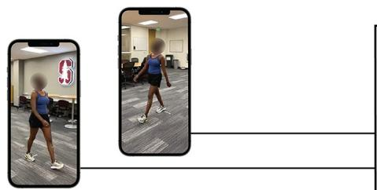
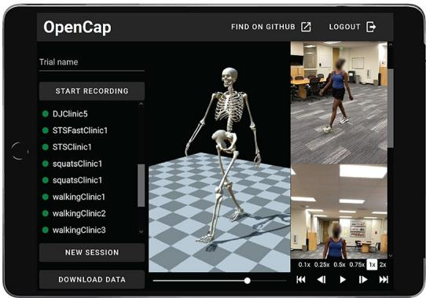
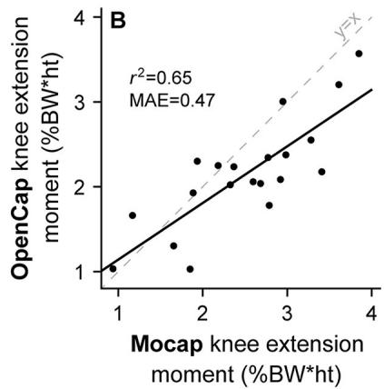
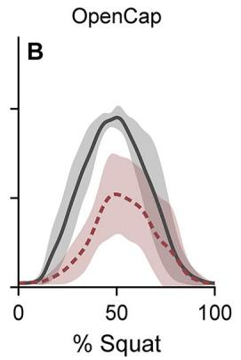
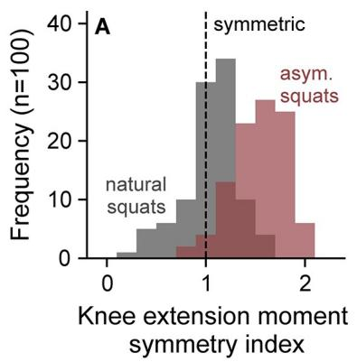
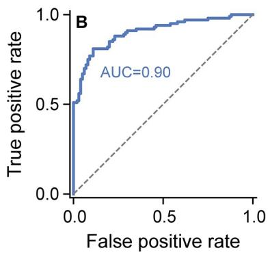

RESEARCH ARTICLE

# OpenCap：从智能手机视频中获取人体运动动力学（Human Movement Dynamics from Smartphone Videos）

Scott D. Uhlrich<sub>ID</sub><sup>1☯</sup>\*, Antoine Falisse<sub>ID</sub><sup>1☯</sup>\*, Łukasz Kidziński<sup>1☯</sup>, Julie Muccini<sup>2</sup>, Michael Ko<sup>2</sup>, Akshay S. Chaudhari<sup>2,3</sup>, Jennifer L. Hicks<sup>1</sup>, Scott L. Delp<sup>1,4,5</sup>


开放获取

引用信息：Uhlrich SD, Falisse A, Kidziński Ł, Muccini J, Ko M, Chaudhari AS, et al. (2023) OpenCap：基于智能手机视频的人体运动动力学。PLoS Comput Biol 19(10)：e1011462。https://doi.org/10.1371/journal.pcbi.1011462

1 生物工程系，Stanford University，斯坦福，加利福尼亚州，美国
2 放射学系，Stanford University，斯坦福，加利福尼亚州，美国
3 生物医学数据科学系，Stanford University，斯坦福，加利福尼亚州，美国
4 机械工程系，Stanford University，斯坦福，加利福尼亚州，美国
5 骨科外科系，Stanford University，斯坦福，加利福尼亚州，美国

编辑：Alison L. Marsden，Stanford University，美国

收稿日期：2023 年 2 月 1 日

接受日期：2023 年 8 月 24 日

出版日期：2023 年 10 月 19 日

同行评审历史：PLOS 认识到同行评审过程中保持透明的益处；因此，我们支持将所有同行评审内容及作者回复与最终发表的文章一同公开。本文编辑历程可在此查阅：https://doi.org/10.1371/journal.pcbi.1011462

版权：© 2023 Uhlrich et al.。本文依据 Creative Commons Attribution License 条款以开放获取方式发行，允许在任何媒介中不受限制地使用、传播和复制，前提是注明原作者及来源。

数据可用性声明：实验室验证和现场研究的数据可在 https://simtk.org/projects/opencap 获取。实验室验证研究共享了可识别视频数据。可识别视频的参与者

☯ 这些作者对本文贡献同等。

\* suhlrich@stanford.edu (SDU)；afalisse@stanford.edu (AF)

## 摘要

人类运动动力学指标能够预测诸如受伤风险或肌肉骨骼疾病进展等结果。然而，由于所需的成本、时间和专业知识门槛过高，这些指标很少被纳入大规模研究或临床实践中。本文提出并验证了 OpenCap——一个开源平台，可利用两台或多台智能手机拍摄的视频来计算人体运动的运动学（即运动）和动力学（即力）。OpenCap 利用姿态估计算法从视频中识别身体标志点；利用深度学习和生物力学模型估计三维运动学；并利用基于物理的仿真来估计肌肉激活和肌肉骨骼动力学。OpenCap 的 Web 应用使用户能够采集同步视频并可视化经云端自动处理的运动数据，从而消除了对专用硬件、软件和专业知识的需求。我们证明 OpenCap 能够准确预测动态指标，如肌肉激活、关节负荷和关节力矩，可用于筛查疾病风险、评估干预效果、评估组间运动差异以及为康复决策提供参考。此外，我们通过一项 100 名受试者的现场研究展示了 OpenCap 的实用价值：一位临床医生使用 OpenCap 估计肌肉骨骼动力学的速度比实验室方法快 25 倍，而成本不到其 1%。通过让人人皆可获得人体运动分析能力，OpenCap 可以加速将生物力学指标纳入大规模研究、临床试验和临床实践中。

## 作者摘要（Author summary）

分析人类的运动方式、肌肉协调方式以及作用于肌肉骨骼系统的力，对于研究神经-肌肉骨骼疾病至关重要。传统上，测量这些指标需要昂贵的实验室设备、训练有素的专家以及数小时的分析工作。因此，高质量的人体运动指标很少

签署视频发布的书面同意书后予以共享。源代码可在 https://github.com/stanfordnmbl/opencap-core（存档于 Zenodo：https://doi.org/10.5281/zenodo.7419967）和 https://github.com/stanfordnmbl/opencap-processing（存档于 Zenodo：https://doi.org/10.5281/zenodo.7419973）以宽松的开源许可证（Apache 2.0）发布，用户可通过访问 https://opencap.ai 使用我们的 Web 和移动应用。该应用及其所依赖的云计算服务在可预见的未来将免费向研究社区开放。

资金：SDU、AF、LK、JM、ASC、JLH 和 SLD 得到美国国立卫生研究院（National Institutes of Health，https://www.nih.gov；资助编号 1P41EB027060-01A1）和吴蔡人类表现联盟（Wu Tsai Human Performance Alliance，https://humanperformancealliance.org）的支持。ASC 和 MK 得到飞利浦医疗（Philips Healthcare，https://www.usa.philips.com/healthcare）和美国国立卫生研究院（National Institutes of Health，https://www.nih.gov；资助编号 1R01AR077604-01）的支持。资助方在研究设计、数据采集与分析、发表决定以及论文撰写中均未发挥作用。

利益冲突：本人已阅读本刊政策，本文作者存在以下利益冲突：SDU 和 AF 是 Model Health, Inc. 的联合创始人，该公司支持此处所述开源软件的非学术商业用途。OpenCap 是该开源软件部署在云端的学术版本，托管于斯坦福大学（Stanford University），在可预见的未来将继续免费向学术研究界开放。其他作者无利益冲突需要声明。

已融入临床实践和大规模研究。用于从标准视频中定位人体关节的计算机视觉方法的出现，为基于实验室的运动分析提供了一种有前景的替代方案。然而，这些方法是否能提供足够的信息以指导生物医学研究和临床实践尚不清楚。在此，我们介绍 OpenCap——一个开源、基于网络的软件工具，可通过智能手机视频计算人体运动的运动学（例如关节角度）和其背后的肌肉骨骼力（例如关节力）。OpenCap 综合了计算机视觉、机器学习和肌肉骨骼模拟方面的最新进展，使运动分析无需专用硬件、软件或专业知识即可广泛使用。我们将 OpenCap 与基于实验室的测量进行了验证，并展示了其在疾病风险筛查、干预效果评估以及辅助康复决策等应用中的实用性。最后，我们着重说明 OpenCap 如何在真实场景中实现大规模的人体运动研究。

## 引言

评估人体运动的动力学（即肌肉骨骼力）及其控制对于理解和治疗肌肉骨骼与神经肌肉疾病至关重要。例如，骨关节炎关节的负荷可预测骨关节炎的进展[1]；老年人从椅子上站起时，下肢关节周围肌肉产生的力矩分布与跌倒风险相关[2–4]；在执行高要求任务时，肌肉力和地面反作用力的左右肢体不对称性与关节手术后的功能结局相关[5–7]。尽管运动动力学指标的用途广泛，但在临床实践中却很少被测量。取而代之的是视觉运动评估或仅需基本器械（如秒表或量角器）的一般功能测试，被用于指导临床决策，并作为临床试验的结局指标。

对运动动力学的定量分析能够比视觉评估和简单的功能测试提供更深入且更具可重复性的洞见；然而，该分析资源密集，阻碍了其在大规模研究和临床实践中的应用。传统上，运动分析需要一个固定的实验室空间，并配备价值超过 \$150,000 的设备（图 1，上排）。运动学指标（如关节角度）通过基于标记的运动捕捉系统测量，该系统使用八个或更多专用摄像头捕捉放置在受试者身上的标记的三维（3D）轨迹。动力学指标（如关节力矩和功率），也可称为 kinetics（动力学），可通过额外地测量安装于地面下方的测力台所得到的地面反作用力来估算。肌肉骨骼建模与仿真工具[8–10]结合了运动学、动力学以及来自肌电图的肌肉激活测量，从而实现对运动控制和肌肉骨骼负荷（如肌肉协调和关节力）的更深入研究。这种全面的运动分析很少在小规模研究以外使用，因为对单一受试者进行数据采集、处理，以及可选地生成动态肌肉骨骼仿真，通常需要训练有素的专家耗费数日时间。

涉及数百名受试者的运动动力学研究已阐明了可预测损伤风险或手术结局的生物力学标志物[11–13]。然而，这一规模的研究既昂贵又罕见——生物力学研究中纳入的受试者中位数介于 12 至 21 人之间[14,15]。因此，需要低成本、可扩展且准确的工具，用于在数量级更多的个体及其自然环境中估算运动动力学。现代数据科学技术随后可利用这些大规模数据集来

## Mocap：基于标记的运动分析

  

图 1. 基于标记点的运动捕捉（Mocap）与基于视频的（OpenCap）人体运动动力学分析对比。（上排）基于标记点的运动分析通常在运动捕捉实验室内进行，而对肌肉骨骼动力学的全面研究通常需要专家投入超过两天的时间以及价值超过 150,000 美元的设备。（下排）OpenCap 可在不超过 10 分钟的人工操作时间内完成肌肉骨骼动力学的研究，且所需设备价值低于 700 美元（假设用户需要购买新的移动设备）。OpenCap 可在有互联网接入的任何地点使用，最低仅需两台 iOS 设备（例如 iPhone 或 iPad）。（右图）OpenCap 可用于估计运动学、动力学和肌腱参数，其中许多参数此前只能通过基于标记点的运动捕捉和测力台分析获得。  
https://doi.org/10.1371/journal.pcbi.1011462.g001

探索运动在健康与疾病中的作用，促进定量运动生物标志物的识别与临床转化。

用于估算运动学的移动工具已被开发出来，但大多数仍然过于昂贵且耗时，难以用于大规模研究和临床转化，并且没有工具能够实现全身运动动力学分析。惯性测量单元（Inertial Measurement Units）是这些工具中使用最广泛的，可以准确估算运动学参数[16]，但商用传感器仍然价格昂贵，穿脱耗时，并且使用专有算法。最近在肌肉骨骼系统基于物理仿真方面的进展已从基于惯性测量单元的运动捕捉中估算动力学[17,18]，但这些算法并未公开可用，也未在小规模可行性研究之外得到转化应用。

使用摄像机测量运动学是另一种有前景的方法，这得益于人体姿态估计算法的最新进展[19,20]。开源的二维（2D）姿态估计算法（例如OpenPose [21]）已使二维运动学分析成为可能[22]，并能为预测运动学与动力学指标的机器学习模型提供输入[23,24]。虽然这些机器学习模型对特定应用很有用，但它们可能无法泛化到训练数据中未涵盖的其他指标、任务和人群。另一种可能更具泛化能力的方法是将姿态估计算法在多个视频中识别的身体关键点（例如关节中心）进行三角测量[25–30]，并使用肌肉骨骼模型和基于物理的仿真来跟踪这些三维（3D）位置。然而，这些算法识别的稀疏三维关键点并不能完全刻画所有身体节段的平移和旋转；因此，尚不清楚这些关键点是否足够具有表达力且足够准确以支持运动研究。商用无标记运动捕捉系统能准确估算运动学参数[31]，但它们通常需要大量有线摄像机、专有软件和专业化计算资源。智能手机摄像头的普及或许能实现基于视频的运动捕捉而无需购买专业设备，但仍不清楚能否从少量缺乏硬件同步的设备中准确估算运动学参数。如果能够解决从智能手机视频中计算准确运动学和动力学的挑战，那么基于智能手机的肌肉骨骼动力学分析就有可能克服当前运动分析技术所面临的转化障碍。

在此我们介绍 OpenCap——一款开源、基于网页的软件，可供研究社区免费使用，用于通过两台或更多智能手机拍摄的视频来估算人体运动的 3D 运动学与动力学（图 1，下排）。OpenCap 融合了计算机视觉与肌肉骨骼模拟领域数十年的进展，使得运动动力学分析不再依赖专门的硬件、软件或专业知识。我们首先将 OpenCap 估算的运动学与动力学指标与基于标记点的运动捕捉和测力台得到的金标准指标进行对比验证。接下来，我们探讨 OpenCap 估算的动力学指标是否具有足够的精度，可用于疾病风险筛查、评估干预效果、研究组间运动差异以及追踪康复进展。在实验室中验证这些指标之后，我们重点展示 OpenCap 如何使临床医生能够在真实场景中测量大规模队列的运动动力学。

## 结果

## 使用 OpenCap 进行数据采集

使用 OpenCap 搭建一次数据采集所需的准备时间不超过五分钟，需要两台 iOS 设备（iPhone、iPad 或 iPod）、两个三脚架、一块标定棋盘格（可使用普通打印机打印）以及另一台运行 OpenCap 网页应用的设备（例如笔记本电脑）。在将 iOS 设备与网页应用配对后，用户将在系统引导下完成相机标定、数据采集以及 3D 运动学的可视化。运动学参数通过深度学习模型以及 OpenSim [8,10] 中的逆运动学从视频中估算，动力学参数则通过基于物理的肌肉骨骼模拟方法进行估算（图 2，S1 影片）。OpenCap 利用云计算进行数据处理，采用可扩展的服务器架构。

## 与实验室金标准的对比验证

我们在十名健康个体的队列中，使用两台 iPhone 对 OpenCap 进行了验证，对比基于标记点的运动捕捉和测力台分析，覆盖多种活动（行走、深蹲、从椅子上站起以及下蹲跳）。OpenCap 估算的关节角度的平均绝对误差（mean absolute error, MAE）为 4.5°，地面反作用力的 MAE 为体重的 6.2%，关节力矩的 MAE 为体重×身高的 1.2%（表 1；更多验证见方法：验证；S1 附录中的 S1–S4 表以及图 A–L）。

## 疾病风险筛查：行走时的膝关节负荷

我们随后探究了 OpenCap 是否具备足够的精度来估计关节负荷指标，从而可用于筛查有内侧膝骨关节炎快速进展风险的个体，并评估非手术干预的疗效。我们首先评估了 OpenCap 在估计早期站立相峰值膝内翻力矩方面的精度，该指标可预测内侧膝骨关节炎的快速进展[1]。十名健康受试者分别以自然步态（即采用自我选择的策略）和通常可降低膝内翻力矩的躯干摆动步态修正方式行走[32]。OpenCap 预测了早期站立相峰值膝

  

地面反作用力（MAE）

iOS 应用程序同步视频采集

  

你提供的只有标题 "Web application data collection and visualization"，没有需要翻译的正文 Markdown 内容。请把论文全文（包含摘要、正文、参考文献等的完整 Markdown）粘贴过来，我再按规则逐段翻译。

  

您好，我目前只收到了论文的标题：

**Scalable cloud computing biomechanical analysis from video**

但没有收到论文的正文内容（摘要、引言、方法、实验、参考文献等 Markdown 文本）。请将整篇论文的 Markdown 原文粘贴过来，我会按照以下规则完整翻译：

- 散文正文全部译成中文
- 行内公式 `$...$` 与块级公式 `$$...$$` 逐字保留
- 代码块 ```lang ... ``` 整块原样输出
- 图片引用 `` 与 `` 标签原样保留（alt 文本保持英文）
- 表格结构（`<table>`/`<tr>`/`<td>`）不变，只翻译单元格内文字与表题
- 文献引用标记 `[1]` `[12, 34]` 原样保留
- 参考文献章节的作者名、期刊名、年份、卷期页码、DOI 保持英文，文章标题译成中文
- 专有名词首次出现时采用「中文译名（English Original）」形式，数据集/模型/机构名（EMDB、3DPW、OpenSim、SMPL 等）保留英文

请提供完整论文内容，我即可开始翻译。

图 2. OpenCap 由一个智能手机应用、一个网页应用和云计算组成。为了采集数据，用户在两台或更多 iOS 设备上打开应用，并将其与 OpenCap 网页应用进行配对。该网页应用使用户能够在 iOS 设备上同时录制视频，并可视化所得到的三维（3D）运动学结果。在云端，使用开源姿态估计算法从多视角视频中提取二维关键点。视频通过关键点速度的互相关进行时间同步，并通过三角测量这些同步后的二维关键点计算三维关键点。这些三维关键点通过一个在大规模运动捕捉数据集上训练的循环神经网络（LSTM）转换为更全面的三维解剖标志点集。然后，使用逆运动学以及具有生物力学约束的肌肉骨骼模型，根据标志点轨迹计算三维运动学。最后，使用追踪三维运动学的肌肉驱动动力学仿真来估计动力学指标。

https://doi.org/10.1371/journal.pcbi.1011462.g002

表 1. 与基于实验室的运动捕捉和测力台相比，OpenCap 在运动学和动力学方面的平均绝对误差（MAE）。

<table><tr><td rowspan=1 colspan=1>Kinematics (MAE)</td><td rowspan=1 colspan=1>Walking</td><td rowspan=1 colspan=1>Squat</td><td rowspan=1 colspan=1>Sit-to-stand</td><td rowspan=1 colspan=1>Drop jump</td><td rowspan=1 colspan=1>Mean</td></tr><tr><td rowspan=1 colspan=1>Rotations (n = 18) [°]</td><td rowspan=1 colspan=1>4.1 (2.3–6.6)</td><td rowspan=1 colspan=1>4.1 (1.8–7.2)</td><td rowspan=1 colspan=1>4.7 (1.7–10.3)</td><td rowspan=1 colspan=1>5.1 (2.3–8.6)</td><td rowspan=1 colspan=1>4.5</td></tr><tr><td rowspan=1 colspan=1>Translations (n = 3) [mm]</td><td rowspan=1 colspan=1>12.3 (6.8–19.6)</td><td rowspan=1 colspan=1>12.3 (5.8–18.4)</td><td rowspan=1 colspan=1>13.2 (5–20.3)</td><td rowspan=1 colspan=1>11.5 (6.3–16.5)</td><td rowspan=1 colspan=1>12.3</td></tr></table>

<table><tr><td rowspan=1 colspan=1>Vertical [%BW]</td><td rowspan=1 colspan=1>8.2 (7.5%)</td><td rowspan=1 colspan=1>6.4 (20.0%)</td><td rowspan=1 colspan=1>5.7 (13.4%)</td><td rowspan=1 colspan=1>25.2 (13.8%)</td><td rowspan=1 colspan=1>11.4 (13.7%)</td></tr><tr><td rowspan=1 colspan=1>Anterior-posterior [%BW]</td><td rowspan=1 colspan=1>2.1 (6.7%)</td><td rowspan=1 colspan=1>1.3 (37.5%)</td><td rowspan=1 colspan=1>1.9 (31.0%)</td><td rowspan=1 colspan=1>8.9 (17.3%)</td><td rowspan=1 colspan=1>3.5 (23.1%)</td></tr><tr><td rowspan=1 colspan=1>Medio-lateral [%BW]</td><td rowspan=1 colspan=1>1.1 (17.1%)</td><td rowspan=1 colspan=1>5.7 (85.4%)</td><td rowspan=1 colspan=1>3.2 (110.5%)</td><td rowspan=1 colspan=1>5.3 (29%)</td><td rowspan=1 colspan=1>3.8 (60.5%)</td></tr></table>

<table><tr><td rowspan=1 colspan=1>All degrees of freedom (n = 15) [%BW*ht]</td><td rowspan=1 colspan=1>0.75 (0.20–1.32, 19%)</td><td rowspan=1 colspan=1>0.97 (0.11–1.93, 45%)</td><td rowspan=1 colspan=1>0.68 (0.13–1.09, 60%)</td><td rowspan=1 colspan=1>2.50 (1.15–5.90, 25%)</td><td rowspan=1 colspan=1>1.22 (37%)</td></tr></table>

每个活动的误差在试验和受试者（n = 10）之间取平均，所报告的均值是跨活动及自由度的平均值（骨盆位置与姿态为六个 [仅运动学]、腰椎为三个、每侧髋部为三个、每侧膝部为一个、每侧踝部为两个）。力以体重百分比（BW）表示，力矩以体重百分比乘以身高（ht）表示。运动学与关节力矩的误差以自由度范围内的均值和极差呈现，动力学误差还额外以占极差百分比形式的平均绝对误差（MAE）呈现。运动学与动力学中的均方根误差见 S2–S4 表。使用 OpenCap 与 Mocap 估计得到的平均运动学、地面反作用力及关节力矩波形见 S1 附录中的图 A–L。


  

图 3. 步行时膝关节内侧负荷。我们评估了 OpenCap 估算膝关节内收力矩（Knee Adduction Moment, KAM）的准确性，KAM 是预测膝关节骨关节炎进展的膝关节内侧负荷指标，同时评估通过改变步行模式后膝关节负荷如何发生变化。受试者（n = 10）分别以自然步态和躯干摆动（trunk sway）步态修正方式步行。（A）与基于标记点的运动捕捉与测力台（Mocap）分析相比，OpenCap 估算的承重反应早期（early-stance）峰值 KAM 达到 $r ^ { 2 } = 0 . 8 0$。KAM 通过体重（Bodyweight, BW）和身高（height, ht）进行归一化处理。（B）图中显示了从自然步态到躯干摆动步态下，峰值 KAM 和峰值内侧接触力（Medial Contact Force, MCF）的变化在各受试者（圆点）间的平均值（条形）和标准差（误差线），MCF 是更为全面的膝关节内侧负荷指标 $( ^ { * } P < . 0 5 )$。OpenCap 检测到了峰值 KAM 与 MCF 的降低（P < .006，t 检验与 Wilcoxon 符号秩检验），这一降低在 Mocap 中同样得到测量（P < .016，t 检验）。此外，OpenCap 还正确识别出了一位如 Mocap 估算结果所示未出现 KAM 或 MCF 降低的个体（实心圆点）。

adduction moment 加 $r^{2}=0.80$（r：皮尔逊相关系数），与基于标记点的运动捕捉和测力台相比，平均绝对误差（MAE）为 0.30% 体重×身高（图 3）。该误差小于检测膝关节骨关节炎症状及进展的一系列阈值（0.5–2.2% 体重×身高 [1,33–35]）。随后我们评估了 OpenCap 是否能够估计躯干摆动步态调整所引起的膝关节内收力矩峰值以及内侧接触力峰值的变化，后者是膝关节骨关节炎干预中常被针对的更为全面的负荷指标 [36,37]。在群体水平上，OpenCap 准确捕捉到了躯干摆动步态调整在站立早期膝关节内收力矩峰值与内侧接触力峰值方面的预期下降（下降 16–33%，$P<.006$；t 检验与 Wilcoxon 符号秩检验，n=10，图 3B）。在使用运动捕捉和测力台时，也检测到了同方向的显著变化（下降 21–46%，$P<.016$；t 检验，n=10）；有关这些统计检验的更多细节可在 S1 Appendix 中的表 A 中找到。对于该样本量，OpenCap 在显著性水平 alpha = .05 下检测这些预期组间差异的几率为 92%（事后检验效能，各检验平均值），而运动捕捉和测力台的相应几率仅为 77%。在个体水平上，OpenCap 正确预测了两种峰值负荷指标在躯干摆动影响下的方向性变化（九名个体下降，一名个体上升）。OpenCap 能够在行走过程中准确估计膝关节负荷及负荷变化，这表明它可用于识别有快速疾病进展风险的膝关节内侧骨关节炎个体，并用于评估步态调整在个体和群体水平上的效果 [38,39]。

## 检测组间差异：坐起动作中的动力学差异

随后我们探讨了 OpenCap 是否可用于研究年轻人与老年人之间普遍存在的运动动力学差异。从椅子上站起的策略随年龄变化，并与不同的肌肉力需求相关 [2]。老年人通常采用躯干屈曲增加的起身策略，从而将肌肉需求从


  

图 4. 从椅子上起身时下肢关节力矩的分布。为了评估 OpenCap 检测动力学组间差异的能力，我们计算了年轻与年长成年人在从椅子上起身时通常存在的下肢关节力矩差异。受试者（n = 10）以自然姿势站立，并以增加躯干屈曲的方式站立，后者是膝伸肌无力人群所采用的策略，可将肌肉需求转移至髋伸肌和踝跖屈肌。（A）图中显示了各受试者（空心圆）在自然条件到躯干屈曲条件之间，起身阶段平均的膝伸展、髋伸展和踝跖屈力矩变化的均值（柱状）和标准差（误差线）$( ^ { * } P < . 0 5 )$。力矩按体重百分比（BW）乘以身高（ht）进行归一化。OpenCap 识别出了关节力矩的变化（P = .004–.024，t 检验），这些变化与使用运动捕捉和测力台（Mocap，P = .001–.002，t 检验）所识别的变化一致。（B）图中显示了每位受试者在各条件下的起身阶段平均膝伸展力矩值。OpenCap 估算的膝伸展力矩与使用运动捕捉和测力台数据作为输入（Mocap）的仿真结果相比，$\stackrel { \smile } { r ^ { 2 } } = 0 . 6 5$。

膝伸肌向髋伸肌和踝跖屈肌传递的负荷增加 [40]；这种策略与较低的功能性肌肉力量相关 [4]，而力量不足与跌倒风险相关 [3]。我们通过对十名健康受试者发出指令，让他们以自然方式从椅子上起身五次，然后再以增加躯干前屈的方式起身五次（图 4），从而模拟了不同年龄组之间起身策略的差异。在群体层面，与自然条件相比，在增加躯干前屈条件下，OpenCap 估计出了膝关节伸展力矩的预期降低（$P = .024$，t 检验，n = 10）以及髋关节伸展力矩（$P = .020$，t 检验，n = 10）和踝关节跖屈力矩（$P = .004$，t 检验，n = 10）的预期增加，这些均为起身阶段的平均值。这些变化的方向与通过运动捕捉和力板所测得的结果一致（$P = .002–.003$，t 检验，n = 10）；关于这些统计检验的更多细节可在 S1 附录的表 B 中找到。对于该样本量，OpenCap 在显著性水平 $\alpha = .05$ 下检测这些预期条件间差异的几率为 65%（跨检验的平均事后检验效能），而运动捕捉和力板的相应几率为 89%。OpenCap 还预测了膝关节伸展力矩的峰值，与基于标记的运动捕捉和力板相比，$r^{2} = 0.65$，MAE = 5.5 Nm（0.47% 体重×身高）。该误差与中年成人在六年内发生的平均力量损失相近（0.93 Nm/年 [41]，详见 S1 附录中的进一步讨论）。综上，这些结果表明 OpenCap 可用于研究年轻成人与老年人之间运动动力学的差异，并可识别那些膝伸肌力量较低、可能受益于肌肉强化干预的个体 [2]。

## 指导康复：蹲起过程中的肌肉激活不对称性

最后，我们探讨了 OpenCap 是否能够准确估计与康复进展相关的肌肉力量测量指标。在膝关节术后康复中，恢复双侧下肢膝伸肌发力的对称性通常是一项重要目标，在康复出院前识别持续存在的不对称性可避免不良的功能结局 [5,6,42]。为了模拟术后不对称，我们指导十名健康受试者以自然方式完成五次下蹲动作，然后通过减少左脚下的受力以不对称方式完成下蹲动作




  

图5. 蹲起过程中股内侧肌（vasti）激活的不对称性。为了评估 OpenCap 在指导康复决策方面的实用性，我们试图识别伸膝肌（vasti）功能中提示康复不完全且与术后功能性结局较差相关的双侧下肢间不对称性。受试者（n = 10）先自然地完成蹲起动作，然后以非对称方式完成，此时要求他们减小左脚下的受力。(A, B) 图中显示了各受试者左腿（未负重侧）股内侧肌激活的均值（实线）和标准差（阴影），分别通过肌电图（electromyography，EMG）测量和 OpenCap 估计获得。肌肉激活度按每位受试者每种测量方式的最大值进行归一化处理。(C) OpenCap 识别出左右腿之间股内侧肌峰值激活的不对称性（基于 EMG 定义不对称性并采用临床相关的对称性阈值），其受试者工作特征曲线下面积（area under the receiver operator characteristic curve，AUC）为 0.83，准确性为 75%。这一结果与使用基于标记点的运动捕捉和测力台数据作为输入的仿真结果（Mocap sim.，AUC = 0.82，准确性 = 70%）性能相当。  
https://doi.org/10.1371/journal.pcbi.1011462.g005

（图 5）。由于肌肉激活（muscle activation）相比肌肉力（muscle force）能够更直接地测量，我们将通过肌电图（electromyography）测得的股肌（vasti，膝关节伸肌）激活与 OpenCap 估计的激活进行了比较。我们使用肌电图以及临床相关的对称性指数阈值 [43] 1.15 来定义真实标签的激活不对称性。OpenCap 将深蹲分类为对称或不对称的受试者工作特征曲线下面积（AUC）为 0.83，在最优对称性指数阈值 1.13 处的准确率为 75%（图 5），这与使用动作捕捉和测力台数据的模拟性能（AUC = 0.82，准确率 = 70%）相近。

## 实验室外的动态分析

为了展示 OpenCap 在真实世界条件下的实用性，我们将这项康复追踪分析扩展到了一项现场研究。一位非运动分析专家的临床医生使用 OpenCap 评估了 100 名在社区中完成自然和不对称深蹲的个体的膝关节伸展力矩对称性。平均而言，每位参与者的设置和数据采集需要 5 分钟，而对于一次深蹲，运动学和动力学分别在单台服务器上自动计算需要 2 分钟和 35 分钟。总计，100 名受试者的数据采集用了 8 小时，计算在 32 线程 CPU 上用了 31 小时（动力学计算被并行化）。OpenCap 的峰值膝关节伸展力矩估计可以区分对称和不对称条件，在使用条件指令（即自然或不对称）作为真实标签时，AUC = 0.90，最优对称性指数阈值 1.33 处的准确率为 85%（图 6A 和 6B）。OpenCap 还检测到受试者内峰值膝关节伸展力矩对称性从不对称到自然条件的改善，在最优阈值 0.26 处的 AUC = 0.93，准确率为 89%（图 6C 和 6D）。综合而言，我们的实验室和现场研究表明，Open-Cap 可以检测股肌力量产生中的不对称性，这可能有助于指导康复决策，并能追踪康复过程中预期会发生的对称性改善。







  

图 6. 实验室外动态分析。为了展示 OpenCap 在追踪康复进展方面的实际效用，我们在一项由临床医生主导的实地实验中招募了 100 名参与者。参与者执行了对称深蹲和非对称深蹲，其中被要求减少左脚下的受力，这很可能导致了左、右膝关节伸展力矩之间的不对称性。我们首先评估了 OpenCap 作为检测膝关节伸展力矩峰值不对称性的筛查工具的效用。（A）展示了两种深蹲条件下膝关节伸展力矩对称性指数的分布，其中对称性指数大于一表示左腿（未负重）相对于右腿具有更低的膝关节伸展力矩峰值。（B）OpenCap 的对称性指数估计在自然深蹲与非对称深蹲之间进行分类，受试者工作特征曲线下面积（AUC）为 0.90，准确率为 85%。随后，我们评估了 OpenCap 在检测康复过程中随时间推移预期会发生的膝关节伸展力矩峰值对称性变化方面的效用。（C）展示了非对称条件与自然条件之间对称性指数的平均差异（即随时间假设的改善对称性；红色），以及非对称条件下三次试验之间对称性指数的平均差异（即随时间假设的不变对称性；灰色）的分布。（D）OpenCap 检测到了从非对称条件到自然条件对称性的改善，$\Delta \mathrm { U C } = \dot { 0 } . 9 3$（相对于 (C) 中未改善的分布有所改善），准确率为 89%。

## 讨论

本研究描述了 OpenCap——一个结合计算机视觉和肌肉骨骼仿真、通过智能手机视频量化人体运动动力学的平台。我们证明 OpenCap 在若干研究和临床应用中具有足够的精度。OpenCap 在估计不同条件之间动态指标变化时的统计效力（0.65– 0.92）与金标准技术（0.77–0.89）相当；它以 $r ^ { 2 } = 0 . 6 5 – 0 . 8 0$ 估计可预测骨关节炎及跌倒风险相关不良结局的动态指标；并且它以 75–89% 的分类准确率估计能够为康复决策提供信息的动态指标。我们的现场研究展示了 OpenCap 如何使临床医生与研究人员都能够分析现场以及大规模人群中的运动动力学。

OpenCap 降低了分析运动动力学的成本、时间和专业门槛。OpenCap 的硬件成本介于 \$40 到 \$700 之间，取决于用户是否需要购买新的 iOS 设备（图 1）。这比传统运动捕捉实验室设备便宜约 215 倍，并且不需要专用的实验室空间。

使用 OpenCap 测量运动动力学的上手时间包括设置移动设备的时间和完成动作的时间（图 1，下排）。在我们的现场数据采集中，每位参与者 5 分钟的上手时间比在运动捕捉实验室中进行类似分析所需的时间（约 2 小时）少约 25 倍。OpenCap 不需要专门的软件或专业知识，从而弥合了计算机视觉、生物力学和临床运动科学社区之间的差距。大多数计算机视觉算法需要计算机科学知识才能运行，大多数仿真工具需要生物力学知识才能操作，而 OpenCap 自动化了这些过程，使这些领域的进展更易于被临床医生和研究人员所获取。在 OpenCap 发布后的一年里，来自不同领域的超过 2,000 名研究人员已使用它采集了数万个运动试次。OpenCap 还满足 Stanford University 对使用高风险数据（例如受保护的健康信息）的云端系统的安全要求，并确保端到端的数据加密。为进一步方便使用，我们在配套网站（https://opencap.ai/）上提供教程与示例。

我们的结果证明了 OpenCap 作为筛查工具和为康复决策提供信息的潜在临床实用性。未来研究可以测试 OpenCap 筛查运动员非接触性韧带损伤风险的能力 [11,44]，或预测脑瘫患者手术疗效的能力 [12,13]。OpenCap 评估也可能足够快速，使动作筛查成为常规临床诊疗的一部分，允许临床医生随时间跟踪功能，并在受伤或手术后，将康复状态与伤前测量值进行基准对比 [45]。我们调查了 OpenCap 在估计若干具有临床意义的指标方面的准确性；我们鼓励针对其他活动、人群和感兴趣的指标进行进一步的验证研究，以评估 OpenCap 是否足够准确，能够在超出我们所探索用例之外的场景中为决策提供依据。

通过支持大规模、非实验室研究，OpenCap 可以加速动作研究。OpenCap 以与运动捕捉和测力台分析相似的统计功效检测出了条件间的差异，但所需时间显著更少。这种准确性和效率使得需要数百名参与者的前瞻性损伤风险研究更为可行，使将动作动力学纳入通常仅使用计步器（pedometry）的群体规模健康研究成为可能（例如，Osteoarthritis Initiative [46] 或 UK Biobank [47]），并促进开发用于临床试验的更敏感的功能结局测量指标。通过自动计算运动学参数，OpenCap 不易受到不同实验者之间运动捕捉标记放置差异所引入的误差影响 [48]。这可以降低多中心研究中的变异性 [49]，并使动作数据能够被汇编为对机器学习社区有用的同质化、可共享的数据集。重要的是，OpenCap 的便携性将使研究那些由于时间和地理限制而在动作研究中往往代表性不足的人群成为可能。

OpenCap 利用机器学习提升基于视频的运动学估计精度，并采用基于物理的建模来保持泛化能力（图 2）。我们将一种适用于时间序列数据的深度学习模型与一个受约束的生物力学模型相结合，从视频关键点中估计三维运动学，而这些关键点本身不足以刻画三维运动学。我们的深度学习模型从常见计算机视觉数据集（例如 COCO [50]）中所标注的稀疏视频关键点出发，预测出一整套全面的解剖学标志点。在生物力学模型中使用这些预测出的解剖学标志点（而非视频关键点），使跨所有自由度的平均运动学精度提高了 3.4°（见方法部分和附表 S2）。这些改进在髋关节屈曲、骨盆倾斜和腰椎屈曲自由度上最为显著（提升 4.9–32.6°），因为髋部与肩部之间视频关键点的稀疏性容易在这些自由度上造成较大的角度误差。此外，深度学习模型架构提供了时间一致性，使 OpenCap 对短暂的遮挡或误识别的关键点更具鲁棒性。最后，尽管问题表述在不同任务上需要进行一定调整，但肌肉驱动的动力学仿真在估计动力学方面比端到端的机器学习方法具有更强的泛化能力。这使我们能够在不针对每种活动收集训练数据的情况下，研究不同运动的动力学特性。

OpenCap 的运动学与动力学估计精度与最先进的无标记运动捕捉方案相当。OpenCap 的运动学误差（下肢各自由度均方根误差[RMSE]范围为 2.0–10.2˚）与文献中报道的基于惯性测量单元（IMU）方法的误差相当（步行、跑步及日常生活活动中为 2.0–12˚[18,51–57]），也与商用及学术研究中八摄像头视频系统的误差相当（步行、跑步和骑行活动中为 2.6–11˚[31,58]）。此外，OpenCap 与基于标记的运动捕捉之间的关节角度误差，与基于标记的运动捕捉中由皮肤运动伪迹所引起的误差相当。例如，使用皮肤固定标记计算的膝关节屈曲角相较于骨钉固定标记测量得到的角度，均方根误差可高达 8˚[59]，超过了 OpenCap 与皮肤标记运动捕捉之间膝关节屈曲角的 4.2˚均方根误差（S2 Table）。由于作为真值的皮肤标记运动捕捉方法本身存在误差，要显著提升无标记与基于标记的运动捕捉系统之间的一致性可能颇具挑战。此外，与大多数基于 IMU 的方法不同，OpenCap 能够估计整体平移量（例如骨盆位移），从而可估计全身性指标，如质心轨迹。值得注意的是，使用超过两台摄像头时，运动学估计并未显著改善（参见方法部分和 S2 Table），这表明两台摄像头足以分析本研究中所纳入的活动。据我们所知，目前尚无仅凭视频计算全身动力学的先例；不过 OpenCap 的动力学估计与基于 IMU 的方法相当。例如，OpenCap 在步行过程中对地面反作用力（1.5–11.1% 体重）和下肢关节力矩（0.3–1.7% 体重×身高）预测的均方根误差（S3 和 S4 Tables），与使用 17 传感器 IMU 套装所得结果相当（分别为 1.7–9.3% 体重和 0.5–2.2% 体重×身高[18,60]）。此外，OpenCap 对步行过程中第一峰值膝关节内收力矩的预测精度，比专门训练以从视频中可提取的标记位置预测该指标的机器学习模型高出 44%[24]。

OpenCap 将姿态检测算法的输出转化为研究人体运动的有价值洞察。我们设计 OpenCap 旨在集成不同的姿态检测算法，测试不同算法时我们发现运动学结果仅有微小差异（见方法以及 S1 和 S2 表）。随着单视角 [26,30,61,62] 与多视角 [26–28] 视频下关节中心估计技术的最新进展，我们预期随着更精确的姿态估计算法陆续发布，OpenCap 在运动学和动力学估计方面的准确性将进一步提升。通过共享我们的数据和源代码，我们鼓励研究人员使用我们的数据对其模型进行基准测试，并通过为其模型添加支持来推动 OpenCap 的发展。

我们的研究存在若干局限性。首先，我们通过让健康个体模拟与病理或治疗相关的不同运动模式，测试了 OpenCap 估计信息性动态指标的能力。虽然这些模拟运动与目标人群中所报告的运动相似（见方法：应用与统计），且 OpenCap 能够区分这些模拟条件下动力学的差异，但仍需未来研究在目标人群中验证这些指标。此外，部分动力学指标与临床结局之间的关系已在

文献；然而，由于建立这些阈值需要资源密集型的纵向研究，在大多数情况下，告知临床决策所需的指标估计精度水平是未知的。在可能的情况下，我们将 OpenCap 的精度与临床上有意义的阈值（例如，膝关节内收力矩）进行了比较。我们希望 OpenCap 的易用性将使更多纵向研究成为可能，从而能够建立动力学指标的临床效用以及所需的测量精度。其次，我们没有测量使用 OpenCap 获得的测量的可重复性。然而，基于先前使用无标记运动捕捉并采用类似方法的可重复性研究 [49]，我们预计 OpenCap 测量运动学的可重复性与基于标记的运动捕捉相当，甚至更好。未来需要进行研究来证实这一说法，并评估动力学评估的可重复性。第三，增强我们三维标记集的深度学习模型可能无法泛化到其训练活动分布之外的活动。我们使用标准 OpenSim 运动学数据生成该模型的训练数据，因此未来可以在训练集中添加其他数据集。此外，估算动力学需要一些依赖于任务的用户输入，这是任何基于优化的肌肉驱动模拟的局限性。我们已经提供了针对若干活动效果良好的优化问题公式。总体而言，如果未来应用需要高精度而非泛化能力，OpenCap 的精度很可能通过针对任务对深度学习模型和优化问题公式进行调优而得到改善。

总之，OpenCap 使非专家能够以比此前使用基于标记的运动捕捉和测力台少一个数量级的时间和少几个数量级的成本来分析人体运动动力学。我们期望 OpenCap 将促进人体运动的大规模研究、运动数据集的共享，以及运动生物标志物向临床实践的转化。

## 方法

## 伦理声明

本研究方案由斯坦福大学（Stanford University）机构审查委员会（IRB00000351）批准并监督。我们按照此批准方案以及相关指南和法规进行了实验。所有参与者在参与前均提供了书面知情同意。公开分享可识别视频的参与者同意共享这些视频。

## 设计

OpenCap 包含若干步骤，用于从视频中估算运动动力学。这些步骤包括标定相机、采集与处理视频、估算标记点位置、估算运动学参数，以及生成基于物理的运动动力学仿真。该流水线使用 Python（v3.7.10）实现。OpenCap 的 Web 应用程序引导用户逐步完成各步骤，并使用云端实例进行计算（图 2）。

相机标定。OpenCap 使用十五参数针孔相机模型（https://github.com/smidm/camera.py）对 iOS 设备相机进行建模，并使用 OpenCV [63] 计算参数。在每次数据采集开始时，OpenCap 从我们创建的最新 iOS 设备数据库中加载与每台设备相机硬件和录制设置相关的事先计算好的内参（主点、焦距和畸变参数）。接着，Web 应用程序引导用户将棋盘格放置在所有相机都能看到的位置，OpenCap 通过单张棋盘格图像自动计算外参（相机相对于全局坐标系的变换）。我们使用一块精密制造的 720×540 mm 棋盘格来为数据库中每台设备预先计算相机内参（关于同款手机和不同手机之间内参测试的详细信息见 S1 Appendix）。在每次数据采集期间，使用打印在 A4 纸上并固定于平整表面的 210×175 mm 棋盘格计算相机外参即可满足要求。我们发现，与使用精密制造的棋盘格相比，使用打印棋盘格进行相机标定所带来的运动学差异很小（见 S1 Appendix）。

视频采集与姿态估计。完成标定后，用户可通过 Web 应用程序同时使用所有设备录制视频。视频录制分辨率为 720×1280 像素，帧率为 60 Hz，相机对焦距离设置为固定值。

录制的视频随后使用视频姿态检测算法进行处理。OpenCap 目前支持两种算法：OpenPose [21] 和 HRNet [64–67]。选择这两种算法的原因是它们的性能以及包含足部关键点。对于每个视频的每一时间帧，两种算法均返回身体关键点的二维（2D）位置以及一个置信度分数（介于 0 到 1 之间），用于表示算法对关键点位置的置信度。共纳入 20 个身体关键点用于后续分析（颈部、髋部中点、左右肩、髋、膝、踝、足跟、小趾与拇趾、肘和腕）。OpenCap 实现了自定义算法，用于处理 2D 关键点位置（例如处理关键点遮挡），并通过关键点速度的互相关对各视频进行时间同步（详见 S1 Appendix）。

三角测量与标记点集增强。OpenCap 对同步的 2D 视频关键点位置进行三角测量，以计算 3D 位置。OpenCap 使用直接线性变换（Direct Linear Transformation）算法进行三角测量 [68]，并在最小二乘问题中以相应的关键点置信度分数作为各摄像头的权重 [58]。使用从视频三角测量得到的 3D 关键点位置进行生物力学分析存在两个主要局限。首先，视频关键点集不足以完整定义所有身体段自由度的运动学。使用带有生物力学关节约束的模型跟踪这些有限的关键点可以在一定程度上缓解此问题，但对于某些身体段仍不充分。例如，髋部和肩部的关键点不足以鲁棒地确定矢状面上的髋关节、骨盆和腰椎运动学。其次，大多数姿态估计算法以逐帧方式识别关键点，因此所得的 3D 关键点轨迹常常在物理上不真实，尤其是在存在误识别或被遮挡的关键点时。

为克服上述局限，我们训练了两个长短期记忆（Long Short-Term Memory，LSTM）网络，从 20 个三角测量得到的 3D 视频关键点位置预测 43 个解剖学标记点的 3D 位置。该组解剖学标记点对应于基于标记点的动作捕捉中常用的标记点集合 [69]，用于鲁棒地确定 3D 关节运动学。我们选择 LSTM 网络是因为它们能够利用时间序列数据，这可能有助于提高输出标记点轨迹的时间一致性。我们训练了两个 LSTM 网络：一个手臂模型从 7 个手臂与躯干关键点的位置预测 8 个手臂标记点的位置，一个身体模型从 15 个下肢与躯干关键点的位置预测 35 个身体标记点的位置。两个模型还将身高和体重作为输入。为了训练这些网络，我们从已发表的生物力学研究 [70–79] 中通过 OpenSim 处理的 108 小时动作捕捉数据中合成了对应的 3D 视频关键点与 3D 解剖学标记点配对（有关数据集生成的详细信息，请参见 S1 Appendix）。我们将数据划分为训练集（约 80%）、验证集（约 10%）和测试集（约 10%）。在训练之前，我们将每个标记点的 3D 位置相对于一个根标记点（髋部关键点的中点）进行表达，按受试者的身高对 3D 位置进行归一化，以 60 Hz 采样，将数据拆分为长度为 0.5 s 的非重叠时间序列，并根据先前报道的关键点误差范围 [24,26,29]，对每个时间步的视频关键点位置添加标准差为 18 mm 的高斯噪声。对于两个模型，我们使用

随机搜索（random search）。测试集上的 RMSE 在身体模型和手臂模型上分别为 8.0 mm 和 15.2 mm（有关模型架构和训练的详细信息见 S1 附录）。在实际应用中，OpenCap 使用这两个 LSTM 网络，从根节点中心化的 3D 视频关键点预测根节点中心化的身体和手臂解剖标记位置。然后将根节点关键点位置加到所有预测位置上。

基于物理的建模与仿真。在标定之后，OpenCap 的 Web 应用引导用户录制参与者站立中性姿态的视频。OpenCap 使用从中性姿态估计出的解剖标记位置，通过 OpenSim 的 Scale 工具将肌肉骨骼模型按参与者的体型进行缩放。OpenCap 使用 Lai 等人 [69,80] 提出的肌肉骨骼模型，并根据 Uhlrich 等人 [79] 的研究修改了髋外展肌的肌肉路径。该肌肉骨骼模型包含 33 个自由度（地面坐标系中的骨盆 [6]、髋关节 [2×3]、膝关节 [2×1]、踝关节 [2×2]、跖趾关节 [2×1]、腰椎 [3]、肩关节 [2×3] 和肘关节 [2×2]）。需要注意的是，由于足趾上没有粘贴标记，因此无法获得跖趾关节运动学的可靠估计。然而，在生成跟踪仿真时仍然包含跖趾关节，因为在肌肉驱动仿真中对跖趾关节建模可以改善膝关节力学 [81]。该肌肉骨骼模型由 80 块驱动下肢坐标的肌肉和 13 个驱动腰椎、肩部和肘部坐标的理想扭矩电机驱动。地面反作用力（即外力） $( \mathrm { i . e . , }$ external forces）通过附着在模型足部段上的六个足–地接触球来建模 [82,83]。采用 Raasch 模型 [84,85] 描述肌肉兴奋–激活耦合，并采用 Hill 型肌肉模型 [86,87] 描述肌腱动力学以及肌力对肌纤维长度和速度的依赖关系。骨骼运动采用牛顿刚体动力学建模，并采用平滑近似的顺应性 Hunt-Crossley 足–地接触模型 [88,89]。理想扭矩电机的动力学采用一阶线性时延近似来描述 [83]。为提高计算速度，肌腱长度、速度以及肌肉力臂被定义为关节位置和速度的多项式函数 [90]。多项式系数通过对 OpenSim Muscle Analysis 工具应用于 5000 个随机变化的下肢姿势输出进行拟合得到。肌肉由九阶或更低阶的多项式表示，肌腱长度和肌肉力臂与原始模型相比的 RMSE 均低于 1.5 mm。

缩放完成后，用户可以通过 OpenCap 的 Web 应用程序记录任意运动。随后，Open-Cap 利用从录制视频并经 LSTM 网络估计所得的解剖标记点位置，结合 OpenSim 的逆运动学（Inverse Kinematics）工具以及缩放后的肌肉骨骼模型，计算关节运动学参数。用户可在该 Web 应用程序中可视化所得的三维运动学结果。

最后，OpenCap 可通过对关节运动学进行肌肉驱动的跟踪仿真来估计动力学。该跟踪仿真被建模为最优控制问题，旨在识别使代价函数最小化（受描述肌肉与骨骼动力学的约束）的肌肉激励。代价函数 $J ( \mathbb { E } \mathbb { q } 1 )$ 包含肌肉激活（$a$）以及腰椎、肩关节和肘关节处理想力矩电机激励 $( e _ { t m } )$ 的平方项。它还包括跟踪项（仿真数据与参考数据之间的平方差），具体为对实验关节位置 $( \tilde { q } )$ 、关节速度 $( \tilde { \dot { q } } )$ 和关节加速度 $( \tilde { \ddot { q } } )$ 的跟踪。

$$
J = \int _ { t _ { 0 } } ^ { t _ { f } } w _ { 1 } a ^ { 2 } + w _ { 2 } e _ { t m } ^ { 2 } + w _ { 3 } \| \tilde { q } - q \| _ { 2 } ^ { 2 } + w _ { 4 } \| \tilde { \dot { q } } - \dot { q } \| _ { 2 } ^ { 2 } + w _ { 5 } \| \tilde { \dot { q } } - \ddot { q } \| _ { 2 } ^ { 2 } d t ,\tag{ð1Þ}
$$

其中 $t _ { 0 }$ 和 $t _ { f }$ 分别为初始时刻和终止时刻，$w _ { i }$（$i = 1 , . . . , 5$）为权重，$t$ 为时间。实验所得的关节位置、速度与加速度均采用四阶零相位巴特沃斯（Butterworth）滤波器进行低通滤波（默认截止频率对步态试验为 12 Hz，对非步态试验为 30 Hz）。每一项代价均采用经验确定的权重进行缩放。为避免奇异弧（singular arcs）[91]，将一个罚函数附加到代价函数中，并保留其余控制变量 [83,92]。需指出的是，最优控制问题的建模可根据所关注的具体活动进行定制，从而融入基于活动的先验知识，例如调整代价函数、约束条件及滤波器设置（参见 S1 附录）。最优控制问题在 Python 中结合 CasADi [93]（v3.5）进行建模，采用直接配置法（direct collocation）以及肌肉与骨骼动力学的隐式表达 [83]。采用算法微分（algorithmic differentiation）计算导数 [92]，并使用 IPOPT 求解所得的非线性规划问题 [94]，收敛容差为 1e-4（其余设置均保持默认值）。

实际应用注意事项。OpenCap 的结果可能受到环境和实验因素的影响。为了最大限度地提高结果的准确性，我们建议用户遵循几项最佳实践。首先，当参与者在视频中清晰可见时，姿态估计模型的性能最佳。可以通过穿着相互之间以及与背景形成对比的衣物来增强可见性。例如，在黑色地板上穿蓝色裤子和白色鞋子会比穿黑色裤子和黑色鞋子产生更好的结果。还建议参与者穿着紧身衣物，以便于检测他们的关节。虽然这些考虑可能会改善 OpenCap 的性能，但为了最好地代表实验室外的数据采集条件，我们在本研究中没有要求参与者穿着特定颜色的衣服。还可以通过避免视野内过度亮度和选择简洁的背景来增强参与者的可见性。

其次，当所有身体部位在任何时候都能被至少两个摄像头看到时，OpenCap 的性能最佳。OpenCap 可以处理身体部位的临时遮挡，但建议通过优化摄像头的位置来尽量减少遮挡。当使用两个摄像头进行主体位移较小的活动（如深蹲、坐立和下落跳跃）时，我们建议将摄像头放置在与受试者面向前方方向约 ±45˚ 的位置。对于步行等活动，将两个摄像头放置在与受试者行走方向约 ±30˚ 的位置可以减少遮挡并增加采集体积的长度。

第三，当使用两个摄像头时，当受试者在采集体积中的同一位置进入两个摄像头的视野，并在同一位置离开两个摄像头的视野时，采集体积的大小达到最大。例如，在为步行定位摄像头时，参与者可以站在采集体积应该开始的位置，然后可以调整两个摄像头，使参与者正好在该位置进入两个摄像头的视野。

第四，受试者与摄像机之间的距离会影响姿态估计模型的精度。我们建议选取一个能让受试者关节在录制视频中清晰可辨的距离。受试者距摄像机 2–10 米时效果良好；然而，要在 10 米距离下获得准确的运动学数据，可能需要使用更高分辨率的姿态估计设置（即 HRNet 或 OpenPose 的高精度设置）。此外，随着距离偏离标定板位置，外参标定误差也会增大。在标定过程中放置标定板的位置附近开展活动，或使用更大的标定板，可以缓解这些问题。我们还建议摄像机与受试者之间的距离不要小于 2 米，因为在受试者占据视野较大比例时，部分姿态估计模型常常会失效。

最后，我们建议用户经常访问我们的网站 opencap.ai，我们会在网站上提供最佳实践与新功能的更新。在 OpenCap 发布后的一年中，我们为其添加了多项功能，包括支持不同的肌肉骨骼模型、以不同帧率及横屏模式录制视频，以及交互式数据绘图。

## 验证（Validation）

受试者与实验。为了将 OpenCap 与金标准的运动学和动力学测量结果进行对比验证，我们在运动捕捉实验室中测量了十名健康成年人（性别：6 名女性和 4 名男性；年龄 = 27.7±3.8 [23–25] 岁；体重 = 69.2±11.6 [59.0–92.9] 千克；身高 = 1.74±0.12 [1.60–1.96] 米；均值 ± 标准差 [范围]），让其完成多种活动。受试者在数据采集过程中被要求以自然（即自选）和改变后的方式完成四项活动：i）以自然方式行走和以躯干侧倾的方式行走（躯干向支撑腿侧倾斜），ii）以自然方式完成五次下蹲，然后以非对称方式完成（减小左脚下的力），iii）以自然方式完成五次坐立动作，然后以增加躯干屈曲的方式完成（起身时前倾），以及 iv）以自然方式完成三次下落跳跃，然后以非对称方式完成（落地时减小左脚下的力）。

实验数据。我们使用光学动作捕捉、力板和肌电图测量了真实运动学、地面反作用力和肌肉活动。一套八摄像头动作捕捉系统（Motion Analysis Corp., Santa Rosa, CA, USA）以 100 Hz 频率追踪 31 个反光标记点的位置，这些标记点对称放置于第 2 和第 5 跖骨头、跟骨、内踝与外踝、股骨内上髁与外上髁、髂前上棘与髂后上棘、胸锁关节、肩峰、肱骨内上髁与外上髁、桡骨茎突与尺骨茎突，以及第七颈椎（C7）。此外还使用了 20 个附加标记点以辅助环节追踪。地面反作用力由三块埋入地面的力板（Bertec Corp., Columbus, OH, USA）以 2000 Hz 频率同步测量。无线肌电图电极（Delsys Corp., Natick, MA, USA）以 2000 Hz 频率测量股外侧肌和股内侧肌的肌肉活动（来自其他 14 块下肢肌肉的肌电图数据已随数据集一同共享，但本文未对其进行分析）。我们使用 OpenCap 通过五部智能手机（iPhone 12 Pro, Apple Inc., Cupertino, CA, USA）录制视频。手机距地面 1.5 m，距力板中心 3 m，分别位于 ±70°、±45° 和 0° 方位，其中 0° 正对受试者。除非另有说明，验证结果仅使用两台 ±45° 相机采集的数据。在 OpenCap 的相机标定步骤中，我们使用一块精密加工的 720×540 mm 棋盘格标定板来计算外参。

标记点、力和肌电图数据使用四阶零相移巴特沃斯滤波器进行滤波。标记点和力数据经低通滤波（行走：6 Hz、深蹲：4 Hz、坐立转换：4 Hz、落地跳：30 Hz）。这些频率的选择依据是：保留经傅里叶变换的标记点轨迹中 99.7% 累积信号功率所对应的频率 [95]。肌电图数据经带通滤波（30–500 Hz）、整流，再进行低通滤波（6 Hz）。肌电图数据按最大激活试验进行归一化，最大激活试验包括最大高度跳跃、短跑，以及踝关节背屈、膝关节屈曲、髋关节外展的等长和等速练习 [96]。

运动学与动力学。基于实验室采集的（后文简称 Mocap）运动学与动力学数据，是使用 OpenSim 4.3 根据所测量的标记点和力板数据估算得到的。我们采用与 OpenCap 相同的建模与仿真流水线来缩放肌骨模型并根据所测量的标记点数据估算关节运动学（参见方法部分：设计：基于物理的建模与仿真）。随后，使用 OpenSim 的逆动力学（Inverse Dynamics）工具，根据关节运动学（以与力板数据相同的频率进行滤波）和力板数据估算关节动力学。

OpenCap的运动学和动力学数据是使用两台45°的相机和HRNet姿态检测算法进行估算的。该方案在简洁性、性能和可接受的开源软件许可证方面均具有优势，是在进行敏感性分析后选定的。该分析研究了使用不同的相机配置（两台、三台和五台相机）以及姿态检测算法（采用默认设置的OpenPose、采用高精度设置的OpenPose和HRNet）对预测的解剖标志点位置和关节运动学的影响。有关敏感性分析和姿态检测算法设置的详细信息，请参见S1附录以及方法：验证：验证结果。

误差分析。我们通过量化OpenCap相对于动捕（Mocap）在解剖标志点位置、关节运动学、地面反作用力和关节动力学方面的误差来评估其性能。

我们使用每个标志点的平均误差（欧氏距离）来量化3D解剖标志点位置的误差。我们报告了17个解剖标志点（第七颈椎以及左右肩峰、左右髂前上棘和髂后上棘、左右股骨内上髁与外上髁、左右内踝与外踝、左右跟骨以及第二和第五跖骨头）的误差。在进行误差分析之前，我们通过对动捕和OpenCap位置数据进行同步和对齐来去除时间延迟（即最小化所有标志点和时间步上位置差异平均值的时间延迟），然后从OpenCap位置中减去该平均位置偏移。

我们使用平均绝对误差（MAE）来量化3D关节运动学的误差。我们报告了18个旋转自由度（骨盆旋转[3个]、髋关节[2×3]、膝关节[2×1]、踝关节[2×2]以及腰椎[3个]）和3个平移自由度（骨盆平移）的误差。

我们使用按体重归一化的MAE来量化3D地面反作用力的误差。我们还将误差表示为每个试验测量信号范围的百分比。在量化误差之前，我们使用与实测地面反作用力相同的滤波器对来自OpenCap的地面反作用力进行滤波（参见方法：验证：实验数据）。

我们使用按体重乘以身高归一化的MAE来量化3D关节动力学的误差。我们报告了15个旋转自由度（髋关节[2×3]、膝关节[2×1]、踝关节[2×2]以及腰椎[3个]）的误差。需要指出的是，虽然由逆动力学估计的关节力矩被视为金标准，但它们包含非物理的骨盆残余力和力矩，用于补偿基于模型运动学与实测地面反作用力之间的不一致。相比之下，肌肉驱动仿真具有动力学一致性，并且不包含骨盆残余。因此，逆动力学与OpenCap估计的关节力矩之间的差异并不能完全归因于OpenCap流程中的误差。

验证结果。在两个摄像头的 HRNet 配置下，所有标记和活动的平均标记误差为 32 mm。灵敏度分析表明，OpenCap 的精度在不同姿态检测器和增加摄像头数量的情况下保持一致。使用 OpenPose 高精度设置和默认设置时，标记误差分别为 31 mm 和 35 mm。使用三个摄像头并未提升精度，但使用五个摄像头时误差略有降低（HRNet 下为 29 mm）。在两个摄像头的 HRNet 配置下，上肢（39 mm）和骨盆（38 mm）的标记误差大于下肢（27 mm）。灵敏度分析的详细结果见 S1 Table。

对于两个摄像头的 HRNet 配置，跨自由度和活动平均的运动学 MAE 为：在 18 个旋转自由度上为 4.5˚（范围 = 1.7–10.3˚），在 3 个平动自由度上为 12.3 mm（范围 = 5–20.3 mm）（Table 1）。灵敏度分析表明，使用高精度设置和默认 OpenPose 设置时运动学误差相近（分别为 4.3˚ 和 4.7˚），增加摄像头带来的改善也小于 0.3˚。我们还研究了使用视频关键点而非解剖标记来估计关节运动学的影响。在两个摄像头的 HRNet 配置下，使用视频关键点代替解剖标记时，运动学误差平均增大了 3.4˚。这主要源于腰椎伸展、骨盆倾斜和髋关节屈曲自由度上的 12.1–39.2˚ 误差，其原因是视频关键点标记集所能提供的信息不足以区分这些关节处的旋转。灵敏度分析的详细结果见 S2 Table。使用 OpenCap 和 Mocap 估计的平均运动学波形见 S1 Appendix 中的图 A–D。

跨方向和活动平均的地面反作用力 MAE 为 6.2% 体重；在垂直方向为 11.4% 体重，前后方向为 3.5% 体重，内–外侧方向为 3.8% 体重（Table 1）。跨自由度和活动平均的关节力矩 MAE 为 1.2% 体重\*身高（Table 1）。详细结果见 S3 和 S4 Tables，使用 OpenCap 和 Mocap 估计的平均地面反作用力和关节力矩波形见 S1 Appendix 中的图 E–L。

## 应用与统计学

我们评估了 OpenCap 在三个代表临床应用场景的任务中估算与肌肉骨骼病理学相关动力学测量指标的能力。除非另有说明，这些分析均在「方法：验证」中所述的 10 名受试者数据集上完成。所有统计分析均使用 Python（v3.7.10）中的 scipy [97]（v1.5.4）、statsmodels [98]（v0.13.2）和 pingouin [99]（v0.5.2）软件包完成。我们采用 r<sup>2</sup>、MAE、双侧配对 t 检验（alpha = .05）以及双侧威尔科克森符号秩检验（Wilcoxon signed rank test），对同一测量模态内和不同测量模态之间的条件进行比较。在进行 t 检验之前，我们使用 Shapiro-Wilk 检验对数据正态性进行检验；对于非正态分布的数据，则使用威尔科克森符号秩检验进行比较。为了防止因多重比较而导致第一类错误膨胀，我们报告了在通过 Benjamini-Hochberg 方法 [100] 控制错误发现率（false discovery rate）之后的校正 P 值。我们基于样本量、alpha = .05 以及观测到的效应量，对 t 检验和威尔科克森符号秩检验的事后检验效能（post-hoc power）进行了评估。我们使用 AUC 以及在使「真阳性率减去假阳性率」最大化时所对应阈值下的二分类准确率，对分类任务的性能进行了评估。除非另有说明，数值均以「平均值 ± 标准差」的形式报告。

在第一个应用中，我们评估了步行过程中的膝关节内收力矩峰值和膝关节内侧接触力峰值。受试者以自然步态行走，并以躯干摇摆（trunk sway）修改步态行走，这种修改通常会改变膝关节内侧负荷[32]。在躯干摇摆条件下，受试者平均比自然条件下多产生15°的躯干摇摆，这与步态修改研究[32,101]中报道的10°–13°躯干摇摆幅度相近。我们使用OpenSim中的关节反作用力分析工具（Joint Reaction Analysis）（详见S1附录）计算了支撑相前半段两种负荷指标的峰值，其输入包括运动学数据、地面反作用力和肌肉力。对于OpenCap，我们使用肌肉驱动动力学仿真（muscle-driven dynamic simulation）的输出来进行此分析；对于Mocap（动作捕捉），我们使用OpenSim的静态优化（Static Optimization）工具来估算肌肉力。我们为Mocap数据使用静态优化，因为该方法通常用于估算步行等低频任务中的膝关节接触力，并且对步态修改引起的接触力变化较为敏感[102]。我们首先评估了OpenCap估算膝关节内收力矩峰值的准确性，以及其在不同步态模式和个体之间的差异。对于每种行走条件，我们将每位受试者三次试验的膝关节内收力矩峰值取平均值，并使用r<sup>2</sup>和MAE在OpenCap和Mocap之间进行比较。然后我们评估了OpenCap是否能够像Mocap一样检测出步态修改引起的两种负荷指标的群体水平变化。对于每种测量模态，我们使用双侧配对t检验或Wilcoxon符号秩检验来评估相对于基线的变化，并计算了每个检验的事后统计功效（post-hoc power）。最后，我们以Mocap的估算结果作为真值，评估了OpenCap是否能在个体水平上正确识别膝关节负荷指标峰值的增加或减少。

在第二个应用中，我们评估了从 40 cm 高的椅子上起身过程中的下肢关节力矩。受试者以自然姿势以及增大的躯干屈曲姿势完成动作，后者可将肌肉力量需求从膝关节伸肌转移至髋关节伸肌和踝关节跖屈肌 [40]。在躯干屈曲增大的条件下，受试者以 $1 4 2 { \pm } 8 ^ { \circ }$ 的躯干屈曲站立，这与先前报告的具有功能性受限的老年人队列中的 $4 7 ^ { \circ }$ 接近 [103]。对每种条件的三次重复，我们在起身阶段对髋关节伸展、膝关节伸展和踝关节跖屈力矩取平均，然后在三次重复间对这些数值取平均。为评估 OpenCap 检测各条件之间组间变化的能力，我们使用双侧配对 t 检验分别比较了 OpenCap 和 Mocap 从基线条件到躯干前倾条件的力矩变化。随后我们对每种测量模态进行了事后功效分析。为确定 OpenCap 在此动作中识别低膝关节伸肌力矩个体的能力，我们使用 $\hat { r } ^ { 2 }$ 和 MAE 比较了 OpenCap 与 Mocap 在每种条件下每位受试者的平均膝关节伸展力矩。

在第三个应用中，我们评估了深蹲过程中膝关节伸肌肌肉激活的双侧对称性。受试者以自然姿势和不对称姿势完成深蹲动作，后者可引发不对称的膝关节伸肌力量产生 [7]。我们首先进行了一项实验室内的实验，比较使用肌电图测量的股四头肌（膝关节伸肌）峰值激活与 OpenCap 和 Mocap 估计的峰值激活。由于这些条件之间的肌肉力量没有变化，肌肉激活在各条件之间的变化是更容易测量的肌肉力量变化替代指标。对于 OpenCap，肌肉激活是肌肉驱动跟踪仿真的输出；而对于 Mocap，肌肉激活是使用 OpenSim 的静态优化工具（Static Optimization tool）估计的。我们首先对股内侧肌（vastus medialis）和股外侧肌（vastus lateralis）的激活取平均，然后在一次深蹲（从站立到再次站立）中提取峰值。我们计算了左右腿之间的股四头肌峰值激活对称性指数（公式 2），并在每种条件的三次重复中取平均：

$$
s y m m e t r y i n d e x = 1 - \frac { a _ { \mathrm { i n v o l v e d } } - a _ { \mathrm { u n i n v o l v e d } } } { a _ { \mathrm { u n i n v o l v e d } } } ,\tag{ð2Þ}
$$

其中 $a_{involved}$ 是左侧股四头肌的峰值激活（非对称条件下左脚下方受力减小），$a_{uninvolved}$ 是右侧股四头肌的峰值激活。当左侧股四头肌峰值激活低于右侧时，对称性指数大于 1，这与非对称条件下的预期相符。平均而言，与自然条件相比，在非对称条件下受试者在下蹲时由肌电图（electromyography, EMG）测得的对称性指数增大了 0.53±0.32；这与文献 [104] 中报道的全膝关节置换术后一个月患者的股四头肌力量不对称性增加 0.51 相似。我们使用 AUC 和分类准确率评估了 OpenCap 区分对称与非对称下蹲的能力，真值对称标签由肌电图根据对称性指数阈值（1.15）确定，该阈值用于预测前交叉韧带（anterior cruciate ligament, ACL）手术后的功能性缺陷 [43]。我们还计算了基于 Mocap 模拟肌肉激活的 AUC 和准确率。

最后，我们开展了一项现场研究，由临床医生使用 OpenCap 在实验室之外对 100 名个体进行膝关节伸展力矩对称性评估（性别：41 名女性和 59 名男性；年龄 = 29.6±9.2 [18-67] 岁；体重 = 69.2±12.0 [50–109] kg；身高 = 1.74±0.09 [1.45–1.97] m；均值 ± 标准差 [范围]）。我们使用了一张打印在 A4 纸上并固定于有机玻璃板的 210×175 mm 棋盘格进行相机标定。受试者执行自然深蹲和非对称深蹲。所有受试者在参与前均提供了书面知情同意。该研究方案由 Stanford University 机构审查委员会（IRB00000351）批准并监督。我们按照该批准方案及相关指南和规定开展实验。首先，我们评估了 OpenCap 检测双肢之间峰值膝关节伸展力矩存在不对称的深蹲动作的能力。对每名受试者，我们计算其在每种条件下三次重复动作的峰值膝关节伸展力矩，计算峰值膝关节伸展力矩对称性指数（公式 2），并在每种条件下的三次重复动作之间取平均值。为确定分类性能，我们计算了 AUC 和准确率，以指导条件（即自然深蹲[假设为对称] vs. 非对称深蹲）作为真实标签。其次，我们评估了 OpenCap 检测膝关节伸展力矩对称性在条件间变化的能力，模拟检测预期随时间发生的对称性改善的能力。为模拟改善的对称性，我们用每名受试者在非对称条件下的对称性指数（取重复动作平均值）减去其在自然条件下的对称性指数（取重复动作平均值）（正值表示对称性改善）。为模拟不变的对称性，我们计算了非对称深蹲各重复动作之间每种组合的对称性指数差值的平均值。我们使用已知类别（即对称性改善或对称性不变）作为真实标签，计算了该对称性变化指标的 AUC 和准确率。

## 补充信息

S1 附录。补充方法与结果。（PDF）

S1 表。OpenCap 与动作捕捉系统之间各标记点位置的误差。针对每个标记点、活动、相机组合以及姿态检测算法，给出了每个标记点的平均误差。

（XLSX）

S2 表。OpenCap 与动作捕捉系统之间运动学的误差。针对每个自由度、活动、相机组合以及姿态检测算法，给出了平均绝对误差（MAE）和均方根误差（RMSE）。

（XLSX）

S3 表。OpenCap 与测力台之间地面反作用力的误差。使用双相机 HRNet 设置，针对每个活动，给出了平均绝对误差（MAE）、均方根误差（RMSE）以及占范围百分比的平均绝对误差（MAPE）。（XLSX）

S4 表。OpenCap 与基于动作捕捉和测力台的反向动力学之间的关节力矩误差。使用双相机 HRNet 配置，针对每种活动和每个自由度，展示平均绝对误差（MAE）、均方根误差（RMSE）以及以活动范围百分比表示的平均绝对误差（MAPE）。

（XLSX）

S1 影片。OpenCap 的研究动机、技术概览与影响综述。我们首先阐述当前基于实验室方法估算人体运动动力学的价值与局限；随后展示一次 OpenCap 数据采集过程，并说明其如何克服实验室方法在成本、时间和专业门槛方面的限制；最后演示 OpenCap 的精度，并讨论其如何推动大规模研究以及运动生物标志物的临床转化。

（MP4）

## 作者贡献

构思（Conceptualization）：Scott D. Uhlrich、Antoine Falisse、Łukasz Kidziński、Jennifer L. Hicks、Scott L. Delp。

数据整理（Data curation）：Scott D. Uhlrich、Antoine Falisse、Łukasz Kidziński、Julie Muccini。

数据分析（Formal analysis）：Scott D. Uhlrich、Antoine Falisse、Łukasz Kidziński。

经费获取（Funding acquisition）：Akshay S. Chaudhari、Jennifer L. Hicks、Scott L. Delp。

调查研究（Investigation）：Scott D. Uhlrich、Antoine Falisse、Łukasz Kidziński、Julie Muccini。

方法论（Methodology）：Scott D. Uhlrich、Antoine Falisse、Łukasz Kidziński、Jennifer L. Hicks、Scott L. Delp。

项目管理（Project administration）：Jennifer L. Hicks、Scott L. Delp。

资源（Resources）：Jennifer L. Hicks、Scott L. Delp。

软件（Software）：Scott D. Uhlrich、Antoine Falisse、Łukasz Kidziński、Michael Ko。

指导（Supervision）：Jennifer L. Hicks、Scott L. Delp。

验证（Validation）：Scott D. Uhlrich、Antoine Falisse。

可视化（Visualization）：Scott D. Uhlrich、Antoine Falisse、Łukasz Kidziński。

撰写——原稿（Writing – original draft）：Scott D. Uhlrich、Antoine Falisse。

撰写——审阅与编辑（Writing – review & editing）：Scott D. Uhlrich、Antoine Falisse、Łukasz Kidziński、Julie Muccini、Michael Ko、Akshay S. Chaudhari、Jennifer L. Hicks、Scott L. Delp。

## 参考文献（References）

1. Miyazaki T, Wada M, Kawahara H, Sato M, Baba H, Shimada S. 动态载荷对内侧间室膝骨关节炎影像学疾病进展的预测价值。Ann Rheum Dis. 2002; 61: 617–622. https://doi.org/10.1136/ard.61.7.617 PMID: 12079903

2. Smith SHL, Reilly P, Bull AMJ. 基于肌肉骨骼建模方法解释老年人因肌肉募集与运动策略变化导致的坐起困难。J Biomech. 2020; 98: 109451. https://doi.org/10.1016/j.jbiomech.2019.109451 PMID: 31685221

3. Moreland JD, Richardson JA, Goldsmith CH, Clase CM. 老年人肌力减弱与跌倒：一项系统综述与荟萃分析。J Am Geriatr Soc. 2004; 52: 1121–1129. https://doi.org/10.1111/j.1532-5415.2004.52310.x PMID: 15209650

4. Van der heijden MMP, Meijer K, Willems PJB, Savelberg HHCM. 限制坐起动作的肌肉：肌力减弱的实验性模拟。Gait Posture. 2009; 30: 110–114. https://doi.org/10.1016/j.gaitpost.2009.04.002 PMID: 19419871

5. Christiansen CL, Bade MJ, Judd DL, Stevens-Lapsley JE. 全膝关节置换术后坐立转换过程中承重不对称性与损伤及功能性移动能力的相关性。Arch Phys Med Rehabil. 2011; 92: 1624–1629. https://doi.org/10.1016/j.apmr.2011.05.010 PMID: 21839986

6. Briggs RA, Houck JR, Drummond MJ, Fritz JM, Lastayo PC, Marcus RL. 坐立任务中识别的不对称性可解释髋部骨折后的身体功能。J Geriatr Phys Ther. 2018; 41: 210–217. https://doi.org/10.1519/JPT.0000000000000122 PMID: 28252470

7. Dai B, Butler RJ, Garrett WE, Queen RM. 利用地面反作用力预测前交叉韧带重建术后的膝关节动力学不对称。Scand J Med Sci Sport. 2014; 24: 974–981. https://doi.org/10.1111/sms.12118 PMID: 24118495

8. Seth A, Hicks JL, Uchida TK, Habib A, Dembia CL, Dunne JJ, et al. OpenSim：模拟肌肉骨骼动力学与神经肌肉控制以研究人类和动物运动。PLoS Comput Biol. 2018; 14: e1006223. https://doi.org/10.1371/journal.pcbi.1006223 PMID: 30048444

9. Pizzolato C, Lloyd DG, Sartori M, Ceseracciu E, Besier TF, Fregly BJ, et al. CEINMS：一个用于研究不同神经控制方案对动态运动任务中肌肉兴奋与关节力矩预测影响的工具箱。J Biomech. 2015; 48: 3929–3936. https://doi.org/10.1016/j.jbiomech.2015.09.021 PMID: 26522621

10. Delp SL, Anderson FC, Arnold AS, Loan P, Habib A, John CT, et al. OpenSim：用于创建和分析运动动态模拟的开源软件。IEEE Trans Biomed Eng. 2007; 54: 1940–1950. https://doi.org/10.1109/TBME.2007.901024 PMID: 18018689

11. Hewett T, Myer G, Ford K, Heidt R, Colosimo A, McLean S, et al. 膝关节神经肌肉控制与外翻负荷的生物力学测量可预测女性运动员的前交叉韧带损伤风险：一项前瞻性研究。Am J Sports Med. 2005; 33: 492–501. https://doi.org/10.1177/0363546504269591 PMID: 15722287

12. Rajagopal A, Kidziński Ł, McGlaughlin AS, Hicks JL, Delp SL, Schwartz MH. 基于回顾性观察临床数据估计手术对改善脑瘫儿童步行能力的效应量。Sci Rep. 2018; 8: 16344. https://doi.org/10.1038/s41598-018-33962-2 PMID: 30397268

13. Rajagopal A, Kidziński Ł, McGlaughlin AS, Hicks JL, Delp SL, Schwartz MH. 脑瘫儿童术前步态中腓肠肌长度可预测腓肠肌延长术后的结局。PLoS One. 2020; 15: e0233706. https://doi.org/10.1371/journal.pone.0233706 PMID: 32502157

14. Knudson D V. 选定生物力学与运动科学期刊中的作者署名与抽样实践。Percept Mot Skills. 2011; 112: 838–844. https://doi.org/10.2466/17.PMS.112.3.838-844 PMID: 21853773

15. Oliveira AS, Pirscoveanu CI. 样本量与所采集步数对跑步生物力学研究的影响. Sci Rep. 2021; 11: 3083. https://doi.org/10.1038/s41598-021-82876-z PMID: 33542463

16. Weygers I, Kok M, Konings M, Hallez H, De Vroey H, Claeys K. 基于惯性传感器的下肢关节运动学：方法学系统综述. Sensors. 2020; 20: 673. https://doi.org/10.3390/s20030673 PMID: 31991862

17. Dorschky E, Nitschke M, Seifer AK, van den Bogert AJ, Eskofier BM. 基于肌肉骨骼模型最优控制从惯性传感器数据估计步态运动学与动力学. J Biomech. 2019; 95: 111147. https://doi.org/10.1016/j.jbiomech.2019.07.022 PMID: 31472970

18. Karatsidis A, Jung M, Schepers HM, Bellusci G, de Zee M, Veltink PH, 等. 步行条件下基于肌肉骨骼模型的惯性运动捕捉逆动力学分析. Med Eng Phys. 2019; 65: 68–77. https://doi.org/10.1016/j.medengphy.2018.12.021 PMID: 30737118

19. Desmarais Y, Mottet D, Slangen P, Montesinos P. 无标记运动捕捉中的三维人体姿态估计算法综述. Comput Vis Image Underst. 2021; 212: 103275. https://doi.org/10.1016/J.CVIU.2021.103275

20. Mathis A, Mamidanna P, Cury KM, Abe T, Murthy VN, Mathis MW, 等. DeepLabCut：基于深度学习对用户自定义身体部位进行无标记姿态估计. Nat Neurosci. 2018; 21: 1281–1289. https://doi.org/10.1038/s41593-018-0209-y PMID: 30127430

21. Cao Z, Hidalgo G, Simon T, Wei S, Sheikh Y. OpenPose：使用部位亲和场进行实时多人二维姿态估计. IEEE Trans Pattern Anal Mach Intell. 2021; 43: 172–186. https://doi.org/10.1109/TPAMI.2019.2929257 PMID: 31331883

22. Stenum J, Rossi C, Roemmich RT. 基于二维视频与姿态估计的人体步态分析. PLoS Comput Biol. 2021; 17: e1008935. https://doi.org/10.1371/journal.pcbi.1008935 PMID: 33891585

23. Kidziński Ł, Yang B, Hicks JL, Rajagopal A, Delp SL, Schwartz MH. 利用深度神经网络与单摄像机视频实现定量运动分析. Nat Commun. 2020; 11: 4054. https://doi.org/10.1038/s41467-020-17807-z PMID: 32792511

24. Boswell MA, Uhlrich SD, Kidziński Ł, Thomas K, Kolesar JA, Gold GE, 等. 一种利用二维视频分析可获取的解剖标志点预测骨关节炎患者膝关节内收力矩的神经网络. Osteoarthr Cartil. 2021; 29: 346–356. https://doi.org/10.1016/j.joca.2020.12.017 PMID: 33422707

25. Joo H, Simon T, Li X, Liu H, Tan L, Gui L, 等. Panoptic Studio：用于社交运动捕捉的大规模多视角系统. 发表于：2015 IEEE 国际计算机视觉大会（ICCV）. IEEE; 2015. 第 3334–3342 页. https://doi.org/10.1109/ICCV.2015.381

26. Iskakov K, Burkov E, Lempitsky V, Malkov Y. 人体姿态的可学习三角化方法. 发表于：2019 IEEE/CVF 国际计算机视觉大会（ICCV）. IEEE; 2019. 第 7717–7726 页. https://doi.org/10.1109/ICCV.2019.00781

27. Tu H, Wang C, Zeng W. VoxelPose：面向野外环境的多相机3D人体姿态估计。欧洲计算机视觉会议（ECCV）。Springer-Verlag；2020。第197–212页。https://doi.org/10.1007/978-3-030-58452-8\_12

28. He Y, Yan R, Fragkiadaki K, Yu SI. 极线Transformer。2020年IEEE/CVF计算机视觉与模式识别会议（CVPR）。IEEE；2020。第7776–7785页。https://doi.org/10.1109/ CVPR42600.2020.00780

29. Nakano N, Sakura T, Ueda K, Omura L, Kimura A, Iino Y, et al. 使用OpenPose结合多台摄像机评估3D无标记动作捕捉的精度。Front Sport Act Living。2020；2：50。https://doi.org/10.3389/fspor.2020.00050 PMID: 33345042

30. Reddy ND, Guigues L, Pishchulin L, Eledath J, Narasimhan SG. TesseTrack：端到端可学习的多人体关节式3D姿态跟踪。2021年IEEE/CVF计算机视觉与模式识别会议（CVPR）。IEEE；2021。第15185–15195页。https://doi.org/10.1109/CVPR46437.2021. 01494

31. Kanko RM, Laende EK, Davis EM, Selbie WS, Deluzio KJ. 基于标记和无标记动作捕捉的步态运动学同步评估。J Biomech。2021；127：110665。https://doi.org/ 10.1016/j.jbiomech.2021.110665 PMID: 34380101

32. Mundermann A, Asay JL, Mundermann L, Andriacchi TP. 躯干内外侧摆动增加对步行生物力学的影响。J Biomech。2008；41：165–170。https://doi.org/10.1016/j.jbiomech. 2007.07.001 PMID: 17678933

33. Mundermann A, Dyrby CO, Hurwitz DE, Sharma L, Andriacchi TP. 减轻不同程度膝骨关节炎患者内侧间室负荷的潜在策略：降低步行速度。Arthritis Rheum。2004；50：1172–1178。https://doi.org/10.1002/art.20132 PMID: 15077299

34. Mundermann A, Dyrby CO, Andriacchi TP. 内侧间室膝骨关节炎患者的继发性步态变化：步行时踝、膝、髋关节负荷增加。Arthritis Rheum。2005；52：2835–2844。https://doi.org/10.1002/art.21262 PMID: 16145666

35. Amin S, Luepongsak N, McGibbon CA, LaValley MP, Krebs DE, Felson DT. 老年人膝关节内收力矩与慢性膝痛的发展。Arthritis Care Res。2004；51：371–376。https://doi.org 10.1002/art.20396 PMID: 15188321

36. Walter JP, D'Lima DD, Colwell CW, Fregly BJ. 膝关节内收力矩减小并不保证步态中内侧接触力的减小。J Orthop Res。2010；28：1348–1354。https://doi.org/10. 1002/jor.21142 PMID: 20839320

37. Brandon SCE, Brown MJ, Clouthier AL, Campbell A, Richards JD, Deluzio KJ. 肌肉和外部力对骨关节炎支具减轻膝内侧负荷的贡献。Knee。2019；26：564–577。https://doi.org/10.1016/j.knee.2019.04.006 PMID: 31097362

38. Uhlrich SD, Silder A, Beaupre GS, Shull PB, Delp SL. 受试者特定的足内翻或足外翻步态改良比非个性化方法更能降低较大的膝关节内收力矩峰值（Subject-specific toe-in or toe-out gait modifications reduce the larger knee adduction moment peak more than a non-personalized approach）. J Biomech. 2018; 66: 103–110. https://doi.org/10.1016/j.jbiomech.2017.11.003 PMID: 29174534

39. Felson DT, Parkes M, Carter S, Liu A, Callaghan MJ, Hodgson R, et al. 预筛后外侧楔形鞋垫对疼痛性内侧膝关节骨关节炎疗效的随机临床试验（The Efficacy of a Lateral Wedge Insole for Painful Medial Knee Osteoarthritis After Prescreening: A Randomized Clinical Trial）. Arthritis Rheumatol. 2019; 71: 908–915. https://doi.org/10.1002/art.40808 PMID: 30615299

40. van der Kruk E, Silverman AK, Reilly P, Bull AMJ. 由年龄相关衰退引起的坐立和坐起行走代偿（Compensation due to age-related decline in sit-to-stand and sit-to-walk）. J Biomech. 2021; 122: 110411. https://doi.org/10.1016/j.jbiomech.2021.110411 PMID: 33915476

41. Larsson L, Karlsson J. 等长和动态耐力作为年龄和骨骼肌特征的函数（Isometric and dynamic endurance as a function of age and skeletal muscle characteristics）. Acta Physiol Scand. 1978; 104: 129–136. https://doi.org/10.1111/j.1748-1716.1978.tb06259.x PMID: 152565

42. Myer GD, Sugimoto D, Thomas S, Hewett TE. 年龄对神经肌肉训练降低前交叉韧带损伤在女性运动员中有效性的影响：一项荟萃分析（The influence of age on the effectiveness of neuromuscular training to reduce anterior cruciate ligament injury in female athletes: A meta-analysis）. Am J Sports Med. 2013; 41: 203–215. https://doi.org/10.1177/0363546512460637 PMID: 23048042

43. Schmitt LC, Paterno MV, Hewett TE. 股四头肌力量不对称对前交叉韧带重建术后恢复运动时功能表现的影响（The impact of quadriceps femoris strength asymmetry on functional performance at return to sport following anterior cruciate ligament reconstruction）. J Orthop Sports Phys Ther. 2012; 42: 750–759. https://doi.org/10.2519/jospt.2012.4194 PMID: 22813542

44. Anz AW, Bushnell BD, Griffin LP, Noonan TJ, Torry MR, Hawkins RJ. 职业棒球投手扭矩与肘部损伤的相关性（Correlation of torque and elbow injury in professional baseball pitchers）. Am J Sports Med. 2010; 38: 1368–1374. https://doi.org/10.1177/0363546510363402 PMID: 20400752

45. Wellsandt E, Failla MJ, Snyder-Mackler L. 肢体对称性指数可能高估前交叉韧带损伤后的膝关节功能（Limb symmetry indexes can overestimate knee function after anterior cruciate ligament injury）. J Orthop Sports Phys Ther. 2017; 47: 334–338. https://doi.org/10.2519/jospt.2017.7285 PMID: 28355978

46. Song J, Semanik P, Sharma L, Chang RW, Hochberg MC, Mysiw WJ, et al. 使用加速度计评估膝关节骨关节炎患者的体力活动：来自骨关节炎倡议的数据（Assessing Physical Activity in Persons With Knee Osteoarthritis Using Accelerometers: Data From the Osteoarthritis Initiative）. Arthritis Care Res. 2010; 62: 1724–1732. https://doi.org/10.1002/acr.20305 PMID: 20806273

47. Sudlow C, Gallacher J, Allen N, Beral V, Burton P, Danesh J, et al. 英国生物银行：识别中老年多种复杂疾病原因的开放获取资源（UK Biobank: An Open Access Resource for Identifying the Causes of a Wide Range of Complex Diseases of Middle and Old Age）. PLOS Med. 2015; 12: e1001779. https://doi.org/10.1371/journal.pmed.1001779 PMID: 25826379

48. Gorton GE, Hebert DA, Gannotti ME. 12家运动分析实验室的运动学变异性评估（Assessment of the kinematic variability among 12 motion analysis laboratories）. Gait Posture. 2009; 29: 398–402. https://doi.org/10.1016/j.gaitpost.2008.10.060 PMID: 19056271

49. Kanko RM, Laende E, Selbie WS, Deluzio KJ. 无标记运动捕捉步态运动学的会话间重复性. J Biomech. 2021; 121: 110422. https://doi.org/10.1016/j.jbiomech.2021.110422 PMID: 33873117

50. Lin T-Y, Maire M, Belongie S, Hays J, Perona P, Ramanan D, 等. Microsoft COCO：上下文中的常见物体. Computer Vision–ECCV 2014. Springer; 2014. pp. 740–755. https://doi.org/10.48550/arXiv.1506.01497

51. Bolink SAAN, Naisas H, Senden R, Essers H, Heyligers IC, Meijer K, 等. 惯性测量单元在步态、坐立转换和上台阶转换中评估骨盆方位角的有效性：与光电运动捕捉系统的比较. Med Eng Phys. 2016; 38: 225–231. https://doi.org/10.1016/j.medengphy.2015.11.009 PMID: 26711470

52. Nüesch C, Roos E, Pagenstert G, Mündermann A. 跑步机行走与跑步时关节运动学的测量：基于惯性传感器的系统与基于摄像头的系统之间的比较. J Biomech. 2017; 57: 32–38. https://doi.org/10.1016/j.jbiomech.2017.03.015 PMID: 28366438

53. Schepers M, Giuberti M, Bellusci G. Xsens MVN：使用惯性传感进行一致的人体运动追踪. Xsens Technol Tech Rep. 2018. https://doi.org/10.13140/RG.2.2.22099.07205

54. Konrath J, Karatsidis A, Schepers H, Bellusci G, de Zee M, Andersen M. 使用惯性运动捕捉在日常生活活动中估计膝关节内收力矩和关节接触力. Sensors. 2019; 19: 1681. https://doi.org/10.3390/s19071681 PMID: 30970538

55. Mavor MP, Ross GB, Clouthier AL, Karakolis T, Graham RB. 用于军事任务的 IMU 套件的验证. Sensors. 2020; 20: 4280. https://doi.org/10.3390/s20154280 PMID: 32751920

56. Al Borno MO'Day J, Ibarra V, Dunne J, Seth A, Habib A, 等. OpenSense：一个用于基于惯性测量单元的下肢长时间运动学测量的开源工具箱. J Neuroeng Rehabil. 2022; 19: 22. https://doi.org/10.1186/s12984-022-01001-x PMID: 35184727

57. Slade P, Habib A, Hicks JL, Delp SL. 用于实时测量三维人体运动的开放源代码可穿戴系统. IEEE Trans Biomed Eng. 2022; 69: 678–688. https://doi.org/10.1109/TBME.2021.3103201 PMID: 34383640

58. Pagnon D, Domalain M, Reveret L. Pose2Sim：三维无标记运动运动学的端到端工作流程——第二部分：精度. Sensors. 2022; 22: 2712. https://doi.org/10.3390/s22072712 PMID: 35408326

59. Cappozzo A, Catani F, Leardini A, Benedetti MG, Della Croce U. 运动过程中骨骼在空间中的位置和方向：实验性伪影. Clin Biomech. 1996; 11: 90–100. https://doi.org/10.1016/0268-0033(95)00046-1 PMID: 11415604

60. Karatsidis A, Bellusci G, Schepers HM, de Zee M, Andersen MS, Veltink PH. 仅使用惯性运动捕捉估计步态期间的地面反作用力和力矩. Sensors. 2017; 17: 75. https://doi.org/10.3390/s17010075 PMID: 28042857

61. Hu W, Zhang C, Zhan F, Zhang L, Wong TT. 用于三维人体姿态估计的条件有向图卷积（Conditional Directed Graph Convolution for 3D Human Pose Estimation）。第 29 届 ACM 国际多媒体会议论文集（Proceedings of the 29th ACM International Conference on Multimedia）。Association for Computing Machinery, Inc；2021 年，第 602–611 页。https://doi.org/10.1145/3474085.3475219

62. Shan W, Lu H, Wang S, Zhang X, Gao W. 通过相对信息编码提高三维人体姿态估计的鲁棒性与精度（Improving Robustness and Accuracy via Relative Information Encoding in 3D Human Pose Estimation）。第 29 届 ACM 国际多媒体会议论文集（Proceedings of the 29th ACM International Conference on Multimedia）。Association for Computing Machinery；2021 年，第 3446–3454 页。

63. Bradski G. OpenCV 库（The OpenCV Library）。Dr Dobb's 软件工具期刊（Dr Dobb's J Softw Tools）。2000 年。

64. Ren S, He K, Girshick R, Sun J. Faster R-CNN：基于区域提议网络的实时目标检测（Faster R-CNN: Towards Real-Time Object Detection with Region Proposal Networks）。神经信息处理系统进展（Advances in Neural Information Processing Systems）。Curran Associates, Inc.；2015 年。

65. Sun K, Xiao B, Liu D, Wang J. 用于人体姿态估计的深度高分辨率表示学习（Deep High-Resolution Representation Learning for Human Pose Estimation）。2019 年 IEEE/CVF 计算机视觉与模式识别会议（CVPR）。IEEE；2019 年，第 5693–5703 页。https://doi.org/10.48550/arXiv.1902.09212

66. Jin S, Xu L, Xu J, Wang C, Liu W, Qian C, 等. 野外全身人体姿态估计（Whole-Body Human Pose Estimation in the Wild）。计算机视觉——ECCV 2020（Computer Vision–ECCV 2020）。Springer-Verlag；2020 年，第 196–214 页。https://doi.org/10.48550/arXiv.2007.11858

67. Zhang F, Zhu X, Dai H, Ye M, Zhu C. 用于人体姿态估计的分布感知坐标表示（Distribution-Aware Coordinate Representation for Human Pose Estimation）。2020 年 IEEE/CVF 计算机视觉与模式识别会议（CVPR）。2020 年，第 7091–7100 页。https://doi.org/10.1109/CVPR42600.2020.00712

68. Hartley RI, Sturm P. 三角测量（Triangulation）。计算机视觉与图像理解（Comput Vis Image Underst）。1997 年；68：146–157。https://doi.org/10.1006/CVIU.1997.0547

69. Rajagopal A, Dembia CL, DeMers MS, Delp DD, Hicks JL, Delp SL. 用于肌肉驱动的人体步态模拟的全身体骨骼肌肉模型（Full-Body Musculoskeletal Model for Muscle-Driven Simulation of Human Gait）。IEEE 生物医学工程汇刊（IEEE Trans Biomed Eng）。2016 年；63：2068–2079。https://doi.org/10.1109/TBME.2016.2586891 PMID: 27392337

70. Arnold EM, Hamner SR, Seth A, Millard M, Delp SL. 肌纤维长度与速度如何影响人类在不同速度行走与跑步时的肌肉力产生（How muscle fiber lengths and velocities affect muscle force generation as humans walk and run at different speeds）。实验生物学杂志（J Exp Biol）。2013 年；216：2150–2160。https://doi.org/10.1242/jeb.075697 PMID: 23470656

71. Dembia CL, Silder A, Uchida TK, Hicks JL, Delp SL. 模拟理想辅助装置以降低负重行走时的代谢成本（Simulating ideal assistive devices to reduce the metabolic cost of walking with heavy loads）。PLoS One。2017 年；12：e0180320。https://doi.org/10.1371/journal.pone.0180320 PMID: 28700630

72. Afschrift M, van Deursen R, De Groote F, Jonkers I. 老年人对内外方向扰动时跨步策略使用增多与反应性胫骨前肌活动的改变相关（Increased use of stepping strategy in response to medio-lateral perturbations in the elderly relates to altered reactive tibialis anterior activity）。步态与姿势（Gait Posture）。2019 年；68：575–582。https://doi.org/10.1016/j.gaitpost.2019.01.010 PMID: 30654320

73. Swinnen W, Mylle I, Hoogkamer W, DE Groote F, Vanwanseele B. 改变步频会改变跑步过程中着地与摆腿阶段的平均关节功率及功率分布（Changing Stride Frequency Alters Average Joint Power and Power Distributions during Ground Contact and Leg Swing in Running）。体育运动医学与科学（Med Sci Sports Exerc）。2021 年；53：2111–2118。https://doi.org/10.1249/MSS.0000000000002692 PMID: 33935233

74. Swinnen W, Hoogkamer W, De Groote F, Vanwanseele B. 习惯性足着地方式不影响跑步过程中模拟小腿三头肌的代谢能耗（J Exp Biol）。J Exp Biol. 2019; 222: jeb212449. https://doi.org/10.1242/jeb.212449 PMID: 31704899

75. Thompson-Kolesar JA, Gatewood CT, Tran AA, Silder A, Shultz R, Delp SL, et al. 年龄对参加前交叉韧带损伤预防项目后生物力学变化的影响（Age Influences Biomechanical Changes After Participation in an Anterior Cruciate Ligament Injury Prevention Program）。Am J Sports Med. 2018; 46: 598–606. https://doi.org/10.1177/0363546517744313 PMID: 29281799

76. Thompson JA, Tran AA, Gatewood CT, Shultz R, Silder A, Delp SL, et al. 损伤预防项目对青春期前女子足球运动员的生物力学影响（Biomechanical Effects of an Injury Prevention Program in Preadolescent Female Soccer Athletes）。Am J Sports Med. 2017; 45: 294–301. https://doi.org/10.1177/0363546516669326 PMID: 27793803

77. Falisse A, Van Rossom S, Jonkers I, De Groote F. 基于肌电驱动优化估计膝关节驱动器的受试者特异性 Hill 肌肉-肌腱参数（EMG-Driven Optimal Estimation of Subject-SPE-CIFIC Hill Model Muscle-Tendon Parameters of the Knee Joint Actuators）。IEEE Trans Biomed Eng. 2017; 64: 2253–2262. https://doi.org/10.1109/TBME.2016.2630009 PMID: 27875132

78. Uhlrich SD, Kolesar JA, Kidziński Ł, Boswell MA, Silder A, Gold GE, et al. 个体化改善了内侧膝关节骨关节炎患者足部进展角度调整的生物力学效果（Personalization improves the biomechanical efficacy of foot progression angle modifications in individuals with medial knee osteoarthritis）。J Biomech. 2022;144. https://doi.org/10.1016/j.jbiomech.2022.111312 PMID: 36191434

79. Uhlrich SD, Jackson RW, Seth A, Kolesar JA, Delp SL. 受肌肉骨骼仿真启发的肌肉协调再训练可降低膝关节接触力（Muscle coordination retraining inspired by musculoskeletal simulations reduces knee contact force）。Sci Rep. 2022; 12: 9842. https://doi.org/10. 1038/s41598-022-13386-9 PMID: 35798755

80. Lai AKM, Arnold AS, Wakeling JM. 为什么在我的仿真中拮抗肌会被协同激活？用于分析人类运动任务的肌肉骨骼模型（Why are Antagonist Muscles Co-activated in My Simulation? A Musculoskeletal Model for Analysing Human Locomotor Tasks）。Ann Biomed Eng. 2017; 45: 2762– 2774. https://doi.org/10.1007/s10439-017-1920-7 PMID: 28900782

81. Falisse A, Afschrift M, De Groote F. 建模足趾有助于三维预测步行仿真中的真实支撑相膝关节力学（Modeling toes contributes to realistic stance knee mechanics in three-dimensional predictive simulations of walking）。PLoS One. 2022; 17: e0256311. https://doi.org/ 10.1371/journal.pone.0256311 PMID: 35077455

82. Lin YC, Pandy MG. 由直接配点法生成的人体运动三维数据追踪动态优化仿真（Three-dimensional data-tracking dynamic optimization simulations of human locomotion generated by direct collocation）。J Biomech. 2017; 59: 1–8. https://doi.org/10.1016/j.jbiomech. 2017.04.038 PMID: 28583674

83. Falisse A, Serrancolí G, Dembia CL, Gillis J, Jonkers I, De Groote F. 使用复杂肌肉骨骼模型的快速预测仿真表明多种健康和病理性人类步态可源自相似的控制策略（Rapid predictive simulations with complex musculoskeletal models suggest that diverse healthy and pathological human gaits can emerge from similar control strategies）。J R Soc Interface. 2019; 16: 20190402. https://doi.org/10. 1098/rsif.2019.0402 PMID: 31431186

84. Raasch CC, Zajac FE, Ma B, Levine WS. 最大速度蹬骑的肌肉协调（Muscle coordination of maximum-speed pedaling）。J Biomech. 1997; 30: 595–602. https://doi.org/10.1016/s0021-9290(96)00188-1 PMID: 9165393

85. De Groote F, Pipeleers G, Jonkers I, Demeulenaere B, Patten C, Swevers J, et al. 基于生理学的人体步态逆动力学分析：潜力与展望. Comput Methods Biomech Biomed Engin. 2009; 12: 563–574. https://doi.org/10.1080/10255840902788587 PMID: 19319704

86. Zajac FE. 肌肉与肌腱：特性、模型、尺度律及其在生物力学与运动控制中的应用. Crit Rev Biomed Eng. 1989; 17: 359–411. PMID: 2676342

87. De Groote F, Kinney AL, Rao A V., Fregly BJ. 用于求解肌肉冗余问题的直接配点最优控制问题公式的评估. Ann Biomed Eng. 2016; 44: 2922–2936. https://doi.org/10.1007/S10439-016-1591-9 PMID: 27001399

88. Sherman MA, Seth A, Delp SL. Simbody：用于生物医学研究的多体动力学. Procedia IUTAM. 2011; 2: 241–261. https://doi.org/10.1016/j.piutam.2011.04.023 PMID: 25866705

89. Serrancoli G, Falisse A, Dembia C, Vantilt J, Tanghe K, Lefeber D, et al. 受试者–外骨骼接触模型标定可实现精确的交互力预测. IEEE Trans Neural Syst Rehabil Eng. 2019; 27: 1597–1605. https://doi.org/10.1109/TNSRE.2019.2924536 PMID: 31247556

90. Van Den Bogert AJ, Geijtenbeek T, Even-Zohar O, Steenbrink F, Hardin EC. 用于人体运动与肌肉功能生物力学分析的实时系统. Med Biol Eng Comput. 2013; 51: 1069–1077. https://doi.org/10.1007/s11517-013-1076-z PMID: 23884905

91. Betts JT. 非线性规划下最优控制与估计的实用方法. 第 2 版. 费城, PA: SIAM; 2010.

92. Falisse A, Serrancolı´ G, Dembia CL, Gillis J, De Groote F. 算法微分提高了基于 OpenSim 的人体运动轨迹优化的计算效率. PLoS One. 2019; 14: e0217730. https://doi.org/10.1371/journal.pone.0217730 PMID: 31622352

93. Andersson JAE, Gillis J, Horn G, Rawlings JB, Diehl M. CasADi：用于非线性优化与最优控制的软件框架. Math Program Comput. 2019; 11: 1–36. https://doi.org/10.1007/S12532-018-0139-4/TABLES/3

94. Wa¨chter A, Biegler LT. 关于大规模非线性规划的 interior-point filter line-search 算法的实现. Math Program. 2006; 106: 25–57. https://doi.org/10.1007/S10107-004-0559-Y

95. Winter DA. 人体运动的生物力学与运动控制. 第 3 版. 霍博肯, NJ: John Wiley and Sons Inc.; 2005.

96. Suydam SM, Manal K, Buchanan TS. 将肌电信号归一化至爆发性任务相对于等长或等动任务的优势. J Appl Biomech. 2017; 33: 189–196. https://doi.org/10.1123/jab.2016-0146 PMID: 27918690

97. Virtanen P, Gommers R, Oliphant TE, Haberland M, Reddy T, Cournapeau D, et al. SciPy 1.0：Python 中科学计算的基础算法. Nat Methods. 2020; 17: 261–272. https://doi.org/10.1038/s41592-019-0686-2 PMID: 32015543

98. Seabold S, Perktold J. Statsmodels：使用 Python 进行计量经济学与统计建模。发表于：第九届 Python 科学会议论文集，2010，92–96 页。https://doi.org/10.25080/majora-92bf1922-011

99. Vallat R. Pingouin：Python 中的统计学。J Open Source Softw。2018; 3: 1026。

100. Benjamini Y, Hochberg Y. 控制错误发现率：一种实用且强大的多重检验方法。J R Stat Soc B。1995; 57: 289–300。https://doi.org/10.2307/2346101

101. Hunt MA, Simic M, Hinman RS, Bennell KL, Wrigley T V. 通过实时生物反馈引导增加躯干前倾以减轻膝关节负荷的步态再训练策略的可行性。J Biomech。2011; 44: 943–947。https://doi.org/10.1016/j.jbiomech.2010.11.027 PMID: 21144522

102. Kaneda JM, Seagers KA, Uhlrich SD, Kolesar JA, Thomas KA, Delp SL. 静态优化能否检测步态调整引起的膝关节内侧峰值接触力的变化？J Biomech。2023;152。https://doi.org/10.1016/j.jbiomech.2023.111569 PMID: 37058768

103. Scarborough DM, McGibbon CA, Krebs DE. 功能受限老年人的起立策略。J Rehabil Res Dev。2007; 44: 33–41。https://doi.org/10.1682/jrrd.2005.08.0134 PMID: 17551856

104. Christiansen CL, Bade MJ, Weitzenkamp DA, Stevens-Lapsley JE. 单侧全膝关节置换术后一个月负重不对称预测因素：一项横断面研究。Gait Posture。2013; 37: 363–367。https://doi.org/10.1016/j.gaitpost.2012.08.006 PMID: 22980137