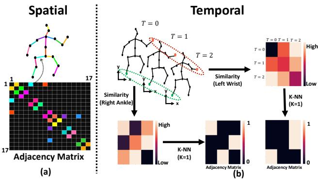
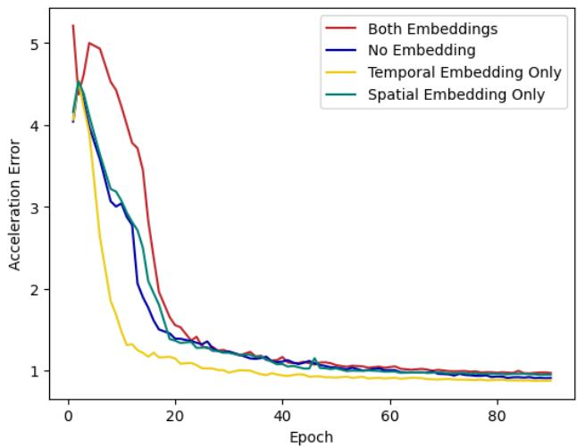
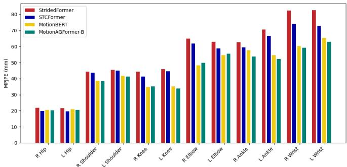
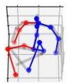
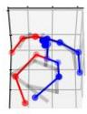
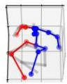

# MotionAGFormer：利用 Transformer-GCNFormer 网络增强三维人体姿态估计

Soroush Mehraban1,2, Vida Adeli1,3, Babak Taati1,2,3

1KITE Research Institute（KITE 研究所）, 2Institute of Biomedical Engineering, University of Toronto（多伦多大学生物医学工程研究所）, 3Department of Computer Science, University of Toronto（多伦多大学计算机科学系）

{soroush.mehraban, vida.adeli}@mail.utoronto.ca, babak.taati@uhn.ca

## 摘要

Recent transformer-based approaches have demonstrated excellent performance in 3D human pose estimation. However, they have a holistic view and by encoding global relationships between all the joints, they do not capture the local dependencies precisely. In this paper, we present a novel Attention-GCNFormer (AGFormer) block that divides the number of channels by using two parallel transformer and GCNFormer streams. Our proposed GCN-Former module exploits the local relationship between adjacent joints, outputting a new representation that is complementary to the transformer output. By fusing these two representation in an adaptive way, AGFormer exhibits the ability to better learn the underlying 3D structure. By stacking multiple AGFormer blocks, we propose Motion-AGFormer in four different variants, which can be chosen based on the speed-accuracy trade-off. We evaluate our model on two popular benchmark datasets: Human3.6M and MPI-INF-3DHP. MotionAGFormer-B achieves stateof-the-art results, with P1 errors of 38.4 mm and 16.2 mm, respectively. Remarkably, it uses a quarter of the parameters and is three times more computationally efficient than the previous leading model on Human3.6M dataset. Code and models are available at https://github.com/ TaatiTeam/MotionAGFormer.

基于 Transformer 的近期方法在三维人体姿态估计中已展现出卓越性能。然而，这类方法采用全局视角，通过编码所有关节点之间的全局关系，无法精确捕捉局部依赖关系。本文提出了一种新颖的注意力-图卷积前馈（Attention-GCNFormer，AGFormer）块，该块通过两条并行的 Transformer 和 GCNFormer 流来划分通道数。我们提出的 GCN-Former 模块利用相邻关节点之间的局部关系，输出与 Transformer 输出互补的新表示。通过以自适应方式融合这两种表示，AGFormer 能够更好地学习底层的三维结构。通过堆叠多个 AGFormer 块，我们以四种不同的变体形式提出了 Motion-AGFormer，可根据速度-精度的权衡进行选择。我们在两个流行的基准数据集 Human3.6M 和 MPI-INF-3DHP 上对模型进行了评估。MotionAGFormer-B 取得了最先进（state-of-the-art）的结果，P1 误差分别为 38.4 mm 和 16.2 mm。值得注意的是，在 Human3.6M 数据集上，其参数量仅为此前最优模型的四分之一，计算效率提升了三倍。代码与模型已在 https://github.com/TaatiTeam/MotionAGFormer 开源。

## 1. 引言

Human pose estimation in 3D space is an active area of research with significant implications for numerous applications, from augmented [21] and virtual reality [26] to autonomous vehicles [2, 9, 43], human-computer interaction [27] and beyond. With this vast range of applications, the demand for more accurate and computationally efficient pose estimation models continues to grow. In most real-world scenarios, pose sequences are captured in 2D, primarily due to the prevalent use of standard RGB cameras. Consequently, one of the pivotal challenges in the field has been to effectively lift these 2D sequences into a 3D space. Accurate 3D human pose estimation enables the extraction of rich spatio-temporal information about human movements, and a deeper understanding of activities and interactions. Recent 3D lifting models leverage the inherent spatial and temporal coherence of human movements to enhance the precision of 3D pose predictions. Nonetheless, despite the considerable advancements, there are several significant challenges that require attention.

三维人体姿态估计是一个活跃的研究领域，对众多应用具有重要意义，涵盖增强现实 [21] 与虚拟现实 [26]，以及自动驾驶车辆 [2, 9, 43]、人机交互 [27] 等等。随着应用范围的不断扩大，对更精确且计算效率更高的姿态估计模型的需求持续增长。在大多数真实场景中，由于标准 RGB 相机的广泛使用，姿态序列以二维形式采集。因此，如何有效地将这些二维序列提升至三维空间，便成为该领域中的关键挑战之一。精确的三维人体姿态估计能够提取丰富的时空信息以刻画人体运动，并有助于更深入地理解人类活动与交互行为。近期涌现的三维姿态提升模型充分利用人体运动固有的时空一致性，提升三维姿态预测的精度。然而，尽管该领域已取得显著进展，仍存在若干亟待关注的重要挑战。

  

图1. 在 Human3.6M [14] 数据集上对近期姿态提升（pose uplifting）方法的对比（数值越低越好）。MACs/frame 表示每个输出帧所需的乘累加运算次数。所提出的 MotionAGFormer 提供了不同的变体，并在保持计算效率的同时取得了更优的结果。

Transformer 架构 [41] 最初是为自然语言处理（NLP）任务设计的，已被适配于多种计算机视觉问题，包括姿态估计。其捕捉长程依赖的能力以及固有的自注意力机制使其成为该领域一个有前景的候选方案。然而，像标准 Transformer 那样单纯依赖全局注意力机制对于姿态估计任务可能并非最优。人体运动本质上具有局部空间和时间依赖的结构。

一个主要关注点在于对骨骼随时间变化的关系进行建模。现有方法主要依赖 Transformer 架构或基于图的模型。虽然 Transformer 擅长捕捉长期依赖，但图模型擅长捕捉局部依赖。因此，存在构建一个统一架构的机会，将 Transformer 的全局视角与图模型的局部精度相融合。

此外，对达到最先进（SOTA）精度的追求常常导致开发参数数量越来越多的复杂模型。这些模型尽管精度良好，但在计算效率和快速响应时间至关重要的实际应用中往往变得不切实际。此外，近期模型中一种主流方法是仅从一段帧序列中预测中心帧的单个三维姿态。这种方法虽然看似高效，但由于需要重新处理多个重叠序列，会导致计算冗余。因此，我们转而采用一种精简的推理策略，以最优方式利用序列数据。该方法通过在单次前向传播中预测输入的完整三维序列来最小化冗余。

在本文中，我们提出了 MotionAGFormer，这是一种为三维人体姿态估计量身定制的新型 Transformer-图混合架构。MotionAGFormer 的核心是利用 Transformer 的力量捕捉全局信息，同时使用图卷积网络（GCN）整合局部空间和时间关系。我们采用自适应融合来聚合来自 Transformer 和图流的特征。通过这样做，我们确保了对人体运动的平衡且全面的表征，从而提升三维姿态估计的精度（见图 1）。

总之，我们论文的主要贡献如下：

• 新颖设计：我们提出了 MotionAGFormer 模型，其中引入了一个新的 GCNFormer 模块，该模块在表示人体姿态序列中固有的局部依赖方面表现出色。

• 效率与灵活性：i) 我们的 MotionAGFormer 因其轻量化的特性和相比先前 SOTA 方法更少参数下的更快速度而脱颖而出，同时不牺牲精度。ii) 考虑到需求的多样性，我们提供了 MotionAGFormer 的不同变体，让用户能够根据其特定需求在精度和速度之间做出平衡选择。

• SOTA 性能：MotionAGFormer 在两个具有挑战性的数据集 Human3.6M 和 MPI-INF-3DHP 上达到了 SOTA。

## 2. 相关工作

三维人体姿态估计。当前解决该问题的方法可以从两个视角来理解。从一个视角来看，模型可以根据输入视频进行分类，输入视频可以是多视角或单视角的。依赖多视角输入的模型 [7, 15, 34, 35, 48] 需要同时使用来自不同角度的多台相机，这在现实场景中可行性较低。从另一个视角来看，根据方法论的不同，这些模型可以分为直接三维估计方法或二维到三维提升方法。直接三维估计方法 [31, 32, 39, 52] 不经过任何中间步骤，直接从视频帧推断三维坐标系中的关节点。受近年来准确二维姿态估计模型快速发展和广泛可用性的启发，近期的二维到三维提升方法首先使用现成的二维姿态检测器 [4, 28, 38]，然后将二维坐标提升到三维空间 [40, 47, 50, 51, 53]。在本文中，我们使用二维到三维提升方法，以单目视频作为输入。

基于 Transformer 的方法。Transformer [41] 在不同的视觉任务中取得了令人瞩目的成果 [10, 37, 45, 54]。在三维人体姿态估计领域，Pose-Former [51] 是首个纯 Transformer 模型。PoseFormerV2 [50] 通过采用频域表示提升了其计算效率，同时该表示还使其对噪声数据中的突发运动具有鲁棒性。MHFormer [20] 通过提出一个学习多个合理姿态假设的模块，解决了自遮挡和深度模糊问题。P-STMO [36] 提出了掩码姿态建模（masked pose modeling），通过对模型进行自监督预训练来降低最终误差。Enfalt 等人 [11] 通过利用掩码标记建模降低了计算复杂度。StridedFormer [19] 用步幅卷积替换了 Transformer 编码器前馈网络中的全连接层，以逐步缩短序列长度并高效地提升（lifting）中心帧。与上述仅对序列中心帧估计三维姿态的模型不同，MixSTE [47] 对输入序列中的每一帧都提供了三维估计。STCFormer [40] 通过将相关性学习分离为空间和时间两个部分来降低计算复杂度。HSTFormer [33] 提出了一种层次化的 Transformer 编码器，以更好地捕捉时空相关性。除了常用的关节-关节注意力之外，HDFormer [3] 还引入了骨骼-关节和超骨骼-关节的交互。一些工作利用输出的运动表示来完成多种任务。MotionBERT [53] 将为三维人体姿态估计任务学习的模型微调后用于动作识别和三维人体网格恢复等任务，而 UPS [12] 则同时训练了一个统一的模型来执行动作识别、三维姿态估计和早期动作预测。

图卷积网络。基于 GCN 的方法在基于骨架的动作识别领域取得了显著成功 [5, 18, 22]。尽管它们在三维人体姿态估计中具有计算效率优势 [6, 8, 42, 49]，但与基于 Transformer 的对应方法相比，它们通常无法展现出有竞争力的误差。这主要是因为它们仅关注局部关节。最近，GLA-GCN [44] 提出了一种自适应的 GCN 方法以利用全局表示。通过采用步幅设计以缩减其时间范围，他们实现了与各种基于 Transformer 的模型相媲美的三维人体姿态估计性能，同时保持了更轻的内存占用。然而，所提模块在提取全局表示方面的有效性仍不及注意力模块。

混合方法（Hybrid methods）。这些方法使用不同的模块来捕获输入序列的不同方面，迄今为止尚未得到广泛探索。最近，DC-GCT [16] 提出了基于 GCN 的局部约束模块（Local Constraint Module）和基于自注意力的全局约束模块（Global Constraint Module），以同时利用输入序列的局部依赖和全局依赖。然而，由于其模型被设计为同时对单帧输入和帧序列进行操作，因此并未对时间维度与空间维度加以区分。因此，与基于 Transformer 的方法相比，其结果竞争力不足。

## 3. 方法

## 3.1. 预备知识

本节首先回顾 MetaFormer [46] 的概念，它构成了我们编码器的核心。MetaFormer 可被视为 Transformer 架构 [41] 的一种推广形式，其中注意力模块被替换为任何能够在 token 之间转换信息的混合器（mixer）。具体而言，对于输入 $\check { X } \in \mathbb { R } ^ { N \times C }$，其中 $N$ 表示 token 的数量，$C$ 表示嵌入维度，token 混合器可以形式化地表示为

$$
Y = { \mathrm { T o k e n M i x e r } } ( { \mathrm { N o r m } } ( X ) ) + X ,\tag{1}
$$

其中 Norm(·) 表示诸如批归一化（Batch Normalization）或层归一化（Layer Normalization）[1,13] 之类的归一化方法，TokenMixer(·) 表示在 token 之间整合信息的模块。我们的方法采用两个并行的 token 混合器：多头自注意力（Multi-head Self-Attention, MHSA）和图卷积网络（Graph Convolutional Networks, GCN）[17]，它们在信息转换过程中各自发挥着独特的作用。

## 3.2. 总体架构

我们的目标是将二维（像素坐标）骨架序列提升为精确的三维姿态序列。为此，我们提出了 MotionAGFormer 架构，该架构同时使用注意力机制（Transformer）和图卷积（GCNFormer）来提升运动序列。该架构的概览如图 2a 所示。

模型接收带有置信度分数的二维输入序列 $\mathbf { X } \in \mathbb { R } ^ { T \times J \times 3 }$，其中 $T$ 和 $J$ 分别表示帧数和关节数。随后，模型使用一个线性投影层，将每个时间帧中的每个关节映射为一个 $d$ 维特征 $\mathbf { F } ^ { ( 0 ) } \in \mathbb { R } ^ { T \times J \times d }$。接着，将一个空间位置嵌入 $\mathbf { P _ { p o s } ^ { s } } \in \bar { \mathbb { R } ^ { 1 \times J \times d } }$ 加到 token 上。这里需要着重指出的是，我们的模型并未忽略时间 token 的顺序，因为该信息在 GCNFormer 流中得以保留（进一步的讨论见消融研究第 4.5 节）。

经过位置嵌入之后，我们使用 N 个 AGFormer 块（第 3.3 节）来计算 $\mathbf { F } ^ { ( i ) } ~ \in ~ \mathbb { R } ^ { T \times J }$ ×d $( i \ = \ 1 , . . . , N )$，以有效捕捉骨架序列的底层 3D 结构。最后，我们通过应用线性层和 tanh 激活函数将 $\bar { \mathbf { F } } ^ { ( N ) }$ 映射到更高维度，以计算运动语义 $\mathbf { M } \in \dot { \mathbb { R } } ^ { T \times J \times d ^ { \prime } }$，并使用回归头估计 3D 姿态 $\hat { \textbf { P } } \in \mathbb { R } ^ { T \times J \times 3 }$。提升损失包含位置项 $\left( L _ { 3 D } \right)$ 和速度项 $( L _ { \Delta \mathbf { P } } )$，其定义如下：

$$
\begin{array} { r l } & { L _ { 3 D } = \Sigma _ { t = 1 } ^ { T } \Sigma _ { j = 1 } ^ { J } \Vert \hat { \mathbf { P } } _ { t , j } - \mathbf { P } _ { t , j } \Vert , } \\ & { L _ { \Delta \mathbf { P } } = \Sigma _ { t = 2 } ^ { T } \Sigma _ { j = 1 } ^ { J } \Vert \Delta \hat { \mathbf { P } } _ { t , j } - \Delta \mathbf { P } _ { t , j } \Vert , } \end{array}\tag{2}
$$

其中 $\Delta \hat { \mathbf P } _ { t } = \hat { \mathbf P } _ { t } - \hat { \mathbf P } _ { t - 1 } , \Delta \mathbf P _ { t } = \mathbf P _ { t } - \mathbf P _ { t - 1 }$。总提升损失定义如下：

$$
{ \cal L } = { \cal L } _ { 3 D } + \lambda _ { \Delta \mathbf { P } } { \cal L } _ { \Delta \mathbf { P } } ,\tag{3}
$$

其中常数系数 $\lambda _ { \Delta \mathbf { P } }$ 用于平衡位置精度和运动平滑度。

## 3.3. AGFormer 块

AGFormer 块采用双流架构（dual-stream architecture）。每个流由两个组件组成：空间 MetaFormer（Spatial MetaFormer，图 2b）和紧随其后的时间 MetaFormer（Temporal MetaFormer，图 2c）。空间 MetaFormer 将各个身体关节点作为不同的 token 进行处理，从而有效捕捉单帧内的帧内关系。而时间 MetaFormer 则将每一帧视为单个 token，从而捕捉跨时间的帧间关系。两个流之间的关键区别在于其 token 混合器（token mixer）类型。其中一个流使用 Transformer，而另一个流使用 GCNFormers。

Transformer 流。该流采用空间多头自注意力（Spatial Multi-Head Self-Attention, S-MHSA）来捕捉空间关系，随后采用时间多头自注意力（Temporal Multi-Head Self-Attention, T-MHSA）来捕捉时间关系。S-MHSA 定义如下：

$$
\begin{array} { r } { \mathrm { S } \mathrm { - } \mathbf { M H S A } ( \mathbf { Q _ { s } } , \mathbf { K _ { s } } , \mathbf { V _ { s } } ) = \mathrm { C o n c a t } ( \mathrm { h e a d _ { i } } , . . . , \mathrm { h e a d _ { h } } ) { \mathbf { W _ { s } } } ^ { ( O ) } , } \\ { \mathrm { h e a d _ { i } } = \mathrm { s o f t m a x } ( \frac { \mathbf { Q _ { s } } ^ { ( i ) } ( \mathbf { K _ { s } } ^ { ( i ) } ) ^ { T } } { \sqrt { d _ { k } } } ) \mathbf { V _ { s } } ^ { ( i ) } , } \end{array}\tag{4}
$$

  

图2. (a) MotionAGFormer 是一种新颖的架构，由 N 个双流时空块（dual-stream spatio-temporal blocks）组成，其中一个流采用 Transformer，另一个流利用 GCNFormer。（b）空间 MetaFormer（Spatial MetaFormer）。每个输入 token 表示人体的单个关节。（c）时间 MetaFormer（Temporal MetaFormer）。输入 token 是姿态序列的帧。

其中 $\mathbf{W}_s^{(O)}$ 是投影参数矩阵，$h$ 是并行注意力头的数量，$d_k$ 是 $\mathbf{K}_s$ 的特征维度。为了计算查询矩阵 $\mathbf{Q}_s$、键矩阵 $\mathbf{K}_s$ 和值矩阵 $\mathbf{V}_s$。，我们有

$$
\mathbf { Q _ { s } } ^ { i } = \mathbf { F _ { s } } \mathbf { W _ { s } } ^ { ( Q , i ) } , \mathbf { K _ { s } } ^ { i } = \mathbf { F _ { s } } \mathbf { W _ { s } } ^ { ( K , i ) } , \mathbf { V _ { s } } ^ { i } = \mathbf { F _ { s } } \mathbf { W _ { s } } ^ { ( V , i ) } ,\tag{5}
$$

其中 $\mathbf{F}_s \in \mathbb{R}^{BT \times J \times d}$ 是空间特征，$\mathbf{W}_s^{(Q,i)}$、$\mathbf{W}_s^{(K,i)}$、$\mathbf{W}_s^{(V,i)}$ 是投影矩阵，$B$ 是批量大小。S-MHSA 的结果随后被送入多层感知机（multilayer perceptron, MLP），接着经过残差连接和层归一化（LayerNorm）。这就完成了第一个 MetaFormer，即空间 Transformer（Spatial Transformer）。

接下来，我们将 $\mathbf{F}_s$ 重塑为 $\mathbf{F}_T \in \mathbb{R}^{BJ \times T \times d}$，以准备每个关节的时间特征作为 T-MHSA 的输入。这里我们有

$$
\begin{array} { r } { \mathrm { { T } - M H S A ( { \mathbf { Q } } _ { T } , { \mathbf { K } } _ { T } , { \mathbf { V } } _ { T } ) } = \mathrm { { C o n c a t } } ( \mathrm { { h e a d } } _ { \mathrm { { i } } } , . . . , \mathrm { { h e a d } _ { h } } ) { \mathbf { W } } _ { \mathbf { T } } { \mathbf { \Lambda } } ^ { ( O ) } , } \\ { \mathrm { { h e a d } } _ { \mathrm { { i } } } = \mathrm { { s o f t m a x } } ( \frac { { \mathbf { Q } } _ { \mathbf { T } } { \mathbf { \Lambda } } ^ { ( i ) } ( { \mathbf { K } } _ { \mathbf { T } } { \mathbf { \Lambda } } ^ { ( i ) } ) ^ { T } } { \sqrt { d _ { k } } } ) { \mathbf { V } } _ { \mathbf { T } } { \mathbf { \Lambda } } ^ { ( i ) } , } \end{array}\tag{6}
$$

其中 $\mathbf{Q}_T$、$\mathbf{K}_T$ 和 $\mathbf{V}_T$ 的计算方式与公式 (5) 类似。

**GCNFormer 流。** 与聚合全局信息的 Transformer 流不同，GCNFormer 流专注于骨骼序列中存在的局部空间和时间关系。虽然 Transformer 也能获得局部信息，但加入这个并行流使模型能够更有效地平衡局部与全局信息的整合（见消融分析 4.5）。我们 GCNFormer 中使用的定制图卷积网络（Graph Convolutional Network, GCN）模块 [24] 定义如下：

$$
G C N ( \mathbf { F } ^ { ( \mathbf { i } ) } ) = \sigma ( V ^ { l } + \mathrm { N o r m } ( \tilde { D } ^ { - \frac { 1 } { 2 } } \tilde { A } \tilde { D } ^ { - \frac { 1 } { 2 } } \mathbf { F } ^ { ( \mathbf { i } ) } W _ { 1 } + \mathbf { F } ^ { ( \mathbf { i } ) } W _ { 2 } ) .\tag{7}
$$

其中 $\tilde { A } = A + I _ { N }$ 表示添加自连接后的邻接矩阵，$I _ { N }$ 代表单位矩阵，$\tilde { D } i i = \Sigma j \tilde { A } j j$ 被定义为 $\tilde{A}$ 对角线上元素之和，$W _ { 1 } , W _ { 2 }$ 表示每一层特有的可训练权重矩阵。激活函数 σ(·)（如 ReLU）被应用，同时使用批归一化 [13]。GCN 的输出随后通过一个 MLP 处理，再经过残差连接和 LayerNorm。

Spatial GCNFormer 与 Temporal GCNFormer 的区别在于它们的邻接矩阵和输入特征。输入特征与 Transformer 流的类似。在 Spatial GCNFormer 中，邻接矩阵表示人体拓扑结构（图 3a）。而对于 Temporal GCNFormer，我们使用 $\begin{array} { r } { { S i m } ( { { \bf \ddot { F } _ { T } } ^ { t _ { i } } } , { \bf F _ { T } } ^ { t _ { j } } ) = ( { \bf \ddot { F } _ { T } } ^ { t _ { i } } ) ^ { T } { \bf F _ { T } } ^ { t _ { j } } } \end{array}$ 计算同一关节点在不同时间帧之间的相似性，并选择 K 个最近邻作为图中相连的节点（图 3b）。因此，Temporal GCNFormer 中的图拓扑由学习到的节点特征决定。

自适应融合。与 MotionBERT [53] 类似，我们使用自适应融合来聚合 Transformer 流和 GCNFormer 流所提取的特征。定义如下：

$$
\mathbf { F } ^ { ( i ) } = \alpha _ { T F } { } ^ { ( i ) } \circ \mathbf { F } _ { \mathbf { T F } } { } ^ { ( i - 1 ) } + \alpha _ { G F } { } ^ { ( i ) } \circ \mathbf { F } _ { \mathbf { G F } } { } ^ { ( i - 1 ) } ,\tag{8}
$$

其中 $\mathbf { F } ^ { ( i ) }$ 表示在第 i 层提取的特征嵌入，$^ { \mathrm { ~ O ~ } }$ 表示逐元素乘法，$\mathbf { F _ { T F } } ^ { \prime } ( i \mathrm { - } 1 ) , ~ \mathbf { F _ { G F } } ^ { ( i \mathrm { - } 1 ) }$ 分别指在第 i-1 层提取的 Transformer 流和 GCNFormer 流的特征。自适应融合权重 $\alpha _ { T F }$ 和 $\alpha _ { G F }$ 是

  

图 3. GCNFormer 模块拓扑结构。（a）空间 GCN-Former 以人体骨架作为其底层拓扑结构。（b）时序 GCNFormer 使用 K 近邻（K-NN）来确定连接边，方法是在整个时间范围内考虑每个关节的最高相似度（例如图中的左腕和右踝）。经过 K-NN 后，每一行连接到 K 列。

定义为

$$
\alpha _ { T F } { } ^ { ( i ) } , \alpha _ { G F } { } ^ { ( i ) } = \mathrm { s o f t m a x } ( W \cdot \mathrm { C o n c a t } ( { \bf F } _ { { \bf T F } } { } ^ { ( i - 1 ) } , { \bf F } _ { { \bf G F } } { } ^ { ( i - 1 ) } ) ) ,\tag{9}
$$

其中 W 为可学习的线性变换。

## 4. 实验

我们在两个大规模 3D 人体姿态估计数据集上评估所提出的 Motion-AGFormer 的性能，即 Human3.6M [14] 和 MPI-INF-3DHP [25]。

## 4.1. 数据集与评估指标

Human3.6M 是一个广泛使用的室内 3D 人体姿态估计数据集。它包含 360 万帧视频，由 11 位受试者执行 15 种不同的日常活动。为确保公平评估，我们遵循标准方法，使用受试者 1、5、6、7 和 8 的数据训练模型，然后在受试者 9 和 11 的数据上进行测试。遵循先前的工作 [40, 50]，我们使用两种协议进行评估。第一种协议（记为 P1）使用估计姿态与真实姿态之间的平均每关节位置误差（Mean Per Joint Position Error, MPJPE），单位为毫米，在对齐其根关节（骶骨）后计算。第二种协议（记为 P2）测量 Procrustes-MPJPE，其中真实姿态与估计姿态通过刚体变换对齐。

MPI-INF-3DHP 是另一个大规模数据集，在三种不同的环境中采集：绿幕、非绿幕和户外环境。遵循先前的工作 [40, 50]，将 MPJPE、150 毫米范围内的关键点正确率（Percentage of Correct Keypoint, PC）以及曲线下面积（Area Under the Curve, AUC）作为评估指标进行报告。

## 4.2. 实现细节

模型变体。如表 1 所示，我们构建了模型的四种不同配置。我们的基础模型，称为 MotionAGFormer-B，在精确估计和计算成本之间取得了平衡。其余变体根据其参数大小和计算需求进行命名，每个变体的选择可基于应用需求，例如在实时处理或更精确估计之间进行权衡。所有实验中，运动语义维度为 $d ^ { \prime } = 5 1 2$，每个 MLP 的扩展层为 $\alpha = 4 ,$，注意力头数为 $h = 8 ,$ ，GCNformer 流中的时间邻居数为 $k = 2 .$ 。

表 1. MotionAGFormer 模型变体的详细信息。N：层数。d：隐藏层大小。T：输入帧数。

<table><tr><td>Method</td><td>N</td><td>d</td><td>T</td><td>Params</td><td>MACs</td></tr><tr><td>MotionAGFormer-XS</td><td>12</td><td>64</td><td>27</td><td>2.2 M</td><td>1.0 G</td></tr><tr><td>MotionAGFormer-S</td><td>26</td><td>64</td><td>81</td><td>4.8M</td><td>6.6 G</td></tr><tr><td>MotionAGFormer-B</td><td>16</td><td>128</td><td>243</td><td>11.7 M</td><td>48.3 G</td></tr><tr><td>MotionAGFormer-L</td><td>26</td><td>128</td><td>243</td><td>19.0 M</td><td>78.3 G</td></tr></table>

实验设置。我们的模型使用 PyTorch [30] 实现，并在配备两块 NVIDIA A40 GPU 的设备上运行。我们遵循 [50, 53] 的做法，在训练和测试阶段均采用水平翻转数据增强。对于模型训练，我们将每个 mini-batch 设为 16 个序列。网络参数使用 AdamW [23] 优化器在 90 个 epoch 上进行优化，权重衰减设为 0.01。初始学习率设为 5e-4，采用指数学习率衰减调度，衰减因子为 0.99。我们沿用 [53] 的设置，在 Human3.6M 上使用 Stacked Hourglass [29] 的 2D 姿态检测结果和 2D 真值。对于 MPI-INF-3DHP，参照对比基线 [40, 50] 中使用的类似方法，采用 2D 真值检测结果。

## 4.3. 在 Human3.6M 上的性能对比

我们在 Human3.6M 上将 MotionAGFormer 与其他模型进行比较。为保证公平对比，仅纳入未在额外数据上进行预训练的模型的结果。如表 2 所示，结果表明 MotionAGFormer-L 在使用估计的 2D 姿态时取得了 38.4 mm 的 P1 误差，在使用 2D 真值时取得了 17.3 mm 的 P1 误差。值得注意的是，与此前最先进的模型（MotionBERT [53]）相比，该模型在仅需约一半计算量和参数量的情况下，分别还提升了 0.8 mm 和 0.5 mm 的精度。在对比 Base 和 Large 两种规格时，MotionAGFormer-L 在存在噪声数据的情况下与 MotionAGFormer-B 具有相同的 P1 误差，而在使用 2D 真值数据时则将误差降低了 2.1 mm。此外，

  

图 4. MotionAGFormer 与 STCformer [40]、PoseFormerV2 [50] 和 MotionBERT [53] 的定性对比。半透明灰色骨架为真实 3D 姿态。蓝色表示躯干和左侧部分，红色表示估计人体的右侧部分。

表2. Human3.6M 上的定量比较。T：输入帧数。CE：仅估计中间帧。P1：MPJPE 误差（mm）。P2：P-MPJPE 误差（mm）。P1†：在 2D 真值上的 P1 误差。（\*）表示使用 HRNet [38] 进行 2D 姿态估计。最佳和次佳分数分别以粗体和下划线标示。各动作的详细结果请参见补充材料。

<table><tr><td>Method</td><td>T</td><td>CE</td><td>Param</td><td>MACs</td><td>MACs/frame</td><td>P1↓/P2↓</td><td>P1†↓</td></tr><tr><td>*MHFormer [20] CVPR&#x27;22</td><td>351</td><td>√</td><td>30.9 M</td><td>7.0 G</td><td>7,096M</td><td>43.0/34.4</td><td>30.5</td></tr><tr><td>MixSTE [47] CVPR’22</td><td>243</td><td>X</td><td>33.6 M</td><td>139.0 G</td><td>572M</td><td>40.9/32.6</td><td>21.6</td></tr><tr><td>P-STMO [36] ECCV’22</td><td>243</td><td>√</td><td>6.2 M</td><td>0.7 G</td><td>740 M</td><td>42.8/34.4</td><td>29.3</td></tr><tr><td>Stridedformer [19] TMM&#x27;22</td><td>351</td><td>√</td><td>4.0 M</td><td>0.8 G</td><td>801 M</td><td>43.7/35.2</td><td>28.5</td></tr><tr><td>Einfalt et al. [11] WACV&#x27;23</td><td>351</td><td>√</td><td>10.4 M</td><td>0.5 G</td><td>498M</td><td>44.2/35.7</td><td></td></tr><tr><td>STCFormer [40] CVPR’23</td><td>243</td><td>X</td><td>4.7 M</td><td>19.6 G</td><td>80 M</td><td>41.0/32.0</td><td>21.3</td></tr><tr><td>STCFormer-L [40] CVPR’23</td><td>243</td><td>X</td><td>18.9 M</td><td>78.2 G</td><td>321 M</td><td>40.5/31.8</td><td></td></tr><tr><td>PoseFormerV2 [50] CVPR’23</td><td>243</td><td>√</td><td>14.3 M</td><td>0.5 G</td><td>528M</td><td>45.2/35.6</td><td></td></tr><tr><td>UPS [12] CVPR’23</td><td>243</td><td>√</td><td></td><td></td><td></td><td>40.8/32.5</td><td></td></tr><tr><td>GLA-GCN [44] ICCV’23</td><td>243</td><td>√</td><td>1.3 M</td><td>1.5 G</td><td>1,556 M</td><td>44.4/34.8</td><td>21.0</td></tr><tr><td>MotionBERT [53] ICCV&#x27;23</td><td>243</td><td>X</td><td>42.5 M</td><td>174.7 G</td><td>719 M</td><td>39.2/32.9</td><td>17.8</td></tr><tr><td>HDFormer [3] IJCAI&#x27;23</td><td>96</td><td>X</td><td>3.7 M</td><td>0.6 G</td><td>6M</td><td>42.6/33.1</td><td>21.6</td></tr><tr><td>HSTFormer [33] arXiv&#x27;23</td><td>81</td><td>X</td><td>22.7 M</td><td>1.0 G</td><td>13M</td><td>42.7/33.7</td><td>27.8</td></tr><tr><td>DC-GCT [16] arXiv&#x27;23</td><td>81</td><td>√</td><td>3.1 M</td><td>41 M</td><td>41 M</td><td>44.71-</td><td></td></tr><tr><td>MotionAGFormer-XS</td><td>27</td><td>X</td><td>2.2 M</td><td>1.0 G</td><td>37M</td><td>45.1/36.9</td><td>28.1</td></tr><tr><td>MotionAGFormer-S</td><td>81</td><td>X</td><td>4.8M</td><td>6.6 G</td><td>81 M</td><td>42.5/35.3</td><td>26.5</td></tr><tr><td>MotionAGFormer-B</td><td>243</td><td>X</td><td>11.7 M</td><td>48.3 G</td><td>198 M</td><td>38.4/32.6</td><td>19.4</td></tr><tr><td>MotionAGFormer-L</td><td>243</td><td>X</td><td>19.0 M</td><td>78.3 G</td><td>322 M</td><td>38.4/32.5</td><td>17.3</td></tr></table>

MotionAGFormer-S 仅使用基线方法三分之一的输入帧数，却在 P1 误差上优于大多数基线方法。类似地，MotionAGFormer-XS 虽然仅接收九分之一的输入信息（27 帧 vs. 243 帧），且参数量约为 PoseTransformerV2 的七分之一，却仍能达到与之相当的性能。

## 4.4. 在 MPI-INF-3DHP 上的性能对比

在 MPI-INF-3DHP 数据集上评估我们的方法时，由于视频序列较短，我们将 base 和 large 变体修改为使用 81 帧。在所有变体中，我们的方法在 MPJPE 指标上均稳定优于其他方法。值得注意的是，我们的 large 变体取得了显著的结果，AUC 达到 85.3%，P1 误差为 16.2 mm，在 AUC 指标上超出最佳模型 1.4%，在 P1 误差上超出 6.9 mm。然而，其 PCK 为 98.2%，比对比模型的 PCK 表现低 0.5%（表 3）。

Table 3. 在 MPI-INF-3DHP 上的定量对比。T：输入帧数。最佳和次佳分数分别以加粗和下划线标示。

<table><tr><td>Method</td><td>T</td><td>PCK↑ AUC↑</td><td>MPJPE↓</td></tr><tr><td>MHFormer [20]</td><td>9</td><td>93.8 94.4</td><td>63.3 58.0</td></tr><tr><td>MixSTE [47] P-STMO [36]</td><td>27 81</td><td>66.5 75.8</td><td>54.9 32.2</td></tr><tr><td>Einfalt et al. [11]</td><td>81</td><td>97.9 95.4 67.6</td><td>46.9</td></tr><tr><td>STCFormer [40]</td><td>81</td><td>98.7 83.9</td><td>23.1</td></tr><tr><td>PoseFormerV2 [50]</td><td></td><td></td><td></td></tr><tr><td></td><td>81</td><td>97.9 78.8</td><td>27.8</td></tr><tr><td>GLA-GCN [44]</td><td>81</td><td>98.5 79.1</td><td>27.7</td></tr><tr><td>HSTFormer [33]</td><td>81</td><td>97.3 71.5</td><td>41.4</td></tr><tr><td>HDFormer [3]</td><td>96</td><td>98.7 72.9</td><td>37.2</td></tr><tr><td>MotionAGFormer-XS</td><td>27</td><td>98.2 83.5</td><td>19.2</td></tr><tr><td>MotionAGFormer-S</td><td>81</td><td>98.3 84.5</td><td>17.1</td></tr><tr><td>MotionAGFormer-B</td><td>81</td><td>98.3 84.2</td><td>18.2</td></tr><tr><td>MotionAGFormer-L</td><td>81</td><td>98.2 85.3</td><td>16.2</td></tr></table>

## 4.5. 消融研究（Ablation Studies）

一系列消融研究在 Human3.6M 数据集上进行，旨在探究 AGFormer 块的不同设计选择。

第一项消融研究考察了 AGFormer 块的数量与模型宽度对 P1 误差的影响。如表 4 所示，总体趋势倾向于更深但更窄的模型。有趣的是，配备 16 个 AGFormer 块且宽度为 128 的模型，与配备 12 个 AGFormer 块且宽度为 256 的模型性能相当，而前者所使用的内存与计算资源约为后者的三分之一。

消融研究的第二部分探究了 AGFormer 块中图分支（graph stream）的替代模块。结果如表 5 所示。从 GCNFormer 切换到 GCN 块会使 P1 误差恶化 0.7 毫米。类似地，使用 GCN 时，将时序 GCNFormer 替换为 TCN 会使 P1 误差恶化 0.2 毫米；使用 GCNFormer 时则会恶化 0.9 毫米。最后，将 GCN 替换为 CTR-GCN [5] 会使 P1 误差增加 2.5 毫米。我们推测，这是由于 CTR-GCN 在训练过程中对每个通道的拓扑结构进行持续细化所致。因此，每个关节不仅从其直接邻居获取信息，还从所有其他关节获取信息，从而阻碍了变换器分支（transformer stream）互补信息的生成。

为探究位置编码对最终性能的影响，我们进行了一系列实验，详见表 6。令人惊讶的是，除空间位置编码外，再加入时序位置编码会使 P1 误差上升 0.6 毫米。正如第 3.2 节所述，这一结果源于 GCNFormer 分支所具有的非置换等变（non-permutation equivariant）特性。与变换器不同，我们的网络天然地保持帧的时序排列。然而，如图 5 所示，相较于仅使用空间位置编码（0.94 毫米），加入时序位置编码可获得更优的加速度误差（0.88 毫米）。

最后，为验证所提出的 AG-Former 块的有效性，表 7 列出了若干替代块。仅使用 GCNFormer 时，P1 误差为 57.5 毫米，表明其准确捕捉底层 3D 序列结构的能力有限。然而，将 GCNFormer 与 Transformer 相结合的混合方案带来了显著改进，相较于单独使用 Transformer，P1 误差下降了 5.2 毫米。此外，两者的串行融合效果不如并行整合。

表 4. 通过改变 AG-Former 块数量与通道数进行的 P1 误差对比。d：每个 AGFormer 块中的通道数。d′：回归头之前的通道数。所有实验中 T 均保持为 243。

<table><tr><td>Layers</td><td> $d$ </td><td> $\overline { { d ^ { \prime } } }$ </td><td>Param</td><td>MACs</td><td>P1</td></tr><tr><td>5</td><td>512</td><td>512</td><td>58M</td><td>252.8 G</td><td>39.2</td></tr><tr><td>4</td><td>256</td><td>512</td><td>11.7 M</td><td>54.G G</td><td>40.2</td></tr><tr><td>6</td><td>256</td><td>512</td><td>17.5 M</td><td>81.64 G</td><td>39.6</td></tr><tr><td>8</td><td>256</td><td>512</td><td>23.3 M</td><td>108.6 G</td><td>39.5</td></tr><tr><td>10</td><td>256</td><td>512</td><td>29.1 M</td><td>135.7 G</td><td>38.6</td></tr><tr><td>12</td><td>256</td><td>512</td><td>34.9 M</td><td>162.7 G</td><td>38.4</td></tr><tr><td>14</td><td>256</td><td>512</td><td>40.7 M</td><td>189.7 G</td><td>38.6</td></tr><tr><td>16</td><td>128</td><td>512</td><td>11.7 M</td><td>64.7 G</td><td>38.4</td></tr><tr><td>16</td><td>128</td><td>256</td><td>11.7 M</td><td>64.5 G</td><td>38.7</td></tr><tr><td>16</td><td>128</td><td>1024</td><td>11.7 M</td><td>64.9 G</td><td>39.2</td></tr><tr><td>26</td><td>64</td><td>512</td><td>4.8M</td><td>39.5 G</td><td>39.5</td></tr></table>

表 5. 在 AGFormer 块的图流（graph stream）中使用替代模块时的 P1 误差比较。

<table><tr><td>GCN</td><td>TCN</td><td>GCNFormer</td><td>CTR-GCNFormer</td><td>P1</td></tr><tr><td>√</td><td>-</td><td>1</td><td>1</td><td>39.1</td></tr><tr><td>√</td><td>√</td><td>-</td><td>1</td><td>39.3</td></tr><tr><td>1</td><td>√</td><td>√</td><td>-</td><td>39.7</td></tr><tr><td>-</td><td>1</td><td>-</td><td>√</td><td>40.9</td></tr><tr><td>-</td><td>一</td><td>√</td><td>-</td><td>38.4</td></tr></table>

## 4.6. 定性分析

使用时间（temporal）GCNFormer 的邻接矩阵和 3D 人体姿态估计的可视化来对 MotionAGFormer-B 进行验证。用于验证的实例是从 Human3.6M 的评估集中随机选取的。

  

图5. 使用不同类型位置嵌入时的加速度误差。相比空间位置嵌入（spatial positional embedding）、不使用嵌入以及同时使用两种嵌入，采用时间位置嵌入（temporal positional embedding）能以更快的收敛速度达到 0.88 mm 的误差，而后三者分别达到 0.94 mm、0.90 mm 和 0.97 mm。

定性比较。图 4 将 MotionAGFormer-B 与近期方法 STCFormer [40]、PoseFormerV2 [50] 和 MotionBERT [53] 进行了比较。设计上，2D 检测器的置信度分数仅被纳入 MotionBERT 和 MotionAGFormer-B 中。总体而言，MotionAGFormer-B 在所有三个样本上均展现出优于 PoseFormerV2 和 STCFormer 的重建结果，同时与 MotionBERT 保持具有竞争力的性能。具体而言，在图 4a 中，MotionAGFormer 与真值（ground truth）的对齐效果优于其他方法；在图 4b 中，其对齐效果略优于其他方法；而在图 4c 中，其对齐效果略逊于 MotionBERT。

时间邻接可视化。GCNFormer 时间部分的邻接矩阵在图 6 中进行了可视化。在初始层中，各个关节呈现出不同的邻接矩阵，由于关节位置随时间变化，这些邻接矩阵在不同序列之间应有所差异。然而，随着模型深度的推进，模型似乎学习到一种表示，其中每个关节与其在相邻帧中的自身状态最为相似。因此，这导致与相邻帧之间形成连接。

## 5. 结论

我们提出了 MotionAGFormer，一种利用 GCNFormer 捕获复杂局部关节关系、并结合 Transformer 有效捕获全局关节相互依赖关系的新颖方法。这种融合增强了模型理解输入 2D 序列中固有 3D 结构的能力。此外，MotionAGFormer 提供了多种可调变体，可在速度与精度之间选择最优平衡。实证评估表明，我们的方法在 Human3.6M 和 MPI-INF-3DHP 上优于其他方法。

  

图 6. Human3.6M 数据集上三个不同关节的随机序列在第一层（左侧）、中间层（中部）和最后一层（右侧）的时序邻接矩阵。K-近邻（K-NN）中的 K 设为 2。

表 6. 使用不同位置嵌入时的 P1 误差比较。

<table><tr><td>Temporal Embedding</td><td>Spatial Embedding</td><td>P1</td></tr><tr><td>1</td><td>-</td><td>39.3</td></tr><tr><td>-</td><td>√</td><td>38.4</td></tr><tr><td>√</td><td>-</td><td>38.9</td></tr><tr><td>√</td><td>√</td><td>40.5</td></tr></table>

表 7. 不同 MetaFormer 集成的对比。所有模型均使用我们的 MotionAGFormer-B 设置在 Human3.6M 上进行训练。

<table><tr><td>Method</td><td>P1</td></tr><tr><td>GCNFormer only</td><td>57.5</td></tr><tr><td>Transformer only</td><td>43.6</td></tr><tr><td>GCNFormer → Transformer (Sequential)</td><td>39.1</td></tr><tr><td>Transformer → GCNFormer (Sequential)</td><td>38.9</td></tr><tr><td>Transformer - GCNFormer (Parallel)</td><td>38.4</td></tr></table>

## 参考文献

[1] Jimmy Lei Ba, Jamie Ryan Kiros, and Geoffrey E Hinton. 层归一化. arXiv预印本 arXiv:1607.06450, 2016. 3

[2] Peter Bauer, Arij Bouazizi, Ulrich Kressel, and Fabian B Flohr. 弱监督多模态三维人体姿态估计用于自动驾驶. 发表于2023年IEEE智能车辆研讨会（IV），第1–7页. IEEE, 2023. 1

[3] Hanyuan Chen, Jun-Yan He, Wangmeng Xiang, Wei Liu, Zhi-Qi Cheng, Hanbing Liu, Bin Luo, Yifeng Geng, and Xuansong Xie. HDFormer：用于三维人体姿态估计的高阶有向Transformer. arXiv预印本 arXiv:2302.01825, 2023. 2, 6, 7, 12

[4] Yilun Chen, Zhicheng Wang, Yuxiang Peng, Zhiqiang Zhang, Gang Yu, and Jian Sun. 用于多人姿态估计的级联金字塔网络. 发表于IEEE计算机视觉与模式识别会议论文集，第7103–7112页, 2018. 2

[5] Yuxin Chen, Ziqi Zhang, Chunfeng Yuan, Bing Li, Ying Deng, and Weiming Hu. 基于骨架动作识别的通道级拓扑精炼图卷积. 发表于IEEE/CVF国际计算机视觉会议论文集，第13359–13368页, 2021. 3, 7

[6] Hongsuk Choi, Gyeongsik Moon, and Kyoung Mu Lee. Pose2Mesh：从二维人体姿态恢复三维人体姿态与网格的图卷积网络. 发表于计算机视觉–ECCV 2020：第16届欧洲会议，英国格拉斯哥，2020年8月23–28日，论文集第VII 16部分，第769–787页. Springer, 2020. 3

[7] Sungho Chun, Sungbum Park, and Ju Yong Chang. 用于三维人体姿态与形状估计的可学习人体网格三角剖分. 发表于IEEE/CVF计算机视觉应用冬季会议论文集，第2850–2859页, 2023. 2

[8] Hai Ci, Chunyu Wang, Xiaoxuan Ma, and Yizhou Wang. 优化用于三维人体姿态估计的网络结构. 发表于IEEE/CVF国际计算机视觉会议论文集，第2262–2271页, 2019. 3

[9] Phillip Czech, Markus Braun, Ulrich Kreßel, and Bin Yang. 使用行为特征的板载行人轨迹预测. 发表于2022年第21届IEEE机器学习与应用国际会议（ICMLA），第437–443页. IEEE, 2022. 1

[10] Alexey Dosovitskiy, Lucas Beyer, Alexander Kolesnikov, Dirk Weissenborn, Xiaohua Zhai, Thomas Unterthiner, Mostafa Dehghani, Matthias Minderer, Georg Heigold, Sylvain Gelly, 等. 一幅图像值16×16个词：用于大规模图像识别的Transformer. arXiv预印本 arXiv:2010.11929, 2020. 2

[11] Moritz Einfalt, Katja Ludwig, and Rainer Lienhart. 提升与上采样：使用提升Transformer的高效三维人体姿态估计. 发表于IEEE/CVF计算机视觉应用冬季会议（WACV）论文集，2023年1月. 2, 6, 7, 12

[12] Lin Geng Foo, Tianjiao Li, Hossein Rahmani, Qiuhong Ke, and Jun Liu. 统一姿态序列建模. 发表于IEEE/CVF计算机视觉与模式识别会议论文集，第13019–13030页, 2023. 2, 6, 12

[13] Sergey Ioffe and Christian Szegedy. 批量归一化：通过减少内部协变量偏移加速深度网络训练（Batch normalization: Accelerating deep network training by reducing internal covariate shift）. 见：国际机器学习大会（International Conference on Machine Learning），第 448–456 页。pmlr，2015 年。3, 4

[14] Catalin Ionescu、Dragos Papava、Vlad Olaru 和 Cristian Sminchisescu. Human3.6m：自然环境下用于三维人体感知的大规模数据集与预测方法（Human3. 6m: Large scale datasets and predictive methods for 3d human sensing in natural environments）. 《IEEE 模式分析与机器智能汇刊》（IEEE Transactions on Pattern Analysis and Machine Intelligence），36(7)：1325–1339，2013 年。1, 5

[15] Karim Iskakov、Egor Burkov、Victor Lempitsky 和 Yury Malkov. 人体姿态的可学习三角剖分（Learnable triangulation of human pose）. 见：IEEE/CVF 国际计算机视觉大会论文集（Proceedings of the IEEE/CVF International Conference on Computer Vision），第 7718–7727 页，2019 年。2

[16] Hongbo Kang、Yong Wang、Mengyuan Liu、Doudou Wu、Peng Liu 和 Wenming Yang. 用于图像和视频中三维人体姿态估计的双链约束（Double-chain constraints for 3d human pose estimation in images and videos）. arXiv 预印本 arXiv:2308.05298，2023 年。3, 6

[17] Thomas N Kipf 和 Max Welling. 基于图卷积网络的半监督分类（Semi-supervised classification with graph convolutional networks）. arXiv 预印本 arXiv:1609.02907，2016 年。3

[18] Jungho Lee、Minhyeok Lee、Dogyoon Lee 和 Sangyoun Lee. 用于基于骨架动作识别的层次分解图卷积网络（Hierarchically decomposed graph convolutional networks for skeleton-based action recognition）. arXiv 预印本 arXiv:2208.10741，2022 年。3

[19] Wenhao Li、Hong Liu、Runwei Ding、Mengyuan Liu、Pichao Wang 和 Wenming Yang. 利用带步幅 Transformer 探索时间上下文进行三维人体姿态估计（Exploiting temporal contexts with strided transformer for 3d human pose estimation）. 《IEEE 多媒体汇刊》（IEEE Transactions on Multimedia），25：1282–1293，2022 年。2, 6, 12

[20] Wenhao Li、Hong Liu、Hao Tang、Pichao Wang 和 Luc Van Gool. MHFormer：用于三维人体姿态估计的多假设 Transformer（MHFormer: Multi-hypothesis transformer for 3d human pose estimation）. 见：IEEE/CVF 计算机视觉与模式识别会议论文集（Proceedings of the IEEE/CVF Conference on Computer Vision and Pattern Recognition, CVPR），第 13147–13156 页，2022 年。2, 6, 7, 12

[21] Huei-Yung Lin 和 Ting-Wen Chen. 基于单目三维姿态估计的人体交互增强现实（Augmented reality with human body interaction based on monocular 3d pose estimation）. 见：高级智能视觉系统概念国际会议（International Conference on Advanced Concepts for Intelligent Vision Systems），第 321–331 页。Springer，2010 年。1

[22] Ziyu Liu、Hongwen Zhang、Zhenghao Chen、Zhiyong Wang 和 Wanli Ouyang. 解耦并统一用于基于骨架动作识别的图卷积（Disentangling and unifying graph convolutions for skeleton-based action recognition）. 见：IEEE/CVF 计算机视觉与模式识别会议论文集（Proceedings of the IEEE/CVF Conference on Computer Vision and Pattern Recognition），第 143–152 页，2020 年。3

[23] Ilya Loshchilov 和 Frank Hutter. 解耦的权重衰减正则化（Decoupled weight decay regularization）. arXiv 预印本 arXiv:1711.05101，2017 年。5

[24] Cheng Luo、Siyang Song、Weicheng Xie、Linlin Shen 和 Hatice Gunes. 学习基于多维边缘特征的面部动作单元关系图用于面部动作单元识别（Learning multi-dimensional edge feature-based au relation graph for facial action unit recognition）. arXiv 预印本 arXiv:2205.01782，2022 年。4

[25] Dushyant Mehta、Helge Rhodin、Dan Casas、Pascal Fua、Oleksandr Sotnychenko、Weipeng Xu 和 Christian Theobalt. 利用改进的 CNN 监督在野外进行单目三维人体姿态估计（Monocular 3d human pose estimation in the wild using improved cnn supervision）. 见：2017 年国际三维视觉大会（2017 International Conference on 3D Vision, 3DV），第 506–516 页。IEEE，2017 年。5

[26] Dushyant Mehta、Srinath Sridhar、Oleksandr Sotnychenko、Helge Rhodin、Mohammad Shafiei、Hans-Peter Seidel、

[27] Weipeng Xu、Dan Casas、Christian Theobalt。VNect：基于单目RGB摄像头的实时三维人体姿态估计。ACM Transactions on Graphics (TOG)，36(4)：1–14，2017。1

[27] Tewodros Legesse Munea、Yalew Zelalem Jembre、Halefom Tekle Weldegebriel、Longbiao Chen、Chenxi Huang、Chenhui Yang。人体姿态估计的进展：应用于二维人体姿态估计的模型的综述与分类。IEEE Access，8：133330–133348，2020。1

[28] Alejandro Newell、Kaiyu Yang、Jia Deng。用于人体姿态估计的堆叠沙漏网络。载于：计算机视觉——ECCV 2016：第14届欧洲会议，荷兰阿姆斯特丹，2016年10月11–14日，会议论文集，第VIII部分14，第483–499页。Springer，2016。2

[29] Alejandro Newell、Kaiyu Yang、Jia Deng。用于人体姿态估计的堆叠沙漏网络。载于：计算机视觉——ECCV 2016：第14届欧洲会议，荷兰阿姆斯特丹，2016年10月11–14日，会议论文集，第VIII部分14，第483–499页。Springer，2016。5

[30] Adam Paszke、Sam Gross、Soumith Chintala、Gregory Chanan、Edward Yang、Zachary DeVito、Zeming Lin、Alban Desmaison、Luca Antiga、Adam Lerer。PyTorch中的自动微分。2017。5

[31] Georgios Pavlakos、Xiaowei Zhou、Kostas Daniilidis。用于三维人体姿态估计的序数深度监督。载于：IEEE计算机视觉与模式识别会议论文集，第7307–7316页，2018。2

[32] Georgios Pavlakos、Xiaowei Zhou、Konstantinos G Derpanis、Kostas Daniilidis。用于单图像三维人体姿态的由粗到细体素预测。载于：IEEE计算机视觉与模式识别会议论文集，第7025–7034页，2017。2

[33] Xiaoye Qian、Youbao Tang、Ning Zhang、Mei Han、Jing Xiao、Ming-Chun Huang、Ruei-Sung Lin。HSTFormer：用于三维人体姿态估计的层次化时空Transformer。arXiv预印本 arXiv:2301.07322，2023。2, 6, 7, 12

[34] N Dinesh Reddy、Laurent Guigues、Leonid Pishchulin、Jayan Eledath、Srinivasa G Narasimhan。TesseTrack：端到端可学习的多人关节式三维姿态跟踪。载于：IEEE/CVF计算机视觉与模式识别会议论文集，第15190–15200页，2021。2

[35] Edoardo Remelli、Shangchen Han、Sina Honari、Pascal Fua、Robert Wang。通过相机解耦表示的轻量级多视角三维姿态估计。载于：IEEE/CVF计算机视觉与模式识别会议论文集，第6040–6049页，2020。2

[36] Wenkang Shan、Zhenhua Liu、Xinfeng Zhang、Shanshe Wang、Siwei Ma、Wen Gao。P-STMO：用于三维人体姿态估计的预训练时空多对一模型。载于：计算机视觉——ECCV 2022：第17届欧洲会议，以色列特拉维夫，2022年10月23–27日，会议论文集，第V部分，第461–478页。Springer，2022。2, 6, 7, 12

[37] Weijie Su, Xizhou Zhu, Chenxin Tao, Lewei Lu, Bin Li, Gao Huang, Yu Qiao, Xiaogang Wang, Jie Zhou, and Jifeng Dai. 朝向通过最大化多模态互信息的统一预训练（Towards all-in-one pre-training via maximizing multi-modal mutual information）。发表于IEEE/CVF计算机视觉与模式识别会议论文集，第15888–15899页，2023年。2

[38] Ke Sun, Bin Xiao, Dong Liu, and Jingdong Wang. 用于人体姿态估计的深度高分辨率表示学习（Deep high-resolution representation learning for human pose estimation）。发表于IEEE/CVF计算机视觉与模式识别会议论文集，第5693–5703页，2019年。2, 6, 12

[39] Xiao Sun, Bin Xiao, Fangyin Wei, Shuang Liang, and Yichen Wei. 积分人体姿态回归（Integral human pose regression）。发表于欧洲计算机视觉会议（ECCV）论文集，第529–545页，2018年。2

[40] Zhenhua Tang, Zhaofan Qiu, Yanbin Hao, Richang Hong, and Ting Yao. 基于时空交叉注意力机制的三维人体姿态估计（3D human pose estimation with spatiotemporal criss-cross attention）。发表于IEEE/CVF计算机视觉与模式识别会议论文集，第4790–4799页，2023年。2, 5, 6, 7, 8, 12, 13

[41] Ashish Vaswani, Noam Shazeer, Niki Parmar, Jakob Uszkoreit, Llion Jones, Aidan N Gomez, Łukasz Kaiser, and Illia Polosukhin. 注意力机制就是你所需的一切（Attention is all you need）。神经信息处理系统进展，30卷，2017年。1, 2, 3

[42] Jingbo Wang, Sijie Yan, Yuanjun Xiong, and Dahua Lin. 运动引导的视频三维姿态估计（Motion guided 3d pose estimation from videos）。发表于欧洲计算机视觉会议论文集，第764–780页，Springer出版社，2020年。3

[43] Julian Wiederer, Arij Bouazizi, Ulrich Kressel, and Vasileios Belagiannis. 自动驾驶车辆的交通控制手势识别（Traffic control gesture recognition for autonomous vehicles）。发表于2020年IEEE/RSJ国际智能机器人与系统会议（IROS），第10676–10683页，IEEE出版社，2020年。1

[44] Bruce X. B. Yu, Zhi Zhang, Yongxu Liu, Sheng hua Zhong, Yan Liu, and Chang Wen Chen. GLA-GCN：用于单目视频三维人体姿态估计的全局-局部自适应图卷积网络（GLA-GCN: Global-local adaptive graph convolutional network for 3d human pose estimation from monocular video），2023年。3, 6, 7, 12

[45] Jiahui Yu, Zirui Wang, Vijay Vasudevan, Legg Yeung, Mojtaba Seyedhosseini, and Yonghui Wu. CoCa：对比字幕生成器是图文基础模型（CoCa: Contrastive captioners are image-text foundation models）。arXiv预印本 arXiv:2205.01917，2022年。2

[46] Weihao Yu, Mi Luo, Pan Zhou, Chenyang Si, Yichen Zhou, Xinchao Wang, Jiashi Feng, and Shuicheng Yan. MetaFormer才是视觉任务真正需要的（MetaFormer is actually what you need for vision）。发表于IEEE/CVF计算机视觉与模式识别会议论文集，第10819–10829页，2022年。3

[47] Jinlu Zhang, Zhigang Tu, Jianyu Yang, Yujin Chen, and Junsong Yuan. MixSTE：用于视频三维人体姿态估计的序列到序列混合时空编码器（MixSTE: Seq2seq mixed spatio-temporal encoder for 3d human pose estimation in video）。发表于IEEE/CVF计算机视觉与模式识别会议（CVPR）论文集，第13232–13242页，2022年6月。2, 6, 7, 12

[48] Zhe Zhang, Chunyu Wang, Weichao Qiu, Wenhu Qin, and Wenjun Zeng. Adafuse：用于野外准确人体姿态估计的自适应多视图融合（Adafuse: Adaptive multiview fusion for accurate human pose estimation in the wild）。国际计算机视觉期刊，129卷，第703–718页，2021年。2

[49] Long Zhao, Xi Peng, Yu Tian, Mubbasir Kapadia, and Dimitris N Metaxas. 用于三维人体姿态回归的语义图卷积网络（Semantic Graph Convolutional Networks for 3D Human Pose Regression）. 发表于 IEEE/CVF 计算机视觉与模式识别会议论文集（Proceedings of the IEEE/CVF Conference on Computer Vision and Pattern Recognition），第 3425–3435 页，2019. 3

  

图 7. 在 Human3.6M 数据集上与其他模型在每个关节上的 MPJPE（mm）误差对比。'L' 和 'R' 分别表示左和右。

[50] Qitao Zhao, Ce Zheng, Mengyuan Liu, Pichao Wang, and Chen Chen. PoseFormerV2：从频域视角探索高效且鲁棒的三维人体姿态估计（Exploring frequency domain for efficient and robust 3d human pose estimation）。发表于 IEEE/CVF 计算机视觉与模式识别会议（CVPR）论文集，第 8877–8886 页，2023 年 6 月。2, 5, 6, 7, 8, 13

[51] Ce Zheng, Sijie Zhu, Matias Mendieta, Taojiannan Yang, Chen Chen, and Zhengming Ding. 基于空间与时间 Transformer 的三维人体姿态估计（3d human pose estimation with spatial and temporal transformers）。发表于 IEEE/CVF 国际计算机视觉会议论文集，第 11656–11665 页，2021 年。2

[52] Kun Zhou, Xiaoguang Han, Nianjuan Jiang, Kui Jia, and Jiangbo Lu. HEMlets Pose：学习以部位为中心的三元组热图以实现精确的三维人体姿态估计（Learning part-centric heatmap triplets for accurate 3d human pose estimation）。发表于 IEEE/CVF 国际计算机视觉会议论文集，第 2344–2353 页，2019 年。2

[53] Wentao Zhu, Xiaoxuan Ma, Zhaoyang Liu, Libin Liu, Wayne Wu, and Yizhou Wang. MotionBERT：学习人体运动表征的统一视角（A unified perspective on learning human motion representations）。发表于 IEEE/CVF 国际计算机视觉会议论文集，2023 年。2, 4, 5, 6, 8, 12, 13

[54] Zhuofan Zong, Guanglu Song, and Yu Liu. 采用协同混合赋值训练的 DETR（DETRs with collaborative hybrid assignments training）。arXiv 预印本 arXiv:2211.12860，2022 年。2

## 附录

## A. Human3.6M 上的额外结果

## A.1. 各动作的结果

为评估我们所提方法在每个动作上的有效性，表 8 给出了在 Human3.6M 数据集上，我们的方法与其他方法在 P1 与 P2 误差方面的对比。在 Direction（指示方向）、Discuss（讨论）、Eating（进食）、Greet（打招呼）、Purchase（购物）、Sitting（坐下）、Sitting Down（坐下去）、Smoke（吸烟）、Wait（等待）和 Walk Dog（遛狗）等多种动作上，与现有方法相比，我们所提的方法在 P1 误差方面均表现出更优的性能。对于其余动作，我们的方法取得了次优的结果。

  

图 8. 针对捕获局部时间依赖关系而设计的不同替代模块之间加速度误差的对比。

## A.2. 逐关节误差对比

图 7 展示了 MotionAGFormer-B、MotionBERT、STCFormer 和 StridedFormer 在 Human3.6M 基准数据集上的逐关节对比结果。STC-Former 在髋关节上表现出轻微的性能优势；而对于肩关节，MotionAGFormer 略优于 MotionBERT，并显著优于其他模型。MotionBERT 在自由度（DoF）为 2 的关节（包括膝关节和肘关节）上总体优于 MotionAGFormer，并且与其它模型之间存在明显差距。然而，对于自由度为 3 的关节，如踝关节和腕关节，MotionAGFormer 始终优于所有其他模型，这一点尤为重要，因为这些关节对整体误差的贡献更大，并且在手/物体交互和步态分析等应用中具有重要意义。

## B. 时序 GCNFormer 的消融实验

在正文中，我们考察了时序 GCNFormer 的多种替代方案，并报告了它们对应的 P1 误差。然而，我们尚未研究每种替代方案所对应的加速度误差。加速度误差定义如下：

$$
\begin{array} { r l r } & { } & { A c c ( { \bf P } , \hat { \bf P } ) = \Sigma _ { t = 1 } ^ { T - 1 } L ( { \bf P } , t ) - L ( \hat { \bf P } , t ) , } \\ & { } & { L ( { \bf X } , t ) = { \bf X } _ { t - 1 } - 2 { \bf X } _ { t } + { \bf X } _ { t + 1 } , \quad } \end{array}\tag{10}
$$

其中 P 和 $\hat { \mathbf { P } }$ 分别表示真实 3D 姿态和估计的 3D 姿态。

图 8 展示了用于捕获时序局部依赖性的不同模型的加速度误差。有趣的是，尽管 CTR-GCN 和 TCN 导致了较高的 P1 误差（如正文所述），但它们在训练过程中的加速度误差收敛速度更快。此外，这还带来了最终约 0.1 mm 的加速度误差改进。

表 8. Human3.6M 上按动作类别划分的 3D 人体姿态估计定量比较。（上）使用检测到的 2D 姿态序列的 MPJPE（mm）。（下）使用检测到的 2D 姿态序列的 P-MPJPE（mm）。(\*) 表示使用 HRNet [38] 进行 2D 姿态估计。(†) 表示使用其提供的评估代码进行人工评估。

<table><tr><td>MPJPE</td><td>T</td><td>Dire.</td><td>Disc.</td><td>Eat</td><td>Greet</td><td>Phone</td><td>Photo</td><td>Pose</td><td>Purch.</td><td>Sit</td><td>SitD</td><td>Smoke</td><td>Wait</td><td>WalkD</td><td>Walk</td><td>WalkT</td><td>Avg</td></tr><tr><td>*MHFormer [20]</td><td>351</td><td>39.2</td><td>43.1</td><td>40.1</td><td>40.9</td><td>44.9</td><td>51.2</td><td>40.6</td><td>41.3</td><td>53.5</td><td>60.3</td><td>43.7</td><td>41.1</td><td>43.8</td><td>29.8</td><td>30.6</td><td>43.0</td></tr><tr><td>MixSTE [47]</td><td>243</td><td>37.6</td><td>40.9</td><td>37.3</td><td>39.7</td><td>42.3</td><td>49.9</td><td>40.1</td><td>39.8</td><td>51.7</td><td>55.0</td><td>42.1</td><td>39.8</td><td>41.0</td><td>27.9</td><td>27.9</td><td>40.9</td></tr><tr><td>P-STMO [36]</td><td>243</td><td>38.9</td><td>42.7</td><td>40.4</td><td>41.1</td><td>45.6</td><td>49.7</td><td>40.9</td><td>39.9</td><td>55.5</td><td>59.4</td><td>44.9</td><td>42.2</td><td>42.7</td><td>29.4</td><td>29.4</td><td>42.8</td></tr><tr><td>StridedFormer [19]</td><td>351</td><td>40.3</td><td>43.3</td><td>40.2</td><td>42.3</td><td>45.6</td><td>52.3</td><td>41.8</td><td>40.5</td><td>55.9</td><td>60.6</td><td>44.2</td><td>43.0</td><td>44.2</td><td>30.0</td><td>30.2</td><td>43.7</td></tr><tr><td>Einfalt et al. [11]</td><td>351</td><td>39.6</td><td>43.8</td><td>40.2</td><td>42.4</td><td>46.5</td><td>53.9</td><td>42.3</td><td>42.5</td><td>55.7</td><td>62.3</td><td>45.1</td><td>43.0</td><td>44.7</td><td>30.1</td><td>30.8</td><td>44.2</td></tr><tr><td>STCFormer [40]</td><td>243</td><td>39.6</td><td>41.6</td><td>37.4</td><td>38.8</td><td>43.1</td><td>51.1</td><td>39.1</td><td>39.7</td><td>51.4</td><td>57.4</td><td>41.8</td><td>38.5</td><td>40.7</td><td>27.1</td><td>28.6</td><td>41.0</td></tr><tr><td>STCFormer-L [40]</td><td>243</td><td>38.4</td><td>41.2</td><td>36.8</td><td>38.0</td><td>42.7</td><td>50.5</td><td>38.7</td><td>38.2</td><td>52.5</td><td>56.8</td><td>41.8</td><td>38.4</td><td>40.2</td><td>26.2</td><td>27.7</td><td>40.5</td></tr><tr><td>UPS [12]</td><td>243</td><td>37.5</td><td>39.2</td><td>36.9</td><td>40.6</td><td>39.3</td><td>46.8</td><td>39.0</td><td>41.7</td><td>50.6</td><td>63.5</td><td>40.4</td><td>37.8</td><td>44.2</td><td>26.7</td><td>29.1</td><td>40.8</td></tr><tr><td>GLA-GCN [44]</td><td>243</td><td>41.3</td><td>44.3</td><td>40.8</td><td>41.8</td><td>45.9</td><td>54.1</td><td>42.1</td><td>41.5</td><td>57.8</td><td>62.9</td><td>45.0</td><td>42.8</td><td>45.9</td><td>29.4</td><td>29.9</td><td>44.4</td></tr><tr><td>† MotionBERT [53]</td><td>243</td><td>36.6</td><td>39.3</td><td>37.8</td><td>33.5</td><td>41.4</td><td>49.9</td><td>37.0</td><td>35.5</td><td>50.4</td><td>56.5</td><td>41.4</td><td>38.2</td><td>37.3</td><td>26.2</td><td>26.9</td><td>39.2</td></tr><tr><td>HDFormer [3]</td><td>96</td><td>38.1</td><td>43.1</td><td>39.3</td><td>39.4</td><td>44.3</td><td>49.1</td><td>41.3</td><td>40.8</td><td>53.1</td><td>62.1</td><td>43.3</td><td>41.8</td><td>43.1</td><td>31.0</td><td>29.7</td><td>42.6</td></tr><tr><td>HSTFormer [33]</td><td>81</td><td>39.5</td><td>42.0</td><td>39.9</td><td>40.8</td><td>44.4</td><td>50.9</td><td>40.9</td><td>41.3</td><td>54.7</td><td>58.8</td><td>43.6</td><td>40.7</td><td>43.4</td><td>30.1</td><td>30.4</td><td>42.7</td></tr><tr><td>MotionAGFormer-XS</td><td>27</td><td>42.7</td><td>46.7</td><td>41.1</td><td>39.4</td><td>47.0</td><td>56.3</td><td>44.4</td><td>41.0</td><td>52.4</td><td>66.3</td><td>46.7</td><td>43.2</td><td>43.4</td><td>32.4</td><td>34.0</td><td>45.1</td></tr><tr><td>MotionAGFormer-S</td><td>81</td><td>41.9</td><td>42.7</td><td>40.4</td><td>37.6</td><td>45.6</td><td>51.3</td><td>41.0</td><td>38.0</td><td>54.1</td><td>58.8</td><td>45.5</td><td>40.4</td><td>39.8</td><td>29.4</td><td>31.0</td><td>42.5</td></tr><tr><td>MotionAGFormer-B</td><td>243</td><td>36.4</td><td>38.4</td><td>36.8</td><td>32.9</td><td>40.9</td><td>48.5</td><td>36.6</td><td>34.6</td><td>51.7</td><td>52.8</td><td>41.0</td><td>36.4</td><td>36.5</td><td>26.7</td><td>27.0</td><td>38.4</td></tr><tr><td>MotionAGFormer-L</td><td>243</td><td>36.8</td><td>38.5</td><td>35.9</td><td>33.0</td><td>41.1</td><td>48.6</td><td>38.0</td><td>34.8</td><td>49.0</td><td>51.4</td><td>40.3</td><td>37.4</td><td>36.3</td><td>27.2</td><td>27.2</td><td>38.4</td></tr><tr><td>P-MPJPE</td><td>T</td><td>Dire.</td><td>Disc.</td><td>Eat</td><td>Greet</td><td>Phone</td><td>Photo</td><td>Pose</td><td>Purch.</td><td>Sit</td><td>SitD</td><td>Smoke</td><td>Wait</td><td>WalkD</td><td>Walk</td><td>WalkT</td><td>Avg</td></tr><tr><td>*MHFormer [20]</td><td>351</td><td>31.5</td><td>34.9</td><td>32.8</td><td>33.6</td><td>35.3</td><td>39.6</td><td>32.0</td><td>32.2</td><td>43.5</td><td>48.7</td><td>36.4</td><td>32.6</td><td>34.3</td><td>23.9</td><td>25.1</td><td>34.4</td></tr><tr><td>MixSTE [47]</td><td>243</td><td>30.8</td><td>33.1</td><td>30.3</td><td>31.8</td><td>33.1</td><td>39.1</td><td>31.1</td><td>30.5</td><td>42.5</td><td>44.5</td><td>34.0</td><td>30.8</td><td>32.7</td><td>22.1</td><td>22.9</td><td>32.6</td></tr><tr><td>P-STMO [36]</td><td>243</td><td>31.3</td><td>35.2</td><td>32.9</td><td>33.9</td><td>35.4</td><td>39.3</td><td>32.5</td><td>31.5</td><td>44.6</td><td>48.2</td><td>36.3</td><td>32.9</td><td>34.4</td><td>23.8</td><td>23.9</td><td>34.4</td></tr><tr><td>StridedFormer [19]</td><td>351</td><td>32.7</td><td>35.5</td><td>32.5</td><td>35.4</td><td>35.9</td><td>41.6</td><td>33.0</td><td>31.9</td><td>45.1</td><td>50.1</td><td>36.3</td><td>33.5</td><td>35.1</td><td>23.9</td><td>25.0</td><td>35.2</td></tr><tr><td>Einfalt et al. [11]</td><td>351</td><td>32.7</td><td>36.1</td><td>33.4</td><td>36.0</td><td>36.1</td><td>42.0</td><td>33.3</td><td>33.1</td><td>45.4</td><td>50.7</td><td>37.0</td><td>34.1</td><td>35.9</td><td>24.4</td><td>25.4</td><td>35.7</td></tr><tr><td>STCFormer [40]</td><td>243</td><td>29.5</td><td>33.2</td><td>30.6</td><td>31.0</td><td>33.0</td><td>38.0</td><td>30.4</td><td>29.4</td><td>41.8</td><td>45.2</td><td>33.6</td><td>29.5</td><td>31.6</td><td>21.3</td><td>22.6</td><td>32.0 31.8</td></tr><tr><td>STCFormer-L [40] UPS [12]</td><td>243 243</td><td>29.3 30.3</td><td>33.0 32.2</td><td>30.7 30.8</td><td>30.6 33.1</td><td>32.7 31.1</td><td>38.2 35.2</td><td>29.7 30.3</td><td>28.8 32.1</td><td>42.2 39.4</td><td>45.0 49.6</td><td>33.3 32.9</td><td>29.4 29.2</td><td>31.5 33.9</td><td>20.9 21.6</td><td>22.3 24.5</td></table>

## C. 序列上的定性对比

除了使用 Human3.6M 数据集中的随机帧进行定性对比外，我们还分析了单个序列内的连续帧。这使我们能够观察所比较模型在一个序列上的表现，而不是仅基于单帧对其进行定性评估。图 9 将 MotionAGFormer-B 与 STCFormer、PoseFormerV2 以及 MotionBERT 进行了对比。总体而言，与另外两个模型相比，MotionAGFormer 和 MotionBERT 表现出与真值（ground truth）更优的对齐效果。在 MotionAGFormer 与 MotionBERT 的对比中，MotionAGFormer 在具有自由度的关节（例如手腕和脚踝）上相较于 MotionBERT 表现出略优的性能。同样存在一些具有挑战性的序列（参见图 10），所有模型都无法准确估计这些序列中的关节。

## D. 野外（in-the-wild）评估

为了验证所提出的 MotionAGFormer 的泛化能力，我们在一些未见过的野外视频上测试了我们的基础（base）变体。我们的估计结果表明，即使在推断的二维姿态存在一定噪声的情况下（如图 11 中第二个示例的最后一帧所观察到的），相应的三维姿态估计仍然保持合理，并对二维序列中突发的噪声运动具有较强的鲁棒性。此外，当被试者距离摄像机较远时，三维姿态估计仍表现出很高的准确性（如图 11 的最后一个示例所示）。

请提供需要翻译的完整论文内容。目前只收到了两个孤立的词：

- **Time**
- **MotionAGFormer**

如果是完整论文（包含标题、摘要、正文、参考文献等章节），请将整篇 Markdown 粘贴过来，我再按学术翻译规范完整译出。

如果只需确认这两个词的译法：

- **Time** → 时间
- **MotionAGFormer** → 保留英文原文（这是论文提出的模型名称，属专有名词）

图 9. MotionAGFormer 与 STCformer [40]、PoseFormerV2 [50] 和 MotionBERT [53] 在 Human3.6M 数据集某随机序列上的定性比较。

时间

请提供需要翻译的完整论文内容（包括摘要、正文、参考文献等）。您目前只发送了标题 **STCFormer**（模型名，建议保留英文原文）。

收到完整 Markdown 内容后，我会按以下规则进行翻译：

- 标题、摘要、正文段落逐段译为中文
- 公式、代码块、图片引用、URL、DOI、文献编号原样保留
- 表格结构不变，单元格内文字译为中文
- 专有名词首次出现时给出「中文译名（English Original）」格式
- 参考文献章节作者、期刊、年份、DOI 保留英文，文章标题译为中文
- 人名、数据集名、模型名、机构名保留英文原文

请提供完整的论文内容（Markdown 格式），包括标题、摘要、正文各章节、公式、表格、图题和参考文献等。仅提供标题 "PoseFormerV2" 我无法进行完整翻译。

请把整篇论文的 Markdown 文本粘贴过来，我会按要求完整翻译成中文：保留所有公式、代码块、图片引用、URL、DOI 和文献编号不变；翻译散文正文、表格内文字、图题与参考文献标题；专有名词首次出现时附英文原文。

请提供要翻译的完整论文 Markdown 内容（正文、公式、图表说明、参考文献等），仅有标题「MotionBERT」无法进行翻译。

  

图 10. 模型在 Human3.6M 数据集某个随机序列上的失败案例。

  

图 11. MotionAGFormer 的野外（in-the-wild）视频评估。估计结果基于我们的基础（base）变体模型。