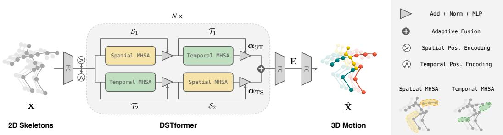
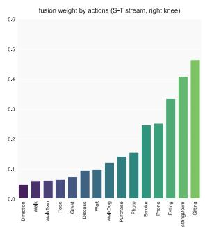
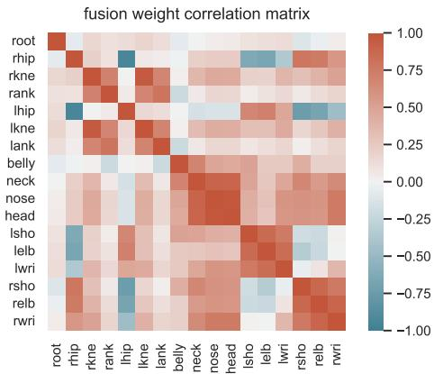
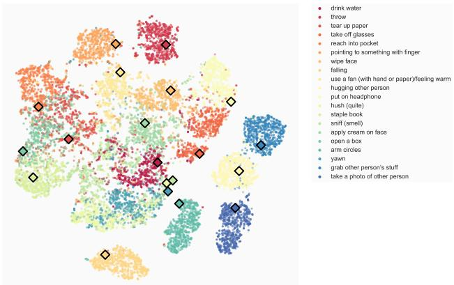

# MotionBERT：学习人体运动表征的统一视角（MotionBERT: A Unified Perspective on Learning Human Motion Representations）

Wentao Zhu1 Xiaoxuan Ma1 Zhaoyang Liu2 Libin Liu1 Wayne Wu2 Yizhou Wang1†

1 北京大学（Peking University） 2 上海人工智能实验室（Shanghai AI Laboratory）

{wtzhu,maxiaoxuan,libin.liu,yizhou.wang}@pku.edu.cn

{zyliumy,wuwenyan0503}@gmail.com

## 摘要

我们提出了一种统一的视角，通过从大规模异构数据资源中学习人体运动表征来处理各种以人为中心的视频任务。具体而言，我们提出了一个预训练阶段，在该阶段中训练一个运动编码器以从含噪的部分二维观测中恢复底层的三维运动。以这种方式获得的运动表征融合了几何、运动学和物理方面的知识，可以轻松迁移到多个下游任务。我们使用双流时空 Transformer（DSTformer）神经网络来实现运动编码器。它能够全面且自适应地捕捉骨骼关节之间长距离的时空关系，从零开始训练时取得了迄今最低的三维姿态估计误差，验证了其有效性。此外，我们提出的框架仅需通过一个简单的回归头（1-2 层）对预训练的运动编码器进行微调，就在所有三个下游任务上达到了最先进的性能，这证明了所学运动表征的多功能性。代码和模型可在 https://motionbert.github.io/ 获取。

## 1. 引言

感知和理解人类活动长期以来一直是机器智能的核心追求。为此，研究人员定义了各种任务来从视频中估计以人为中心的语义标签，例如骨骼关键点 [14, 35]、动作类别 [64, 123] 和表面网格 [46, 71]。尽管在每个任务上都取得了显著进展，但这些任务往往被孤立地建模，而不是作为相互关联的问题。例如，时空图卷积网络（Spatial Temporal Graph Convolutional Networks, ST-GCN）已被应用于在三维姿态估计 [13, 116] 和动作识别 [96, 123] 中建模人体关节的时空关系，但它们的联系尚未被充分探索。直观上，这些模型都应该学会了识别典型的人体运动模式，尽管它们是为不同的问题设计的。尽管如此，现有方法未能挖掘和利用这些任务之间的共性。理想情况下，我们可以开发一种统一的以人为中心的视频表征，能够在所有相关任务之间共享。

  

图 1. 框架概览。我们利用运动编码器，通过从损坏的 2D 骨架序列中恢复 3D 人体运动来学习人体运动表征。为了适配不同的下游任务，我们使用线性层或简单的 MLP 对预训练的运动表征进行微调。

开发此类表征的一个重大挑战在于现有数据资源的异构性。动作捕捉（Motion Capture, Mocap）系统[38, 76]能够提供由标记点和传感器获取的高保真三维运动数据，但所捕获视频的视觉外观通常局限于简单的室内场景。动作识别数据集提供了动作语义的标注，但它们要么不包含人体姿态标签[16, 95]，要么仅包含有限的日常活动动作[63, 64, 93]。相比之下，野外（in-the-wild）人体视频提供了丰富多样的外观与运动。然而，获取精确的二维姿态标注需要付出大量人力[3]，而获得真值（Ground-Truth, GT）三维关节点位置几乎是不可能的。因此，大多数现有研究侧重于使用单一类型的人体运动数据来解决特定任务，因而无法受益于其他数据资源的优势。

在本研究中，我们为学习人体运动表征提供了一个新视角。其核心思想是：我们能够以一种统一的方式从异构数据资源中学习一种通用的人体运动表征，并以统一的方式利用该表征来处理不同的下游任务。我们提出了一个由预训练和微调组成的两阶段框架，如图1所示。在预训练阶段，我们从多种运动数据源中提取二维骨架序列，并对其施加随机掩码与噪声加以破坏。随后，我们训练运动编码器从被破坏的二维骨架中恢复出三维运动。这一具有挑战性的预置任务本质上要求运动编码器能够：i）从其时序运动中推断潜在的三维人体结构；ii）恢复出错误的以及缺失的观测。通过这种方式，运动编码器隐式地捕获了人体运动的常识，例如关节点连接关系、解剖学约束以及时序动态特征。在具体实现中，我们提出双流时空 Transformer（Dual-stream Spatio-temporal Transformer, DSTformer）作为运动编码器，以捕获骨架关键点之间的长程依赖关系。我们假设，从大规模、多样化数据资源中学习到的运动表征可在不同的下游任务间共享，并提升其性能。因此，针对每个下游任务，我们使用任务特定的训练数据与监督信号，通过一个简单的回归头对预训练的运动表征进行适配。

总之，本工作的贡献可归纳为三点：1) 我们提供了一个新的视角，即通过学习人体运动表征的共享框架来解决各种以人为中心的视频任务。2) 我们提出了一种预训练方法，以利用规模庞大但异构的人体运动资源，并学习可泛化的人体运动表征。我们的方法能够同时兼顾三维动捕数据的精度和真实世界 RGB 视频的多样性。3) 我们设计了一个具有级联时空自注意力块的双流 Transformer 网络，它可作为人体运动建模的通用骨干网络。实验表明，上述设计使得所学到的人体运动表征具有通用性，可迁移到多个下游任务，并优于针对特定任务设计的现有最优方法。

## 2. 相关工作

人体运动表征学习。早期的研究工作使用隐马尔可夫模型（Hidden Markov Models）[53, 108] 和图模型（graphical models）[51, 99] 来建模人体运动。Kanazawa 等人 [42] 设计了一个时间编码器和一个幻觉器（hallucinator）来学习三维人体动力学的表征。Zhang 等人 [132] 以自监督的方式预测未来的三维动力学。Sun 等人 [102] 进一步结合动作记忆库（action memory bank）引入了动作标签。从动作识别的视角出发，已有多种前置任务被设计用于以自监督方式学习运动表征，包括未来预测 [100]、拼图（jigsaw puzzle）[60]、骨骼对比学习 [107]、速度变化 [101]、跨视角一致性 [62] 以及对比-重建 [117]。类似的技术也在运动评估 [33, 85] 和运动重定向 [126, 139] 等任务中得到了探索。这些方法利用同质化的运动数据，设计相应的前置任务，并将其应用于特定的下游任务。本文中，我们提出了一个统一的预训练-微调框架，以融合异构的数据资源，并在多种下游任务中验证其通用性。

三维人体姿态估计。从单目 RGB 视频中恢复三维人体姿态是一个经典问题，相关方法可分为两大类。第一类方法直接使用 CNN 从图像中估计三维姿态 [82, 104, 136]。然而，这些方法的一个局限在于，由于现有数据采集技术的限制，三维姿态精度与外观多样性之间存在权衡。第二类方法首先提取二维姿态，然后通过独立的神经网络将估计得到的二维姿态提升到三维。该提升过程可通过全连接网络 [29, 78]、时序卷积网络（Temporal Convolutional Network，TCN）[22, 89]、图卷积网络（GCN）[13, 28, 116] 以及 Transformer [56, 94, 134, 135] 实现。我们的框架基于第二类方法构建，因为我们使用所提出的 DSTformer 来完成二维到三维的姿态提升。

基于骨架的动作识别（Skeleton-based Action Recognition）。开创性研究 [74, 115, 127] 指出了动作识别与人体姿态估计之间的内在联系。为了建模人体关节之间的时空关系，先前的研究主要采用 LSTM [98, 138] 和 GCN [21, 55, 68, 96, 123]。最近，PoseConv3D [32] 提出了将 3D-CNN 应用于堆叠的二维关节热力图，并取得了改进的结果。除了全监督动作识别任务之外，NTU-RGB+D-120 [64] 还引起了人们对具有挑战性的单样本动作识别问题的关注。为此，SL-DML [81] 将深度度量学习应用于多模态信号。Sabater 等人 [92] 在治疗场景中使用 TCN 探索单样本识别。我们证明，预训练的运动表征可以很好地泛化到动作识别任务，并且预训练-微调框架是单样本挑战的合适解决方案。

人体网格恢复（Human Mesh Recovery）。基于诸如 SMPL [71] 之类的参数化人体模型，许多研究工作 [41, 75, 83, 122, 133] 专注于从单张图像回归人体网格。SPIN [48] 此外还结合了身体拟合

  

图 2. 模型架构。我们提出了双流时空 Transformer（Dual-stream Spatio-temporal Transformer，DSTformer），作为人体运动建模的通用骨干网络。DSTformer 由 N 个双流融合模块组成。每个模块包含空间或时间多头自注意力（MHSA）与多层感知机（MLP）两个分支。空间 MHSA 建模同一时间步内不同关节之间的连接，而时间 MHSA 建模单个关节的运动。

## 3.2. 网络结构

……纳入训练循环。尽管这些方法在单帧上取得了令人瞩目的效果，但在应用于视频时会产生不稳定且抖动的结果 [46,130]。为了提升时序一致性，PoseBERT [8] 和 SmoothNet [130] 提出了对单帧预测施加去噪与平滑模块。若干工作 [24,42,46,106] 以视频片段作为输入以利用时序线索。另一个常见的问题是，配对的图像与真实网格（GT meshes）大多在受限场景下采集，这限制了上述方法的泛化能力。为此，Pose2Mesh [25] 提出首先使用现成的姿态估计器提取二维骨架，再将其提升至三维网格顶点。我们的方法与最先进的人体网格恢复方法互补，并可借助预训练的运动表征进一步提升它们的时序一致性。

## 3. 方法

## 3.1. 概述

如第 1 节所讨论，我们的方法包含两个阶段，即统一的预训练（unified pretraining）和任务特定的微调（task-specific finetuning）。在第一阶段，我们训练一个运动编码器来完成二维到三维的提升任务，其中我们使用所提出的 DSTformer 作为骨干网络（backbone）。在第二阶段，我们在下游任务上微调预训练的运动编码器以及若干新增的层。我们在预训练与微调中均使用二维骨架序列作为输入，因为它们可以可靠地从各种运动源中提取出来 [3, 10, 76, 86, 103]，并且对各类变化更加稳健 [19, 32]。已有研究表明，使用二维骨架序列对不同的下游任务是有效的 [25, 32, 89, 109]。我们将首先介绍 DSTformer 的网络结构，然后详细描述训练方案。

图 2 展示了二维到三维提升的网络架构。给定输入的二维骨架序列 $\mathbf { x } \in \mathbb { R } ^ { T \times J \times C _ { \mathrm { i n } } }$，我们首先将其投影到高维特征 ${ \bf F } ^ { 0 } \in { }$ $\mathbb { R } ^ { T \times J \times C _ { 1 } }$ f，然后为其添加可学习的空间位置编码 $\mathbf { P } _ { \mathrm { p o s } } ^ { \mathrm { S } } \in \mathbb { R } ^ { 1 \times J \times C _ { \mathrm { f } } }$ 与时间位置编码 $\mathbf { P } _ { \mathrm { p o s } } ^ { \mathrm { T } } \bar { \in }$ $\mathbb { R } ^ { \sum _ { T \times 1 \times C _ { \mathrm { f } } } }$。接着，我们使用序列到序列模型 DSTformer 计算 $\mathbf { F } ^ { i } \in \bar { \mathbb { R } } ^ { T \times J \times C _ { \mathrm { f } } } ( i \mathbf { \theta } = 1 , \dots , N )$，其中 N 为网络深度。我们对 $\mathbf { F } ^ { N }$ 施加带 tanh 激活 [30] 的线性层以计算运动表示 $\mathbf { E } \in \mathbb { R } ^ { \bar { T } \times J \times C _ { \mathrm { e } } }$。最后，我们对 E 进行线性变换以估计三维运动 $\hat { \hat { \mathbf { X } } } \in \mathbb { R } ^ { T \times J \times C _ { \mathrm { o u t } } }$ t。其中，$T$ 表示序列长度，J 表示人体关节点的数量。$C _ { \mathrm { i n } } , C _ { \mathrm { f } } , C _ { \mathrm { e } } ,$ 和 $C _ { \mathrm { { o u t } } }$ 分别表示输入、特征、嵌入和输出的通道数。我们首先介绍 DSTformer 的基本组成模块，即采用多头自注意力（Multi-Head Self-Attention, MHSA）的空间块（Spatial Block）与时间块（Temporal Block），然后阐述 DSTformer 的架构设计。

空间块（Spatial Block）。空间多头自注意力（S-MHSA）旨在建模同一时间步内各关节点之间的关系。其定义如下：

$$
\begin{array} { r } { \mathrm { S } \mathrm { - } \mathbf { M } \mathrm { H S A } ( \mathbf { Q } _ { \mathrm { S } } , \mathbf { K } _ { \mathrm { S } } , \mathbf { V } _ { \mathrm { S } } ) = [ \mathrm { h e a d } _ { 1 } ; \dots ; \mathrm { h e a d } _ { h } ] \mathbf { W } _ { \mathrm { S } } ^ { P } , } \\ { \mathrm { h e a d } _ { i } = \mathrm { s o f t m a x } ( \frac { \mathbf { Q } _ { \mathrm { S } } ^ { i } ( \mathbf { K } _ { \mathrm { S } } ^ { i } ) ^ { \prime } } { \sqrt { d _ { K } } } ) \mathbf { V } _ { \mathrm { S } } ^ { i } , } \end{array}\tag{1}
$$

其中 $\mathbf { W } _ { \mathrm { S } } ^ { P }$ 为投影参数矩阵，h 为注意力头的数量，$i \in { 1 , \dots , h } ,$，′ 表示矩阵转置。我们利用自注意力从输入的逐帧空间特征 $\mathbf { F } _ { \mathrm { S } } ^ { \mathrm { } } \in \mathbb { R } ^ { J \times C _ { \mathrm { e } } }$ 中为每个头获取查询 $\mathbf { Q } _ { \mathrm { S } }$ ，键 $\mathbf { K } _ { \mathrm { S } } .$ ，和值 ${ \bf V } _ { \mathrm { S } }$ ，

$$
\mathbf { Q } _ { \mathrm { s } } ^ { i } = \mathbf { F } _ { \mathrm { s } } \mathbf { W } _ { \mathrm { s } } ^ { ( Q , i ) } , \mathbf { K } _ { \mathrm { s } } ^ { i } = \mathbf { F } _ { \mathrm { s } } \mathbf { W } _ { \mathrm { s } } ^ { ( K , i ) } , \mathbf { V } _ { \mathrm { s } } ^ { i } = \mathbf { F } _ { \mathrm { s } } \mathbf { W } _ { \mathrm { s } } ^ { ( V , i ) } ,\tag{2}
$$

其中 $\mathbf { W } _ { \mathrm { S } } ^ { ( Q , i ) } , \mathbf { W } _ { \mathrm { S } } ^ { ( K , i ) } , \mathbf { W } _ { \mathrm { S } } ^ { ( V , i ) }$ 是投影矩阵，$d _ { K }$ 是 $\mathbf { K } _ { \mathrm { S } }$ 的特征维度。我们并行地对不同时间步的特征应用 S-MHSA。对 S-MHSA 的结果使用残差连接和层归一化（LayerNorm），其输出进一步输入到多层感知机（MLP）中，随后按照文献 [112] 的做法再接一个残差连接和 LayerNorm。我们将由 MHSA、LayerNorm、MLP 和残差连接组成的整个空间块记为 。

**时间块（Temporal Block）。** 时间 MHSA（T-MHSA）旨在对单个身体关节在各时间步之间的关系进行建模。其计算过程与 S-MHSA 类似，区别在于 MHSA 作用于逐关节的时间特征 $\mathbf { F } _ { \mathrm { T } } \in \mathbb { R } ^ { T \times C _ { \mathrm { e } } }$，并在空间维度上并行化。

$$
\begin{array} { r } { \mathrm { T } \mathbf { \cdot } \mathbf { M } \mathrm { H S A } ( \mathbf { Q } _ { \mathrm { T } } , \mathbf { K } _ { \mathrm { T } } , \mathbf { V } _ { \mathrm { T } } ) = [ \mathrm { h e a d } _ { 1 } ; \dots ; \mathrm { h e a d } _ { h } ] \mathbf { W } _ { \mathrm { T } } ^ { P } , } \\ { \mathrm { h e a d } _ { i } = \operatorname { s o f t m a x } ( \frac { \mathbf { Q } _ { \mathrm { T } } ^ { i } ( \mathbf { K } _ { \mathrm { T } } ^ { i } ) ^ { \prime } } { \sqrt { d _ { K } } } ) \mathbf { V } _ { \mathrm { T } } ^ { i } , } \end{array}\tag{3}
$$

其中 $i \in { 1 , \ldots , h , \mathbf { Q } _ { \mathrm { { T } } } , \mathbf { K } _ { \mathrm { { T } } } , \mathbf { V } _ { \mathrm { { T } } } }$ 的计算方式与公式 2 类似。我们将整个时间块记为 $\tau$。

**双流时空 Transformer（Dual-stream Spatio-temporal Transformer）。** 鉴于空间 MHSA 和时间 MHSA 分别捕获帧内与帧间的身体关节交互，我们将这些基本构件在流程中组合起来，以融合空间与时间信息。我们基于以下假设设计了一种双流架构：1) 两条流都应能够建模全面的时空上下文；2) 每条流应专注于不同的时空方面；3) 两条流应融合在一起，融合权重根据输入的时空特征进行动态平衡。

因此，我们将空间 MHSA 块和时间 MHSA 块以不同顺序堆叠，形成两个并行的计算分支。两个分支的输出特征通过注意力回归器预测的自适应权重进行融合。然后将双流融合模块重复 N 次：

$$
\mathbf { F } ^ { i } = \alpha _ { \mathrm { S T } } ^ { i } \circ \mathcal { T } _ { 1 } ^ { i } ( S _ { 1 } ^ { i } ( \mathbf { F } ^ { i - 1 } ) ) + \alpha _ { \mathrm { T S } } ^ { i } \circ S _ { 2 } ^ { i } ( \mathcal { T } _ { 2 } ^ { i } ( \mathbf { F } ^ { i - 1 } ) ) , \quad i \in 1 , \dots , N ,\tag{4}
$$

其中 $\mathbf { F } ^ { i }$ 表示第 $i$ 层的特征嵌入，$\circ$ 表示逐元素乘积。$S$ 块和 $\mathcal{T}$ 块的顺序如图 $2$ 所示，不同的块不共享权重。自适应融合权重 $\alpha_{\mathrm{ST}}, \alpha_{\mathrm{TS}} \in \mathbb{R}^{N \times T \times J}$ 由下式给出：

$$
\alpha _ { \mathrm { S T } } ^ { i } , \alpha _ { \mathrm { T S } } ^ { i } = \mathrm { s o f t m a x } ( \mathcal { W } ( [ \mathcal { T } _ { 1 } ^ { i } ( S _ { 1 } ^ { i } ( \mathbf { F } ^ { i - 1 } ) ) , S _ { 2 } ^ { i } ( \mathcal { T } _ { 2 } ^ { i } ( \mathbf { F } ^ { i - 1 } ) ) ] ) ) ,\tag{5}
$$

其中 $\mathcal{W}$ 是一个可学习的线性变换。$[, ]$ 表示拼接。

## 3.3. 统一预训练（Unified Pretraining）

在设计统一预训练框架时，我们应对两个关键挑战：1) 如何通过通用预训练任务学习强大的运动表示；2) 如何利用大规模但异构的、各种格式的人体运动数据。

对于第一个挑战，我们借鉴语言 [12, 30, 90] 和视觉 [7, 36] 建模中的成功经验来构建监督信号，即遮盖部分输入并利用编码后的表示来重建整个输入。值得注意的是，此类"完形填空"（cloze）任务天然存在于人体运动分析中，即从二维视觉观测恢复丢失的深度信息，也就是三维人体姿态估计。受此启发，我们利用大规模三维动捕数据 [76]，设计了一个二维到三维提升的预训练任务。我们首先通过正交投影三维运动，提取出二维骨架序列 $\mathbf{x}$。然后，我们通过对 $\mathbf{x}$ 进行随机遮盖并添加噪声来生成被破坏的二维骨架序列，这也类似于二维检测结果，因为其中包含遮挡、检测失败和错误。我们以一定概率同时施加关节点级别和帧级别的遮盖。我们使用前述的运动编码器获得运动表示 $\mathbf{E}$，并重建三维运动 $\hat{\mathbf{X}}$。然后我们计算 $\hat{\mathbf{X}}$ 与真值（GT）三维运动 $\mathbf{X}$ 之间的关节损失 $\mathcal{L}_{3\mathrm{D}}$。我们还遵循先前工作 [89, 134]，加入了速度损失 $\mathcal{L}_{0}$。因此，三维重建损失由下式给出：

$$
\mathcal { L } _ { \mathrm { 3 D } } = \sum _ { t = 1 } ^ { T } \sum _ { j = 1 } ^ { J } \parallel \hat { \mathbf { X } } _ { t , j } - \mathbf { X } _ { t , j } \parallel _ { 2 } , \quad \mathcal { L } _ { 0 } = \sum _ { t = 2 } ^ { T } \sum _ { j = 1 } ^ { J } \parallel \hat { \mathbf { O } } _ { t , j } - \mathbf { O } _ { t , j } \parallel _ { 2 } ,
$$

其中 $\begin{array} { r } { \hat { \mathbf { O } } _ { t } = \hat { \mathbf { X } } _ { t } - \hat { \mathbf { X } } _ { t - 1 } , \mathbf { O } _ { t } = \mathbf { X } _ { t } - \mathbf { X } _ { t - 1 } . } \end{array}$

(6)

针对第二个挑战，我们注意到二维骨架可以作为一种通用媒介，因为它可以从各种运动数据源中提取得到。我们在二维到三维的提升框架中进一步引入了野外 RGB 视频，以实现统一的预训练。对于 RGB 视频，二维骨架 $\mathbf{x}$ 可以通过人工标注 [3] 或二维姿态估计器 [14, 103] 获得，而所提取二维骨架的深度通道本质上是被「遮蔽」的。类似地，我们添加额外的遮蔽和噪声来降质 $\mathbf{x}$（如果 $\mathbf{x}$ 已经包含检测噪声，则仅施加遮蔽）。由于这些数据没有三维运动真值 $\mathbf{X}$ 可用，我们应用一个加权的二维重投影损失，计算公式为

$$
\mathcal { L } _ { \mathrm { 2 D } } = \sum _ { t = 1 } ^ { T } \sum _ { j = 1 } ^ { J } \delta _ { t , j } \| \hat { \mathbf { x } } _ { t , j } - \mathbf { x } _ { t , j } \| _ { 2 } ,\tag{7}
$$

其中 $\hat { \bf x }$ 是估计的三维运动 $\hat { \bf X }$ 的二维正交投影，$\pmb { \delta } \in \mathbf { \bar { \mathbb { R } } } ^ { \bar { T } \times J }$ 由可见性标注或二维检测置信度给出。

总预训练损失由下式计算

$$
\small \mathcal { L } = \underbrace { \mathcal { L } _ { \mathrm { 3 D } } + \lambda _ { 0 } \mathcal { L } _ { 0 } } _ { \mathrm { f o r 3 D \ : d a t a } } + \underbrace { \mathcal { L } _ { \mathrm { 2 D } } } _ { \mathrm { f o r 2 D \ : d a t a } } ,\tag{8}
$$

其中 $\lambda _ { 0 }$ 是用于平衡各损失项的常数系数。

## 3.4. 任务特定的微调（Task-specific Finetuning）

学习到的特征嵌入 $\mathbf{E}$ 充当了一种具有三维感知和时间感知能力的人体运动表示。对于下游任务，我们采用极简设计原则，即实现一个浅层的下游网络，并在不使用任何额外技巧的情况下进行训练。在实践中，我们使用一个额外的线性层或一个具有单隐藏层的多层感知机（MLP）。然后我们对整个网络进行端到端的微调。

**三维姿态估计。** 由于我们采用二维到三维的提升作为前置任务，我们直接复用整个预训练网络。在微调过程中，输入的二维骨架由视频估计得到，不再施加额外的遮蔽或噪声。

基于骨架的动作识别（Skeleton-based Action Recognition）。我们直接对不同人物和时间步应用全局平均池化。然后将结果输入到一个具有一个隐藏层的多层感知机（Multilayer Perceptron, MLP）中。网络使用交叉熵分类损失进行训练。对于一次性学习（one-shot learning），我们在池化特征之后应用一个线性层来提取片段级别的动作表征。我们在第 4.4 节中介绍一次性学习的详细设置。

人体网格恢复（Human Mesh Recovery）。我们使用 SMPL [71] 模型来表示人体网格并回归其参数。SMPL 模型由姿态参数 $\theta \ \in \ \mathbb { R } ^ { 7 2 }$ 和形状参数 $\beta \in \mathbb { R } ^ { 1 0 }$ 组成，并将三维网格计算为 $\mathcal { M } ( \boldsymbol { \theta } , \bar { \boldsymbol { \beta } } ) \in \mathbb { R } ^ { 6 8 9 0 \times 3 }$。为了回归每一帧的姿态参数，我们将运动嵌入 E 输入到一个具有一个隐藏层的 MLP 中，得到 $\pmb { \hat { \theta } } \in \mathbb { R } ^ { T \times \breve { 7 } 2 }$。为了估计形状参数，考虑到视频序列中的人体形状应保持一致，我们首先在时间维度上对 E 进行平均池化，然后将其输入到另一个 MLP 中以回归单个 $\hat { \beta }$，并将其扩展到整个序列，得到 $\hat { \beta } \in \mathbb { R } ^ { \bar { T } } \times 1 0$。

形状 MLP 与姿态回归 MLP 具有相同的架构，它们分别使用平均形状和平均姿态进行初始化，如文献 [46] 所示。整体损失计算为：

$$\begin{array} { r } { \mathcal { L } = \lambda _ { 3 \mathrm { { D } } } ^ { \mathrm { { m } } } \mathcal { L } _ { 3 \mathrm { { D } } } ^ { \mathrm { { m } } } + \lambda _ { \theta } \mathcal { L } _ { \theta } + \lambda _ { \beta } \mathcal { L } _ { \beta } + \lambda _ { \mathrm { { n } } } \mathcal { L } _ { \mathrm { { n o r m } } } + \lambda _ { 0 } ^ { \mathrm { { m } } } \mathcal { L } _ { 0 } ^ { \mathrm { { m } } } , } \end{array}\tag{9}$$

其中每一项的计算方式为：

$$\begin{array} { r l } & { \mathcal { L } _ { 3 \mathrm { D } } ^ { \mathrm { m } } = \| \hat { \mathbf { X } } ^ { \mathrm { m } } - \mathbf { X } ^ { \mathrm { m } } \| _ { 1 } , \quad \mathcal { L } _ { \boldsymbol { \theta } } = \| \hat { \pmb { \theta } } - \pmb { \theta } \| _ { 1 } , \quad \mathcal { L } _ { \boldsymbol { \beta } } = \| \hat { \pmb { \beta } } - \pmb { \beta } \| _ { 1 } , } \\ & { \mathcal { L } _ { \mathrm { n o r m } } = \| \hat { \pmb { \theta } } \| _ { 2 } + \| \hat { \pmb { \beta } } \| _ { 2 } , \quad \mathcal { L } _ { 0 } ^ { \mathrm { m } } = \| \hat { \mathbf { O } } ^ { \mathrm { m } } - \mathbf { O } ^ { \mathrm { m } } \| _ { 2 } . } \end{array}\tag{10}$$

注意，运动 $\mathbf{X}^{m}$ 中第 $t$ 帧的每个 3D 姿态由网格顶点回归得到，公式为 $\mathbf{X}_{t}^{m} = \mathbf{J}\mathcal{M}(\theta_{t}, \beta_{t})$，其中 $\mathbf{J} \in \mathbb{R}^{J \times 6890}$ 是一个预定义矩阵 [10]。$\mathbf{O}^{m} = \mathbf{X}_{t+1}^{m} - \mathbf{X}_{t}^{m}$。$\hat{\mathbf{O}}^{m} = \hat{\mathbf{X}}_{t+1}^{m} - \hat{\mathbf{X}}_{t}^{m}$。$\lambda_{3D}^{m}$、$\lambda_{\theta}$、$\lambda_{\beta}$、$\lambda_{n}$ 和 $\lambda_{0}^{m}$ 是用于平衡训练损失的常数系数。

## 4. 实验

## 4.1. 实现

我们以深度 $N = 5$、注意力头数 $h = 8$、特征尺寸 $C_{f} = 512$、嵌入尺寸 $C_{e} = 512$ 来实现所提出的运动编码器 DSTformer。在预训练阶段，我们使用序列长度 $T = 243$。得益于基于 Transformer 的骨干网络，预训练后的模型能够处理不同的输入长度。在微调阶段，我们将骨干网络的学习率设为新层学习率的 0.1 倍。我们将在以下各节中分别介绍实验所用数据集，更多实验细节请参阅附录。

## 4.2. 预训练

我们从 Human3.6M [38] 和 AMASS [76] 这两个数据集中收集多样化且真实的 3D 人体运动。Human3.6M [38] 是一个常用的室内 3D 人体姿态估计数据集，包含 360 万帧专业演员表演日常动作的视频画面。遵循先前工作 [78, 89]，我们使用受试者 1、5、6、7、8 进行训练，使用受试者 9、11 进行测试。AMASS [76] 整合了大多数现有的基于标记点的 Mocap 数据集 [1,2,5,11,15,18,34,37,52,69,72,77,84,97,110,111] 并以统一的表示对其进行参数化。预训练期间，我们不使用这两个数据集的图像或 2D 检测结果，因为 Mocap 数据集通常不提供原始视频。相反，我们使用正交投影来获取未受污染的 2D 骨架。为了引入更多样化的运动，我们进一步纳入两个野外 RGB 视频数据集 PoseTrack [3]（带标注）和 InstaVariety [42]（无标注）。我们参照 [27] 将人体关键点定义与 Human3.6M 对齐，并将相机坐标标定到像素坐标。我们随机将 15% 的关节置零，并从高斯分布与均匀分布的混合分布中采样噪声 [17]。遵循课程学习的做法 [9, 118]，我们首先仅在 3D 数据上训练 30 个 epoch，然后在 3D 数据和 2D 数据上联合训练 60 个 epoch。

## 4.3. 3D 姿态估计

我们在 Human3.6M [38] 上评估 3D 姿态估计性能，并报告平均每关节位置误差（mean per joint position error, MPJPE），单位为毫米，该指标衡量在根关节对齐后预测关节位置与真实标签（GT）之间的平均距离。我们还计算了平均每关节速度误差（mean per-joint velocity error, MPJVE）来评估时序平滑度，沿用之前工作的做法 [134, 135]。我们使用堆叠沙漏网络（Stacked Hourglass, SH）[86] 从视频中提取 2D 骨架，并在 Human3.6M [38] 训练集上对整个网络进行微调。此外，我们还训练了一个具有相同架构但使用随机初始化而非预训练权重的独立模型。如表 1（上）所示，从零开始训练的模型优于以往方法，包括其他基于 Transformer 并结合时空建模的设计。这表明所提出的 DSTformer 在学习 3D 几何结构和时间动态方面的有效性。为了进一步评估模型能力的上界，我们比较了在使用 2D GT 姿态序列作为输入时的性能，这消除了不同 2D 检测器的影响。如表 1（中）所示，我们的模型显著优于所有先前的方法。表 1（下）显示，我们的两个模型在 MPJVE 方面也都超越了先前的工作，意味着更好的时序一致性。我们将从零训练模型的性能优势归因于所提出的 DSTformer 设计。我们在第 4.6 节和补充材料中提供了更多比较与分析，以展示 DSTformer 在时空架构方面的优势。此外，我们的方法通过所提出的预训练阶段实现了更低的误差。

<table><tr><td>Method</td><td>T</td><td>Dire.</td><td>Disc.</td><td>Eat</td><td>Greet</td><td>Phone</td><td>Photo</td><td>Pose</td><td>Purch.</td><td>Sit</td><td>SitD</td><td>Smoke</td><td>Wait</td><td>WalkD</td><td>Walk</td><td>WalkT</td><td>Avg</td></tr><tr><td>Martinez et al. [78] ICCV&#x27;17</td><td>1</td><td>51.8</td><td>56.2</td><td>58.1</td><td>59.0</td><td>69.5</td><td>78.4</td><td>55.2</td><td>58.1</td><td>74.0</td><td>94.6</td><td>62.3</td><td>59.1</td><td>65.1</td><td>49.5</td><td>52.4</td><td>62.9</td></tr><tr><td>Pavlakos et al. [88] CVPR’18</td><td>1</td><td>48.5</td><td>54.4</td><td>54.4</td><td>52.0</td><td>59.4</td><td>65.3</td><td>49.9</td><td>52.9</td><td>65.8</td><td>71.1</td><td>56.6</td><td>52.9</td><td>60.9</td><td>44.7</td><td>47.8</td><td>56.2</td></tr><tr><td>LCN [28] ICCV&#x27;19</td><td>1</td><td>46.8</td><td>52.3</td><td>44.7</td><td>50.4</td><td>52.9</td><td>68.9</td><td>49.6</td><td>46.4</td><td>60.2</td><td>78.9</td><td>51.2</td><td>50.0</td><td>54.8</td><td>40.4</td><td>43.3</td><td>52.7</td></tr><tr><td>Xu et al. [121] CVPR’21</td><td>1</td><td>45.2</td><td>49.9</td><td>47.5</td><td>50.9</td><td>54.9</td><td>66.1</td><td>48.5</td><td>46.3</td><td>59.7</td><td>71.5</td><td>51.4</td><td>48.6</td><td>53.9</td><td>39.9</td><td>44.1</td><td>51.9</td></tr><tr><td>VideoPose3D [89] CVPR&#x27;19</td><td>243</td><td>45.2</td><td>46.7</td><td>43.3</td><td>45.6</td><td>48.1</td><td>55.1</td><td>44.6</td><td>44.3</td><td>57.3</td><td>65.8</td><td>47.1</td><td>44.0</td><td>49.0</td><td>32.8</td><td>33.9</td><td>46.8</td></tr><tr><td>Cai et al. [13] ICCV’19</td><td>7</td><td>44.6</td><td>47.4</td><td>45.6</td><td>48.8</td><td>50.8</td><td>59.0</td><td>47.2</td><td>43.9</td><td>57.9</td><td>61.9</td><td>49.7</td><td>46.6</td><td>51.3</td><td>37.1</td><td>39.4</td><td>48.8</td></tr><tr><td>Yeh et al. [129] NeurIPS’19</td><td>243</td><td>44.8</td><td>46.1</td><td>43.3</td><td>46.4</td><td>49.0</td><td>55.2</td><td>44.6</td><td>44.0</td><td>58.3</td><td>62.7</td><td>47.1</td><td>43.9</td><td>48.6</td><td>32.7</td><td>33.3</td><td>46.7</td></tr><tr><td>Liu et al. [67] CVPR’20</td><td>243</td><td>41.8</td><td>44.8</td><td>41.1</td><td>44.9</td><td>47.4</td><td>54.1</td><td>43.4</td><td>42.2</td><td>56.2</td><td>63.6</td><td>45.3</td><td>43.5</td><td>45.3</td><td>31.3</td><td>32.2</td><td>45.1</td></tr><tr><td>* Cheng et al. [22] AAAI&#x27;20</td><td>128</td><td>36.2</td><td>38.1</td><td>42.7</td><td>35.9</td><td>38.2</td><td>45.7</td><td>36.8</td><td>42.0</td><td>45.9</td><td>51.3</td><td>41.8</td><td>41.5</td><td>43.8</td><td>33.1</td><td>28.6</td><td>40.1</td></tr><tr><td>* UGCN [116] ECCV’20</td><td>96</td><td>38.2</td><td>41.0</td><td>45.9</td><td>39.7</td><td>41.4</td><td>51.4</td><td>41.6</td><td>41.4</td><td>52.0</td><td>57.4</td><td>41.8</td><td>44.4</td><td>41.6</td><td>33.1</td><td>30.0</td><td>42.6</td></tr><tr><td>† PoseFormer [135] ICCV’21</td><td>81</td><td>41.5</td><td>44.8</td><td>39.8</td><td>42.5</td><td>46.5</td><td>51.6</td><td>42.1</td><td>42.0</td><td>53.3</td><td>60.7</td><td>45.5</td><td>43.3</td><td>46.1</td><td>31.8</td><td>32.2</td><td>44.3</td></tr><tr><td>* Wehrbein et al. [119] ICCV&#x27;21</td><td>200</td><td>38.5</td><td>42.5</td><td>39.9</td><td>41.7</td><td>46.5</td><td>51.6</td><td>39.9</td><td>40.8</td><td>49.5</td><td>56.8</td><td>45.3</td><td>46.4</td><td>46.8</td><td>37.8</td><td>40.4</td><td>44.3</td></tr><tr><td>† MHFormer [56] CVPR’22</td><td>351</td><td>39.2</td><td>43.1</td><td>40.1</td><td>40.9</td><td>44.9</td><td>51.2</td><td>40.6</td><td>41.3</td><td>53.5</td><td>60.3</td><td>43.7</td><td>41.1</td><td>43.8</td><td>29.8</td><td>30.6</td><td>43.0</td></tr><tr><td>*† MixSTE [134] CVPR&#x27;22</td><td>243</td><td>36.7</td><td>39.0</td><td>36.5</td><td>39.4</td><td>40.2</td><td>44.9</td><td>39.8</td><td>36.9</td><td>47.9</td><td>54.8</td><td>39.6</td><td>37.8</td><td>39.3</td><td>29.7</td><td>30.6</td><td>39.8</td></tr><tr><td>† P-STMO [94] ECCV’22</td><td>243</td><td>38.4</td><td>42.1</td><td>39.8</td><td>40.2</td><td>45.2</td><td>48.9</td><td>40.4</td><td>38.3</td><td>53.8</td><td>57.3</td><td>43.9</td><td>41.6</td><td>42.2</td><td>29.3</td><td>29.3</td><td>42.1</td></tr><tr><td>† Ours (scratch)</td><td>243</td><td>36.3</td><td>38.7</td><td>38.6</td><td>33.6</td><td>42.1</td><td>50.1</td><td>36.2</td><td>35.7</td><td>50.1</td><td>56.6</td><td>41.3</td><td>37.4</td><td>37.7</td><td>25.6</td><td>26.5</td><td>39.2</td></tr><tr><td>† Ours (finetune)</td><td>243</td><td>36.1</td><td>37.5</td><td>35.8</td><td>32.1</td><td>40.3</td><td>46.3</td><td>36.1</td><td>35.3</td><td>46.9</td><td>53.9</td><td>39.5</td><td>36.3</td><td>35.8</td><td>25.1</td><td>25.3</td><td>37.5</td></tr><tr><td>Method</td><td>T</td><td>Dire.</td><td>Disc.</td><td>Eat</td><td>Greet</td><td>Phone</td><td>Photo</td><td>Pose</td><td>Purch.</td><td>Sit</td><td>SitD</td><td>Smoke</td><td>Wait</td><td>WalkD</td><td>Walk</td><td>WalkT</td><td>Avg</td></tr><tr><td>Martinez et al. [78] ICCV&#x27;17</td><td>1</td><td>37.7</td><td>44.4</td><td>40.3</td><td>42.1</td><td>48.2</td><td>54.9</td><td>44.4</td><td>42.1</td><td>54.6</td><td>58.0</td><td>45.1</td><td>46.4</td><td>47.6</td><td>36.4</td><td>40.4</td><td>45.5</td></tr><tr><td>LCN [28] ICCV’19</td><td>1</td><td>36.3</td><td>38.8</td><td>29.7</td><td>37.8</td><td>34.6</td><td>42.5</td><td>39.8</td><td>32.5</td><td>36.2</td><td>39.5</td><td>34.4</td><td>38.4</td><td>38.2</td><td>31.3</td><td>34.2</td><td>36.3</td></tr><tr><td>Xu et al. [121] CVPR’21</td><td>1</td><td>35.8</td><td>38.1</td><td>31.0</td><td>35.3</td><td>35.8</td><td>43.2</td><td>37.3</td><td>31.7</td><td>38.4</td><td>45.5</td><td>35.4</td><td>36.7</td><td>36.8</td><td>27.9</td><td>30.7</td><td>35.8</td></tr><tr><td>UGCN [116] ECCV&#x27;20</td><td>96</td><td>23.0</td><td>25.7</td><td>22.8</td><td>22.6</td><td>24.1</td><td>30.6</td><td>24.9</td><td>24.5</td><td>31.1</td><td>35.0</td><td>25.6</td><td>24.3</td><td>25.1</td><td>19.8</td><td>18.4</td><td>25.6</td></tr><tr><td>† PoseFormer [135] ICCV’21</td><td>81</td><td>30.0</td><td>33.6</td><td>29.9</td><td>31.0</td><td>30.2</td><td>33.3</td><td>34.8</td><td>31.4</td><td>37.8</td><td>38.6</td><td>31.7</td><td>31.5</td><td>29.0</td><td>23.3</td><td>23.1</td><td>31.3 30.5</td></tr><tr><td>† MHFormer [56] CVPR’22 † MixSTE [134] CVPR’22</td><td>351</td><td>27.7 21.6</td><td>32.1 22.0</td><td>29.1 20.4</td><td>28.9 21.0</td><td>30.0 20.8</td><td>33.9 24.3</td><td>33.0 24.7</td><td>31.2 21.9</td><td>37.0 26.9</td><td>39.3 24.9</td><td>30.0 21.2</td><td>31.0 21.5</td><td>29.4 20.8</td><td>22.2 14.7</td><td>23.0 15.6</td></table>

Table 1. 3D 人体姿态估计在 Human3.6M 上的定量对比。（上）使用检测到的 2D 姿态序列时的 MPJPE（mm）。（中）使用 GT 2D 姿态序列时的 MPJPE（mm）。（下）使用检测到的 2D 姿态序列时的 MPJVE（mm）。T 表示该方法所使用的片段长度。我们选取了各工作中报告的最佳结果。∗ 表示使用 HRNet [103] 进行 2D 检测。† 表示采用时空 Transformer 设计实现。最佳和次佳结果分别以加粗和下划线标出。

## 4.4. 基于骨架的动作识别

我们进一步探索了利用预训练的人体运动表征来学习动作语义的可能性。我们使用了人体动作数据集 NTU-RGB+D [93]，该数据集包含 60 个动作类别的 57K 视频，并遵循跨受试者（Cross-subject, X-Sub）和跨视角（Cross-view, X-View）的数据划分方式。该数据集还有一个扩展版本 NTU-RGB+D-120 [64]，包含 120 个动作类别的 114K 视频。我们在 NTU-RGB+D-120 上遵循所建议的 One-shot 动作识别协议。对于两个数据集，我们均使用 HRNet [103] 按照 [32] 的方法提取 2D 骨架。同样，我们训练了一个采用随机初始化的从头训练模型用于对比。如表 2（左）所示，我们的方法与最先进的方法相当或更优。值得注意的是，预训练阶段带来了很大的性能提升。

此外，我们深入研究了具有重要实际意义的 One-shot 设置。现实世界的应用通常需要在特定领域（如教育、体育和医疗保健）中进行细粒度的动作识别。然而，这些场景中的动作类别通常在公开数据集中并未定义，因此只有少量这些新动作类别的标注可供使用，使得准确识别成为一项具有挑战性的任务。按照 [64] 所提出的方法，我们报告了在仅使用每个类别 1 个标注视频的条件下，对 20 个新类别评估集上的结果。辅助集包含其他 100 个类别，这些类别的所有样本均可使用。我们使用监督对比学习技术 [44] 在辅助集上训练模型。对于一批辅助数据，同一类别的样本被拉近，而不同类别的样本在动作嵌入空间中被推远。在评估过程中，我们计算测试样本与样本代表（exemplar）之间的余弦距离，并使用 1-最近邻（1-nearest neighbor）确定类别。表 2（右）表明，所提出的模型以相当大的幅度优于最先进的方法。此外，值得注意的是，我们的预训练模型仅需 1-2 个 epoch 的微调即可达到最佳性能。我们的结果表明，预训练阶段能够有效地学习到对新的下游任务具有良好泛化能力的鲁棒运动表征，即使在标注数据有限的情况下也是如此。

<table><tr><td rowspan=1 colspan=4>Method</td><td rowspan=1 colspan=1>X-Sub X-View</td></tr><tr><td rowspan=4 colspan=4>ST-GCN [123] AAAI&#x27;182s-AGCN [96] CVPR’19MS-G3D [68] CVPR’20Shift-GCN [21] CVPR’20</td><td rowspan=1 colspan=1>81.5  88.3</td></tr><tr><td rowspan=1 colspan=1>88.5  95.1</td></tr><tr><td rowspan=1 colspan=1>3D [68] CVPR'20</td><td rowspan=1 colspan=1>91.5  96.2</td></tr><tr><td rowspan=1 colspan=3>hift-GCN [21] CVPR'20</td><td rowspan=1 colspan=1>90.7  96.5</td></tr><tr><td rowspan=1 colspan=1>Cro</td><td></td><td rowspan=1 colspan=2>sSCLR [62] CVPR’21</td><td rowspan=1 colspan=1>86.2  92.5</td></tr><tr><td rowspan=1 colspan=4>MCC (finetune) [101] ICCV&#x27;21</td><td rowspan=1 colspan=1>89.7  96.3</td></tr><tr><td rowspan=1 colspan=4>SCC (finetune) [125] ICCV’21</td><td rowspan=1 colspan=1>88.0  94.9</td></tr><tr><td rowspan=3 colspan=4>UNIK (finetune) [124] BMVC&#x27;21CTR-GCN [20] ICCV’21PoseConv3D [32] CVPR’22</td><td rowspan=1 colspan=1>86.8  94.4</td></tr><tr><td rowspan=1 colspan=1>92.4  96.8</td></tr><tr><td rowspan=1 colspan=1>93.1  95.7</td></tr><tr><td rowspan=2 colspan=4>Ours (scratch)Ours (finetune)</td><td rowspan=1 colspan=1>87.7  94.1</td></tr><tr><td rowspan=1 colspan=1>93.0  97.2</td></tr></table>

<table><tr><td>Method</td><td>Accuracy</td></tr><tr><td>ST-LSTM + AvgPool [65]</td><td>42.9</td></tr><tr><td>ST-LSTM + FC [66]</td><td>42.1</td></tr><tr><td>ST-LSTM + Attention [66]</td><td>41.0</td></tr><tr><td>APSR [64]</td><td>45.3</td></tr><tr><td>TCN OneShot [92]</td><td>46.5</td></tr><tr><td>SL-DML [81]</td><td>50.9</td></tr><tr><td>Skeleton-DML [80]</td><td>54.2</td></tr><tr><td>Ours (scratch)</td><td>61.0</td></tr><tr><td>Ours (finetune)</td><td>67.4</td></tr></table>

表 2. 基于骨架的动作识别准确率的定量比较。（左）在 NTU-RGB+D 上的跨受试者（cross-subject）与跨视角（cross-view）识别准确率。所有方法均仅使用"joint"模态并采用 1-clip 采样进行评估，以保证比较的公平性。（右）在 NTU-RGB+D-120 上的一次性（one-shot）识别准确率。所有结果均为 top-1 准确率（%）。

<table><tr><td rowspan="2">Method</td><td rowspan="2">Input</td><td rowspan="2"> $T$ </td><td colspan="3">Human3.6M</td><td colspan="3">3DPW</td></tr><tr><td>MPVE↓</td><td>MPJPE↓</td><td>PA-MPJPE↓</td><td>MPVE↓</td><td>MPJPE↓</td><td>PA-MPJPE↓</td></tr><tr><td>HMR [41] CVPR&#x27;18</td><td>image</td><td>1</td><td></td><td>88.0</td><td>56.8</td><td></td><td>130.0</td><td>81.3</td></tr><tr><td>† SPIN [48] ICCV&#x27;19</td><td>image</td><td>1</td><td>82.3</td><td>59.4</td><td>39.3</td><td>129.1</td><td>100.9</td><td>59.1</td></tr><tr><td>Pose2Mesh [25] ECCV&#x27;20</td><td>2D pose</td><td>1</td><td>85.3</td><td>64.9</td><td>48.7</td><td>109.3</td><td>91.4</td><td>60.1</td></tr><tr><td>I2L-MeshNet [83] ECCV&#x27;20</td><td>image</td><td>1</td><td></td><td>55.7</td><td>41.7</td><td>110.1</td><td>93.2</td><td>58.6</td></tr><tr><td>† HybrIK [54] CVPR&#x27;21</td><td>image</td><td>1</td><td>58.1</td><td>47.4</td><td>30.1</td><td>82.4</td><td>71.3</td><td>41.9</td></tr><tr><td>METRO [58] CVPR’21</td><td>image</td><td>1</td><td></td><td>54.0</td><td>36.7</td><td>88.2</td><td>77.1</td><td>47.9</td></tr><tr><td>Mesh Graphormer [59] ICCV&#x27;21</td><td>image</td><td>1</td><td></td><td>51.2</td><td>34.5</td><td>87.7</td><td>74.7</td><td>45.6</td></tr><tr><td>PARE [47] ICCV’21</td><td>image</td><td>1</td><td></td><td></td><td></td><td>88.6</td><td>74.5</td><td>46.5</td></tr><tr><td>ROMP [105] ICCV’21</td><td>image</td><td>1</td><td></td><td></td><td></td><td>108.3</td><td>91.3</td><td>54.9</td></tr><tr><td>PyMAF [133] ICCV&#x27;21</td><td>image</td><td>1</td><td></td><td>57.7</td><td>40.5</td><td>110.1</td><td>92.8</td><td>58.9</td></tr><tr><td>ProHMR [50] ICCV&#x27;21</td><td>image</td><td>1</td><td></td><td></td><td>41.2</td><td></td><td></td><td>59.8</td></tr><tr><td>OCHMR [43] CVPR&#x27;22</td><td>image</td><td>1</td><td></td><td></td><td></td><td>107.1</td><td>89.7</td><td>58.3</td></tr><tr><td>3DCrowdNet [26] CVPR&#x27;22</td><td>image</td><td>1</td><td></td><td></td><td></td><td>98.3</td><td>81.7</td><td>51.5</td></tr><tr><td>CLIFF [57] ECCV’22</td><td>image</td><td>1</td><td></td><td>47.1</td><td>32.7</td><td>81.2</td><td>69.0</td><td>43.0</td></tr><tr><td>FastMETRO [23] ECCV’22</td><td>image</td><td>1</td><td></td><td>52.2</td><td>33.7</td><td>84.1</td><td>73.5</td><td>44.6</td></tr><tr><td>VisDB [128] ECCV&#x27;22</td><td>image</td><td>1</td><td></td><td>51.0</td><td>34.5</td><td>85.5</td><td>73.5</td><td>44.9</td></tr><tr><td>TemporalContext [6] CVPR&#x27;19</td><td>video</td><td>32</td><td></td><td>77.8</td><td>54.3</td><td>-</td><td></td><td>72.2</td></tr><tr><td>HMMR [42] CVPR&#x27;19</td><td>video</td><td>20</td><td></td><td></td><td>56.9</td><td>139.3</td><td>116.5</td><td>72.6</td></tr><tr><td>DSD-SATN [106] ICCV&#x27;19</td><td>video</td><td>9</td><td></td><td>59.1</td><td>42.4</td><td></td><td></td><td>69.5</td></tr><tr><td>VIBE [46] CVPR’20</td><td>video</td><td>16</td><td></td><td>65.6</td><td>41.4</td><td>99.1</td><td>82.9</td><td>51.9</td></tr><tr><td>TCMR [24] CVPR’21</td><td>video</td><td>16</td><td></td><td>62.3</td><td>41.1</td><td>102.9</td><td>86.5</td><td>52.7</td></tr><tr><td>† MAED [114] ICCV’21</td><td>video</td><td>16</td><td>84.1</td><td>60.4</td><td>38.3</td><td>93.3</td><td>79.0</td><td>45.7</td></tr><tr><td>MPS-Net [120] CVPR&#x27;22</td><td>video</td><td>16</td><td></td><td>69.4</td><td>47.4</td><td>99.7</td><td>84.3</td><td>52.1</td></tr><tr><td>* PoseBERT [8] TPAMI&#x27;22 (+SPIN [48])</td><td>video</td><td>16</td><td></td><td></td><td></td><td>-</td><td></td><td>57.3↓2.3</td></tr><tr><td>* SmoothNet [130] ECCV&#x27;22 (+SPIN [48])</td><td>video</td><td>32</td><td></td><td>67.5↓1.0</td><td>46.3↓0.2</td><td>-</td><td>86.7↓0.9</td><td>52.7↓0.6</td></tr><tr><td>Ours (scratch)</td><td>2D motion</td><td>16</td><td>75.7</td><td>62.8</td><td>41.0</td><td>99.1</td><td>85.5</td><td>50.2</td></tr><tr><td>Ours (finetune)</td><td>2D motion</td><td>16</td><td>65.5</td><td>53.8</td><td>34.9</td><td>88.1</td><td>76.9</td><td>47.2</td></tr><tr><td>Ours (finetune) + SPIN [48]</td><td>video</td><td>16</td><td>63.7↓18.6</td><td> $5 2 . 2 \downarrow 7 . 2$ </td><td>35.7↓3.6</td><td>92.8 ↓36.3</td><td>79.6↓21.3</td><td>48.2↓10.9</td></tr><tr><td>Ours (finetune) + MAED [114] Ours (finetune) + HybrIK [54]</td><td>video video</td><td>16 16</td><td> $6 6 . 8 \downarrow 1 7 . 3$   $5 2 . 6 \downarrow 5 . 5$ </td><td> $5 4 . 8 \downarrow 5 . 6$   $4 3 . 1 \downarrow 4 . 3$ </td><td>36.4↓1.9  $2 7 . 8 \downarrow 2 . 3$ </td><td>84.4↓8.9  $7 9 . 4 \downarrow 3 . 0$ </td><td>72.3 ↓ 6.7 68.8↓2.5</td><td> $4 2 . 3 \downarrow 3 . 4$   ${ \bf 4 0 . 6 . } | 1 . 3$ </td></tr></table>

表 3. 在 Human3.6M 和 3DPW 数据集上人体网格恢复的定量对比。T 表示该方法使用的片段长度。† 表示使用官方模型权重得到的结果。其余均为官方报告的结果。∗ 中的增益对应于不同重新实现的 SPIN [48] 的结果。

## 4.5. 人体网格恢复

我们在 Human3.6M [38] 和 3DPW [113] 数据集上进行实验，并在训练过程中按照 [46, 58, 114] 的做法额外加入 COCO [61] 数据集。对于这两个数据集，我们保持与 [78]（第 4.2 节）相同的训练集与测试集划分。

  

图 3. 微调与从头开始训练的学习曲线。

<table><tr><td>Backbone (frozen)</td><td>MPJPE↓ (3D pose)</td><td>MPVE↓ (mesh)</td><td>Accuracy ↑ (action x-view)</td><td>Accuracy↑ (action 1-shot)</td></tr><tr><td>Random Pretrained</td><td>404.4mm 40.3mm</td><td>114.4mm 72.1mm</td><td>47.6% 87.3%</td><td>46.8% 60.7%</td></tr></table>

表 4. 部分微调的对比。

并分别与 [46, 58, 114] 进行对比。遵循通用做法 [41,46,49,114]，我们报告由 J(θ, β) 得到的 14 个关节点的 MPJPE（mm）和 PA-MPJPE（mm）。PA-MPJPE 在与 GT（Ground Truth）对齐平移、旋转和尺度之后计算 MPJPE。我们进一步报告网格 (θ, β) 的平均逐顶点误差（MPVE）（mm），该指标在根关节点对齐后测量估计顶点与 GT 顶点之间的平均距离。需要注意的是，大多数先前的工作 [24, 41, 46, 48, 54, 58, 73, 114] 在训练期间使用了 COCO [61] 之外的其他数据集，例如 LSP [39]、MPI-INF-3DHP [79] 等，而我们没有使用。表 3 表明，我们微调后的模型在 Human3.6M 和 3DPW 数据集上都取得了具有竞争力的结果，在 MPVE 误差上尤其超越了所有最先进的基于视频的方法，包括 MAED [114]。尽管如此，我们注意到仅从稀疏的 2D 关键点估计全身网格 [10,25] 是一个不适定问题，因为它缺少人体形状信息。有鉴于此，我们提出了一种混合方法，利用我们的框架（连贯运动）和基于 RGB 的方法（准确形状）两者的优势。我们引入了一个精炼器（refiner）模块，可以方便地与现有的图像/视频方法集成，类似于 [8,130]。具体而言，我们的精炼器模块是一个多层感知机（MLP），它接收我们预训练的运动表示与初始预测的组合，并回归关节点旋转的残差。我们的方法有效改进了最先进的方法 [48,54,114]，并取得了迄今为止的最低误差。

## 4.6. 消融研究

微调 vs. 从头训练。我们比较了微调预训练模型与从头开始训练的进展。如图 3 所示，使用预训练权重初始化的模型在所有三个任务上都表现出更优的性能和更快的收敛速度。这一观察表明，预训练模型学到了关于人体运动的可迁移知识，有助于多个下游任务的学习。

<table><tr><td>Pretrain</td><td>Noise</td><td>Mask 2D</td><td>MPJPE↓ (3D pose)</td><td>MPVE↓ (mesh)</td><td>Accuracy↑ (action x-sub)</td></tr><tr><td>-</td><td></td><td></td><td>39.2mm</td><td>75.7mm</td><td>87.7%</td></tr><tr><td>√</td><td>-</td><td></td><td>38.8mm</td><td>70.6mm</td><td>89.4%</td></tr><tr><td>√</td><td>√</td><td>一 1</td><td>38.1mm</td><td>68.4mm</td><td>90.7%</td></tr><tr><td>√</td><td>√</td><td>√ –</td><td>37.4mm</td><td>67.8mm</td><td>91.9%</td></tr><tr><td>√</td><td>√</td><td>√ √</td><td>37.5mm</td><td>65.5mm</td><td>93.0%</td></tr></table>

表 5. 预训练策略的对比。

部分微调。除了端到端微调之外，我们还冻结运动编码器骨干网络，仅针对每个下游任务训练回归头。为验证所预训练运动表示的有效性，我们将预训练的运动编码器与随机初始化的运动编码器进行了对比。我们在 Human3.6M 上报告 3D 姿态与网格结果，在 NTU-RGB+D 与 NTU RGB+D-120 上报告动作识别结果（以下各表均采用同样的报告方式）。从表 4 中可以看出，基于冻结的预训练运动表示，我们的方法在多个下游任务上仍取得了具有竞争力的性能，相较基线有大幅提升。预训练结合部分微调使所有下游任务能够共享同一骨干网络，显著降低了需要多任务推理的应用的计算开销。

预训练策略。我们评估了不同预训练策略对下游任务性能的影响。从从头训练的基线出发，我们依次加入所提出的各项策略。如表 5 所示，基础的二维到三维预训练阶段为所有下游任务带来了收益。进一步引入数据损坏增强则可改进所学到的运动嵌入。结合野外视频（w. 2D）的统一预训练带来了更高的运动多样性，进一步提升了下游多个任务的性能。

不同骨干网络下的预训练。我们进一步研究所提出的预训练方法的通用性。我们将运动编码器骨干替换为两种变体：TCN [89] 和 PoseFormer [135]。这些模型被略微调整为 seq2seq 版本，预训练与微调的所有配置均保持不变。表 6 显示，所提方法在不同任务的不同骨干模型上均能带来稳定的性能提升。

<table><tr><td>Setting</td><td>MPJPE↓ (3D pose)</td><td>MPVE↓ (mesh)</td><td>Accuracy ↑ (action x-view)</td><td>Accuracy↑ (action 1-shot)</td></tr><tr><td>TCN (scratch)</td><td>50.1mm</td><td>92.6mm</td><td>91.5%</td><td>52.4%</td></tr><tr><td>TCN (finetune)</td><td>47.9mm</td><td>86.3mm</td><td>92.8%</td><td>59.9%</td></tr><tr><td>PoseFormer (scratch) PoseFormer (finetune)</td><td>44.8mm 41.5mm</td><td>85.9mm 80.5mm</td><td>94.2% 95.9%</td><td>57.4% 60.7%</td></tr></table>

表 6. 不同骨干网络（backbone）的比较。

<table><tr><td>Arch. Design</td><td>(a) S-T</td><td>(b)</td><td>(c)</td><td>(d)</td><td>(e) S-T + T-S S-T + T-S</td><td>(f)</td></tr><tr><td>MPJPE↓</td><td></td><td>T-S</td><td>S+T</td><td>ST-MHSA</td><td></td><td>(Average) (Adaptive)</td></tr><tr><td></td><td> $4 0 . 5 8 _ { \pm 0 . 3 1 }$ </td><td></td><td></td><td>41.05±0.24 41.76±0.22 41.54±0.35</td><td> $3 9 . 8 7 _ { \pm 0 . 3 2 }$ </td><td> $3 9 . 2 5 _ { \pm 0 . 2 7 }$ </td></tr></table>

表7. 模型架构变体的比较。所有方法均在 Human3.6M 上从头训练，运行 5 次，以 MPJPE（毫米）测量均值和标准差。

模型架构（Model Architecture）。最后，我们研究了 DSTformer 的设计选择。在表8的 (a) 至 (f) 中，我们比较了基本 Transformer 模块的不同结构设计。(a) 和 (b) 是具有不同顺序的单流版本。(a) 在概念上与 PoseFormer [135]、MH-Former [56] 和 MixSTE [134] 类似。(c) 将每个流限制为在融合之前进行时间或空间建模，与 MAED [114] 类似。(d) 直接连接 S-MHSA 和 T-MHSA 而中间不使用 MLP，与 MAED [114] 中的 MSA-T 变体类似。(e) 用平均池化代替自适应融合来处理两个流。(f) 是所提出的 DSTformer 设计。统计结果证实了我们在第3.2节中介绍的设计原则，即两个流都应该具备能力且彼此互补。此外，我们发现将每个自注意力块与 MLP 配对至关重要，因为它可以投影学习到的特征交互并带来非线性。总体而言，我们针对3D姿态估计任务设计了模型架构，并将其应用于所有其他任务，无需额外调整。

## 5. 结论（Conclusion）

在这项工作中，我们提供了一个统一的视角来处理各种以人为中心的视频任务。我们开发了一种预训练方法，从大规模和异构的数据源中学习人体运动表示。我们还提出了 DSTformer 作为通用人体运动编码器。在多个基准上的实验结果证明了所学运动表示的通用性。未来的工作可以探索将所学运动表示与通用视频架构融合，作为以人为中心的语义特征，并将其应用于更多任务（例如，动作评估、分割）。

致谢（Acknowledgement） 本工作部分由 MOST-2022ZD0114900 资助。我们感谢 Hai Ci 和 Jiefeng Li 的杰出支持。

## 参考文献（References）

[1] Advanced Computing Center for the Arts and Design. ACCAD MoCap Dataset. 5

[2] Ijaz Akhter and Michael J. Black. Pose-conditioned joint angle limits for 3D human pose reconstruction. In CVPR, pages 1446–1455, June 2015. 5

[3] Mykhaylo Andriluka, Umar Iqbal, Eldar Insafutdinov, Leonid Pishchulin, Anton Milan, Juergen Gall, and Bernt Schiele. Posetrack: A benchmark for human pose estimation and tracking. In CVPR, pages 5167– 5176, 2018. 1, 3, 4, 5, 16

[4] Mykhaylo Andriluka, Leonid Pishchulin, Peter Gehler, and Bernt Schiele. Human pose estimation: New benchmark and state of the art analysis. In CVPR, 2014. 16

[5] Andreas Aristidou, Ariel Shamir, and Yiorgos Chrysanthou. Digital dance ethnography: Organizing large dance collections. JOCCH, 12(4):1–27, 2019. 5

[6] Anurag Arnab, Carl Doersch, and Andrew Zisserman. 利用时间上下文进行野外三维人体姿态估计. 发表于 CVPR，第 3395–3404 页，2019 年. 7

[7] Hangbo Bao, Li Dong, Songhao Piao, and Furu Wei. BEit：图像 Transformer 的 BERT 预训练. 发表于 ICLR，2022 年. 4

[8] Fabien Baradel, Romain Brégier, Thibault Groueix, Philippe Weinzaepfel, Yannis Kalantidis, and Grégory Rogez. PoseBERT：一个用于时间三维人体建模的通用 Transformer 模块. 《IEEE 模式分析与机器智能汇刊》，2022 年. 3, 7, 8

[9] Yoshua Bengio, Jérôme Louradour, Ronan Collobert, and Jason Weston. 课程学习. 发表于 ICML，第 41–48 页，2009 年. 5

[10] Federica Bogo, Angjoo Kanazawa, Christoph Lassner, Peter Gehler, Javier Romero, and Michael J Black. 保持 SMPL：从单张图像自动估计三维人体姿态与形状. 发表于 ECCV，第 561–578 页，2016 年. 3, 5, 8, 16

[11] Federica Bogo, Javier Romero, Gerard Pons-Moll, and Michael J Black. Dynamic FAUST：运动中的人体配准. 发表于 CVPR，第 6233–6242 页，2017 年. 5

[12] Tom Brown, Benjamin Mann, Nick Ryder, Melanie Subbiah, Jared D Kaplan, Prafulla Dhariwal, Arvind Neelakantan, Pranav Shyam, Girish Sastry, Amanda Askell, et al. 语言模型是小样本学习器. NeurIPS，第 33 卷，第 1877–1901 页，2020 年. 4

[13] Yujun Cai, Liuhao Ge, Jun Liu, Jianfei Cai, Tat-Jen Cham, Junsong Yuan, and Nadia Magnenat Thalmann. 基于图卷积网络利用时空关系进行三维姿态估计. 发表于 ICCV，第 2272–2281 页，2019 年. 1, 2, 6

[14] Zhe Cao, Tomas Simon, Shih-En Wei, and Yaser Sheikh. 使用部件亲和场进行实时多人二维姿态估计. 发表于 CVPR，第 7291–7299 页，2017 年. 1, 4, 16

[15] Carnegie Mellon University. CMU MoCap 数据集. 5

[16] Joao Carreira and Andrew Zisserman. 何去何从，动作识别？一种新模型与 Kinetics 数据集. 发表于 CVPR，第 6299–6308 页，2017 年. 1

[17] Ju Yong Chang, Gyeongsik Moon, and Kyoung Mu Lee. PoseLifter：从单个含噪声的二维人体姿态进行绝对三维人体姿态提升的网络. arXiv 预印本 arXiv:1910.12029，2019 年. 5, 16

[18] Anargyros Chatzitofis, Leonidas Saroglou, Prodromos Boutis, Petros Drakoulis, Nikolaos Zioulis, Shishir Subramanyam, Bart Kevelham, Caecilia Charbonnier, Pablo Cesar, Dimitrios Zarpalas, et al. Human4D：一个以人为中心的多模态运动与沉浸式媒体数据集. 《IEEE Access》，第 8 卷，第 176241–176262 页，2020 年. 5

[19] Xipeng Chen, Kwan-Yee Lin, Wentao Liu, Chen Qian, and Liang Lin. 用于三维人体姿态估计的几何感知表示的弱监督发现. 发表于 CVPR，2019 年. 3

[20] Yuxin Chen, Ziqi Zhang, Chunfeng Yuan, Bing Li, Ying Deng, and Weiming Hu. 基于骨架的动作识别中的逐通道拓扑精炼图卷积. 发表于 ICCV，2021 年. 7

[21] Ke Cheng, Yifan Zhang, Xiangyu He, Weihan Chen, Jian Cheng, and Hanqing Lu. 基于移位图卷积网络的骨架动作识别. 发表于 CVPR，2020 年. 2, 7

[22] Yu Cheng, Bo Yang, Bo Wang, and Robby T Tan. 使用具有显式遮挡训练的时间-空间网络进行三维人体姿态估计. 发表于 AAAI, 2020 年. 2, 6

[23] Junhyeong Cho, Kim Youwang, and Tae-Hyun Oh. 使用 Transformer 进行三维人体网格恢复时解耦模态的交叉注意力. 发表于 European Conference on Computer Vision (ECCV), 2022 年. 7

[24] Hongsuk Choi, Gyeongsik Moon, Ju Yong Chang, and Kyoung Mu Lee. 超越静态特征：从视频中估计时间一致的三维人体姿态与形状. 发表于 CVPR, 2021 年, 第 1964–1973 页. 3, 7, 8

[25] Hongsuk Choi, Gyeongsik Moon, and Kyoung Mu Lee. Pose2mesh：用于从二维人体姿态恢复三维人体姿态与网格的图卷积网络. 发表于 ECCV, 2020 年, 第 769–787 页. 3, 7, 8, 16

[26] Hongsuk Choi, Gyeongsik Moon, JoonKyu Park, and Kyoung Mu Lee. 学习从野外拥挤场景中估计鲁棒的三维人体网格. 发表于 CVPR, 2022 年 6 月, 第 1475–1484 页. 7

[27] Hai Ci, Xiaoxuan Ma, Chunyu Wang, and Yizhou Wang. 用于单目三维人体姿态估计的局部连接网络. IEEE TPAMI, 2020 年, 第 1–1 页. 5, 16

[28] Hai Ci, Chunyu Wang, Xiaoxuan Ma, and Yizhou Wang. 针对三维人体姿态估计的网络结构优化. 发表于 ICCV, 2019 年, 第 2262–2271 页. 2, 6

[29] Hai Ci, Mingdong Wu, Wentao Zhu, Xiaoxuan Ma, Hao Dong, Fangwei Zhong, and Yizhou Wang. Gfpose：使用梯度场学习三维人体姿态先验. CVPR, 2023 年. 2

[30] Jacob Devlin, Ming-Wei Chang, Kenton Lee, and Kristina Toutanova. BERT：用于语言理解的深度双向 Transformer 预训练. 发表于 NAACL, 2019 年. 3, 4, 16

[31] Haodong Duan, Jiaqi Wang, Kai Chen, and Dahua Lin. Pyskl：迈向骨骼动作识别的良好实践, 2022 年. 16

[32] Haodong Duan, Yue Zhao, Kai Chen, Dian Shao, Dahua Lin, and Bo Dai. 重新审视基于骨骼的动作识别. 发表于 CVPR, 2022 年. 2, 3, 6, 7, 16

[33] Mark Endo, Kathleen L. Poston, Edith V. Sullivan, Li Fei-Fei, Kilian M. Pohl, and Ehsan Adeli. Gaitforemer：基于人体运动预测的 Transformer 自监督预训练用于小样本步态障碍严重程度估计. 发表于 MICCAI, 2022 年, 第 130–139 页. 2

[34] Rıza Alp Güler, Natalia Neverova, and Iasonas Kokkinos. MoVi：一个大规模多用途运动与视频数据集, 2020 年. 5

[35] Rıza Alp Güler, Natalia Neverova, and Iasonas Kokkinos. Densepose：野外密集人体姿态估计. 发表于 CVPR, 2018 年, 第 7297–7306 页. 1

[36] Kaiming He, Xinlei Chen, Saining Xie, Yanghao Li, Piotr Dollár, and Ross B. Girshick. 掩码自编码器是可扩展的视觉学习器. 发表于 CVPR, 2022 年. 4, 18

[37] Ludovic Hoyet, Kenneth Ryall, Rachel McDonnell, and Carol O'Sullivan. 手法之妙：从简化的标记点集合感知手指运动. 发表于 Proceedings of the ACM SIGGRAPH Symposium on Interactive 3D Graphics and Games, 2012 年. 5

[38] Catalin Ionescu, Dragos Papava, Vlad Olaru, and Cristian Sminchisescu. Human3.6M：大规模数据集

[38] ……以及用于自然环境中三维人体感知的预测方法. IEEE TPAMI, 2014. 1, 5, 7, 16

[39] Sam Johnson, Mark Everingham. 用于人体姿态估计的聚类姿态和非线性外观模型. 发表于 BMVC, 第 2 卷, 第 5 页, 2010. 8

[40] Hanbyul Joo, Natalia Neverova, Andrea Vedaldi. 面向野外三维人体姿态估计的三维人体模型拟合示例微调. 发表于 3DV, 第 42–52 页. IEEE, 2021. 16

[41] Angjoo Kanazawa, Michael J Black, David W Jacobs, Jitendra Malik. 人体形状和姿态的端到端恢复. 发表于 CVPR, 第 7122–7131 页, 2018. 2, 7, 8, 16

[42] Angjoo Kanazawa, Jason Y Zhang, Panna Felsen, Jitendra Malik. 从视频中学习三维人体动力学. 发表于 CVPR, 第 5614–5623 页, 2019. 2, 3, 5, 7, 16

[43] Rawal Khirodkar, Shashank Tripathi, Kris Kitani. 遮挡下的人体网格恢复. 发表于 CVPR, 第 1715–1725 页, 2022 年 6 月. 7

[44] Prannay Khosla, Piotr Teterwak, Chen Wang, Aaron Sarna, Yonglong Tian, Phillip Isola, Aaron Maschinot, Ce Liu, Dilip Krishnan. 有监督对比学习. 发表于 NeurIPS, 2020. 7, 16

[45] Diederik P Kingma, Jimmy Ba. Adam：一种随机优化方法. arXiv 预印本, arXiv:1412.6980, 2014. 16

[46] Muhammed Kocabas, Nikos Athanasiou, Michael J Black. VIBE：用于人体姿态和形状估计的视频推理. 发表于 CVPR, 第 5253–5263 页, 2020. 1, 3, 5, 7, 8, 16

[47] Muhammed Kocabas, Chun-Hao P. Huang, Otmar Hilliges, Michael J. Black. PARE：用于三维人体估计的部位注意力回归器. 发表于 IEEE/CVF 国际计算机视觉会议 (ICCV) 论文集, 第 11127–11137 页, 2021 年 10 月. 7

[48] Nikos Kolotouros, Georgios Pavlakos, Michael J Black, Kostas Daniilidis. 通过循环内模型拟合学习重建三维人体姿态和形状. 发表于 ICCV, 第 2252–2261 页, 2019. 2, 7, 8, 16

[49] Nikos Kolotouros, Georgios Pavlakos, Kostas Daniilidis. 用于单图像人体形状重建的卷积网格回归. 发表于 CVPR, 第 4501–4510 页, 2019. 8

[50] Nikos Kolotouros, Georgios Pavlakos, Dinesh Jayaraman, Kostas Daniilidis. 用于人体网格恢复的概率建模. 发表于 ICCV, 第 11605–11614 页, 2021 年 10 月. 7

[51] Björn Krüger, Anna Vögele, Tobias Willig, Angela Yao, Reinhard Klein, Andreas Weber. 运动数据的高效无监督时间分割. IEEE Transactions on Multimedia, 2017. 2

[52] Bio Motion Lab. BMLhandball 运动捕获数据库. 5

[53] Andreas Lehrmann, Peter V. Gehler, Sebastian Nowozin. 用于人体运动的高效非线性马尔可夫模型. 发表于 CVPR, 2014. 2

[54] Jiefeng Li, Chao Xu, Zhicun Chen, Siyuan Bian, Lixin Yang, Cewu Lu. HybrIK：用于三维人体姿态和形状估计的解析-神经混合逆运动学方法. 发表于 CVPR, 第 3383–3393 页, 2021. 7, 8

[55] Maosen Li, Siheng Chen, Xu Chen, Ya Zhang, Yan feng Wang, Qi Tian. 用于基于骨架的动作识别的动作-结构图卷积网络. 发表于 CVPR, 2019. 2

[56] Wenhao Li, Hong Liu, Hao Tang, Pichao Wang, and Luc Van Gool. MHFormer：用于三维人体姿态估计的多假设 Transformer。发表于 IEEE/CVF 计算机视觉与模式识别会议（CVPR）论文集，第 13147–13156 页，2022 年。2, 6, 9, 16

[57] Zhihao Li, Jianzhuang Liu, Zhensong Zhang, Songcen Xu, and Youliang Yan. CLIFF：将完整帧中的位置信息引入人体姿态与形状估计。发表于 ECCV，2022 年。7

[58] Kevin Lin, Lijuan Wang, and Zicheng Liu. 基于 Transformer 的端到端人体姿态与网格重建。发表于 CVPR 论文集，第 1954–1963 页，2021 年。7, 8

[59] Kevin Lin, Lijuan Wang, and Zicheng Liu. Mesh Graphormer。发表于 ICCV 论文集，第 12939–12948 页，2021 年。7

[60] Lilang Lin, Sijie Song, Wenhan Yang, and Jiaying Liu. MS2L：基于骨骼动作识别的多任务自监督学习。发表于 ACM 国际多媒体会议论文集，第 2490–2498 页，2020 年。2, 17

[61] Tsung-Yi Lin, Michael Maire, Serge Belongie, James Hays, Pietro Perona, Deva Ramanan, Piotr Dollár, and C Lawrence Zitnick. Microsoft COCO：上下文中的常见物体。发表于 ECCV 论文集，第 740–755 页，2014 年。7, 8, 16

[62] Li Linguo, Wang Minsi, Ni Bingbing, Wang Hang, Yang Jiancheng, and Zhang Wenjun. 通过跨视图一致性追求学习三维人体动作表示。发表于 CVPR，2021 年。2, 7, 17

[63] Chunhui Liu, Yueyu Hu, Yanghao Li, Sijie Song, and Jiaying Liu. PKU-MMD：用于连续多模态人体动作理解的大规模基准。arXiv 预印本 arXiv:1703.07475，2017 年。1

[64] Jun Liu, Amir Shahroudy, Mauricio Perez, Gang Wang, Ling-Yu Duan, and Alex C Kot. NTU RGB+D 120：用于三维人体活动理解的大规模基准。IEEE TPAMI，42(10)：2684–2701，2019 年。1, 2, 6, 7

[65] Jun Liu, Amir Shahroudy, Dong Xu, Alex C Kot, and Gang Wang. 使用带信任门的时空 LSTM 网络进行基于骨骼的动作识别。IEEE TPAMI，40(12)：3007–3021，2017 年。7

[66] Jun Liu, Gang Wang, Ping Hu, Ling-Yu Duan, and Alex C Kot. 用于三维动作识别的全局上下文感知注意力 LSTM 网络。发表于 CVPR 论文集，第 1647–1656 页，2017 年。7

[67] Ruixu Liu, Ju Shen, He Wang, Chen Chen, Sen-ching Cheung, and Vijayan Asari. 注意力机制利用时间上下文：实时三维人体姿态重建。发表于 CVPR，2020 年。6

[68] Ziyu Liu, Hongwen Zhang, Zhenghao Chen, Zhiyong Wang, and Wanli Ouyang. 分解与统一图卷积用于基于骨骼的动作识别。发表于 CVPR 论文集，第 143–152 页，2020 年。2, 7

[69] Matthew Loper, Naureen Mahmood, and Michael J. Black. MoSh：从稀疏标记点进行运动与形状捕捉。ACM Transactions on Graphics，33(6)，2014 年 11 月。5

[70] Matthew Loper, Naureen Mahmood, and Michael J Black. MoSh：从稀疏标记点进行运动与形状捕捉。TOG，33(6)：1–13，2014 年。16

[71] Matthew Loper, Naureen Mahmood, Javier Romero, Gerard Pons-Moll, and Michael J Black. SMPL：一种蒙皮的多人线性模型。ACM Transactions on Graphics，34(6)：1–16，2015 年。1, 2, 5

[72] Eyes JAPAN Co. Ltd. Eyes Japan 动作捕捉数据集（Eyes Japan MoCap Dataset）. 5

[73] Zhengyi Luo, S Alireza Golestaneh, and Kris M Kitani. 通过运动压缩与细化实现三维人体运动估计. 载于：ACCV, 2020 年. 8

[74] Diogo C. Luvizon, David Picard, and Hedi Tabia. 使用多任务深度学习的二维/三维姿态估计与动作识别. 载于：CVPR, 第 5137–5146 页, 2018 年. 2

[75] Xiaoxuan Ma, Jiajun Su, Chunyu Wang, Wentao Zhu, and Yizhou Wang. 基于虚拟标记的三维人体网格估计. 载于：IEEE/CVF 计算机视觉与模式识别大会论文集 (CVPR), 第 534–543 页, 2023 年 6 月. 2

[76] Naureen Mahmood, Nima Ghorbani, Nikolaus F. Troje, Gerard Pons-Moll, and Michael J. Black. AMASS：以表面形状形式归档的动作捕捉数据. 载于：ICCV, 第 5441–5450 页, 2019 年 10 月. 1, 3, 4, 5, 16

[77] Christian Mandery, Ömer Terlemez, Martin Do, Nikolaus Vahrenkamp, and Tamim Asfour. KIT 全人体运动数据库（The KIT Whole-Body Human Motion Database）. 载于：ICAR, 第 329–336 页. IEEE, 2015 年. 5

[78] Julieta Martinez, Rayat Hossain, Javier Romero, and James J Little. 一种简单但有效的三维人体姿态估计基线方法. 载于：ICCV, 第 2640–2649 页, 2017 年. 2, 5, 6, 7

[79] Dushyant Mehta, Helge Rhodin, Dan Casas, Pascal Fua, Oleksandr Sotnychenko, Weipeng Xu, and Christian Theobalt. 使用改进 CNN 监督的野外单目三维人体姿态估计. 载于：3DV, 第 506–516 页. IEEE, 2017 年. 8

[80] Raphael Memmesheimer, Simon Häring, Nick Theisen, and Dietrich Paulus. Skeleton-DML：基于骨骼的单样本动作识别的深度度量学习. 载于：WACV, 第 3702–3710 页, 2022 年. 7

[81] Raphael Memmesheimer, Nick Theisen, and Dietrich Paulus. SL-DML：用于多模态单样本动作识别的信号级深度度量学习. 载于：ICPR, 2021 年. 2, 7

[82] Gyeongsik Moon, Juyong Chang, and Kyoung Mu Lee. 用于单张 RGB 图像三维多人姿态估计的相机距离感知自顶向下方法. 载于：ICCV, 2019 年. 2

[83] Gyeongsik Moon and Kyoung Mu Lee. I2L-MeshNet：用于从单张 RGB 图像精确估计三维人体姿态与网格的图像到体素预测网络. 载于：ECCV, 第 752–768 页, 2020 年. 2, 7

[84] Meinard Müller, Tido Röder, Michael Clausen, Bernhard Eberhardt, Björn Krüger, and Andreas Weber. 动捕数据库 HDM05 文档说明. 技术报告 CG-2007-2, Universität Bonn, 2007 年 6 月. 5

[85] Mahdiar Nekoui and Li Cheng. 通过自监督表示学习增强人体运动评估. 载于：BMVC, 2021 年. 2

[86] Alejandro Newell, Kaiyu Yang, and Jia Deng. 用于人体姿态估计的堆叠沙漏网络. 载于：ECCV, 2016 年. 3, 5

[87] Adam Paszke, Sam Gross, Francisco Massa, Adam Lerer, James Bradbury, Gregory Chanan, Trevor Killeen, Zeming Lin, Natalia Gimelshein, Luca Antiga, Alban Desmaison, Andreas Kopf, Edward Yang, Zachary DeVito, Martin Raison, Alykhan Tejani, Sasank Chilamkurthy, Benoit Steiner, Lu Fang, Junjie Bai, and Soumith Chintala. PyTorch：一种命令式风格、高性能的深度学习库. 载于：NeurIPS. 2019 年. 16

[88] Georgios Pavlakos, Xiaowei Zhou, and Kostas Daniilidis. 用于三维人体姿态估计的序数深度监督（Ordinal depth supervision for 3d human pose estimation）. 发表于 CVPR，第 7307–7316 页，2018 年。6

[89] Dario Pavllo, Christoph Feichtenhofer, David Grangier, and Michael Auli. 视频中的三维人体姿态估计：时间卷积与半监督训练（3d human pose estimation in video with temporal convolutions and semisupervised training）. 发表于 CVPR，第 7753–7762 页，2019 年。2, 3, 4, 5, 6, 9, 16

[90] Colin Raffel, Noam Shazeer, Adam Roberts, Katherine Lee, Sharan Narang, Michael Matena, Yanqi Zhou, Wei Li, and Peter J Liu. 探索统一文本到文本Transformer迁移学习的极限（Exploring the limits of transfer learning with a unified text-to-text transformer）. 机器学习研究杂志（Journal of Machine Learning Research），2020 年。4

[91] Javier Romero, Dimitrios Tzionas, and Michael J. Black. 具身之手：手与身体的联合建模与捕捉（Embodied hands: Modeling and capturing hands and bodies together）. ACM 图形学汇刊（ACM Transactions on Graphics），（SIGGRAPH Asia 会议论文集），2017 年。16

[92] Alberto Sabater, Laura Santos, Jose Santos-Victor, Alexandre Bernardino, Luis Montesano, and Ana C. Murillo. 挑战性治疗场景下的单样本动作识别（One-shot action recognition in challenging therapy scenarios）. 发表于 CVPR Workshop，2021 年。2, 7

[93] Amir Shahroudy, Jun Liu, Tian-Tsong Ng, and Gang Wang. NTU RGB+D：一个用于三维人体活动分析的大规模数据集（Ntu rgb+ d: A large scale dataset for 3d human activity analysis）. 发表于 CVPR，第 1010–1019 页，2016 年。1, 6

[94] Wenkang Shan, Zhenhua Liu, Xinfeng Zhang, Shanshe Wang, Siwei Ma, and Wen Gao. P-STMO：用于三维人体姿态估计的预训练时空多对一模型（P-stmo: Pretrained spatial temporal many-to-one model for 3d human pose estimation）. 收录于《计算机视觉——ECCV 2022：第17届欧洲会议，特拉维夫，以色列，2022年10月23–27日，会议论文集，第V部分》，第 461–478 页。Springer出版社，2022 年。2, 6

[95] Dian Shao, Yue Zhao, Bo Dai, and Dahua Lin. FineGym：一个用于细粒度动作理解的层次化视频数据集（Finegym: A hierarchical video dataset for fine-grained action understanding）. 发表于 CVPR，第 2616–2625 页，2020 年。1

[96] Lei Shi, Yifan Zhang, Jian Cheng, and Hanqing Lu. 用于基于骨架动作识别的双流自适应图卷积网络（Two-stream adaptive graph convolutional networks for skeleton-based action recognition）. 发表于 CVPR，2019 年。1, 2, 7

[97] Leonid Sigal, Alexandru O Balan, and Michael J Black. HumanEva：用于铰接式人体运动评估的同步视频与运动捕捉数据集及基线算法（Humaneva: Synchronized video and motion capture dataset and baseline algorithm for evaluation of articulated human motion）. 国际计算机视觉杂志（IJCV），87(1):4–27，2010 年。5

[98] Sijie Song, Cuiling Lan, Junliang Xing, Wenjun Zeng, and Jiaying Liu. 一种用于从骨架数据进行人体动作识别的端到端时空注意力模型（An end-to-end spatio-temporal attention model for human action recognition from skeleton data）. 发表于 AAAI，第 4263–4270 页，2017 年。2

[99] Yang Song, Luis Goncalves, and Pietro Perona. 人体运动模型的无监督学习（Unsupervised learning of human motion models）. 收录于 T. Dietterich、S. Becker 和 Z. Ghahramani 主编的 NeurIPS，第14卷。MIT Press出版社，2001 年。2

[100] Kun Su, Xiulong Liu, and Eli Shlizerman. 预测与聚类：无监督的基于骨架的动作识别（Predict & cluster: Unsupervised skeleton based action recognition）. 发表于 CVPR，第 9631–9640 页，2020 年。2

[101] Yukun Su, Guosheng Lin, and Qingyao Wu. 基于运动一致性与连续性的自监督三维骨架动作表征学习（Self-supervised 3d skeleton action representation learning with motion consistency and continuity）. 发表于 ICCV，2021 年。2, 7, 17

[102] Jiangxin Sun, Zihang Lin, Xintong Han, Jian-Fang Hu, Jia Xu, and Wei-Shi Zheng. 动作引导的三维人体运动预测（Action-guided 3d human motion prediction）. 发表于 NeurIPS，第34卷，第 30169–30180 页。Curran Associates, Inc.，2021 年。2

[103] Ke Sun, Bin Xiao, Dong Liu, and Jingdong Wang. 面向人体姿态估计的深度高分辨率表征学习（Deep high-resolution representation learning for human pose estimation）. 收录于：CVPR，2019. 3, 4, 6, 16

[104] Xiao Sun, Bin Xiao, Fangyin Wei, Shuang Liang, and Yichen Wei. 积分人体姿态回归（Integral human pose regression）. 收录于：ECCV，2018. 2

[105] Yu Sun, Qian Bao, Wu Liu, Yili Fu, Michael J Black, and Tao Mei. 单目、单阶段、多人 3D 姿态回归（Monocular, one-stage, regression of multiple 3d people）. 收录于：ICCV，第 11179–11188 页，2021. 7

[106] Yu Sun, Yun Ye, Wu Liu, Wenpeng Gao, Yili Fu, and Tao Mei. 基于骨架解耦表征的单目图像人体网格恢复（Human mesh recovery from monocular images via a skeleton-disentangled representation）. 收录于：ICCV，第 5349–5358 页，2019. 3, 7

[107] Fida Mohammad Thoker, Hazel Doughty, and Cees GM Snoek. 骨架对比式 3D 动作表征学习（Skeleton-contrastive 3d action representation learning）. 收录于：ACM 国际多媒体会议（ACM International Conference on Multimedia），第 1655–1663 页，2021. 2, 17

[108] Dorra Trabelsi, Samer Mohammed, Faicel Chamroukhi, Latifa Oukhellou, and Yacine Amirat. 基于隐马尔可夫模型回归的自动活动识别无监督方法（An unsupervised approach for automatic activity recognition based on hidden markov model regression）. 《IEEE 自动化科学与工程汇刊》（IEEE Transactions on Automation Science and Engineering），2013. 2

[109] Shashank Tripathi, Siddhant Ranade, Ambrish Tyagi, and Amit K. Agrawal. PoseNet3D：通过知识蒸馏学习时序一致的 3D 人体姿态（Posenet3d: Learning temporally consistent 3d human pose via knowledge distillation）. 收录于：第八届 3D 视觉国际会议（8th International Conference on 3D Vision），2020. 3

[110] Nikolaus F. Troje. 分解生物运动：人类步态模式分析与合成框架（Decomposing biological motion: A framework for analysis and synthesis of human gait patterns）. 《视觉杂志》（Journal of Vision），第 2 卷第 5 期：2–2，2002 年 9 月. 5

[111] Matthew Trumble, Andrew Gilbert, Charles Malleson, Adrian Hilton, and John P. Collomosse. 全捕获：融合视频与惯性传感器的 3D 人体姿态估计（Total capture: 3d human pose estimation fusing video and inertial sensors）. 收录于：BMVC，2017. 5

[112] Ashish Vaswani, Noam Shazeer, Niki Parmar, Jakob Uszkoreit, Llion Jones, Aidan N Gomez, Łukasz Kaiser, and Illia Polosukhin. 注意力机制就是你所需要的一切（Attention is all you need）. 收录于：NeurIPS，2017. 4

[113] Timo von Marcard, Roberto Henschel, Michael J Black, Bodo Rosenhahn, and Gerard Pons-Moll. 利用 IMU 与移动相机在野外恢复精确的 3D 人体姿态（Recovering accurate 3d human pose in the wild using imus and a moving camera）. 收录于：ECCV，第 601–617 页，2018. 7, 16

[114] Ziniu Wan, Zhengjia Li, Maoqing Tian, Jianbo Liu, Shuai Yi, and Hongsheng Li. 用于 3D 人体形状与姿态估计的多层级注意力编解码器（Encoder-decoder with multi-level attention for 3d human shape and pose estimation）. 收录于：ICCV，第 13033–13042 页，2021. 7, 8, 9, 16

[115] Chunyu Wang, Yizhou Wang, and Alan L. Yuille. 一种基于姿态的动作识别方法（An approach to pose-based action recognition）. 收录于：CVPR，第 915–922 页，2013. 2

[116] Jingbo Wang, Sijie Yan, Yuanjun Xiong, and Dahua Lin. 由运动引导的视频 3D 姿态估计（Motion guided 3d pose estimation from videos）. 收录于：欧洲计算机视觉会议（European Conference on Computer Vision），第 764–780 页，Springer，2020. 1, 2, 6

[117] Peng Wang, Jun Wen, Chenyang Si, Yuntao Qian, and Liang Wang. 用于自监督骨架动作识别的对比—重建表征学习（Contrast-reconstruction representation learning for self-supervised skeleton-based action recognition）. arXiv 预印本 arXiv:2111.11051，2021. 2

[118] Xin Wang, Yudong Chen, and Wenwu Zhu. 课程学习综述（A survey on curriculum learning）. 《IEEE TPAMI》，2022. 5

[119] Tom Wehrbein、Marco Rudolph、Bodo Rosenhahn 和 Bastian Wandt. 基于归一化流的概率单目三维人体姿态估计. 发表于 ICCV，2021年. 6

[120] Wen-Li Wei、Jen-Chun Lin、Tyng-Luh Liu 和 Hong-Yuan Mark Liao. 捕捉运动中的人：基于时序注意力的单目视频三维人体姿态与形状估计. 发表于 IEEE 计算机视觉与模式识别会议（CVPR），2022年6月. 7

[121] Tianhan Xu 和 Wataru Takano. 用于三维人体姿态估计的图堆叠沙漏网络. 发表于 CVPR，2021年. 6

[122] Yuanlu Xu、Song-Chun Zhu 和 Tony Tung. DenseRaC：通过稠密渲染与比较的联合三维姿态与形状估计. 发表于 ICCV，第 7760–7770 页，2019年. 2

[123] Sijie Yan、Yuanjun Xiong 和 Dahua Lin. 用于基于骨架动作识别的时空图卷积网络. 发表于 AAAI，2018年. 1, 2, 7, 16

[124] Di Yang、Yaohui Wang、Antitza Dantcheva、Lorenzo Garattoni、Gianpiero Francesca 和 Francois Bremond. UniK：面向真实世界基于骨架动作识别的统一框架. 发表于 BMVC，2021年. 7

[125] Siyuan Yang、Jun Liu、Shijian Lu、Meng Hwa Er 和 Alex C. Kot. 用于无监督三维动作表征学习的骨架云着色. 发表于 ICCV，2021年. 7, 17

[126] Zhuoqian Yang、Wentao Zhu、Wayne Wu、Chen Qian、Qiang Zhou、Bolei Zhou 和 Chen Change Loy. TransMoMo：基于不变性驱动的无监督视频运动重定向. 发表于 CVPR，2020年. 2

[127] Angela Yao、Juergen Gall 和 Luc Gool. 多视角下耦合的动作识别与姿态估计. 国际计算机视觉杂志，第 16–37 页，2012年. 2

[128] Chun-Han Yao、Jimei Yang、Duygu Ceylan、Yi Zhou、Yang Zhou 和 Ming-Hsuan Yang. 学习可见性以实现鲁棒的稠密人体估计. 发表于欧洲计算机视觉会议（ECCV），2022年. 7

[129] Raymond Yeh、Yuan-Ting Hu 和 Alexander Schwing. 用于人体姿态回归的手性网络. 发表于 NeurIPS，2019年. 6

[130] Ailing Zeng、Lei Yang、Xuan Ju、Jiefeng Li、Jianyi Wang 和 Qiang Xu. SmoothNet：用于优化视频中人体姿态的即插即用网络. 发表于欧洲计算机视觉会议. Springer，2022年. 3, 7, 8

[131] Feng Zhang、Xiatian Zhu、Hanbin Dai、Mao Ye 和 Ce Zhu. 用于人体姿态估计的分布感知坐标表示. 发表于 CVPR，2020年6月. 16

[132] Feng Zhang、Xiatian Zhu 和 Mao Ye. 快速人体姿态估计. 发表于 CVPR，2019年. 2

[133] Hongwen Zhang、Yating Tian、Xinchi Zhou、Wanli Ouyang、Yebin Liu、Limin Wang 和 Zhenan Sun. PyMAF：基于金字塔网格对齐反馈循环的三维人体姿态与形状回归. 发表于 ICCV，第 11446–11456 页，2021年. 2, 7

[134] Jinlu Zhang、Zhigang Tu、Jianyu Yang、Yujin Chen 和 Junsong Yuan. MixSTE：用于视频三维人体姿态估计的 Seq2Seq 混合时空编码器. 发表于 CVPR，2022年. 2, 4, 5, 6, 9, 16

[135] Ce Zheng、Sijie Zhu、Matias Mendieta、Taojiannan Yang、Chen Chen 和 Zhengming Ding. 基于时空 Transformer 的三维人体姿态估计. ICCV，2021年. 2, 5, 6, 9, 16

[136] Kun Zhou, Xiaoguang Han, Nianjuan Jiang, Kui Jia, and Jiangbo Lu. Hemlets pose：面向精确 3D 人体姿态估计的以部件为中心的热图三元组学习。发表于 ICCV, 2019。2

[137] Yi Zhou, Connelly Barnes, Jingwan Lu, Jimei Yang, and Hao Li. 关于神经网络中旋转表示的连续性。发表于 CVPR, 2019。16

[138] Wentao Zhu, Cuiling Lan, Junliang Xing, Wenjun Zeng, Yanghao Li, Li Shen, and Xiaohui Xie. 基于正则化深度 LSTM 网络的骨骼动作识别共现特征学习。发表于 AAAI, 2016。2

[139] Wentao Zhu, Zhuoqian Yang, Ziang Di, Wayne Wu, Yizhou Wang, and Chen Change Loy. Mocanet：通过规范化网络实现野外运动重定向。发表于 AAAI, 2022。2

## A. 附录

## A.1. 实验细节

设置。我们使用 $\mathrm { P y }.$ Torch [87] 实现所提出的模型。所有实验均在配备 8 块 NVIDIA V100 GPU 的 Linux 机器上进行，其目的是加速预训练。微调和推理通常单块 GPU 即可满足需求。

预训练。对于 AMASS [76]，我们首先渲染参数化人体模型 SMPL+H [91]，然后使用预定义的回归矩阵 [10] 提取 3D 关键点。我们通过相机投影 [27] 从 Human3.6M [38] 中提取 3D 关键点。对于 3D 动捕数据，我们采样长度为 $T = 2 4 3$ 的运动片段。对于 2D 数据，我们利用 PoseTrack [3] 提供的标注。我们进一步纳入由 OpenPose [14] 从无标注视频数据集 InstaVariety [42] 中提取的 2D 运动。由于野外视频的有效序列长度要短得多，我们使用 $T = 3 0$（PoseTrack）和 $T = 8 1$（InstaVariety）。我们遵循先前工作的做法，通过置换和插值将 2D 数据集（COCO 和 OpenPose 格式）的关键点转换为 Human3.6M 格式。我们遵循 [32, 123] 将输入通道设置为 $C _ { \mathrm { i n } } = 3 \ : ( x$ , y 坐标及置信度）。我们采用随机水平翻转作为数据增强。整个网络使用 Adam [45] 优化器训练 90 个 epoch，学习率为 0.0005，批量大小为 64。损失项的权重为 $\lambda _ { 0 } = 2 0$ 。我们将 2D 骨骼掩码比率设置为 15%，与 BERT [30] 相同。更具体而言，我们使用 10% 的帧级掩码和 5% 的关节级掩码。我们改变两种掩码的比例，仅观察到微小的差异。我们遵循 [17] 拟合一个混合分布，并从中对每个关节采样噪声。为保持噪声平滑并避免严重抖动，我们首先为 $T _ { K } = 2 7$ 个关键帧采样噪声 $\boldsymbol { z } \in \mathbb { R } ^ { T _ { K } \times J }$ ，再将其上采样至 $z ^ { \prime } \in \mathbb { R } ^ { T \times J }$ ，并添加一个高斯噪声 $\mathcal { N } ( 0 , 0 . 0 0 2 ^ { 2 } )$ 。

3D Pose Estimation（三维姿态估计）。二维骨架由在 MPII [4] 和 Human3.6M [38] 上训练的二维姿态估计器提供，遵循常见的做法 [27, 89]。从零训练（from scratch）时，我们训练 60 个 epoch，学习率为 0.0002，批大小为 32。微调（finetuning）时，我们加载预训练权重并训练 30 个 epoch。

Skeleton-based Action Recognition（基于骨架的动作识别）。我们使用由 HRNet [103] 提取的二维骨架序列，数据由 PYSKL [31] 提供。然后我们将骨架序列上采样到统一长度 $T = 2 4 3$。对于 $\mathrm{NTU-RGB+D}$，DSTformer 在全局平均池化后的输出被送入一个 MLP，该 MLP 包含 dropout $p = 0 . 5$、一个 2048 通道的隐藏层、BatchNorm 和 ReLU。从零训练时，我们训练 200 个 epoch，学习率为 0.001，批大小为 32。微调时，我们将 backbone 的学习率设为 0.0001，下游 MLP 的学习率设为 0.001。对于 NTU-RGB+D-120 上的 one-shot 识别，我们应用 dropout $p = 0 . 1$，并使用一个线性层得到大小为 2048 的动作表征。我们以批大小 16 进行训练，每个 batch 包含 8 个动作对。来自同一动作类别的样本作为正样本，与 batch 中其余的样本构成负样本。我们使用监督对比损失 [44]，温度参数为 0.1。

Human Mesh Recovery（人体网格恢复）。对于 Human3.6M 数据集，我们使用与三维姿态估计任务相同的二维骨架序列。SMPL 真值（GT）参数由 MoSh [70] 获得，MoSh 被拟合到物理动捕标记上。对于 3DPW 数据集，我们从 DarkPose [131] 获取其检测到的二维骨架序列，由 [25] 提供。3DPW 的 SMPL 真值参数使用 IMUs [113] 获得。遵循先前的工作 [41, 46, 114]，我们按照 [25] 加入 COCO [61] 数据集用于训练。COCO 的伪真值 SMPL 参数由 EFT [40] 提供。遵循 [46, 48]，我们在估计姿态参数时使用 6D 连续旋转表示 [137] 而不是原始的轴角。形状和姿态 MLP 相同，包括一个 512 通道的隐藏层、BatchNorm 和 ReLU。我们在两个数据集上都以长度 $T = 1 6$、步长为 8 来采样运动片段。损失项的权重为 $\lambda _ { \mathrm { 3 D } } ^ { \mathrm { m } } = 0 . 5 , \lambda _ { \theta } = 1 0 0 0 , \lambda _ { \beta } = 1 , \lambda _ { \mathrm { n } } = 2 0$ 和 $\lambda _ { 0 } ^ { \mathrm { m } } = 1 0$。我们端到端地训练整个网络 60 个 epoch，批大小为 128，backbone 的学习率为 0.00005，下游网络的学习率为 0.0005。

## A.2. Additional Experiments

我们首先对所提模型架构进行更深入的分析，然后给出基于骨架的动作识别的更多结果。我们还包括关于预训练掩码率的消融研究以及定性结果。

## A.2.1 Analysis of DSTformer

我们调查所提出的 DSTformer 模型以解释其性能提升，并对第 3.2 节中的设计假设进行重新评估。DSTformer 与已有工作 [56,134,135] 之间的主要区别在于双流设计（dual-stream design）和自适应融合机制（adaptive fusion mechanism）。因此，我们探查由注意力回归器（attention regressor）产生的融合权重 $\alpha _ { \mathrm { S T } }$ 和 $\alpha _ { \mathrm { T S } }$，以理解 DSTformer 如何平衡两个流并适应不同的输入。

我们首先考察不同输入动作如何影响双流的融合权重，结果如图 4（左）所示。注意 $\alpha _ { \mathrm { S T } } + \alpha _ { \mathrm { T S } } = 1$ ，因此为简便起见仅分析 $\pmb { \alpha } _ { \mathrm { S T } }$ 。我们发现，运动程度较高的动作（例如 walking）会导致 S-T 流的融合权重较小，这意味着模型倾向于 T-S 流。相反，当输入来自更静态的动作（例如 sitting 和 eating）时，模型倾向于增大 S-T 流的权重。这些结果与我们的假设一致，即两个流可以专注于时空特征的不同维度，并且模型能够根据输入特征对两个流重新加权。直观地说，S-T 分支更专注于空间建模，而 T-S 分支更专注于时间建模。

  

图 4. 按动作（左）和关节点（右）分组的融合权重统计。我们在 Human3.6M 测试集上绘制了 S-T 流的平均融合权重。使用在 Human3.6M 上从头训练的 3D 姿态估计模型的第三层进行探针分析。

<table><tr><td colspan="2">Depth(N) Heads(h)</td><td>Channels(Ce)</td><td>MPJPE</td></tr><tr><td>4</td><td>8</td><td>512</td><td>39.7</td></tr><tr><td>6</td><td>8</td><td>512</td><td>40.4</td></tr><tr><td>5</td><td>6</td><td>512</td><td>39.6</td></tr><tr><td>5</td><td>10</td><td>512</td><td>39.5</td></tr><tr><td>5</td><td>8</td><td>256</td><td>40.4</td></tr><tr><td>5</td><td>8</td><td>512</td><td>39.2</td></tr></table>

表 8. 模型架构设计的对比。所有方法均在 Human3.6M 上从头训练，并以 MPJPE（毫米）为度量指标。

我们进一步研究了融合权重（fusion weights）在不同身体关节点上的分布。如图 4（右）所示，融合权重在不同身体关节点之间差异显著。具体而言，对于具有较大时序变化幅度的关键点（四肢关节），模型更倾向于选择 T-S 分支；对于相对稳定的关键点（躯干关节），模型则赋予 S-T 分支更大的权重。这一结果也与我们对两条流所采用的"分工与协作"（division and cooperation）设计相吻合。此外，我们还分析了不同身体关节点融合权重之间的相关性。图 5 表明，来自同一功能部位（例如手臂、腿、头、躯干）的关节点其融合权重天然具有相关性，这意味着模型隐式地学到了关节点之间的连接关系，并针对输入变化以相互关联的方式自适应地调整这些权重。

  

图 5. 各关节融合权重的相关性矩阵。 结果在 Human3.6M 测试集上计算得出。 我们使用在 Human3.6M 上从头训练的三维姿态估计模型的第三层进行探测。

## A.2.2 架构超参数分析（Architecture Hyperparameter Analysis）

我们探索了不同架构超参数如何影响 DSTformer 的性能。在表 8 中，我们改变堆叠模块的数量（depth，深度）、自注意力头的数量（heads，头数）以及嵌入维度（channels，通道数），并在三维人体姿态估计（3D human pose estimation）任务上评估其性能。随后，我们选取最优组合，并将该设计应用于所有任务，且不再做额外调整。

<table><tr><td rowspan="2">Method</td><td colspan="3">X-Sub</td><td colspan="3">X-View</td></tr><tr><td>scratch</td><td>finetune</td><td>diff</td><td>scratch</td><td>finetune</td><td>diff</td></tr><tr><td>MS2L [60]</td><td>78.4</td><td>78.6</td><td>+0.2</td><td>-</td><td>-</td><td>-</td></tr><tr><td>CrosSCLR [62]</td><td>85.2</td><td>86.2</td><td>+1.0</td><td>91.4</td><td>92.5</td><td>+1.1</td></tr><tr><td>Skel-Con [107]</td><td>72.9</td><td>79.3</td><td>+6.4</td><td>87.8</td><td>90.4</td><td>+2.6</td></tr><tr><td>MCC [101]</td><td>88.5</td><td>89.7</td><td>+1.2</td><td>95.1</td><td>96.3</td><td>+1.2</td></tr><tr><td>SCC [125]</td><td>-</td><td>88.0</td><td>-</td><td>-</td><td>94.9</td><td>-</td></tr><tr><td>Ours</td><td>87.7</td><td>93.0</td><td>+5.3</td><td>94.1</td><td>97.2</td><td>+3.1</td></tr></table>

表 9：与自监督动作识别方法的定量比较。我们在 NTU-RGB+D 上测量 top-1 准确率。diff 表示从零训练（scratch）与微调（finetune）之间的性能差距。

## A.2.3 与自监督动作识别方法的比较

我们的框架与自监督的基于骨架的动作识别研究方向 [60, 62, 101, 107, 125] 也存在一些共通之处。这些方法在 3D 骨架序列上设计多种前置任务（pretext task），并在不使用动作标签的条件下学习 3D 运动表示（即自监督学习）。据我们所知，我们的方法是首个将 2D 到 3D 提升（lifting）作为基于骨架的动作识别的前置任务的工作。通过这种方式，它在 2D 骨架序列上学习具有 3D 感知能力的运动表示。

  

图 6. 一次性识别（one-shot recognition）的动作表示可视化。我们在用对比学习（contrastive learning）对其他 100 个辅助类别进行训练后，展示了这 20 个新类别（novel classes）的动作表示。我们计算成对余弦距离并应用 t-SNE。菱形表示用于一次性识别的标注样本（exemplars）。

虽然先前的方法学习的是需要 3D 骨架序列作为输入的 3D 运动表示（通常借助 Azure Kinect 等 RGB-D 设备获取），但 2D 运动表示能够更轻松地应用于野外视频（来自移动设备或互联网）。我们进行了定量比较，并将结果列于表 9 中。相较于从头训练，微调所带来的精度提升可视为所学运动表示的贡献。尽管我们的网络并非专为动作识别任务（从头训练）设计，但它在微调性能（微调）上超越了先前的方法，并显示出显著的性能增益（差异）。

## A.2.4 一次性动作识别（One-shot Action Recognition）

图 6 展示了我们经微调的模型针对新颖类别所学习到的动作表示。可以看出，尽管模型从未见过这些动作，但仍然涌现出了有意义的聚类。我们使用 1-最近邻（1-nearest-neighbor）算法结合样本进行一次性动作识别，取得了 67.4% 的 top-1 准确率。

## A.2.5 掩码比例分析（Mask Ratio Analysis）

我们研究了不同掩码比例对预训练和下游微调的影响。我们在 Human3.6M 测试集上以 MPJPE 衡量表现。帧级掩码与关节级掩码的比例固定为 2:1。如图 7 所示，当掩码比例低于 45% 时，预训练模型能够良好地学习从 2D 到 3D 的提升，且预训练能够改善微调性能（优于从头训练基线）。随着掩码比例的继续增大，预训练模型在 2D 到 3D 提升任务上的表现显著恶化，预训练对微调性能也不再具有增益。我们的观察与 MAE [36] 略有不同——在 MAE 中，较高的掩码比例（75%）效果较好。一种可能的解释是，骨架是人体运动的高度抽象表示，较高的掩码比例留下的线索过少，难以重建整个序列，因此模型倾向于过拟合。值得注意的是，在我们的预训练任务（2D 到 3D 提升）中，深度通道 $( \frac 1 3$ 原始数据）本质上就是被掩码的。

  

图 7. 预训练掩码比例的消融研究。对于每种掩码比例，我们分别测试了预训练模型在微调/不微调情况下的 Human3.6M MPJPE。

## A.3. 局限性

本研究工作的主要局限性在于其聚焦于单人骨骼序列（single-person skeleton sequences），这使得运动表征对诸如外观（appearance）、周围环境（surroundings）以及交互（interactions）等因素不敏感。为了克服这些局限性，未来的工作可以探索将所学习到的运动表征与通用视频特征或场景表征相结合。