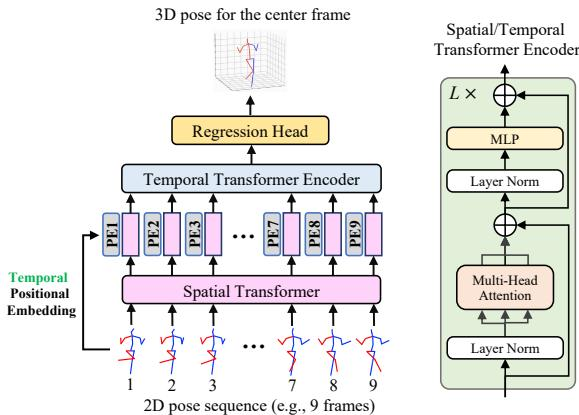
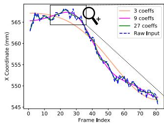
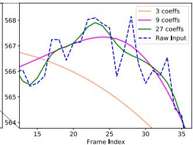
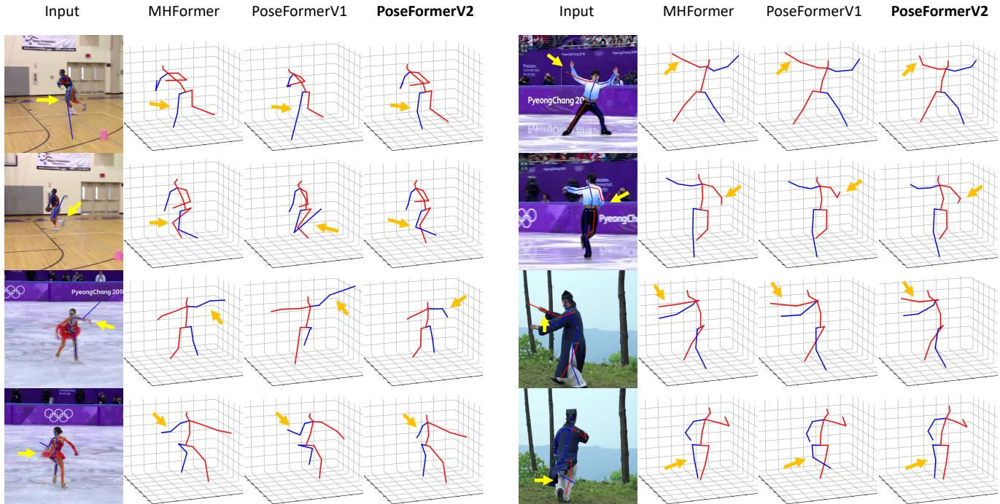
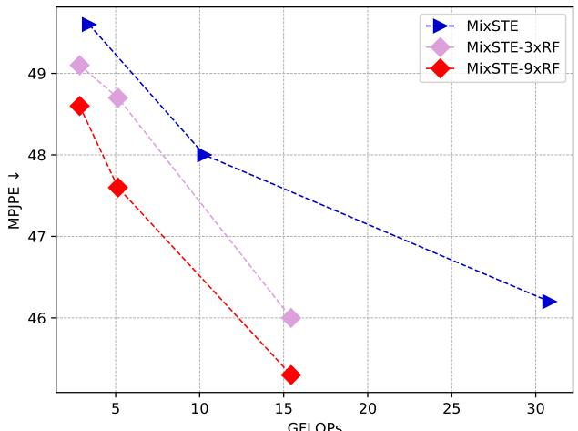
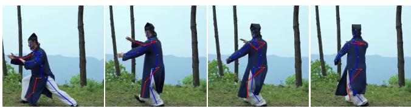
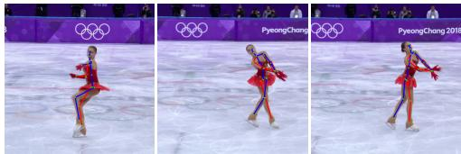
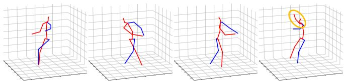

# PoseFormerV2：探索频域以实现高效且鲁棒的 3D 人体姿态估计

Qitao Zhao1\* Ce Zheng2 Mengyuan Liu3 Pichao Wang4 Chen Chen2

1Shandong University（山东大学） 2Center for Research in Computer Vision, University of Central Florida（中央佛罗里达大学计算机视觉研究中心） 4Amazon Prime Video（亚马逊 Prime Video）

3Key Laboratory of Machine Perception, Peking University, Shenzhen Graduate School（北京大学深圳研究生院机器感知与智能重点实验室）

qitaozhao@mail.sdu.edu.cn cezheng@knights.ucf.edu nkliuyifang@gmail.com

pichaowang@gmail.com

chen.chen@crcv.ucf.edu

## 摘要

近年来，基于 Transformer（Transformer）的方法在序列式的 2D 到 3D 提升人体姿态估计任务中取得了显著成功。作为开创性工作，PoseFormer 通过级联的 Transformer 层捕捉每一视频帧中人体的空间关系以及跨帧的人体动态，并取得了令人瞩目的性能。然而，在真实场景中，PoseFormer 及其后续方法的性能受限于两个因素：（a）增强 2D 关节检测（2D joint detection）质量；（b）增强输入关节序列的长度。现有方法通常对输入序列的所有帧施加自注意力（self-attention），当帧数增加以获得更高估计精度时，会带来巨大的计算负担，并且这些方法对由 2D 关节检测器能力有限所自然引入的噪声天然地不够鲁棒。在本文中，我们提出 PoseFormerV2，它在频域（frequency domain）中利用长度较长骨架序列的紧凑表示，从而高效地扩大感受野（receptive field），并提升对有噪 2D 关节检测的鲁棒性。在对 PoseFormer 进行最小改动的前提下，所提方法有效地融合了时域（time domain）与频域中的特征，相较于其前身具有更优的速度-精度权衡。在两个基准数据集（即 Human3.6M 和 MPI-INF-3DHP）上的大量实验表明，所提方法显著优于原始的 PoseFormer 以及其他基于 Transformer 的变体。代码已在 https://github.com/QitaoZhao/PoseFormerV2 开源。

## 1. 引言

3D 人体姿态估计（HPE）旨在基于单目视频（无中间 2D 表示）[25,28] 或 2D 人体关节序列（即 2D 到 3D 提升方法）[5,18,37,43]，在三维空间中定位人体关节。随着 2D 人体姿态检测器 [6, 26] 的大量可用性，加之人体 2D 骨架表示的轻量化特性，基于提升的方法如今在 3D 人体姿态估计中占据主导地位。相比于原始的单目视频，每一视频帧中人体关节的 2D 坐标在内存上要友好得多，这使得基于提升的方法能够利用较长的关节序列来提升姿态估计的精度。

  

图 1. PoseFormerV2 与 PoseFormerV1 [46] 在 Human3.6M [13] 上的对比。RF 表示感受野（Receptive Field），k×RF 表示 PoseFormerV2 空间编码器所输入的帧数与完整序列长度之比为 1/k，即空间编码器的感受野（RF）通过完整序列的少量低频系数被扩展了 k×。所提方法在速度-精度权衡方面大幅优于 PoseFormerV1，并且更大的 k 能带来更显著的提升，例如当 k=27 时可获得 4.6× 的加速。

Transformer [36] 最初在自然语言处理（Natural Language Processing，NLP）[3, 8] 领域取得了巨大成功，随后将其能力扩展到计算机视觉社区，成为多个视觉任务的事实标准方法，例如图像分类 [9, 19, 35]、目标检测 [4, 47] 和视频识别 [1, 2, 42]。人体关节表示的离散性以及骨架序列中对长程时间依赖建模的需求，使得 Transformer 非常契合基于提升（lifting）方式的人体姿态估计任务。已有工作 [15, 16, 32, 44, 46] 将 Transformer 作为三维人体姿态估计的骨干网络，并取得了令人瞩目的结果。

  

图 2. PoseFormerV1 概述。PoseFormerV1 主要由两个模块组成：空间变换器编码器（spatial transformer encoder）和时间变换器编码器（temporal transformer encoder）。给定一个 2D 关节点序列，PoseFormerV1 的时间编码器对所有帧应用自注意力机制以进行人体运动建模。

表 1. 将真值 2D 检测替换为 CPN [6] 2D 姿态检测时，各当前最优（State-of-the-Art, SOTA）基于 Transformer 的方法所带来的计算开销与性能下降。性能下降在 Human3.6M 数据集（Protocol 1）[13] 上进行报告。RF：感受野（Receptive Field），含义与图 1 中的相同。

<table><tr><td colspan="2">Method</td><td>Seq. Length</td><td>GFLOPs</td><td>Perform. Drop (mm)</td></tr><tr><td colspan="2">PoseFormerV1 [46]</td><td>81</td><td>1.36</td><td>13.0</td></tr><tr><td rowspan="3">StridedTransformer [15] MixSTE [44]</td><td>ICCV&#x27;21 TMM&#x27;22</td><td>243</td><td>1.37</td><td>15.2</td></tr><tr><td>CVPR&#x27;22</td><td>81</td><td>92.46</td><td>16.5</td></tr><tr><td>CVPR&#x27;22 ECCV&#x27;22</td><td>81</td><td>3.12</td><td>11.8</td></tr><tr><td colspan="2">P-STMO [32] PoseFormerV2 (9×RF) PoseFormerV2 (27× RF)</td><td>243 81</td><td>1.74 0.35</td><td>13.5 8.2</td></tr></table>

作为基于 Transformer 的方法中的开创性工作，PoseFormer [46] 将关节序列特征提取分解为两个阶段（见图 2），并优于传统的基于卷积的方法。首先，每个帧内的所有关节被线性投影到高维向量（即关节 token），作为空间 Transformer 编码器的输入。空间编码器利用自注意力机制构建单帧内各关节之间的依赖关系。在第二阶段，每个帧的关节 token 被组合为一个帧 token，作为时间编码器的输入，用于跨帧对人体运动进行建模。更多细节见 3.1 节。

尽管能力出众，PoseFormer（以及其他基于 Transformer 的方法）的性能受到两个关键因素的限制。（a）输入 2D 骨架序列的长度（帧数）。当前最先进的基于 Transformer 的方法通常使用极长的序列以获得先进性能，例如 PoseFormer [46] 使用 81 帧，P-STMO [15] 使用 243 帧，MHFormer [16] 使用 351 帧。然而，对如此长的序列密集施加自注意力的计算开销非常高，例如在 RTX 3090 GPU 上，3 帧 PoseFormer 的单个 epoch 训练耗时约为 5 分钟，而 81 帧 PoseFormer 的耗时激增到约 1.5 小时。（b）2D 关节检测的质量。2D 关节检测器不可避免地会引入噪声，这源于其训练数据集中的偏差以及单帧估计范式带来的时间不一致性。例如，PoseFormer 在 Human3.6M 数据集 [13] 上使用真值 2D 检测时达到 31.3mm 的 MPJPE（Mean Per Joint Position Error，每关节平均位置误差）。当使用 CPN [6] 的 2D 姿态检测替换干净的输入时，该结果显著下降到 44.3mm。在实际应用中，长序列推理对于 AR/VR 头戴设备等资源受限设备上的硬件部署而言可能难以承受，而且高质量的 2D 检测也难以获得。关于现有基于 Transformer 的方法处理长序列的效率以及对含噪 2D 关节检测的鲁棒性的更多定量结果见表 1。

受这些实际问题的驱动，我们提出两个重要的研究问题：

• Q1：如何高效地利用长关节序列以获得更高的估计精度？

• Q2：如何提高模型对不可靠 2D 姿态检测的鲁棒性？

已有工作鲜有尝试通过引入手工设计的模块来回答上述两个问题中的任意一个，例如仅处理部分视频帧以提升效率的下采样-上抬升（Down-Sampling-and-Uplifting）模块 [10]，以及用于建模身体部位深度歧义与二维检测器不确定性的多假设模块 [16]。然而，上述工作无一能在同一个方案中同时解决这两个问题；更糟糕的是，这些问题的解决方案之间似乎存在悖论，例如多假设 [16] 提升了鲁棒性却带来了额外的计算开销（另见表 1）。

在本文中，我们提出了一次「一石二鸟」的初步尝试。在对已有最优方法 PoseFormer 做出轻量的修改后，我们证明：输入序列的恰当表征形式可能是同时回答上述问题的关键。具体而言，我们聚焦于三维人体姿态估计（Human Pose Estimation, HPE）文献中鲜有探索的频域，并提出将输入骨架序列编码为低频系数。这一表征背后的洞见其实非常简单：一方面，低频分量足以表达完整的视觉身份信息 [38, 41]（例如图像压缩中的二维图像以及本文中的关节点轨迹），从而无需昂贵的全帧自注意力；另一方面，骨架序列自身的低频表征能够滤除检测到的关节点轨迹中所包含的高频噪声（抖动与离群点）[21, 22]。

我们沿用 PoseFormer 的时空架构，但使空间 Transformer 编码器只能「看到」长序列中的少量中心帧。随后，我们将完整序列低频分量中的全局特征与「目光短浅」的逐帧特征（即空间编码器的输出）进行互补。在不依赖对所有时间步进行昂贵的逐帧自注意力前提下，时间 Transformer 编码器被重新构造为时-频特征融合（Time-Frequency Feature Fusion）模块。

在两个人体姿态估计基准（即 Human3.6M [13] 和 MPI-INF-3DHP [23]）上的大量实验表明，本文所提方法（命名为 PoseFormerV2）在速度-精度权衡以及对二维关节点检测噪声的鲁棒性方面，显著优于其前身方法（另见图 1）以及其他基于 Transformer 的变体。本文的贡献可归纳为以下三点：

• 据我们所知，我们是首个将输入关节点序列的频域表征用于二维到三维提升型人体姿态估计的工作。我们发现该表征是同时解决该领域中两个重要问题（即处理长序列的效率以及对不可靠关节点检测的鲁棒性）的理想选择，并且实验证据表明该方法能够轻松泛化至其他模型。

• 我们设计了一个有效的时频特征融合模块（Time-Frequency Feature Fusion module），用于缩小时域特征与频域特征之间的差距，使我们能够在速度与精度之间灵活权衡。

• 我们的 PoseFormerV2 在 Human3.6M 上的速度-精度权衡与鲁棒性方面优于其他基于 Transformer 的方法，并在 MPI-INF-3DHP 上达到了最先进水平。

## 2. Related Work

我们的方法建立在概念上简洁的 PoseFormer [46] 之上，旨在从频域视角提升其处理长序列的效率以及对噪声关节检测的鲁棒性。因此，本文主要聚焦于 2D 到 3D 提升型 HPE 中这一系列工作（基于 Transformer 的方法），并介绍频域表示在计算机视觉文献中的应用，特别是与基于提升的 3D HPE 最相关的基于骨架的任务。

## 2.1. Transformer-based 3D Human Pose Estimation

PoseFormer [46] 是首个在基于提升的三维人体姿态估计中采用视觉 Transformer 作为骨干网络的研究，并大幅超越了之前的基于 CNN 的方法。尽管具有竞争力，Zhang 等人 [44] 指出 PoseFormer 的「先空间后时间」范式可能会忽略每个关节独特的时序模式，并提出采用交替的空间-时间 Transformer 层来提取细粒度的关节特定特征。MHFormer [16] 进一步将任务相关的先验知识融入 Transformer 中用于三维 HPE。具体而言，2D 到 3D 提升是一个逆问题，可能存在多个合理的解，因此他们生成多个假设以建模模糊的身体部位以及关节检测器中的不确定性，取得了先进的性能。受掩码图像建模（Masked Image Modeling，MIM）在图像分类 [12, 39, 40] 方面进展的启发，P-STMO [32] 将掩码关节建模（Masked Joint Modeling）以自监督学习的形式应用于三维 HPE。

另一类工作 [10, 15] 致力于提升基于 Transformer 的方法的效率。StridedTransformer [15] 利用 2D 关节序列中的时序冗余性，将参数密集的全连接层替换为跨步卷积（strided convolutions）。Einfalt 等人 [10] 认为逐帧的 2D 关节检测其计算开销甚至高于提升模型本身，因此提出以固定间隔对输入视频帧进行下采样，并仅在这些采样帧上采用 2D 关节检测器和提升模型。尽管比之前的工作更高效，但上述方法 [10, 15] 在沿时序维度缩减自注意力机制的参与数量时，仅利用了相邻视频帧之间的一致性而非全局视角，因此可能会出现明显的性能下降。

## 2.2. Frequency Representation in Vision

由于人类视觉系统对图像的低频分量更为敏感，传统的图像压缩算法（例如 JPEG [30] 和 JPEG 2000 [33]）通过为图像的低频离散余弦变换（Discrete Cosine Transform, DCT）系数分配更多存储预算来降低 2D 图像的存储成本。基于同样的思路，[41] 提出自适应地去除 DCT 分量中信息量不足的通道，以提高图像分类的效率。最近，一些工作 [11, 31] 提出用频率变换来替代开销较大的自注意力机制，这些频率变换可以借助其快速算法进行加速。GFN [31] 提出利用可学习的频率滤波器高效地混合视觉令牌（visual tokens），而 AFNO [11] 借助算子学习进一步提升了令牌混合器（token mixer）在频域中的性能。此外，Wang 等人 [38] 利用低频快速傅里叶变换（Fast Fourier Transform, FFT）分量来压缩视觉 Transformer。

基于骨骼的任务与我们的工作更为相关，因为我们的输入是 2D 骨骼序列。在人体运动预测领域，先前的工作 [21, 22] 将骨骼序列从时域变换到 DCT 系数，以对人体动态进行编码（相较于静态关节坐标）。他们观察到，丢弃少量高频系数未必会带来性能下降，反而能够提升预测未来运动的平滑度。然而，在基于提升的 3D 人体姿态估计中，2D 关节序列的频域表示尚未被探索。

我们的方法受这些先前将频率变换应用于视觉任务的工作的启发，但采用了不同的视角。我们在第 3.2.1 节中详细讨论了选择 DCT 系数表示的动机。

## 3. 方法

PoseFormer [46] 通过将序列特征提取分解为两个阶段 $i . e .$——空间编码器和时间编码器——来促进 3D 人体姿态估计，已被证明是有效的。然而，当输入序列的长度增加时，它会带来巨大的计算负担，并且对噪声关节检测敏感。在本节中，我们介绍 PoseFormerV2 的细节，该方法利用输入序列的频域表示来克服上述两个问题。

## 3.1. PoseFormerV1 [46] 的预备知识

我们首先简要概述 PoseFormerV1（见图 2），为其改进的讨论奠定基础。PoseFormerV1 包含两个主要模块：用于单帧关节点相关性建模的空间编码器（spatial encoder）和用于跨帧人体运动建模的时间编码器（temporal encoder）。给定输入的二维骨架序列 $\mathbf { x } \in \mathbb { R } ^ { F \times J \times 2 }$，其中 $F$ 表示序列长度，$J$ 表示人体表示中的关节点数量。首先，每一帧中人体所有关节点的坐标被线性投影到一个 $c$ 维向量（即关节点嵌入）中，记为 $\mathbf { z } _ { 0 } \in \mathbb { R } ^ { F \times J \times c }$。一个可学习的空间位置嵌入 $\mathbf { E } _ { S P o s } \in \mathbb { R } ^ { 1 \times J \times c }$ [9] 被加到 $\mathbf { z } _ { 0 }$ 上，以编码与关节点相关的信息。

空间 Transformer 编码器（spatial transformer encoder）。空间 Transformer 编码器通过自注意力机制分别对每一帧的关节点嵌入 $\mathbf { z } _ { 0 } ^ { i } \in \mathbb { R } ^ { 1 \times J \times c }$ 建立空间依赖关系。在此阶段，输入到每个 Transformer 块的 token 数量为 $J$。第 $i$ 帧经过 $L$ 层空间 Transformer 编码器后的输出记为 $\mathbf { z } _ { L } ^ { i } \in \mathbb { R } ^ { 1 \times J \times c }$。随后，每帧的表示被展平并拼接，作为输入 $\mathbf { Z } _ { 0 } \in \bar { \mathbb { R } } ^ { F \times ( J \cdot c ) }$ 送入时间 Transformer 编码器。

时间 Transformer 编码器（temporal transformer encoder）。类似地，输入 $\mathbf { Z } _ { 0 }$ 被加上一个可学习的时间位置嵌入 $\mathbf { E } _ { T P o s } \in \mathbb { R } ^ { F \times ( J \cdot c ) }$，以编码每一帧与索引相关的信息。具有 $M$ 层 Transformer 的时间编码器对整个序列的帧间依赖关系进行密集建模，其输出记为 $\mathbf { Z } _ { M } \in \mathbb { R } ^ { F \times ( J \cdot c ) }$。在此阶段，每个 Transformer 层的 token 数量为 $F$，即输入序列长度。

回归头（regression head）。为了估计序列中中心帧的三维姿态，使用一个简单的一维卷积来收集时间信息，并通过一个线性投影输出最终的姿态表示 $\mathbf { y } \in \mathbb { R } ^ { 1 \times ( J \cdot 3 ) }$。

  

图 3. Human3.6M [13] 中 CPN [6] 检测到的关节轨迹的一个随机选取示例，以及使用前 3、9 和 27 个 DCT 系数（共 81 个）的重构结果。注意，即使仅使用前 3 个系数，重构（橙色）曲线也能捕捉到原始输入的整体特征，并且更加平滑。

PoseFormerV1 的局限性。使用 transformer 层建模每一帧内关节之间的依赖关系以及跨帧的人体运动是直观直接的。虽然这种密集建模带来了更高的估计精度，但由于自注意力相对于 token 数量（即空间编码器中的关节数和时间编码器中的序列长度）的计算量呈二次增长，因此其计算开销较大，特别是当输入序列长度增加时。尽管空间 transformer 层的 token 数量（即关节数）与帧数无关，但值得注意的是，在实际场景中，由于 GPU 并行化能力有限，序列长度会隐式地影响空间编码器的计算预算。除了效率问题之外，PoseFormerV1 对输入二维关节检测的质量较为敏感（实验证据见表 1 和第 4.3 节）。

接下来，我们提出一种基于输入序列频域表示的替代方案，以克服 PoseFormerV1 的局限性。

## 3.2. PoseFormerV2

## 3.2.1 骨架序列的频率表示

动机。我们提出使用离散余弦变换（Discrete Cosine Transform, DCT）将输入骨架序列变换到频域，并仅利用其中一部分低频系数。DCT 系数对输入时间序列的多层级时间信息进行编码。具体而言，低频系数编码其大致轮廓，而高频系数编码其细节，例如抖动或剧烈变化。

为了更好地说明我们选择这种表示的动机，我们给出了 Human3.6M [13] 数据集中动作 "Directions"（指示方向）的 CPN 检测 [6] 关节轨迹的 81 帧示例，以及分别使用前 3 个、9 个和 27 个 DCT 系数进行重建的结果（见图 3）。随着保留的 DCT 系数数量的增加，重建轨迹越来越接近原始输入，但平滑度降低。值得注意的是，仅使用 3 个 DCT 系数（由橙色曲线表示）即可捕捉到原始轨迹的整体趋势，而使用 9 个和 27 个系数（粉色和绿色曲线）则能更好地保留原始序列的特征，同时去除高频噪声（锯齿状波动）。

这些观察结果促使我们在工作中利用输入关节序列中少量信息量丰富的低频 DCT 分量作为紧凑且去噪的序列表示。通过这种表示，我们显著缩短了作为输入的序列有效长度，并增强了模型对二维关节检测中所含噪声的鲁棒性。

我们在补充材料中给出了 DCT 的正式介绍。

  

图 4. (a) PoseFormerV2 概览。(b) 空间 Transformer（Spatial Transformer）与时频特征融合 Transformer（Time-Frequency Feature Fusion Transformer）。(c) FreqMLP（频率多层感知机，Frequency Multi-Layer Perceptron）。作为示例，在 (a) 中我们使用 3 个中心帧（索引 -1、0 和 1）进行细粒度的帧级特征提取，并使用完整 9 帧序列的前 3 个 DCT 系数进行全局频域特征提取。因此，与 PoseFormerV1 相比，输入到空间编码器和时间编码器的有效帧数有所减少（3,6 对 9,9）。

## 3.2.2 架构

在本节中，我们介绍所提出方法 PoseFormerV2 的架构（总体概览见图 4）。

空间 Transformer 编码器。给定一个二维骨架序列 $\mathbf { x } \in \mathbb { R } ^ { F \times J \times 2 }$（最好是较长的序列，例如 $F$ 为 81），我们首先在序列中心（图 4(a) 中索引为 0 的帧）周围采样 $F'$（通常 $F' \ll F$）帧，记作 $\mathbf { x } ^ { \prime } \in \mathbb { R } ^ { F ^ { \prime } \times J \times 2 }$，作为空间编码器的输入。空间编码器的输出记作 $\mathbf { z } ^ { T i m e } \in \mathbb { R } ^ { F ^ { \prime } \times ( \bar { J ` c } ) }$（时域中的帧级特征）。空间编码器的设计直接沿用 PoseFormerV1。

低频 DCT 系数。$\mathbf { z } ^ { T i m e }$ 被称为"短视的"，因为其感受野 $( F ^ { \prime } )$ 相对于整个序列长度 $(F)$ 是受限的。为了高效地利用原始序列的远距离人体动态信息，我们转而采用其频域表示。我们首先将完整序列 $\textbf { x } \in \mathbb { R } ^ { \sum _ { F \times J \times 2 } ^ { \star } }$ 转换为 DCT 系数，记作 $\dot { \mathbf { C } } \in \mathbb { R } ^ { F \times J \times 2 }$。然后，对每条关节轨迹使用低通滤波器，仅保留前 $N \ ( \ll \ F )$ 个系数 ${ \bf C } ^ { \prime } \in { \bf \Sigma }$ $\mathbb { R } ^ { N \times J \times 2 }$，其中原始序列的时间信息得以大体保留，高频噪声则被去除。

低频系数 $\mathbf { C ^ { \prime } }$ 被展平并线性投影为 $\mathbf { \bar { z } } ^ { F r e q } \in \mathbb { R } ^ { N \times ( J \cdot c ) }$（频率系数的嵌入）。${ \mathbf z } ^ { F r e q }$ 与一个可学习的频率位置嵌入 $\mathbf { E } _ { F P o s }$ 相加（类似于 PoseFormerV1 中的 $\mathbf { E } _ { T P o s }$）。时域与频域的特征被拼接在一起，公式如下

$$
{ \bf z } = [ { \bf z } ^ { T i m e } ; { \bf z } ^ { F r e q } ],\tag{1}
$$

输入到时频特征融合模块（Time-Frequency Feature Fusion module）。

**Time-Frequency Feature Fusion.** 我们采用 Transformer 层进行跨帧时序依赖建模，与 PoseFormerV1 一致。与完全在时域中提取特征的 PoseFormerV1 不同，所提方法融合了时域和频域两方面的特征。为了缩小这两个域之间的差距，我们对原始（vanilla）Transformer 层进行了简单改进。(1) 时域和频域特征共享自注意力（self-attention），但使用各自独立的前馈网络；(2) 我们在时域特征 $\mathbf{z}^{Time}$ 的前馈网络中应用 FreqMLP（Frequency Multi-Layer Perceptron，频域多层感知机）（见图 4 (b)(c)）。在 FreqMLP 中，我们在原始（vanilla）MLP 的前后分别使用 DCT 与 IDCT。该方法背后的直觉是：通过低通滤波器可以从频域特征中滤除高频噪声，但一些细致的人体运动特征（例如快速的局部运动）也可能作为噪声一并被滤除。为了解决这一问题，FreqMLP 充当一个可训练的频域滤波器，使我们能够在 2D 关节坐标（即时域特征）的嵌入中自适应地调整每个频率分量的权重，作为对频域特征的补充。这些模块可表述为：

$$
\mathbf { z } _ { k } ^ { ' } = \mathrm { M S A } ( \mathbf { z } _ { k } ) ,\tag{2}
$$

$$
\begin{array} { r } { \mathbf { z } _ { k } ^ { T i m e } , \mathbf { z } _ { k } ^ { F r e q } = \mathbf { z } _ { k } ^ { ' } [ : F ^ { \prime } ] , \mathbf { z } _ { k } ^ { ' } [ F ^ { \prime } : ] , } \end{array}\tag{3}
$$

$$
\mathbf { z } _ { k + 1 } = \mathrm { C o n c a t } ( \mathrm { F r e q M L P } ( \mathbf { z } _ { k } ^ { T i m e } ) , \mathrm { M L P } ( \mathbf { z } _ { k } ^ { F r e q } ) ) ,\tag{4}
$$

其中 MSA 表示多头自注意力（Multi-head Self-Attention），$F'$ 为采样后中心帧的数量。 上述改进的有效性在第 4.4 节中得到验证。需要注意的是，拼接操作会导致 Transformer 的 token 数量增多。然而，通过将空间编码器限制为仅观测有限数量的中心帧，并结合少量低频 DCT 系数来扩展其感受野，我们可以灵活地降低整体计算量。该方法不仅降低了计算成本，还提升了模型相较于 PoseFormerV1 的抗噪能力。

**Regression head and loss function.** 沿用 PoseFormerV1 的做法，我们使用 1D 卷积层来汇集时序信息，并通过线性投影得到序列中心帧的最终 3D 姿态 $\mathbf { y } \in \mathbb { R } ^ { 1 \times ( J \cdot 3 ) }$。我们使用与 PoseFormerV1 相同的标准 MPJPE（Mean Per Joint Position Error，平均关节位置误差）损失来训练模型。

## 4. 实验

## 4.1. 数据集与评价指标

我们在两个 3D 人体姿态估计数据集上进行实验，即 Human3.6M [13] 和 MPI-INF-3DHP [23]，以证明我们方法的有效性。两个数据集及其各自评估指标的更详细描述见补充材料。

## 4.2. 实现细节与分析

所提出的方法包含三个重要的超参数，这些参数特定于实验设置。这些包括：在空间编码器中用作输入的帧数（f）、表示扩大感受野的整个输入序列长度（F），以及用于融合长程时间信息的保留 DCT 系数数量（n）。除非特别说明，为方便起见，我们简单地将 $n = f$。实际上，可以进一步调整它们以实现灵活的速度-精度权衡。当 f 等于 1 时，n 设为 3，因为单个 DCT 系数可能不足以编码来自较长输入序列的时间信息。当 $f$ 和 n 固定时，模型的计算复杂度是预先确定的（即空间编码器的 token 数量和特征融合模块的 token 数量是固定的）。我们可以改变 $F$ 以将模型的感受野从有限的 f 有效扩展到任意值，且不带来额外的计算开销。这使我们能够高效地利用长序列来提高精度。我们在补充材料中提供了模型架构和训练的超参数细节。

## 4.3. 与最先进方法的比较

Human3.6M。我们在 Human3.6M 上将我们的方法与 Pose-FormerV1 和其他基于 Transformer 的方法进行比较（表 2）。我们通过改变 $f$ 的值和序列长度来展示模型的灵活性。当扩展比 $( i . e . ,$ （即完整序列长度与 f 的比值）较大时，我们的方法特别高效。例如，当扩展比为 81 时，它仅用 77.2 MFLOPs 就达到了 47.6 mm MPJPE，而 MHFormer [16] 用 342.9 MFLOPs 达到 47.8 mm MPJPE（慢了 4.4 倍）。此外，在类似的计算预算（约 350 MFLOPs）和相同的完整序列长度（81）下，我们的方法达到 46.0 mm MPJPE，而 StridedTransformer [15] 得到 47.5 mm MPJPE（提升 3.2%）。图 5 给出了更清晰的对比，表明所提出的方法在速度-精度权衡方面优于其他基于 Transformer 的方法。请注意，具有额外预训练阶段的方法以及计算量较大的 MixSTE [44]（仅 3 帧输入就需要 3420 MFLOPs）未纳入比较。Pose-FormerV2 相对于 PoseFormerV1 的改进见图 1。

表 2. 在 Human3.6M 上与之前基于 Transformer 的方法的定量比较（单位 mm）。$f \colon$ 模型输入的帧数，Seq. Len.：整个输入序列的长度 $( i . e .$ （即有效感受野）。最佳分数以粗体标出。（\*）表示使用了额外的预训练阶段，（†）表示我们的重新实现。

<table><tr><td rowspan=1 colspan=1>Method</td><td rowspan=1 colspan=1>f</td><td rowspan=1 colspan=1>Seq.Len.</td><td rowspan=1 colspan=1>MFLOPs</td><td rowspan=1 colspan=1>MPJPE↓/P-MPJPE↓</td></tr><tr><td rowspan=6 colspan=1>PoseFormerV1 [46] ICCV&#x27;21StridedTrans. [15] TMM&#x27;22MixSTE [44](†) CVPR’22MHFormer [16] CVPR&#x27;22MHFormer [16] CVPR’22P-STMO [32](*) ECCV’22P-STMO [32](*) ECCV’22Einfalt et al. [10] WACV&#x27;23</td><td rowspan=1 colspan=1>27</td><td rowspan=1 colspan=1>27</td><td rowspan=1 colspan=1>542.1</td><td rowspan=1 colspan=1>47.0/-</td></tr><tr><td rowspan=1 colspan=1>81</td><td rowspan=1 colspan=1>81</td><td rowspan=1 colspan=1>342.5</td><td rowspan=5 colspan=1>47.5/-49.6/38.947.8/-45.9/-46.8/-45.6/-47.9/-</td></tr><tr><td rowspan=4 colspan=1>392727819</td><td rowspan=3 colspan=1>3927</td><td rowspan=1 colspan=1>3420</td></tr><tr><td rowspan=1 colspan=1>342.9</td></tr><tr><td rowspan=1 colspan=1>1031.8</td></tr><tr><td rowspan=1 colspan=1>818181</td><td rowspan=1 colspan=1>163493543</td></tr><tr><td rowspan=1 colspan=1>PoseFormerV2PoseFormerV2PoseFormerV2</td><td rowspan=1 colspan=1>111</td><td rowspan=1 colspan=1>92781</td><td rowspan=1 colspan=1>77.277.277.2</td><td rowspan=1 colspan=1>49.9/38.748.7/37.847.6/37.3</td></tr><tr><td rowspan=1 colspan=1>PoseFormerV2PoseFormerV2PoseFormerV2</td><td rowspan=1 colspan=1>333</td><td rowspan=1 colspan=1>92781</td><td rowspan=1 colspan=1>117.3117.3117.3</td><td rowspan=1 colspan=1>49.5/38.547.9/37.447.1/37.3</td></tr><tr><td rowspan=1 colspan=1>PoseFormerV2PoseFormerV2</td><td rowspan=1 colspan=1>99</td><td rowspan=1 colspan=1>2781</td><td rowspan=1 colspan=1>351.7351.7</td><td rowspan=1 colspan=1>47.6/37.146.0/36.1</td></tr><tr><td rowspan=1 colspan=1>PoseFormerV2</td><td rowspan=1 colspan=1>27</td><td rowspan=1 colspan=1>243</td><td rowspan=1 colspan=1>1054.8</td><td rowspan=1 colspan=1>45.2/35.6</td></tr></table>

  

图 5. PoseFormerV2 与其他最先进的基于 Transformer 的方法在 Human3.6M 数据集上的对比（单位：毫米）。RF：感受野（Receptive Field），$k \times \mathrm{RF}$ 表示 PoseFormerV2 的感受野通过完整序列的少量低频 DCT 系数扩展了 $k$ 倍。所提出的方法在速度-精度的权衡上优于其他方法，且 $k$ 值越大，相对于其他方法的提升也越大。（建议在彩色模式下查看）

  

图 6. PoseFormerV2 与其他基于 Transformer 的方法 [16, 44, 46] 在 Human3.6M 上对噪声鲁棒性的对比。在真实 2D 检测结果上添加标准差为 sigma 的零均值高斯噪声，并展示随着 sigma 增大它们的性能下降（△MPJPE，单位 mm）。标记的大小表示模型的计算成本。

表 3. 与此前方法在 MPI-INF-3DHP 上的定量比较。T：整个序列长度，默认为 1。最佳分数以粗体标记。（*）表示使用了额外的预训练阶段，（†）表示我们重新实现的结果。

<table><tr><td rowspan=1 colspan=1>Method</td><td rowspan=1 colspan=1></td><td rowspan=1 colspan=1>PCK↑  AUC ↑  MPJPE↓</td></tr><tr><td rowspan=11 colspan=1>Mehta et al. [23]Mehta et al. [24]Pavllo et al. [29] (T=81)Pavllo et al. [29] (T=243)Lin et al. [17] (T=25)Li et al. [14]Chen et al. [5] (T=81)PoseFormerV1 [46] (T=9)(†)MHFormer [16] (T=9)MixSTE [44] (T=27)P-STMO [32] (T=81)(*)</td><td rowspan=3 colspan=1>3DV&#x27;17ACM ToG&#x27;17CVPR&#x27;19</td><td rowspan=1 colspan=1>75.7    39.3     117.6</td></tr><tr><td rowspan=1 colspan=1>76.6    40.4     124.7</td></tr><tr><td rowspan=1 colspan=1>86.0    51.9     84.0</td></tr><tr><td rowspan=6 colspan=1>CVPR&#x27;19BMVC&#x27;19CVPR’20TCSVT&#x27;21ICCV’21CVPR&#x27;22</td><td rowspan=1 colspan=1>85.5    51.5     84.8</td></tr><tr><td rowspan=1 colspan=1>83.6    51.4     79.8</td></tr><tr><td rowspan=1 colspan=1>81.2    46.1     99.7</td></tr><tr><td rowspan=1 colspan=1>87.9    54.0     78.8</td></tr><tr><td rowspan=1 colspan=1>95.4    63.2     57.7</td></tr><tr><td rowspan=1 colspan=1>93.8    63.3     58.0</td></tr><tr><td rowspan=2 colspan=1>CVPR&#x27;22ECCV&#x27;22</td><td rowspan=1 colspan=1>94.4    66.5     54.9</td></tr><tr><td rowspan=1 colspan=1>97.9    75.8     32.2</td></tr><tr><td rowspan=1 colspan=1>PoseFormerV2 (T=81)</td><td rowspan=1 colspan=1></td><td rowspan=1 colspan=1>97.9    78.8     27.8</td></tr></table>

为了证明低频DCT系数的引入有助于提升所提方法的鲁棒性，我们在Human3.6M数据集[13]上向真实2D检测结果添加零均值高斯噪声，使基于提升（lifting）的姿态估计任务更具挑战性（图6）。为保证公平比较，我们保持所有方法的输入序列长度一致（此处为27帧）。对于我们的方法，$f = n = 3$。实验结果表明，随着高斯噪声标准差（sigma）的增大，PoseFormerV2的性能下降幅度更小，同时效率更高。我们观察到，当sigma从8增加到10时，PoseFormerV1的性能急剧下降。相比之下，所提方法呈现出更为稳定的变化趋势。此外，我们的方法甚至优于将2D检测器的不确定性纳入模型设计的MHFormer[16]。有趣的是，我们发现轻微的噪声反而可能提升3D姿态估计的精度（sigma = 3）。

表4. PoseFormerV1若干改动的消融研究。我们展示了如何将9帧的PoseFormerV1逐步转换为PoseFormerV2（使用来自81帧序列的9个DCT系数）。评估在Human3.6M（协议1，单位mm）上进行。RF表示感受野（Receptive Field）。

<table><tr><td>Step</td><td>Description</td><td>RF</td><td>MPJPE↓</td></tr><tr><td>(0)</td><td>Original 9-frame PoseFormerV1.</td><td>9</td><td>49.9</td></tr><tr><td>(1)</td><td>Frames are sampled from a longer sequence.</td><td>9</td><td>49.9</td></tr><tr><td>(2)</td><td>Append the embedding of DCT coefficients.</td><td>81</td><td>47.1 (2.8↓)</td></tr><tr><td>(3)</td><td>Replace the vanilla MLP with FreqMLP.</td><td>81</td><td>46.0 (3.9↓)</td></tr></table>

表 5. 对用作 PoseFormerV2 输入的帧数与 DCT 系数数量的消融研究。评估在 Human3.6M（Protocol 1，单位为毫米）上进行。

<table><tr><td>Frame Number (f)</td><td>Coefficient Number (n)</td><td>Full Length</td><td>MFLOPs</td><td>MPJPE</td></tr><tr><td>1</td><td>1</td><td>27</td><td>39.2</td><td>51.1</td></tr><tr><td>1</td><td>3</td><td>27</td><td>77.2</td><td>48.7 (2.4↓)</td></tr><tr><td>3</td><td>1</td><td>27</td><td>79.4</td><td>50.1 (1.0↓)</td></tr><tr><td>3</td><td>3</td><td>27</td><td>117.3</td><td>47.9 (3.2↓)</td></tr><tr><td>9</td><td>9</td><td>27</td><td>351.7</td><td>47.6 (3.5↓)</td></tr></table>

MPI-INF-3DHP。我们还在 MPI-INF-3DHP [23] 上与其他方法进行了比较（表 3）。我们使用 9 个中心帧以及从 81 帧输入序列中提取的前 9 个 DCT 系数。本文方法优于包括带掩蔽关节预训练的 P-STMO [32] 在内的其他方法。该结果验证了本文方法的有效性。我们的实现遵循文献 [32]。

定性比较。我们在图 7 中给出了本文方法与具有竞争力的 MHFormer [16] 和 PoseFormerV1 [46] 的定性比较。所有方法均使用 81 帧的二维关节序列作为输入。为了进一步说明本文方法的鲁棒性，我们通过向随机选取的关节（例如"左手腕""右脚"）的二维时序检测中加入高斯噪声，使姿态估计任务更加困难。即使在高度偏离的二维检测下（用浅黄色箭头标出），本文方法仍能获得可靠的三维人体姿态。需要注意的是，本文的模型比 MHFormer 效率高出约 9 倍（3.12 GFLOPs 对 0.35 GFLOPs），比 PoseFormerV1 效率高出约 4 倍（1.36 GFLOPs 对 0.35 GFLOPs）。

## 4.4. 消融实验

在本节中，我们逐步展示对 PoseFormerV1 的若干修改如何带来显著的性能提升。此外，为了深入探究输入序列的频域表示，我们揭示了输入帧数与所保留 DCT 系数数量对本文方法的影响。

将 PoseFormerV1 转换为 PoseFormerV2。我们继承了 PoseFormerV1 整体的空间–时间架构，并对其中的时间 Transformer 引入受限的修改，以实现更好的多域特征融合。作为示例，我们逐步展示如何将一个 9 帧的 PoseFormerV1 转换为 PoseFormerV2：(1) 输入（即 9 帧）从更长的序列（例如 81 帧）中在序列中心进行采样。这一步并不会带来性能提升，也不会增大感受野，因为模型的输入实际上并未改变。(2) 将 PoseFormerV1 空间编码器的输出 zTime 与完整序列（本例中为 81 帧）前 n 个 DCT 系数的嵌入（记为 zFreq）拼接，作为时间编码器的输入。为方便起见，我们将 n 设为 9。(3) 我们用 FreqMLP（细节见第 3.2.2 节）替换时间编码器中用于 zTime 的原始 MLP（在替换之前，zTime 和 zFreq 已分别使用各自的原始 MLP）。经过上述步骤，PoseFormerV1 被转换为 PoseFormerV2，且感受野由 9 扩大至 81。我们在表 4 中给出了每一步所带来的提升。值得注意的是，通过引入来自更长序列（即 81 帧）的 9 个 DCT 系数，9 帧 PoseFormerV1 的 MPJPE 下降了 7.8%（49.9 mm 对 46.0 mm），这验证了本文所提出的输入关节序列 DCT 表示的有效性。

  

图7. PoseFormerV2 与 MHFormer [16] 和 PoseFormerV1 [46] 的定性比较。我们对一个特定关节的 2D 检测结果随机添加高斯噪声，并用浅黄色箭头标出偏离的 2D 检测结果，用橙色箭头标出相应的 3D 姿态估计结果。PoseFormerV2 在面对高噪声输入时比现有方法表现出更强的鲁棒性。

输入帧数与 DCT 系数。 在表 5 中，我们研究了输入到空间编码器的帧数（f）与保留的 DCT 系数个数（n）的影响。此处我们固定整个关节序列的长度为 27。基线模型仅使用一个中心帧与一个 DCT 系数 $( f = n = 1)$。同时增大这两个参数都能带来稳定的提升，并且 n 的增加会带来更大的误差下降（n = 3 时下降 2.4，而 f = 3 时仅下降 1.0），因为仅需少量 DCT 系数即可捕捉整个序列的全局特征。我们通过实验发现，f 与 n 以 9 倍的扩展率进行匹配（即 f = n = 3）即可在速度与精度之间取得令人满意的折中。

## 4.5. 泛化能力

所提出的频域方法可推广到其他方法，例如 MixSTE [44] 与 MHFormer [16]，因为它们同样使用 Transformer 进行时序建模。我们通过引入低频 DCT 系数来改进这两种方法。详见补充材料。

## 5. 结论

我们从一个鲜有探索的频域视角出发，提出了一种方案，同时解决基于抬升（lifting）的 3D 人体姿态估计中两个看似无关甚至相互矛盾的问题——长序列输入的处理效率与对噪声关节检测的鲁棒性。所提出的方法 PoseFormerV2 利用长 2D 关节序列的紧凑频域表示，在有效扩大模型感受野的同时提升其鲁棒性。实验结果表明，我们的方法在 Human3.6M 和 MPI-INF-3DHP 上优于此前基于 Transformer 的方法。

## 补充材料

## A. 概述

补充材料包含以下章节：

• B 节：离散余弦变换的形式化介绍。

• C 节：数据集与评价指标。

• D 节：更多实现细节。

• E 节：PoseFormerV2 与一个纯频域的简单基线模型的对比。

• F 节：本方法向更多模型的推广。

• G 节：可视化与分析。

• H 节：更广泛的影响与局限性。

## B. 离散余弦变换

下面给出 DCT 的形式化介绍。给定一个 2D 关节序列，记为 $\mathbf{x} \in \mathbb{R}^{F \times J \times 2}$，其中 F 是序列长度，J 是每帧中的关节数，第 j 个关节的 x（或 y）坐标轨迹记为 $\mathbf{x}_{j,0} \in \mathbb{R}^{F}$（或 $\mathbf{x}_{j,1} \in \mathbb{R}^{F}$，为简洁起见统一记为 $\hat{\mathbf{x}}_j$），它是一个一维时间序列，我们对每条轨迹（共 $J * 2$ 条）分别施加 DCT。

对于轨迹 $\hat{\mathbf{x}}_j$，第 i 个 DCT 系数计算如下

$$
\begin{array} { r } { C _ { j , i } = \sqrt { \frac { 2 } { F } } \sum _ { f = 1 } ^ { F } x _ { j , f } \frac { 1 } { \sqrt { 1 + \delta _ { i 1 } } } \cos \left( \frac { \pi } { 2 F } ( 2 f - 1 ) ( i - 1 ) \right) } \end{array}\tag{5}
$$

其中当 $i = 1$ 时 $\delta_{i1} = 1$，否则 $\delta_{i1} = 0$。轨迹中的每个时间步都会产生一个 DCT（Discrete Cosine Transform，离散余弦变换）系数，即 $i \in \{1, 2, \cdots, F\}$。DCT 系数对输入时间序列中多个层次的时间信息进行编码。具体而言，低频系数（即 $i$ 较小时）编码输入序列的粗略轮廓，而高频系数（即 $i$ 较大时）编码细节，例如输入序列中的抖动或剧烈变化。时域中的原始输入序列可以通过逆离散余弦变换（Inverse Discrete Cosine Transform, IDCT）来恢复，其公式为

$$
\begin{array} { r } { x _ { j , f } = \sqrt { \frac { 2 } { F } } \sum _ { i = 1 } ^ { F } C _ { j , i } \frac { 1 } { \sqrt { 1 + \delta _ { i 1 } } } \cos \left( \frac { \pi } { 2 F } ( 2 f - 1 ) ( i - 1 ) \right) } \end{array}\tag{6}
$$

其中 $f \in \{1, 2, \cdots, F\}$。如果我们完整保留所有系数，则 DCT 是无损的。在实践中，我们可以仅使用少数低频系数来略有损失地恢复输入序列，并将其他系数置零。值得注意的是，由于丢弃了部分高频系数，恢复出的曲线相比原始曲线更为平滑。DCT 的这一性质是理想的——只需一小部分 DCT 系数就足以表示整个输入序列，而且表示得更为干净。这促使我们采用这种表示方式来高效处理长序列，同时提升模型对低质量 2D 检测（在低质量检测中常常存在高频噪声）的鲁棒性。

## C. 数据集与评价指标（Datasets and Evaluation Metrics）

Human3.6M 是目前使用最广泛的 3D 人体姿态估计基准。该数据集在不同地点使用 4 个摄像机在室内采集了超过 360 万帧视频。该数据集包含 11 位受试者执行 15 种不同动作，例如「Walking」和「Phoning」。我们遵循 [5, 18, 29, 46]，使用 5 位受试者（S1、S5、S6、S7、S8）训练模型，并使用另外 2 位受试者（S9、S11）进行测试。

MPI-INF-3DHP 是在可控的室内环境和具有挑战性的室外环境中采集的。它与 Human3.6M 类似，也提供了来自多个摄像机视角的不同受试者和动作。

评价指标（Evaluation Metrics）。我们在 Human3.6M 上报告两个常用指标：MPJPE 和 P-MPJPE [45]。MPJPE（Mean Per Joint Position Error，平均关节位置误差，称为 Protocol 1）衡量估计的 3D 姿态与真实 3D 姿态之间的平均欧氏距离。P-MPJPE（Protocol 2）对估计的 3D 姿态施加刚性变换，然后在对齐后的估计 3D 姿态与真实 3D 姿态之间计算距离。

对于 MPI-INF-3DHP 数据集，我们报告了 MPJPE、150mm 范围内的正确关键点百分比（PCK）以及曲线下面积（AUC），与文献 [5, 17, 37] 一致。

## D. 更多实现细节

我们的方法建立在 PoseFormerV1 [46] 之上。为了更好地展示输入序列 DCT 系数表示的有效性，并与 PoseFormerV1 进行公平比较，我们直接采用 PoseFormerV1 的最优模型架构超参数，尽管进一步的探索可能带来额外的提升。

**模型架构超参数。** 空间变换器中的嵌入特征维度 c 为 32，空间变换器和特征融合变换器的层数为 4，沿用文献 [46]。此外，空间-时间位置嵌入（Spatial-Temporal Positional Embedding）的设计同样采用自文献 [46]。

**实验设置。** 我们的实验使用 Pytorch [27] 在单块 NVIDIA RTX 3090 上进行。在训练和测试中，我们沿用文献 [5, 18, 29, 46] 应用水平翻转增强。我们使用 AdamW [20] 优化器训练模型 80 个 epoch，权重衰减为 0.1。初始学习率设为 8e-4，采用指数学习率衰减调度，衰减因子为 0.99。我们沿用文献 [5, 18, 29]，在 Human3.6M 上采用 CPN [7] 进行二维姿态检测。对于 MPI-INF-3DHP 数据集，我们沿用文献 [17, 24]，使用真实二维检测结果。

## E. 简单基线

在我们的方法中，PoseFormerV1 [46] 的时间编码器被重新构建为时-频特征融合模块（Time-Frequency Feature Fusion module），并验证了输入序列的低频系数有助于提升模型处理长序列的效率以及对噪声关节检测的鲁棒性。鉴于该表示的有效性，读者可能会提出一个问题：为什么不直接从输入序列的 DCT 系数中完整地提取特征，而是将其与时域中的特征进行额外融合？为此，我们设计了一个基线模型，仅将 PoseFormerV1 [46] 的输入（即时域中的关节坐标）替换为输入序列的低频 DCT 系数。基线模型与我们的方法保持相同的完整序列长度以及保留的 DCT 系数数量（记为 n）。为方便起见，输入到 PoseFormerV2 空间编码器的帧数（f）设为 n。我们提供的定量结果表明，这种直接的做法效果不佳，尤其是当完整序列长度与 n 的比值增大时（见表 6）。仅使用序列中少数中心帧的特征就能显著提升精度，$e . g .$ ，在使用长度为 81 的完整输入序列中的 3 个中心帧时，MPJPE 由 49.7mm 降低至 47.1mm（下降 5.2%，见表 6 第 3 行）。

表 6. PoseFormerV2 与一个简单基线（simple baseline）的对比。评估在 Human3.6M（Protocol 1, MPJPE）[13] 上进行，其中帧数（Frame Number，f）仅适用于 PoseFormerV2。

<table><tr><td>Frame Number (f)</td><td>Coefficient Number (n)</td><td>Full Length</td><td>Baseline</td><td>PoseFormerV2</td></tr><tr><td>3</td><td>3</td><td>9</td><td>50.2</td><td>49.5 (0.7↓)</td></tr><tr><td>3</td><td>3</td><td>27</td><td>48.7</td><td>47.9 (0.8↓)</td></tr><tr><td>3</td><td>3</td><td>81</td><td>49.7</td><td>47.1 (2.6↓)</td></tr><tr><td>9</td><td>9</td><td>27</td><td>48.8</td><td>47.6 (1.2↓)</td></tr><tr><td>9</td><td>9</td><td>81</td><td>47.8</td><td>46.0 (1.8↓)</td></tr></table>

直观上，PoseFormerV2 的空间编码器在时间域中对若干中心帧的关节坐标进行编码，有助于捕捉细粒度的人体运动，从而提升对序列中心帧的 3D 姿态估计精度。相比之下，输入序列的低频系数会滤除高频噪声以及人体运动细节（例如，快速运动），而这些信息对人体姿态估计可能是有价值的（即，过平滑问题）。因此，时间域与频率域的特征（即，中心帧的关节坐标与序列的低频系数）蕴含互补的语义信息。这些考量促使我们提出时频特征融合（Time-Frequency Feature Fusion）设计。

## F. 推广到更多模型

在正文中，我们主要从一个鲜有探索的频域视角来改进 PoseFormerV1 [46]。在本节中，我们展示了所提出的频域方法同样能够良好地推广到其他现有的最先进方法，例如 MixSTE [44] 和 MHFormer [16]。由于这些方法 [16, 44] 与 PoseFormerV1 [46] 类似，也沿时间维度对所有帧施加自注意力，因此所提方法无需复杂的模型架构重设计，即可方便地嵌入到这些模型中。为保证公平比较，我们直接采用这些原始方法的最优超参数（例如，层数、通道维度）。进一步的超参数调优可能会带来额外的性能提升。

  

图 8. MixSTE [44] 及其改进版本在 Human3.6M [13] 上结合序列频率表示的对比。RF：感受野（Receptive Field），k×RF 表示 MixSTE 的感受野借助全序列中的少量低频 DCT 系数扩展了 k×。所提方法使 MixSTE 在速度与精度之间获得更优的权衡。（建议在彩色下查看）

  

图 9. MixSTE [44] 及其改进版本（使用序列的低频 DCT 系数）在 Human3.6M [13] 上对噪声鲁棒性的对比。将标准差为 sigma 的零均值高斯噪声（Zero-mean Gaussian noise）添加到真实 2D 检测结果中，并展示了随着 sigma 增大时两者性能的下降（△MPJPE）。标记的大小表示模型的计算开销。

MixSTE [44] 采用了与 PoseFormerV1 [46] 相同的空间-时间架构。与 PoseFormerV1 的「先空间后时间（spatial-then-temporal）」范式相比，MixSTE 交替使用空间和时间 Transformer 编码器。类似地，我们从一段较长的视频序列中集中采样若干视频帧作为输入，送入 MixSTE 的空间编码器。对于时间编码器，我们将时域特征（即空间编码器的输出）与完整输入序列低频系数的嵌入向量相拼接。MixSTE 及其改进版本的对比结果如图 8、图 9 所示。原始 MixSTE 计算开销极高，而我们的方法同时提升了其效率与精度：MixSTE 在 30.8 GFLOPs 下达到 46.2 mm MPJPE，而其改进版本在 15.4 GFLOPs 下即可达到 45.3 mm MPJPE（速度提升 2 倍，误差降低 1.9%，对应图 8 中的亮红色曲线）。我们还展示了我们所提方法能够提升 MixSTE 对含噪 2D 关节点检测的鲁棒性（图 9）。具体地，我们在 Human3.6M [13] 上对一段 27 帧的真值 2D 关节点序列添加零均值高斯噪声。改进后的 MixSTE（记作 MixSTE+）使用 3 个中心帧作为空间编码器的输入，并使用前 3 个 DCT（离散余弦变换）系数作为整段序列的更纯净的全局表征。MixSTE+ 的性能下降幅度更小，同时效率提升 6 倍（30.8 GFLOPs 对比 5.1 GFLOPs，由标记大小体现）。

  

图 10. MHFormer [16] 及其改进版本（使用序列的低频 DCT 系数）在 Human3.6M [13] 数据集上针对噪声鲁棒性的对比。实验设置与图 9 保持一致。标记的大小表示模型的计算成本。

MHFormer [16] 在其架构中引入了多假设（multiple hypotheses）来建模身体部位的深度模糊性与关节点检测器的不确定性，因此具有较好的鲁棒性（实验结果见正文）。此外，MHFormer 也像 PoseFormerV1 [46] 一样包含了时空 Transformer 模块。为进一步验证我们方法的通用性，我们同样按照 MixSTE+ 的方式对 MHFormer 进行了改进。实验证据表明，所提出的方法在提升了 MHFormer 鲁棒性的同时降低了其计算开销（见图 10），即使 MHFormer 已经具备了关于噪声关节点检测的先验知识。因此，该结果表明，在提升模型鲁棒性方面，我们的方法与其他方法是兼容的。

到目前为止，我们已将所提出的方法推广到了另外两种基于 Transformer 的方法，即 MixSTE [44] 和 MHFormer [16]。未来，我们将探索把所提出的方法推广到更多模型架构中，例如 3D 人体姿态估计中基于 CNN 和基于 GNN 的方法。此外，我们相信我们的方法也可以应用于其他任务，特别是基于骨架的任务，在这些任务中长序列处理的计算开销以及人体骨架表示的质量可能成为瓶颈。

## G. 可视化与分析

在本节中，我们提供了一系列在具有挑战性的真实场景图像上的定性结果，以展示 PoseFormerV2 在实际场景中的鲁棒性。

图 11 展示了若干使用 HRNet [34] 进行 2D 关节点检测的代表性困难案例：(a) 关节之间相互重叠的遮挡；(b)(c) 缺失的关节；(d) 交换的关节。具体而言，(b) 中第 4 张图中人物的右臂以及 (c) 中第 3 张图中人物的左臂发生了缺失。此外，在 (d) 中第 2 张图中，人物的两条腿被交换（用浅黄色圆圈高亮标出）。尽管 2D 关节点输入并不完美，PoseFormerV2 仍然能在 3D 空间中为这些关节推断出正确的位置（用橙色圆圈标记）。

分析。PoseFormerV2 的鲁棒性归功于其使用了输入关节序列的一种合适的表示形式——低频 DCT 系数（low-frequency DCT coefficients），而不是那些可能带来额外计算开销的手工设计模块，例如 [16] 中的多假设生成模块。低频 DCT 系数提供了对输入序列的全局视角，因此单个视频帧中包含的噪声被相对弱化。DCT 系数的这种使用方式还给 PoseFormerV2 带来了额外优势，即相邻帧之间估计出的 3D 姿态具有时间一致性。我们提供了视频演示，以说明所提出的方法在 2D 关节点检测被极度破坏的情况下仍能保持优异的一致性（即时间稳定性）。

## H. 更广泛的影响与局限性

更广泛的影响。在本文中，我们尝试协调三维人体姿态估计（3D HPE）实际场景应用中的两个关键问题，即模型处理长序列以提高精度的效率，以及它们对含噪二维检测的鲁棒性，因为高质量的关节序列难以获取。为了推动更多的实际应用，我们可以将研究重点从在精心控制的数据集上追求边际改进，转向克服现有方法在实际使用中的缺陷。我们期望更多的研究沿着这一方向展开。

  

您发送的 "(a)" 内容似乎不完整，我没有看到需要翻译的英文论文内容。请将完整的 Markdown 论文内容粘贴给我，我会按照学术翻译规范进行翻译。

  

(b)

  

(c)  
(d)  
图 11. PoseFormerV2 在具有挑战性的野外图像（in-the-wild images）下的定性结果：(a) 遮挡；(b)(c) 二维关节点检测缺失；(d) 二维关节点错位。我们用浅黄色圆圈高亮不可靠的二维检测，并用橙色圆圈高亮对应的三维姿态估计。PoseFormerV2 对不完美的二维关节点检测表现出很强的鲁棒性。

另一方面，本工作基于一种鲜有研究的频率方法，即离散余弦变换（Discrete Cosine Transform, DCT），它在传统图像压缩算法中扮演着重要角色。我们希望本研究能够激发学界重新审视传统信号处理技术，因为在深度学习时代我们所处理的各种数据本质上都是不同形式的信号。将这些经过精心编排的技术与近年来发展的深度学习方法相结合，可能会带来意想不到的优势。

局限性。我们的方法包含两个重要的超参数——采样的中心帧数量以及完整输入序列所保留的 DCT 系数数量。目前，它们是基于实验结果或人工经验在速度与精度之间进行权衡而选取的。未来，我们可以将它们重塑为可从输入数据中自动学习的可学习参数，或者进一步在理论上给出它们的最优选取方案，从而消除参数搜索的需要。

## 参考文献

[1] Anurag Arnab, Mostafa Dehghani, Georg Heigold, Chen Sun, Mario Lucič, and Cordelia Schmid. ViViT：一种视频视觉 Transformer（video vision transformer）. 载于：IEEE/CVF 国际计算机视觉会议（ICCV）论文集，第 6836–6846 页，2021 年 10 月。

[2] Gedas Bertasius, Heng Wang, and Lorenzo Torresani. 时空注意力就是视频理解所需的全部吗？. 载于：国际机器学习会议（ICML）论文集，2021 年 7 月。

[3] Tom Brown, Benjamin Mann, Nick Ryder, Melanie Subbiah, Jared D Kaplan, Prafulla Dhariwal, Arvind Neelakantan, Pranav Shyam, Girish Sastry, Amanda Askell, 等. 语言模型是少样本学习者. 载于：《神经信息处理系统进展》（Advances in Neural Information Processing Systems），第 33 卷，第 1877–1901 页，2020 年。

[4] Nicolas Carion, Francisco Massa, Gabriel Synnaeve, Nicolas Usunier, Alexander Kirillov, and Sergey Zagoruyko. 使用 Transformer 进行端到端目标检测. 载于：欧洲计算机视觉会议论文集（European Conference on Computer Vision），第 213–229 页，Springer，2020 年。

[5] Tianlang Chen, Chen Fang, Xiaohui Shen, Yiheng Zhu, Zhili Chen, and Jiebo Luo. 基于骨骼姿态分解的解剖学感知三维人体姿态估计. 载于：IEEE 视频技术电路与系统汇刊（IEEE Transactions on Circuits and Systems for Video Technology），2021 年。

[6] Yilun Chen, Zhicheng Wang, Yuxiang Peng, Zhiqiang Zhang, Gang Yu, and Jian Sun. 用于多人姿态估计的级联金字塔网络. 载于：CVPR，2018 年。

[7] Yilun Chen, Zhicheng Wang, Yuxiang Peng, Zhiqiang Zhang, Gang Yu, and Jian Sun. 用于多人姿态估计的级联金字塔网络. 载于：IEEE 计算机视觉与模式识别会议论文集（Proceedings of the IEEE Conference on Computer Vision and Pattern Recognition），第 7103–7112 页，2018 年。

[8] Jacob Devlin, Ming-Wei Chang, Kenton Lee, and Kristina Toutanova. BERT：用于语言理解的深度双向 Transformer 预训练. arXiv 预印本 arXiv:1810.04805，2018 年。

[9] Alexey Dosovitskiy, Lucas Beyer, Alexander Kolesnikov, Dirk Weissenborn, Xiaohua Zhai, Thomas Unterthiner, Mostafa Dehghani, Matthias Minderer, Georg Heigold, Sylvain Gelly, Jakob Uszkoreit, and Neil Houlsby. 一张图像等价于 16×16 个词：用于大规模图像识别的 Transformer（An Image Is Worth 16x16 Words: Transformers for Image Recognition at Scale）. ICLR, 2021. 1, 4

[10] Moritz Einfalt, Katja Ludwig, and Rainer Lienhart. 提升与上采样：基于提升式 Transformer 的高效 3D 人体姿态估计（Uplift and Upsample: Efficient 3D Human Pose Estimation with Uplifting Transformers）. 载于：IEEE/CVF 冬季计算机视觉应用会议（WACV）论文集，2023 年 1 月. 2, 3, 6

[11] John Guibas, Morteza Mardani, Zongyi Li, Andrew Tao, Anima Anandkumar, and Bryan Catanzaro. 自适应傅里叶神经算子：Transformer 的高效 token 混合器（Adaptive Fourier Neural Operators: Efficient Token Mixers for Transformers）. arXiv 预印本 arXiv:2111.13587, 2021. 3

[12] Kaiming He, Xinlei Chen, Saining Xie, Yanghao Li, Piotr Dollar, and Ross Girshick. 掩码自编码器是可扩展的视觉学习器（Masked Autoencoders Are Scalable Vision Learners）. 载于：IEEE/CVF 计算机视觉与模式识别会议论文集，第 16000–16009 页，2022 年. 3

[13] C. Ionescu, D. Papava, V. Olaru, and C. Sminchisescu. Human3.6M：用于自然环境下 3D 人体感知的大规模数据集与预测方法（Human3.6M: Large Scale Datasets and Predictive Methods for 3D Human Sensing in Natural Environments）. IEEE TPAMI, 2014. 1, 2, 3, 4, 6, 7, 10, 11

[14] Shichao Li, Lei Ke, Kevin Pratama, Yu-Wing Tai, Chi-Keung Tang, and Kwang-Ting Cheng. 基于进化训练数据的级联深度单目 3D 人体姿态估计（Cascaded Deep Monocular 3D Human Pose Estimation with Evolutionary Training Data）. 载于：IEEE/CVF 计算机视觉与模式识别会议（CVPR）论文集，2020 年 6 月. 7

[15] Wenhao Li, Hong Liu, Runwei Ding, Mengyuan Liu, Pichao Wang, and Wenming Yang. 利用跨步 Transformer 挖掘时间上下文进行 3D 人体姿态估计（Exploiting Temporal Contexts with Strided Transformer for 3D Human Pose Estimation）. IEEE Transactions on Multimedia, 2022. 2, 3, 6

[16] Wenhao Li, Hong Liu, Hao Tang, Pichao Wang, and Luc Van Gool. MHFormer：用于 3D 人体姿态估计的多假设 Transformer（MHFormer: Multi-Hypothesis Transformer for 3D Human Pose Estimation）. 载于：IEEE/CVF 计算机视觉与模式识别会议（CVPR）论文集，第 13147–13156 页，2022 年 6 月. 2, 3, 6, 7, 8, 10, 11

[17] Jiahao Lin and Gim Hee Lee. 基于深度视频的 3D 人体姿态估计的轨迹空间分解（Trajectory Space Factorization for Deep Video-Based 3D Human Pose Estimation）. 载于：BMVC, 2019. 7, 9

[18] Ruixu Liu, Ju Shen, He Wang, Chen Chen, Sen-ching Cheung, and Vijayan Asari. 注意力机制利用时间上下文：实时 3D 人体姿态重建（Attention Mechanism Exploits Temporal Contexts: Real-Time 3D Human Pose Reconstruction）. 载于：CVPR, 2020. 1, 9

[19] Ze Liu, Yutong Lin, Yue Cao, Han Hu, Yixuan Wei, Zheng Zhang, Stephen Lin, and Baining Guo. Swin Transformer：使用移位窗口的层级视觉 Transformer（Swin Transformer: Hierarchical Vision Transformer Using Shifted Windows）. 载于：IEEE/CVF 国际计算机视觉会议论文集，第 10012–10022 页，2021 年. 1

[20] Ilya Loshchilov and Frank Hutter. 解耦的权重衰减正则化（Decoupled Weight Decay Regularization）. arXiv 预印本 arXiv:1711.05101, 2017. 9

[21] Wei Mao, Miaomiao Liu, and Mathieu Salzmann. 历史会重演：基于运动注意力的人体运动预测（History Repeats Itself: Human Motion Prediction via Motion Attention）. 载于：欧洲计算机视觉会议论文集，第 474–489 页. Springer, 2020. 2, 3

[22] Wei Mao, Miaomiao Liu, Mathieu Salzmann, and Hongdong Li. 学习轨迹依赖性以预测人体运动. 发表于 IEEE/CVF 国际计算机视觉会议论文集，第 9489–9497 页，2019 年. 2, 3

[23] Dushyant Mehta, Helge Rhodin, Dan Casas, Pascal Fua, Oleksandr Sotnychenko, Weipeng Xu, and Christian Theobalt. 使用改进 CNN 监督的野外单目 3D 人体姿态估计. 发表于 2017 年国际 3D 视觉会议 (3DV)，第 506–516 页. IEEE，2017 年. 3, 6, 7

[24] Dushyant Mehta, Srinath Sridhar, Oleksandr Sotnychenko, Helge Rhodin, Mohammad Shafiei, Hans-Peter Seidel, Weipeng Xu, Dan Casas, and Christian Theobalt. VNect：基于单个 RGB 摄像头的实时 3D 人体姿态估计. ACM 图形学汇刊 (TOG)，36(4)：1–14，2017 年. 7, 9

[25] Gyeongsik Moon and Kyoung Mu Lee. I2L-MeshNet：用于从单张 RGB 图像精确估计 3D 人体姿态与网格的图像到列像素预测网络. 发表于 ECCV，2020 年. 1

[26] Alejandro Newell, Kaiyu Yang, and Jia Deng. 用于人体姿态估计的堆叠沙漏网络. 发表于欧洲计算机视觉会议，第 483–499 页. Springer，2016 年. 1

[27] Adam Paszke, Sam Gross, Soumith Chintala, Gregory Chanan, Edward Yang, Zachary DeVito, Zeming Lin, Alban Desmaison, Luca Antiga, and Adam Lerer. PyTorch 中的自动微分. 2017 年. 9

[28] Georgios Pavlakos, Xiaowei Zhou, and Kostas Daniilidis. 用于 3D 人体姿态估计的序数深度监督. 发表于 CVPR，2018 年. 1

[29] Dario Pavllo, Christoph Feichtenhofer, David Grangier, and Michael Auli. 基于时间卷积与半监督训练的视频中 3D 人体姿态估计. 发表于 CVPR，2019 年. 7, 9

[30] William B Pennebaker and Joan L Mitchell. JPEG：静态图像数据压缩标准. Springer 科学与商业媒体，1992 年. 3

[31] Yongming Rao, Wenliang Zhao, Zheng Zhu, Jiwen Lu, and Jie Zhou. 用于图像分类的全局滤波器网络. 神经信息处理系统进展，34：980–993，2021 年. 3

[32] Wenkang Shan, Zhenhua Liu, Xinfeng Zhang, Shanshe Wang, Siwei Ma, and Wen Gao. P-STMO：用于 3D 人体姿态估计的预训练时空多对一模型. arXiv 预印本 arXiv:2203.07628，2022 年. 2, 3, 6, 7

[33] Athanassios Skodras, Charilaos Christopoulos, and Touradj Ebrahimi. JPEG 2000 静态图像压缩标准. IEEE 信号处理杂志，18(5)：36–58，2001 年. 3

[34] Ke Sun, Bin Xiao, Dong Liu, and Jingdong Wang. 用于人体姿态估计的深度高分辨率表示学习. 发表于 CVPR，2019 年. 11

[35] Hugo Touvron, Matthieu Cord, Matthijs Douze, Francisco Massa, Alexandre Sablayrolles, and Herve J´ egou. 通过注意力机制训练数据高效的图像 Transformer 并进行蒸馏. arXiv 预印本 arXiv:2012.12877，2020 年. 1

[36] Ashish Vaswani, Noam Shazeer, Niki Parmar, Jakob Uszkoreit, Llion Jones, Aidan N. Gomez, Lukasz Kaiser, and Illia Polosukhin. 注意力机制就是你需要的全部. 2017 年. 1

[37] Jingbo Wang, Sijie Yan, Yuanjun Xiong, 和 Dahua Lin. 视频中运动引导的三维姿态估计（Motion guided 3d pose estimation from videos）。发表于：欧洲计算机视觉会议（European Conference on Computer Vision），第 764–780 页。Springer，2020 年。1, 9

[38] Zhenyu Wang, Hao Luo, Pichao Wang, Feng Ding, Fan Wang, 和 Hao Li. VTC-LFC：基于低频分量的视觉 Transformer 压缩（Vision transformer compression with low-frequency components）。发表于：第三十六届神经信息处理系统大会（Thirty-Sixth Conference on Neural Information Processing Systems），2022 年。2, 3

[39] Chen Wei, Haoqi Fan, Saining Xie, Chao-Yuan Wu, Alan Yuille, 和 Christoph Feichtenhofer. 用于自监督视觉预训练的掩码特征预测（Masked feature prediction for self-supervised visual pre-training）。发表于：IEEE/CVF 计算机视觉与模式识别会议论文集（Proceedings of the IEEE/CVF Conference on Computer Vision and Pattern Recognition），第 14668–14678 页，2022 年。3

[40] Zhenda Xie, Zheng Zhang, Yue Cao, Yutong Lin, Jianmin Bao, Zhuliang Yao, Qi Dai, 和 Han Hu. SimMIM：一个用于掩码图像建模的简单框架（A simple framework for masked image modeling）。发表于：IEEE/CVF 计算机视觉与模式识别会议论文集（Proceedings of the IEEE/CVF Conference on Computer Vision and Pattern Recognition），第 9653–9663 页，2022 年。3

[41] Kai Xu, Minghai Qin, Fei Sun, Yuhao Wang, Yen-Kuang Chen, 和 Fengbo Ren. 频域学习（Learning in the frequency domain）。发表于：IEEE/CVF 计算机视觉与模式识别会议（CVPR）论文集，2020 年 6 月。2, 3

[42] Shen Yan, Xuehan Xiong, Anurag Arnab, Zhichao Lu, Mi Zhang, Chen Sun, 和 Cordelia Schmid. 用于视频识别的多视图 Transformer（Multiview transformers for video recognition）。发表于：IEEE/CVF 计算机视觉与模式识别会议论文集（Proceedings of the IEEE/CVF Conference on Computer Vision and Pattern Recognition），第 3333–3343 页，2022 年。1

[43] Ailing Zeng, Xiao Sun, Fuyang Huang, Minhao Liu, Qiang Xu, 和 Stephen Lin. SRNet：基于拆分与重组方法提升三维人体姿态估计的泛化能力（Improving generalization in 3d human pose estimation with a split-and-recombine approach）。发表于：ECCV，2020 年。1

[44] Jinlu Zhang, Zhigang Tu, Jianyu Yang, Yujin Chen, 和 Junsong Yuan. MixSTE：用于视频中三维人体姿态估计的 Seq2seq 混合时空编码器（Seq2seq mixed spatio-temporal encoder for 3d human pose estimation in video）。发表于：IEEE/CVF 计算机视觉与模式识别会议论文集（Proceedings of the IEEE/CVF Conference on Computer Vision and Pattern Recognition），第 13232–13242 页，2022 年。2, 3, 6, 7, 8, 10, 11

[45] Ce Zheng, Wenhan Wu, Taojiannan Yang, Sijie Zhu, Chen Chen, Ruixu Liu, Ju Shen, Nasser Kehtarnavaz, 和 Mubarak Shah. 基于深度学习的人体姿态估计综述（Deep learning-based human pose estimation: A survey），2020 年。9

[46] Ce Zheng, Sijie Zhu, Matias Mendieta, Taojiannan Yang, Chen Chen, 和 Zhengming Ding. 基于时空 Transformer 的三维人体姿态估计（3d human pose estimation with spatial and temporal transformers）。发表于：IEEE/CVF 国际计算机视觉会议（ICCV）论文集，第 11656–11665 页，2021 年 10 月。1, 2, 3, 4, 6, 7, 8, 9, 10, 11

[47] Xizhou Zhu, Weijie Su, Lewei Lu, Bin Li, Xiaogang Wang, 和 Jifeng Dai. Deformable DETR：用于端到端目标检测的可变形 Transformer（Deformable transformers for end-to-end object detection）。arXiv 预印本 arXiv:2010.04159，2020 年。1