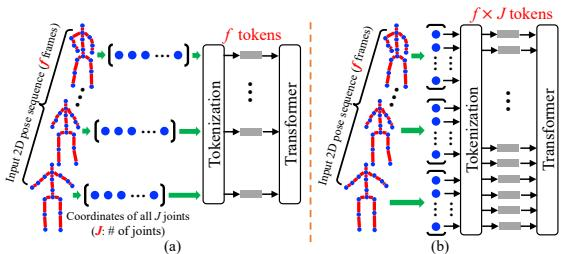
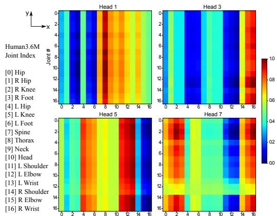
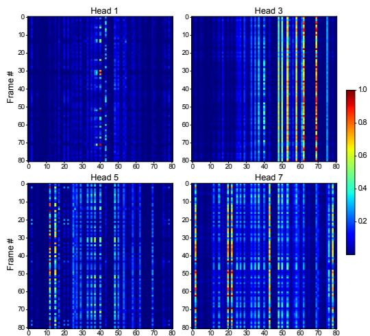
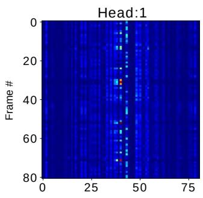

# 基于时空Transformer的三维人体姿态估计

Ce Zheng1, Sijie Zhu1, Matias Mendieta1, Taojiannan Yang1, Chen Chen1, Zhengming Ding2

1Center for Research in Computer Vision, University of Central Florida, USA

2Department of Computer Science, Tulane University, USA

{cezheng,sizhu,mendieta,taoyang1122}@knights.ucf.edu;

chen.chen@crcv.ucf.edu;zding1@tulane.edu

## 摘要

Transformer架构已成为自然语言处理领域的首选模型，并正被引入到计算机视觉任务中，例如图像分类、目标检测和语义分割。然而，在人体姿态估计领域，卷积架构仍然占据主导地位。在本工作中，我们提出了PoseFormer，一种纯粹基于Transformer的视频三维人体姿态估计方法，不涉及任何卷积架构。受视觉Transformer最新发展的启发，我们设计了一种时空Transformer结构，以全面建模每一帧内人体关节之间的关系以及跨帧的时间相关性，然后输出中心帧的精确三维人体姿态。我们在两个流行且标准的基准数据集Human3.6M和MPI-INF-3DHP上对我们的方法进行了定量和定性评估。大量实验表明，PoseFormer在两个数据集上均达到了最先进的性能。代码可在 https://github.com/zczcwh/PoseFormer 获取。

## 1. 引言

人体姿态估计（Human Pose Estimation, HPE）旨在从图像和视频等输入数据中定位人体关节点并构建身体表示（例如骨架位置）。HPE 提供人体几何与运动信息，可广泛应用于诸多应用场景（例如人机交互、运动分析、医疗健康）。当前的工作大致可以分为两类：(1) 直接估计方法，以及 (2) 2D-to-3D 提升方法。直接估计方法 [31, 29] 从 2D 图像或视频帧直接推断 3D 人体姿态，无需中间估计 2D 姿态表示。2D-to-3D 提升方法 [25, 5, 43, 38] 则从中间估计得到的 2D 姿态推断 3D 人体姿态。受益于当前最先进的 2D 姿态检测器的优异性能，2D-to-3D 提升方法总体上优于直接估计方法。然而，从这些 2D 姿态到 3D 姿态的映射并非易事；由于深度模糊与遮挡问题，同一 2D 姿态可能对应多种潜在的 3D 姿态。为了缓解其中一些问题并保持自然的连贯性，许多近期工作已将视频中的时序信息整合到其方法中。

例如，[25, 5] 利用时序卷积神经网络（temporal CNN）捕获相邻帧之间的全局依赖关系，[33] 则使用循环网络架构取得类似的效果。然而，这两种架构的时序关联窗口都有限。基于 CNN 的方法通常依赖扩张（dilation）技术，而该技术天然具有有限的时序连通性；循环网络则主要受限于简单的序列关联。

最近，Transformer [37] 凭借其高效性、可扩展性以及强大的建模能力，已成为自然语言处理（Natural Language Processing, NLP）领域事实上的标准模型。得益于 Transformer 的自注意力（self-attention）机制，可以清晰地捕获跨长序列的全局关联。这使其成为处理序列数据问题时特别合适的架构，因此可自然地扩展到 3D HPE。凭借其全面的连通性与表达能力，Transformer 提供了在帧间学习更强时序表示的机会。然而，近期工作 [12, 36] 表明，对于视觉任务，Transformer 需要专门设计才能达到与 CNN 对应方法相当的性能。具体而言，它们通常要么需要规模极大的训练数据集 [12]，要么在应用于较小数据集时需要增强的数据增广与正则化策略 [36]。此外，现有的视觉 Transformer 主要局限于图像分类 [12, 36]、目标检测 [4, 50] 与分割 [41, 47]，但如何将 Transformer 的强大能力用于 3D HPE 仍不清楚。

要开始回答这个问题，我们首先直接将 Transformer 应用于二维到三维提升的人体姿态估计（Human Pose Estimation，HPE）。在这种情况下，我们将给定序列中每一帧的整个二维姿态视为一个词元（token）（图 1(a)）。虽然这种基线方法在一定程度上是可行的，但它忽略了空间关系（即关节点与关节点之间的关系）的自然区分，从而留下了潜在的改进空间。该基线方法的一个自然扩展是将每个二维关节点坐标视为一个词元，并提供由序列中所有帧的这些关节点所组成的输入（图 1(b)）。然而，在这种情况下，当使用较长的帧序列时，词元数量会变得非常大（在三维人体姿态估计中，常见多达 243 帧且每帧 17 个关节点，词元数量将达到 243×17=4131）。由于 Transformer 需要计算每个词元与其他所有词元之间的直接注意力，模型的内存需求将达到不合理的水平。

  

图 1. 两种基线方法。

因此，作为应对这些挑战的有效方案，我们提出了 PoseFormer，这是首个用于视频中二维到三维提升式人体姿态估计（Human Pose Estimation, HPE）的纯 Transformer 网络。PoseFormer 直接使用针对空间与时间两个维度的独立 Transformer 模块来建模空间关系和时间关系。PoseFormer 不仅能够在空间和时间元素上生成强有力的特征表示，而且在处理长输入序列时不会引入庞大的 token 数量。从高层视角来看，PoseFormer 简单地接收来自现成二维姿态检测器检测到的二维姿态序列，并输出中心帧的三维姿态。更具体而言，我们构建了一个空间 Transformer 模块来编码每一帧中二维关节点之间的局部关系。空间自注意力层考虑二维关节点的位置信息，并返回该帧的潜在特征表示。随后，我们的时间 Transformer 模块分析各空间特征表示之间的全局依赖关系，并生成精确的三维姿态估计结果。

在两个主流的三维 HPE 基准数据集 Human3.6M [16] 和 MPI-INF-3DHP [27] 上的实验评估表明，PoseFormer 在两个数据集上均取得了当前最优（state-of-the-art）的性能。我们将估计出的三维姿态与当前最优方法进行了可视化对比，发现 PoseFormer 产生的结果更加平滑且更加可靠。此外，我们还在消融研究中提供了 PoseFormer 注意力图的可视化与分析，以理解模型的内部工作机制并展示其有效性。我们的贡献包含以下三个方面：

• 我们提出了首个基于纯 Transformer 的模型 PoseFormer，用于二维到三维提升式三维 HPE 任务。

• 我们设计了一个有效的时空 Transformer（Spatial-Temporal Transformer）模型，其中空间 Transformer 模块编码人体关节点之间的局部关系，时间 Transformer 模块捕获整个序列跨帧之间的全局依赖关系。

• 在不借助任何额外技巧（bells and whistles）的前提下，我们的 PoseFormer 模型在 Human3.6M 和 MPI-INF-3DHP 数据集上均取得了当前最优的结果。

## 2. 相关工作（Related Works）

在本节中，我们专门对三维单人物单视角 HPE 方法进行总结。直接估计方法从二维图像中直接推断三维人体姿态，无需中间估计二维姿态表示。二维到三维提升方法则利用二维姿态作为输入来生成对应的三维姿态，这在该领域的当前最优方法中更为流行。任何现成的二维姿态估计器都可以有效地与这些方法兼容。我们所提出的方法 PoseFormer 同样遵循二维到三维提升流程，因此本节将主要聚焦于此类方法。

二维到三维提升的人体姿态估计。二维到三维提升的方法利用从输入图像或视频帧中估计出的二维姿态。OpenPose [3]、CPN [6]、AlphaPose [13] 和 HR-Net [35] 已被广泛用作二维姿态检测器。基于这一中间表示，三维姿态可以通过多种方法生成。Martinez 等人 [26] 提出了一种简单且有效的全连接残差网络，仅根据单帧的二维关节位置回归三维关节位置。然而，与从单目图像估计三维人体姿态不同，视频可以提供时间信息以提高准确性和鲁棒性 [49, 10, 32, 8, 2, 44, 38]。Hossain 和 Little [33] 提出了一种使用长短期记忆（Long Short-Term Memory, LSTM）单元的循环神经网络，以利用输入序列中的时间信息。若干研究工作 [10, 2, 21] 利用了时空关系与约束，例如骨骼长度和左右对称性，以提升性能。Pavllo 等人 [32] 引入了一种时间卷积网络，根据连续的二维关键点序列估计三维姿态。在 [32] 的基础上，Chen 等人 [5] 增加了骨骼方向模块和骨骼长度模块，以确保视频帧间的时间一致性；Liu 等人 [25] 则利用注意力机制来识别重要的帧。然而，先前的最先进方法（例如 [25, 5]）依赖于膨胀时间卷积来捕获全局依赖关系，这在时间连通性上存在固有的局限性。此外，这些工作中的大多数 [25, 5, 33, 32] 仅通过简单操作将关节坐标投影到潜在空间，未考虑人体关节的运动学相关性。

三维人体姿态估计中的图神经网络。自然地，人体姿态可以表示为一个图，其中关节是节点，骨骼是边。图神经网络（Graph Neural Networks, GNNs）也已被应用于二维到三维姿态提升问题，并取得了令人期待的性能 [9, 45, 24]。Ci 等人 [9] 提出了一种名为局部连接网络（Locally Connected Networks, LCNs）的框架，该框架同时利用全连接网络和图神经网络操作来编码局部关节邻域之间的关系。Zhao 等人 [45] 解决了图卷积网络 [19]（Graph Convolutional Network, GCN）操作的一个局限性，特别是权重矩阵在所有节点间共享的问题。他们引入了语义图卷积操作，以学习边上的逐通道权重。

  

图 2. (a) 时间 Transformer 基线。(b) 时空 Transformer（PoseFormer）架构，由三个模块组成：空间 Transformer 模块，用于在考虑每个个体骨骼关节点相关性的前提下提取特征；时间 Transformer 模块，用于学习整个序列的全局依赖关系；回归头模块，用于回归中心帧的最终 3D 姿态。Transformer 编码器的示意图遵循 ViT [12]。

对于我们的 PoseFormer，Transformer 可以被视为一种图神经网络，它具有独特且通常具有优势的图运算。具体而言，Transformer 编码器模块本质上构成了一个全连接图（fully-connected graph），其中边的权重通过输入条件化的多头自注意力计算得到。该运算还包括节点特征的归一化、跨注意力头输出的前馈聚合，以及使堆叠层能够有效扩展的残差连接。这种运算与其他图运算相比可能具有优势。例如，节点之间连接的强度由 Transformer 的自注意力机制决定，而不是像本任务中通常采用的基于 GCN 的公式那样通过预定义的邻接矩阵来确定。这使得模型能够针对每一个输入姿态灵活地调整关节之间的相对重要性。此外，Transformer 全面而完备的缩放与归一化组件可能有助于缓解许多 GNN 运算变体在堆叠多层时所面临的过平滑现象 [48]。

视觉 Transformer（Vision Transformers）。最近，人们对将 Transformer 应用于视觉任务产生了日益浓厚的兴趣 [17, 14]。Carion 等人 [4] 提出了用于目标检测和全景分割的 DEtection TRansformer（DETR）。Dosovitskiy 等人 [12] 提出了一种纯 Transformer 架构——视觉 Transformer（ViT），在图像分类任务上取得了最先进的性能。然而，ViT 是在大规模数据集 ImageNet-21k 和 JFT-300M 上训练的，这需要巨大的计算资源。随后，一种数据高效的图像 Transformer（DeiT）[36] 被提出，它在 ViT 的基础上引入了知识蒸馏。对于 HPE 等回归任务，Yang 等人 [40] 提出了一个 Transformer 网络 Transpose，用于仅从图像估计 2D 姿态。Lin 等人 [23] 在他们的方法 METRO（MEsh TRansfOrmer，网格 Transformer）中将 CNN 与 Transformer 网络相结合，以从单张图像重建 3D 姿态和网格顶点。与我们的方法不同，METRO 属于直接估计的范畴。此外，METRO 忽略了时间一致性，这限制了其估计结果的鲁棒性。我们的时空 Transformer 架构利用了每一帧中的关键点相关性，并在视频中保留了自然的时间连贯性。

## 3. 方法（Method）

我们沿用与 [26, 32, 25, 5] 相同的 2D-to-3D 提升（lifting）流水线来完成视频中的 3D HPE。每帧的 2D 姿态由现成的 2D 姿态检测器获得，然后将连续帧的 2D 姿态序列作为输入，用于估计中心帧的 3D 姿态。与先前基于 CNN 的最先进模型相比，我们提出了一个极具竞争力的纯 Transformer（无卷积）网络。

## 3.1. 时间 Transformer 基线（Temporal Transformer Baseline）

作为 Transformer 在二维到三维提升中的基线应用，我们将每个二维姿态视为一个输入标记（token），并采用 Transformer 来捕捉输入之间的全局依赖关系，如图 2(a) 所示。我们将每个输入标记称为一个 patch（词块），这与视觉 Transformer（ViT）[12] 中的术语类似。对于输入序列 $X \in \mathbb { R } ^ { f \times ( J \cdot 2 ) }$)，其中 $f$ 为输入序列的帧数，$J$ 为每个二维姿态的关节数，2 表示关节在二维空间中的坐标。$\{ \mathbf { x } ^ { i } \overset { \cdot } { \in } \mathbb { R } ^ { 1 \times ( J \cdot 2 ) } | i = 1 , 2 , \overset { \cdot } { \dots } f \}$ 表示每一帧的输入向量。Patch 嵌入是一个可训练的线性投影层，用于将每个 patch 嵌入到高维特征。Transformer 网络利用位置嵌入（positional embedding）来保留序列的位置信息。该过程可形式化为：

$$
Z _ { 0 } = [ \mathbf { x } ^ { 1 } E ; \mathbf { x } ^ { 2 } E ; \ldots ; \mathbf { x } ^ { f } E ] + E _ { p o s } .\tag{1}
$$

在通过线性投影矩阵 $E \in \mathbb { R } ^ { ( J \cdot 2 ) \times C }$ 进行嵌入，并与位置嵌入 $E _ { p o s } \in \mathbb { R } ^ { f \times C }$ 相加之后，输入序列 $\overset { \cdot } { X } \in \mathbb { R } ^ { f \times ( J \cdot 2 ) }$ 变为 $\dot { Z _ { 0 } } \in \mathbb { R } ^ { f \times C }$，其中 $C$ 为嵌入维度。$Z _ { 0 }$ 被送入时序 Transformer 编码器（Temporal Transformer Encoder）。

作为 Transformer 的核心功能，自注意力（self-attention）旨在将输入序列中不同位置与嵌入特征相关联。我们的 Transformer 编码器由多头自注意力（Multi-head Self Attention）块和多层感知机（MLP）块组成，与文献 [12] 中一致。层归一化（LayerNorm）被应用于每个块之前，残差连接被应用于每个块之后 [39, 1]。

缩放点积注意力（Scaled Dot-Product Attention）可被描述为一个将查询矩阵 $Q$、键矩阵 $K$ 和值矩阵 $V$ 映射到输出注意力矩阵的映射函数。$Q , K , V \in \mathbb { R } ^ { N \times d }$，其中 $N$ 是序列中向量的数量，$d$ 是维度。该注意力操作中使用缩放因子 $\textstyle { \frac { 1 } { \sqrt { d } } }$ 进行适当的归一化，以防止当 $d$ 的值较大导致点积在数值上变得很大时出现极小的梯度。因此，缩放点积注意力的输出可表示为：

$$
\operatorname { A t t e n t i o n } ( Q , K , V ) = \operatorname { S o f t m a x } ( Q K ^ { \top } / \sqrt { d } ) V .\tag{2}
$$

在我们的时序 Transformer 中，$d = C$ 且 $N = f$。$Q$、$K$ 和 $V$ 由嵌入特征 $Z \in \mathbb { R } ^ { f \times C }$ 通过线性变换 $W _ { Q } , \thinspace W _ { K }$ 与 $W _ { V }$ $\in \mathbb { R } ^ { C \times C }$ 计算得到：

$$
Q = Z W _ { Q } , K = Z W _ { K } , V = Z W _ { V } .\tag{3}
$$

多头自注意力层（Multi-head Self Attention Layer, MSA）利用多个注意力头在不同表示子空间中对不同位置的信息进行联合建模。每个头并行地应用缩放点积注意力。MSA 的输出将是 h 个注意力头输出的拼接。

$$
\mathrm { M S A } ( Q , K , V ) = \mathrm { C o n c a t } ( H _ { 1 } , H _ { 2 } , \dots , H _ { h } ) W _ { o u t}\tag{4}
$$

$$
\mathrm { w h e r e } \quad H _ { i } = \mathrm { A t t e n t i o n } ( Q _ { i } , K _ { i } , V _ { i } ) , i \in [ 1 , . . . , h ]\tag{5}
$$

给定嵌入特征 $Z _ { 0 } \in \mathbb { R } ^ { f \times C }$，由 L 层构成的时间 Transformer 编码器结构可表示如下：

$$
Z _ { \ell } ^ { ' } = \mathrm { M S A } ( \mathrm { L N } ( Z _ { \ell - 1 } ) ) + Z _ { \ell - 1 } , \quad \ell = 1 , 2 \dots L\tag{6}
$$

$$
Z _ { \ell } = \mathrm { M L P } ( \mathrm { L N } ( Z _ { \ell } ^ { ' } ) ) + Z _ { \ell } ^ { ' } , ~ \ell = 1 , 2 , \ldots L\tag{7}
$$

$$
Y = \mathrm { L N } ( Z _ { L } ) ,\tag{8}
$$

其中 LN(·) 表示层归一化算子（与 ViT 中相同）。时间 Transformer 编码器由 L 个相同的层组成，编码器输出 $Y \in \mathbb { R } ^ { f \times C }$ 与编码器输入 $Z _ { 0 } \in \bar { \mathbb { R } ^ { f \times C } }$ 保持相同尺寸。

为了预测中心帧的三维姿态，编码器输出 $\bar { Y } \in \mathbb { R } ^ { f \times C }$ 通过在帧维度上取平均值被收缩为向量 y $\in \mathbb { R } ^ { 1 \times C }$。最后，一个 MLP（多层感知机）块将输出回归为 $\mathbf { y } \in \mathbb { R } ^ { 1 \times ( J \cdot 3 ) }$)，即中心帧的三维姿态。

## 3.2. PoseFormer：时空 Transformer

我们观察到，时间 Transformer 基线方法主要关注输入序列中帧之间的全局依赖关系。块嵌入（patch embedding），即一个线性变换，被用来将关节坐标投影到一个隐藏维度。然而，由于简单的线性投影层无法学习注意力信息，时间 Transformer 基线方法未能充分表达局部关节坐标之间的运动学信息。一种潜在的解决方案是将每个关节坐标视为一个独立的块，并将来自所有帧的关节作为输入送入 Transformer（见图 1(b)）。然而，块的数量会迅速增加（帧数 f 乘以关节数 J），导致模型的计算复杂度达到 $O ( ( f \cdot J ) ^ { 2 } )$。例如，如果我们使用 81 帧并且每个二维姿态包含 17 个关节，则块的数量将达到 1377（ViT 模型使用 576 个块（输入尺寸 = $384 \times 384$，块尺寸 = $16 \times 16$））。

为了高效地学习局部关节点之间的相关性，我们分别采用两个独立的 Transformer 来建模空间信息和时间信息。如图 2(b) 所示，PoseFormer 由三个模块组成：空间 Transformer 模块、时间 Transformer 模块和回归头模块。

空间 Transformer 模块。空间 Transformer 模块用于从单帧中提取高维特征嵌入。给定一个包含 J 个关节点的 2D 姿态，我们将每个关节点（即两个坐标）视为一个 patch，并遵循通用视觉 Transformer 的流程在所有 patch 之间进行特征提取。首先，我们通过一个可训练的线性投影将每个关节点的坐标映射到高维空间，这被称为空间 patch 嵌入。我们将这一结果与可学习的空间位置嵌入（spatial positional embedding）[12] $E _ { S P o s } ~ \in ~ \mathbb { R } ^ { J \times c }$ 相加，因此第 i 帧的输入 $\mathbf { x } _ { i } \in \mathbb { R } ^ { 1 \times \left( J \cdot 2 \right) }$ 变为 $\boldsymbol { z } _ { 0 } ^ { i } \in \mathbb { R } ^ { J \times c }$，其中 2 表示每帧中的 2D 坐标，c 是空间嵌入维度。所得的关节点特征序列 $z _ { 0 } ^ { i }$ 被送入空间 Transformer 编码器，该编码器通过自注意力机制整合所有关节点之间的信息。对于第 i 帧，具有 L 层结构的空

回归头（Regression Head）。由于我们使用一串帧序列来预测中心帧的 3D 姿态，时序 Transformer 模块的输出 $Y \in \mathbb { R } ^ { f \times ( J \cdot c ) }$ 需要被压缩为 $\mathbf { y } \in \mathbb { R } ^ { 1 \times ( J \cdot c ) }$ 。我们在帧维度上施加一个带可学习权重的加权平均操作来实现这一压缩。最后，一个包含层归一化（Layer Norm）和一个线性层的简单多层感知机（MLP）模块返回输出 $\mathbf { y } \in \mathbb { R } ^ { 1 \times ( J \cdot 3 ) }$ ，即中心帧的预测 3D 姿态。

损失函数（Loss Function）。为了训练我们的空时 Transformer 模型，我们采用标准的 MPJPE（Mean Per Joint Position Error，每关节平均位置误差）损失，以最小化预测姿态与真实姿态之间的误差：

$$
\mathcal { L } = \frac { 1 } { J } \Sigma _ { k = 1 } ^ { J } \Vert p _ { k } - \hat { p } _ { k } \Vert _ { 2 } ,\tag{9}
$$

其中 $p _ { k }$ 和 $\hat { p } _ { k }$ 分别是第 $k$ 个关节的真实 3D 位置和估计 3D 位置。

## 4. 实验

## 4.1. 数据集与评价指标

我们在两个常用的 3D 人体姿态估计（Human Pose Estimation，HPE）数据集 Human3.6M [16] 和 MPI-INF-3DHP [27] 上评估我们的模型。

Human3.6M [16] 是 3D 单人 HPE 中使用最广泛的室内数据集。其中有 11 位专业演员执行 17 种动作，如坐着、走路、打电话等。每位受试者的视频由室内环境中 4 个不同视角的相机拍摄。该数据集包含 360 万帧带有精确 3D 真实标注的视频帧，标注由基于标记的精确动捕系统采集。沿用先前工作 [32, 25, 5] 的设置，我们采用相同的实验配置：使用全部 15 个动作进行训练和测试，在五个受试者分段（S1、S5、S6、S7、S8）上训练模型，并在两位受试者（S9 和 S11）上进行测试。

MPI-INF-3DHP [27] 是一个更具挑战性的 3D 姿态数据集。它同时包含受限的室内场景和复杂的室外场景。共有 8 位演员从 14 个相机视角执行 8 种动作，涵盖了更多样化的姿态。MPI-INF-3DHP 提供了一个包含 6 位受试者、来自不同场景的测试集。我们沿用 [22, 5, 38] 中的设置。

对于 Human3.6M 数据集，我们使用最常见的评价指标（MPJPE 和 P-MPJPE）[46] 来评估我们的估计结果与 3D 真实姿态之间的性能。MPJPE（Mean Per Joint Position Error，每关节平均位置误差）以毫米为单位计算估计关节与真实关节之间的平均欧氏距离；我们将其称为 Protocol 1。P-MPJPE 是在对估计 3D 姿态与真实姿态进行刚体对齐后处理后得到的 MPJPE，它对单个关节的预测失败更具鲁棒性。我们将其称为 Protocol 2。

对于 MPI-INF-3DHP 数据集，我们使用 MPJPE、150 mm 范围内的正确关键点百分比（Percentage of Correct Keypoint，PCK）[22, 5, 38] 以及曲线下面积（Area Under Curve，AUC）。

## 4.2. 实现细节

我们使用 Pytorch [30] 实现了所提出的方法。训练和测试均使用两块 NVIDIA RTX 3090 GPU。我们在实验中选取了三种不同的帧序列长度，分别为 $f = 9 , f = 2 7$ $f = 8 1$。关于帧数及对应结果的详细信息将在消融研究（Sec. 4.4）中讨论。我们遵循 [32, 25, 5] 的做法，在训练和测试中都采用姿态水平翻转作为数据增强。我们使用 Adam [18] 优化器训练模型，共训练 130 个 epoch，权重衰减为 0.1。我们采用指数学习率衰减策略，初始学习率为 2e-4，每个 epoch 的衰减因子为 0.98。我们将批量大小（batch size）设为 1024，并在 Transformer 编码器层中采用随机深度（stochastic depth）[15]，丢弃率为 0.1。对于 2D 姿态检测器，我们在 Human3.6M 上遵循 [32, 25, 5] 使用级联金字塔网络（cascaded pyramid network, CPN）[7]；对于 MPI-INF-3DHP，我们遵循 [28, 22] 使用真值 2D 姿态作为输入。

## 4.3. 与现有方法的对比

Human3.6M。我们在表 1 中报告了测试集（S9 和 S11）上全部 15 种动作的结果。最后一列给出了在整个测试集上的平均性能。遵循 2D 到 3D 提升（lifting）方法的流程，我们使用 CPN 网络作为 2D 姿态检测器，然后将检测到的 2D 姿态作为输入进行训练和测试。PoseFormer 在协议 1 和协议 2 下分别以较大优势（6.1% 和 6.4%）超越了我们的基线（即 Sec. 3.1 中的时序 Transformer 基线）。这清楚地展示了使用空间 Transformer 来有效建模每一帧中各关节点之间相关性的优势。如 Table 1（上）所示，PoseFormer 在协议 1 下取得了最低的平均 MPJPE，为 44.3 mm。与基于 Transformer 的方法 METRO [23] 相比，由于 METRO 通过单张图像估计 3D 姿态因而忽略了时序一致性，PoseFormer 将 MPJPE 降低了约 18%。对于协议 2，我们也取得了最佳的整体结果，如 Table 1（下）所示。此外，PoseFormer 在 Photo、SittingDown、WalkDog 和 Smoke 等困难动作上取得了更准确的姿态预测。与其他简单动作不同，这些动作中姿态变化更快，且某些长距离帧之间存在强相关性。在这种情况下，全局依赖关系发挥着重要作用，而 Transformer 的注意力机制具有特别的优势。

Table 1. 在 Human3.6M 上以检测到的 2D 姿态作为输入，在协议 1 和协议 2 下，估计 3D 姿态与真值 3D 姿态之间平均每关节位置误差（Mean Per Joint Position Error）的定量比较。上表：协议 1 下的结果（MPJPE）。下表：协议 2 下的结果（P-MPJPE）。f 表示各方法使用的输入帧数，∗ 表示输入 2D 姿态由级联金字塔网络（CPN）检测得到，† 表示基于 Transformer 的模型。（红色：最佳；蓝色：次佳）

<table><tr><td>Protocol i</td><td></td><td>Dir.</td><td>Disc.</td><td>Eat.</td><td>Greet</td><td>Phone</td><td>Photo</td><td>Pose</td><td>Purch.</td><td>Sit</td><td>SitD.</td><td>Somke</td><td>Wait</td><td>WalkD.</td><td>Walk</td><td>WalkT.</td><td>Average</td></tr><tr><td>Dabral et al. [11]</td><td>ECCV&#x27;18 ICCV&#x27;19</td><td>44.8</td><td>50.4</td><td>44.7</td><td>49.0</td><td>52.9</td><td>61.4</td><td>43.5</td><td>45.5</td><td>63.1</td><td>87.3</td><td>51.7</td><td>48.5</td><td>52.2 51.3</td><td>37.6 37.1</td><td>41.9 39.4</td><td>52.1</td></tr><tr><td>Cai et al.  $[ 2 ] \overset { \cdot } { ( } f \overset { \cdot } { = } 7 )$ </td><td></td><td>44.6</td><td>47.4</td><td>45.6</td><td>48.8</td><td>50.8</td><td>59.0</td><td>47.2</td><td>43.9</td><td>57.9</td><td>61.9</td><td>49.7</td><td>46.6</td><td></td><td></td><td></td><td>48.8</td></tr><tr><td>Pavllo et  $a l . \left[ 3 2 \right] ( f = 2 4 3 ) ^ { * }$ </td><td>CVPR&#x27;19</td><td>45.2</td><td>46.7</td><td>43.3</td><td>45.6</td><td>48.1</td><td>55.1</td><td>44.6</td><td>44.3</td><td>57.3</td><td>65.8</td><td>47.1</td><td>44.0</td><td>49.0</td><td>32.8</td><td>33.9</td><td>46.8</td></tr><tr><td>Lin et al.  $[ 2 2 ] ( f = 5 0 )$ </td><td>BMVC&#x27;19</td><td>42.5</td><td>44.8</td><td>42.6</td><td>44.2</td><td>48.5</td><td>57.1</td><td>52.6</td><td>41.4</td><td>56.5</td><td>64.5</td><td>47.4</td><td>43.0</td><td>48.1</td><td>33.0</td><td>35.1</td><td>46.6</td></tr><tr><td>Yeh et al. [42]</td><td>NIPS&#x27;19</td><td>44.8</td><td>46.1</td><td>43.3</td><td>46.4</td><td>49.0</td><td>55.2</td><td>44.6</td><td>44.0</td><td>58.3</td><td>62.7</td><td>47.1</td><td>43.9</td><td>48.6</td><td>32.7</td><td>33.3</td><td>46.7</td></tr><tr><td>Liu et al. [25] (f = 243)*</td><td>CVPR&#x27;20</td><td>41.8</td><td>44.8</td><td>41.1</td><td>44.9</td><td>47.4</td><td>54.1</td><td>43.4</td><td>42.2</td><td>56.2</td><td>63.6</td><td>45.3</td><td>43.5</td><td>45.3</td><td>31.3</td><td>32.2</td><td>45.1</td></tr><tr><td>SRNet [43] *</td><td>ECCV&#x27;20</td><td>46.6</td><td>47.1</td><td>43.9</td><td>41.6</td><td>45.8</td><td>49.6</td><td>46.5</td><td>40.0</td><td>53.4</td><td>61.1</td><td>46.1</td><td>42.6</td><td>43.1</td><td>31.5</td><td>32.6</td><td>44.8</td></tr><tr><td>UGCN [38] (f = 96)</td><td>ECCV&#x27;20</td><td>41.3</td><td>43.9</td><td>44.0</td><td>42.2</td><td>48.0</td><td>57.1</td><td>42.2</td><td>43.2</td><td>57.3</td><td>61.3</td><td>47.0</td><td>43.5</td><td>47.0</td><td>32.6</td><td>31.8</td><td>45.6</td></tr><tr><td>Chen et al. [5] (f = 81)* METRO [23] (f = 1) †</td><td>TCSVT21</td><td>42.1</td><td>43.8</td><td>41.0</td><td>43.8</td><td>46.1</td><td>53.5</td><td>42.4</td><td>43.1</td><td>53.9</td><td>60.5</td><td>45.7</td><td>42.1</td><td>46.2</td><td>32.2</td><td>33.8</td><td>44.6</td></tr><tr><td>Baseline (f = 81)*†</td><td>CVPR&#x27;21</td><td></td><td>47.9</td><td></td><td></td><td></td><td>-</td><td>-</td><td>-</td><td>-</td><td></td><td>-</td><td></td><td></td><td></td><td></td><td>54.0</td></tr><tr><td>PoseFormer (f = 81)*†</td><td></td><td>43.8 41.5</td><td>44.8</td><td>43.8 39.8</td><td>45.5 42.5</td><td>49.7 46.5</td><td>55.7 51.6</td><td>44.3 42.1</td><td>45.8</td><td>57.7 53.3</td><td>66.3 60.7</td><td>47.4 45.5</td><td>45.4</td><td>48.6 46.1</td><td>32.5</td><td>33.8 32.2</td><td>47.2 44.3</td></tr><tr><td>Protocol 2</td><td></td><td>Dir.</td><td>Disc.</td><td>Eat.</td><td></td><td></td><td></td><td></td><td>42.0</td><td>Sit</td><td>SitD.</td><td></td><td>43.3</td><td>WalkD.</td><td>31.8</td><td></td><td></td></tr><tr><td>Pavlakos et al. [31]</td><td>CVPR&#x27;18</td><td>34.7</td><td>39.8</td><td>41.8</td><td>Greet</td><td>Phone 42.5</td><td>Photo 47.5</td><td>Pose</td><td>Purch. 36.6</td><td>50.7</td><td>56.8</td><td>Somke 42.6</td><td>Wait</td><td>43.9</td><td>Walk</td><td>WalkT. 36.5</td><td>Average 41.8</td></tr><tr><td></td><td>ECCV&#x27;18</td><td>35.7</td><td>39.3</td><td>44.6</td><td>38.6</td><td></td><td></td><td>38.0</td><td></td><td></td><td>61.3</td><td>46.5</td><td>39.6</td><td></td><td>32.1</td><td>39.4</td><td>44.1</td></tr><tr><td>Hossain et al. [33]</td><td></td><td></td><td></td><td></td><td>43.0</td><td>47.2</td><td>54.0</td><td>38.3</td><td>37.5</td><td>51.6</td><td></td><td></td><td>41.4</td><td>47.3</td><td>34.2</td><td></td><td></td></tr><tr><td>Cai et al.  $\left[ 2 \right] \left( f = 7 \right)$ </td><td>ICCV&#x27;19</td><td>35.7</td><td>37.8 35.3</td><td>36.9</td><td>40.7</td><td>39.6</td><td>45.2</td><td>37.4</td><td>34.5</td><td>46.9</td><td>50.1</td><td>40.5</td><td>36.1</td><td>41.0</td><td>29.6</td><td>32.3</td><td>39.0 36.8</td></tr><tr><td>Lin et al.  $\left[ 2 2 \right] \left( f = 5 0 \right)$ </td><td>BMVC&#x27;19 CVPR&#x27;19</td><td>32.5</td><td></td><td>34.3</td><td>36.2</td><td>37.8</td><td>43.0</td><td>33.0</td><td>32.2</td><td>45.7</td><td>51.8</td><td>38.4</td><td>32.8</td><td>37.5</td><td>25.8</td><td>28.9</td><td>36.5</td></tr><tr><td>Pavllo et al.  $[ 3 2 ] ( f = 2 4 3 ) ^ { \ast }$ </td><td>CVPR&#x27;20</td><td>34.1</td><td>36.1 35.2</td><td>34.4</td><td>37.2</td><td>36.4</td><td>42.2</td><td>34.4</td><td>33.6</td><td>45.0</td><td>52.5</td><td>37.4</td><td>33.8</td><td>37.8</td><td>25.6</td><td>27.3 27.2</td><td>35.6</td></tr><tr><td>Liu et al. [2  $5 ] ( f = 2 4 3 ) ^ { \ast }$ </td><td></td><td>32.3</td><td>35.2</td><td>33.3</td><td>35.8</td><td>35.9</td><td>41.5</td><td>33.2</td><td>32.7</td><td>44.6</td><td>50.9</td><td>37.0</td><td>32.4</td><td>37.0</td><td>25.2</td><td></td><td>35.5</td></tr><tr><td>UGCN [38  $\displaystyle { \mathrm { ~ l ~ } ( f = 9 6 ) }$ </td><td>ECCV&#x27;20 TCSVT&#x27;21</td><td>32.9</td><td>35.3</td><td>35.6</td><td>34.4</td><td>36.4</td><td>42.7</td><td>31.2</td><td>32.5</td><td>45.6</td><td>50.2</td><td>37.3</td><td>32.8</td><td>36.3</td><td>26.0</td><td>23.9</td><td></td></tr><tr><td>Chen et al.  $[ 5 ] ( f = \mathring 8 1 ) ^ { * }$ </td><td></td><td>33.1</td><td></td><td>33.4</td><td>35.9</td><td>36.1</td><td>41.7</td><td>32.8</td><td>33.3</td><td>42.6</td><td>49.4</td><td>37.0</td><td>32.7</td><td>36.5</td><td>25.5</td><td>27.9</td><td>35.6</td></tr><tr><td>Baseline  $\overline { { f = 8 1 ) ^ { * } \dag } }$ </td><td></td><td>33.6</td><td>37.1</td><td>35.4</td><td>36.7</td><td>37.8</td><td>42.2</td><td>33.9</td><td>34.7</td><td>47.0</td><td>53.4</td><td>38.2</td><td>34.3</td><td>37.6</td><td>25.3</td><td>27.8</td><td>37.0</td></tr><tr><td>PoseFormer  $( f = 8 1 ) ^ { * } \dag$ </td><td></td><td>32.5</td><td>34.8</td><td>32.6</td><td>34.6</td><td>35.3</td><td>39.5</td><td>32.1</td><td>32.0</td><td>42.8</td><td>48.5</td><td>34.8</td><td>32.4</td><td>35.3</td><td>24.5</td><td>26.0</td><td>34.6</td></tr></table>

为了进一步探究所提方法的下界，我们直接使用真值（ground truth）2D 姿态作为输入，以减轻噪声 2D 姿态数据带来的误差。表 2 给出了相应的结果。通过使用干净的 2D 姿态数据，MPJPE 从 44.3 mm 降低到 31.3 mm，降幅约为 29.7%。PoseFormer 在 9 个动作上取得了最佳成绩，在 6 个动作上取得了次佳成绩，其平均得分相较 SRNet [43] 提升了约 2%。

在图 3 中，我们还在 Human3.6M 测试集 S11 的 Photo 动作上，对部分误差最大的单个关节的 MPJPE 进行了对比。在这些困难关节上，PoseFormer 的表现优于文献 [32, 5] 中的方法。

  

图3. Human3.6M 测试集 S11 上 Photo 动作所有帧的关节平均误差对比。

MPI-INF-3DHP。表 3 报告了 PoseFormer 与其他方法在 MPI-INF-3DHP 上的定量结果。与 Human3.6M 相比，该数据集包含的训练样本更少，且部分样本采集自室外场景。由于该数据集的序列长度通常较短，我们使用 9 帧的 2D 姿态作为模型输入。我们的方法在所有三项评估指标（PCK、AUC 和 MPJPE）上再次取得了最佳性能。

定性结果。我们还提供了 3D 估计姿态与真实姿态之间的可视化对比。我们在 Human3.6M 测试集 S11 上对 PoseFormer 进行评估，使用的是 Photo 动作，这是最具挑战性的动作之一（所有方法在该动作上都具有较高的 MPJPE）。如图 4 所示，与当前最优方法 [5] 相比，我们的 PoseFormer 实现了更准确的预测。

## 4.4. 消融实验

为了验证 PoseFormer 各组成部分的贡献以及超参数对性能的影响，我们在 Human3.6M 数据集上采用协议 1 进行了广泛的消融实验。

PoseFormer 的设计。我们在表 4 中研究了空间 transformer 以及空间和时序 transformer 的位置嵌入的影响。我们输入 9 帧由 CPN 检测到的 2D 姿态 $( J ~ = ~ 1 7 )$ 来预测 3D 姿态。为了公平比较每个模块的影响，所有架构参数保持固定；空间 transformer 的嵌入维度为 $1 7 \times 3 2 = 5 4 4$，空间 transformer 编码器层数为 4。对于时序 transformer，嵌入维度与空间 transformer 保持一致（即 544），我们同样使用 4 层时序 transformer。为了验证我们时空设计的影响，我们首先与第 3.1 节中作为起点的 transformer 基线进行比较。表 4 中的结果表明，我们的时空 transformer 带来了显著影响（MPJPE 从 52.5 降至 49.9），这是因为关节点间的相关性被更强地建模。这与表 1 中 $f = 8 1$ 时的结果（Baseline vs. PoseFormer）一致。接下来，我们评估位置嵌入的影响。我们探索了四种可能的组合：不使用位置嵌入、仅使用空间位置嵌入、仅使用时序位置嵌入以及同时使用空间和时序位置嵌入。通过比较这些组合的结果，可以明显看出位置嵌入能够提升性能。通过在空间和时序模块上都应用位置嵌入，可以获得最佳的总体结果。

表 2. 在 Human3.6M 数据集上，使用真实 2D 姿态作为输入时，估计 3D 姿态与真实 3D 姿态之间在协议 1 下的平均每关节点位置误差（MPJPE）定量对比。（红色：最佳；蓝色：次佳）

<table><tr><td>GT Protocol 1</td><td colspan="10">Dir.</td><td>Somke</td><td></td><td>Wait</td><td>WalkD.</td><td>Walk</td><td>WalkT.</td><td>Average</td></tr><tr><td>Hossain et al. [33]</td><td>ECCV&#x27;18</td><td>35.2</td><td>Disc. 40.8</td><td>Eat. 37.2</td><td>Greet 37.4</td><td>Phone 43.2</td><td>Photo 44.0</td><td>Pose 38.9</td><td>Purch. 35.6</td><td>Sit 42.3</td><td>SitD. 44.6</td><td>39.7</td><td>39.7</td><td>40.2</td><td>32.8</td><td>35.5</td><td>39.2</td></tr><tr><td>Pavllo et al. [32] (f = 243)</td><td>CVPR&#x27;19</td><td></td><td></td><td></td><td></td><td></td><td></td><td></td><td></td><td></td><td></td><td></td><td></td><td></td><td></td><td></td><td>37.2</td></tr><tr><td>Liu et al. [25] (f = 243)</td><td>CVPR&#x27;20</td><td>34.5</td><td>37.1</td><td>33.6</td><td>34.2</td><td>32.9</td><td>37.1</td><td>39.6</td><td>35.8</td><td>40.7</td><td>41.4</td><td>33.0</td><td>33.8</td><td>33.0</td><td>26.6</td><td>26.9</td><td>34.7</td></tr><tr><td>SRNet [43]</td><td>ECCV&#x27;20</td><td>34.8</td><td>32.1</td><td>28.5</td><td>30.7</td><td>31.4</td><td>36.9</td><td>35.6</td><td>30.5</td><td>38.9</td><td>40.5</td><td>32.5</td><td>31.0</td><td>29.9</td><td>22.5</td><td>24.5</td><td>32.0</td></tr><tr><td>Chen et al. [5] (f = 243)</td><td>TCSVT&#x27;21</td><td></td><td></td><td></td><td></td><td></td><td></td><td></td><td></td><td></td><td></td><td></td><td></td><td></td><td></td><td></td><td>32.3</td></tr><tr><td>PoseFormer (f = 81)</td><td></td><td>30.0</td><td>33.6</td><td>29.9</td><td>31.0</td><td>30.2</td><td>33.3</td><td>34.8</td><td>31.4</td><td>37.8</td><td>38.6</td><td>31.7</td><td>31.5</td><td>29.0</td><td>23.3</td><td>23.1</td><td>31.3</td></tr></table>

  

图 4. 我们的方法（PoseFormer）与当前最先进的方法 Chen 等人 [5] 在 Human3.6M 测试集 S11 上 Photo 动作的定性比较。绿色箭头突出显示了 PoseFormer 结果明显更优的位置。

表 3. 在 MPI-INF-3DHP 上与先前方法的定量比较。最佳得分以加粗标出。

<table><tr><td></td><td></td><td>PCK↑</td><td>AUC↑</td><td>MPJPE↓</td></tr><tr><td>Mehta et al. [27]</td><td>3DV&#x27;17</td><td>75.7</td><td>39.3</td><td>117.6</td></tr><tr><td>Mehta et al. [28] Pavllo et al. [32] (81 frames)</td><td>ACM ToG&#x27;17 CVPR&#x27;19</td><td>76.6 86.0</td><td>40.4</td><td>124.7</td></tr><tr><td>Pavllo et al. [32] (243 frames)</td><td>CVPR&#x27;19</td><td>85.5</td><td>51.9 51.5</td><td>84.0 84.8</td></tr><tr><td>Lin et al. [22] (25 frames)</td><td>BMVC&#x27;19</td><td>83.6</td><td>51.4</td><td>79.8</td></tr><tr><td>Li et al. [20]</td><td>CVPR&#x27;20</td><td>81.2</td><td>46.1</td><td>99.7</td></tr><tr><td>Chen et al. [5] (81 frames)</td><td>TCSVT’21</td><td>87.9</td><td>54.0</td><td>78.8</td></tr><tr><td>PoseFormer (9 frames)</td><td></td><td>88.6</td><td>56.4</td><td>77.1</td></tr></table>

表 4. PoseFormer 中不同组件的消融实验。评估在 Human3.6M（协议 1）上进行，使用检测到的 2D 姿态作为输入。（T：仅时间维度；S-T：时空维度）

<table><tr><td>Input length (f)</td><td>T</td><td>S-T</td><td>Spatial Pos Emb</td><td>Temporal Pos Emb</td><td>MPJPE</td></tr><tr><td>9</td><td>√</td><td>x</td><td>x</td><td>√</td><td>52.5</td></tr><tr><td>9</td><td>x</td><td>√</td><td>x</td><td>x</td><td>51.6</td></tr><tr><td>9</td><td>×</td><td>√</td><td>√</td><td>x</td><td>50.7</td></tr><tr><td>9</td><td>x</td><td>v√</td><td>x</td><td>√</td><td>50.5</td></tr><tr><td>9</td><td>x</td><td></td><td>√</td><td>√</td><td>49.9</td></tr></table>

表 5. PoseFormer 中不同架构参数的消融研究。评估在 Human3.6M（协议 1，Protocol 1）上使用检测到的 2D 姿态作为输入进行。c 为空间 Transformer 的块嵌入维度。$L _ { S }$ 和 $L _ { T }$ 分别表示空间和时间 Transformer 的层数。

<table><tr><td>C</td><td>16</td><td>16</td><td>16</td><td>32</td><td>32</td><td>32</td><td>48</td><td>48</td><td>48</td></tr><tr><td> $\overline { { L _ { S } } }$ </td><td>2</td><td>4</td><td>6</td><td>2</td><td>4</td><td>6</td><td>2</td><td>4</td><td>6</td></tr><tr><td> $L _ { T }$ </td><td>2</td><td>4</td><td>6</td><td>2</td><td>4</td><td>6</td><td>2</td><td>4</td><td>6</td></tr><tr><td>MPJPE</td><td>52.8</td><td>51.7</td><td>50.4</td><td>52.4</td><td>49.9</td><td>50.3</td><td>51.7</td><td>50.4</td><td>50.5</td></tr></table>

**架构参数分析。** 我们在表 5 中探索了各种参数组合，以找到最优的网络架构。$c$ 表示空间 Transformer 中的嵌入特征维度，$L$ 表示 Transformer 编码器所使用的层数。在 PoseFormer 中，空间 Transformer 的输出被展平，并与时间位置嵌入相加，构成时间 Transformer 编码器的输入。因此，时间 Transformer 编码器中的嵌入特征维度为 $c \times J$。我们模型的最优参数为 $c = 3 2 \AA$ $L _ { S } = 4 ,$ and $L _ { T } = 4$。

**表 6.** 计算复杂度、MPJPE 与推理速度（每秒帧数（FPS））的对比。评估在 Human3.6M 数据集上采用协议 1，以检测得到的 2D 姿态作为输入进行。FPS 基于单块 GeForce GTX 2080 Ti GPU 测得。

<table><tr><td rowspan=1 colspan=4></td><td></td><td rowspan=1 colspan=1>Parameters (M)</td><td rowspan=1 colspan=1>FLOPs (M)</td><td rowspan=1 colspan=1>MPJPE</td><td rowspan=1 colspan=6>FPS</td></tr><tr><td rowspan=6 colspan=4>Hossain and Little [33]Pavllo et al. [32]Pavllo et al. [32]Pavllo et al. [32]Chen et al. [5]Chen et al. [5]Chen et al. [5]</td><td></td><td rowspan=1 colspan=1>16.95</td><td rowspan=1 colspan=1>33.88</td><td rowspan=1 colspan=1>58.3</td><td rowspan=1 colspan=6>=</td></tr><tr><td rowspan=1 colspan=2></td><td></td><td rowspan=1 colspan=1>8.56</td><td rowspan=1 colspan=1>17.09</td><td rowspan=1 colspan=1>48.8</td><td rowspan=1 colspan=6>1492</td></tr><tr><td rowspan=1 colspan=2>et al. [32]</td><td></td><td rowspan=1 colspan=1>12.79</td><td rowspan=1 colspan=1>25.48</td><td rowspan=1 colspan=1>47.7</td><td rowspan=1 colspan=6>1121</td></tr><tr><td></td><td rowspan=1 colspan=1>16.95</td><td rowspan=1 colspan=1>33.87</td><td rowspan=1 colspan=1>46.8</td><td rowspan=1 colspan=6>863</td><td rowspan=1 colspan=1></td></tr><tr><td rowspan=1 colspan=1>27</td><td rowspan=1 colspan=1>31.88</td><td rowspan=1 colspan=1>61.7</td><td rowspan=1 colspan=1>45.3</td><td rowspan=1 colspan=6>410</td><td rowspan=1 colspan=1>81</td><td rowspan=1 colspan=1>45.53</td><td rowspan=1 colspan=1>88.9</td><td rowspan=1 colspan=1>44.6</td></tr><tr><td></td><td rowspan=1 colspan=1>59.18</td><td rowspan=1 colspan=1>116</td><td rowspan=1 colspan=1>44.1</td><td rowspan=1 colspan=6>264</td></tr><tr><td rowspan=2 colspan=4>PoseFormerPoseFormerPoseFormer</td><td></td><td rowspan=1 colspan=1>9.58</td><td rowspan=1 colspan=1>150</td><td rowspan=1 colspan=1>49.9</td><td rowspan=1 colspan=6>320</td></tr><tr><td></td><td rowspan=1 colspan=1>9.599.60</td><td rowspan=1 colspan=1>4521358</td><td rowspan=1 colspan=1>47.044.3</td><td rowspan=1 colspan=6>297269</td></tr></table>

## 计算复杂度分析（Computational Complexity Analysis）

我们在表 6 中报告了模型性能、总参数量以及每帧的浮点运算（FLOPs）估计，并给出了不同输入序列长度（f）下的输出帧率（FPS）。当序列长度增加时，模型的精度会随之提升，而总参数量增加并不显著。这是因为序列帧数仅影响时间位置嵌入层，而该层本身不需要大量参数。与其他模型相比，本模型在保持竞争力的同时，总参数量更少。我们按照文献 [5] 中的相同设置，在单块 GeForce RTX 2080 Ti GPU 上报告了不同模型的推理 FPS。虽然本模型的推理速度并非绝对最快，但该速度仍可满足实时推理的需求。在完整的三维人体姿态估计（3D HPE）流程中，先由二维姿态检测器检测二维姿态，再由本方法估计三维姿态。常用二维姿态检测器的 FPS 通常低于 80，这意味着本模型的推理速度不会成为整个流程的瓶颈。

  

图 5. 空间变换器（spatial transformer）中自注意力机制的可视化。x 轴（水平方向）和 y 轴（垂直方向）分别对应查询（queries）和预测输出。像素 $w_{i,j}$（i 表示行，j 表示列）表示第 j 个查询对第 i 个输出的注意力权重。红色表示更强的注意力。注意力输出已归一化到 0 到 1 的区间。

  

图 6. 时间 Transformer 中自注意力的可视化。x 轴（水平）和 y 轴（垂直）分别对应查询（queries）和预测输出。像素 $w_{i,j}$（i：行，j：列）表示第 i 个输出对第 j 个查询的注意力权重。红色表示更强的注意力。注意力输出被归一化到 0 到 1 之间。

注意力可视化（Attention Visualization）。为了通过多头自注意力块展示注意力机制，我们针对 Human3.6M 测试集 S11 中的某一特定动作（坐下（SittingDown））评估了我们的模型，并分别可视化了空间与时间 Transformer 的自注意力图，如图 5 和图 6 所示。对于空间自注意力图，横轴对应 17 个关节的查询（query），纵轴表示注意力输出。如图 5 所示，不同注意力头返回不同的注意力强度，这些强度反映了输入关节之间学习到的多种局部关系。我们发现，Head 3 关注第 15 和第 16 号关节，即右肘和右腕。Head 5 在左腿与左臂之间建立联系（第 4、5、6 号关节与第 11、12、13 号关节）。这些关节可以被归为身体的左侧部分，而 Head 7 则聚焦于身体的右侧（第 1、2、3 号关节与第 12、13、14 号关节）。

对于图 6 中的时间自注意力图，横轴对应 81 帧的查询（query），纵轴表示注意力输出。不同的注意力头学习了长程全局依赖关系。Head 3 的注意力与中心帧右侧的某些帧（例如第 58、62 和 69 帧）高度相关。Head 7 捕捉到了第 1、20、22、42、78 帧之间的依赖关系，尽管这些帧彼此相距很远。这些空间与时间注意力图表明，PoseFormer 成功地建模了关节之间的局部关系，并捕获了整个输入序列的长程全局依赖。

表 7. 在 HumanEva 测试集上的 MPJPE 评估。FT 表示使用在 Human3.6M 上预训练的模型进行微调。

<table><tr><td></td><td colspan="3">walk</td><td colspan="3">jog</td></tr><tr><td></td><td>S1</td><td>S2</td><td>S3</td><td>S1</td><td>S2</td><td>S3</td></tr><tr><td>PoseFormer (f = 43)</td><td>16.3</td><td>11.0</td><td>47.1</td><td>25.0</td><td>15.2</td><td>15.1</td></tr><tr><td>PoseFormer (f = 43) FT</td><td>14.4</td><td>10.2</td><td>46.6</td><td>22.7</td><td>13.4</td><td>13.4</td></tr></table>

泛化到小数据集。先前的工作如 [12] 得出结论，当训练数据量不足时，Transformer 不能很好地泛化。我们使用我们的模型进行实验，以探究 Transformer 在小数据集上的学习能力——HumanEva [34]。与 Human3.6M（>1M 帧）相比，这是一个小得多的数据集（<50K 帧）。表 7 展示了从零开始训练以及在 Human3.6M 上使用预训练模型进行微调的结果。我们发现微调可以大幅提升性能，这符合先前的观察 [12, 36]，即 Transformer 在大规模数据集上进行预训练时可以表现良好。

## 5. 结论

在本文中，我们提出了 PoseFormer，一种基于纯 Transformer 的方法，用于从 2D 视频中进行 3D 姿态估计。空间 Transformer 模块编码 2D 关节之间的局部关系，而时间 Transformer 模块则捕获跨任意帧的全局依赖关系，无论距离远近。大量的实验表明，我们的模型在两个流行的 3D 姿态数据集上取得了最先进的性能。

致谢：本工作部分得到国家科学基金会（National Science Foundation）资助，资助编号 1910844。

## 参考文献

[1] Alexei Baevski 和 Michael Auli. 神经语言建模的自适应输入表示（Adaptive input representations for neural language modeling）. arXiv 预印本 arXiv:1809.10853, 2018。

[2] Y. Cai, L. Ge, J. Liu, J. Cai, T. Cham, J. Yuan, 和 N. M. Thalmann. 基于图卷积网络利用时空关系进行 3D 姿态估计（Exploiting spatial-temporal relationships for 3d pose estimation via graph convolutional networks）. 发表于 ICCV, 2019。

[3] Zhe Cao, Tomas Simon, Shih-En Wei, 和 Yaser Sheikh. 使用部件亲和场进行实时多人 2D 姿态估计（Realtime multi-person 2d pose estimation using part affinity fields）. 发表于 CVPR, 2017。

[4] Nicolas Carion, Francisco Massa, Gabriel Synnaeve, Nicolas Usunier, Alexander Kirillov, 和 Sergey Zagoruyko. 使用 Transformers 进行端到端目标检测（End-to-end object detection with transformers）. 发表于欧洲计算机视觉会议（European Conference on Computer Vision）, 第 213–229 页. Springer, 2020。

[5] Tianlang Chen, Chen Fang, Xiaohui Shen, Yiheng Zhu, Zhili Chen, 和 Jiebo Luo. 基于骨骼姿态分解的解剖学感知 3D 人体姿态估计（Anatomy-aware 3d human pose estimation with bone-based pose decomposition）. IEEE 视频技术电路与系统汇刊（IEEE Transactions on Circuits and Systems for Video Technology）, 2021。

[6] Yilun Chen, Zhicheng Wang, Yuxiang Peng, Zhiqiang Zhang, Gang Yu, 和 Jian Sun. 用于多人姿态估计的级联金字塔网络（Cascaded pyramid network for multi-person pose estimation）. 发表于 CVPR, 2018。

[7] Yilun Chen, Zhicheng Wang, Yuxiang Peng, Zhiqiang Zhang, Gang Yu, 和 Jian Sun. 用于多人姿态估计的级联金字塔网络（Cascaded pyramid network for multi-person pose estimation）. 发表于 IEEE 计算机视觉与模式识别会议论文集（Proceedings of the IEEE conference on computer vision and pattern recognition）, 第 7103–7112 页, 2018。

[8] Y. Cheng, B. Yang, B. Wang, Y. Wending, 和 R. Tan. 视频中 3D 人体姿态估计的遮挡感知网络（Occlusion-aware networks for 3d human pose estimation in video）. 发表于 ICCV, 2019。

[9] H. Ci, C. Wang, X. Ma, 和 Y. Wang. 优化 3D 人体姿态估计的网络结构（Optimizing network structure for 3d human pose estimation）. 发表于 ICCV, 2019。

[10] Rishabh Dabral, Anurag Mundhada, Uday Kusupati, Safeer Afaque, Abhishek Sharma, and Arjun Jain. 从结构和运动中学习三维人体姿态（Learning 3d human pose from structure and motion）. 收录于欧洲计算机视觉大会（ECCV），2018年.

[11] Rishabh Dabral, Anurag Mundhada, Uday Kusupati, Safeer Afaque, Abhishek Sharma, and Arjun Jain. 从结构和运动中学习三维人体姿态（Learning 3d human pose from structure and motion）. 收录于欧洲计算机视觉大会论文集（ECCV），第668–683页，2018年.

[12] Alexey Dosovitskiy, Lucas Beyer, Alexander Kolesnikov, Dirk Weissenborn, Xiaohua Zhai, Thomas Unterthiner, Mostafa Dehghani, Matthias Minderer, Georg Heigold, Sylvain Gelly, Jakob Uszkoreit, and Neil Houlsby. 一张图像相当于 16×16 个词：用于大规模图像识别的 Transformer（An image is worth 16x16 words: Transformers for image recognition at scale）. 国际学习表征会议（ICLR），2021年.

[13] Hao-Shu Fang, Shuqin Xie, Yu-Wing Tai, and Cewu Lu. RMPE：区域多人姿态估计（RMPE: Regional multi-person pose estimation）. 收录于国际计算机视觉大会（ICCV），2017年.

[14] Kai Han, Yunhe Wang, Hanting Chen, Xinghao Chen, Jianyuan Guo, Zhenhua Liu, Yehui Tang, An Xiao, Chunjing Xu, Yixing Xu, et al. 视觉 Transformer 综述（A survey on visual transformer）. arXiv 预印本 arXiv:2012.12556，2020年.

[15] Gao Huang, Yu Sun, Zhuang Liu, Daniel Sedra, and Kilian Q Weinberger. 具有随机深度的深度网络（Deep networks with stochastic depth）. 收录于欧洲计算机视觉大会论文集，第646–661页，施普林格（Springer），2016年.

[16] C. Ionescu, D. Papava, V. Olaru, and C. Sminchisescu. Human3.6M：自然环境下三维人体感知的大规模数据集与预测方法（Human3.6m: Large scale datasets and predictive methods for 3d human sensing in natural environments）. IEEE TPAMI，2014年.

[17] Salman Khan, Muzammal Naseer, Munawar Hayat, Syed Waqas Zamir, Fahad Shahbaz Khan, and Mubarak Shah. 视觉中的 Transformer：综述（Transformers in vision: A survey）. arXiv 预印本 arXiv:2101.01169，2021年.

[18] Diederik P Kingma and Jimmy Ba. Adam：一种随机优化方法（Adam: A method for stochastic optimization）. arXiv 预印本 arXiv:1412.6980，2014年.

[19] Thomas N. Kipf and Max Welling. 基于图卷积网络的半监督分类（Semi-supervised classification with graph convolutional networks）. 收录于国际学习表征会议（ICLR），2017年.

[20] Shichao Li, Lei Ke, Kevin Pratama, Yu-Wing Tai, Chi-Keung Tang, and Kwang-Ting Cheng. 基于进化训练数据的级联深度单目三维人体姿态估计（Cascaded deep monocular 3d human pose estimation with evolutionary training data）. 收录于 IEEE/CVF 计算机视觉与模式识别会议论文集（CVPR），2020年6月.

[21] Z. Li, X. Wang, F. Wang, and P. Jiang. 基于单目视频提升单帧三维人体姿态估计（On boosting singleframe 3d human pose estimation via monocular videos）. 收录于国际计算机视觉大会（ICCV），2019年.

[22] Jiahao Lin and Gim Hee Lee. 面向基于深度视频的三维人体姿态估计的轨迹空间分解（Trajectory space factorization for deep video-based 3d human pose estimation）. 收录于英国机器视觉大会（BMVC），2019年.

[23] Kevin Lin, Lijuan Wang, and Zicheng Liu. 基于 Transformer 的端到端人体姿态与网格重建（End-to-end human pose and mesh reconstruction with transformers）. arXiv 预印本 arXiv:2012.09760，2020年.

[24] Kenkun Liu, Rongqi Ding, Zhiming Zou, Le Wang, and Wei Tang. 三维人体姿态估计中图网络权重共享的综合研究（A comprehensive study of weight sharing in graph networks for 3d human pose estimation）. 收录于欧洲计算机视觉大会（ECCV），2020年.

[25] Ruixu Liu, Ju Shen, He Wang, Chen Chen, Sen-ching Cheung, and Vijayan Asari. 注意力机制利用时间上下文：实时三维人体姿态重建（Attention mechanism exploits temporal contexts: Real-time 3d human pose reconstruction）. 收录于计算机视觉与模式识别会议（CVPR），2020年.

[26] Julieta Martinez, Rayat Hossain, Javier Romero, and James J. Little. 一个简单但有效的3D人体姿态估计基线方法. 载于：ICCV, 2017.

[27] Dushyant Mehta, Helge Rhodin, Dan Casas, Pascal Fua, Oleksandr Sotnychenko, Weipeng Xu, and Christian Theobalt. 使用改进CNN监督的野外单目3D人体姿态估计. 载于：2017年三维视觉国际会议 (3DV), 第506–516页。IEEE, 2017.

[28] Dushyant Mehta, Srinath Sridhar, Oleksandr Sotnychenko, Helge Rhodin, Mohammad Shafiei, Hans-Peter Seidel, Weipeng Xu, Dan Casas, and Christian Theobalt. VNect：使用单个RGB摄像头的实时3D人体姿态估计. ACM Transactions on Graphics (TOG), 36(4):1–14, 2017.

[29] Gyeongsik Moon and Kyoung Mu Lee. I2L-MeshNet：从单张RGB图像进行精确3D人体姿态和网格估计的图像到体素预测网络. 载于：ECCV, 2020.

[30] Adam Paszke, Sam Gross, Soumith Chintala, Gregory Chanan, Edward Yang, Zachary DeVito, Zeming Lin, Alban Desmaison, Luca Antiga, and Adam Lerer. PyTorch中的自动微分. 2017.

[31] Georgios Pavlakos, Xiaowei Zhou, and Kostas Daniilidis. 用于3D人体姿态估计的序数深度监督. 载于：CVPR, 2018.

[32] Dario Pavllo, Christoph Feichtenhofer, David Grangier, and Michael Auli. 使用时间卷积和半监督训练的视频3D人体姿态估计. 载于：CVPR, 2019.

[33] Mir Rayat Imtiaz Hossain and James J. Little. 利用时间信息进行3D人体姿态估计. 载于：欧洲计算机视觉会议 (ECCV), 2018.

[34] L. Sigal, A. Balan, and M. J. Black. HumanEva：用于评估关节人体运动的同步视频与运动捕捉数据集及基线算法. IJCV, 2010.

[35] Ke Sun, Bin Xiao, Dong Liu, and Jingdong Wang. 用于人体姿态估计的深度高分辨率表示学习. 载于：CVPR, 2019.

[36] Hugo Touvron, Matthieu Cord, Matthijs Douze, Francisco Massa, Alexandre Sablayrolles, and Herve Jégou. 通过注意力机制训练数据高效的图像Transformer并进行蒸馏. arXiv preprint arXiv:2012.12877, 2020.

[37] Ashish Vaswani, Noam Shazeer, Niki Parmar, Jakob Uszkoreit, Llion Jones, Aidan N. Gomez, Lukasz Kaiser, and Illia Polosukhin. 注意力就是你所需要的一切. 2017.

[38] Jingbo Wang, Sijie Yan, Yuanjun Xiong, and Dahua Lin. 由运动引导的视频3D姿态估计. 载于：欧洲计算机视觉会议, 第764–780页。Springer, 2020.

[39] Qiang Wang, Bei Li, Tong Xiao, Jingbo Zhu, Changliang Li, Derek F Wong, and Lidia S Chao. 学习用于机器翻译的深度Transformer模型. arXiv preprint arXiv:1906.01787, 2019.

[40] Sen Yang, Zhibin Quan, Mu Nie, and Wankou Yang. Transpose：通过Transformer实现可解释的人体姿态估计. arXiv preprint arXiv:2012.14214, 2020.

[41] Linwei Ye, Mrigank Rochan, Zhi Liu, 和 Yang Wang。跨模态自注意力网络用于指代图像分割（Cross-modal self-attention network for referring image segmentation）。发表于 IEEE/CVF 计算机视觉与模式识别会议论文集，第 10502–10511 页，2019 年。

[42] Raymond A Yeh, Yuan-Ting Hu, 和 Alexander G Schwing。手性网络用于人体姿态回归（Chirality nets for human pose regression）。2019 年。

[43] Ailing Zeng, Xiao Sun, Fuyang Huang, Minhao Liu, Qiang Xu, 和 Stephen Lin。SRNet：通过拆分与重组方法改进三维人体姿态估计的泛化能力（Srnet: Improving generalization in 3d human pose estimation with a split-and-recombine approach）。发表于 ECCV，2020 年。

[44] Tianshu Zhang, Buzhen Huang, 和 Yangang Wang。从单张彩色图像估计物体遮挡下的人体形状与姿态（Object-occluded human shape and pose estimation from a single color image）。发表于 CVPR，2020 年。

[45] Long Zhao, Xi Peng, Yu Tian, Mubbasir Kapadia, 和 Dimitris N. Metaxas。用于三维人体姿态回归的语义图卷积网络（Semantic graph convolutional networks for 3d human pose regression）。发表于 CVPR，2019 年。

[46] Ce Zheng, Wenhan Wu, Taojiannan Yang, Sijie Zhu, Chen Chen, Ruixu Liu, Ju Shen, Nasser Kehtarnavaz, 和 Mubarak Shah。基于深度学习的人体姿态估计综述（Deep learning-based human pose estimation: A survey），2020 年。

[47] Sixiao Zheng, Jiachen Lu, Hengshuang Zhao, Xiatian Zhu, Zekun Luo, Yabiao Wang, Yanwei Fu, Jianfeng Feng, Tao Xiang, Philip HS Torr, 等人。从序列到序列视角使用 Transformer 重新思考语义分割（Rethinking semantic segmentation from a sequence-to-sequence perspective with transformers）。arXiv 预印本 arXiv:2010.04159，2020 年。

[48] Kaixiong Zhou, Xiao Huang, Yuening Li, Daochen Zha, Rui Chen, 和 Xia Hu。迈向更深的图神经网络：可微分组归一化（Towards deeper graph neural networks with differentiable group normalization）。发表于 H. Larochelle, M. Ranzato, R. Hadsell, M. F. Balcan, 和 H. Lin 主编的《神经信息处理系统进展》（Advances in Neural Information Processing Systems），第 33 卷，第 4917–4928 页。Curran Associates, Inc.，2020 年。

[49] Xingyi Zhou, Qixing Huang, Xiao Sun, Xiangyang Xue, 和 Yichen Wei。迈向野外三维人体姿态估计：一种弱监督方法（Towards 3d human pose estimation in the wild: A weakly-supervised approach）。发表于 ICCV，2017 年。

[50] Xizhou Zhu, Weijie Su, Lewei Lu, Bin Li, Xiaogang Wang, 和 Jifeng Dai。可形变 DETR：用于端到端目标检测的可形变 Transformer（Deformable detr: Deformable transformers for end-to-end object detection）。arXiv 预印本 arXiv:2010.04159，2020 年。

## 附录

在本附录中，我们提供以下内容：

• 空间与时间注意力图的可视化展示。

• 逐帧对比，以追踪所有关节跨帧的平均 MPJPE。

• 更多估计三维姿态的定性比较。

• 在从 YouTube 收集的野外视频上使用所提 PoseFormer 估计的三维姿态。

我们还提供了演示视频，以展示所提 PoseFormer 的三维人体姿态估计结果。更多详情，请访问 https://github.com/ zczcwh/PoseFormer

## A. 注意力可视化

我们在 Human3.6M 测试集 S11 的 SittingDown（坐下）动作上评估 PoseFormer 模型时，给出了所有 8 个注意力头的空间注意力图（spatial attention map）和时间注意力图（temporal attention map）的更多可视化示例。对于图 7 中的空间自注意力图（spatial self-attention map），x 轴对应 17 个关节的查询（query），y 轴表示注意力输出。不同的注意力头返回不同的注意力强度，这些强度反映了输入关节之间所学习的多种局部关系。对于图 8 中的时间自注意力图（temporal self-attention map），x 轴对应 81 帧的查询，y 轴表示注意力输出。长期全局依赖关系由不同的注意力头捕获。空间和时间注意力图均表明，PoseFormer 成功编码了 2D 关节之间的局部关系，并对任意帧之间的全局依赖关系（无论距离远近）进行了建模。

## B. 逐帧分析（Frame-wise Analysis）

我们通过计算每帧中所有估计关节的平均 MPJPE 来进行逐帧估计分析。如图 9 所示，我们在 Human3.6M [16] 测试集 S11 的 Eating（吃东西）和 Photo（拍照）动作上测量了逐帧 MPJPE。在这两个动作的大多数帧中，我们的 PoseFormer（红线）相比我们的基线方法（仅时间 Transformer）和最先进方法 [5] 都取得了更低的 MPJPE。

## C. 更多定性结果（More Qualitative Results）

我们提供了 3D 估计姿态与真实值（ground truth）之间的更多可视化对比。我们在 Human3.6M 测试集 S11 的 Greeting（打招呼）和 Walk-Dog（遛狗）动作上评估了 PoseFormer。如图 10 所示，相比最先进方法 [5] 和我们的基线方法，PoseFormer 取得了更精确的估计结果。

## D. 野外视频上的性能（Performance on Videos in-the-wild）

我们的模型在室内数据集 Human3.6M 上进行训练，其背景是静态的，且相机拍摄设置是已知的。由于环境动态变化以及相机设置未知，从野外视频估计 3D 人体姿态更具挑战性。在无约束环境中，前景/背景物体的外观常常差异较大，并存在严重的遮挡。我们也在 YouTube 上的一些在线视频上评估了 PoseFormer 的性能，如图 11 所示。我们首先使用 AlphaPose [13] 作为 2D 姿态检测器从视频帧生成 2D 姿态，然后应用 PoseFormer 进行 3D 姿态估计。我们观察到 PoseFormer 在大多数帧中取得了可接受的效果，但仍存在一些失败案例（见图 11），这些失败归因于 2D 姿态检测不准确、遮挡以及快速运动。由于 PoseFormer 是一种 2D 到 3D 的提升（lifting）方法，任何检测错误的 2D 姿态都可能导致 3D 姿态估计不准确。遮挡仍然是 3D 人体姿态估计（Human Pose Estimation, HPE）中的一个关键挑战，因为信息缺失。此外，极端快速运动的估计可能会受到帧运动模糊的影响。

  

图 7. 空间变换器（spatial transformer）中自注意力机制（self-attentions）的可视化。x 轴（水平方向）和 y 轴（垂直方向）分别对应查询（queries）和预测输出（predicted outputs）。像素 w（i：行，j：列）表示第 i 个输出对第 j 个查询的注意力权重。红色表示更强的注意力。注意力输出被归一化到 0 到 1 之间。

  

图 8. 时间变换器（temporal transformer）中自注意力（self-attention）的可视化。x 轴（水平方向）和 y 轴（垂直方向）分别对应查询（queries）和预测输出（predicted outputs）。像素 $w _ { i , j }$（i：行，$j \colon$ 列）表示第 i 个输出对第 j 个查询的注意力权重。红色表示更强的注意力。注意力输出被归一化到 0 到 1 之间。

  

图 9. 在 Human3.6M 测试集上，我们的方法（PoseFormer）、我们的基线方法与 Chen 等人 [5] 所提出的当前最优方法（SOTA）之间的逐帧对比。上图：受试者 S11 的 Eating（进食）动作。下图：受试者 S11 的 Photo（拍照）动作。

  

图 10. 我们的方法（PoseFormer）、我们的基线方法与 Chen 等人 [5] 的最先进（SOTA）方法在 Human3.6M 测试集 S11 上的 Greeting 和 WalkDog 动作上的定性比较。绿色箭头突出显示了 PoseFormer 明显具有更好结果的位置。

合理的案例

不准确的案例

  

图 11. 野外视频（in-the-wild videos）上的定性结果：使用 PoseFormer 检测到二维关节的原始帧序列以及恢复的三维姿态。