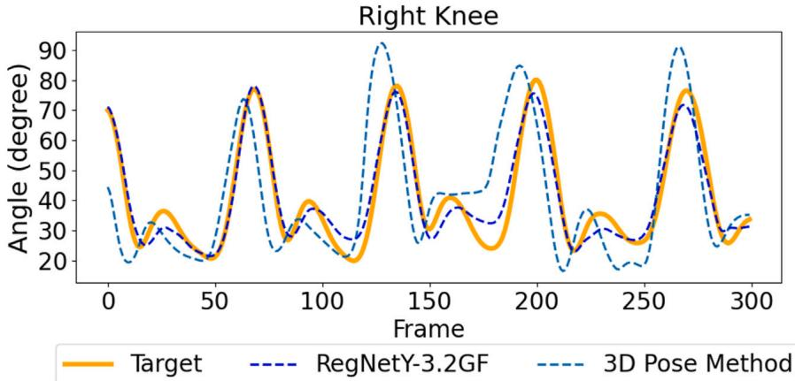
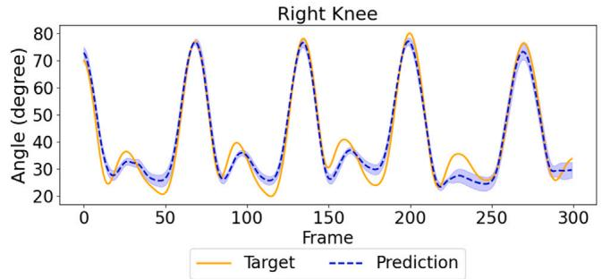
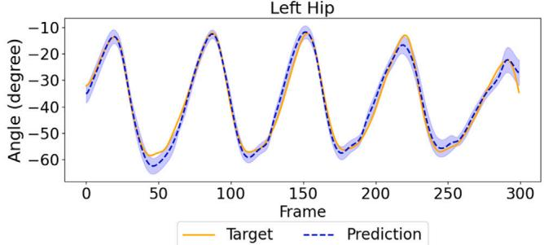
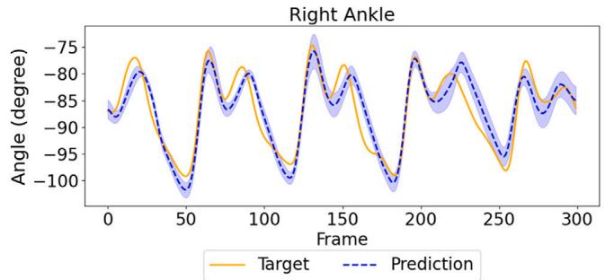
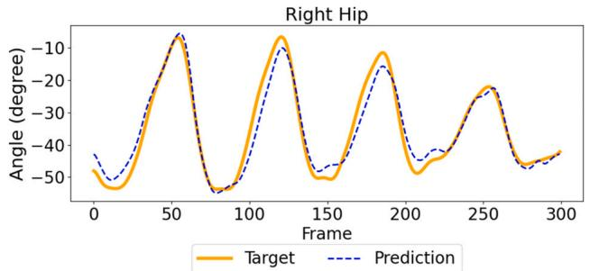
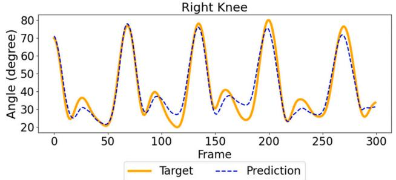
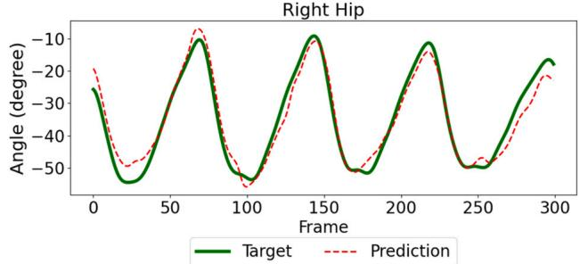
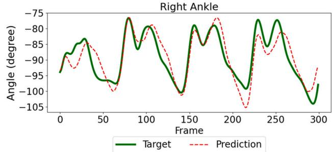

# 使用单目 RGB 摄像头的下肢关节角度估计

Vanyi Chao a,b，Sungho Park a,c，Ankhzaya Jamsrandorj a，Dawoon Jung a，Jinwook Kim a,∗，Kyung-Ryoul Mun a,∗

a Intelligence and Interaction Research Center, Korea Institute of Science and Technology, Seoul 02792, Republic of Korea

b AI-Robotics, KIST School, University of Science and Technology, Seoul 02792, Republic of Korea

c Department of Brain and Cognitive Engineering, Korea University, Seoul 02841, Republic of Korea

## A R T I C L E I N F O

关键词：CNN-transformer 架构、关节角度估计、下肢运动学

## A B S T R A C T

准确的关节角度测量对步态分析、康复训练以及退行性疾病的早期检测至关重要。现有的基于标记点（marker-based）的方法依赖可穿戴传感器，不仅需要复杂的装置，还涉及繁琐的标定流程，因而难以在日常生活中得到广泛应用。本研究旨在提出一种基于视觉的方法，直接从单视角 RGB 图像帧中估计髋、膝、踝三处关节的角度。我们构建了一个端到端模型：其中卷积神经网络用于提取空间特征，transformer 模块用于捕捉步态的时间动态信息；同时设计了一种新颖的损失函数，对角度误差与角速度误差联合进行惩罚，从而提升估计结果的连贯性与精度。我们将所提出模型的性能与三维姿态方法进行了比较，并通过改变相机视角、行走速度以及引入异常步态模式对其鲁棒性进行了检验。结果表明，在不同的观察角度、行走速度和步态模式下，所提模型的组内相关系数（intraclass correlation coefficient, ICC）均高于 0.92，且其性能优于基于三维姿态的两阶段基线方法。该模型不仅省去了复杂装置与传感器的依赖，相较于两阶段流水线方法也更为稳健，不易产生误差。在临床及家庭环境中应用时，它可以为步态评估提供一种经济且可靠的解决方案。

## 1. 引言

关节角度测量是人类运动分析的基础，广泛应用于步态分析、临床评估、康复训练和体育科学等领域。值得注意的是，最新研究表明，步态分析中的关节角度测量可以有效地用于帕金森病 [1]、肌少症 [2,3]、痴呆与阿尔茨海默病 [4] 以及衰弱症 [5] 的早期检测。

传统下肢关节角度测量主要依赖使用可穿戴传感器的运动捕捉（MoCap）系统。MoCap 系统使用多台相机和身体标记来提供准确的关节角度数据，并被视为金标准。可穿戴传感器，例如惯性测量单元（IMU）和表面肌电图（sEMG）传感器，直接附着在身体上以捕获运动学数据和肌肉活动，这些数据可以映射到关节角度。尽管 MoCap 系统具有较高的准确性，但在系统设置和用户不适方面仍面临若干挑战。MoCap 的系统设置通常不仅需要受控的环境，还需要复杂且昂贵的设备。IMU 和 sEMG 传感器则相当容易受到信号漂移 [6,7] 和放置位置问题 [8] 的影响，且已有研究报道偶发的用户不适情况。

近年来，深度学习技术被融入 MoCap 系统，使其能够在不使用标记或可穿戴设备的情况下估计关节角度 [9–13]。这些系统使用姿态估计模型从每个视频帧中提取二维关节点，然后通过二维到三维提升模型重建关节的三维位置，从而能够计算整个步态周期中的关节角度。它们已成为传统步态分析的一种实用且非侵入式的替代方案。然而，仍有一些挑战亟待解决。二维关键点检测的准确性容易受到个体解剖学变异的影响，从而导致估计的关节中心与实际关节中心之间存在偏差。这些二维关键点定位中的初始误差通常会在后续的二维到三维姿态重建过程中传播并放大不准确性，这凸显了对能够在不同人群和录制条件下良好泛化的鲁棒单相机解决方案的需求。

这些挑战进一步限制了姿态估计模型在临床和真实世界环境中的适用性。研究表明，要达到与临床标准相当的准确性，基于视觉的系统通常需要采用多视角相机设置来解决遮挡问题并确保三维保真度 [14]。因此，这需要同步的硬件和专门的采集空间，类似于传统的实验室环境。为克服这一挑战，研究者提出了单相机方法，提供了更高的可及性，但它们依赖于相机内参的显式知识或需要在场景中使用特定的标定物体来恢复绝对尺度 [15]。这些因素阻碍了无标记姿态估计技术在远程监测场景中的广泛应用，在这类场景中，非专业用户通常依赖未经标定的消费级设备，且没有训练有素的专业人员的协助。

  
图 1. 实验装置展示了为实现最佳数据采集而将十二台摄像头划分为四个区域的布置。区域 1（C12、C1、C2）、区域 2（C3、C4、C5）、区域 3（C6、C7、C8）和区域 4（C9、C10 和 C11）。  
表 1

基于上述动机，我们提出了一种端到端模型，能够直接根据单个 RGB 摄像头采集的视频帧估计下肢关节角度，从而消除三维姿态方法中的两阶段流水线。该模型将结合空间特征提取与时序建模，并在不同的摄像头视角、行走速度和步态模式下对其性能进行验证。本研究的主要贡献包括：

1. 一种鲁棒的单摄像头关节角度估计模型，可在不同视角、行走速度和步态模式下进行泛化；

2. 一种同时集成空间建模与时序建模的端到端深度学习架构；

3. 借助关节角度与角速度的精确预测，进一步丰富步态分析；

4. 构建一个不仅可用于关节角度估计、还可用于疾病早期识别的综合性关节角度数据集。

## 2. 材料与方法

## 2.1. 参与者

研究共纳入 69 名参与者（表 1）。平均年龄为 73.34 ± 12.4 岁，平均身高和平均体重分别为 161.43 ± 9.43 cm 和 $6 0 . 4 3 \pm 1 0 . 6 7$ kg。男性参与者占 58% $\left( \mathbf { n } = 4 0 \right)$ 。参与者中包括 28 例肌少症（sarcopenia）患者和 23 例帕金森病（Parkinson's disease）患者。其余 18 名参与者未患任何可能影响其行走能力的疾病，作为对照组。所有招募的参与者均能够在不使用助行器的情况下独立行走。所有参与者在参与研究前均签署了书面知情同意书，且本研究已获机构审查委员会（institutional review board）批准（KHUH 2022-05-036-001）。

各组研究参与者的人体测量学特征。

<table><tr><td rowspan="2"></td><td rowspan="2">正常步态</td><td colspan="2">异常步态</td></tr><tr><td>肌少症</td><td>帕金森病</td></tr><tr><td>年龄</td><td>62.72 ± 18.00</td><td>81.14 ± 3.93</td><td>72.17 ± 5.08</td></tr><tr><td>体重</td><td>65.29 ± 11.17</td><td>53.43 ± 6.75</td><td>65.29 ± 11.17</td></tr><tr><td>身高</td><td>163.33 ± 11.41</td><td>157.67 ± 7.05</td><td>164.52 ± 8.65</td></tr></table>

## 2.2. 实验

实验在室内进行，安装了运动捕捉系统（Motion Capture, MoCap）和12台数码相机（图1）。每位参与者被指示在正常速度和快于正常速度两种条件下，穿着追踪标记物直线行走4米。此外，还开展了一项补充验证实验，使用一位穿着宽松长裤的受试者的数据来评估模型在严重服装遮挡下的鲁棒性。数字相机从12个不同角度记录参与者的步行过程，分为第1、2、3和4区域的四个视角。第1区域为参与者右侧的对角视角，第2区域为正面视角，第3区域为侧向视角，第4区域为参与者左侧的对角视角。CORTEX光学运动捕捉系统用于获取关节角度和位置。数字相机和光学相机的采样频率均设置为60 Hz。

## 2.3 数据采集与处理

由于12台相机在运动捕捉进行的同时同步录制视频，录制的视频通过闪光信号技术进行裁剪和同步。首先，设计了一个用于接收闪光设备闪光信号的电路。当闪光触发时，光电二极管产生电流，然后经运算放大器放大并转换为晶体管-晶体管逻辑（Transistor-Transistor Logic, TTL）电平信号。当该信号发生突变时，微控制器产生一个持续100毫秒的脉冲。本实验中使用的MoCap系统由上升沿脉冲触发。与此同时，数字相机捕捉闪光发生的瞬间。该时刻通过检测像素强度的突然增加来识别。为了适应背景亮度和光照条件的变化，用于检测闪光的像素强度阈值被设定在100到150之间。生成的脉冲和捕捉到的闪光时刻用于同步和裁剪视频与关节角度数据。

  
图2. 关节角度与角速度预测的端到端架构。一个包含�帧的单视角输入片段被通过共享图像编码器提取每帧的空间特征。这些帧级特征被拼接后输入两个并行的Transformer模块，一个预测逐帧关节角度，另一个预测关节角速度，从而同时学习空间与时间步态动力学。

在获取关节角度数据后，应用了 $\sigma = 3$ 的高斯滤波器对数据进行平滑处理以降低噪声。随后，提取每一帧中每位被试的边界框，以便仅聚焦于被试本身。为获得边界框，分别采用 YOLOv8 [16] 模型和 ByteTrack [17] 进行人体检测与跟踪。由于跟踪器会对帧中所有人（包括非被试）生成边界框，因此对 ID 进行了人工校正，以确保边界框与每位被试正确对应。

数据集被划分为三部分：训练集包含 41 名受试者，验证集包含 14 名受试者，测试集包含 14 名受试者。具体而言，训练集、验证集和测试集分别由 1342 个视频和 1,037,010 张图像、466 个视频和 324,953 张图像、以及 455 个视频和 338,433 张图像构成。

## 2.4. 模型构建

所提出的端到端模型的总体架构如图 2 所示。该框架旨在通过统一的流水线直接从视频帧估计关节角度与角速度。它由三个主要阶段组成：（1）输入构建（Input Construction），用于准备时序视频片段；（2）特征提取（Feature Extraction），由共享的图像编码器从每一帧中捕获空间特征；（3）时序聚合与预测（Temporal Aggregation and Prediction），由 Transformer 模块建模时序步态动态以生成最终的关节运动学预测结果。各组件的具体细节将在以下小节中描述。

## 2.4.1. 输入构建

为了构建用于预测人体关节角度与角速度的深度学习模型，采用滑动窗口方法构建输入。输入由 32 个连续帧构成，并确保各窗口之间不存在帧重叠。所构建的输入对应于 60 帧每秒（FPS）下约半秒的视频。模型输入张量记为 $x \in \mathbb { R } ^ { T \times 3 \times H \times W }$，其中 $T$ 为每个输入的帧数，$H$ 和 $W$ 分别为每个视频帧的高度与宽度。训练阶段，输入是随机选取的。该模型由两个主要模块组成：特征提取和时序聚合。

## 2.4.2. 特征提取

给定帧序列 $x \in \mathbb { R } ^ { C \times T \times H \times W }$，每个编码器独立处理单帧 $x _ { i } \in \mathbb { R } ^ { C \times H \times W }$，并生成输出特征向量 $x _ { i } \ \in \ \mathbb { R } ^ { D }$，其中 D 表示所提取特征的维度。在帧经过编码器处理之后，各编码器的输出沿时间维度进行拼接，以生成帧级特征 $\boldsymbol { x } _ { f } \in \mathbb { R } ^ { T \times D }$。该拼接表示捕获了序列中每帧的空间特征，随后被传递到时间聚合模块进行进一步处理。

所提取特征的维度 D 取决于所选的主干模型。我们探索了多种主干模型，包括视觉 Transformer（Vision Transformers）、卷积神经网络（CNNs）以及混合模型。在视觉 Transformer 方面，我们使用了 Swin Transformer [18]，它利用具有移位窗口（shifted windows）的层级架构来高效地捕获局部与全局空间特征。对于混合模型，我们使用了 MaxViT [19]，它通过块注意力（block attention）和网格注意力（grid attention）将 CNN 与 ViT 相结合，以捕获局部与全局空间特征。对于 CNN，我们实现了 ConvNeXtV2 [20]、RegNetY [21] 和 EfficientNetV2 [22]，这些模型被认为是当前最先进的主干模型之一 [23]。

## 2.4.3. 时间聚合

在特征提取之后，我们获得了一组帧级特征序列 $x _ { f } \in \mathbb { R } ^ { T \times D }$。时间聚合模块对该序列进行处理，以捕获帧之间的动态关系。在我们的方法中，基于 Transformer 的架构利用自注意力机制对局部与全局时间依赖进行动态加权与整合，从而生成聚合特征 $x _ { \mathbf { a g g } } \in \mathbb { R } ^ { T \times D }$，该特征封装了空间特征随时间的演化过程。

随后，将时间感知特征输入到一个全连接层，该全连接层的神经元数量等于关节类别数。这些类别对应于右踝、左踝、右膝、左膝、右髋和左髋的屈伸角度。

接着，构建了一个用于关节角速度预测的额外分支，以镜像关节角度预测分支。该额外分支通过利用多任务损失函数，略微提升了模型的整体性能。关节角速度是一项有价值的步态参数，因为众所周知，其不易受标记物放置的影响——而标记物放置在采集 MoCap 真值数据时可能会引起角度偏移。

## 2.4.4. 推理算法

在本工作中，与依赖中间关键点定位的传统算法不同，所提出的框架学习了一个直接映射函数 ${ \mathcal { F } } : x \to ( \theta , \omega )$。该函数以原始视频张量 x 为输入，并在单次前向传播中回归关节角 θ 与角速度 ω，从而无需显式的骨架跟踪即可隐式地捕捉受试者的步态模式。附录中的算法 1 给出了本研究使用的算法。

## 2.5. 损失函数

我们的模型采用多任务损失进行训练，该损失联合优化两个相关任务：关节角的估计与关节角速度的估计。对于这两个任务，我们均采用 L1 损失，该损失已被证明在回归场景中是有效的。此外，为了促进估计关节角与导出速度之间的时间一致性，我们引入了一致性损失项。该项鼓励预测速度与预测关节角的有限差分相匹配。各损失分量的计算如下：

$$
\mathcal {L} _ {\theta} = \| \hat {\theta} - \theta \| _ {1},\tag{1}
$$

$$
\mathcal {L} _ {\omega} = \| \hat {\omega} - \omega \| _ {1},\tag{2}
$$

$$
\mathcal {L} = \mathcal {L} _ {\theta} + \mathcal {L} _ {\omega} + \lambda \left\| \hat {\omega} _ {2: T} - (\hat {\theta} _ {2: T} - \hat {\theta} _ {1: T - 1}) \right\| _ {1},\tag{3}
$$

其中 θ̂ 和 θ 分别表示预测的关节角与真实的关节角。ω̂ 和 ω 分别表示预测的关节角速度与真实的关节角速度。2:T 表示从时间步 2 到 T 的帧。λ 是手动调节的一致性项权重因子。

## 2.6. 训练细节

准备好的样本使用 YOLOv8 生成的边界框进行裁剪以用于训练。YOLOv8 的边界框在所有边上向外扩展了 10 个像素，以确保完整覆盖每位受试者的肢体。裁剪后的输入随后用零值进行方形填充以保持其宽高比，然后调整为 224 × 224 像素，以保证输入具有一致的尺寸。真实标签采用输入构建时所用的滑动窗口方法进行分割。每个关节角通过其运动范围被归一化到 0 到 1 的区间内。为了获得关节角速度的真实标签，计算连续关节角之间的差值如下：

$$
\omega_ {2: T} = \theta_ {2: T} - \theta_ {1: T - 1},\tag{4}
$$

其中初始角速度被设为零，假设每位受试者均从静止位置开始行走。这些步骤确保输入图像和对应的真实标签数据都经过统一缩放、时间对齐，并准备好用于模型训练。

训练过程中使用了 AdamW 优化器，权重衰减（weight decay）为 0.01，初始学习率为 $1 \times 1 0 ^ { - 4 }$。采用了 CosineAnnealing WarmupRestarts 调度器，预热周期为 6 个 epoch，学习率从最小值 $3 \times 1 0 ^ { - 6 }$ 退火到最大值 $1 \times 1 0 ^ { - 4 }$。模型使用损失函数  (3) 进行训练，最多训练 50 个 epoch。所有实验均在 NVIDIA RTX 4090 GPU 上进行。

训练过程中，每完成一个 epoch 就在评估集上使用平均绝对误差（Mean Absolute Error, MAE）和组内相关系数（Intraclass Correlation Coefficient, ICC）对模型性能进行评估。

MAE 用于量化模型的绝对精度，表示预测关节角度与真实值之间偏差的平均幅度，单位为度。MAE 值越低，表明对关节位置幅值的估计精度越高。

为评估预测步态波形的可靠性和时间一致性，计算了 ICC。

根据既定的可靠性评估指南 [24]，ICC 值小于 0.50、介于 0.50 到 0.75 之间、介于 0.75 到 0.90 之间、以及大于 0.90 分别表示可靠性较差、中等、良好和优秀。

这些阈值被用于在不同测试条件下对模型性能的质量进行分类。

表 2 不同骨干模型在测试集上关节角度与关节角速度预测的对比。

<table><tr><td rowspan="2">骨干网络（Backbone）</td><td colspan="2">角度（Angle）</td><td colspan="2">角速度（Angular velocity）</td></tr><tr><td>MAE</td><td>ICC</td><td>MAE</td><td>ICC</td></tr><tr><td>MaxViT</td><td>4.5874</td><td>0.9138</td><td>0.4167</td><td>0.9385</td></tr><tr><td>ConvNeXtV2-T</td><td>4.5310</td><td>0.9184</td><td>0.4257</td><td>0.9319</td></tr><tr><td>RegNetY3.2GF</td><td>4.1966</td><td>0.9285</td><td>0.4027</td><td>0.9418</td></tr><tr><td>EfficientNetV2-S</td><td>4.2577</td><td>0.9297</td><td>0.4318</td><td>0.9331</td></tr><tr><td>Swin-T</td><td>4.8141</td><td>0.9149</td><td>0.4863</td><td>0.9205</td></tr></table>

## 3. 结果（Results）

## 3.1. 不同骨干模型的性能（Model performance by backbone models）

以 RegNetY 作为骨干网络（backbone）的模型在预测角度和角速度方面均优于其他模型（表 2）。在角度预测中，使用 RegNetY 作为骨干网络的模型取得了最低的 MAE 值 4.1966，ICC 为 0.9285。在角速度预测中，最低 MAE 值为 0.4027，对应 ICC 为 0.9418。总体而言，五种骨干网络均表现强劲，各项指标差异较小，证实了所提架构在关节角度和角速度预测方面的有效性。使用 RegNetY 和 EfficientNetV2 的模型在准确性与可靠性之间提供了最佳平衡。使用 EfficientNetV2 的模型在角度预测中取得了最高的 ICC 值 0.9297，而使用 RegNetY 的模型在角度和角速度预测中均表现出持续较低的 MAE。选择以 RegNetY 作为骨干网络的模型，是因为其在关节角度和角速度预测两方面均具有强劲的整体预测性能。尽管 EfficientNetV2 在角度预测上取得了略高的 ICC，但 RegNetY 在两者的预测中均给出了最低的 MAE，并在角速度预测上获得了最高的 ICC。这种稳定的准确性使 RegNetY 成为我们提出模型的首选。

## 3.2. 所开发模型的性能

所开发模型在测试集上取得了平均 MAE 为 4.1966、ICC 为 0.9285 的成绩，与真值（ground truth）具有高度相关性（表 3）。当模型在不含角速度信息的情况下训练时，ICC 为 0.9193。最低 MAE 值 2.9992 出现在左踝关节角度的预测中，而最高 ICC 值 0.9654 出现在右膝关节角度的预测中。角速度信息的加入虽幅度有限，但提升了关节角度预测的一致性与整体性能。综合来看，所开发模型在预测不同关节的运动幅度与时序方面均表现有效，且在角速度预测上具有特别稳健的性能。

Table 5  
Table 4  
Table 3  
不同关节在角度和角速度预测中的性能比较。性能采用 MAE 和 ICC 进行评估。结果基于 RegNetY3.2GF 骨干网络模型，在测试集上评估得出。

<table><tr><td rowspan="2">关节</td><td colspan="2">角度</td><td colspan="2">角速度</td></tr><tr><td>MAE</td><td>ICC</td><td>MAE</td><td>ICC</td></tr>
<tr><td>右髋</td><td>4.6776</td><td>0.9420</td><td>0.3192</td><td>0.9691</td></tr>
<tr><td>左髋</td><td>5.1525</td><td>0.9338</td><td>0.3459</td><td>0.9618</td></tr>
<tr><td>右膝</td><td>4.5971</td><td>0.9654</td><td>0.5347</td><td>0.9635</td></tr>
<tr><td>左膝</td><td>4.4972</td><td>0.9651</td><td>0.5278</td><td>0.9635</td></tr>
<tr><td>右踝</td><td>3.2557</td><td>0.8795</td><td>0.3549</td><td>0.8916</td></tr>
<tr><td>左踝</td><td>2.9992</td><td>0.8856</td><td>0.3335</td><td>0.9010</td></tr>
<tr><td>平均值</td><td>4.1966</td><td>0.9285</td><td>0.4027</td><td>0.9418</td></tr>
<tr><td>无速度</td><td>-</td><td>0.9193</td><td>-</td><td>-</td></tr>
</table>

所开发模型在不同输入图像分辨率下的性能对比。基准分辨率为 224 × 224。结果基于 RegNetY3.2GF 主干网络模型，在测试集上评估得到。

<table><tr><td rowspan="2">分辨率</td><td colspan="2">角度</td><td colspan="2">角速度</td></tr><tr><td>MAE</td><td>ICC</td><td>MAE</td><td>ICC</td></tr>
<tr><td>224 × 224</td><td>4.1966</td><td>0.9285</td><td>0.4027</td><td>0.9418</td></tr>
<tr><td>128 × 128</td><td>4.6676</td><td>0.9189</td><td>0.4077</td><td>0.9392</td></tr>
<tr><td>112 × 112</td><td>4.6392</td><td>0.9160</td><td>0.4369</td><td>0.9294</td></tr>
<tr><td>64 × 64</td><td>5.1559</td><td>0.9000</td><td>0.4528</td><td>0.9255</td></tr>
</table>

我们的 RegNetY3.2GF 模型与三维姿态方法在验证集和测试集上的对比

<table><tr><td rowspan="2">模型（仅膝关节）</td><td colspan="2">验证集</td><td colspan="2">测试集</td></tr><tr><td>MAE</td><td>ICC</td><td>MAE</td><td>ICC</td></tr>
<tr><td>RegNetY3.2GF</td><td>5.5312</td><td>0.8983</td><td>4.5472</td><td>0.9652</td></tr>
<tr><td>三维姿态方法</td><td>10.2434</td><td>0.7932</td><td>9.6163</td><td>0.8522</td></tr>
</table>

进一步对平滑核大小进行敏感性分析后发现：将核大小减小至 σ = 1 时，由于保留了高频噪声，可靠性略有下降（ICC = 0.9253）；而将其增大至 σ = 5 时，则过度衰减了峰值关节角度。因此，选取 σ = 3 作为核大小，以在降噪与波形保留之间取得最佳平衡（ICC = 0.9285）。

## 3.3. 输入分辨率对所提模型的影响

为了评估所提出模型在不同图像分辨率下的鲁棒性，进行了一项包含 224×224、128×128、112×112 和 64×64 四种不同分辨率的消融研究。如表 4 所示，使用 224×224 图像分辨率训练的模型取得了最高的精度，关节角度的 MAE 为 4.3200，ICC 为 0.9285。将图像分辨率降低至 128×128 时，关节角度的 MAE 为 4.6676，ICC 为 0.9189。在最低的 64×64 图像分辨率下，模型对关节角度的 MAE 为 5.1559，ICC 为 0.9000。对于角速度，在所有图像分辨率下其 ICC 均保持在 0.92 以上。

## 3.4. 与三维姿态方法的定量比较

将所开发的模型与三维（3D）姿态方法的比较表明，所开发的模型在预测膝关节角度方面优于三维姿态方法（表 5）。由于三维姿态方法的源代码不可得，因此重新搭建了一个两阶段流程以便进行比较。首先，应用 ViTPose 从 RGB 图像中提取二维（2D）关节点 [25]；然后，使用 MotionBERT 将这些关键点提升至三维（3D）空间 [26]。关节角度由这些重建的三维位置直接计算得出。选择 ViTPose 是因为其鲁棒的二维关键点估计能力，选择 MotionBERT 是因为其在三维姿态方面的准确性。采用这一方法是因为它们具有最先进的性能，并且兼具开源可用性和易于实现的特点。

表 6
测试集上四个相机视角分组下的性能。相机设置在第 2.2 节中说明。

<table><tr><td rowspan="2">相机分组</td><td colspan="2">角度</td><td colspan="2">角速度</td></tr>
<tr><td>MAE</td><td>ICC</td><td>MAE</td><td>ICC</td></tr>
<tr><td>区域 1</td><td>4.240</td><td>0.929</td><td>0.410</td><td>0.942</td></tr>
<tr><td>区域 2</td><td>4.256</td><td>0.929</td><td>0.405</td><td>0.942</td></tr>
<tr><td>区域 3</td><td>4.028</td><td>0.936</td><td>0.396</td><td>0.945</td></tr>
<tr><td>区域 4</td><td>4.337</td><td>0.919</td><td>0.405</td><td>0.938</td></tr></table>

当 MotionBERT 将关键点提升到三维空间时，其输出的是以相机为中心的坐标系下的坐标。为了将这些坐标变换为与人体解剖结构对齐的、以身体为中心的坐标系，首先定义局部坐标轴：x 轴由从根关节（root joint）到左髋的向量确定，y 轴由从根关节到腹部的向量确定，z 轴由 Y 轴与 Z 轴的叉积确定。随后，将从头部到鼻部的向量投影到 XY 平面上，并计算其与初步 x 轴的点积。当点积为负时，将 x 轴翻转，使其能够始终指向鼻部投影的方向，从而保证向前的解剖方向。最后，在该局部坐标系中，基于标准解剖标志点定义了规范的 T-pose（canonical T-pose）。在关节角度计算阶段，将每个肢体段从其 T-pose 朝向按层级旋转到观测朝向，确保所有关节角度都在一致的解剖轴上进行测量。由于 MotionBERT 的三维姿态估计器未提供脚趾关键点，因此无法计算踝关节角度。所以，仅与左右膝关节的角度进行了比较。

所开发模型在验证集上预测膝关节角度的 ICC（组内相关系数，Intraclass Correlation Coefficient）为 0.8983，而三维姿态方法的 ICC 为 0.7932。在测试集上，所开发模型取得了 0.9652 的 ICC，三维姿态方法的 ICC 为 0.8522。

当对所提出模型与三维姿态方法的目标轨迹进行比较时，所提出模型能够更紧密地跟踪真实值，尤其是在快速屈伸阶段（图 3）。

## 3.5. 对视角变化的鲁棒性

在考察所开发模型在不同视角下的性能时，未观察到视角之间存在显著差异（表 6）。无论视角如何，该模型在关节角度和角速度的预测上都表现出了一致的准确性和可靠性。视角 1、2、3 和 4 的 ICC 范围较窄，在 0.919 到 0.936 之间，MAE（平均绝对误差，Mean Absolute Error）在 4.028 到 4.337 之间变化。视角 3 取得了最高的 ICC（0.945）和最低的 MAE（4.028）。视角 4 的 ICC 最低。每个视角的预测都收敛到接近真实值，表明所提出模型能够在不同视角下都产生可靠的预测（图 4）。

## 3.6. 对速度变化的鲁棒性

在两种不同行走速度下考察所开发模型的性能时，无论是在常规速度还是在快于常规速度的条件下，所开发模型的预测都与真实值的轨迹高度吻合（图 5）。预测的幅值、相位和时间都与真实值高度匹配，但在步幅和步态周期时长上存在轻微偏差。

图3. 左右膝关节角度预测的可视化：所提方法 vs. 三维姿态方法。

不同受试者群体在测试集上关节角度与角速度预测的性能对比。健康组同时包含年轻与年长受试者。

<table><tr><td rowspan="2">群体</td><td colspan="2">角度</td><td colspan="2">角速度</td></tr><tr><td>MAE</td><td>ICC</td><td>MAE</td><td>ICC</td></tr><tr><td>帕金森病</td><td>4.2069</td><td>0.9165</td><td>0.4109</td><td>0.9170</td></tr><tr><td>肌少症</td><td>4.2911</td><td>0.9251</td><td>0.3678</td><td>0.9474</td></tr><tr><td>健康</td><td>4.1281</td><td>0.9389</td><td>0.4201</td><td>0.9547</td></tr></table>

在快于常速的步速条件下，由于快于常速时踝关节的活动范围相较常速时更小，模型在摆动中期对踝关节角度的预测出现了轻微的相位滞后。尽管如此，所提模型仍然准确地捕捉到了常速与快速两种条件下关节运动的整体趋势与动态特征。

## 3.7. 对步态变异性的鲁棒性

进一步通过异常步态对所开发模型的性能进行了考察。受试者被分为三组：诊断为帕金森病的受试者（n = 23）、诊断为肌少症的受试者（n = 28），以及在参与本实验时未被诊断出任何可能影响其行走的健康状况的受试者（n = 18）。诊断为帕金森病与诊断为肌少症的受试者之间没有重叠。诊断为帕金森病或肌少症者的步态被视为异常步态，其余受试者的步态被视为正常步态。在测试集上，该模型在预测帕金森病组的关节角度时取得了 0.9165 的 ICC，在肌少症组中取得了 0.9251 的 ICC，在其余受试者中取得了 0.9389 的 ICC（表 7）。异常步态的 MAE 介于 4.2069 至 4.2911 之间，区间较窄，且与正常步态的 MAE 无显著偏离。在角速度方面，肌少症组的 MAE 略有下降，但仍在不影响模型可靠预测性能的范围内。最后，在一名穿着宽松长裤、完全遮挡膝关节与踝关节的受试者身上进行的验证中，该模型在七个视角（C1、C3、C4、C5、C8、C10、C12）下仍保持了高可靠性，平均 ICC 为 0.9335，证明了在关节被遮挡的条件下模型仍具有鲁棒性。

## 4. 讨论

本研究旨在开发并验证一个能够直接从视频帧估计下肢关节角度的模型。我们开发了以 RegNetY 作为骨干网络的模型，将用于空间特征提取的卷积神经网络与用于捕捉时序步态动态的 Transformer 模块相集成。我们提出了一种新的损失函数，该函数同时惩罚角度误差与角速度误差，以提升一致性并改善整体估计精度。我们将所开发模型的精度与 3D 姿态模型进行了比较，在测试集上取得了 0.9652 的 ICC 值。所开发的模型在多种相机视角、行走速度和步态模式下，不仅能稳健地估计关节角度，也能稳健地估计角速度。

所提出方法的核心创新在于从显式几何重建到直接运动学学习的范式转变，消除了以往易出错的两阶段流程。通过绕过中间关键点检测，该框架直接学习视觉步态模式与关节力学之间的内在生物力学关系，并以一种速度感知的损失函数引导，确保时序一致性。由于无需标记点或专用硬件，所提出的方法摆脱了对专业设备和受过训练的专业人员的依赖，显著增强了可及性。所提出的模型即使在使用消费级智能手机摄像头通常所能获得的低图像分辨率下也表现出合理的性能，这表明该模型具有作为临床与居家步态评估中经济且可及解决方案的潜力。

  
图 4. 一位受试者以较快速度行走时，从十二个不同相机视角（C1 至 C12）采集的关节角度预测值（蓝色）与真值（橙色）的可视化对比。

所提出模型的卓越成果可能源于卷积神经网络（CNN）与 Transformer 的结合。有研究表明，将用于局部特征提取的 CNN 与用于全局时序建模的 Transformer 相结合的混合深度学习架构，在人体运动学分析中表现出更优的性能 [27]。这些混合网络有效缓解了步态事件检测与时空参数估计中空间分辨率与时序一致性之间的权衡问题 [28]。膝关节在步态周期中显著的活动范围也可能有助于取得优异的表现。与踝关节（其旋转相对细微）不同，膝关节表现出明显且高幅度的屈伸模式，提供了强烈的视觉线索，使空间特征提取器能够更精确地捕捉其动态。此外，一种联合优化关节角度与角速度预测的新型多任务损失函数也有助于提升整体一致性。

本研究所使用的损失函数被设计为联合优化关节角度及其对应角速度的估计。模型采用多任务损失进行训练，其中关节角度和角速度预测均使用 L1 损失。此外，还引入了一致性损失项以促进时序一致性，通过鼓励预测速度与预测关节角度的有限差分相匹配。该方法使模型能够利用关节角度与角速度之间的内在关系，从而同时提升预测的准确性和时序一致性。

在输出和损失计算中均纳入角速度有助于整体性能的提升。值得注意的是，加入速度预测使组内相关系数（ICC）从 0.9193 提高到 0.9285。尽管提升幅度不大，但它表明与真值之间的一致性得到了增强，并凸显了引入动态特征的价值。这表明，在训练过程中同时利用静态和动态步态特征，可以从视频数据中更可靠地估计下肢关节角度。该方法也反映了物理感知运动捕捉以及当前最先进的运动表示学习的最新趋势。研究已证明，将速度级别的监督集成到 MotionBERT 损失函数中，对于从部分观测数据中恢复平滑且时序一致的三维运动至关重要 [26]。当前的研究已采用显式的基于物理的学习策略来强制生物学合理性，利用基于导数的约束消除物理上不可能的伪影 [29.30]。

本研究探索了多种模型作为模型开发的骨干网络，最终选定了 RegNetY。尽管所有骨干网络模型都表现出了相当强的性能，支撑了所提模型设计的有效性，但与其他骨干网络模型相比，RegNetY 在关节角度和角速度两项任务上都提供了最稳健且一致的性能。可以推测，RegNetY 灵活且可扩展的架构得益于对深度、宽度和分组卷积的高效平衡，从而增强了特征表示能力。这一观察得到了近期研究的支持，这些研究证明了 RegNet 系列架构强大的特征提取能力和高效性 [23]。使用 RegNetY 开发的模型在估计下肢关节角度方面表现强劲，其中膝关节的估计精度最高。将角速度整合进模型进一步提高了预测精度，表明动态特征在预测中具有重要价值。未来使用面向回归任务的量化方法（如 Reg-PTQ[31]）对 RegNetY 骨干进行量化，并结合量化 Transformer 模块（如 Q-ViT[32]），将能够最大限度地减少内存占用，并提升所提模型的适用性。

  
(a) 快步走（Fast walking）。

  
(b) 正常步态行走（Normal walking）。  
图 5. 在两种步态条件下，目标值与预测值的右侧关节角度随帧数变化的对比。(a) 快步走（实线橙色：目标值；虚线蓝色：预测值）。(b) 正常步态行走（实线绿色：目标值；虚线红色：预测值）。

所开发的模型与三维姿态模型之间的性能对比表明，所开发的模型可以作为其可靠的替代方案。三维姿态方法依赖于从 RGB 图像中提取二维关键点，再将其输入到提升模型（lifting model）中以估计三维关节位置，然后由这些位置计算出关节角度 [9–13]。然而，该过程相当容易产生误差，因为初始的二维关键点定位会导致最终估计中出现累积性偏差。相比之下，所开发的模型通过直接从视频帧估计关节角度，获得了更接近真实值的估计结果。因此，误差传播的风险得以降低，尤其是在步态的快速变化阶段，无论是在时间还是幅度上均如此。这种直接估计方式不仅提高了精度，还简化了工作流程，使其在各种情境下的步态分析中成为一种更易获取的替代方案。

所开发的模型对各种变化来源表现出了强大的鲁棒性，例如相机视角、行走速度、步态异常以及不同的服装条件。跨不同相机视角的估计结果保持一致，仅在视角间出现了 ICC 与 MAE 的轻微波动。在速度变化方面，同样再次确认了模型表现出的良好性能。在常规速度与快于常规速度条件下，预测轨迹与真实轨迹均高度吻合，仅在快于常规速度条件下的中摆动期出现了小幅偏差。在较高行走速度下观察到的相位滞后，可能源于快速运动的远端关节产生了更明显的运动模糊，从而降低了关节相关的空间特征质量，并影响了时间维度的估计精度。所开发模型在区分肌少症患者与帕金森病患者步态与正常步态方面所体现的鲁棒性，进一步拓展了其潜在的应用范围。这种鲁棒性同样延伸至服装变化场景——即便宽松长裤遮挡了下肢，模型仍能通过利用全身动力学与时序模式，而非单纯依赖局部关节可见性，成功推断关节运动学信息。这种鲁棒性可归因于模型的端到端架构：它融合了对每一视频帧的强大空间特征提取能力，以及基于 Transformer 的时序建模能力。通过同时学习帧级视觉线索及其时序关系，模型能够有效捕捉关键的步态动力学特征，从而在多种条件下保持稳定的性能。这种能力对于现实应用至关重要，因为实际录制环境与受试者状况常常存在差异。

在考察输入分辨率对模型性能的影响时发现，降低图像分辨率仅会导致精度出现轻微下降，而在较低分辨率下仍能保持较高的可靠性。这表明所提出的模型能够有效捕捉全局时空步态模式，而非仅依赖精细的空间细节。这提升了所提出模型在现实场景中的适用性，尤其是在计算资源或输入质量可能受限的情况下。该特性尤其支持其在需要兼顾鲁棒性与效率的实际步态评估场景中的部署应用。

所提出模型的高处理吞吐量表明其在实时步态分析方面具有很强的可行性。该模型在 4.14 s 内处理了一段包含 1127 帧的视频，对应平均吞吐量约为 270 FPS，即每帧约 3.7 ms。鉴于步态分析的标准视频采集速率为 60 FPS，所提出模型的运行速度约为实时的 4.5 倍。尽管由于滑动窗口（sliding-window）策略需要短暂的初始缓冲时间，但该模型能够以可忽略的延迟生成后续输出，从而支持连续分析。这一能力凸显了所提出模型在实时临床与监测应用中的潜力。

所提出模型具有多项具有临床意义的优势，支持其在真实医疗场景中的应用。通过使用单个 RGB 摄像头，该模型能够在不依赖可穿戴传感器或基于标记点的系统的前提下，实现低成本、无创的步态分析。该模型表现出较高的估计精度与可靠性，能够对关节角度和角速度进行临床可行的评估。其在多种步态模式（包括神经系统和肌肉骨骼疾病患者所表现出的步态模式）上的稳健性，凸显了其在疾病早期发现与纵向进展监测方面的潜力。最后，其对动态步态特征的量化能力为开发可扩展的、基于视频的数字生物标志物（digital biomarkers）提供了机会，以支持未来的诊断与预后应用。对于未来真实场景的部署，可以考虑多种策略，例如测试时增强（test-time augmentation）和域适应（domain adaptation）。测试时增强通过对输入的多个增强版本进行评估与聚合，将提升预测的稳健性。域适应技术可被用于缓解训练数据与真实场景之间的域差距（domain gap）。

尽管如此，本研究仍存在若干局限性。首先，所开发的模型仅在画面中仅有一名受试者的场景下进行设计与验证。在涉及多人的画面中，或在由于日常生活物品（如家具或助行器）造成遮挡的环境中，该模型的性能仍需进一步研究。其次，数据是在受控的室内设置下采集的，其中光照与背景保持一致。

## 5. 结论（Conclusion）

本研究开发并验证了一种端到端的基于视觉的模型，该模型可直接从视频帧中估计下肢关节角度。所开发的模型以 RegNetY 作为骨干网络，将用于空间特征提取的卷积神经网络与用于捕获时间步态动态的 Transformer 模块相集成。一种联合惩罚角度和角速度误差的新型损失函数提升了整体估计精度。所开发的模型表现出比 3D 姿态（3D pose）模型更高的精度，实现了最高的 ICC（组内相关系数）为 0.9652。在不同的相机视角、速度条件和步态模式下，所开发模型的鲁棒性得到了验证。该模型可在临床和家庭环境中带来更可靠、更易获取的步态评估。

## 贡献声明（CRediT authorship contribution statement）

Vanyi Chao：撰写 – 审阅与编辑、撰写 – 初稿、可视化、验证、软件、方法学、形式分析、概念化。Sungho Park：可视化、验证、调查、数据管理。Ankhzaya Jamsrandorj：撰写 – 审阅与编辑、形式分析、数据管理。Dawoon Jung：验证、形式分析。Jinwook Kim：撰写 – 审阅与编辑、形式分析。Kyung-Ryoul Mun：撰写 – 审阅与编辑、可视化、验证、监督、经费获取、形式分析、Concep tualization。

## 利益冲突声明（Declaration of competing interest）

作者声明，他们不存在任何已知的可能影响本报告工作的竞争性经济利益或个人关系。

## 致谢（Acknowledgments）

本研究由 Korea Institute of Science and Technology 机构项目（项目编号：26E0211）以及由韩国政府（MSIT）通过 National Research Foundation of Korea（NRF）资助的课题（编号：RS-2025-25462906）资助。

## 附录。推理阶段的实现细节（Appendix. Implementation details of the inference stage）

从原始视频输入到最终运动学估计的完整算法流程详见算法 1。该过程从受试者定位（步骤 1）开始，其中 YOLOv8 检测器在每个视频帧中分离出参与者。这些检测结果用于裁剪和缩放帧至 224 × 224 像素，并应用方形填充以保持受试者的原始长宽比。在步骤 2 中，预处理后的视频序列被划分为长度为 32 帧的非重叠时间窗口（T = 32）。为确保对潜在乱序处理的鲁棒性，每个窗口的帧索引被存储为参考键。在模型推理阶段（步骤 3），每个窗口通过所提出的端到端网络  进行处理，以预测相应的关节角度 � 和角速度 �。最后，在步骤 4 中，按索引键对窗口级预测进行排序和拼接，以重建整个视频期间的连续运动学轨迹。

算法 1 端到端关节角度估计的推理算法
输入：原始视频序列 $V = \{f_1, f_2, ..., f_N\}$
输出：关节角度 $\theta \in \mathbb{R}^{N \times J}$ 和角速度 $\omega \in \mathbb{R}^{N \times J}$
1: 初始化空预测映射 $M_{preds} \leftarrow \{\}$
2: 步骤 1：受试者定位与预处理
3: 对 $V$ 中的每个帧 $f_i$ 执行
4: $B_i \leftarrow \text{YOLOv8}(f_i)$
5: $x_i \leftarrow \text{SquarePad}(\text{Crop}(f_i, B_i), 224 \times 224)$
6: 结束循环
7: 步骤 2：时间窗口划分
8: 将处理后的帧 $x$ 划分为不重叠的窗口 $W$
9: 设置窗口大小 $T \leftarrow 32$
10: 为每个窗口 $W_k$ 存储帧索引 $idx_k$
11: 步骤 3：模型推理
12: 对 $W$ 中的每个窗口 $W_k$ 执行
13: $(\hat{\theta}_k, \hat{\omega}_k) \leftarrow F(W_k)$
14: $M_{preds}[idx_k] \leftarrow (\hat{\theta}_k, \hat{\omega}_k)$
15: 结束循环
16: 步骤 4：序列对齐
17: 按键索引对 $M_{preds}$ 排序
18: $\theta, \omega \leftarrow \text{Concatenate}(M_{preds})$
19: 返回 $\theta, \omega$

## 数据可用性

数据将根据要求提供。

## 参考文献

[1] L. Di Biase, A. Di Santo, M.L. Caminiti, A. De Liso, S.A. Shah, L. Ricci, V. Di Lazzaro. 帕金森病的步态分析：诊断与症状监测中最准确标志物的综述, Sensors 20 (12) (2020) 3529.

[2] J.-K. Kim, M.-N. Bae, K.B. Lee, S.G. Hong. 基于惯性传感器步态参数的肌少症患者识别, Sensors 21 (5) (2021) 1786.

[3] S. Kim, S. Park, S. Lee, S.H. Seo, H.S. Kim, Y. Cha, J.-T. Kim, J.-W. Kim, Y.-C. Ha, J.-I. Yoo. 利用步态分析与智能鞋垫评估肌少症患者身体能力以开发数字生物标志物, Sci. Rep. 13 (1) (2023) 10602.

[4] R. Rucco, V. Agosti, F. Jacini, P. Sorrentino, P. Varriale, M. De Stefano, G. Milan, P. Montella, G. Sorrentino. 基于三维运动捕捉的额颞叶痴呆与阿尔茨海默病患者时空及运动学步态分析, Gait Posture 52 (2017) 312–317.

[5] W. Tsuchida, Y. Kobayashi, K. Inoue, M. Horie, K. Yoshihara, T. Ooie. 基于主成分分析识别的体弱老年女性步态运动学特征, Sci. Rep. 12 (1) (2022) 1676.

[6] J. Ryu, B.-H. Lee, J. Maeng, D.-H. Kim. 基于表面肌电信号与 IMU 传感器的用户自适应分类器步态子阶段检测与预测, Med. Eng. Phys, 69 (2019) 50–57.

[7] A. Küderle, N. Roth, J. Zlatanovic, M. Zrenner, B. Eskofier, F. Kluge. 足部 IMU 传感器的放置位置会影响正常行走时空间参数的准确性, PLoS One 17 (6) (2022) e0269567.

[8] R. Merletti, P. Di Torino. 肌电数据报告标准, J Electromyogr Kinesiol. 9 (1) (1999) 3–4.

[9] H. Wang, Z. Xie, L. Lu, L. Li, X. Xu, 一种通过单摄像机估计提举任务中关节角度和L5/S1力矩的计算机视觉方法, J. Biomech. 129 (2021) 110860.

[10] J.-Y. Choi, E. Ha, M. Son, J.-H. Jeon, J.-W. Kim, 基于深度学习三维人体姿态估计在真实环境中的人体关节角度估计, Sensors 24 (12) (2024) 3823.

[11] H. Yuan, Y. Zhou, 基于单目RGB相机与一种新的多人三维姿态估计技术（ROMP）的老年护理人体工效学评估, Int. J. Ind. Ergon. 95 (2023) 103440.

[12] M. Yahya, J. Shah, K. Kadir, A. Warsi, S. Khan, H. Nasir, 基于单RGB摄像机的康复用精确肩关节角度估计, 载于: 2019年IEEE国际仪器与测量技术会议（I2MTC）, IEEE, 2019, 第1–6页.

[13] H. Wang, B. Su, L. Lu, S. Jung, L. Qing, Z. Xie, X. Xu, 基于单摄像机与计算机视觉的无标记步态分析, J. Biomech. 165 (2024) 112027.

[14] N. Nakano, T. Sakura, K. Ueda, L. Omura, A. Kimura, Y. Iino, S. Fukashiro, S. Yoshioka, 使用OpenPose结合多摄像机评估三维无标记动作捕捉精度, Front. Sport. Act. Living 2 (2020) 50.

[15] L. Needham, M. Evans, D.P. Cosker, L. Wade, P.M. McGuigan, J.L. Bilzon, S.L. Colyer, 多种姿态估计方法在三维关节中心定位上的精度, Sci. Rep. 11 (1) (2021) 20673.

[16] D. Reis, J. Kupec, J. Hong, A. Daoudi, 基于YOLOv8的实时飞行目标检测, 2023, arXiv预印本 arXiv:2305.09972.

[17] Y. Zhang, P. Sun, Y. Jiang, D. Yu, F. Weng, Z. Yuan, P. Luo, W. Liu, X. Wang, ByteTrack: 通过关联每个检测框实现多目标跟踪, 载于: 欧洲计算机视觉会议, Springer, 2022, 第1–21页.

[18] Z. Liu, Y. Lin, Y. Cao, H. Hu, Y. Wei, Z. Zhang, S. Lin, B. Guo, Swin Transformer: 使用移位窗口的分层视觉Transformer, 载于: IEEE/CVF国际计算机视觉会议论文集, 2021, 第10012–10022页.

[19] Z. Tu, H. Talebi, H. Zhang, F. Yang, P. Milanfar, A. Bovik, Y. Li, MaxViT: 多轴视觉Transformer, 载于: 欧洲计算机视觉会议, Springer, 2022, 第459–479页.

[20] S. Woo, S. Debnath, R. Hu, X. Chen, Z. Liu, I.S. Kweon, S. Xie, ConvNeXt V2: 利用掩码自编码器协同设计与扩展ConvNet, 载于: IEEE/CVF计算机视觉与模式识别会议论文集, 2023, 第16133–16142页.

[21] I. Radosavovic, R.P. Kosaraju, R. Girshick, K. He, P. Dollár, 网络设计空间的设计, 载于: IEEE/CVF计算机视觉与模式识别会议论文集, 2020, 第10428–10436页.

[22] M. Tan, Q. Le, EfficientNetV2: 更小的模型与更快的训练, 载于: 国际机器学习会议, PMLR, 2021, 第10096–10106页.

[23] P. Jeevan, A. Sethi, 使用哪个骨干网络：一种面向计算机视觉的资源高效领域特定比较, 2024, arXiv预印本 arXiv:2406.05612.

[24] T.K. Koo, M.Y. Li, 可靠性研究中组内相关系数的选择与报告指南, J. Chiropr. Med. 15 (2) (2016) 155–163.

[25] Y. Xu, J. Zhang, Q. Zhang, D. Tao, ViTPose：用于人体姿态估计的简单视觉Transformer基线, Adv. Neural Inf. Process. Syst. 35 (2022) 38571–38584.

[26] W. Zhu, X. Ma, Z. Liu, L. Liu, W. Wu, Y. Wang, MotionBERT：学习人体运动表示的统一视角, 发表于：2023年IEEE/CVF国际计算机视觉会议论文集, 2023, 第15085–15099页.

[27] A. Jamsrandorj, Q.H.N. Nguyen, D. Jung, M.S. Baek, K.-R. Mun, J. Kim, 基于图像的步态时空参数估计：使用单目相机与CNN-Transformer混合网络, 发表于：2023年第45届IEEE医学与生物工程学会年会（EMBC）, IEEE, 2023, 第1–5页.

[28] A. Jamsrandorj, D. Jung, K.S. Kumar, M.Z. Arshad, H. Lim, J. Kim, K.-R. Mun, 视角无关的步态事件检测：使用CNN-Transformer混合网络, J. Biomed. Informatics 147 (2023) 104524.

[29] S. Shimada, V. Golyanik, W. Xu, C. Theobalt, PhysCap：实时物理可信的单目3D运动捕捉, ACM Trans. Graph. (ToG) 39 (6) (2020) 1–16.

[30] C. Guo, G. L'Erario, G. Romualdi, M. Leonori, M. Lorenzini, A. Ajoudani, D. Pucci, 基于物理信息的学习：通过稀疏IMU预测人体全身运动学, 2025, arXiv预印本 arXiv:2509.25704.

[31] Y. Ding, W. Feng, C. Chen, J. Guo, X. Liu, Reg-PTQ：面向全量化目标检测器的回归专用训练后量化, 发表于：2024年IEEE/CVF计算机视觉与模式识别会议论文集, 2024, 第16174–16184页.

[32] Y. Li, S. Xu, B. Zhang, X. Cao, P. Guo, Q-ViT：精确且完全量化的低比特视觉Transformer, Adv. Neural Inf. Process. Syst. 35 (2022) 34451–34463.