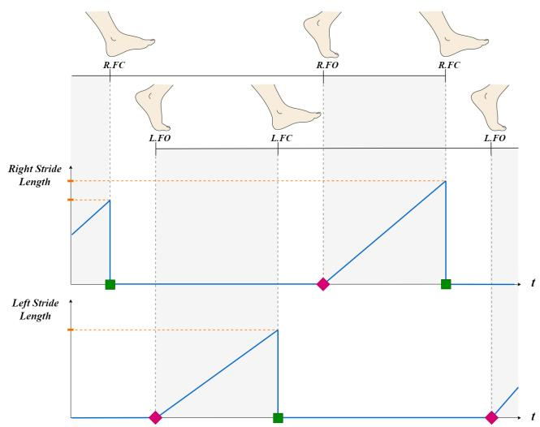
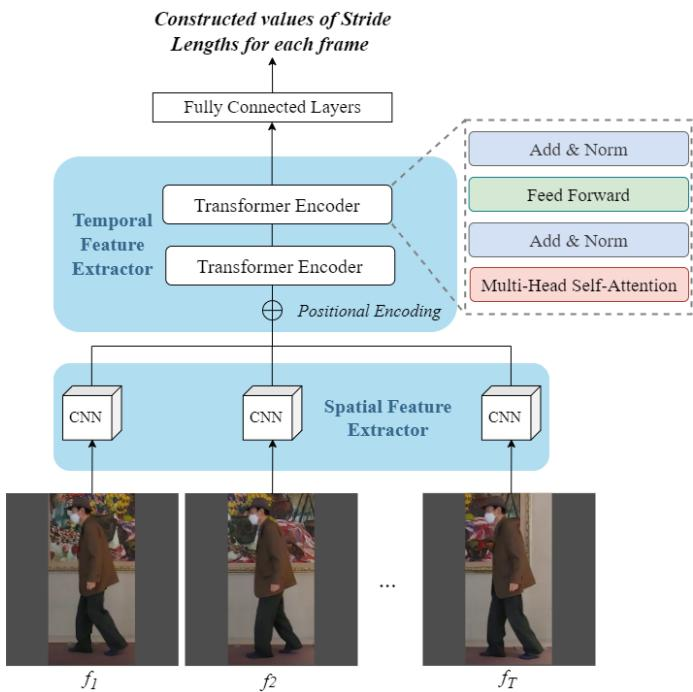
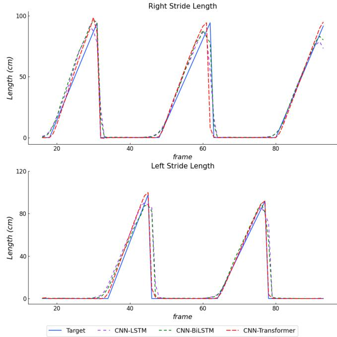

# 基于图像的步态时空参数估计：使用单目相机与卷积-Transformer 混合网络

Ankhzaya Jamsrandorj1,4, Quynh Hoang Ngan Nguyen2,4, Dawoon Jung4, Min Seok Baek3, Kyung-Ryoul Mun4, Jinwook Kim4

摘要（Abstract）—— 基于视觉的步态分析在老年人健康状况的远程与持续监测中可以发挥重要作用。然而，大多数基于视觉的方法利用人体姿态信息来计算步态时空参数，并给出平均参数。本研究旨在提出一种直接的方法以实现逐步步态时空参数的估计。本研究共有 160 名老年人参与。数据通过 GAITRite 系统和一台移动相机同时采集。我们训练了三个深度学习网络，以少量 RGB 帧作为输入，以包含步态空间与时间参数的连续一维信号作为输出。训练后的网络估计的步幅长度与真实值之间的相关系数达到 0.938 及以上，检测步态事件的 F 分数（F-score）达到 0.914 及以上。

临床意义（Clinical relevance）—— 所提方法在分析步态时空参数方面与 GAITRite 系统表现出极佳的一致性。我们的方法可应用于根据老年人步态参数监测其健康状况，以实现疾病的早期诊断、适当治疗以及及时干预。

## I. 引言（Introduction）

步态会因损伤、虚弱以及衰老而发生改变，导致异常步行，进而可能引发更为严重的健康问题，例如肌肉骨骼、心血管和心理健康问题。因此，对老年人进行步态分析可以成为一种有效的临床指标，用于评估其身心状况并及早发现健康问题。

目前包括光学动作捕捉系统、测力板以及可穿戴设备在内的专用系统成本高昂、难以移动，且在日常生活中难以获取。由于需要高度配合，这些系统可能给老年人带来不适。因此，亟需一种基于视觉的步态分析系统，以便远程评估和监测老年人的步态。多数基于视觉的方法聚焦于使用特定相机系统或外部姿态机进行二维或三维人体姿态估计，然后基于骨架跟踪数据计算步态参数 [1]–[9]。Ismail 等人采用 DeepPose 框架获取二维人体关节位置，并通过回归模型估计所选关节的运动以进行步态分析 [2]。类似地，Stenum 等人使用侧视视频，通过 OpenPose 定位关节并进行跟踪来测量时空步态参数 [6]。然而，从人体姿态检测器提取的二维关节位置可能并非该关节的中心，存在一定误差。此外，二维姿态估计结果会因视角、部分遮挡、光照变化以及生物特征差异而发生改变，这会影响步态参数的计算。因此，一些研究工作采用三维关节位置以规避上述问题，并提升步态分析的可靠性。Azhand 等人提出了一种步态分析系统，该系统基于由二维人体姿态提升得到的三维人体姿态及其跟踪结果 [7]。Zhu 等人提出了一种级联网络，利用红外热成像视频以及由 OpenPose 框架提取的二维姿态来回归三维人体关节位置，随后通过对所估计关节的跟踪来计算步态参数 [8]。然而，这些方法仍然依赖于二维姿态，并使用复杂模型来估计三维人体关节坐标。此外，这些方法仅在健康的青年和老年受试者上进行了验证。

在本研究中，我们主要关注老年人群，包括健康对照（Healthy Controls, HC）以及罹患神经退行性疾病的患者，特别是帕金森病（Parkinson's Disease, PD）、阿尔茨海默病（Alzheimer's Disease, AD）以及轻度认知障碍（Mild Cognitive Impairment, MCI），考虑到这些疾病在老年人中具有较高的流行率，且步态可用于评估神经退行性疾病 [10]–[12]。此外，对老年人进行逐步（stride-by-stride）的连续步态分析有助于对损伤或跌倒风险 [9]、术后康复效果以及运动障碍的诊断与评估进行基础的临床评估。

因此，本研究旨在提出一种无需人体关节位置、且易于应用于日常生活的基于视觉的方法，用于逐步时空步态参数的估计。

## II. 材料与方法（MATERIALS AND METHODS）

## A. 受试者（Participants）

本研究基于韩国科学技术研究院（Korea Institute of Science and Technology）机构审查委员会（Institutional Review Board, IRB）批准的工作开展。

共有 160 名老年受试者参与本实验。所有受试者在参与前均获得了书面知情同意。所有受试者，包括健康对照者（HC）以及被诊断为帕金森病（PD）、阿尔茨海默病（AD）、轻度认知障碍（MCI）及其他疾病的患者，均能够在无帮助或无辅助器具的情况下自行行走。

  
图 1. 使用 GAITRite 步道系统与移动相机的实验装置。相机从侧面视角记录行走动作，但相机的高度与位置并未固定。

表 I 总结了各研究组的人口统计学与人体测量学特征。

## B. 实验方案

如图 1 所示，数据由 GAITRite 步道系统与移动相机在室内环境中同步采集。受试者被要求以自选速度在压力垫上行走。每位受试者需完成十次行走动作。相机以高清分辨率、30 Hz 帧率从侧面视角记录行走过程。步态时空参数（包括步幅长度（SL）、足部触地（FC）时刻与足部离地（FO）时刻）的真值由 GAITRite 步道系统测得。视频与 GAITRite 系统数据由一位专家依据首次 FC 事件进行手动同步，并由另一位专家进行交叉核对。

## C. 步态时空参数估计器的开发

1) 基于视觉的步态时空参数估计的目标构建：GAITRite 系统提供两组步态时空参数：测试区域内的平均参数，以及详细区域内的逐足着地参数。我们提取了与步幅相关的足部时间信息。

  
图 2. 逐步幅步态时空参数估计的目标构建。（步幅长度——矩形，FC——正方形，FO——菱形）

表 I  
各研究组的人口统计学与人体测量学特征。

<table><tr><td></td><td>AD</td><td>MCI</td><td>PD</td><td>HC</td><td>其他</td></tr><tr><td>受试者人数（女性）</td><td>37 (18)</td><td>28 (15)</td><td>39 (18)</td><td>26 (14)</td><td>30 (12)</td></tr><tr><td>年龄（岁）</td><td> $73.5 \pm 7.6$ </td><td> $74.4 \pm 6.0$ </td><td> $70.9 \pm 10.6$ </td><td> $70.8 \pm 9.7$ </td><td> $70.7 \pm 11.8$ </td></tr><tr><td>体重（kg）</td><td> $56.7 \pm 10.4$ </td><td> $55.5 \pm 9.7$ </td><td> $61.2 \pm 10.4$ </td><td> $59.8 \pm 12.9$ </td><td> $61.8 \pm 9.9$ </td></tr><tr><td>身高（cm）</td><td> $157.7 \pm 8.8$ </td><td> $153.4 \pm 6.8$ </td><td> $160.9 \pm 9.1$ </td><td> $162.1 \pm 7.1$ </td><td> $161.7 \pm 8.8$ </td></tr><tr><td>平均行走速度（cm/s）</td><td> $76.2 \pm 16.7$ </td><td> $84.7 \pm 23.1$ </td><td> $91.7 \pm 24.2$ </td><td> $102.9 \pm 20.6$ </td><td> $80.1 \pm 25.0$ </td></tr></table>

数据以平均值 ± 标准差（mean ± SD）的形式呈现。

足着地（Foot Contact, FC）和足离地（Foot Off, FO）事件以及步长（Stride Length, SL）均来自每位受试者的个体足部落足参数，每个步长参数均使用受试者的腿长进行归一化。如图 2 所示，这些时空参数被用于构建逐步步态的一维信号，以进行基于视觉的估计。步长是同一只脚连续两次足着地（FC）时刻之间的距离。然而，我们在同一只脚的足离地（FO）和足着地（FC）事件之间构建了一维信号。假设参与者在行走过程中保持恒定速度，则将信号线性增加以达到从 GAITRite 系统提取的步长真值。因此，每个构建的信号都包含每一步的空间和时间步态参数。

2) 网络架构：所提出的用于基于视觉的步态时空参数估计的网络 CNN-Transformer 由空间特征提取器、时间特征提取器和全连接层组成。采用在 ImageNet 上预训练的 ResNet18 作为输入帧的空间特征提取器，并使用 Transformer 编码器提取时间特征。如图 3 所示，输入特征序列隐含位置信息，并将其馈送到 Transformer 编码器中，该编码器包含两个编码器层。每个编码器层包含四个多头自注意力子层和一个前馈层。最终模块包含两个全连接层，中间使用 ReLU 激活函数和 Dropout。我们使用长短期记忆网络（CNN-LSTM）和双向长短期记忆网络（CNN-BiLSTM）两种深度学习网络作为时间特征提取器进行实验，以进行性能比较。网络的输入是 27 个连续视频帧，网络的输出是双腿步长的构建目标值。

## D. 实现细节

1) 数据处理：网络的输入是 27 个连续帧，其中包含真实人体边界框和所有帧的构建步长值。原始帧通过裁剪帧中的人物进行预处理，然后左右填充以获得正方形图像，并将其缩放至 448×448。我们按受试者将数据集划分为三部分。训练集包括来自 96 名受试者的数据，其中包含 20 名阿尔茨海默病（Alzheimer's Disease, AD）、17 名轻度认知障碍（Mild Cognitive Impairment, MCI）、21 名帕金森病（Parkinson's Disease, PD）、15 名健康对照（Healthy Controls, HC）和 23 名患有其他疾病的受试者。验证集包含来自 32 名受试者的数据，其中包含 7 名 AD、5 名 MCI、8 名 PD、5 名 HC 和 7 名患有其他疾病的受试者。最后，测试集由来自其余 32 名受试者的数据组成，其中包含 10 名 AD、6 名 MCI、10 名 PD 和 6 名 HC 受试者。

表 II  
网络在测试集上的空间参数估计性能。

<table><tr><td rowspan="2">模型</td><td colspan="2">MAE（cm）</td><td colspan="2">ICC</td></tr><tr><td>右步幅</td><td>左步幅</td><td>右步幅</td><td>左步幅</td></tr><tr><td>CNN-LSTM</td><td>9.236 ± 4.677</td><td>9.983 ± 4.523</td><td>0.905 ± 0.041</td><td>0.885 ± 0.047</td></tr></tr><tr><td>CNN-BiLSTM</td><td>7.211 ± 3.648</td><td>8.643 ± 4.742</td><td>0.953 ± 0.043</td><td>0.918 ± 0.043</td></tr></tr><tr><td>CNN-Transformer</td><td>6.909 ± 3.657</td><td>7.420 ± 3.153</td><td>0.962 ± 0.047</td><td>0.957 ± 0.045</td></tr></table>

RSL（right stride length，右步幅）；LSL（left stride length，左步幅）。数据以平均值 ± 标准差表示。

2) 数据增强：尽管本研究中使用单个相机采集步态数据，但相机的高度与位置并未固定，以避免受限于单一相机视角。每位参与者所使用的相机高度与位置可能略有差异。此外，对输入帧施加了旋转增强，即绕 x 轴分别旋转 $3 0 ^ { \circ }$ 和 -30°，以使所提方法对相机角度变化更具鲁棒性。同时还采用了水平翻转。

3) 训练方案：所有实验均基于 PyTorch 框架实现。网络权重通过对 ImageNet 进行预训练进行初始化，用于步态时空参数估计任务。所有网络均采用平均绝对误差（Mean Absolute Error, MAE）作为损失函数，并使用 Adam 优化器，初始学习率为 0.0001，批量大小为 16。每经过三个 epoch，对学习率进行一次衰减，共进行两次。

图 3. CNN-Transformer 网络的整体结构。采用 ResNet18 模型作为空间特征提取器，并使用包含两个编码器层的 Transformer 编码器提取时间特征。每个 Transformer 编码器层包含四个多头自注意力子层。

表 III
各网络在测试集上的步态事件检测性能

<table><tr><td rowspan="2">模型</td><td colspan="4">F1</td></tr><tr><td>右脚着地</td><td>右脚离地</td><td>左脚着地</td><td>左脚离地</td></tr><tr><td>CNN-LSTM</td><td>0.908 ± 0.132</td><td>0.941 ± 0.127</td><td>0.914 ± 0.136</td><td>0.949 ± 0.112</td></tr></tr><tr><td>CNN-BiLSTM</td><td>0.907 ± 0.125</td><td>0.941 ± 0.119</td><td>0.906 ± 0.128</td><td>0.965 ± 0.090</td></tr></tr><tr><td>CNN-Transformer</td><td>0.901 ± 0.146</td><td>0.951 ± 0.114</td><td>0.928 ± 0.141</td><td>0.967 ± 0086</td></tr></table>

RFC（right foot contact，右脚着地）；RFO（right foot-off，右脚离地）；LFC（left foot contact，左脚着地）；LFO（left foot-off，左脚离地）。数据以平均值 ± 标准差表示。

## E. 评估指标

用于步态时空参数估计的目标被设计为简单的 1D 信号。MAE（厘米）和组内相关系数（ICC）被用来评估网络在步幅长度估计方面的性能。首先为每个信号挑选定义步幅长度的峰值，然后计算类型为 (2,k) 的 MAE 和 ICC，以评估 GAITRite 系统与所提方法之间的一致性。F1 分数（F1）被用来评估网络在步态事件检测方面的性能。我们找出具有峰值的帧，以精确定位包含 FC 事件的帧号。阈值设为 2（厘米）以内的最近点确定包含 FO 事件的帧号。然后计算目标帧号与预测帧号之间的帧差。如果帧差小于 2 帧的阈值，则该事件被视为真阳性。所有其他步态事件预测被视为假阳性，而所有未被检测到的目标被视为假阴性。

## III. 结果

估计结果如图 4 所示，表明所有三个网络都准确地估计了步幅长度并检测了具有步态事件的帧。

表 II 总结了深度学习网络在估计右、左步幅长度方面的 MAE 和 ICC。CNN-Transformer 网络在步幅长度估计上达到了最小的 MAE，分别为 6.909 和 7.420。相应地，CNN-Transformer 网络在估计右、左步幅长度时获得了最高的 ICC，分别为 0.962 和 0.957。

表 III 总结了网络在测试集上对 FO 和 FC 事件的检测结果。对于所有网络而言，FO 事件的检测性能均高于 FC 事件。CNN-Transformer 网络在检测右 FO 事件、左 FC 和 FO 事件时，分别获得了最高的 $\mathrm { F } _ { 1 } \mathrm { \cdot }$ 分数 0.951（精确率 0.928，召回率 0.985）、0.928（精确率 0.909，召回率 0.969）和 0.967（精确率 0.953，召回率 0.988）。相比之下，CNN-BiLSTM 网络在检测右 FC 事件时获得了最高的 F1 分数 0.908（精确率 0.857，召回率 0.993）。

表 IV 和表 V 展示了当相机角度改变时深度学习网络的性能。本研究使用的所有三个网络在输入帧绕水平轴旋转的情况下，都对步态时空参数表现出合理的鲁棒估计。如表所示，与将输入旋转 $3 0 ^ { \circ }$ 度相比，网络在输入旋转 -30° 度时获得了更好的性能。这种性能的提升可能是由于下肢在负角度旋转的帧中显得更加展开。

表 IV  
不同角度旋转数据上网络的步幅长度估计性能。

<table><tr><td rowspan="2"></td><td rowspan="2">模型（Model）</td><td colspan="3">旋转角度（Rotation angle）</td></tr><tr><td> $30^{\circ}$ </td><td> $0^{\circ}$ </td><td> $-30^{\circ}$ </td></tr><tr><td rowspan="3">MAE (cm)</td><td>CNN-LSTM</td><td> $9.635 \pm 5.141$ </td><td> $9.610 \pm 4.600$ </td><td> $9.487 \pm 5.162$ </td></tr><tr><td>CNN-BiLSTM</td><td> $7.930 \pm 4.821$ </td><td> $7.927 \pm 4.195$ </td><td> $7.685 \pm 4.773$ </td></tr><tr><td>CNN-Transformer</td><td> $7.171 \pm 3.971$ </td><td> $7.165 \pm 3.405$ </td><td> $7.061 \pm 3.854$ </td></tr></tr><tr><td rowspan="3">ICC</td><td>CNN-LSTM</td><td> $0.882 \pm 0.045$ </td><td> $0.895 \pm 0.063$ </td><td> $0.896 \pm 0.078$ </td></tr><tr><td>CNN-BiLSTM</td><td> $0.937 \pm 0.049$ </td><td> $0.936 \pm 0.047$ </td><td> $0.940 \pm 0.045$ </td></tr><tr><td>CNN-Transformer</td><td> $0.961 \pm 0.042$ </td><td> $0.960 \pm 0.042$ </td><td> $0.963 \pm 0.041$ </td></tr></tr></tr>

数据以平均值 ± 标准差（mean ± SD）形式呈现。

## IV. 讨论（DISCUSSION）

本研究提出了一种基于视觉的时空步态参数估计新方法。我们构建了包含时空步态参数的简单一维信号，用于连续的逐步幅步态分析。仅使用少量 RGB 帧训练的深度学习网络，通过所构建的信号在时空步态参数估计中取得了令人满意的性能。值得注意的是，我们的方法在老年人步态分析中不需要任何特殊传感器、标记点或人体姿态估计器。

所提出的方法在时空步态参数分析上与 GAITRite 步道系统表现出极佳的一致性。本研究中 CNN-Transformer 网络所达到的最佳估计性能，可能源于其通过多头自注意力机制同时访问长范围序列数据的能力。与 CNN-LSTM 不同的是，CNN-Transformer 网络能够同时考虑未来和过去的信息，这也带来了 CNN-BiLSTM 的优势，但计算成本仅为后者的一半。

我们使用 CNN-Transformer 网络分析了不同受试者群体的估计性能，包括阿尔茨海默病（AD）、轻度认知障碍（MCI）、帕金森病（PD）和健康对照（HC）。如表 VI 所示，CNN-Transformer 网络对所有受试者群体的步幅长度估计的 ICC 均达到 0.929 及以上，FO 事件检测的 $\mathrm { F } _ { 1 }$ 分数均达到 0.933 及以上。然而，与 HC 和 MCI 相比，AD 和 PD 患者的 FC 事件检测效果较差。基于估计性能，所提出的方法可用于正常步态及病理性步态的远程监测与分析。

如引言所述，大多数基于视觉的方法使用人体姿态估计机器来定位人体关节点并对其进行跟踪，以计算时空参数。然而，也有一些研究仅使用 RGB 视频进行步态分析。Yu 和 Jeong 等人开发并使用了相同的深度学习网络来分析步态。他们使用从 RGB 视频帧中通过 3D CNN 网络提取的预准备特征来估计平均时空参数 [13], [14]。与这些研究相比，我们的方法在没有任何预准备特征的情况下估计逐步步态参数，使其更适合日常生活中的连续和远程步态分析。此外，由于健康状况的缘故，老年人和患者在行走的不同时期（如开始、中间和结束阶段）可能具有可区分的步态特征。逐步步态时空参数能够实现对这些行走阶段步态变异性的分析。

TABLE V  
不同旋转角度数据下各网络步态事件检测性能。

<table><tr><td rowspan="2"></td><td rowspan="2">模型</td><td colspan="3">旋转角度</td></tr><tr><td> $30^{\circ}$ </td><td> $0^{\circ}$ </td><td> $-30^{\circ}$ </td></tr><tr><td rowspan="3">EI</td><td>CNN-LSTM</td><td> $0.928 \pm 0.093$ </td><td> $0.928 \pm 0.079$ </td><td> $0.936 \pm 0.091$ </td></tr><tr><td>CNN-BiLSTM</td><td> $0.931 \pm 0.074$ </td><td> $0.930 \pm 0.069$ </td><td> $0.933 \pm 0.079$ </td></tr><tr><td>CNN-Transformer</td><td> $0.939 \pm 0.061$ </td><td> $0.937 \pm 0.086$ </td><td> $0.943 \pm 0.055$ </td></tr></table>

数据以平均值 ± 标准差表示。

本研究中有若干方面可视为局限性。本研究仅旨在检测步态事件并估计步幅（stride length）。时序步态参数可以使用主要的两个步态事件进行计算。然而，更多的空间参数，如步长（step length）、步宽和足部离地间隙（foot clearance），将纳入未来工作中。我们的方法从单视角视频中获得了步态时空参数的优异性能。尽管如此，将所提方法扩展到多视角视频、增强网络架构以提升性能，以及检验目标信号的不同形状，均列入未来的工作计划中。

  
图 4. 各网络与目标信号的估计性能。注：黑色虚线为精确定位包含 FO（脚离地，Foot Off）事件的帧编号的阈值；每个信号峰值所在的帧表示包含 FC（脚着地，Foot Contact）事件的帧编号。

TABLE VI  
CNN-Transformer 网络在不同受试者组上的步态时空参数估计性能比较。

<table><tr><td rowspan="2">Subject group</td><td colspan="2">ICC</td><td colspan="2">F1</td></tr>
<tr><td> $RSL$ </td><td> $LSL$ </td><td> $FC$ </td><td> $FO$ </td></tr>
<tr><td>AD</td><td>0.957 ± 0.139</td><td>0.933 ± 0.131</td><td>0.895 ± 0.210</td><td>0.933 ± 0.178</td></tr>
<tr><td>MCI</td><td>0.966 ± 0.039</td><td>0.929 ± 0.026</td><td>0.922 ± 0.096</td><td>0.970 ± 0.069</td></tr>
<tr><td>PD</td><td>0.939 ± 0.063</td><td>0.937 ± 0.074</td><td>0.895 ± 0.175</td><td>0.949 ± 0.102</td></tr>
<tr><td>HC</td><td>0.981 ± 0.029</td><td>0.983 ± 0.033</td><td>0.941 ± 0.051</td><td>0.982 ± 0.049</td></tr>
</table>

RSL，右步长（right stride length）；LSL，左步长（left stride length）；FC，足触地（foot contact）；FO，足离地（foot-off）。数据以 $\mathrm{mean} \pm \mathrm{SD}$ 表示。

## V. 结论（CONCLUSIONS）

本研究提出了一种基于视觉的逐步步态时空参数估计方法。我们的结果支持所提方法在评估多种步态方面的能力。以少量视频帧和连续信号作为训练目标的深度学习网络，在步态事件检测和步长估计方面表现出了具有竞争力的性能。我们的方法可应用于在家庭环境中监测老年人的健康状况，并有助于疾病的早期诊断、合理治疗和及时干预。

## 致谢（ACKNOWLEDGMENT）

本工作得到了"残障人士足部诊断与制鞋技术开发项目"（编号：1711192863）以及"运动员训练/比赛数据管理与基于AI的绩效提升解决方案技术开发项目"（编号：1375027432）的支持。

## 参考文献（REFERENCES）

[1] I. Gonzalez, I. H. López-Nava, J. Fontecha, A. Muñoz-Meléndez, A. I. Pérez-SanPablo, and I. Quiñones-Urióstegui, "被动视觉系统与可穿戴惯性系统在估计与GaitRite电子步道相关的步态时序参数方面的比较（Comparison between passive vision-based system and a wearable inertial-based system for estimating temporal gait parameters related to the gaitrite electronic walkway）," *生物医学信息学杂志（Journal of biomedical informatics）*, vol. 62, pp. 210–223, 2016.

[2] H. Ismail, I. Radwan, H. Suominen, and R. Goecke, "基于噪声观测的步态估计与分析（Gait estimation and analysis from noisy observations）," 载于：*2019年第41届IEEE医学与生物工程学会国际年会（EMBC）*. IEEE, 2019年, 第2707–2712页.

[3] Ł. Kidziński, B. Yang, J. L. Hicks, A. Rajagopal, S. L. Delp, and M. H. Schwartz, "深度神经网络实现基于单摄像头视频的定量运动分析（Deep neural networks enable quantitative movement analysis using single-camera videos）," *自然通讯（Nature communications）*, vol. 11, no. 1, pp. 1–10, 2020.

[4] S. Hazra, A. A. Pratap, D. Tripathy, and A. Nandy, "基于多Kinect传感器的人体步态分析的新型数据融合策略（Novel data fusion strategy for human gait analysis using multiple kinect sensors）," *生物医学信号处理与控制（Biomedical Signal Processing and Control）*, vol. 67, p. 102512, 2021.

[5] Y. Ma, K. Mithraratne, N. Wilson, Y. Zhang, and X. Wang, "基于Kinect v2的脑性麻痹儿童步态分析：稳定裕度及时空变量的有效性与可靠性（Kinect v2-based gait analysis for children with cerebral palsy: Validity and reliability of spatial margin of stability and spatiotemporal variables）," *传感器（Sensors）*, vol. 21, no. 6, p. 2104, 2021.

[6] J. Stenum, C. Rossi 和 R. T. Roemmich, "基于姿态估计的二维视频人体步态分析," PLoS Computational Biology, vol. 17, no. 4, p. e1008935, 2021.

[7] A. Azhand, S. Rabe, S. Muller, I. Sattler 和 A. Heimann-Steinert, "基于单一单目视频的算法可提供高有效性与高可靠性的步态参数," Scientific Reports, vol. 11, no. 1, pp. 1–10, 2021.

[8] Y. Zhu, W. Lu, R. Zhang, R. Wang 和 D. Robbins, "基于红外热图像与真实标注训练的双通道级联姿态估计网络用于实时步态测量," Medical Image Analysis, vol. 79, p. 102435, 2022.

[9] E. E. Stone 和 M. Skubic, "在家居环境中被动测量步间步态变异性并比较视觉与 Kinect 传感," 载于 2011 Annual International Conference of the IEEE Engineering in Medicine and Biology Society. IEEE, 2011, pp. 6491–6494.

[10] D. Jung, J. Kim, M. Kim, C. W. Won 和 K.-R. Mun, "利用序列步态特征与长短期记忆网络对认知障碍风险进行分类," IEEE Journal of Biomedical and Health Informatics, vol. 25, no. 10, pp. 4029–4040, 2021.

[11] B. Vidya 和 P. Sasikumar, "基于步态的帕金森病诊断与严重程度分级：采用多类支持向量机," Applied Soft Computing, vol. 113, p. 107939, 2021.

[12] B. Ghoraani, L. N. Boettcher, M. D. Hssayeni, A. Rosenfeld, M. I. Tolea 和 J. E. Galvin, "采用双任务步态评估与机器学习检测轻度认知障碍与阿尔茨海默病," Biomedical Signal Processing and Control, vol. 64, p. 102249, 2021.

[13] H. Yu, K. Kang, S. Jeong 和 J. Park, "用于院内与院外临床步态分析的深度视觉系统," 载于 International Conference on Neural Information Processing. Springer, 2019, pp. 633–642.

[14] S. Jeong, H. Yu, J. Park 和 K. Kang, "基于单目视频与深度学习算法的特发性正常压力脑积水定量步态分析," Scientific Reports, vol. 11, no. 1, pp. 1–10, 2021.