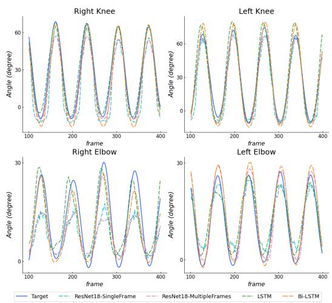
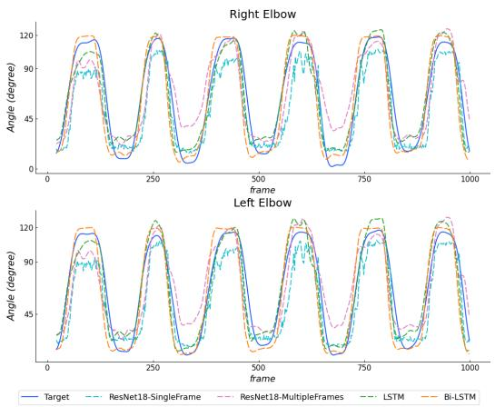

# 用于视角无关的膝关节与肘关节角度估计的深度学习网络

Ankhzaya Jamsrandorj, Konki Sravan Kumar, Muhammad Zeeshan Arshad, Kyung-Ryoul Mun, Jinwook Kim

摘要——基于视觉的人体关节角度估计对于远程与持续的健康监测至关重要。大多数基于视觉的角度估计方法使用通过光学运动相机、深度相机或人体姿态估计模型提取的人体关节位置。本研究旨在提出一种可靠且直接的方法，利用深度学习网络从 RGB 视频中估计膝关节与肘关节的屈伸角度。本研究共有十五名健康受试者完成四项日常活动。实验使用了四种不同的深度学习网络，网络以九个连续帧作为输入，输出为针对每一帧由光学运动捕捉系统提取的膝关节与肘关节角度。基于 BiLSTM 网络的关节角度估计器能够在任意相机视角下，以膝关节 0.955、肘关节 0.917 的相关系数估计两个关节的角度。

## I. 引言

持续的人体关节角度估计对于老年人受伤风险的临床分析、术后康复效果的评估，以及人体关节运动障碍的诊断与评估至关重要。在日常活动中的膝关节屈伸角度与肘关节屈伸角度，可作为帕金森病（Parkinson's disease）、中风（stroke）、衰弱（frailty）以及脑性麻痹（cerebral palsy）等神经与肌肉骨骼障碍程度的指标。因此，准确且可靠的膝关节与肘关节角度估计对于适当的临床干预至关重要。

诸如表面肌电图（surface electromyography, sEMG）和惯性测量单元（inertial measurement unit, IMU）之类的可穿戴传感器因其高精度以及能够在实验室之外远程监测人体运动以估算人体关节角度而被广泛应用。然而，基于可穿戴传感器的方法需要专业人员将传感器贴附在受试者身体上，分析输出信号，并与受试者高度配合 [1]–[5]。

另一方面，基于视觉的方法被用于人体关节角度估计。当前的基于视觉的方法主要使用由专用硬件或软件生成的数据，例如光学运动相机、深度相机、基于被动标记点的系统或人体姿态估计器 [6]–[12]。

Schmitz 等人提出了一种无标记点运动捕捉系统，用于评估使用单个相机测量的关节角度的精度。该系统使用 Kinect 相机采集测试夹具的深度图和二维图像。一种假设膝关节为球窝关节的铰链迭代最近点算法被用于将这些采集到的数据与模板对齐。然后，系统导出虚拟标记点的轨迹，并使用这些轨迹计算关节角度 [7]。

Wang 等人提出了一种计算机视觉方法，使用单个相机在提举任务中估计关节角度，该方法分三步估计关节角度。首先，在 Detectron2 中对视频进行预处理，以检测每一帧中人体关节的二维关键点。然后，VideoPose3D 模型使用二维关键点重建三维姿态。最后，通过使用三维关节坐标的自上而下的逆动力学生物力学模型计算关节角度 [10]。

Kidzinski 等人设计了一个机器学习模型来预测临床步态指标。他们使用 OpenPose 从视频中提取二维人体姿态。这些人体姿态轨迹被输入神经网络，以估计最大伸展时的膝关节屈曲角度 [11]。

这些基于视觉的方法完全依赖于使用深度感知相机、被动标记点跟踪系统或人体姿态估计模型所提取的人体关节位置。然而，深度相机的覆盖范围有限，环境光照条件会对人体关节角度的估计精度产生显著影响。此外，人体姿态检测系统所提取的关节位置可能并非该关节的中心，这会影响关节角度的估计结果。

Kumar 等人提出了一种基于视频的系统，使用深度学习技术来解决上述基于视觉的方法的局限性。一个使用少量视频帧堆叠训练的深度卷积神经网络估计了在跑步机上行走和深蹲时人体下肢的角速度 [13]。

受文献[13]启发，本研究旨在提出一种简单、实用且多视角的方法，利用深度学习网络来估计膝关节屈伸角度和肘关节屈伸角度。

## II. 材料与方法

## A. 受试者

本研究基于韩国科学技术研究院（Korea Institute of Science and Technology）伦理审查委员会支持的工作开展。

共15名受试者（男性12名，女性3名；年龄=24.2±3.8岁，身高=170.7±6.4厘米，体重=71.7±16.1千克）参与了本实验，所有受试者均无任何神经疾病史或现患疾病。所有受试者均签署了书面知情同意书，且实验过程中未发生任何违规行为。

## B. 实验方案

数据采集自室内环境，使用视频系统和动作捕捉系统，如图1所示，采集区域尺寸为3.68米×2.0米。动作捕捉系统配备六台光学动作相机，用于追踪附着于受试者双侧膝关节和肘关节的标记点位置，动作捕捉数据的采样频率为120 Hz。同时，四台时间同步的RGB相机以全高清分辨率和60 Hz帧率同步采集视频数据。本研究开发了一种基于闪光的同步方法，在光学数据中产生持续100毫秒的脉冲信号，由数码相机捕获闪光瞬间。光学动作相机和数码相机通过这些闪光信号针对每位受试者和每个动作试次进行同步。

受试者被要求执行四种日常动作：下蹲（Squat）、原地踏步（Walking in place, WIP）、单腿站立（One leg stand, OLS）和手臂运动（Arm）。在下蹲动作中，受试者进行30秒的下蹲。在原地踏步动作中，受试者被要求以自选速度原地踏步。在单腿站立动作中，受试者单腿站立并抬起另一条腿，然后换另一条腿重复该动作。受试者被要求将双臂保持与地面平行并在肘部弯曲，然后向两侧伸展双臂，回到初始姿势，再将双臂向前推出，然后收回。在手臂运动动作中，受试者保持直立姿势并重复该动作持续一分钟。最终，数据集共包含129万帧。数据集详细信息汇总于表I。膝关节和肘关节角度的真值指标由光学动作捕捉数据计算得到。每个视频均提供每一帧的人体边界框，以及包含四个角度的标注：右膝和左膝屈伸角度，以及右肘和左肘屈伸角度。

## C. 膝关节和肘关节角度估计器开发

所提网络的架构由两部分组成：一个特征提取模型和一个基于 LSTM 的关节角度估计器。图 2 展示了本研究中所提出的基于 LSTM 的估计器的架构。我们采用了在 ImageNet 上预训练的 ResNet18 作为骨干特征提取器，并将随后的九帧作为输入。

表 I
膝关节和肘关节角度估计的数据集汇总

<table><tr><td>受试者人数</td><td>动作名称</td><td>时间（秒）</td><td>帧率</td><td>视角数量</td><td>总帧数</td></tr><tr><td rowspan="4">15（12 名男性和 3 名女性）</td><td>深蹲</td><td>30 × 2</td><td rowspan="4">60 帧/秒</td><td rowspan="4">4</td><td>216000</td></tr></tr><tr><td>原地踏步</td><td>60 × 2</td><td>432000</td></tr></tr></tr><tr><td>单腿站立</td><td>60 × 2</td><td>432000</td></tr></tr></tr><tr><td>手臂动作</td><td>30 × 2</td><td>216000</td></tr></tr></tr><tr><td colspan="5">数据集规模</td><td>1296000</td></tr></table>

  
图 1. 由四个 RGB 相机和一个光学动作捕捉系统组成的实验设置。

特征向量序列被输入到基于 LSTM 的网络中，该网络包含四层双向 LSTM 层，其后接两个具有修正线性单元（ReLU）激活函数的全连接（FC）层。最后一个全连接层包含四个神经元，分别对应于左、右膝关节的屈曲/伸展角度以及左、右肘关节的屈曲/伸展角度。为了进行性能对比，我们运行了三种不同的网络进行实验：单帧训练的 ResNet18（ResNet18_SF）、九帧堆叠训练的 ResNet18（ResNet18_MF）以及单向 LSTM 网络。对于这些网络，我们去除了最后的全连接层，并添加了一个新的全连接层以适配我们的输出。

## D. 实现细节与评估

1) 数据处理：我们将视频和动作捕捉数据下采样至 30 Hz。网络的输入为随后的九帧图像以及这九帧对应的真值人体边界框和每个膝、肘关节的屈曲/伸展角度。原始帧按如下方式进行预处理：首先根据真值人体边界框裁剪帧中的人物，然后进行左右填充以获得正方形图像，再将其缩放至 448 × 448 的尺寸。数据集按受试者划分为三部分：8 名受试者的数据作为训练集（345.6k 帧），4 名受试者的数据作为验证集（172.8k 帧），其余 3 名受试者的数据作为测试集（129.6k 帧）。

  
图 2. 双向 LSTM 模型的架构。

  
图 3. 深蹲动作过程中估计的膝关节和肘关节角度。

2) 训练方案（Training scheme）：所有实验均使用 PyTorch 框架进行。各网络的权值通过在 ImageNet 上进行膝关节与肘关节角度估计的预训练来初始化。在所有训练实验中，采用平均绝对误差（Mean Absolute Error, MAE）和 Adam 优化器，初始学习率为 0.001，批次大小为 16。每经过三个轮次（epoch），学习率降低两次。

3) 评价指标（Evaluation metrics）：采用平均绝对误差（MAE，单位：度）和皮尔逊相关系数（Pearson's Correlation Coefficient, PCC）评估网络的性能。

## III. 结果

图3和图4分别展示了四种不同深度学习网络在深蹲（Squat）和 WIP 动作中对膝关节与肘关节角度的估计结果。OLS 和 Arm 动作中的膝关节与肘关节角度估计结果分别如图5和图6所示。结果表明，在不同活动中，网络能够准确估计膝关节与肘关节角度。

表 II 总结了各深度学习网络在右膝与左膝屈/伸以及右肘与左肘屈/伸角度上的 MAE 和 PCC。LSTM 模型在右膝角度估计上取得了最低 MAE 为 8.24；BiLSTM 模型在左膝、右肘和左肘角度估计上取得了最低 MAE，分别为 7.73、9.80 和 10.29。右膝角度估计的最高 PCC 为 0.975，由 ResNet18_SF 和 BiLSTM 网络获得。在左膝、右肘和左肘角度估计中，最高 PCC 分别为 0.976、0.917 和 0.922，均由 BiLSTM 模型取得。如表 III 所示，我们分别分析了

  
图 4. WIP 动作期间估计的膝关节与肘关节角度。

各网络在不同动作上的 MAE。对于 Squat 活动，LSTM 模型在膝关节角度估计中取得了最低 MAE，分别为 12.27 和 11.45；而 BiLSTM 模型在肘关节角度估计中取得了最低 MAE，分别为 9.95 和 10.26。此外，对于 WIP 动作，ResNet18_MF 模型在右膝与左膝角度估计中分别取得了最低 MAE 8.15 和 7.88；右肘与左肘角度估计的 MAE 分别为 7.00 和 8.05，由 BiLSTM 模型取得。对于 OLS 活动，LSTM 和 BiLSTM 模型分别在右膝与左膝角度估计中取得了最低 MAE，分别为 6.64 和 7.06。相比之下，ResNet18_SF 和 ResNet18_MF 模型分别在右肘与左肘角度估计中取得了最低 MAE，分别为 5.45 和 5.61。

表 IV 和表 V 展示了四个深度学习网络在不同动作上的皮尔逊相关系数（PCC），其中包含了各活动期间最活跃关节的结果。如表 IV 所示，对于深蹲（Squat）和单腿深蹲（OLS）动作，BiLSTM 模型在估计膝关节角度方面平均分别取得了最高的 PCC 值 0.991 和 0.993。ResNet18_SF 模型在原地行走（WIP）动作的右膝上获得了最高的 PCC，为 0.951，而 ResNet18_MF 模型在左膝角度估计方面达到了最高的 PCC，为 0.950。如表 V 所总结，BiLSTM 模型在原地行走（WIP）和手臂动作（Arm）活动中估计肘关节角度时的平均 PCC 最高，分别为 0.906 和 0.933。

表 II  
四个网络对膝关节和肘关节角度的估计性能

<table><tr><td></td><td>模型（Model）</td><td>右膝（R_Knee）</td><td>左膝（L_Knee）</td><td>右肘（R_Elbow）</td><td>左肘（L_Elbow）</td></tr><tr><td rowspan="4"> $MAE (^\circ)$ </td><td>ResNet18_SF</td><td>8.29</td><td>7.83</td><td>15.37</td><td>16.07 </td></tr><tr><td>ResNet18_MF</td><td>10.17</td><td>9.34</td><td>14.64</td><td>14.28 </td></tr><tr><td>LSTM</td><td>8.24 </td><td>8.32 </td><td>15.37 </td><td>16.59 </td></tr><tr><td>BiLSTM</td><td>8.67 </td><td>7.73 </td><td>9.80 </td><td>10.29 </td></tr><tr><td rowspan="4">PCC</td><td>ResNet18_SF</td><td>0.975</td><td>0.975</td><td>0.887</td><td>0.902 </td></tr><tr><td>ResNet18_MF</td><td>0.974</td><td>0.968</td><td>0.882</td><td>0.900 </td></tr><tr><td>LSTM</td><td>0.973</td><td>0.955</td><td>0.890</td><td>0.901 </td></tr><tr><td>BiLSTM</td><td>0.975</td><td>0.976</td><td>0.917</td><td>0.922 </td></tr></tr></table>

  
图 5. OLS 动作期间膝关节角度估计结果。

## IV. 讨论

本研究提出了一种利用深度学习网络估计膝关节屈曲/伸展角度和肘关节屈曲/伸展角度的新方法。利用若干连续视频帧训练的深度学习网络表现出优异的性能，而利用单帧训练的简单二维网络在估计膝关节和肘关节角度时也取得了令人满意的结果，且不受相机视角的影响。值得注意的是，该方法在进行人体关节角度估计时无需任何特殊传感器、标记物以及人体姿态估计器。

深度学习网络对膝关节角度估计的平均 MAE（Mean Absolute Error，平均绝对误差）为 8.57°，平均 PCC（Pearson Correlation Coefficient，皮尔逊相关系数）为 0.969；对肘关节角度估计的平均 MAE 为 14.05°，平均 PCC 为 0.900。表 VI 分别汇总了网络在不同相机视角下的性能。网络对膝关节屈伸角度的估计性能在不同相机视角下均相对较好。相比之下，相机视角对肘关节屈伸角度的估计有影响。如表 VI 所示，在 Squat 与 Arm 动作中，由于从后方无法观察到肘关节的屈曲，深度学习网络从后方视角估计肘关节角度时 MAE 更高。因此，在右侧视角下，网络对右膝和右肘关节的估计误差小于左膝和左肘关节。在相反的左侧相机视角下也观察到了类似的结果。

表 III  
网络在膝关节和肘关节角度估计中针对不同动作的性能对比

<table><tr><td rowspan="2" colspan="2">模型</td><td colspan="4">MAE (°)</td></tr>
<tr><td>R_Knee</td><td>L_Knee</td><td>R_Elbow</td><td>L_Elbow</td></tr>
<tr><td rowspan="4">Squat</td><td>ResNet18_SF</td><td>12.66</td><td>13.26</td><td>21.54</td><td>24.43</td></tr>
<tr><td>ResNet18_MF</td><td>15.04</td><td>13.83</td><td>15.77</td><td>18.30</td></tr>
<tr><td>LSTM</td><td>12.27</td><td>11.45</td><td>22.95</td><td>25.30</td></tr>
<tr><td>BiLSTM</td><td>13.93</td><td>12.46</td><td>9.95</td><td>10.26</td></tr>
<tr><td rowspan="4">WIP</td><td>ResNet18_SF</td><td>8.67</td><td>8.21</td><td>10.32</td><td>10.02</td></tr>
<tr><td>ResNet18_MF</td><td>8.15</td><td>7.88</td><td>11.38</td><td>10.14</td></tr>
<tr><td>LSTM</td><td>10.42</td><td>11.43</td><td>7.44</td><td>8.83</td></tr>
<tr><td>BiLSTM</td><td>9.58</td><td>9.30</td><td>7.00</td><td>8.05</td></tr>
<tr><td rowspan="4">OLS</td><td>ResNet18_SF</td><td>8.37</td><td>7.38</td><td>5.45</td><td>7.55</td></tr>
<tr><td>ResNet18_MF</td><td>14.03</td><td>11.90</td><td>7.70</td><td>5.61</td></tr>
<tr><td>LSTM</td><td>6.64</td><td>8.10</td><td>9.08</td><td>8.97</td></tr>
<tr><td>BiLSTM</td><td>7.36</td><td>7.06</td><td>6.32</td><td>7.75</td></tr>
<tr><td rowspan="4">Arm</td><td>ResNet18_SF</td><td>3.47</td><td>2.47</td><td>22.72</td><td>23.76</td></tr>
<tr><td>ResNet18_MF</td><td>3.45</td><td>3.73</td><td>22.40</td><td>24.38</td></tr>
<tr><td>LSTM</td><td>3.62</td><td>2.29</td><td>21.40</td><td>23.90</td></tr>
<tr><td>BiLSTM</td><td>3.79</td><td>2.10</td><td>15.21</td><td>15.79</td></tr>
</table>

  
图 6. Arm 动作过程中肘关节角度的估计结果。

如引言部分所述，大多数基于视觉的方法使用特定的相机系统和人体姿态估计设备来定位人体关节，并跟踪它们以估计人体关节角度。Cai 等人研究了单个基于 Kinect 的系统在 Kinect 传感器放置于不同距离和方向时测量上肢关节角度的精度。在上肢功能性任务中，上肢关节角度是基于 Kinect v2 传感器得到的躯干和上肢关节中心的三维坐标计算得到的。对于肘关节角度估计，平均绝对误差（MAE）的范围为 10.20 到 28.32，取决于 Kinect 传感器的放置位置。当 Kinect 传感器放置在左侧 30° 时，基于 Kinect 的系统在估计肘关节屈伸角度（elbow flexion/extension angle）时达到了最小平均绝对误差 10.20 [6]。Pantzar-Castilla 等人设计了一个使用 RGB-D 相机的系统，从侧视图估计膝关节角度。在行走过程中，从深度数据中提取髋、膝、踝关节中心并进行跟踪。然后，使用这些关节中心的轨迹计算膝关节角度。该系统估计膝关节角度的平均相关系数为 0.906 [12]。与这些研究相比，我们的方法在无需特殊相机和人体姿态信息的情况下，从多相机视角估计膝关节和肘关节角度方面取得了显著的性能。我们期望所提出的方法能够作为远程持续健康监测的有效且实用的人体关节角度估计方法。

本研究存在一个与其泛化性相关的局限性。研究参与者主要为年轻健康人群。因此，将我们的方法应用于各种参与者群体，包括老年人以及患有帕金森病（Parkinson's disease）、脑卒中（stroke）、脑性瘫痪（cerebral palsy）和肌营养不良症（muscular dystrophy）等疾病的患者，将纳入未来的工作计划。

TABLE IV  
不同动作下膝关节角度估计的网络性能对比

<table><tr><td rowspan="2"></td><td rowspan="2">Model</td><td colspan="2">PCC</td></tr><tr><td>R_Knee</td><td>L_Knee</td></tr><tr><td rowspan="4">Squat</td><td>ResNet18_SF</td><td>0.989</td><td>0.986</td></tr><tr><td>ResNet18_MF</td><td>0.988</td><td>0.985</td></tr><tr><td>LSTM</td><td>0.969</td><td>0.966</td></tr><tr><td>BiLSTM</td><td>0.991</td><td>0.990</td></tr><tr><td rowspan="4">WIP</td><td>ResNet18_SF</td><td>0.947</td><td>0.950</td></tr><tr><td>ResNet18_MF</td><td>0.951</td><td>0.936</td></tr><tr><td>LSTM</td><td>0.906</td><td>0.913</td></tr><tr><td>BiLSTM</td><td>0.940</td><td>0.945</td></tr><tr><td rowspan="4">OLS</td><td>ResNet18_SF</td><td>0.987</td><td>0.989</td></tr><tr><td>ResNet18_MF</td><td>0.984</td><td>0.982</td></tr><tr><td>LSTM</td><td>0.989</td><td>0.987</td></tr><tr><td>BiLSTM</td><td>0.993</td><td>0.993</td></tr></table>

TABLE V

不同动作下肘关节角度估计的网络性能对比

<table><tr><td rowspan="2"></td><td rowspan="2">模型</td><td colspan="2">PCC</td></tr><tr><td>R_Elbow</td><td>L_Elbow</td></tr><tr><td rowspan="4">WIP</td><td>ResNet18_SF</td><td>0.884</td><td>0.902</td></tr><tr><td>ResNet18_MF</td><td>0.888</td><td>0.907</td></tr><tr><td>LSTM</td><td>0.882</td><td>0.903</td></tr><tr><td>BiLSTM</td><td>0.901</td><td>0.911</td></tr><td rowspan="4">Arm</td><td>ResNet18_SF</td><td>0.889</td><td>0.902</td></tr><tr><td>ResNet18_MF</td><td>0.877</td><td>0.883</td></tr><tr><td>LSTM</td><td>0.898</td><td>0.898</td></tr><tr><td>BiLSTM</td><td>0.932</td><td>0.933</td></tr></table>

## V. 结论

本研究提出了一种基于多视角视觉的方法，使用深度学习网络进行关节角度估计，无需特殊的相机系统和可穿戴传感器。仅使用少量视频帧训练的深度学习网络在估计膝关节和肘关节角度方面表现优异，且不受相机视角的限制。该方法可应用于家庭场景下对个体健康状况的监测，以便实现疾病的早期诊断、适当治疗以及及时干预。

## 致谢

本工作部分得到了韩国体育振兴财团（Korea Sports Promotion Foundation）的高科技国家竞技表现提升（冬季）项目的资助，部分得到了运动员训练/比赛数据管理与基于人工智能的绩效增强解决方案技术开发项目（编号：1375027374）的资助。

## 参考文献

[1] A. Kumar, A. K. Godiyal, P. Joshi, and D. Joshi，"一种基于力肌图（force myography）的下肢截肢者与健康受试者膝关节角度连续估计新方法"，*IEEE Journal of Biomedical and Health Informatics*，第 25 卷，第 701–710 页，2021 年。

表VI  
不同相机视角下各网络性能的比较。

<table><tr><td rowspan="2" colspan="2">模型</td><td colspan="4">MAE (°)</td></tr><tr><td>右膝</td><td>左膝</td><td>右肘</td><td>左肘</td></tr><tr><td rowspan="4">背面 (back)</td><td>ResNet18_SF</td><td>9.06</td><td>7.75</td><td>17.85</td><td>19.55</td></tr><tr><td>ResNet18_MF</td><td>13.08</td><td>10.59</td><td>15.79</td><td>16.38</td></tr><tr><td>LSTM</td><td>8.40</td><td>9.60</td><td>18.23</td><td>20.17</td></tr><tr><td>BiLSTM</td><td>8.77</td><td>7.27</td><td>12.37</td><td>12.74</td></tr><tr><td rowspan="4">左侧 (left)</td><td>ResNet18_SF</td><td>7.41</td><td>7.07</td><td>15.07</td><td>13.60</td></tr><tr><td>ResNet18_MF</td><td>8.29</td><td>7.47</td><td>14.90</td><td>13.59</td></tr><tr><td>LSTM</td><td>7.62</td><td>7.44</td><td>15.99</td><td>15.37</td></tr><tr><td>BiLSTM</td><td>8.70</td><td>8.06</td><td>9.60</td><td>8.90</td></tr><tr><td rowspan="4">正面 (frontal)</td><td>ResNet18_SF</td><td>9.09</td><td>8.30</td><td>14.38</td><td>15.38</td></tr><tr><td>ResNet18_MF</td><td>8.52</td><td>9.40</td><td>14.02</td><td>13.64</td></tr><tr><td>LSTM</td><td>9.84</td><td>8.46</td><td>13.07</td><td>14.26</td></tr><tr><td>BiLSTM</td><td>9.11</td><td>7.33</td><td>8.70</td><td>10.49</td></tr><tr><td rowspan="4">右侧 (right)</td><td>ResNet18_SF</td><td>7.62</td><td>8.20</td><td>14.21</td><td>15.76</td></tr><tr><td>ResNet18_MF</td><td>10.78</td><td>9.87</td><td>13.84</td><td>13.51</td></tr><tr><td>LSTM</td><td>7.08</td><td>7.78</td><td>14.21</td><td>16.58</td></tr><tr><td>BiLSTM</td><td>8.08</td><td>8.25</td><td>8.52</td><td>9.02</td></tr></table>

[2] Z. Li, X. Guan, K. Zou, and C. Xu, "基于主成分分析随机森林的表面肌电信号膝关节运动估计," Electronics, vol. 9, 2020. [在线]. Available: https://www.mdpi.com/2079-9292/9/1/43

[3] X. Ma, Y. Liu, Q. Song, and C. Wang, "基于表面肌电信号与时间提前特征的长短期记忆神经网络连续估计膝关节角度," Sensors, vol. 20, 2020. [在线]. Available: https://www.mdpi.com/1424- 8220/20/17/4966

[4] Y. Deng, F. Gao, and H. Chen, "基于PCA-RELM算法的膝关节运动角度估计," Symmetry, vol. 12, 2020. [在线]. Available: https://www.mdpi.com/2073-8994/12/1/130

[5] H.-S. Cho, J.-H. Yang, J.-H. Lee, and J.-H. Lee, "基于单壁碳纳米管涂层织物运动传感器实现方式的关节运动感知效率评估," Sensors, vol. 20, 2020. [在线]. Available: https://www.mdpi.com/1424-8220/20/1/284

[6] L. Cai, D. Liu, and Y. Ma, "单Kinect运动捕捉系统在单侧动态运动分析中的布设建议," Healthcare, vol. 9, p. 1076, 1 2021.

[7] A. Schmitz, M. Ye, R. Shapiro, R. Yang, and B. Noehren, "单相机无标记运动捕捉系统测量关节角度的精度与可重复性," Journal of biomechanics, vol. 47, 1 2013.

[8] F. Mateo, J. J. Carrasco, M. Aguilar-Rodríguez, E. Olivas, S. Bonanad, F. Querol, 和 S. Pérez-Alenda, "使用角度校正模型评估 Kinect v2 对血友病患者肘关节活动范围的估计", Haemophilia, vol. 25, 1 2019.

[9] S. Örücü 和 M. Selek, "使用 Kinect v2 设计与验证用于实时运动员支持的基于规则专家系统", Applied Sciences, vol. 10, 2020. [在线]. 获取地址：https://www.mdpi.com/2076-3417/10/2/611

[10] H. Wang, Z. Xie, L. Lu, L. Li, 和 X. Xu, "一种通过单目相机在举升任务中估计关节角度与 l5/s1 力矩的计算机视觉方法", Journal of Biomechanics, vol. 129, p. 110860, 2021. [在线]. 获取地址：https://www.sciencedirect.com/science/article/pii/S0021929021006175

[11] Łukasz Kidziński, B. Yang, J. L. Hicks, A. Rajagopal, S. L. Delp, 和 M. H. Schwartz, "深度神经网络实现基于单目相机视频的定量运动分析", Nature Communications, vol. 11, p. 4054, 2020. [在线]. 获取地址：https://doi.org/10.1038/s41467-020-17807-z

[12] E. Pantzar, A. Cereatti, G. Figari, N. Valeri, G. Paolini, U. D. Croce, A. Magnuson, 和 J. Riad, "脑瘫患者膝关节矢状面运动：二维无标记视频与三维步态分析的对比研究", Acta Orthopaedica, vol. 89, pp. 656–661, 1 2018.

[13] K. S. Kumar, A. Jamsarndorj, D. Jung, D. Lee, J. Kim, 和 K.-R. Mun, "深蹲与跑步机上行走动作中基于视觉的人体关节角速度估计", 2021, pp. 2186–2190.