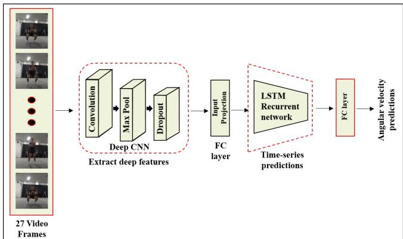

基于视觉系统的下肢运动学预测深度学习方法

Konki Sravan Kumar1，Ankhzaya Jamsrandorj2，Jinwook Kim1，Kyung-Ryoul Mun1

摘要—日常生活锻炼中的关节角速度是损伤风险指数、康复进程监测以及运动员表现评估的重要临床指标。近年来，可穿戴传感器已被广泛应用于监测下肢运动学。然而，这些传感器在日常生活中使用困难且不便。为了缓解这些局限性，本研究提出了一种基于视觉的系统，采用深度卷积神经网络结合双向长短期记忆网络和门控循环单元网络来估计下肢关节运动学。在光学运动捕捉系统获得的真值与所提模型估计的关节角速度之间，计算了归一化相关系数和平均绝对误差。估计结果显示，深蹲动作的最高相关系数为 0.93，跑步机上行走动作的最高相关系数为 0.92。此外，对髋、膝、踝三个关节角速度分别建立了独立模型并进行了分析与比较。在三个关节角速度中，膝关节的估计精度最佳（深蹲为 0.96，跑步机上行走为 0.96）。所提模型在侧视和正视两种视角下，无论相机位置和角度如何，均表现出较高的估计精度。本研究证明了使用无传感器的基于视觉的系统监测家庭锻炼中下肢运动学的可行性，可用于医疗保健和康复领域。

## I. 引言（INTRODUCTION）

人类步态是肢体运动的模式，步态参数可以反映人体的功能能力和健康状态 [1]。在若干步态参数中，下肢关节角速度是日常生活运动中的重要临床指标，可用于评估损伤风险指数、确定患者康复进展、诊断早期人体关节运动障碍以及提升运动员表现 [2, 3]。此外，最近的研究 [4, 5] 指出，关节角速度是监测下肢关节功率变化的有力候选指标，因为关节功率是关节角速度与关节运动的乘积，而关节功率是步态病理临床诊断和下肢假肢控制的重要参数 [6, 7]。基于惯性传感器的系统常被用于采集下肢运动学数据。基于惯性测量单元（Inertial Measurement Unit, IMU）传感器的系统被设计用于在人体肢体动态运动过程中测量膝关节角度 [8]。基于 IMU 传感器的三维运动捕捉系统由加速度计、地磁传感器和陀螺仪组成，是在日常生活动作中记录下肢关节（膝、髋和脊柱）运动的有效测量工具 [9]。在过去几年中，基于 IMU 传感器的系统引起了研究者的关注，并在关节运动学测量中展现出显著的精度 [10, 11]。然而，一个 IMU 传感器无法用于跟踪多于一个身体节段的动作。因此，仅为了追踪下肢动作（例如骨盆、踝、膝和髋，左右两侧），通常就需要七个 IMU 传感器。随着佩戴的 IMU 传感器数量增加，会产生若干缺点，包括复杂的预处理流程（传感器到节段的标定与受试者标定）、日常生活使用的不便，以及在监测精确下肢运动学时必须考虑的人体运动链问题 [12]。此外，使用 IMU 传感器等运动追踪系统时，由于需要用束带紧密固定传感器，会妨碍受试者的自然动作，而且此类系统仍然存在成本高、功耗大、设备操作复杂、需要受试者配合以及依赖受控实验室环境和放置标记等劳动密集型问题。为了克服可穿戴传感器式捕捉系统在监测人体下肢运动方面的局限性，研究者开发了基于摄像头的系统。深度学习框架的兴起和摄像头技术的发展，为从视频帧信息预测下肢角速度提供了新的契机。最近的研究 [13, 14] 提出了使用 OpenPose 库的基于摄像头的系统，该系统能够以较好的精度记录下肢关节角度。然而，基于 OpenPose 库的估计精度依赖于真值（ground truth）二维关键点数据集；这些关键点由人工标注，且并未标注在关节中心位置。因此，基于 OpenPose 的系统在估计下肢角速度时可能不够可靠

ty。此外，这些方法仅在侧视图中开发用于监测参与者的关节角度，无法跟踪受试者在前视图和后视图中的关节角度。在我们之前的研究中，已经提出了深度卷积神经网络（deep convolution neural network，CNN）架构来测量髋关节、膝关节和踝关节的下肢角速度，该方法在不同摄像机视角下具有良好的估计精度[15]。然而，这些预训练的深度CNN框架在估计结果中由于时间延迟仍表现出较高的误差。

在本研究中，我们提出了一种基于视觉的下肢关节运动学估计系统，该系统采用带有双向长短期记忆（long-short term memory，LSTM）/门控循环单元（gated recurrent unit，GRU）递归网络的深度卷积神经网络（DeepConvLSTM/DeepConvGRU）。该方法基于RGB摄像系统，可在深蹲（squat）和跑步机上行走（walking on treadmill）动作中检测髋关节、膝关节和踝关节（左右两侧）的角速度。对DeepConvGRU模型的估计性能进行了量化，并与运动捕捉系统所捕获的关节角速度真值（ground truth）进行了比较。

## II. 方法（METHODS）

## A. 实验设备与方案（Experimental Equipment and Protocol）

为构建视频数据集，招募了33名健康成年人（男性25名，女性8名）作为参与者。实验在安装有光学运动捕捉系统和Xiaomi Mijia Camera 4K数码摄像系统的实验室内进行。图1展示了我们在实验中为获取视频数据集所采用的摄像机布置。作为记录人体关节角度的金标准，使用了由六台摄像机构成的光学运动捕捉系统，其分辨率为1280×1024（约130万像素），采样频率为120Hz。根据Plug-in-gait标记集，将15个反光标记附着于人体下肢部位，包括骨盆、髋部、膝部、大腿、小腿、脚趾、踝部和足跟。光学运动捕捉系统跟踪附着在人体上的反光标记，并计算所有关节的精确三维角度和三维位置。关节角速度通过关节角度的微分计算得出。地面上的捕捉区域为2.000米×3.685米。使用了六台数码摄像机构成的摄像系统，其分辨率为1920×1080，帧率为60Hz。六台摄像机分别放置在参与者的前方、后方和侧面，以在30秒内捕捉深蹲和跑步机上行走动作的视频。我们设计了一个数字电路以同步光学运动捕捉摄像系统和数码摄像系统。光学运动捕捉摄像系统的采样率为每秒120帧（为数码摄像机帧率的两倍）。因此，将标注数据从120Hz下采样至60Hz。

  
图 1：实验设置。光学运动捕捉系统追踪标记，记录关节的角速度，数字摄像机在深蹲和跑步机上行走动作过程中采集参与者的视频信息。

B. 用于估计下肢关节角速度的深度学习框架

我们提出了一种基于 CNN 与 LSTM 神经网络的深度学习模型（DeepConvLSTM），用于估计下肢关节（如左右两侧的髋关节、膝关节和踝关节）的角速度。其中卷积神经网络用于从动作视频中提取特征（空间域），而循环神经网络用于提供时间序列预测（时间域）。作为一种监督学习方式，DeepConvLSTM 架构学习以 RGB 图像信息作为输入、关节角速度作为输出之间的时间依赖关系。首先，采用基于深度学习的特征选择技术（YOLO4）来检测人体并去除动作视频中的非信息背景 [16]。然后，根据所得的人体边界框对视频帧进行裁剪，并将其调整为 448 × 448 的尺寸。接下来，将 27 帧视频信息作为所提出的 DeepConvLSTM 网络的输入。然后，网络被训练以输出对应的六个关节角速度。在本工作中，我们采用卷积神经网络（ResNet18）结合 Bi-LSTM/GRU 来预测关节角速度的估计。在每个时间步，从 CNN 层提取的空间特征被连接到 LSTM/GRU 网络。最后，全连接（FC）层在每个时间步输出六个关节角速度的预测值（左/右髋关节屈曲/伸展、膝关节屈曲/伸展以及踝关节背屈/跖屈），如图 2 所示。

  
图 2：DeepConvLSTM 架构。深度 CNN 从动作视频中提取特征（空间域），LSTM 用于提供时间序列（时间域）的关节角速度预测。

## C. DeepConvLSTM 模型实现

DeepConvLSTM 使用 Python 中的 PyTorch 库实现。模型采用自适应矩估计（Adam）进行优化，以平均绝对误差（MAE）作为损失函数，在配备 GTX 2080Ti 显卡的计算机上利用 CUDA 10.2 库进行训练，运行平台为 Ubuntu 18.04.5 LTS。训练网络的学习率选定为 0.0001。批量大小（batch size）设为 8，模型使用包含 27 张图像及其对应关节角速度的序列进行训练，共训练 20 个 epoch（迭代轮次）。为了训练所提出的模型，使用了七名参与者在深蹲和跑步机上行走过程中的动作视频作为训练集，三名参与者的动作视频作为验证集，另外三名参与者的动作视频作为测试集。

## III. 实验结果

本节展示了所提出的 DeepConvLSTM/DeepConvGRU 网络在下蹲和跑步机行走动作中预测下肢关节角速度的结果。由光学运动捕捉系统获得的角速度与 DeepConvLSTM 和 DeepConvGRU 网络估计的角速度之间的差异，通过归一化相关系数（normalized correlation coefficients, r）和平均绝对误差（mean absolute error, MAE）进行评估。

为了说明所提出模型的估计性能，图 3 展示了在下蹲动作中下肢关节的估计角速度与真实角速度。

与真实角速度相比，使用 DeepConvGRU 估计的角速度优于使用 ResNet18 和 DeepConvLSTM 估计的角速度。

跑步机行走期间的预测角速度如图 4 所示。

GRU、Bi-LSTM 和 ResNet18 网络在下蹲和跑步机行走期间所有三个关节的 r 平均值详见表 I。

在所有三个模型中，GRU 网络的 r 平均值显示出强相关性（下蹲期间为 0.93，跑步机行走期间为 0.92）。

三种模型在下蹲动作期间对髋、膝和踝关节逐关节角速度预测的平均 r 和 MAE 详见表 II。

在髋、膝和踝关节中，使用 GRU 模型估计的膝关节角速度在平均 r 上表现出更好的准确性。

在下蹲动作的所有关节估计中，GRU 网络的 MAE 误差小于 Bi-LSTM 和 ResNet18 网络。

  
图 3：参与者在下蹲动作期间髋、膝和踝关节估计角速度的示例。比较由光学运动捕捉系统捕获的真实值（红线）与由 ResNet18（黑线）、GRU（橙线）和 Bi-LSTM（青色线）估计的关节角速度。

  
图 4：该图展示了参与者在跑步机行走动作期间髋、膝和踝关节的估计角速度。比较由光学运动捕捉系统捕获的真实值（红线）与由 ResNet18（黑线）、GRU（橙线）和 Bi-LSTM（青色线）估计的关节角速度。

表 I：使用所提出模型在下蹲和跑步机行走动作中预测关节角速度的平均 r。

<table><tr><td>Model</td><td>Squat</td><td>Walking on treadmill</td></tr>
<tr><td>ResNet18</td><td>0.87</td><td>0.90</td></tr>
<tr><td>Bi-LSTM</td><td>0.92</td><td>0.91</td></tr>
<tr><td>GRU</td><td>0.93</td><td>0.92</td></tr></table>

表 II：使用 GRU、Bi-LSTM 和 ResNet18 模型在下蹲动作期间髋、膝和踝关节角速度的平均 r（MAE）。

<table><tr><td>模型</td><td>髋关节</td><td>膝关节</td><td>踝关节</td></tr></tr><tr><td>ResNet18</td><td>0.87(44.18)</td><td>0.94(30.92)</td><td>0.90(6.09)</td></tr><tr><td>Bi-LSTM</td><td>0.91(18.48)</td><td>0.96(21.56)</td><td>0.89(6.23)</td></tr><tr><td>GRU</td><td>0.94(15.13)</td><td>0.96(18.09)</td><td>0.92(5.83)</td></tr></tr>

TABLE III: 在跑步机行走动作中，使用 GRU、Bi-LSTM 和 ResNet18 模型得到的髋关节、膝关节和踝关节角速度的平均 r (MAE)。

<table><tr><td>模型</td><td>髋关节</td><td>膝关节</td><td>踝关节</td></tr></tr><tr><td>ResNet18</td><td>0.80(27.20)</td><td>0.94(37.48)</td><td>0.84(6.05)</td></tr><tr><td>Bi-LSTM</td><td>0.89(21.05)</td><td>0.95(24.80)</td><td>0.85(5.70)</td></tr><tr><td>GRU</td><td>0.91(15.97)</td><td>0.96(20.47)</td><td>0.89(4.15)</td></tr></tr>

TABLE IV: 在侧面和正面相机视角下，三名参与者角速度的平均 r。

<table><tr><td>受试者</td><td>侧面视角</td><td>正面视角</td></tr></tr><tr><td>S18</td><td>0.92</td><td>0.92</td></tr><tr><td>S30</td><td>0.91</td><td>0.87</td></tr><tr><td>S31</td><td>0.93</td><td>0.92</td></tr><tr><td>平均值</td><td>0.92</td><td>0.89</td></tr>

表 III 展示了在跑步机行走动作期间，髋关节、膝关节和踝关节角速度的平均 r 和 MAE。在深蹲和跑步机行走动作中，GRU 网络的平均 MAE 低于 Bi-LSTM 和 ResNet18 网络。表 IV 展示了在侧面和正面相机视角下，三名参与者角速度的平均 r。侧面和正面视角下的平均 r 分别为 0.92 和 0.89。结果表明，无论相机位置和角度如何，所提出的模型在两种视角下均具有更高的估计精度。

## IV. 讨论

本研究提出了一种基于视觉的系统，采用 Deep-ConvLSTM / DeepConvGRU 网络，用于在深蹲和跑步机上行走动作中估计下肢关节角速度。我们开展了实验研究，使用光学运动捕捉系统记录角速度，并使用小米米家相机 4K（Xiaomi Mijia Camera 4K）数字相机系统拍摄动作视频。所提出的架构以动作视频信息作为输入、对应的关节角速度作为输出进行训练。为训练所提模型，使用了七名参与者在深蹲和跑步机上行走时的动作视频用于训练，三名参与者的动作视频用于验证，另三名参与者的动作视频用于测试。采用相关系数 r 和平均绝对误差 MAE 对光学运动捕捉系统获得的角速度与 DeepConvLSTM 和 DeepConvGRU 网络估计的角速度之间的差异进行评估。r 用于度量估计角速度与真实角速度（ground truth）之间的相关性。利用 DeepConvLSTM / DeepConvGRU 网络预测的关节角速度与光学运动捕捉系统在深蹲和跑步机上行走动作中获得的角速度之间呈现出相当好的一致性。

如表 I 所示，DeepConvGRU 模型在三种深度学习架构中提供了最高的精度，在深蹲动作中为 0.93，在跑步机上行走动作中为 0.92。在深蹲和跑步机上行走动作中，分别评估了独立的 DeepConvLSTM / DeepConvGRU 模型对髋关节、膝关节和踝关节角速度的估计性能。DeepConvGRU 网络在两种动作中均提供了更高的 r。在三个关节角速度中，估计的膝关节精度最高（深蹲中为 0.96，跑步机上行走中为 0.96），高于估计的髋关节和踝关节角速度。在矢状面内，膝关节运动在不同参与者之间更为稳定，而踝关节具有更高的自由度；髋关节估计精度可能受到参与者身体测量差异以及髋关节标记点波动所引起的运动伪影的影响。表 IV 给出了三名参与者在侧视和前视相机视角下角速度的平均 r。侧视和前视两种视角下的平均 r 均超过 0.90，表明无论相机位置和角度如何，DeepConvGRU 网络在两种相机视角下均能提供相对较高的预测精度。表（此处原文缺失表号）给出了深蹲和跑步机上行走动作中髋关节、膝关节和踝关节角速度的平均 MAE。GRU 网络的平均 MAE 比（原文此处中断）

BI-LSTM 和 ResNet18 网络在深蹲和跑步机上行走时的表现如表 II 和表 III 所示。然而，所提模型仍然表现出较高的 MAE 误差，这是因为动捕系统采集的真实角速度不够精确，并且由于人体上标记点位置不精确以及受试者身体测量值的差异，可能产生偏移值误差。所提的 DeepConvGRU 模型显示出 15 到 20 rad/s 之间的角速度误差。尽管如此，通过应用序列网络在一定程度上克服了 MAE 误差较大的局限。

在未来的工作中，应当在更大的参与者群体、不同的年龄组、不同速度下更多的日常动作以及患有步态病理的患者中进行实验。所提的 DeepConvGRU 模型将扩展为使用 Transformer 和多头注意力（multi-head attention）网络，以实现更高精度的角速度估计。必须使用其他精确的动捕系统来确认真实标注。本研究还将扩展用于估计其他步态参数（步频、速度、步幅和步宽）。

## V. 结论

本文提出了一种基于视觉的下肢关节角速度估计系统，用于在深蹲和跑步机上行走动作中，采用 Bi-LSTM 和 GRU 循环神经网络。所提架构以动作视频信息作为输入，对应的关节角速度作为输出进行训练。使用 DeepConvGRU 网络估计的关节角速度与使用动捕系统测量的关节角速度高度相关，并在不同相机视角下提供更高的精度。这些估计结果证明了无需可穿戴传感器即可使用视频信息监测关节角速度的潜力。然而，由于动捕系统采集的真实角速度不够精确，所提模型仍显示出 15 到 20 rad/s 的角速度误差。为了实现更高精度的角速度估计，本研究将扩展为使用 Transformer 和多头注意力网络。所提的基于视觉的方法也可用于估计其他步态参数（步频、速度、步幅和步宽）。

## 致谢

本研究得到了韩国科学技术研究院机构项目（项目编号：2E31051）以及由韩国政府（科学技术信息通信部、产业通商资源部、保健福祉部、食品医药品安全部）资助的韩国医疗器械发展基金资助项目（项目编号：1711139131）的支持。

## 参考文献

[1] P. Messier, C. Legault, C. Schoenlank, J. Newman, D. Martin, and P. Devita, “Risk factors and mechanisms of knee injury in runners,” *Medicine Science in Sports Exercise*, 卷 40, 期 11, 页 1873–1879, 2008 年 11 月. （《跑步者膝关节损伤的危险因素与机制》）

[2] R. Ibrahim, I. Kingma, V. de Boode, G. S. Faber, and J. H. van Dieen, "守门员扑救动作中踝、膝、髋关节的角速度、力矩和功率分析," Frontiers in Sports and Active Living, vol. 2, Feb 2020.

[3] J. Dicharry, "步态的运动学与动力学：从实验室到临床," Clinics in Sports Medicine, vol. 29, no. 3, pp. 347–364, Jul 2010.

[4] M. G. Browne and J. R. Franz, "踝关节功率生物反馈可减弱老年人远端到近端的功率重分配," Gait Posture, vol. 71, pp. 44–49, Jun 2019.

[5] N. L. Pieper, M. D. Lewek, and J. R. Franz, "小腿加速度能否为步行中单侧肢体推进提供临床上可行的替代指标," Journal of Biomechanics, vol. 98, p. 109449, Jan 2020.

[6] Jiang, Gholami, Khoshnam, Eng, and Menon, "基于两个惯性传感器的步行踝关节功率估计," Sensors, vol. 19, no. 12, p. 2796, Jan 2019.

[7] J. F. Hafer and R. F. Zernicke, "推进关节功率与传感器导出的角速度一致：无实验室步态再训练的一种潜在工具," Journal of Biomechanics, vol. 106, p. 109821, Jun 2020.

[8] M. Ajdaroski, R. Tadakala, L. Nichols, and A. Esquivel, "用于动态运动膝关节角度测量装置的验证," Sensors, vol. 20, no. 6, p. 1747, Mar 2020.

[9] I. Tak, W. Wiertz, M. Barendrecht, and R. Langhout, "用于单腿下蹲过程中膝、髋和脊柱关节角度评估的新型三维运动分析工具的有效性," Sensors, vol. 20, no. 16, p. 4539, Aug 2020.

[10] V. Hernandez, D. Dadkhah, V. Babakeshizadeh, and D. Kulic, "基于可穿戴传感器的步行与跑步下肢运动学估计：一种深度学习方法," Gait Posture, vol. 83, Jan 2021.

[11] J. S. et al, "基于低频单 IMU 与 LSTM 循环神经网络的地面步行下肢多关节角度预测," Sensors, vol. 22, no. 1, p. 53, Dec 2021.

[12] Lim, Kim, and Park, "基于下背部单 IMU 利用机器学习预测步行过程中下肢动力学与运动学," Sensors, vol. 20, no. 1, p. 130, Dec 2019.

[13] A. Schmitz, M. Ye, R. Shapiro, R. Yang, and B. Noehren, "采用单摄像头无标记运动捕捉系统测量关节角度的准确性与可重复性," Journal of Biomechanics, vol. 47, no. 2, pp. 587–591, Nov 2014.

[14] E. D'Antonio, J. Taborri, E. Palermo, S. Rossi, and F. Patane, "基于 OpenPose 库的无标记步态分析系统," 发表于：2020 年 IEEE 国际仪器与测量技术大会（I2MTC），2020 年，第 1–6 页。

[15] K. S. Kumar, A. Jamsarndorj, D. Jung, D. Lee, J. Kim, and K. R. Mun, "深蹲与跑步机行走动作中基于视觉的人体关节角速度估计," 发表于：2021 年第 43 届 IEEE 医学与生物工程学会年会（EMBC），2021 年，第 2186–2190 页。

[16] A. Bochkovskiy、C. Wang 和 H. Liao，"YOLOv4：目标检测的最优速度与精度，" ArXiv，卷 abs/2004.10934，2020。