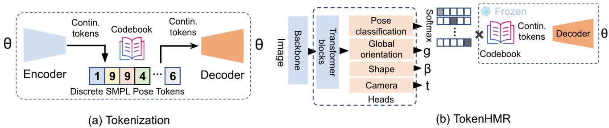
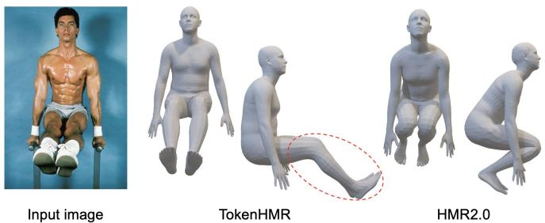
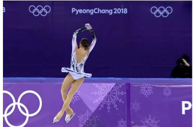

# TokenHMR：利用分词化姿态表示推进人体网格恢复

Sai Kumar Dwivedi1,\* Yu Sun2,∗ Priyanka Patel1 Yao Feng1,2,3 Michael J. Black1 1Max Planck Institute for Intelligent Systems, Tübingen, Germany（德国图宾根 马克斯·普朗克智能系统研究所） 2Meshcapade 3ETH Zurich（苏黎世联邦理工学院）

  
图 1. 现有从图像回归三维人体姿态与形状（HPS）的方法（例如 HMR2.0 [12]）所估计的人体要么与图像对齐，要么具有准确的三维姿态，但不能两者兼得。我们表明，对现有方法而言，这是一个根本性的权衡。为了解决这一问题，我们的方法 TokenHMR 提出了一种新颖的损失函数——阈值自适应损失缩放（Threshold-Adaptive Loss Scaling, TALS），以及一种基于离散令牌的三维姿态表示。借助这些设计，TokenHMR 在多个真实场景下的三维基准测试上达到了最先进的精度。

## 摘要

我们研究从单张图像回归三维人体姿态与形状的问题，重点关注三维精度。当前最先进的方法利用了大规模的三维伪真值（pseudo-ground-truth, p-GT）和二维关键点数据集，从而取得了稳健的性能。然而，我们观察到在使用这些方法时出现了一个看似矛盾的现象：随着二维精度的提高，三维姿态精度反而下降。这种现象源于伪真值数据中的偏差以及所使用的近似相机投影模型。我们量化了当前相机模型所引入的误差，并表明精确拟合二维关键点和伪真值会导致错误的三维姿态。我们的分析定义了二维损失和伪真值损失产生不利影响的无效距离区间。基于此，我们提出了一种新的损失函数——"阈值自适应损失缩放"（Threshold-Adaptive Loss Scaling, TALS），该函数对较大的二维和伪真值误差进行惩罚，而对较小的误差则不施加惩罚。然而，采用这样的损失函数后，可能存在许多能同等程度地解释二维证据的三维姿态。为了减少这种歧义性，我们需要一个关于有效人体姿态的先验，但此类先验可能会引入不必要的偏差。为了解决这一问题，我们利用人体姿态的分词化（tokenized）表示，并将该问题重新表述为令牌预测问题。这将估计的姿态限制在有效姿态的空间内，从而有效地提升了对遮挡的鲁棒性。在 EMDB 和 3DPW 数据集上的大量实验表明，我们重新构建的损失函数和分词化方法使我们能够在真实场景数据上进行训练，同时在精度上超越当前最先进的三维方法。我们的模型和代码已在 https://tokenhmr.is.tue.mpg.de 上开放，可供研究使用。

## 1. 引言

我们研究从单张图像回归三维人体姿态与形状（Human Pose and Shape, HPS）的问题。近期的方法 [3, 12, 32, 49] 在该任务上越来越精确。

所谓准确，我们指的是两件事。一种方法应当能正确地回归 3D 姿态，但也应当与图像证据相吻合。遗憾的是，现有模型无法同时满足这两点。我们观察到一个看似矛盾的现象：一种方法在拟合 2D 关键点方面越准确，其 3D 姿态预测反而越不准确。我们研究了这一问题，并确定常用的弱透视相机假设（weak-perspective camera assumption）是主要的罪魁祸首。该相机模型与采集图像时所用的真实相机并不匹配，因此投影出的 3D 关键点与检测到的 2D 关键点之间存在不一致。由于目前还没有从单张图像中可靠估计相机参数的方法，我们研究并量化了这一效应，并提出了两种解决方案。

具体而言，我们使用了合成数据集 BEDLAM [3]，该数据集具有完美的 3D 与 2D 真值（groundtruth，GT）。我们使用文献 [12] 中的相机模型将 3D 数据投影到 2D，以量化在最理想情况下的 2D 误差——结果该误差很大。随后我们又反过来证明：很小的 2D 误差也可能导致很大的 3D 误差。即便使用诸如文献 [32] 那样的完整透视模型也无法解决问题，因为我们缺乏精确的相机内外参数。

这一分析凸显了用 2D 关键点损失来监督 3D 姿态回归的问题。然而，这样的损失使我们能够利用大规模数据集，从而带来泛化性与鲁棒性。遗憾的是，伪真值（pseudo ground-truth，p-GT）训练数据也存在同样的问题，因为它是借助近似相机模型，通过优化将 3D 人体拟合到 2D 数据上而生成的。那么，如何在缓解 3D 精度下降的同时，利用大规模、野外（in-the-wild）数据中丰富的信息呢？我们对此的回答是 TokenHMR——一种新的 HPS 回归方法，它在有效利用 2D 关键点与保持 3D 姿态准确性之间取得平衡，从而能够在没有已知相机参数的当下利用互联网数据。

TokenHMR 包含两个主要组件。第一个组件基于我们的关键洞见：来自 2D 关键点的监督虽然有缺陷，但对于防止出现严重错误的预测却很有价值。然而，过度依赖 2D 线索会引入偏差。为解决这一问题，我们定义了一种新的损失，称为阈值自适应损失缩放（Threshold-Adaptive Loss Scaling，TALS）。它对较大的 2D 误差和 p-GT 误差施加显著惩罚，而对较小的误差仅施加轻微惩罚。我们利用对 BEDLAM 的分析来定义此损失，从而避免网络在拟合 2D 关键点时超出相机模型所能合理支持的精度。

然而，这带来一个新的问题。从二维关键点预测三维姿态在根本上是模糊的。当放宽关键点匹配约束时，便会有更多三维姿态与二维数据相一致。为了控制这一点，我们需要引入一个先验，使网络偏向于有效姿态。不幸的是，现有的基于高斯混合 [4] 或 VAE [42] 的姿态先验偏向于训练数据中频繁出现的姿态。相反，我们寻求一种无偏先验，它仅限制网络输出有效姿态，而不偏向任何特定姿态。

这引导我们进入 TokenHMR 的第二个关键组件，也是其名称的由来。具体而言，我们通过将人体姿态离散化，把连续姿态回归问题转化为令牌（token）预测问题。我们使用向量量化 VAE（VQ-VAE）[53] 在大规模运动捕捉数据集（如 AMASS [37] 和 MOYO [52]）上进行预训练，从而将连续人体姿态离散化。这种离散化表示为回归器提供了一个有效姿态的"词汇表"，有效地将姿态先验表示为一个码本（即知识库）。由于 VQ-VAE 被设计用于表示均匀先验，我们认为这可以减少先前姿态先验所带来的偏差。

TokenHMR 通过分类生成离散令牌，而非回归连续姿态。当我们采用一个当前最优（SOTA）的 HPS 方法并将其中的连续姿态替换为我们基于令牌的姿态方法时，在三维精度上得到了一致的提升（其他条件保持不变）。

我们进行了大量实验来评估不同的姿态离散化方式及其对精度的影响。任何姿态离散化都会带来一定的精度损失。在我们的情况下，这会导致约 2.5 毫米的三维精度损失，约为当前最优 HPS 回归器在真实数据上精度的二十分之一；也就是说，由离散化引起的精度损失可以忽略不计。

最后，我们将两个组件结合在一起，发现它们具有协同效应。我们的新损失函数不会使三维姿态发生畸变以过度拟合关键点或 p-GT，而离散化也防止了网络为了追求二维精度而扭曲三维姿态。通过这种组合，我们在三维精度上达到了新的当前最优水平。我们在 EMDB [23] 和 3DPW [55]（这两者均具有精确的三维真值）上对 TokenHMR 和其他近期方法进行了广泛评估。在使用相同数据和骨干网络的情况下，TokenHMR 在具有挑战性的 EMDB 数据集上与 HMR2.0 [12] 相比，三维误差减少了 7.6%。定性结果表明，TokenHMR 对模糊的图像证据具有鲁棒性，估计的姿态不会出现使用 p-GT 和二维关键点的方法所具有的"膝盖弯曲"偏差（见图 1）。

综上，我们做出以下关键贡献：(1) 3D 精度退化分析：我们分析并量化了当前人体姿态与形状估计（Human Pose and Shape, HPS）方法在使用 2D 损失时在 3D 与 2D 精度之间所面临的权衡。(2) 阈值自适应损失缩放（Threshold-Adaptive Loss Scaling）：为缓解该问题，我们提出了一种新颖的损失函数，能够削弱小于因相机模型错误所导致的预期误差的 2D 与伪真实标注（pseudo Ground Truth, p-GT）误差的影响。(3) 基于 Token 的姿态表征（Token-Based Pose Representation）：我们引入了一种基于 token 的人体姿态表征方式，并证明其能产出更精确的姿态估计结果。我们的模型与代码已开源供研究使用。

## 2. 相关工作

## 2.1. HPS 回归

从单张图像估计 3D 人体姿态与形状已得到深入研究，从早期基于优化的方法到最新的基于 Transformer 的回归器均有涵盖。优化方法将参数化模型 [36, 42, 59] 拟合到 2D 图像线索上，包括但不限于关键点 [4, 42, 59]、剪影（silhouettes）[41] 与部位分割 [30]。部分学习方法直接从图像 [6, 8, 9, 21, 25, 32, 48, 49, 61] 与视频 [22, 24] 中估计参数化人体模型，另一些则以无模型（model-free）方式估计人体，或以顶点 [28, 34, 46] 形式，或以隐式形状 [39, 45, 58] 形式。近期方法 [12, 33] 使用 Transformer 估计 3D 人体，取得了当前最优精度。为应对泛化方面的挑战，EFT [20]、NeuralAnnot [40]、HMR2.0 [12] 与 CLIFF [32] 等近期方法在训练损失中引入 2D 关键点与 p-GT，以使投影人体与图像之间产生良好对齐。HuManiFlow [47] 与 POCO [9] 等方法对人体姿态与形状估计（HPS）进行概率建模，以显式处理姿态歧义性。在追求更优 2D 对齐过程中出现的 3D 精度退化问题此前虽被提及，但并未在我们的工作之前得到广泛量化。我们的统计分析揭示了现有人体网格恢复（Human Mesh Recovery, HMR）方法中存在的这一偏差，为该问题的训练策略提供了全新视角。

一些方法 [26, 32, 56] 通过从单张图像估计相机来应对 3D 到 2D 的投影误差。SPEC [26] 使用网络预测相机参数但泛化能力欠佳，而 CLIFF [32] 则通过向网络提供图像中人物的边界框坐标信息来做近似。从单张图像估计相机是高度不适定的（ill-posed），因此这仍是一个具有挑战性、尚未解决的问题。我们的方法减弱了使用错误相机模型带来的影响，并可应用于任何 HPS 回归方法。

## 2.2. 姿态先验

人体姿态先验在诸多应用中扮演着关键角色，例如将二维姿态提升到三维 [4, 42] 以及从图像/视频中估计人体姿态 [20, 29]。早期的姿态先验侧重于学习关节限位 [1]，以避免出现不可能的姿态。高斯混合模型（Gaussian Mixture Models, GMMs）[4] 和生成对抗网络（Generative Adversarial Networks, GANs）[11, 21] 也被用于在训练过程中施加先验知识。一些近期方法使用变分自编码器（VAEs）[42] 和归一化流（normalizing flows）[29] 作为先验。这些方法中有许多对常见姿态存在偏倚，并且这种偏倚会传递给回归器。诸如 Pose-NDF [51] 之类的方法学习一个合理姿态的流形，该流形表示为神经隐式函数的零水平集。将无效姿态映射到有效姿态涉及梯度下降，这在集成到人体姿态估计（Human Pose Estimation, HPS）训练中时是一项开销很大的操作。与先前工作相比，我们对有效的 SMPL 姿态学习一种基于离散令牌的先验，从而降低姿态偏倚并提升对遮挡的鲁棒性，同时易于集成到 HPS 训练中。

  
图 2. 相机/姿态偏倚问题的可视化。（a）由于缺乏正确的焦距，诸如 HMR2.0 之类的方法会将透视缩短的腿估计为弯曲的。（b）将预测的身体姿态替换为真值，揭示了相机偏倚；（c）在保持二维对齐的情况下，三维姿态究竟可能错到什么程度？详见第 3 节。

我们使用 VQ-VAE [53]（VAE 的一种变体），通过在一个称为"令牌化（Tokenization）"的过程中对三维训练姿态进行量化来学习一种离散先验，从而创建一个知识库（即码本）。令牌化在诸多应用中被广泛使用，例如图像合成 [44, 53]、文本到图像生成 [43]、二维人体姿态估计 [10] 以及运动先验学习 [18, 62]。在人体姿态估计的语境下，令牌化仍然相对未被充分探索，尽管它在人体运动生成 [14, 62] 中被广泛使用。当然，图像和语言的令牌化表示已被广泛用于许多视觉和语言问题。我们的方法具有创新性，它将回归问题重新表述为姿态令牌分类问题，从而利用令牌化来表示有效姿态，有效地提供了一种姿态先验。

## 3. 相机/姿态偏倚（Camer

估计三维人体姿态与形状（3D Human Pose and Shape, HPS）的方法通常试图同时满足两个目标：精确的三维姿态以及与二维图像特征的对齐。然而，我们在所有实验中都观察到一个趋势——方法在二维误差上表现越好，在三维上的表现就越差，反之亦然。其根本原因在于，包括本文测试的在内的现有方法都不估计相机内参（如焦距）或相机外参（旋转和平移）。相反，现有方法使用缩放正交投影或采用固定且不正确的相机参数的透视投影，在相机坐标系下估计人体。这导致真实三维关节点与它们二维投影之间的不匹配。具体而言，由于照片通常大致从与眼睛同高的高度拍摄，腿部比上半身距离相机更远，这会使腿部产生透视收缩（foreshortening）。训练模型最小化二维误差会迫使它们生成错误的三维姿态；如图 2（a）所示。对于二维姿态数据集，伪真值（pseudo ground truth, p-GT）是通过在存在问题的相机参数下最小化二维误差获得的。完全信任这样的 p-GT 并追求对这些标注的精确学习会使问题更加突出。请注意，透视收缩使腿在图像中看起来更短。要使人体模型适配这种情况，唯一的方法是在膝盖处弯曲腿部或在三维中倾斜身体，使腿部更靠后。这会产生不自然或不稳定的姿态。

这是所有现有方法的一个根本性问题，除非知道相机参数，否则不可能同时在三维和二维上获得低误差。为了以数值方式评估这种不匹配的影响，我们采用 BEDLAM [3]，一个合成数据集，其中三维和二维数据与相机参数都精确已知。这消除了任何可能的噪声，并使我们能够观察到使用错误相机对二维投影误差的影响。具体而言，如图 2（b）所示，我们使用 HMR2.0 [12] 的相机将 BEDLAM 中的真值人体投影到图像中。

我们使用标准度量关键点正确百分比（Percentage of Correct Keypoints, PCK）来评估错误相机在二维上的影响，我们对 BEDLAM 验证集的一个序列计算该指标。HMR2.0b 计算出的三维人体在 PCK0.5 和 PCK1.0 上的得分分别为 0.78 和 0.88。相比之下，当我们将 HMR2.0b 的相机与真值三维人体一起使用时，PCK0.5 和 PCK1.0 的得分分别下降到 0.66 和 0.86。在理想情况下，使用正确的相机模型时，PCK0.5 和 PCK1.0 都应达到 1.0。HMR2.0b 的误差低于真值这一事实表明，由于相机偏差，其输出偏离了真实的三维姿态与形状。这表明，像 HMR2.0b 这样的方法虽然获得了较高的 PCK 值，但这是以三维精度为代价的。总之，除非拥有正确的相机模型，否则追求高 PCK 值会损害三维精度。

我们进一步设计实验，探索在保持良好 2D 对齐的同时，3D 误差能够达到多大程度。我们修改 SMPLify [4] 的损失函数，使预测的 2D 关键点与真实 2D 关键点 $\scriptstyle J _ { 2 D _ { g } }$ 之间的距离保持较小，同时新增一项损失以增大预测 3D 关键点 $J _ { 3 D }$ 与真实 3D 关键点 $\ J _ { 3 D _ { g } }$ 之间的距离，如以下公式所示：

$$
w _ { 2 D } | | \Pi ( J _ { 3 D } , { \cal T } ) - J _ { 2 D _ { g } } | | _ { 2 } - w _ { 3 D } | | J _ { 3 D } - J _ { 3 D _ { g } } | | _ { 2 } + m\tag{1}
$$

其中 Π 表示使用 HMR2.0 相机的 3D 到 2D 投影，$m \ = \ 2 0$ 为间隔（margin）值，$w _ { 2 D } ~ = ~ 4$ 与 $w _ { 3 D } ~ = ~ 4 0 . 5$ 为标量权重。经过 100 次优化迭代后，平均关节点位置误差（Mean Per Joint Position Error, MPJPE）达到 146 毫米。如图 2 (c) 所示，即使深度方向存在显著误差，投影后的 3D 姿态仍能保持较高程度的 2D 对齐。当优化 200 次迭代时，MPJPE 超过 300 毫米，并且随着进一步优化，误差继续增大。

由于该领域目前尚无可靠的方法能够从单张图像估计相机参数，下面我们将探索我们的新方法（阈值自适应损失缩放（TALS）与词元化（tokenization））是否有助于缓解近似相机模型所带来的问题。图 2 (a) 比较了 HMR2.0 与 TokenHMR 的结果。请注意，在 TokenHMR 中，透视缩短（foreshortening）对姿态的影响较小。

## 4. TokenHMR

## 4.1. 预备知识

我们的方法 TokenHMR 接收输入图像 $I$，并输出身体姿态 $\theta$、形状 $\beta$ 以及透视相机 $T$。我们使用 SMPL [36]，一个可微的参数化人体模型。其输入参数包括姿态，记为 $\theta \in \mathbb { R } ^ { 7 2 }$，以及形状，记为 $\beta \in \mathbb { R } ^ { 1 0 }$ 。作为输出，它生成人体网格 $M$ 与顶点 $V \in \mathbb { R } ^ { N X \bar { 3 } }$ ，其中 $N = 6 8 9 0$ 为顶点数。记为 $J _ { 3 D }$ 的 3D 关节点通过使用预训练的关节点回归器对网格顶点进行线性组合而得到。

## 4.2. 阈值自适应损失缩放：TALS

在第 3 节中，我们的分析揭示了一个显著阻碍伪真值（pseudo-ground-truth）和 2D 关键点有效学习的因素——相机/姿态偏差（camera/pose bias）。尽管存在这一挑战，这些标注所提供的尺度信息对于实现最优的泛化性与鲁棒性仍然不可或缺。我们认为，只要使用得当、不过拟合，这些标注能够显著提升模型鲁棒地估计姿态的能力。从我们的观察中得出一个关键洞见：必须设定一个有效的阈值（effective threshold），以辨别那些不再为训练信号带来额外收益的误差水平。当损失超过该阈值时，常规的学习机制将引导姿态估计；反之，当损失低于这一有效阈值时，我们将其影响最小化，以防止对相机/姿态偏差的过拟合。

为确定这一有效阈值，我们利用 GT（Ground Truth）三维姿态与一个标准（不正确的）相机模型所产生的误差进行了分析。同样借助 BEDLAM

  
图 3. 框架概览。我们的方法包含两个阶段。(a) 在分词（tokenization）阶段，编码器学习将连续姿态映射为离散的姿态令牌（pose tokens），而解码器则尝试重建原始姿态。(b) 为训练 TokenHMR，我们使用预训练的解码器将回归任务替换为分类任务，该解码器提供一个有效姿态的"词表"（vocabulary）。

## 4.3. 分词（Tokenization）

[3] 中的 GT 3D 姿态，这次是为了同时为 2D 关键点和 SMPL 伪真值建立有效阈值。对于 2D 关键点，我们用来自 BEDLAM 的真值替换预测的 SMPL 参数，从而获得在 HMR2.0 相机下真实三维人体的 2D 关键点投影。随后，我们计算这些投影与 GT 2D 关键点之间的平均 L1 范数，并将其用作 2D 关键点监督的阈值 $\varepsilon J _ { 2 D }$。我们按图像宽度对这些 2D 关键点进行归一化，并将数值缩放到 $[-0.5, 0.5]$ 之间，以缓解与尺度相关的差异。

类似地，为建立 SMPL p-GT 的有效监督阈值，我们进行了额外的实验。对于 p-GT，我们以关节角度误差（joint angle error）的形式构造姿态损失。为在这些误差上设定合适的阈值，我们评估了 HMR2.0 在 BEDLAM 上的预测与 SMPL 模型中每个关节的真值之间的关节角度差异。具体而言，我们计算 HMR2.0 预测的三维关节旋转（在 SO(3) 旋转流形上）与 BEDLAM 中的真值旋转之间的平均测地距离*。具体的阈值数值请参阅补充材料（Sup. Mat.）的 B.2 节。

在建立 2D 关键点与 SMPL p-GT 的有效阈值之后，我们引入一种新的损失，称为阈值自适应损失缩放（Threshold-Adaptive Loss Scaling，TALS）。它仅在损失低于阈值时对其进行缩放。具体而言，用于 p-GT 姿态与 2D 关节的 TALS 损失项定义如下

$$
\mathcal { L } _ { \theta _ { p G T } } = \left\{ \begin{array} { l l } { \Vert \pmb { \theta } - \pmb { \theta _ { g } } \Vert ^ { 2 } } & { \mathrm { i f } \ \mathcal { L } _ { \theta _ { p G T } } > \varepsilon _ { \theta } } \\ { \alpha _ { \theta } \cdot \Vert \pmb { \theta } - \pmb { \theta _ { g } } \Vert ^ { 2 } } & { \mathrm { o t h e r w i s e } } \end{array} \right.\tag{2}
$$

$$
\mathcal { L } _ { J _ { 2 D _ { p G T } } } = \left\{ \begin{array} { l l } { | J _ { 2 D } - J _ { 2 D _ { g } } | } & { \mathrm { i f ~ } \mathcal { L } _ { J _ { 2 D _ { p G T } } } > \varepsilon _ { J _ { 2 D } } } \\ { \alpha _ { J _ { 2 D } } \cdot | J _ { 2 D } - J _ { 2 D _ { g } } | } & { \mathrm { o t h e r w i s e } } \end{array} \right.\tag{3}
$$

其中 $\alpha _ { J _ { 2 D } }$ 和 $\alpha \theta$ 是小的标量乘子，$\varepsilon _ { \theta }$ 是针对每个姿态参数分别计算的阈值，$\varepsilon J _ { 2 D }$ 是 2D 关节点的阈值。

我们使用 VQ-VAE [53]，它学习 3D 姿态的一种离散表示。具体而言，我们为 SMPL 人体参数学习一个离散表示，$\theta \ =$ $[ \theta _ { 1 } , \theta _ { 2 } , \ldots , \theta _ { 2 1 } ]$ ，其中 $\theta _ { i }$ 表示每个关节点在 $\mathbb { R } ^ { 6 }$ 中的姿态参数。该过程涉及使用自编码器架构和一个可学习的码本对姿态参数进行编码和解码，记码本为 $C B = \{ c _ { k } \} _ { k = 1 } ^ { K } ,$ ，其中每个码字 $c _ { k } \ \in \ \mathbb { R } ^ { d _ { c } }$ ，$d _ { c }$ 是码字的维度。姿态 VQ-VAE 的整体架构如图 3 (a) 所示。自编码器的编码器和解码器分别记为 $E$ 和 $D ,$ 。编码器负责生成离散的姿态标记，而解码器则将这些标记重建回 SMPL 姿态。潜特征 $z$ 可通过 $z = E ( \theta )$ 计算得到，结果为 $z = [ z _ { 1 } , z _ { 2 } , \dots , z _ { M } ]$ ，其中 $z _ { i } \in \mathbb { R } ^ { d _ { c } }$ ，$M$ 是标记的数量。每个潜特征 $z _ { i }$ 通过在码本 $CB$ 中查找最相似的码字进行量化，如下式所示：

$$
\hat { z } _ { i } = \underset { c _ { k } \in C B } { \arg \operatorname* { m i n } } \| z _ { i } - c _ { k } \| _ { 2 } .\tag{4}
$$

在训练姿态标记器时，我们采用与先前工作 [53] 相似的策略，其中涉及三个主要的损失函数来优化标记器：重建损失 $( \mathcal { L } _ { \mathcal { R } \mathcal { E } } )$、嵌入损失 $( \mathcal { L } _ { \mathcal { E } } )$ 和承诺损失 $( \mathcal { L } _ { \mathcal { C } } )$。总体损失 $( \mathcal { L } _ { \mathcal { V } \mathcal { Q } } )$ 定义为

$$
\begin{array} { r l } & { \mathcal { L } _ { \mathcal { V } \mathcal { Q } } = \lambda _ { \mathcal { R } \mathcal { E } } \mathcal { L } _ { \mathcal { R } \mathcal { E } } + \lambda _ { \mathcal { E } } \mathcal { L } _ { \mathcal { E } } + \lambda _ { \mathcal { C } } \mathcal { L } _ { \mathcal { C } } } \\ & { \quad \quad \quad = \lambda _ { \mathcal { R } \mathcal { E } } \mathcal { L } _ { \mathcal { R } \mathcal { E } } + \lambda _ { \mathcal { E } } \vert \vert s { g } [ z ] - e \vert \vert _ { 2 } + \lambda _ { \mathcal { C } } \vert \vert z - s g [ e ] \vert \vert _ { 2 } } \end{array}\tag{5}
$$

其中 $sg$ 为停止梯度算子（stop gradient operator），$e$ 为来自码本（codebook）的嵌入，$\lambda_{\mathcal{RE}}$、$\lambda_{\mathcal{E}}$、$\lambda_{\mathcal{C}}$ 分别为各项的超参数。对于重建，我们在真实姿态 $\theta_g$ 与预测姿态 $\theta$ 之间采用 $\mathcal{L}_1$ 损失，并在 SMPL 真实三维关节点 $J_{3D_g}$ 与预测关节点 $J_{3D}$ 之间的误差上也采用 $\mathcal{L}_1$ 损失。因此，$\mathcal{L}_{\mathcal{RE}}$ 损失定义如下：

$$
\begin{array} { r } { \mathcal { L } _ { \mathcal { R E } } = \mathcal { L } _ { 1 } ( \theta _ { g } , \theta ) + \mathcal { L } _ { 1 } ( J _ { 3 D _ { g } } , J _ { 3 D } ) . } \end{array}\tag{6}
$$

原始的 VQ-VAE 存在码本坍塌问题，即码本未被充分利用。遵循先前的工作 [62]，我们采用指数移动平均（exponential moving average，EMA）和码本重置（Code Reset）的训练策略以提升码本的利用率。

## 4.4. 网络结构

我们的网络结构采用了视觉 Transformer（Vision Transformer，ViT）[7]，与 HMR2.0 [12] 类似。输入图像 $I$ 首先被转换为输入令牌（input tokens），随后由 Transformer 进行处理以生成输出令牌（output tokens）。这些输出令牌接着在 Transformer 解码器中进行进一步处理。Transformer 解码器具有多头自注意力机制，其通过将一个零输入令牌与图像输出令牌进行交叉注意力（cross-attention），以从 Transformer 块中提取特征。与 HMR2.0 [12] 有所不同——其采用三个线性层将 Transformer 块的特征映射到 SMPL 姿态 $\theta$、形状 $\beta$ 和相机参数 $T$——我们提出了一种新颖的方法。我们的目标是利用在大量动作捕捉（motion capture，mocap）数据上训练得到的分词器（tokenizer），该分词器专门聚焦于身体姿态。为此，我们将 SMPL 姿态参数划分为身体姿态和全局朝向两部分，并使用独立的线性层分别从分词器预测全局朝向和身体姿态。

对分词器（tokenizer）进行直接集成的方法是：从 ViT 主干网络直接估计码本索引，再根据码本 CB 中的码本索引选择嵌入 e。然而，这一做法存在一个挑战：从码本中选择嵌入的过程是不可微的。为解决该问题，我们采用基于 logit 的方法。我们不再直接估计码本索引，而是为每个 token 输出 logit Q。这些 logit 与码本相乘，得到加权后的嵌入。因此，近似量化特征 $\hat { z } = [ \hat { z } _ { 1 } , \hat { z } _ { 2 } , . . . , \hat { z } _ { M } ]$ 可通过如下方式计算：

$$
\bar { z } = \sigma ( { \cal Q } _ { { \cal M } \times { \cal K } } ) \times C B _ { { \cal K } \times { \cal D } } \approx \hat { z }\tag{7}
$$

其中，Q 是由主干网络估计的 logit，σ 是 softmax 操作，CB 是预训练码本，M 是 token 的数量，K 是码本中条目的数量，D 是每个码本条目的维度。该操作使其可微。得到的近似量化特征 z¯ 随后被送入分词器解码器。此过程输出最终的姿态。在 TokenHMR 的训练过程中，学习到的分词器解码器被冻结，以利用其从动捕数据中学到的先验知识。

## 4.5. 损失函数

参考已有工作 [12, 25]，我们在 2D 与 3D 关节点以及 SMPL 姿态与形状参数（即分别针对 $J _ { 2 D } , J _ { 3 D } , \theta , \beta$）上定义损失。然而，根据第 4.2 节的分析，我们对来自 2D 和 3D 数据集的数据采用不同的处理方式。对于 3D 真值数据集，我们定义标准损失为

$$
\begin{array} { r } { \mathcal { L } _ { G T } = \lambda _ { \theta } \mathcal { L } _ { \theta } ( \theta , \theta _ { g } ) + \lambda _ { \beta } \mathcal { L } _ { \beta } ( \beta , \beta _ { g } ) + } \\ { \lambda _ { 3 D } \mathcal { L } _ { 3 D } ( \mathbf { J } _ { 3 D } , \mathbf { J } _ { 3 D _ { g } } ) + \lambda _ { 2 D } \mathcal { L } _ { 2 D } ( \mathbf { J } _ { 2 D } , \mathbf { J } _ { 2 D _ { g } } ) } \end{array}\tag{8}
$$

其中，$\mathcal { L } _ { \beta }$ 是 SMPL 形状损失，$\mathcal { L } _ { J _ { 3 D } }$ 是 3D 关节点损失，$\mathcal { L } _ { J _ { 2 D } }$ 是关节点重投影损失。$\lambda _ { \beta } , \lambda _ { 3 D }$ 与 $\lambda _ { 2 D }$ 是各项的权重系数。为了从 SMPL 伪真值中学习，我们采用阈值自适应损失缩放（Threshold-Adaptive Loss Scaling, TALS），根据第 4.2 节中计算的阈值（见公式 2 与公式 3）对损失进行缩放。因此，总损失定义为

$$
\mathcal { L } _ { T o t a l } = \mathcal { L } _ { G T } + \mathcal { L } _ { \theta _ { p G T } } + \mathcal { L } _ { J _ { 2 D _ { p G T } } } .\tag{9}
$$

## 5. 实验

## 5.1. 实现细节

TokenHMR 的训练包含两个阶段：首先，我们训练一个分词器（tokenizer），利用 AMASS [37] 和 MOYO [52] 的动作捕捉（mocap）数据来学习离散的姿态表征；然后，我们将该分词器的预训练解码器用作回归身体姿态的额外输出头。在 TokenHMR 的训练过程中，分词器被冻结以利用其先验知识。

我们的分词器架构灵感来自 T2M-GPT [62]，但我们学习的是 SMPL 姿态参数的姿态 token，而非 3D 关节点的动作 token。我们在编码器和解码器中均使用 1 个 ResNet [15] 块和 4 个一维卷积。

控制权重 $\lambda _ { \mathcal { R } \mathcal { E } } , \lambda _ { \mathcal { E } } , \lambda _ { \mathcal { C } }$ 分别设为 50.0、1.0 和 1.0。

模型训练 150K 次迭代，批量大小为 256，学习率为 $2 e ^ { - 4 } .$。为了训练一个鲁棒的模型，我们从 $1 e ^ { - 3 }$ 开始对随机关节点加入噪声，并每经过 5K 次迭代后逐步增大。

我们根据验证集上的重建误差，为 TokenHMR 选取了最佳的分词器模型，其包含 160 个 token，码本大小为 2048 × 256。

对于 TokenHMR，我们遵循 HMR2.0 [12] 的设置，使用 ViT-H/16 [7] 作为骨干网络，并采用标准的 Transformer 解码器 [54]。

我们使用 4 个独立的线性层，将 Transformer 解码器输出的 1024 维特征分别映射到 SMPL 的全局朝向、手部姿态和身体形状，另有 1 个线性层用于相机。

而对于身体姿态，我们将这 1024 维特征通过 4 个线性层块进行处理，每个块包含 2 个多层感知机（MLP）和一个 GELU 激活函数 [16]。

这给出了大小为 160 × 2048 的最终 logits Q，用于与大小为 $2 0 4 8 \times 2 5 6$ 的码本相乘，从而得到近似量化的特征 $\bar{z}$；参见公式 4。

我们使用 ViT-Pose [60] 作为预训练的骨干网络。

我们在 4 块 Nvidia RTX 6000 GPU 上训练 100K 次迭代，批量大小为 256，学习率为 $1 e ^ { - 5 }$，训练时长约为一天。

控制权重 $\lambda _ { \theta } , \lambda _ { \beta } , \lambda _ { J _ { 2 D } } , \lambda _ { J _ { 3 D } }$ 分别设为 $1 e ^ { - 3 } , 5 e ^ { - 4 }$ $1 e ^ { - 2 } , \bar { 5 } e ^ { - 2 }$。

TALS 的损失权重对姿态 $\alpha \theta$ 和 2D 关键点 $\alpha _ { J _ { 2 D } }$ 均设为 1%。

<table><tr><td rowspan="2">训练数据集</td><td rowspan="2">方法</td><td colspan="3">EMDB [23]</td><td colspan="3">3DPW [55]</td></tr><tr><td>MVE</td><td>MPJPE</td><td>PA-MPJPE</td><td>MVE</td><td>MPJPE</td><td>PA-MPJPE</td></tr>
<tr><td>SD</td><td>HybrIK [31]</td><td>122.2</td><td>103.0</td><td>65.6</td><td>94.5</td><td>80.0</td><td>48.8</td></tr>
<tr><td>SD</td><td>CLIFF [32]</td><td>122.9</td><td>103.1</td><td>68.8</td><td>81.2</td><td>69.0</td><td>43.0</td></tr>
<tr><td>SD</td><td>HMR2.0 [12]</td><td>120.1</td><td>97.8</td><td>61.5</td><td>84.1</td><td>70.0</td><td>44.5</td></tr>
<tr><td>BL</td><td>BEDLAM-CLIFF [3]</td><td>113.2</td><td>97.1</td><td>61.3</td><td>85.0</td><td>72.0</td><td>46.6</td></tr>
<tr><td>BL</td><td>HMR2.0</td><td>106.6</td><td>90.7</td><td>51.3</td><td>88.4</td><td>72.2</td><td>45.1</td></tr>
<tr><td>BL</td><td>TokenHMR</td><td>104.2</td><td>88.1</td><td>49.8</td><td>86.0</td><td>70.5</td><td>43.8</td></tr>
<tr><td>SD + ITW</td><td>HMR2.0 [12]</td><td>140.6</td><td>118.5</td><td>79.3</td><td>94.4</td><td>81.3</td><td>54.3</td></tr>
<tr><td>SD + ITW</td><td>TokenHMR</td><td>124.4</td><td>102.4</td><td>67.5</td><td>88.1</td><td>76.2</td><td>49.3</td></tr>
<tr><td>SD + ITW + BL</td><td>HMR2.0</td><td>120.7</td><td>99.3</td><td>62.8</td><td>88.4</td><td>77.4</td><td>47.4</td></tr>
<tr><td>SD + ITW + BL</td><td>HMR2.0 + TALS</td><td>115.7</td><td>96.7</td><td>58.5</td><td>89.6</td><td>73.5</td><td>46.8</td></tr>
<tr><td>SD + ITW + BL</td><td>HMR2.0 + Token</td><td>116.1</td><td>95.6</td><td>62.2</td><td>86.6</td><td>75.0</td><td>48.0</td></tr>
<tr><td>SD + ITW + BL</td><td>HMR2.0 + TALS + VPoser [42]</td><td>116.8</td><td>97.9</td><td>56.4</td><td>87.1</td><td>73.7</td><td>45.7</td></tr>
<tr><td>SD + ITW + BL</td><td>TokenHMR</td><td>109.4</td><td>91.7</td><td>55.6</td><td>84.6</td><td>71.0</td><td>44.3</td></tr>
</table>

表 1. 在 EMDB 和 3DPW 数据集上的三维人体网格与姿态误差。详见正文。

<table><tr><td rowspan="2">方法</td><td colspan="3">裁剪 30%</td><td colspan="3">裁剪 50%</td></tr><tr><td>MVE</td><td>MPJPE</td><td>PA-MPJPE</td><td>MVE</td><td>MPJPE</td><td>PA-MPJPE</td></tr>
<tr><td>HMR2.0 [12]</td><td>135.24 (+14.98)</td><td>113.39 (+14.13)</td><td>70.68 (+7.86)</td><td>166.71 (+46.45)</td><td>137.88 (+38.59)</td><td>90.30 (+27.48)</td></tr>
<tr><td>TokenHMR</td><td>124.09 (+14.71)</td><td>104.72 (+13.01)</td><td>62.13 (+6.52)</td><td>150.29 (+40.91)</td><td>125.99 (+34.28)</td><td>78.88 (+23.27)</td></tr>
</table>

表 2. 从图像边界按不同比例均匀裁剪对 EMDB 数据集上三维人体姿态与形状重建（HPS）精度的影响。括号中的数字表示相对于未裁剪场景下性能的变化量；数值越小越好。此处比较的所有模型均采用相同的骨干网络，并在相同的数据上进行训练。

<table><tr><td>1</td><td>一</td><td colspan="2">AMASS [37]</td><td colspan="2">MOYO [52]</td></tr>
<tr><td></td><td>方法</td><td>MVE↓</td><td>MPJPE↓</td><td>MVE↓</td><td>MPJPE↓</td></tr>
<tr><td rowspan="3">CB</td><td>1024 × 256</td><td>11.5</td><td>4.6</td><td>27.1</td><td>15.7</td></tr>
<tr><td>2048 × 128</td><td>9.4</td><td>3.1</td><td>22.5</td><td>12.3</td></tr>
<tr><td>2048 × 256</td><td>8.3</td><td>2.2</td><td>19.9</td><td>10.4</td></tr>
<tr><td rowspan="3">Tokekens</td><td>80</td><td>12.5</td><td>4.1</td><td>24.4</td><td>16.7</td></tr>
<tr><td>160</td><td>8.3</td><td>2.2</td><td>19.9</td><td>10.4</td></tr>
<tr><td>320</td><td>8.1</td><td>1.9</td><td>19.0</td><td>10.1</td></tr>
<tr><td rowspan="3">Noise</td><td>是</td><td>8.3</td><td>2.2</td><td>19.9</td><td>10.4</td></tr>
<tr><td>否</td><td>7.9</td><td>1.9</td><td>21.0</td><td>11.5</td></tr>
<tr><td colspan="1">AMASS + MOYO⋆</td><td>8.7</td><td>2.6</td><td>16.5</td><td>7.6</td></tr>
</table>

表 3. 分词器消融实验。除最后一行⋆（使用 MOYO 训练集训练）外，所有方法均在 AMASS [37] 的标准训练集上训练，并在 AMASS 的测试集和 MOYO [52] 的验证集上进行评估。最后一个模型用作 TokenHMR 中的分词器。

训练数据：对于分词器的训练，我们使用 AMASS [37] 的标准训练划分以及 MOYO [52] 的训练数据。关于训练数据准备的更多细节，请参阅补充材料（Sup. Mat.）。遵循先前方法 [12, 25, 27]，我们使用标准数据集（SD）进行训练，其中包括 Human3.6M [17]、MPI-INF-3DHP [38]、COCO [35] 和 MPII [2]。此外，像 HMR2.0b 一样，我们也使用野外 2D 数据集（ITW），如 InstaVariety [22]、AVA [13] 和 AI Challenger [57] 数据集及其 p-GT 进行训练。我们还纳入了 BEDLAM（BL）[3]，这是一个具有精确三维真值数据的合成数据集。为了公平比较，我们使用 SD、ITW 和 BL 数据集的组合重新训练了 HMR2.0b。我们选择 HMR2.0b 作为基线模型，因为其代码开源且我们能够复现其结果。

评估与指标：对于分词器的精度，我们报告平均顶点误差（Mean Vertex Error，MVE）和平均关节位置误差（Mean Per Joint Position Error，MPJPE），并在 AMASS 的标准测试划分和 MOYO 的验证集上进行评估。对于 TokenHMR，我们报告预测值与真值之间的平均顶点误差（MVE）、平均关节位置误差（MPJPE）以及 Procrustes 对齐平均关节位置误差（Procrustes-Aligned Mean Per Joint Position Error，PA-MPJPE）。我们在 3DPW [55] 和 EMDB [23] 数据集的测试集上进行评估。前者是标准三维数据集，后者是最近发布的、更具挑战性的数据集，包含了变化的相机运动和多样的三维姿态。

## 5.2. 如何缓解三维退化问题？

表 1 展示了仅使用 SD 数据集训练的 HMR2.0 模型性能，以及同时使用 SD 和 ITW 数据集训练时的性能。我们观察到，在加入 ITW 数据后，EMDB 数据集上的 3D 精度显著下降（超过 17%）。同时，根据 HMR2.0 [12] 论文中的表 2，ITW 数据提升了方法的 2D 性能。一种直观的应对方案是纳入更多具有精确 3D 标注的数据，例如 BEDLAM [3]。然而，如表 1 所示，即使加入了 BEDLAM，HMR2.0（SD+ITW+BL）仍然存在明显的 3D 指标退化。这一观察构成了我们进一步研究的基线。

  
图 4. LSP [19] 数据集上挑战性姿态的定性比较。

采用我们新颖的损失函数（TALS）后，在 EMDB 和 3DPW 数据集上都取得了显著的性能提升，表明其在防止对含噪声 p-GT 数据过拟合方面的有效性。尽管 TALS 带来了改进，我们进一步探索了姿态先验以补偿被削弱的监督信号。我们对 VPoser [42]（HPS 中常用的 VAE 先验）进行了评估，结果仅有边际改进，表明需要更鲁棒的替代方案。我们基于 VQ-VAE 的姿态分词方法带来了更大的提升。TokenHMR 显著优于 HMR2.0，在 EMDB 上 MVE 提升 9%、MPJPE 提升 7.6%、PA-MPJPE 提升 11.5%。在 3DPW 上也观察到一致的趋势。

## 5.3. 基于分词的先验为何有效？

除了如上所述促进更有效的学习之外，我们还考察了我们基于离散分词的先验在图像信息不明确的场景（如截断）中的有效性。我们在 EMDB 数据集上以不同程度的图像裁剪评估我们的方法。具体而言，我们从图像边界裁剪 30% 和 50%。如表 2 所示，与 HMR2.0 [12] 相比，我们的方法在具有挑战性的截断设置（50% 对 30%）下性能下降幅度更小。此外，图 4 所示的定性结果凸显了嵌入在我们基于分词的姿态表示中的先验的鲁棒性。这种鲁棒性对于处理真实场景中常见的图像截断至关重要。

## 5.4. 分词器的消融研究

表 3 展示了我们在 AMASS 标准测试集和 MOYO 验证集上针对不同 tokenizer 设计选择的消融研究。为了理解这些设计选择对分布外 MOYO 数据的影响，我们仅使用 AMASS 进行训练并开展了多种消融实验。然而，最终的 tokenizer 模型（表 3 最后一行）被用于 TokenHMR，并在 AMASS 和 MOYO 数据集上联合训练。我们的研究结果表明，码本（codebook）条目数量的影响比码维度（code dimensions）更为显著。尽管 token 数量对于精确表示至关重要，但我们观察到性能出现了平台效应，因此在最终模型中选用 160 个 token。该数量在 TokenHMR 的网络规模与重建精度之间取得了平衡。对姿态参数进行随机噪声增强可构建出更鲁棒的 tokenizer，虽然会使分布内数据的性能略有下降，但对 OOD（out-of-distribution）数据具有积极影响。

## 6. Conclusion

在本文中，我们提出了一种从单张图像进行 3D 人体姿态估计的新颖方法。我们首先识别并量化了使用不正确的相机模型配合 2D 关键点损失所引发的问题。这导致现有方法面临一个根本性的权衡——要么具有较高的 3D 精度，要么具有较高的 2D 精度，但两者难以兼得。我们的方法 TokenHMR 通过两项贡献解决了该问题，这两项贡献可被其他方法便捷地采用。TokenHMR 采用了一种基于对人体姿态的离散化 token 表示进行回归的新颖姿态估计范式。我们将其与一种新的损失函数 TALS 相结合，该损失函数可在允许使用野外（in-the-wild）训练数据的同时，减轻由相机投影误差以及有偏的 p-GT 所引起的一些偏差。我们在 EMDB 和 3DPW 数据集上的实验表明，即便存在显著遮挡，TokenHMR 在 3D 精度方面仍显著优于 HMR2.0 等现有模型。

## 7. Acknowledgement

我们衷心感谢 Perceiving Systems 部门以及 Meshcapade GmbH 的 ML 团队所提供的富有洞察力的讨论和反馈。我们感谢 International Max Planck Research School for Intelligent Systems（IMPRS-IS，智能系统国际马普研究学校）对 Sai Kumar Dwivedi 的支持。我们感谢 Meshcapade GmbH 对 Yu Sun 的支持以及所提供的 GPU 资源。本工作部分受德国联邦教育与研究部（BMBF）资助：Tubingen AI Center，项目编号：01IS18039B。¨ 利益冲突声明：https://files.is.tue.mpg.de/black/CoI CVPR 2024.txt

## References

[1] Ijaz Akhter and Michael J. Black. 用于 3D 人体姿态重建的姿态条件化关节角度限制. In Computer Vision and Pattern Recognition (CVPR), 2015. 3

[2] Mykhaylo Andriluka, Leonid Pishchulin, Peter Gehler, and Bernt Schiele. 2D 人体姿态估计：新基准与最新技术分析. In Computer Vision and Pattern Recognition (CVPR), 2014. 7, 1

[3] Michael J Black、Priyanka Patel、Joachim Tesch 和 Jinlong Yang。Bedlam：展现细致逼真动画运动的人体合成数据集。见：CVPR，第 8726–8737 页，2023 年。1, 2, 4, 5, 7, 8

[4] Federica Bogo、Angjoo Kanazawa、Christoph Lassner、Peter Gehler、Javier Romero 和 Michael J. Black。Keep it SMPL：基于单张图像的 3D 人体姿态与形状自动估计。见：European Conference on Computer Vision (ECCV)，2016 年。2, 3, 4

[5] Z. Cao、G. Hidalgo Martinez、T. Simon、S. Wei 和 Y. A. Sheikh。OpenPose：基于部位亲和场的实时多人 2D 姿态估计。IEEE Transaction on Pattern Analysis and Machine Intelligence (TPAMI)，2019 年。1

[6] Hongsuk Choi、Gyeongsik Moon、JoonKyu Park 和 Kyoung Mu Lee。学习从野外拥挤场景中估计稳健的 3D 人体网格。见：Computer Vision and Pattern Recognition (CVPR)，第 1475–1484 页，2022 年。3

[7] Alexey Dosovitskiy、Lucas Beyer、Alexander Kolesnikov、Dirk Weissenborn、Xiaohua Zhai、Thomas Unterthiner、Mostafa Dehghani、Matthias Minderer、Georg Heigold、Sylvain Gelly、Jakob Uszkoreit 和 Neil Houlsby。一张图像值 16×16 个词：用于大规模图像识别的 Transformer。见：International Conference on Learning Representations (ICLR)，2021 年。6

[8] Sai Kumar Dwivedi、Nikos Athanasiou、Muhammed Kocabas 和 Michael J. Black。使用可微分语义渲染从图像回归人体。见：International Conference on Computer Vision (ICCV)，2021 年。3

[9] Sai Kumar Dwivedi、Cordelia Schmid、Hongwei Yi、Michael J. Black 和 Dimitrios Tzionas。POCO：基于置信度的 3D 姿态与形状估计。见：International Conference on 3D Vision (3DV)，2024 年。3

[10] Zigang Geng、Chunyu Wang、Yixuan Wei、Ze Liu、Houqiang Li 和 Han Hu。将人体姿态表示为组合式 token。见：Computer Vision and Pattern Recognition (CVPR)，2023 年。3

[11] G. Georgakis、Ren Li、S. Karanam、Terrence Chen、J. Kosecka 和 Ziyan Wu。层次化运动学人体网格恢复。European Conference on Computer Vision (ECCV)，2020 年。3

[12] Shubham Goel、Georgios Pavlakos、Jathushan Rajasegaran、Angjoo Kanazawa 和 Jitendra Malik。4D 中的人：使用 Transformer 重建与跟踪人体。见：International Conference on Computer Vision (ICCV)，2023 年。1, 2, 3, 4, 6, 7, 8

[13] Chunhui Gu、Chen Sun、David A Ross、Carl Vondrick、Caroline Pantofaru、Yeqing Li、Sudheendra Vijayanarasimhan、George Toderici、Susanna Ricco、Rahul Sukthankar 等。Ava：时空局部化的原子级视觉动作视频数据集。见：Computer Vision and Pattern Recognition (CVPR)，第 6047–6056 页，2018 年。7

[14] Chuan Guo、Xinxin Zuo、Sen Wang 和 Li Cheng。TM2T：用于 3D 人体运动与文本双向生成的随机化与 token 化建模。见：European Conference on Computer Vision (ECCV)，2022 年。3

[15] Kaiming He、Xiangyu Zhang、Shaoqing Ren 和 Jian Sun。图像识别中的深度残差学习。见：Computer Vision and Pattern Recognition (CVPR)，2016 年。6

[16] Dan Hendrycks and Kevin Gimpel. 高斯误差线性单元（GELUs）. arXiv预印本 arXiv: 1606.08415, 2016. 6

[17] Catalin Ionescu, Dragos Papava, Vlad Olaru, and Cristian Sminchisescu. Human3.6M：面向自然环境下3D人体感知的大规模数据集与预测方法. IEEE Transactions on Pattern Analysis and Machine Intelligence (TPAMI), 2014. 7, 1

[18] Biao Jiang, Xin Chen, Wen Liu, Jingyi Yu, Gang Yu, and Tao Chen. MotionGPT：将人体运动视为一门外语. arXiv预印本 arXiv: 2306.14795, 2023. 3

[19] Sam Johnson and Mark Everingham. 从不精确标注中学习有效的人体姿态估计. 载于：Computer Vision and Pattern Recognition (CVPR), 2011. 8, 1

[20] Hanbyul Joo, Natalia Neverova, and Andrea Vedaldi. 面向野外3D人体姿态估计的3D人体姿态拟合示例微调. 载于：International Conference on 3D Vision (3DV), 2020. 3

[21] Angjoo Kanazawa, Michael J. Black, David W. Jacobs, and Jitendra Malik. 人体形状与姿态的端到端恢复. 载于：Computer Vision and Pattern Recognition (CVPR), 2018. 3

[22] Angjoo Kanazawa, Jason Y. Zhang, Panna Felsen, and Jitendra Malik. 从视频中学习3D人体动力学. 载于：Computer Vision and Pattern Recognition (CVPR), 2019. 3, 7

[23] Manuel Kaufmann, Jie Song, Chen Guo, Kaiyue Shen, Tianjian Jiang, Chengcheng Tang, Juan Jose Zárate, and Otmar Hilliges. EMDB：野外全局3D人体姿态与形状的电磁数据库. 载于：International Conference on Computer Vision (ICCV), 2023. 2, 7

[24] Muhammed Kocabas, Nikos Athanasiou, and Michael J. Black. VIBE：用于人体姿态与形状估计的视频推理. 载于：Computer Vision and Pattern Recognition (CVPR), 2020. 3

[25] Muhammed Kocabas, Chun-Hao P. Huang, Otmar Hilliges, and Michael J. Black. PARE：用于3D人体估计的部分注意力回归器. 载于：International Conference on Computer Vision (ICCV), 2021. 3, 6, 7

[26] Muhammed Kocabas, Chun-Hao P. Huang, Joachim Tesch, Lea Muller, Otmar Hilliges, and Michael J. Black. SPEC：利用估计相机在野外观察人物. 载于：International Conference on Computer Vision (ICCV), 2021. 3

[27] Nikos Kolotouros, Georgios Pavlakos, Michael J. Black, and Kostas Daniilidis. 通过环路内模型拟合学习重建3D人体姿态与形状. 载于：International Conference on Computer Vision (ICCV), 2019. 7

[28] Nikos Kolotouros, Georgios Pavlakos, and Kostas Daniilidis. 用于单图像人体形状重建的卷积网格回归. 载于：Computer Vision and Pattern Recognition (CVPR), 2019. 3

[29] Nikos Kolotouros, Georgios Pavlakos, Dinesh Jayaraman, and Kostas Daniilidis. 人体网格恢复的概率建模. 载于：International Conference on Computer Vision (ICCV), 2021. 3

[30] Christoph Lassner, Javier Romero, Martin Kiefel, Federica Bogo, Michael J. Black, and Peter Gehler. 团结人民：弥合三维与二维人体表征之间的闭环. 发表于 计算机视觉与模式识别会议（CVPR），2017. 3

[31] Jiefeng Li, Chao Xu, Zhicun Chen, Siyuan Bian, Lixin Yang, and Cewu Lu. HybrIK：用于三维人体姿态与形状估计的解析-神经网络混合逆运动学求解方法. 发表于 计算机视觉与模式识别会议（CVPR），2021. 7

[32] Zhihao Li, Jianzhuang Liu, Zhensong Zhang, Songcen Xu, and Youliang Yan. CLIFF：将完整画面中的位置信息带入人体姿态与形状估计. 发表于 欧洲计算机视觉大会（ECCV），2022. 1, 2, 3, 7

[33] Jing Lin, Ailing Zeng, Haoqian Wang, Lei Zhang, and Yu Li. 单阶段三维全身网格恢复的部件感知 Transformer 方法. 发表于 计算机视觉与模式识别会议（CVPR），2023. 3

[34] Kevin Lin, Lijuan Wang, and Zicheng Liu. Mesh Graphormer. 发表于 国际计算机视觉大会（ICCV），2021. 3

[35] Tsung-Yi Lin, Michael Maire, Serge J. Belongie, James Hays, Pietro Perona, Deva Ramanan, Piotr Dollar, and C. Lawrence Zitnick. Microsoft COCO：上下文中的常见物体. 发表于 欧洲计算机视觉大会（ECCV），2014. 7

[36] Matthew Loper, Naureen Mahmood, Javier Romero, Gerard Pons-Moll, and Michael J. Black. SMPL：一种蒙皮多人线性模型. 发表于 图形学汇刊（TOG），2015. 3, 4

[37] Naureen Mahmood, Nima Ghorbani, Nikolaus F. Troje, Gerard Pons-Moll, and Michael J. Black. AMASS：作为表面形状的运动捕捉归档. 发表于 国际计算机视觉大会（ICCV），2019. 2, 6, 7, 1

[38] Dushyant Mehta, Helge Rhodin, Dan Casas, Pascal V. Fua, Oleksandr Sotnychenko, Weipeng Xu, and Christian Theobalt. 使用改进卷积神经网络监督的野外单目三维人体姿态估计. 发表于 国际三维视觉大会（3DV），2017. 7

[39] Marko Mihajlovic, Shunsuke Saito, Aayush Bansal, Michael Zollhoefer, and Siyu Tang. COAP：人体的组合式关节占据表示. 发表于 计算机视觉与模式识别会议（CVPR），2022. 3

[40] Gyeongsik Moon, Hongsuk Choi, and Kyoung Mu Lee. NeuralAnnot：用于三维人体网格训练集的神经标注器. 发表于 IEEE/CVF 计算机视觉与模式识别会议论文集，第 2299–2307 页，2022. 3

[41] Mohamed Omran, Christoph Lassner, Gerard Pons-Moll, Peter Gehler, and Bernt Schiele. 神经人体拟合：统一深度学习与基于模型的人体姿态与形状估计. 发表于 国际三维视觉大会（3DV），2018. 3

[42] Georgios Pavlakos, Vasileios Choutas, Nima Ghorbani, Timo Bolkart, Ahmed A. A. Osman, Dimitrios Tzionas, and Michael J. Black. 富表达性人体捕捉：基于单张图像的三维手部、面部与身体重建. 发表于 计算机视觉与模式识别会议（CVPR），2019. 2, 3, 7, 8, 1

[43] A. Ramesh、Mikhail Pavlov、Gabriel Goh、S. Gray、Chelsea Voss、Alec Radford、Mark Chen 和 Ilya Sutskever。零样本文本到图像生成（Zero-shot text-to-image generation）。国际机器学习大会（International Conference on Machine Learning, ICML），2021 年。第 3 页。

[44] Ali Razavi、Aaron Van den Oord 和 Oriol Vinyals。使用 vq-vae-2 生成多样化高保真图像（Generating diverse high-fidelity images with vq-vae-2）。神经信息处理系统大会（Conference on Neural Information Processing Systems, NeurIPS），2019 年。第 3 页。

[45] Shunsuke Saito、Tomas Simon、Jason Saragih 和 Hanbyul Joo。PIFuHD：用于高分辨率三维人体数字化（PIFuHD: Multi-level pixel-aligned implicit function for high-resolution 3D human digitization）。发表于计算机视觉与模式识别会议（In Computer Vision and Pattern Recognition, CVPR），2020 年。第 3 页。

[46] Istvan Sárándi、Timm Linder、Kai O. Arras 和 Bastian Leibe。用于三维人体姿态估计的度量尺度截断鲁棒热力图（Metric-scale truncation-robust heatmaps for 3D human pose estimation）。发表于 IEEE 人脸与手势识别国际会议（In IEEE Int Conf Automatic Face and Gesture Recognition, FG），2020 年。第 3 页。

[47] Akash Sengupta、Ignas Budvytis 和 Roberto Cipolla。Hu-ManiFlow：在 SO(3) 流形上以祖先为条件的归一化流用于人体姿态与形状分布估计（Hu-ManiFlow: Ancestor-Conditioned Normalising Flows on SO(3) Manifolds for Human Pose and Shape Distribution Estimation）。发表于计算机视觉与模式识别会议（In Computer Vision and Pattern Recognition, CVPR），2023 年。第 3 页。

[48] Yu Sun、Qian Bao、Wu Liu、Yili Fu、Black Michael J. 和 Tao Mei。单目单阶段多人三维回归（Monocular, One-stage, Regression of Multiple 3D People）。发表于国际计算机视觉大会（In International Conference on Computer Vision, ICCV），2021 年。第 3 页。

[49] Yu Sun、Wu Liu、Qian Bao、Yili Fu、Tao Mei 和 Michael J Black。让人们各归其位：深度图中单目回归三维人物（Putting People in their Place: Monocular Regression of 3D People in Depth）。发表于计算机视觉与模式识别会议（In Computer Vision and Pattern Recognition, CVPR），2022 年。第 1、3 页。

[50] Guy Tevet、Sigal Raab、Brian Gordon、Yoni Shafir、Daniel Cohen-or 和 Amit Haim Bermano。人运动扩散模型（Human motion diffusion model）。发表于第十一届国际学习表征会议（In The Eleventh International Conference on Learning Representations），2023 年。第 2 页。

[51] Garvita Tiwari、Dimitrije Antic、Jan Eric Lenssen、Nikolaos Sarafianos、Tony Tung 和 Gerard Pons-Moll。Pose-ndf：使用神经距离场建模人体姿态流形（Pose-ndf: Modeling human pose manifolds with neural distance fields）。发表于欧洲计算机视觉会议（In European Conference on Computer Vision, ECCV），2022 年。第 3 页。

[52] Shashank Tripathi、Lea Muller、Chun-Hao P. Huang、Taheri Omid、Michael J. Black 和 Dimitrios Tzionas。基于直觉物理学的三维人体姿态估计（3D human pose estimation via intuitive physics）。发表于计算机视觉与模式识别会议（In Computer Vision and Pattern Recognition, CVPR），2023 年。第 2、6、7、1 页。

[53] Aaron Van Den Oord、Oriol Vinyals 等人。神经离散表示学习（Neural discrete representation learning）。神经信息处理系统大会（Conference on Neural Information Processing Systems, NeurIPS），2017 年。第 2、3、5 页。

[54] Ashish Vaswani、Noam M. Shazeer、Niki Parmar、Jakob Uszkoreit、Llion Jones、Aidan N. Gomez、Lukasz Kaiser 和 Illia Polosukhin。注意力就是你所需要的一切（Attention is all you need）。神经信息处理系统大会（Conference on Neural Information Processing Systems, NeurIPS），2017 年。第 6 页。

[55] Timo von Marcard、Roberto Henschel、Michael J. Black、Bodo Rosenhahn 和 Gerard Pons-Moll。在野外使用 IMU 和移动相机恢复精确的三维人体姿态（Recovering accurate 3D human pose in the wild using IMUs and a moving camera）。发表于欧洲计算机视觉会议（In European Conference on Computer Vision, ECCV），2018 年。第 2、7 页。

[56] Wenjia Wang, Yongtao Ge, Haiyi Mei, Zhongang Cai, Qingping Sun, Yanjun Wang, Chunhua Shen, Lei Yang, and Taku Komura. Zolly：针对透视畸变人体网格重建的变焦焦距校正方法. 发表于 国际计算机视觉大会 (ICCV), 2023. 3

[57] Jiahong Wu, He Zheng, Bo Zhao, Yixin Li, Baoming Yan, Rui Liang, Wenjia Wang, Shipei Zhou, Guosen Lin, Yanwei Fu, 等. AI Challenger：用于深入图像理解的大规模数据集. arXiv, 2017. 7

[58] Yuliang Xiu, Jinlong Yang, Xu Cao, Dimitrios Tzionas, and Michael J. Black. ECON：通过法向积分优化的显式着装人体. 发表于 计算机视觉与模式识别 (CVPR), 2023. 3

[59] Hongyi Xu, Eduard Gabriel Bazavan, Andrei Zanfir, William T. Freeman, Rahul Sukthankar, and Cristian Sminchisescu. GHUM 与 GHUML：生成式三维人体形状与关节姿态模型. 发表于 计算机视觉与模式识别 (CVPR), 2020. 3

[60] Yufei Xu, Jing Zhang, Qiming Zhang, and Dacheng Tao. ViTPose：用于人体姿态估计的简单视觉 Transformer 基线. 发表于 神经信息处理系统大会 (NeurIPS), 2022. 6

[61] Hongwen Zhang, Yating Tian, Xinchi Zhou, Wanli Ouyang, Yebin Liu, Limin Wang, and Zhenan Sun. PyMAF：基于金字塔网格对齐反馈循环的三维人体姿态与形状回归. 发表于 国际计算机视觉大会 (ICCV), 第 11446–11456 页, 2021. 3

[62] Jianrong Zhang, Yangsong Zhang, Xiaodong Cun, Shaol Huang, Yong Zhang, Hongwei Zhao, Hongtao Lu, and Xi Shen. T2M-GPT：通过离散表示从文本描述生成人体运动. 发表于 计算机视觉与模式识别 (CVPR), 2023. 3, 6

# TokenHMR：基于姿态标记化表示推进人体网格恢复

## 补充材料

## A. 引言

在本补充文档中，我们提供 TokenHMR 的更多实现细节并讨论其局限性。请参阅补充视频，以获取本文的简要回顾和更多定性结果。

## B. 更多实现细节

## B.1. 标记器的数据准备

对于姿态标记化，我们遵循 Vposer [42] 使用 21 个身体姿态参数。如主论文中的表 3 所示，我们在两种设定下评估我们的标记化方法：分布内和分布外。对于分布内，我们在 AMASS [37] 的训练集上训练，并在 AMASS 的测试集上评估。为了展示标记化的有效性，我们还在一个分布外的瑜伽数据集 MOYO [52] 上进行评估。训练时，我们使用以下数据集：{CMU, KIT, BMLrub, DanceDB, BMLmovi, EyesJapan, BMLhandball, TotalCapture, EKUT, ACCAD, TCDHands, MPI-Limits}，其权重分别为 {0.14, 0.14, 0.14, 0.06, 0.06, 0.06, 0.06, 0.06, 0.04, 0.04, 0.04, 0.16}。

## B.2. TALS 的逐关节阈值

为了建立有效的 TALS 关节级阈值（第 4.2 节），我们对 BEDLAM [3] 数据集的 20221018 3-8 250 batch01hand 6fps 验证子集进行了详细的统计分析，该子集涵盖了超过 34k 个样本，涵盖了多样化的人体三维姿态、形状和相机视角。表 S.1 给出了 TALS 所使用的每个关节的阈值距离。

## B.3. 数据增强

数据增强在增强 HPS 回归器的鲁棒性和泛化能力方面起着关键作用。因此，沿用 HMR2.0，我们执行了多种数据增强操作。这些操作包括在 x 和 y 方向上的随机平移（系数为 0.02）、缩放（系数为 0.3）以及旋转（30 度）。其他增强操作还包括水平翻转和颜色重新缩放。我们观察到，极端裁剪（即随机移除人体肢体的某一部分）同样能提升对遮挡的鲁棒性。

## C. 讨论

## C.1. 姿态空间分析

我们通过评估对训练集中不存在的 OOD 姿态的重建来分析姿态空间。具体做法是在 AMASS 上训练，并在 MOYO 上测试。定性结果如

<table><tr><td rowspan=1 colspan=1>二维关节（2D Joints）</td><td rowspan=1 colspan=1>阈值（Threshold）</td><td rowspan=1 colspan=1>SMPL 关节（SMPL Joints）</td><td rowspan=1 colspan=1>阈值（Threshold）</td></tr><tr><td rowspan=1 colspan=1>OP Nose</td><td rowspan=1 colspan=1>0.00850</td><td rowspan=1 colspan=1>Pelvis</td><td rowspan=1 colspan=1>0.46</td></tr><tr><td rowspan=1 colspan=1>OP Neck</td><td rowspan=1 colspan=1>0.00649</td><td rowspan=1 colspan=1>LHip</td><td rowspan=1 colspan=1>0.22</td></tr><tr><td rowspan=1 colspan=1>OP RShoulder</td><td rowspan=1 colspan=1>0.00748</td><td rowspan=1 colspan=1>RHip</td><td rowspan=1 colspan=1>0.21</td></tr><tr><td rowspan=1 colspan=1>OP RElbow</td><td rowspan=1 colspan=1>0.01103</td><td rowspan=1 colspan=1>Spine</td><td rowspan=1 colspan=1>0.15</td></tr><tr><td rowspan=1 colspan=1>OP RWrist</td><td rowspan=1 colspan=1>0.01356</td><td rowspan=1 colspan=1>LKnee</td><td rowspan=1 colspan=1>0.33</td></tr><tr><td rowspan=1 colspan=1>OP LShoulder</td><td rowspan=1 colspan=1>0.00742</td><td rowspan=1 colspan=1>RKnee</td><td rowspan=1 colspan=1>0.30</td></tr><tr><td rowspan=1 colspan=1>OP LElbow</td><td rowspan=1 colspan=1>0.01097</td><td rowspan=1 colspan=1>Thorax</td><td rowspan=1 colspan=1>0.17</td></tr><tr><td rowspan=1 colspan=1>OP LWrist</td><td rowspan=1 colspan=1>0.01414</td><td rowspan=1 colspan=1>LAnkle</td><td rowspan=1 colspan=1>0.20</td></tr><tr><td rowspan=1 colspan=1>OP MidHip</td><td rowspan=1 colspan=1>0.00974</td><td rowspan=1 colspan=1>RAnkle</td><td rowspan=1 colspan=1>0.27</td></tr><tr><td rowspan=1 colspan=1>OP RHip</td><td rowspan=1 colspan=1>0.01127</td><td rowspan=1 colspan=1>Thorax</td><td rowspan=1 colspan=1>0.12</td></tr><tr><td rowspan=1 colspan=1>OP RKnee</td><td rowspan=1 colspan=1>0.01663</td><td rowspan=1 colspan=1>LToe</td><td rowspan=1 colspan=1>0.29</td></tr><tr><td rowspan=1 colspan=1>OP RAnkle</td><td rowspan=1 colspan=1>0.00565</td><td rowspan=1 colspan=1>RToe</td><td rowspan=1 colspan=1>0.28</td></tr><tr><td rowspan=1 colspan=1>OP LHip</td><td rowspan=1 colspan=1>0.01126</td><td rowspan=1 colspan=1>Neck</td><td rowspan=1 colspan=1>0.24</td></tr><tr><td rowspan=1 colspan=1>OP LKnee</td><td rowspan=1 colspan=1>0.01616</td><td rowspan=1 colspan=1>LCollar</td><td rowspan=1 colspan=1>0.26</td></tr><tr><td rowspan=1 colspan=1>OP LAnkle</td><td rowspan=1 colspan=1>0.00533</td><td rowspan=1 colspan=1>RCollar</td><td rowspan=1 colspan=1>0.26</td></tr><tr><td rowspan=1 colspan=1>OP REye</td><td rowspan=1 colspan=1>0.00830</td><td rowspan=1 colspan=1>Jaw</td><td rowspan=1 colspan=1>0.28</td></tr><tr><td rowspan=1 colspan=1>OP LEye</td><td rowspan=1 colspan=1>0.00831</td><td rowspan=1 colspan=1>LShoulder</td><td rowspan=1 colspan=1>0.29</td></tr><tr><td rowspan=1 colspan=1>OP REar</td><td rowspan=1 colspan=1>0.00737</td><td rowspan=1 colspan=1>RShoulder</td><td rowspan=1 colspan=1>0.32</td></tr><tr><td rowspan=1 colspan=1>OP LEar</td><td rowspan=1 colspan=1>0.00743</td><td rowspan=1 colspan=1>LElbow</td><td rowspan=1 colspan=1>0.35</td></tr><tr><td rowspan=1 colspan=1>OP LBigToe</td><td rowspan=1 colspan=1>0.00544</td><td rowspan=1 colspan=1>RElbow</td><td rowspan=1 colspan=1>0.35</td></tr><tr><td rowspan=1 colspan=1>OP LSmallToe</td><td rowspan=1 colspan=1>0.00551</td><td rowspan=1 colspan=1>LWrist</td><td rowspan=1 colspan=1>0.62</td></tr><tr><td rowspan=1 colspan=1>OP LHeel</td><td rowspan=1 colspan=1>0.00536</td><td rowspan=1 colspan=1>RWrist</td><td rowspan=1 colspan=1>0.59</td></tr><tr><td rowspan=1 colspan=1>OP RBigToe</td><td rowspan=1 colspan=1>0.00565</td><td rowspan=1 colspan=1>LHand</td><td rowspan=1 colspan=1>0.20</td></tr><tr><td rowspan=1 colspan=1>OP RSmallToe</td><td rowspan=1 colspan=1>0.00582</td><td rowspan=1 colspan=1>RHand</td><td rowspan=1 colspan=1>0.20</td></tr><tr><td rowspan=1 colspan=1>OP RHeel</td><td rowspan=1 colspan=1>0.00573</td><td rowspan=1 colspan=1></td><td rowspan=1 colspan=1></td></tr><tr><td rowspan=1 colspan=1>LSP RAnkle</td><td rowspan=1 colspan=1>0.00554</td><td rowspan=1 colspan=1></td><td rowspan=1 colspan=1></td></tr><tr><td rowspan=1 colspan=1>LSP RKnee</td><td rowspan=1 colspan=1>0.01515</td><td rowspan=1 colspan=1></td><td rowspan=1 colspan=1></td></tr><tr><td rowspan=1 colspan=1>LSP RHip</td><td rowspan=1 colspan=1>0.00986</td><td rowspan=1 colspan=1></td><td rowspan=1 colspan=1></td></tr><tr><td rowspan=1 colspan=1>LSP LHip</td><td rowspan=1 colspan=1>0.00998</td><td rowspan=1 colspan=1></td><td rowspan=1 colspan=1></td></tr><tr><td rowspan=1 colspan=1>LSP LKnee</td><td rowspan=1 colspan=1>0.01520</td><td rowspan=1 colspan=1></td><td rowspan=1 colspan=1></td></tr><tr><td rowspan=1 colspan=1>LSP LAnkle</td><td rowspan=1 colspan=1>0.00511</td><td rowspan=1 colspan=1></td><td rowspan=1 colspan=1></td></tr><tr><td rowspan=1 colspan=1>LSP RWrist</td><td rowspan=1 colspan=1>0.01288</td><td rowspan=1 colspan=1></td><td rowspan=1 colspan=1></td></tr><tr><td rowspan=2 colspan=1>LSP RElbowLSP RShoulder</td><td rowspan=1 colspan=1>0.01106</td><td rowspan=1 colspan=1></td><td rowspan=1 colspan=1></td></tr><tr><td rowspan=1 colspan=1>0.00711</td><td rowspan=1 colspan=1></td><td rowspan=1 colspan=1></td></tr><tr><td rowspan=6 colspan=1>LSP LShoulderLSP LElbowLSP LWristLSP NeckLSP Head TopMPII Pelvis</td><td rowspan=1 colspan=1>0.00710</td><td rowspan=1 colspan=1></td><td rowspan=10 colspan=1></td></tr><tr><td rowspan=1 colspan=1>0.01092</td><td rowspan=1 colspan=1></td><td rowspan=1 colspan=1></td></tr><tr><td rowspan=1 colspan=1>0.01388</td><td rowspan=1 colspan=1></td></tr><tr><td rowspan=1 colspan=1>0.00648</td><td rowspan=1 colspan=1></td><td rowspan=1 colspan=1></td></tr><tr><td rowspan=1 colspan=1>0.00766</td><td rowspan=1 colspan=1></td></tr><tr><td rowspan=1 colspan=1>0.00931</td><td rowspan=1 colspan=1></td></tr><tr><td rowspan=1 colspan=1>MPII Thorax</td><td rowspan=1 colspan=1>0.00647</td><td rowspan=4 colspan=1></td></tr><tr><td rowspan=1 colspan=1>H36M Spine</td><td rowspan=1 colspan=1>0.00677</td></tr><tr><td rowspan=1 colspan=1>H36M Jaw</td><td rowspan=1 colspan=1>0.00744</td></tr><tr><td rowspan=1 colspan=1>H36M Head</td><td rowspan=1 colspan=1>0.00752</td></tr></table>

Table S.1. 44个2D关节和24个SMPL关节的阈值。2D关节名称以骨架原点开始，其中OP代表OpenPose [5]。LSP [19]、MPII [2]和H36M [17]是数据集。

如图S.1所示，该图展示了对MOYO [52]中分布外瑜伽姿态的良好泛化能力。相比之下，我们发现嘈杂的测试姿态无法被很好地恢复。

  
Figure S.1. 由仅在AMASS上训练的tokenizer重建的未见姿态（3D身体关节）的t-SNE可视化。我们能够重建来自MOYO的分布外瑜伽姿态。GT表示真实姿态，PR表示预测姿态。

## C.2. TALS损失与过滤策略

类似于HMR2.0，我们采用过滤策略以确保p-GT的高质量2D图像对齐。然而，过滤策略是"全有或全无"的；即数据样本要么被拒绝，要么被接受。我们的TALS损失不同之处在于，它会使用所有经过过滤的伪真值样本直到一个阈值，之后监督信号按比例缩减。这超越了标准的过滤和数据清理流程。

## D. 局限性讨论

## D.1. 弱透视相机模型下的较差2D对齐

第3节中的实验分析表明，使用现有的有缺陷的相机投影模型会导致对2D关键点的过拟合，并导致学习到有偏差的姿态。为避免此问题，我们设计了一个宽松的TALS监督训练策略，并通过基于token的姿态表示引入先验知识。如图S.2 a)所示，结合使用TALS的宽松2D监督和表示中的内置先验，TokenHMR能够估计合理的3D姿态，但在存在透视收缩时，这些姿态并不总是在2D图像中对齐良好。正如在弱透视相机模型下所预期的，透视畸变越明显，2D对齐就越差。

## D.2. 失败案例

在这项工作中，我们引入TokenHMR以减少相机/姿态偏差，并通过token化的姿态先验缓解模糊性。然而，TokenHMR仍然存在一些限制，可在未来工作中进一步探索。

如图S.2 b)所示，在没有更好相机模型的情况下，透视收缩仍然具有挑战性。在如图S.2 c)这样的情况下，仅考虑身体线索时全局方向存在模糊性。我们可能需要利用来自面部和脚部的更多线索来确定正确的全局方向。未来工作可以尝试将TokenHMR扩展到全身姿态估计（即SMPL-X）以解决此问题。

## E. 未来工作

未来工作显然应直接解决相机投影问题，通过恢复更准确的相机估计来实现。

a) 由于 TALS 的监督较为松散，在弱透视相机下我们的预测在二维上对齐效果不佳。

b) 深度方向上的歧义仍然极具挑战性。

c) 全局朝向估计有时会失败，因为面部与脚部的线索尚未被充分挖掘。
图 S.2. 二维对齐问题与失败案例。

即便存在上述改进，我们仍认为 token 表示具有价值，因为它在不同的测试场景下都能稳定地提升性能。一个有前景的下一步是将 token 化扩展到时间维度上。近期的文本生成人体动作的工作利用了人体动作的 token 化表示 [50]。更进一步看，未来研究的一个有趣方向是探索将我们基于 token 的姿态表示与大型语言模型（LLMs）相结合的应用。我们为三维人体姿态估计所设计的离散、鲁棒的姿态 tokens 为弥合计算机视觉与自然语言处理之间的鸿沟提供了契机。