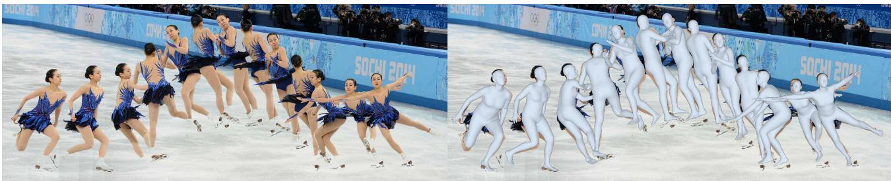
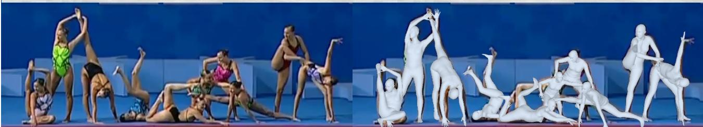
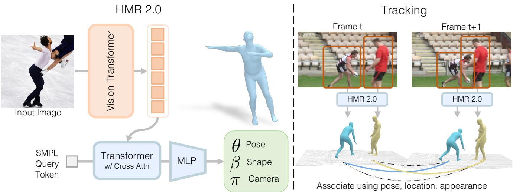
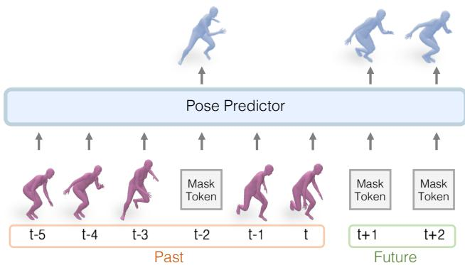
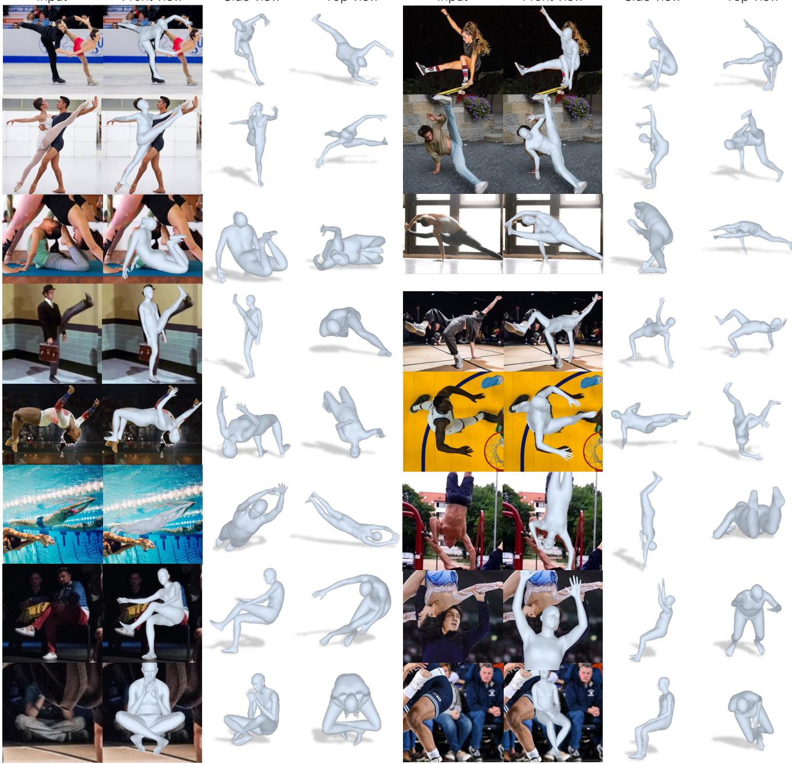
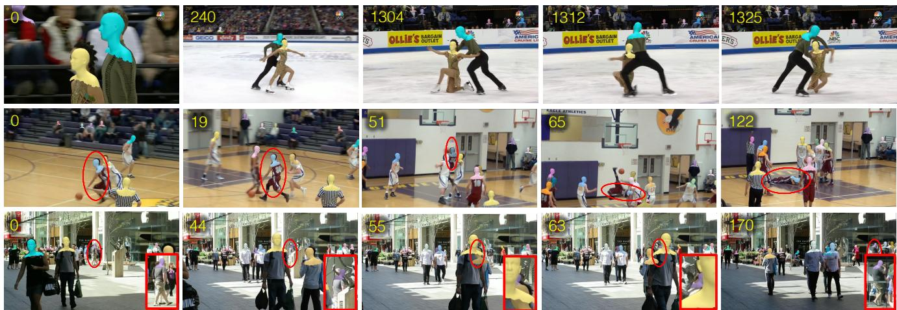
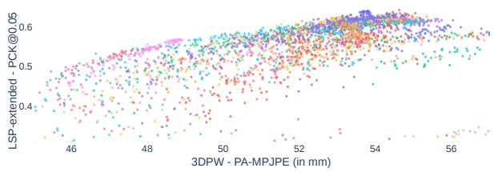
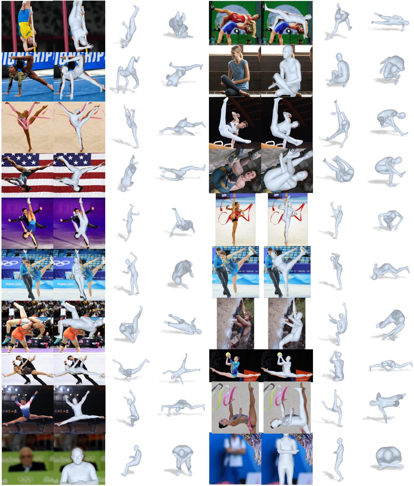
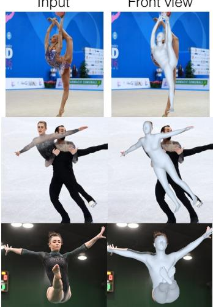
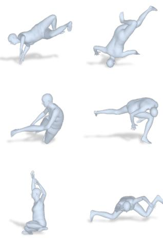

# 4D 中的人体：使用 Transformer 重建与跟踪人体

Shubham Goel　Georgios Pavlakos　Jathushan Rajasegaran　Angjoo Kanazawa∗　Jitendra Malik∗ shubham-goel, pavlakos, jathushan, kanazawa @berkeley.edu, malik@eecs.berkeley.edu University of California, Berkeley

  
图 1：人体网格恢复的“Transformer 化”视角。我们提出 HMR 2.0，一种完全基于 Transformer 的方法，用于从单张图像进行 3D 人体姿态与形状重建。除了在各种姿态和视角下表现优异外，HMR 2.0 还是一个改进系统的骨干，用于联合重建和跟踪 4D 中的人体（4DHumans）。这里展示的是 HMR 2.0 对左图中每个 2D 检测输出的重建结果。

## 摘要

我们提出了一种重建人体并在时间维度上对其进行跟踪的方法。我们方法的核心是提出一个完全“Transformer 化”的人体网格恢复网络版本。该网络 HMR 2.0 推进了当前最优水平，并展现出能够分析过去难以从单张图像中重建的非常规姿态的能力。为了分析视频，我们使用 HMR 2.0 的 3D 重建结果作为输入，送入一个在 3D 空间中运行的跟踪系统。这使我们能够处理多人场景，并在遮挡事件中保持身份一致性。我们的完整方法 4DHumans 在单目视频人体跟踪任务上取得了当前最优的结果。此外，我们在下游的动作识别任务上验证了 HMR 2.0 的有效性，相较于以往基于姿态的动作识别方法取得了显著提升。我们的代码和模型已在项目网站上发布：https://shubham-goel.github. io/4dhumans/。

## 1. 引言

在本文中，我们提出了一种完全基于 Transformer 的方法，用于从单张图像恢复人体的 3D 网格，并在视频中随时间对其进行跟踪。我们在单张图像 3D 重建任务上获得了前所未有的精度（见图 1），即使在以往方法难以处理的非常规姿态上也是如此。在视频中，我们通过 3D 跟踪将这些重建结果在时间上关联起来，在此过程中弥合因遮挡或检测失败造成的间隙。这些 4D 重建结果可在项目网页上查看。

我们的问题建模与方法可以看作是对先前人体网格恢复工作 HMR [30] 与三维跟踪工作 PHALP [65] 的「Transformer 化」。自开创性的 ViT 论文 [15] 以来，「Transformer 化」即将模型从 CNN 或 LSTM 转换为 Transformer 主干网络的过程，已在多个计算机视觉任务中迅速发展，例如 [8, 16, 24, 40, 61, 77]。具体到二维姿态（二维人体关键点），这一工作已由 ViTPose [81] 完成。我们以此为出发点，并开发了一种新版本的 HMR，将其命名为 HMR 2.0 以致敬其前身。

我们使用 HMR 2.0 构建了一个能够同时从视频中重建并跟踪人体的系统。我们依赖最近的三维跟踪系统 PHALP [65]，并借助我们的姿态恢复方法对其进行了简化与改进。该系统可在四维空间中重建人体，这也正是我们方法名称 4DHumans 的由来。4DHumans 可部署于任意视频之上，并能在视频中联合跟踪与重建人物。为每个人创建跟踪实体的功能，是分析与理解视频中人物的基础。除了在 PoseTrack 数据集 [1] 上取得最先进的跟踪结果之外，我们还将 HMR 2.0 应用于动作识别这一下游任务。我们遵循近期工作 [63] 的系统设计，并展示了使用 HMR 2.0 能够在 AVA v2.2 数据集的动作识别任务上取得对当前最先进水平的显著提升。

本文不折不扣地是一篇系统论文。我们所做出的设计选择旨在打造出在野外场景下用于三维人体重建与跟踪的最佳系统。我们的模型已在项目网页上公开发布。在计算机视觉乃至自然语言处理领域，一个新兴趋势是训练大规模预训练模型，这些模型可获得广泛的下游应用，从而证明其规模化训练的价值。HMR 2.0 正是这样的大规模预训练模型，它不仅在计算机视觉领域具有潜在用途，还有望应用于机器人 [54, 62, 73]、计算机图形学 [76]、生物力学 [60] 以及其他需要从图像或视频中分析人体形态与运动的领域。

我们的贡献可总结如下：

1. 我们提出了一种用于人体网格恢复的端到端「Transformer 化」架构 HMR 2.0。在不依赖领域专用设计的情况下，我们在三维人体姿态重建任务上超越了现有方法。

2. 在 HMR 2.0 的基础上，我们设计了 4DHumans，能够在视频中联合重建与跟踪人体，并在跟踪任务上取得了最先进的结果。

3. 我们证明，HMR 2.0 所提供的更优三维姿态能够带来更好的动作识别下游任务性能，最终在 AVA 基准上取得了当前最先进的结果（42.3 mAP）。

## 2. 相关工作

Human Mesh Recovery from a Single Image（从单张图像恢复人体网格）。虽然已有许多方法依赖迭代优化来估计 3D 人体姿态与形状，例如 SMPLify [7] 及其变体 [22, 38, 56, 66, 72, 85]，但在本分析中我们将聚焦于直接从单张图像输入回归身体形状的方法。其中最具代表性的工作是 HMR [30]，它使用 CNN 来回归 SMPL [45] 参数。自其提出以来，已有大量工作对原始方法进行了改进。值得注意的是，许多工作提出了用于伪真值（pseudo-ground truth）生成的替代方法，包括利用时序信息 [3]、多视角 [39] 或迭代优化 [35, 29, 57]。SPIN [35] 提出了一种 in-the-loop 优化，将 SMPLify [7] 纳入 HMR 的训练过程。在本工作中，我们同样依赖伪真值拟合来进行训练，并使用 [37] 进行离线拟合。

More recently（更近期的进展），已有工作为 HMR 架构提出了更具针对性的设计。PyMAF [89, 88] 引入了网格对齐模块来回归 SMPL 参数。PARE [34] 提出了一种身体部位引导的注意力机制以更好地处理遮挡问题。HKMR [20] 利用 SMPL 已知的层次结构进行预测。Holo-Pose [23] 提出了一种沿每个身体关节 2D 位置进行池化的策略。与此不同，我们采用了一种不包含任何领域特定决策的设计，并证明其优于所有先前的方法。

Many related approaches are making non-parametric predictions, i.e., instead of estimating the parameters of the SMPL model, they explicitly regress the vertices of the mesh（许多相关方法进行的是非参数化预测，即不再估计 SMPL 模型的参数，而是显式地回归网格的顶点）。GraphCMR [36] 使用图神经网络进行预测，METRO [42] 与 FastMETRO [10] 使用 Transformer，而 Mesh Graphormer [43] 则采用了图网络与 Transformer 的混合架构。由于我们回归的是 SMPL 模型参数而非网格顶点的位置，因此我们无法与这些方法直接比较。然而，我们将展示如何将一个完全「Transformer 化（transformerized）」的设计应用于 HMR。

Human Mesh & Motion Recovery from Video（从视频恢复人体网格与运动）。为了将人体网格恢复扩展到时序维度，大多数方法沿用 HMR [30] 的基本骨干网络，并提出用于融合逐帧特征的时序编码器设计。HMMR [31] 在 HMR [30] 提取的特征上使用卷积编码器。VIBE [33]、MEVA [48] 与 TCMR [11] 使用循环时序编码器。DSD [71] 组合了卷积层与自注意力层，而 MAED [75] 与 t-HMMR [57] 则采用了基于 Transformer 的时序编码器。Baradel 等人 [5, 4] 也使用 Transformer 进行时序姿态预测，但其直接作用于 SMPL 姿态。这些方法的一个关键局限在于，它们通常在跟踪较为简单的场景下运行 [31, 90]，例如视频中只有单人或遮挡极少的情况。与此相反，我们完整的 4DHumans 方法同时也在解决跟踪问题。

视频中的人物追踪（Tracking People in Video）。最近，出现了一些方法，通过依赖 HMR 模型进行三维人体重建来实现最先进的追踪性能，例如 T3DP [64] 和 PHALP [65]。在这些方法中，每次人物检测都通过 HMR 网络 [57] 提升到三维，然后利用提升 [64] 和预测 [65] 得到的三维表示来追踪视频中的人物。实证结果表明，PHALP 在多个追踪基准上表现良好（其主要要求是图像具有足够的空间分辨率，以便能够将人物提升到三维）。我们使用这些追踪流程，尤其是 PHALP，作为评估人体网格恢复方法的任务。

  
图 2：我们方法的概览。左：HMR 2.0 是用于人体网格恢复（Human Mesh Recovery）网络的完全"Transformer 化"版本。右：我们将 HMR 2.0 作为我们 4DHumans 系统的骨干，该系统基于 PHALP [65]，用于在四维空间中联合重建和追踪人体。

TokenAction 动作识别（TokenAction Recognition）。动作识别通常使用来自原始视频输入的外观特征来完成。此类别中的典型示例包括 SlowFast [18] 和 MViT [16]。与此同时，也有一些方法使用从身体姿态信息中提取的特征，例如 Po-Tion [12] 和 JMRN [68]。最近的方法 LART [63] 通过将基于视频的特征与来自三维人体姿态估计的特征相融合，展示了最先进的动作识别性能。我们采用该方法的流程，并将动作识别作为评估人体网格恢复方法的下游任务。

## 3. 人物重建

## 3.1. 预备知识

人体模型（Body Model）。SMPL 模型 [46] 是人体的低维参数化模型。给定用于姿态 $(\theta \in \mathbb { R } ^ { 2 4 \times 3 \times 3 })$ 和形状 $(\beta \in \mathbb { R } ^ { 1 0 })$ 的输入参数，它输出一个包含 $N = 6 8 9 0$ 个顶点的网格 $\mathbf { \bar { M } } \in \mathbb { R } ^ { 3 \times N }$。身体关节点 $X \in \mathbb { R } ^ { 3 \times k }$ 被定义为顶点的线性组合，可通过 $X = M W$ 计算，其中 $W \in \mathbb { R } ^ { N \times k }$ 为固定权重。注意，姿态参数 θ 包含身体姿态参数 $\theta _ { b } \in \mathbb { R } ^ { \bar { 2 } 3 \times 3 \bar { \times } 3 }$ 和全局朝向 $\theta _ { g } \in \mathbb { R } ^ { 3 \times 3 }$。

相机（Camera）。我们使用固定焦距和内参 K 的透视相机模型。每个相机 $\pi = (R, t)$ 由全局旋转 $R \in \mathbb{R}^{3 \times 3}$ 和平移 $t \in \mathbb{R}^3$ 组成。给定这些参数，SMPL 空间中的点（例如关节点 $X$）可以投影到图像上为 $x = \pi(X) = \Pi(K(RX + t))$，其中 $\Pi$ 是具有相机内参 $K$ 的透视投影。由于 $\theta$ 已经包含了全局旋转，在实践中我们假设 $R$ 为单位矩阵，只预测相机平移 $t$。

HMR。人体网格重建（Human Mesh Reconstruction, HMR）任务的目标是学习一个预测器 $f(I)$，给定单张图像 $I$，通过预测 MLP 他们的 3D 姿态和形状参数来重建图像中的人。遵循典型的参数化方法 [30, 35]，我们将 $f$ 建模为预测 $\Theta = [\theta, \beta, \pi] = f(I)$ Pose，其中 $\theta$ 和 $\beta$ 是 SMPL 姿态和形状参数，$\pi$ 是相机平移。

## 3.2. 架构

我们将 HMR [30] 重新构想为一个端到端的 Transformer 架构，它不使用任何领域特定的设计选择。然而，它的性能优于所有那些采用大量定制架构和精心设计决策的现有方法。如图 2 所示，我们使用 (i) 一个 ViT [15] 来提取图像 token，以及 (ii) 一个标准的 Transformer 解码器，通过交叉注意力对图像 token 进行处理并输出 $\Theta$。

ViT。视觉 Transformer（Vision Transformer, ViT）[15] 是为处理图像而修改的 Transformer [74]。输入图像首先被分块为输入 token，然后通过 Transformer 处理以获得输出 token。这些输出 token 随后被传递到 Transformer 解码器。我们使用 ViT-H/16，即「Huge」变体，输入块大小为 $16 \times 16$。更多细节请参见补充材料（SupMat）。

Transformer 解码器。我们使用带有多头自注意力的标准 Transformer 解码器 [74]。它处理单个（零）输入 token，通过交叉注意力对输出图像 token 进行处理，并以对 $\Theta$ 的线性读出作为结束。我们遵循 [35] 并使用 [91] 的表示方法回归 3D 旋转。

## 3.3. 损失

遵循 HMR 文献 [30, 35] 中的最佳实践，我们使用 2D 损失、3D 损失和判别器的组合来训练我们的预测器 $f$。由于我们使用混合数据集进行训练，每个数据集都有不同类型的标注，我们对小批量（minibatch）中的每张图像使用这些损失的一个子集。即使使用伪真值标注，我们也使用相同的损失。给定输入图像 $I$，模型预测 $\Theta = [\theta, \beta, \pi] = f(I)$。每当我们能够访问真值 SMPL 姿态参数 $\theta^{*}$ 和形状参数 $\beta^{*}$ 时，我们使用 MSE 损失来引导模型预测：

$$
\mathcal{L}_{\mathrm{smpl}} = ||\theta - \theta^{*}||_2^2 + ||\beta - \beta^{*}||_2^2.
$$

当图像具有精确的真值 3D 关键点标注 $X ^ { * }$ 时，我们额外使用 L1 损失对预测的 3D 关键点 $X$ 进行监督：

$$
{ \mathcal { L } } _ { \mathrm { k p 3 D } } = | | X - X ^ { * } | | _ { 1 } .
$$

当图像具有 2D 关键点标注 $x ^ { * }$ 时，我们使用 L1 损失对预测 3D 关键点的投影 $\pi ( X )$ 进行监督：

$$
\mathcal L _ { \mathrm { k p 2 D } } = | | \pi ( X ) - x ^ { * } | | _ { 1 } .
$$

此外，我们希望确保模型预测出有效的 3D 姿态，并使用 HMR [30] 中的对抗先验。它将模型参数分解为：(i) 身体姿态参数 $\theta _ { b }$，(ii) 形状参数 $\beta$，以及 (iii) 每个部件的相对旋转 $\theta _ { i }$，即 SMPL 模型中 23 个关节各对应一个 3D 旋转。我们针对身体模型的每一个因子训练一个判别器 $D _ { k }$，生成器损失可表示为：

$$
\mathcal { L } _ { \mathrm { a d v } } = \sum _ { k } ( D _ { k } ( \theta _ { b } , \beta ) - 1 ) ^ { 2 } .
$$

## 3.4. 伪真值拟合（Pseudo-Ground Truth fitting）

我们通过计算伪真值标注来扩展到无标注数据集（即 InstaVariety [31]、AVA [21]、AI Challenger [78]）。对于任意一张图像，我们首先使用现成的检测器 [40] 和身体关键点估计器 [81] 来获得边界框及对应的 2D 关键点。然后，我们使用 ProHMR [37] 将 SMPL 网格拟合到这些 2D 关键点上，从而得到伪真值的 SMPL 参数 $\theta ^ { * }$ 与 $\beta ^ { * }$，以及相机 $\pi ^ { * }$。

## 4. 人物跟踪（Tracking People）

在包含多人的视频中，我们需要具备跨时间关联人物的能力，即执行跟踪。为此，我们基于 PHALP [65] 进行构建，它是一个基于 HMR 风格 3D 重建特征的当前最先进（state-of-the-art）跟踪器。其基本思想是：在单帧中检测人物，并将其"提升"到 3D，提取其 3D 姿态、3D 空间中的位置（由估计的相机推导得到）以及 3D 外观（由纹理图推导得到）。针对每个独立人物，随着时间推移逐步构建其轨迹表示（tracklet）。其递归步骤是：针对每条轨迹，预测该人物在下一帧中的姿态、位置和外观（均在 3D 中），然后在将这些自顶向下的预测与该帧中自底向上检测到的人物（已提升至 3D）之间寻找最佳匹配。随后，每条轨迹所表示的状态由到来的观测进行更新，并重复该过程。由于轨迹的 3D 表示能够基于历史信息持续更新，因此即使在遮挡情况下也能保持跟踪。

  
图 3：姿态预测：我们在从 [63] 获得的超过 100 万条轨迹上训练了一个 BERT 风格 [13] 的 Transformer 模型。这使我们能够使用同一个模型进行未来预测以及对缺失检测的非模态补全。为了预测未来姿态（t+1, $t + 2 , . . .$），我们使用对应的位置嵌入以掩码标记查询模型。类似地，对于非模态补全，我们将缺失检测替换为掩码标记。

我们认为一个稳健的姿态预测器在该下游跟踪任务上也应该表现良好，因此我们使用跟踪指标作为评估 3D 重建质量的代理度量。但首先我们需要修改 PHALP 框架，以允许对不同的姿态预测模型进行公平比较。最初，PHALP 使用基于 HMR 网络最后一层的姿态特征，即 $i . e . ,$ 一个 2048 维的嵌入空间。这限制了 PHALP 与不同姿态模型（例如 HMR 2.0、PARE、PyMAF 等）配合使用的能力。为了创建 PHALP 的更通用版本，我们进行了如下修改：用 SMPL 姿态参数来表示姿态，并相应地优化 PHALP 代价函数以利用新的姿态距离。类似地，我们将姿态预测器适配在 SMPL 参数空间上运行。更具体地说，如图 3 所示，我们通过掩码随机姿态标记训练了一个 vanilla Transformer 模型 [74]。这使我们能够随时间预测未来姿态，以及对缺失检测进行非模态补全。通过这些修改，我们可以插入任何网格恢复方法，并在任何视频上运行它们。我们将这个修改后的版本称为 PHALP′。

**4DHumans。** 我们的最终跟踪系统 4DHumans 使用了一个基于采样的无参数外观头以及一个新的姿态预测器（图 3）。为了建模外观，我们通过将网格上的可见点投影到输入图像上，并从对应像素采样颜色，从而对其进行纹理贴图。

为了在视频中跟踪人，以往的方法依赖于现成的跟踪方法，并使用其输出重建视频中的人（例如，从跟踪输出中获取边界框并重建人体）。例如，PHD [90]、HMMR [31] 只能在场景中只有一个人的视频上运行。在本工作中，我们将重建和跟踪合并到一个统一的系统中，并表明更好的姿态重建会带来更好的跟踪，并且该组合系统现在可以在任何野外视频上运行。

## 5. 实验

在本节中，我们定性和定量地评估我们的重建与跟踪系统。首先，我们证明 HMR 2.0 在标准的 2D 和 3D 姿态精度指标上优于以往的方法（第 5.2 节）。其次，我们证明 4DHumans 是一个通用的跟踪器，能够达到当前最优的性能（第 5.3 节）。第三，我们进一步通过在动作识别这一下游应用上的优越性能，展示我们恢复出的姿态的鲁棒性和准确性（第 5.4 节）。最后，我们讨论在设计 HMR 2.0 时进行的实验探究，并对一系列设计选择进行消融研究（第 5.5 节）。

## 5.1. 实验设置

数据集。沿用之前的工作，我们使用典型的数据集进行训练，即 Human3.6M [27]、MPI-INF-3DHP [49]、COCO [44] 和 MPII [2]。此外，我们还额外使用 InstaVariety [31]、AVA [21] 和 AI Challenger [78] 作为数据，在这些数据上我们生成伪真值拟合（pseudo-ground truth fits）。

基线方法。我们在能够与众多先前工作进行比较的基准上报告性能（第 5.2 节），但我们也与近期最先进的方法进行更详细的对比，即 PyMAF [89]、CLIFF [41]、HMAR [65]、PARE [34] 和 PyMAF-X [88]。为了公平起见，我们仅评估 PyMAF-X 的仅人体（body-only）性能。

## 5.2. 姿态精度

3D 指标。对于 3D 姿态精度，我们遵循先前工作（例如 [35]）的典型协议，我们在 3DPW 测试划分和 Human3.6M 验证划分上给出结果，在表 1 中报告 MPJPE 和 PA-MPJPE。请注意，我们仅与那些未使用 3DPW 训练集进行训练的方法进行比较，这一点与我们相同。我们观察到，仅使用典型数据集进行训练的 HMR 2.0a 模型能够在所有指标上超越所有先前的基线方法。然而，我们认为这些基准已经非常饱和，这些姿态指标上较小的差异往往并不非常显著。事实上，我们观察到，以在 3DPW 上的性能上的小幅让步为代价，我们训练时间更长且使用更多数据（AVA [21]、AI Challenger [78] 和 InstaVariety [31]）的 HMR 2.0b 模型，能够在比 Human3.6M 和 3DPW 中所能找到的更不寻常的姿态上取得更好的结果。我们通过定性观察以及在 2D 姿态重投影上的性能评估（表 2）证实了这一点。此外，我们观察到 HMR 2.0b 是一个更为鲁棒的模型，并在本文余下部分中将其用于评估。

<table><tr><td rowspan="2">方法</td><td colspan="2">3DPW</td><td colspan="2">Human3.6M</td></tr><tr><td>MPJPE</td><td>PA-MPJPE</td><td>MPJPE</td><td>PA-MPJPE</td></tr>
<tr><td>Kanazawa et al. [31]</td><td>116.5</td><td>72.6</td><td>=</td><td>56.9</td></tr>
<tr><td>Doersch et al. [14]</td><td>=</td><td>74.7</td><td></td><td></td></tr>
<tr><td>Temmpooral Arnab et al. [3]</td><td></td><td>72.2</td><td>77.8</td><td>54.3</td></tr>
<tr><td>DSD [71]</td><td></td><td>69.5</td><td>59.1</td><td>42.4</td></tr>
<tr><td>VIBE [33]</td><td>93.5</td><td>56.5</td><td>65.9</td><td>41.5</td></tr>
<tr><td>Pavlakos et al. [59]</td><td></td><td></td><td></td><td>75.9</td></tr>
<tr><td>HMR [30]</td><td>130.0</td><td>76.7</td><td>88.0</td><td>56.8</td></tr>
<tr><td>NBF [53]</td><td></td><td></td><td></td><td>59.9</td></tr>
<tr><td>GraphCMR [36]</td><td></td><td>70.2</td><td></td><td>50.1</td></tr>
<tr><td>HoloPose [23]</td><td></td><td></td><td>60.3</td><td>46.5</td></tr>
<tr><td>DenseRaC [82]</td><td></td><td></td><td>76.8</td><td>48.0</td></tr>
<tr><td>SPIN [35]</td><td>96.9</td><td>59.2</td><td>62.5</td><td>41.1</td></tr>
<tr><td>DecoMR [86]</td><td></td><td>61.7†</td><td></td><td>39.3†</td></tr>
<tr><td>DaNet [87]</td><td></td><td>56.9</td><td>61.5</td><td>48.6</td></tr>
<tr><td>Fraq-sed Song et al. [69]</td><td></td><td>55.9</td><td></td><td>56.4</td></tr>
<tr><td>I2L-MeshNet [51]</td><td>100.0</td><td>60.0</td><td>55.7†</td><td>41.1†</td></tr>
<tr><td>HKMR [20]</td><td></td><td></td><td>59.6</td><td>43.2</td></tr>
<tr><td>PyMAF [89]</td><td>92.8</td><td>58.9</td><td>57.7</td><td>40.5</td></tr>
<tr><td>PARE [34]</td><td>82.0</td><td>50.9</td><td>76.8</td><td>50.6</td></tr>
<tr><td>PyMAF-X [88]</td><td>78.0</td><td>47.1</td><td>54.2</td><td>37.2</td></tr>
<tr><td>HMR 2.0a</td><td>70.0</td><td>44.5</td><td>44.8</td><td>33.6</td></tr>
<tr><td>HMR 2.0b</td><td>81.3</td><td>54.3</td><td>50.0</td><td>32.4</td></tr>
</table>

表 1：三维重建评估：在 3DPW 和 Human3.6M 数据集上的重建误差（单位：毫米）。† 表示该数值在非参数化结果上评估得出。数值越低越好。详见正文。

<table><tr><td rowspan=1 colspan=4>LSP-Extended  COCO   PoseTrack方法@0.05@0.1 @0.05 @0.1@0.05 @0.1</td></tr><tr><td rowspan=1 colspan=2>PyMAF [89]     一      1</td><td rowspan=1 colspan=1>0.680.86</td><td rowspan=1 colspan=1>0.770.92</td></tr><tr><td rowspan=1 colspan=1>CLIFF [41]</td><td rowspan=1 colspan=1>0.32 0.66</td><td rowspan=1 colspan=1>0.640.88</td><td rowspan=1 colspan=1>0.750.92</td></tr><tr><td rowspan=1 colspan=1>PARE [34]</td><td rowspan=1 colspan=1>0.27 0.60</td><td rowspan=1 colspan=1>0.720.91</td><td rowspan=1 colspan=1>0.790.93</td></tr><tr><td rowspan=1 colspan=1>PyMAF-X [88]</td><td rowspan=1 colspan=1></td><td rowspan=1 colspan=1>0.790.93</td><td rowspan=1 colspan=1>0.850.95</td></tr><tr><td rowspan=1 colspan=1>HMR 2.0a</td><td rowspan=1 colspan=1>0.38 0.72</td><td rowspan=1 colspan=1>0.790.95</td><td rowspan=1 colspan=1>0.86 （0.97</td></tr><tr><td rowspan=1 colspan=1>HMR 2.0b</td><td rowspan=1 colspan=1>0.53 0.82</td><td rowspan=1 colspan=1>0.86 0.96</td><td rowspan=1 colspan=1>0.900.98</td></tr></table>

表 2：2D 重建评估。在 LSP-Extended、COCO 和 PoseTrack 数据集上，不同阈值下投影关键点的 PCK（Percentage of Correct Keypoints）分数。分数越高越好。

2D 指标。我们通过报告在 LSP-Extended [28]、COCO 验证集 [44] 和 Posetrack 验证集 [1] 上不同阈值下重投影关键点的 PCK 分数，来评估生成姿态的 2D 图像对齐程度。由于 PyMAF(-X) [89, 88] 是使用 LSP-Extended 训练的，因此我们不在表格的该部分报告数值。请注意，在表 2 中，HMR 2.0b 一致地优于所有先前方法。在包含非常规姿态的 LSP-Extended 上，HMR 2.0b 在 PCK@0.05 上达到 0.53，是第二名（CLIFF）的 0.32 的 1.6 倍。对于姿态较为常规、较容易的 COCO 和 PoseTrack 数据集，HMR 2.0b 在 PCK@0.05 上仍然优于次优方法，但优势较小，分别高出 9% 和 6%。HMR 2.0a 也优于所有基线方法，但逊色于 HMR 2.0b，特别是在 LSP-Extended 中较难的姿态上。

定性结果。我们在图 4 中展示了 HMR 2.0 的定性结果。我们对极端姿态和部分遮挡具有鲁棒性。我们的重建结果与图像对齐良好，并且在从新视角观察时仍然有效。此外，我们在图 5 中与最接近的竞品方法进行了比较。我们观察到，PyMAF-X 以及特别是 PARE 在处理较为非常规的姿态时常常表现吃力，而 HMR 2.0 则返回更为忠实的重建结果。

## 5.3. 跟踪

对于跟踪任务，我们首先展示 PHALP′ 所引入修改的多功能性，这些修改使我们能够在跟踪的下游任务上评估 3D 姿态估计器。随后，我们相对当前最先进技术评估我们的完整系统 4DHumans。

**评估设置（Evaluation Setting）。** 遵循先前工作 [64, 65]，我们在 Posetrack 验证集上基于 IDs（ID 切换）、MOTA [32]、IDF1 [67] 和 HOTA [47] 报告结果，采用 [65] 的协议，检测来自 Mask R-CNN [25]。

**PHALP′ 的通用性（Versatility of PHALP′）。** 通过对 PHALP′ 的改进，我们舍弃了 [65] 中模型特定的潜在空间，转而在大多数网格恢复系统共享的 SMPL 空间中进行操作。这使得 PHALP′ 更加通用，并允许我们插入不同的 3D 姿态估计器，基于它们在跟踪这一下游任务中的表现进行比较。我们在表 3 中进行此比较，其中使用来自当前最先进 3D 姿态估计器的姿态和位置线索（外观仍来自 HMAR [65]）。我们观察到 HMR 2.0 表现最佳，PARE [34]、HMAR [65] 和 PyMAF-X [88] 在 Posetrack 数据集上紧随其后，彼此之间差异不大。请注意，跟踪通常最容易受到预测 3D 位置误差的影响，而身体姿态对性能的影响较小 [65]。这意味着良好的跟踪性能可以反映对遮挡的鲁棒性，因此考虑该指标是有帮助的，但对于区分姿态上的细粒度差异帮助较小。因此，PARE [34]、HMAR [65] 和 PyMAF-X [88] 的竞争性结果表明它们能够优雅地处理遮挡，但它们的姿态估计可能仍不够准确（如表 2 所示）。更多定性比较见图 5 和补充材料（SupMat）。

**4DHumans。** 表 4 评估了我们完整系统 4DHumans 在 PoseTrack 数据集上的跟踪性能。使用与 [64, 65] 相同的边界框检测器，4DHumans 在所有指标上均优于现有方法，ID 切换减少了 22%。使用改进的 ViT-Det 检测器 [40] 可以进一步提升性能。作为时间预测模型（图 3）的副产品，我们可以执行非模态补全（amodal completion），并将姿态赋予缺失的检测。我们在补充材料中展示了相关示例。

<table><tr><td rowspan="2">跟踪器</td><td rowspan="2">姿态引擎</td><td colspan="4">Posetrack</td></tr>
<tr><td>HOTA↑</td><td>IDs↓ MOTA↑</td><td>IDF1↑</td></tr>
<tr><td rowspan="4">PHALP&#x27;</td><td>PARE [34]</td><td>53.6</td><td>510 59.4 472</td><td>76.8</td></tr>
<tr><td>PyMAF-X [88]</td><td>53.7 551</td><td>59.2 58.7</td><td>76.9 76.5</td></tr>
<tr><td>CLIFF [41] PyMAF [89]</td><td>53.5 53.0 623</td><td>58.6</td><td>76.1</td></tr>
<tr><td>HMAR [65]</td><td>53.6 482</td><td>59.3</td><td>77.1</td></tr>
<tr><td></td><td>HMR 2.0</td><td>54.1</td><td>456 59.4</td><td>77.4</td></tr></table>

表 3：使用不同 3D 姿态估计器进行跟踪。通过对 PHALP′ 的改进，我们得到一个通用的跟踪器，允许插入不同的 3D 姿态估计器。HMR 2.0、PARE 和 PyMAF-X 在此设置下表现最佳。

<table><tr><td>Method</td><td colspan="2">Posetrack HOTA↑ IDs↓ MOTA↑ IDF1↑</td></tr><tr><td>Trackformer [50]</td><td>46.7 1263</td><td>33.7 64.0</td></tr><tr><td>Tracktor [6]</td><td>38.5 702</td><td>42.4 65.2</td></tr><tr><td>AlphaPose [17]</td><td>37.6 2220</td><td>36.9 66.9</td></tr><tr><td>Pose Flow [79]</td><td>38.0 1047</td><td>15.4 64.2</td></tr><tr><td>T3DP [64]</td><td>50.6 655</td><td>55.8 73.4</td></tr><tr><td>PHALP [65]</td><td>52.9 541</td><td>58.9 76.4</td></tr><tr><td>4DHumans</td><td>54.3 421</td><td>59.8 77.9</td></tr><tr><td>4DHumans + ViTDet</td><td>57.8 382</td><td>61.4 79.1</td></tr></table>

表 4：在 Posetrack 数据集上将 4DHumans 与当前最先进方法的比较。4DHumans 在所有指标上都达到了最先进的跟踪性能。引入更好的检测系统 [40] 可带来进一步的性能提升。

## 5.4. 动作识别（Action Recognition）

评估设置（Evaluation setting）。文献 [63] 的方法是视频动作识别领域的当前最先进技术。给定一个视频作为输入，作者提出使用逐帧的 3D 姿态与位置估计（使用现成的 HMR 模型 [65]）作为预测动作标签的附加特征。他们还展示了仅基于姿态的基线结果，该基线仅利用

Input

Front view

Side view

Top view

Input

Front view

Side view

Top view

  
图 4：HMR 2.0 的定性评估结果。对于每个示例，我们展示：a) 输入图像，b) 重建叠加效果，c) 侧视图，d) 俯视图。为了展示 HMR 2.0 的鲁棒性，我们可视化了多种场景下的结果——包括异常姿态（第 1-4 行）、异常视角（第 5 行）以及可见性差、极端截断和极端遮挡的图像（第 6-8 行）。

3D 姿态与位置估计来预测动作标签。我们使用这一设置在 AVA 数据集 [21] 上将我们的模型与基线方法在动作识别这一下游任务上进行比较。在 [63] 中，作者训练了一个以 SMPL 姿态作为输入并预测动作标签的 Transformer。遵循他们的设置，我们为每个基线方法单独训练一个动作分类 Transformer。

比较（Comparisons）。通过比较表 5 中的结果，我们观察到 HMR 2.0 在不同的类别（OM、PI、PM）以及整体上都优于基线方法。它在 AVA 测试集上达到了 22.3 的 mAP，比第二好的基线方法高出 14%。由于从姿态进行准确的动作识别需要细粒度的姿态估计，这是 HMR 2.0 预测的姿态比现有方法更准确的强有力的证据。事实上，当与外观特征结合时，[63] 的结果表明 HMR 2.0 在 AVA 动作识别任务上达到了 42.3 mAP 的当前最先进水平，比第二好的 39.5 mAP 高出 7%。

  
图 5：当前最先进的网格恢复方法的定性比较。在异常姿态下，HMR 2.0 相比最接近的竞争对手 PyMAF-X [88] 和 PARE [34]，能够返回更加忠实的重建结果。

  
图 6：4DHumans 的定性跟踪结果。我们使用头部掩码（左上角为帧编号）。第一行：我们在长达一分钟的视频中跟踪在冰上滑冰的人，其中包含具有挑战性的姿态和严重的遮挡，且没有发生身份切换。第二行：主要人物在与其他玩家的多次交互过程中被持续跟踪。第三行：目标人物在长时间遮挡下被持续跟踪。

<table><tr><td>动作模型</td><td>姿态引擎</td><td>OM</td><td>PI</td><td>PM</td><td>mAP</td></tr><tr><td rowspan="6">[63]</td><td>PyMAF [89]</td><td>7.3</td><td>16.9</td><td>34.7</td><td>15.4</td></tr><tr><td>CLIFF [41]</td><td>9.2</td><td>20.0</td><td>40.3</td><td>18.6</td></tr><tr><td>HMAR [65]</td><td>8.7</td><td>20.1</td><td>40.3</td><td>18.3</td></tr><tr><td>PARE [34]</td><td>9.2</td><td>20.7</td><td>41.5</td><td>19.1</td></tr><tr><td>PyMAF-X [88]</td><td>10.2</td><td>21.4</td><td>40.8</td><td>19.6</td></tr><tr><td>HMR 2.0</td><td>11.9</td><td>24.6</td><td>45.8</td><td>22.3</td></tr></table>

表 5：AVA 数据集上的动作识别结果。我们在基于姿态的动作识别下游任务上对不同的网格恢复方法进行了基准测试。其中，OM：物体操作（Object Manipulation），PI：人物交互（Person Interactions），PM：人物运动（Person Movement）。

## 5.5. HMR 2.0 模型设计

在开发 HMR 2.0 的过程中，我们研究了一系列设计决策。图 7 简要说明了这一探索过程。我们实验了超过 100 种设置，并可视化每次运行的 100 个检查点（checkpoint）的性能。在可视化中，我们使用每个检查点在 3DPW 和 LSP-Extended 数据集上的性能。

我们的研究聚焦于模型的一些特定方面，我们将其作为一系列"经验教训"记录在此，供未来研究参考。在接下来的段落中，我们将经常引用表 6，该表使用 3DPW、Human3.6M 和 LSP-Extended 数据集，在 3D 和 2D 指标上对这些方面进行了评估。

  
图 7：广泛的模型搜索。每个点表示一个检查点在 3DPW 和 LSP-Extended 上评估时的性能。颜色表示不同的运行。我们探索了超过 100 种设置，并可视化每次运行的 100 个检查点。

**骨干网络（backbone）的影响。** 与以往大多数采用 ResNet 骨干网络的人体网格恢复（Human Mesh Recovery）研究工作不同，我们的 HMR 2.0 方法依赖于 ViT 骨干网络。为了直接对比骨干网络的影响，模型 B1 采用 ResNet-50 骨干网络，并配合一个实现 IEF（迭代误差反馈，Iterative Error Feedback [9, 30]）的基于多层感知机（MLP）的头部来实现 HMR。相比之下，模型 B2 使用 Transformer 骨干网络（ViT-H），同时保持其他设计决策不变。通过更新骨干网络，我们观察到在 3D 与 2D 指标上均有显著提升，这证明了"Transformer 化"步骤的合理性。

**训练数据的影响。** 除架构之外，我们还研究了训练数据的影响。模型 D1 在典型数据集（H3.6M、MPII、COCO、MPI-INF）上进行训练，这些数据集是大多数先前工作所使用的。相比之下，模型 D2 在训练集中额外加入 AVA，遵循文献 [21]。最终，我们还使用 AI-Challenger 与 Insta-Variety（模型 B2）进行训练，以进一步扩充训练集。正如我们所见，增加训练数据对所报告的各项指标均有提升，但相较于骨干网络的更新，其收益较小。

**ViT 预训练。** 另一个对我们模型性能有显著影响的因素是 ViT 骨干网络的预训练方式。以随机初始化权重（模型 P1）作为起点会导致收敛缓慢且性能较差。当骨干网络在 ImageNet 上通过 MAE（掩码自编码器，Masked Autoencoders）[24] 进行预训练（模型 P2）时，结果有所改善。最终，我们所选的模型（HMR 2.0b）首先在 ImageNet 上用 MAE 进行预训练，然后在 2D 关键点预测任务 [81] 上进一步预训练，取得了最佳性能。

**SMPL 头部。** 我们还研究了用于预测 SMPL 参数的头部架构的影响。相比于传统的基于 MLP 并带有 IEF 步骤的头部（B2），我们提出的 Transformer 解码器（HMR 2.0b）在图像-模型对齐（即 2D 指标）方面性能更优。

**数据集质量。** 与先前工作类似，例如文献 [35]，保持训练数据的高质量至关重要；我们剔除了低质量的伪真值拟合结果（高拟合误差），并去除了低置信度的 2D 检测图像。

<table><tr><td rowspan="2">模型</td><td>3DPW</td><td>Human3.6M</td><td></td><td>LSP-Extended</td></tr><tr><td colspan="4">|MPJPE PA-MPJPE|MPJPE PA-MPJPE|PCK@0.05 PCK@0.1</td></tr><tr><td>HMR 2.0b|</td><td>81.3 54.3</td><td>50.0</td><td>32.4</td><td>0.53 0.82</td></tr><tr><td>B1</td><td>85.2 56.8</td><td>58.9</td><td>41.4</td><td>0.35 0.66</td></tr><tr><td>B2</td><td>79.7 53.4</td><td>51.4</td><td>34.4</td><td>0.48 0.81</td></tr><tr><td>D1</td><td>84.1 54.8</td><td>54.5</td><td>35.1</td><td>0.45 0.79</td></tr><tr><td>D2</td><td>80.2 53.3</td><td>52.4</td><td>34.9</td><td>0.46 0.79</td></tr><tr><td>P1</td><td>61.7</td><td>89.9</td><td></td><td>0.52</td></tr><tr><td></td><td>98.9 82.7</td><td></td><td>58.7</td><td>0.24</td></tr><tr><td>P2</td><td>55.6</td><td>49.3</td><td>32.4</td><td>0.52 0.81</td></tr></table>

表 6：消融实验：在 3DPW、Human3.6M 和 LSP-Extended 数据集上对不同模型设计的评估。

## 6. 结论

我们研究了从图像和视频中重建与跟踪人体的任务。首先，我们提出了 HMR 2.0，即一个完全「Transformer 化」的人体网格重建（Human Mesh Recovery）网络版本 [30]。HMR 2.0 在常用的 2D/3D 姿态指标上取得了优异表现，同时它也作为我们改进后的视频跟踪器的骨干网络。完整系统 4DHumans 联合重建并跟踪视频中的人物，在跟踪任务上取得了最先进的结果。为了进一步展示我们的三维姿态估计器 HMR 2.0 的优势，我们将其应用于动作识别任务，相比先前基于姿态的方法取得了显著提升。

我们的工作拓展了可被三维人体重建技术分析的视频范围。与此同时，结果的改进也揭示了未来需要解决的一些局限。例如，使用 SMPL 模型 [45] 带来了固有的限制，借助更先进的模型可以建模手部姿态和面部表情 [56]，甚至捕捉更大的年龄变化，例如婴儿 [26] 与儿童 [55, 70]。此外，由于我们将每个人独立处理，我们的重建在刻画近距离人群的细粒度信息（例如人物之间的接触 [19, 52]）方面效果不佳。除此之外，我们的重建结果「存在于」相机坐标系中，因此为了正确理解视频中的动作，我们需要同时推断相机运动 [58, 83, 84]，将所有人纳入统一的世界坐标系中。最后，较低的输入分辨率会影响重建质量，这可以通过分辨率增强 [80] 来加以改善。

致谢 我们感谢 BAIR 社区成员富有成效的讨论，以及 StabilityAI 慷慨的计算资源资助。本研究得到了 BAIR/BDD 赞助商、ONR MURI（N00014-21-1-2801）以及 DARPA MCS 项目的支持。

## 参考文献

[1] Mykhaylo Andriluka, Umar Iqbal, Eldar Insafutdinov, Leonid Pishchulin, Anton Milan, Juergen Gall, and Bernt Schiele. PoseTrack：人体姿态估测与跟踪基准。发表于 CVPR, 2018。

[2] Mykhaylo Andriluka, Leonid Pishchulin, Peter Gehler, and Bernt Schiele. 二维人体姿态估测：新基准与最先进方法分析。发表于 CVPR, 2014。

[3] Anurag Arnab, Carl Doersch, and Andrew Zisserman. 利用时间上下文进行野外三维人体姿态估测。发表于 CVPR, 2019。

[4] Fabien Baradel, Romain Bregier, Thibault Groueix, Philippe Weinzaepfel, Yannis Kalantidis, and Gregory Rogez. Pose-BERT：用于时间三维人体建模的通用 Transformer 模块。PAMI, 2022。

[5] Fabien Baradel, Thibault Groueix, Philippe Weinzaepfel, Romain Bregier, Yannis Kalantidis, and Gregory Rogez. 利用动作捕捉数据进行人体网格恢复。发表于 3DV, 2021。

[6] Philipp Bergmann, Tim Meinhardt, and Laura Leal-Taixe. 无需花哨技巧的跟踪。发表于 ICCV, 2019。

[7] Federica Bogo, Angjoo Kanazawa, Christoph Lassner, Peter Gehler, Javier Romero, and Michael J Black. 保持 SMPL：从单张图像自动估测三维人体姿态与形状。发表于 ECCV, 2016。

[8] Nicolas Carion, Francisco Massa, Gabriel Synnaeve, Nicolas Usunier, Alexander Kirillov, and Sergey Zagoruyko. 使用 Transformers 进行端到端目标检测。发表于 ECCV, 2020。

[9] Joao Carreira, Pulkit Agrawal, Katerina Fragkiadaki, and Jitendra Malik. 基于迭代误差反馈的人体姿态估测。发表于 CVPR, 2016。

[10] Junhyeong Cho, Kim Youwang, and Tae-Hyun Oh. 基于 Transformer 的解耦模态交叉注意力用于三维人体网格恢复。发表于 ECCV, 2022。

[11] Hongsuk Choi, Gyeongsik Moon, Ju Yong Chang, and Kyoung Mu Lee. 超越静态特征：从视频获取时间一致的三维人体姿态与形状。发表于 CVPR, 2021。

[12] Vasileios Choutas, Philippe Weinzaepfel, Jérôme Revaud, and Cordelia Schmid. PoTion：用于动作识别的姿态动作表征。发表于 CVPR, 2018。

[13] Jacob Devlin, Ming-Wei Chang, Kenton Lee, and Kristina Toutanova. BERT：用于语言理解的深度双向 Transformers 预训练。arXiv 预印本 arXiv:1810.04805, 2018。

[14] Carl Doersch and Andrew Zisserman. 三维人体姿态估测的仿真到真实迁移学习：动作来救场。NeurIPS, 2019。

[15] Alexey Dosovitskiy, Lucas Beyer, Alexander Kolesnikov, Dirk Weissenborn, Xiaohua Zhai, Thomas Unterthiner, Mostafa Dehghani, Matthias Minderer, Georg Heigold, Sylvain Gelly, Jakob Uszkoreit, and Neil Houlsby. 一图胜千言（16×16 个词）：用于大规模图像识别的 Transformers。ICLR, 2021。

[16] Haoqi Fan, Bo Xiong, Karttikeya Mangalam, Yanghao Li, Zhicheng Yan, Jitendra Malik, and Christoph Feichtenhofer. 多尺度视觉 Transformers。发表于 ICCV, 2021。

[17] Hao-Shu Fang, Shuqin Xie, Yu-Wing Tai, and Cewu Lu. RMPE：区域多人姿态估测。发表于 ICCV, 2017。

[18] Christoph Feichtenhofer, Haoqi Fan, Jitendra Malik, and Kaiming He. 用于视频识别的 Slowfast 网络. 载于 ICCV，2019.

[19] Mihai Fieraru, Mihai Zanfir, Elisabeta Oneata, Alin-Ionut Popa, Vlad Olaru, and Cristian Sminchisescu. 人体交互的三维重建. 载于 CVPR，2020.

[20] Georgios Georgakis, Ren Li, Srikrishna Karanam, Terrence Chen, Jana Košecká, and Ziyan Wu. 分层运动学人体网格恢复. 载于 ECCV，2020.

[21] Chunhui Gu, Chen Sun, David A Ross, Carl Vondrick, Caroline Pantofaru, Yeqing Li, Sudheendra Vijayanarasimhan, George Toderici, Susanna Ricco, Rahul Sukthankar, Cordelia Schmid, and Jitendra Malik. AVA：一个时空局部化原子视觉动作的视频数据集. 载于 CVPR，2018.

[22] Peng Guan, Alexander Weiss, Alexandru O Bălan, and Michael J Black. 从单张图像估计人体形状与姿态. 载于 ICCV，2009.

[23] Riza Alp Guler and Iasonas Kokkinos. HoloPose：野外整体式三维人体重建. 载于 CVPR，2019.

[24] Kaiming He, Xinlei Chen, Saining Xie, Yanghao Li, Piotr Dollár, and Ross Girshick. 掩蔽自编码器是可扩展的视觉学习器. 载于 CVPR，2022.

[25] Kaiming He, Georgia Gkioxari, Piotr Dollár, and Ross Girshick. Mask R-CNN. 载于 ICCV，2017.

[26] Nikolas Hesse, Sergi Pujades, Michael J Black, Michael Arens, Ulrich G Hofmann, and A Sebastian Schroeder. 从 RGB-D 序列学习与跟踪自由运动婴儿的三维身体形状. PAMI，2019.

[27] Catalin Ionescu, Dragos Papava, Vlad Olaru, and Cristian Sminchisescu. Human3.6M：自然环境中三维人体感知的大规模数据集与预测方法. PAMI，2013.

[28] Sam Johnson and Mark Everingham. 从不精确标注中学习有效的人体姿态估计. 载于 CVPR，2011.

[29] Hanbyul Joo, Natalia Neverova, and Andrea Vedaldi. 面向野外三维人体姿态估计的三维人体模型拟合样本微调. 载于 3DV，2021.

[30] Angjoo Kanazawa, Michael J Black, David W Jacobs, and Jitendra Malik. 人体形状与姿态的端到端恢复. 载于 CVPR，2018.

[31] Angjoo Kanazawa, Jason Y Zhang, Panna Felsen, and Jitendra Malik. 从视频中学习三维人体动力学. 载于 CVPR，2019.

[32] Rangachar Kasturi, Dmitry Goldgof, Padmanabhan Soundararajan, Vasant Manohar, John Garofolo, Rachel Bowers, Matthew Boonstra, Valentina Korzhova, and Jing Zhang. 视频中人脸、文本与车辆检测及跟踪性能评估框架：数据、指标与协议. PAMI，2008.

[33] Muhammed Kocabas, Nikos Athanasiou, and Michael J Black. VIBE：用于人体姿态与形状估计的视频推断. 载于 CVPR，2020.

[34] Muhammed Kocabas, Chun-Hao P Huang, Otmar Hilliges, and Michael J Black. PARE：用于三维人体估计的部分注意力回归器. 载于 ICCV，2021.

[35] Nikos Kolotouros, Georgios Pavlakos, Michael J Black, Kostas Daniilidis. 通过模型拟合在环中学习重建三维人体姿态与形状. 发表于 ICCV, 2019.

[36] Nikos Kolotouros, Georgios Pavlakos, Kostas Daniilidis. 用于单张图像人体形状重建的卷积网格回归. 发表于 CVPR, 2019.

[37] Nikos Kolotouros, Georgios Pavlakos, Dinesh Jayaraman, Kostas Daniilidis. 人体网格恢复的概率建模. 发表于 ICCV, 2021.

[38] Christoph Lassner, Javier Romero, Martin Kiefel, Federica Bogo, Michael J Black, Peter V Gehler. 联合大众：闭合三维与二维人体表示之间的环路. 发表于 CVPR, 2017.

[39] Vincent Leroy, Philippe Weinzaepfel, Romain Bregier, Hadrien Combaluzier, Gregory Rogez. SMPLy：野外三维人体姿态估计基准测试. 发表于 3DV, 2020.

[40] Yanghao Li, Hanzi Mao, Ross Girshick, Kaiming He. 探索用于目标检测的朴素视觉 Transformer 主干网络. 发表于 ECCV, 2022.

[41] Zhihao Li, Jianzhuang Liu, Zhensong Zhang, Songcen Xu, Youliang Yan. CLIFF：将完整帧中的位置信息融入人体姿态与形状估计. 发表于 ECCV, 2022.

[42] Kevin Lin, Lijuan Wang, Zicheng Liu. 基于 Transformer 的端到端人体姿态与网格重建. 发表于 CVPR, 2021.

[43] Kevin Lin, Lijuan Wang, Zicheng Liu. 网格图 Transformer（Mesh Graphormer）. 发表于 ICCV, 2021.

[44] Tsung-Yi Lin, Michael Maire, Serge Belongie, James Hays, Pietro Perona, Deva Ramanan, Piotr Dollar, C Lawrence Zitnick. Microsoft COCO：上下文中的常见物体. 发表于 ECCV, 2014.

[45] Matthew Loper, Naureen Mahmood, Javier Romero, Gerard Pons-Moll, Michael J Black. SMPL：一种蒙皮多人线性模型. ACM Transactions on Graphics (TOG), 34(6):1–16, 2015.

[46] Matthew Loper, Naureen Mahmood, Javier Romero, Gerard Pons-Moll, Michael J. Black. SMPL：一种蒙皮多人线性模型. ACM Trans. Graphics (Proc. SIGGRAPH Asia), 34(6):248:1–248:16, Oct. 2015.

[47] Jonathon Luiten, Aljosa Osep, Patrick Dendorfer, Philip Torr, Andreas Geiger, Laura Leal-Taixe, Bastian Leibe. HOTA：用于评估多目标跟踪的高阶指标. IJCV, 2021.

[48] Zhengyi Luo, S Alireza Golestaneh, Kris M Kitani. 基于运动压缩与精化的三维人体运动估计. 发表于 ACCV, 2020.

[49] Dushyant Mehta, Helge Rhodin, Dan Casas, Pascal Fua, Oleksandr Sotnychenko, Weipeng Xu, Christian Theobalt. 采用改进 CNN 监督的野外单目三维人体姿态估计. 发表于 3DV, 2017.

[50] Tim Meinhardt, Alexander Kirillov, Laura Leal-Taixe, Christoph Feichtenhofer. TrackFormer：基于 Transformer 的多目标跟踪. 发表于 CVPR, 2022.

[51] Gyeongsik Moon, Kyoung Mu Lee. I2L-MeshNet：面向从单张 RGB 图像准确估计三维人体姿态与网格的图像到 lixel 预测网络. 发表于 ECCV, 2020.

[52] Lea Muller、Vickie Ye、Georgios Pavlakos、Michael Black、Angjoo Kanazawa。生成式空间关系学：面向图像的三维社交交互先验。arXiv 预印本 arXiv:2306.09337，2023。

[53] Mohamed Omran、Christoph Lassner、Gerard Pons-Moll、Peter Gehler、Bernt Schiele。神经人体拟合：统一深度学习与基于模型的人体姿态与形状估计。载于 3DV，2018。

[54] Austin Patel、Andrew Wang、Ilija Radosavovic、Jitendra Malik。从互联网视频中学习模仿物体交互。arXiv 预印本 arXiv:2211.13225，2022。

[55] Priyanka Patel、Chun-Hao P Huang、Joachim Tesch、David T Hoffmann、Shashank Tripathi、Michael J Black。AGORA：为回归分析而优化的地理化虚拟形象。载于 CVPR，2021。

[56] Georgios Pavlakos、Vasileios Choutas、Nima Ghorbani、Timo Bolkart、Ahmed AA Osman、Dimitrios Tzionas、Michael J Black。富表现力人体捕捉：来自单张图像的三维手部、面部与人体。载于 CVPR，2019。

[57] Georgios Pavlakos、Jitendra Malik、Angjoo Kanazawa。基于多帧图像的人体网格恢复。载于 CVPR，2022。

[58] Georgios Pavlakos、Ethan Weber、Matthew Tancik、Angjoo Kanazawa。他们在电视剧中重建三维人物与场景的那项工作。载于 ECCV，2022。

[59] Georgios Pavlakos、Luyang Zhu、Xiaowei Zhou、Kostas Daniilidis。从单张彩色图像学习估计三维人体姿态与形状。载于 CVPR，2018。

[60] Owen Pearl、Soyong Shin、Ashwin Godura、Sarah Bergbreiter、Eni Halilaj。通过生物力学模型动态优化融合视频与惯性传感数据。《生物力学杂志》（Journal of Biomechanics），第 155 卷，111617，2023。

[61] William Peebles、Saining Xie。基于 Transformer 的可扩展扩散模型。arXiv 预印本 arXiv:2212.09748，2022。

[62] Xue Bin Peng、Angjoo Kanazawa、Jitendra Malik、Pieter Abbeel、Sergey Levine。SFV：从视频中强化学习物理技能。《ACM 图形学汇刊》（ACM Transactions on Graphics, TOG），第 37 卷第 6 期：1–14 页，2018。

[63] Jathushan Rajasegaran、Georgios Pavlakos、Angjoo Kanazawa、Christoph Feichtenhofer、Jitendra Malik。关于三维跟踪与姿态估计对人体动作识别的作用。载于 CVPR，2023。

[64] Jathushan Rajasegaran、Georgios Pavlakos、Angjoo Kanazawa、Jitendra Malik。使用三维表示进行人物跟踪。载于 NeurIPS，2021。

[65] Jathushan Rajasegaran、Georgios Pavlakos、Angjoo Kanazawa、Jitendra Malik。通过预测三维外观、位置与姿态进行人物追踪。载于 CVPR，2022。

[66] Davis Rempe、Tolga Birdal、Aaron Hertzmann、Jimei Yang、Srinath Sridhar、Leonidas J Guibas。HuMoR：面向鲁棒姿态估计的三维人体运动模型。载于 ICCV，2021。

[67] Ergys Ristani、Francesco Solera、Roger Zou、Rita Cucchiara、Carlo Tomasi。多目标多相机跟踪的性能评价指标与数据集。载于 ECCV，2016。

[68] Anshul Shah、Shlok Mishra、Ankan Bansal、Jun-Cheng Chen、Rama Chellappa、Abhinav Shrivastava。姿态与关节感知的动作识别。载于 WACV，2022。

[69] Jie Song, Xu Chen, and Otmar Hilliges. 通过学习梯度下降的人体模型拟合（Human body model fitting by learned gradient descent）。在 ECCV 中，2020 年。

[70] Yu Sun, Wu Liu, Qian Bao, Yili Fu, Tao Mei, and Michael J Black. 将人物归位：深度方向的单目 3D 人体回归（Putting people in their place: Monocular regression of 3D people in depth）。在 CVPR 中，2022 年。

[71] Yu Sun, Yun Ye, Wu Liu, Wenpeng Gao, Yili Fu, and Tao Mei. 通过骨架解耦表示从单目图像恢复人体网格（Human mesh recovery from monocular images via a skeleton-disentangled representation）。在 ICCV 中，2019 年。

[72] Garvita Tiwari, Dimitrije Antic, Jan Eric Lenssen, Nikolaos Sarafianos, Tony Tung, and Gerard Pons-Moll. Pose-NDF：使用神经距离场建模人体姿态流形（Pose-NDF: Modeling human pose manifolds with neural distance fields）。在 ECCV 中，2022 年。

[73] Vasileios Vasilopoulos, Georgios Pavlakos, Sean L Bowman, J Diego Caporale, Kostas Daniilidis, George J Pappas, and Daniel E Koditschek. 利用深度感知反馈在未探索语义环境中进行反应式语义规划（Reactive semantic planning in unexplored semantic environments using deep perceptual feedback）。IEEE 机器人与自动化快报（IEEE Robotics and Automation Letters），5(3):4455–4462，2020 年。

[74] Ashish Vaswani, Noam Shazeer, Niki Parmar, Jakob Uszkoreit, Llion Jones, Aidan N Gomez, Łukasz Kaiser, and Illia Polosukhin. 注意力机制就是你所需要的一切（Attention is all you need）。在 NIPS 中，2017 年。

[75] Ziniu Wan, Zhengjia Li, Maoqing Tian, Jianbo Liu, Shuai Yi, and Hongsheng Li. 用于 3D 人体形状与姿态估计的多级注意力编解码器（Encoder-decoder with multi-level attention for 3D human shape and pose estimation）。在 ICCV 中，2021 年。

[76] Chung-Yi Weng, Brian Curless, Pratul P Srinivasan, Jonathan T Barron, and Ira Kemelmacher-Shlizerman. HumanNeRF：基于单目视频的运动人物自由视点渲染（HumanNeRF: Free-viewpoint rendering of moving people from monocular video）。在 CVPR 中，2022 年。

[77] Chao-Yuan Wu, Justin Johnson, Jitendra Malik, Christoph Feichtenhofer, and Georgia Gkioxari. 用于 3D 重建的多视图压缩编码（Multiview compressive coding for 3D reconstruction）。在 CVPR 中，2023 年。

[78] Jiahong Wu, He Zheng, Bo Zhao, Yixin Li, Baoming Yan, Rui Liang, Wenjia Wang, Shipei Zhou, Guosen Lin, Yanwei Fu, Yizhou Wang, and Yonggang Wang. AI Challenger：用于深入图像理解的大规模数据集（AI Challenger: A large-scale dataset for going deeper in image understanding）。arXiv 预印本 arXiv:1711.06475，2017 年。

[79] Yuliang Xiu, Jiefeng Li, Haoyu Wang, Yinghong Fang, and Cewu Lu. Pose Flow：高效的在线姿态跟踪（Pose Flow: Efficient online pose tracking）。在 BMVC 中，2018 年。

[80] Xiangyu Xu, Hao Chen, Francesc Moreno-Noguer, Laszlo A Jeni, and Fernando De la Torre. 从低分辨率图像与视频中恢复 3D 人体姿态、形状与纹理（3D human pose, shape and texture from low-resolution images and videos）。PAMI，2021 年。

[81] Yufei Xu, Jing Zhang, Qiming Zhang, and Dacheng Tao. ViTPose：用于人体姿态估计的简洁视觉 Transformer 基线（ViTPose: Simple vision transformer baselines for human pose estimation）。在 NeurIPS 中，2022 年。

[82] Yuanlu Xu, Song-Chun Zhu, and Tony Tung. DenseRaC：通过稠密渲染与比较进行联合 3D 姿态与形状估计（DenseRaC: Joint 3D pose and shape estimation by dense render-and-compare）。在 ICCV 中，2019 年。

[83] Vickie Ye, Georgios Pavlakos, Jitendra Malik, and Angjoo Kanazawa. 在野外视频中解耦人体运动与相机运动（Decoupling human and camera motion from videos in the wild）。在 CVPR 中，2023 年。

[84] Ye Yuan, Umar Iqbal, Pavlo Molchanov, Kris Kitani, and Jan Kautz. GLAMR：面向动态相机下全局遮挡感知的人体网格恢复（GLAMR: Global occlusion-aware human mesh recovery with dynamic cameras）。在 CVPR 中，2022 年。

[85] Andrei Zanfir、Elisabeta Marinoiu、Cristian Sminchisescu. 单目自然场景下多人 3D 姿态与形状估计——多场景约束的重要性（Monocular 3D pose and shape estimation of multiple people in natural scenes - The importance of multiple scene constraints）. 载于：CVPR，2018.

[86] Wang Zeng、Wanli Ouyang、Ping Luo、Wentao Liu、Xiaogang Wang. 基于稠密对应的人体三维网格回归（3D human mesh regression with dense correspondence）. 载于：CVPR，2020.

[87] Hongwen Zhang、Jie Cao、Guo Lu、Wanli Ouyang、Zhenan Sun. DaNnet：用于三维人体形状与姿态估计的分解-聚合网络（DaNnet: Decompose-and-aggregate network for 3D human shape and pose estimation）. 载于：第 27 届 ACM 国际多媒体会议论文集（Proceedings of the 27th ACM International Conference on Multimedia），2019.

[88] Hongwen Zhang、Yating Tian、Yuxiang Zhang、Mengcheng Li、Liang An、Zhenan Sun、Yebin Liu. PyMAF-X：面向单目图像全身模型良好对齐的回归方法（PyMAF-X: Towards well-aligned full-body model regression from monocular images）. PAMI，2023.

[89] Hongwen Zhang、Yating Tian、Xinchi Zhou、Wanli Ouyang、Yebin Liu、Limin Wang、Zhenan Sun. PyMAF：基于金字塔网格对齐反馈循环的三维人体姿态与形状回归（PyMAF: 3D human pose and shape regression with pyramidal mesh alignment feedback loop）. 载于：ICCV，2021.

[90] Jason Y Zhang、Panna Felsen、Angjoo Kanazawa、Jitendra Malik. 从视频预测三维人体动态（Predicting 3D human dynamics from video）. 载于：ICCV，2019.

[91] Yi Zhou、Connelly Barnes、Jingwan Lu、Jimei Yang、Hao Li. 论神经网络中旋转表示的连续性（On the continuity of rotation representations in neural networks）. 载于：CVPR，2019.

# “Humans in 4D: Reconstructing and Tracking Humans with Transformers”补充材料

Shubham Goel　Georgios Pavlakos　Jathushan Rajasegaran　Angjoo Kanazawa∗　Jitendra Malik∗

shubham-goel, pavlakos, jathushan, kanazwa @berkeley.edu，malik@eecs.berkeley.edu　加州大学伯克利分校（University of California, Berkeley）

我们提供了关于 HMR 2.0 的更多细节，包括我们使用的架构（S.1 节）、数据（S.2 节）以及训练流程（S.3 节）。此外，我们还介绍了姿态预测相关内容（S.4 节），并讨论了用于评估的各项指标（S.5 节）。随后，我们讨论了用于跟踪（S.6 节）和动作识别（S.7 节）的实验设置。最后，我们给出了额外的定性结果（S.8 节）。

## S.1. HMR 2.0 架构细节

我们的 HMR 2.0 模型架构基于 ViT 图像编码器与 Transformer 解码器。我们使用一个在 2D 关键点定位任务 [25] 上预训练的 ViT-H/16（"huge"）模型。它包含 50 层 Transformer，以 $2 5 6 \times 1 9 2$ 大小的图像作为输入，并输出 $1 6 \times 1 2$ 个图像标记，每个标记维度为 1280。我们的 Transformer 解码器采用标准的 Transformer 解码器架构 [23]，共 6 层，每层包含多头自注意力、多头交叉注意力以及前馈块，并使用层归一化 [2]。其隐藏维度为 2048，自注意力与交叉注意力均使用 8 个 64 维头，前馈 MLP 块的隐藏维度为 1024。它以单个可学习的 2048 维 SMPL 查询标记作为输入，并与 $1 6 \times 1 2$ 个图像标记进行交叉注意力。最后，对 Transformer 解码器输出的标记进行线性读出，得到姿态 $\theta$、形状 $\beta$ 以及相机参数 $\pi$。

## S.2. 数据细节

在训练中，我们遵循先前工作 [10] 的训练数据约定，使用来自 Human3.6M [4]、COCO [13]、MPII [1] 和 MPI-INF-3DHP [18] 的图像。这些构成了正文中我们称为 HMR 2.0a 版本的训练集。对于最终的 HMR 2.0b 版本，我们额外为来自 AVA [3]、InstaVariety [6] 和 AI Challenger [24] 的图像生成伪真值 SMPL [14] 拟合结果。由于 AVA 和 InstaVariety 包含视频，我们分别以 1fps 和 5fps 的采样率来收集帧。在伪真值生成方面，我们使用 ViTDet [11] 进行边界框检测，使用 ViTPose [25] 进行关键点检测，拟合过程则使用 ProHMR [10] 完成。我们丢弃检测到的 2D 关键点过少（少于五个）以及检测置信度低（阈值 0.5）的检测结果。我们同样丢弃体型不自然的拟合（即体型参数超出 $[-3, 3]$）、身体姿态不自然的拟合（使用 AMASS [17] 上每个关节的姿态直方图来计算），以及拟合误差较大的结果（即表明重建未成功）。在训练 HMR 2.0b 模型时，我们以不同概率从各数据集中进行采样，即 Human3.6M: 0.1、MPII: 0.1、MPI-INF-3DHP: 0.1、AVA: 0.15、AI Challenger: 0.15、InstaVariety: 0.2、COCO: 0.2。

## S.3. 训练细节

我们使用 8 块 A100 GPU 训练主模型，有效批量大小为 $8 \times 48 = 384$。我们采用 AdamW 优化器 [15]，学习率为 1e-5，$\beta_1 = 0.9$，$\beta_2 = 0.999$，权重衰减为 1e-4。训练持续 1M 次迭代，大约需要六天。对于我们的主模型 HMR 2.0b，我们对网络进行端到端训练。然而，对于 HMR 2.0a 变体，ViT 编码器保持冻结，从而允许使用更大的有效批量大小 $8 \times 512 = 4096$，学习率为 1e-4，以及更少的训练迭代次数 100K（即大致等价的训练轮数）。

在训练过程中，我们对不同损失进行加权。$\mathcal{L}_{\mathrm{kp3D}}$、$\mathcal{L}_{\mathrm{kp2D}}$ 和 $\mathcal{L}_{\mathrm{adv}}$ 的权重分别为 0.05、0.01 和 0.0005。$\mathcal{L}_{\mathrm{smp1}}$ 内的各项也被赋予不同的权重，θ 和 β 项的权重分别为 0.001 和 0.0005。

## S.4. 姿态预测

对于姿态预测模型，我们使用文献 [19] 得到的轨迹片段（tracklet）训练一个基础 Transformer 模型 [23]。每个轨迹片段在每个时间步都包含三维姿态和三维位置信息，其中姿态由 SMPL 模型 [14] 参数化，位置则用相机坐标系下的平移表示。该 Transformer 包含 6 层和 8 个自注意力头，隐藏维度为 256。每个输出 token 回归预测指定时间步下人体的三维姿态和三维位置。我们训练该模型时随机掩蔽输入姿态 token，并在被掩蔽的 token 上计算损失。推理时，为了预测未来的三维姿态，我们通过在未来时间步位置读出的方式进行查询，并将该时间步的输入设为一个可学习的掩码 token（mask-token）。类似地，对于模态补全（amodal completion），我们将缺失的检测结果替换为可学习的掩码 token，然后从对应时间步的输出中读出结果。该模型以 64 个序列为批量大小、128 个 token 的序列长度进行训练。我们使用 AdamW 优化器 [15]，学习率为 0.001，$\beta _ { 1 } = 0 . 9 , \beta _ { 2 } = 0 . 9 5$

## S.5. 评估指标

在评估中，我们使用文献中常用的指标：

三维姿态（3D Pose）：我们沿用文献 [5] 的做法，使用 MPJPE 和 PA-MPJPE。MPJPE 即平均每关节位置误差（Mean Per Joint Position Error），是与根节点对齐后所有关节的平均 L2 误差。PA-MPJPE 类似，但在使用 Procrustes 对齐将预测姿态与真实姿态对齐后计算。

二维姿态（2D Pose）：我们使用文献 [26] 中定义的 PCK，即正确关键点定位百分比（Percentage of Correctly localized Keypoints）。当其与真实关键点之间的 L2 距离小于阈值 $t$ 时，认为该关键点被正确定位。我们针对不同阈值（图像尺寸的 @0.05 和 @0.1）报告结果。

跟踪（Tracking）：遵循文献 [20, 21]，我们使用标准的跟踪指标，包括 ID 切换（ID switches, IDs）、MOTA [7]、IDF1 [22] 和 HOTA [16]。

动作识别（Action Recognition）：我们使用 AVA 数据集 [3] 中定义的 mAP 指标来报告结果。我们还提供了更细粒度的分析，按不同动作类别报告结果：涉及物体操作（Object Manipulation, OM）的动作、涉及人际交互（Person Interactions, PI）的动作，以及涉及人体运动（Person Movement, PM）的动作。这些类别的结果同样以 mAP 进行报告。

## S.6. 使用 PHALP′ 进行跟踪

在主论文中，我们在跟踪（tracking）这一下游任务上比较了不同的人体网格恢复系统（主论文表 3）。为此，我们对 PHALP 方法 [21] 进行了修改，使姿态距离在所有模型共享的 SMPL 空间上计算。为了使该比较公平，我们保持其他变量与原始 PHALP 相似（例如，使用相同的表观（appearance）嵌入）。需要注意的是，这一比较对那些自身不建模表观的基线方法更为有利。最终，我们的 4DHumans 系统采用了基于采样的表观头（sampling-based appearance head）和我们新提出的姿态预测，在 PoseTrack 数据集上取得了最先进的跟踪性能（主论文表 4）。为了建模表观，我们将网格上的可见点投影到输入图像上，从对应像素采样颜色，从而为这些点赋予纹理。

## S.7. 动作识别（Action recognition）

作为评估三维人体重建质量的另一种方式，我们在 AVA 数据集上对各种人体网格恢复系统在动作识别这一下游任务上进行了评测（任务定义的更多细节请参阅 [19]）。具体而言，我们采用 [19] 中通过在 Kinetics [8] 和 AVA [3] 数据集上运行 PHALP [21] 得到的轨迹片段（tracklets）。然后，我们用不同人体网格恢复模型（即 PyMAF [28]、PyMAF-X [27]、PARE [9]、CLIFF [12]、HMAR [21]、HMR 2.0）的姿态替换原轨迹中的姿态，并评估它们在动作识别任务上的表现。在这种仅使用姿态（pose-only）的设定下，动作识别模型只能访问三维姿态（SMPL 格式）和三维位置，并被训练用于预测每个人的动作。为了进行公平比较并使每个三维姿态回归器都达到最佳性能，我们针对每种三维姿态方法专门重新训练了动作识别模型。

## S.8. 额外的定性结果

我们已经在主论文以及项目网页上的视频中展示了很多 HMR 2.0 的定性结果。这里，我们提供更多结果，包括与我们最接近的竞争对手的对比（图 S.1），以及我们的方法在各种具有挑战性场景下的表现展示，包括成功案例（图 S.2）和失败案例（图 S.3）。

## 参考文献

[1] Mykhaylo Andriluka, Leonid Pishchulin, Peter Gehler, and Bernt Schiele. 二维人体姿态估计：新基准与最新技术分析. 发表于 CVPR, 2014.

[2] Jimmy Lei Ba, Jamie Ryan Kiros, and Geoffrey E Hinton. 层归一化. arXiv 预印本 arXiv:1607.06450, 2016.

[3] Chunhui Gu, Chen Sun, David A Ross, Carl Vondrick, Caroline Pantofaru, Yeqing Li, Sudheendra Vijayanarasimhan, George Toderici, Susanna Ricco, Rahul Sukthankar, Cordelia Schmid, and Jitendra Malik. AVA：一个时空定位的原子级视觉动作视频数据集. 发表于 CVPR, 2018.

[4] Catalin Ionescu, Dragos Papava, Vlad Olaru, and Cristian Sminchisescu. Human3.6M：自然环境中三维人体感知的大规模数据集与预测方法. 发表于 PAMI, 2013.

[5] Angjoo Kanazawa, Michael J Black, David W Jacobs, and Jitendra Malik. End-to-end recovery of human shape and pose. In CVPR, 2018.

Input

PyMAF-X

PARE

CLIFF

HMR 2.0

  
Figure S.1: Qualitative comparison of our approach with state-of-the-art methods. We compare HMR 2.0 with our closest competitors, PyMAF-X [27], PARE [9] and CLIFF [12]. For each example, we show the input image, and results from each method (including the frontal and a side view). HMR 2.0 is significantly more robust in a variety of settings, including images with unusual poses, unusual viewpoints and heavy person-person overlap.

Input

Front view

Side view

Top view

Input

Front view

Side view

Top view

  
Figure S.2: Qualitative results of our approach on challenging examples. For each example we show the input image, the reconstruction overlay, a side view and the top view. The examples include unusual poses, unusual viewpoints, people in close interaction, extreme truncations and occlusions, as well as blurry images.

Front view

Side view

Top view

Input

Front view

Side view

Top view

  
Figure S.3: Failures of single frame 3D human reconstruction with HMR 2.0. Despite the increased robustness of our method, we observe that HMR 2.0 occasionally recovers erroneous reconstructions in cases with very unusual articulation (first row), heavy personperson interaction (second row), and very challenging depth ordering for the different body parts (third row).

[6] Angjoo Kanazawa, Jason Y Zhang, Panna Felsen, and Jitendra Malik. Learning 3D human dynamics from video. In CVPR, 2019.

[7] Rangachar Kasturi, Dmitry Goldgof, Padmanabhan Soundararajan, Vasant Manohar, John Garofolo, Rachel Bowers, Matthew Boonstra, Valentina Korzhova, and Jing Zhang. Framework for performance evaluation of face, text, and vehicle detection and tracking in video: Data, metrics, and protocol. PAMI, 2008.

[8] Will Kay, Joao Carreira, Karen Simonyan, Brian Zhang, Chloe Hillier, Sudheendra Vijayanarasimhan, Fabio Viola, Tim Green, Trevor Back, Paul Natsev, Mustafa Suleyman, and Andrew Zisserman. The kinetics human action video dataset. arXiv preprint arXiv:1705.06950, 2017.

[9] Muhammed Kocabas, Chun-Hao P Huang, Otmar Hilliges, and Michael J Black. PARE: Part attention regressor for 3D human body estimation. In ICCV, 2021.

[10] Nikos Kolotouros, Georgios Pavlakos, Dinesh Jayaraman, and Kostas Daniilidis. Probabilistic modeling for human mesh recovery. In ICCV, 2021.

[11] Yanghao Li, Hanzi Mao, Ross Girshick, and Kaiming He. 探索用于目标检测的纯视觉 Transformer 主干网络（Exploring plain vision transformer backbones for object detection）. 发表于 ECCV, 2022.

[12] Zhihao Li, Jianzhuang Liu, Zhensong Zhang, Songcen Xu, and Youliang Yan. CLIFF：在完整帧中携带位置信息用于人体姿态与形状估计（CLIFF: Carrying location information in full frames into human pose and shape estimation）. 发表于 ECCV, 2022.

[13] Tsung-Yi Lin, Michael Maire, Serge Belongie, James Hays, Pietro Perona, Deva Ramanan, Piotr Dollar, and C Lawrence´ Zitnick. Microsoft COCO：上下文中的常见物体（Microsoft COCO: Common objects in context）. 发表于 ECCV, 2014.

[14] Matthew Loper, Naureen Mahmood, Javier Romero, Gerard Pons-Moll, and Michael J Black. SMPL：一种蒙皮多人线性模型（SMPL: A skinned multiperson linear model）. ACM 图形学汇刊（ACM transactions on graphics, TOG）, 34(6):1–16, 2015.

[15] Ilya Loshchilov and Frank Hutter. 解耦的权重衰减正则化（Decoupled weight decay regularization）. arXiv 预印本 arXiv:1711.05101, 2017.

[16] Jonathon Luiten, Aljosa Osep, Patrick Dendorfer, Philip Torr, Andreas Geiger, Laura Leal-Taixe, and Bastian Leibe.´ HOTA：用于评估多目标跟踪的高阶度量（HOTA: A higher order metric for evaluating multi-object tracking）. IJCV, 2021.

[17] Naureen Mahmood, Nima Ghorbani, Nikolaus F Troje, Gerard Pons-Moll, and Michael J Black. AMASS：作为表面形状的运动捕捉档案（AMASS: Archive of motion capture as surface shapes）. 发表于 ICCV, 2019.

[18] Dushyant Mehta, Helge Rhodin, Dan Casas, Pascal Fua, Oleksandr Sotnychenko, Weipeng Xu, and Christian Theobalt. 利用改进的 CNN 监督进行野外单目三维人体姿态估计（Monocular 3D human pose estimation in the wild using improved CNN supervision）. 发表于 3DV, 2017.

[19] Jathushan Rajasegaran, Georgios Pavlakos, Angjoo Kanazawa, Christoph Feichtenhofer, and Jitendra Malik. 关于三维跟踪和姿态对人体动作识别的好处（On the benefits of 3D tracking and pose for human action recognition）. 发表于 CVPR, 2023.

[20] Jathushan Rajasegaran, Georgios Pavlakos, Angjoo Kanazawa, and Jitendra Malik. 通过三维表征跟踪人体（Tracking people with 3D representations）. 发表于 NeurIPS, 2021.

[21] Jathushan Rajasegaran, Georgios Pavlakos, Angjoo Kanazawa, and Jitendra Malik. 通过预测三维外观、位置和姿态来跟踪人体（Tracking people by predicting 3D appearance, location and pose）. 发表于 CVPR, 2022.

[22] Ergys Ristani, Francesco Solera, Roger Zou, Rita Cucchiara, and Carlo Tomasi. 多目标多摄像头跟踪的性能度量与数据集（Performance measures and a data set for multi-target, multi-camera tracking）. 发表于 ECCV, 2016.

[23] Ashish Vaswani, Noam Shazeer, Niki Parmar, Jakob Uszkoreit, Llion Jones, Aidan N Gomez, Łukasz Kaiser, and Illia Polosukhin. 注意力就是你所需要的一切（Attention is all you need）. 发表于 NIPS, 2017.

[24] Jiahong Wu, He Zheng, Bo Zhao, Yixin Li, Baoming Yan, Rui Liang, Wenjia Wang, Shipei Zhou, Guosen Lin, Yanwei Fu, Yizhou Wang, and Yonggang Wang. AI Challenger：一个用于深入理解图像的大规模数据集（AI Challenger: A large-scale dataset for going deeper in image understanding）. arXiv 预印本 arXiv:1711.06475, 2017.

[25] Yufei Xu, Jing Zhang, Qiming Zhang, and Dacheng Tao. ViTPose：用于人体姿态估计的简单视觉 Transformer 基线（ViTPose: Simple vision transformer baselines for human pose estimation）. 发表于 NeurIPS, 2022.

[26] Yi Yang and Deva Ramanan. 使用灵活部件混合的关节式人体检测（Articulated human detection with flexible mixtures of parts）. PAMI, 2012.

[27] Hongwen Zhang, Yating Tian, Yuxiang Zhang, Mengcheng Li, Liang An, Zhenan Sun, and Yebin Liu. PyMAF-X：从单目图像实现全身模型良好对齐的回归（PyMAF-X: Towards well-aligned full-body model regression from monocular images）. PAMI, 2023.

[28] Hongwen Zhang, Yating Tian, Xinchi Zhou, Wanli Ouyang, Yebin Liu, Limin Wang, 和 Zhenan Sun. PyMAF：基于金字塔网格对齐反馈循环的三维人体姿态与形状回归. 发表于 ICCV, 2021.