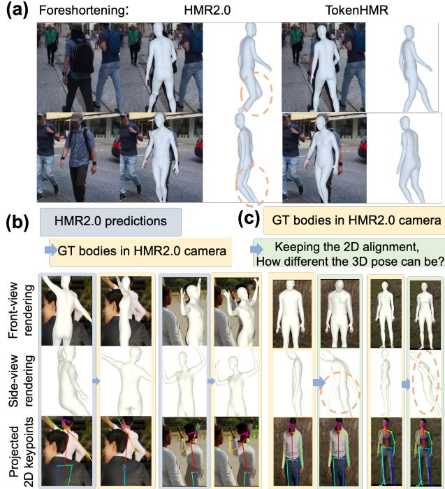
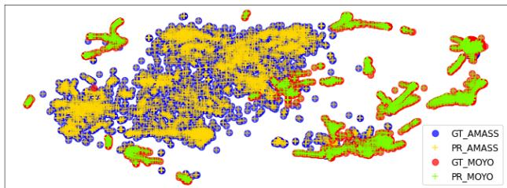

# TokenHMR: Advancing Human Mesh Recovery with a Tokenized Pose Representation

Sai Kumar Dwivedi1,\* Yu Sun2,∗ Priyanka Patel1 Yao Feng1,2,3 Michael J. Black1 1Max Planck Institute for Intelligent Systems, Tubingen, Germany ¨ 2Meshcapade 3ETH Zurich

  
Figure 1. Existing methods that regress 3D human pose and shape (HPS) from an image (like HMR2.0 [12]) estimate bodies that are either image-aligned or have accurate 3D pose, but not both. We show that this is a fundamental trade-off for existing methods. To address this our method, TokenHMR, introduces a novel loss, Threshold-Adaptive Loss Scaling (TALS), and a discrete token-based pose representation of 3D pose. With these, TokenHMR achieves state-of-the-art accuracy on multiple in-the-wild 3D benchmarks.

## Abstract

We address the problem of regressing 3D human pose and shape from a single image, with a focus on 3D accuracy. The current best methods leverage large datasets of 3D pseudo-ground-truth (p-GT) and 2D keypoints, leading to robust performance. With such methods, however, we observe a paradoxical decline in 3D pose accuracy with increasing 2D accuracy. This is caused by biases in the p-GT and the use of an approximate camera projection model. We quantify the error induced by current camera models and show that fitting 2D keypoints and p-GT accurately causes incorrect 3D poses. Our analysis defines the invalid distances within which minimizing 2D and p-GT losses is detrimental. We use this to formulate a new loss, “Threshold-Adaptive Loss Scaling” (TALS), that penalizes gross 2D andp-GT errors but not smaller ones. With such a

loss, there are many 3D poses that could equally explain the 2D evidence. To reduce this ambiguity we need a prior over valid human poses but such priors can introduce unwanted bias. To address this, we exploit a tokenized representation ofhuman pose and reformulate theproblem as token prediction. This restricts the estimated poses to the space ofvalid poses, effectively improving robustness to occlusion. Extensive experiments on the EMDB and 3DPW datasets show that our reformulated loss and tokenization allows us to train on in-the-wild data while improving 3D accuracy over the state-of-the-art. Our models and code are available for research at https://tokenhmr.is.tue.mpg.de.

## 1. Introduction

We address the problem of regressing 3D human pose and shape (HPS) from a single image. Recent methods [3, 12, 32, 49] are increasingly accurate on this task.

By accurate, we mean two things. A method should correctly regress the 3D pose but it should also align with the image evidence. Unfortunately, current models cannot do both. We observe a seeming paradox, that the more accurate a method is on fitting 2D keypoints, the less accurate it is at predicting 3D pose. We study this problem and identify the common weak-perspective camera assumption as a key culprit. This camera model does not match the true camera used to acquire the images and thus there is a mismatch between the projected 3D joints and the detected 2D ones. Since currently, no reliable method exists to estimate camera parameters from single image, we study and quantify this effect and propose two solutions to address it.

Specifically, we use the synthetic BEDLAM [3] dataset, which has perfect 3D and 2D groundtruth (GT). We project the 3D data into 2D using the camera model from [12] to quantify the 2D error in the best case; it is large. We then also go the other direction and show that low 2D error can result in large 3D error. Even using a full perspective model like [32] does not solve the problem since we lack the precise intrinsic and extrinsic camera parameters.

This analysis highlights the issue of supervising 3D pose regression with a 2D keypoint loss. But such a loss opens up access to large datasets, providing generalization and robustness. Unfortunately, pseudo ground-truth (p-GT) training data suffers the same problem since it is generated by fitting a 3D body to 2D data via optimization using an approximate camera model. How can we leverage the abundant information present in large-scale, in-the-wild, datasets while mitigating the decline in 3D accuracy? Our answer to this is TokenHMR, a new HPS regression method that strikes a balance between effectively leveraging 2D keypoints while maintaining 3D pose accuracy, thus leveraging Internet data today without known camera parameters.

TokenHMR has two main components. The first is based on our key insight that supervision from 2D keypoints, while flawed, is valuable for preventing highly incorrect predictions. However, excessive reliance on 2D cues introduces bias. To address this, we define a new loss called Threshold-Adaptive Loss Scaling (TALS) that penalizes large 2D and p-GT errors but only minimally penalizes small ones. We use our BEDLAM analysis to define this, so that the network is not encouraged to fit 2D keypoints more accurately than makes sense given the camera model.

This, however, creates a new problem. Predicting 3D pose from 2D keypoints is fundamentally ambiguous. When one relaxes the keypoint matching constraint, even more 3D poses are consistent with the 2D data. To control this, we need to introduce a prior that biases the network to valid poses. Unfortunately, existing pose priors based on mixtures of Gaussians [4] or VAEs [42] are biased towards poses that occur frequently in the training data. Instead, we seek an unbiased prior that restricts the network to only output valid poses but does not bias it to any particular pose.

This leads us to the second key component of TokenHMR, which gives it its name. Specifically, we convert the problem of continuous pose regression into a problem of token prediction by tokenizing human poses. We use a Vector Quantized-VAE (VQ-VAE) [53] to discretize continuous human poses by pre-training on extensive motion capture datasets, such as AMASS [37] and MOYO [52]. This tokenized representation provides the regressor with a “vocabulary” of valid poses, effectively representing the the pose prior as a knowledge bank, codebook. Since VQ-VAE’s are designed to represent a uniform prior, we posit that this reduces the biases caused by previous pose priors.

TokenHMR generates discrete tokens through classification, in contrast to regressing continuous pose. When we take a SOTA HPS method and replace the continuous pose with our tokenized pose approach we see consistent improvements in 3D accuracy (all else held the same).

We perform extensive experiments to evaluate different ways of tokenizing pose and their effects on accuracy. Any discretization of pose comes with some loss in accuracy. In our case it results in a loss of 3D accuracy of about 2.5mm, which is 20 times smaller than the accuracy of the state-ofthe-art (SOTA) HPS regressors on real data; i.e., the loss in accuracy due to tokenization is negligible.

Finally, we put our two components together and find that they work synergistically. Our new loss does not distort the 3D pose to over-fit the keypoints or p-GT and the tokenization keeps the network from distorting 3D pose for the sake of 2D accuracy. With this combination, we achieve a new state-of-the-art in terms of 3D accuracy. We extensively evaluate TokenHMR and other recent methods on EMDB [23] and 3DPW [55], which have accurate 3D ground truth. Using the same data and backbone, TokenHMR exhibits a 7.6% reduction in 3D error compared to HMR2.0 [12] on the challenging EMDB dataset. Qualitative results suggest that the TokenHMR is robust to ambiguous image evidence and the estimated poses do not suffer from the “bent knees” bias of methods that use p-GT and 2D keypoints (see Fig. 1).

In summary, we make the following key contributions: (1) Analysis of 3D Accuracy Degradation: We analyze and quantify the trade-off between 3D and 2D accuracy that current HPS methods face if they use 2D losses. (2) Threshold-Adaptive Loss Scaling: To ameliorate the issue, we develop a novel loss function that reduces the influence of 2D and p-GT errors that are less than the expected error due to the incorrect camera model. (3) Token-Based Pose Representation: We introduce a token-based representation for human pose and show that it produces more accurate pose estimates. Our models and code are available for research.

## 2. Related Work

## 2.1. HPS Regression

Estimating 3D human pose and shape from single images has been studied in great detail from optimization-based approaches to the most recent transformer-based regressors. Optimization approaches fit a parametric model [36, 42, 59] to 2D image cues, including, but not limited to keypoints [4, 42, 59], silhouettes [41], and part segmentations [30]. Some learning-based approaches directly estimate the parametric body model from images [6, 8, 9, 21, 25, 32, 48, 49, 61] and videos [22, 24] and some estimate bodies with a modelfree approach either as vertices [28, 34, 46] or as implicit shapes [39, 45, 58]. Recent methods [12, 33] use transformers to estimate 3D bodies, achieving the current best accuracy. To address the challenges of generalization, recent methods like EFT [20], NeuralAnnot [40], HMR2.0 [12] and CLIFF [32] use 2D keypoints and p-GT in the training loss, to produce a good alignment between the projected body and the image. Methods like HuManiFlow [47] and POCO [9] model probabilistic HPS to explicitly address pose ambiguity. The problem of 3D accuracy degradation in pursuit of better 2D alignment has been noted but not extensively quantified before our work. Our statistical analysis highlights this bias in existing HMR methods, offering a new perspective on training strategies for this problem.

Some methods [26, 32, 56] address the 3D-to-2D projection error by estimating the camera from a single image. SPEC [26] uses a network to predict camera parameters but does not generalize well, while CLIFF [32] uses an approximation by providing the network with information about the bounding box coordinates of the person in the image. Estimating the camera from a single image is highly ill-posed so this remains a challenging, unsolved, problem. Our approach reduces the impact of using the wrong camera model and can be applied to any HPS regression method.

## 2.2. Pose Prior

Human pose priors play a pivotal role in various applications like lifting 2D pose to 3D [4, 42] and estimating human pose from images/videos [20, 29]. Early pose priors focus on learning joint limits [1] to avoid poses that are impossible. Gaussian Mixture Models (GMMs) [4] and Generative Adversarial Networks (GANs) [11, 21] are also used to impose prior knowledge during training. Some recent methods use VAEs [42] and normalizing flows [29] as priors. Many of these methods are biased to commonly occurring poses and this bias is passed on the regressor. Methods like Pose-NDF [51] learn a manifold of plausible poses represented as the zero-level set of a neural implicit function. The mapping of invalid to valid poses involves gradient descent, which is an expensive operation when integrated in HPS training. In contrast to prior work, we learn a discrete token-based prior over valid SMPL poses, reducing pose bias and improving robustness to occlusion, while being easy to integrate into HPS training.

  
Figure 2. Visualization of the camera/pose bias issues. (a) The lack of correct focal length means that foreshortened legs are estimated as bent by methods like HMR2.0. (b) Replacing the predicted body poses with ground truth reveals camera bias; (c) Maintaining 2D alignment, how wrong can the 3D poses be? See Sec. 3 for details.

We use a VQ-VAE [53], which is a variant of VAEs, to learn a discretized prior by quantizing the 3D training poses in a process called “Tokenization” creating a knowledge bank i.e. codebook. Tokenization is widely used in various applications like image synthesis [44, 53], text-toimage generation [43], 2D human pose estimation [10], and learning motion priors [18, 62]. In the context of human pose estimation, tokenization remains relatively unexplored, though it is widely used in human motion generation [14, 62]. Of course, tokenized representations of images and language are widely used for many vision and language problems. Our approach is novel in that it reformulates the regression problem as a pose token classification problem. It thus exploits tokenization to represent valid poses, effectively providing a pose prior.

## 3. Camera/pose Bias

Methods that estimate 3D HPS typically try to satisfy two goals: accurate 3D pose and accurate alignment with 2D image features. Unfortunately, we observe a trend in all experiments – the better a method does on 2D error, the worse it does on 3D and vice versa. The key reason for this is that current methods, including those tested here, do not estimate the camera intrinsic parameters (e.g. focal length) or the camera extrinsics (rotation and translation). Instead, current methods estimate the person in camera coordinates using scaled orthographic projection or perspective projection with fixed and incorrect camera parameters. This results in a mismatch between the true 3D joints and their 2D projection. Specifically, since photos are typically taken from roughly eye height, the legs are further away than the upper body. This causes them to be foreshortened. Training models to minimize 2D error forces them to generate incorrect poses in 3D; this is illustrated in Fig. 2 (a). Pseudo ground truth (p-GT) for 2D pose datasets is obtained by minimizing the 2D error with problematic camera parameters. Fully trusting such p-GT and pursuing accurate learning of such annotations will make the problem more prominent. Notice how foreshortening makes the legs appear shorter in the image. The only way to make a human body fit this is to bend the legs at the knees or tilt the body in 3D, making the legs further away. This produces unnatural or unstable poses.

This is a fundamental issue with all current methods and one cannot get low error for both 3D and 2D without knowing the camera. To numerically evaluate the impact of this mismatch, we employ BEDLAM [3], a synthetic dataset where both 3D and 2D data are known exactly along with the camera. This removes any possible noise and allows us to see the effects of using the wrong camera on 2D projection error. Specifically, as shown in Fig. 2 (b), we take ground truth BEDLAM bodies and project them into the image using the camera of HMR2.0 [12].

We evaluate the effect of the incorrect camera in 2D using the standard measure of Percentage of Correct Keypoints (PCK), which we compute for a sequence from the BEDLAM validation set. The 3D bodies computed by HMR2.0b have errors of 0.78 on PCK0.5 and 0.88 on PCK1.0. In contrast, when we use the HMR2.0b camera with the ground truth 3D bodies, the PCK scores decrease to 0.66 on PCK0.5 and 0.86 on PCK1.0. Ideally, with a correct camera model, both PCK0.5 and PCK1.0 should reach 1.0. The fact that HMR2.0b achieves lower error than the ground truth indicates that its output deviates from the true 3D pose and shape due to camera bias. This demonstrates that methods like HMR2.0b, while obtaining high PCK values, do so at the expense of 3D accuracy. In summary, seeking high PCK values is counterproductive to 3D accuracy unless one has the correct camera model.

We further design experiments to explore how bad the 3D error can be while maintaining good 2D alignment. We modify the loss function of SMPLify [4] to keep the distance between predicted 2D keypoints and GT 2D keypoints $\scriptstyle J _ { 2 D _ { g } }$ close, while adding a new loss to increase the distance between predicted 3D keypoints $J _ { 3 D }$ and real 3D keypoints $\ J _ { 3 D _ { g } }$ , as expressed in the following equation:

$$
w _ { 2 D } | | \Pi ( J _ { 3 D } , { \cal T } ) - J _ { 2 D _ { g } } | | _ { 2 } - w _ { 3 D } | | J _ { 3 D } - J _ { 3 D _ { g } } | | _ { 2 } + m\tag{1}
$$

where Π represents 3D-to-2D projection using HMR2.0’s camera, $m \ = \ 2 0$ is the margin value, $w _ { 2 D } ~ = ~ 4$ and $w _ { 3 D } ~ = ~ 4 0 . 5$ are scalar weights. After 100 iterations of optimization, the Mean Per Joint Position Error (MPJPE) reaches 146mm. As shown in Fig. 2 (c), the projected 3D pose can still maintain a high degree of 2D alignment even with significant errors in the depth direction. When optimized for 200 iterations, the MPJPE exceeds 300mm, and the error continues to increase with further optimization.

Since the field does not currently have a reliable way to estimate the camera parameters from a single image, below we explore the ability of our new methods (TALS and tokenization) to help mitigate the issues caused by approximate camera models. Figure 2 (a) compares results from HMR2.0 and TokenHMR. Note that the effect of foreshortening has less impact on pose with TokenHMR.

## 4. TokenHMR

## 4.1. Preliminaries

Our method, TokenHMR, takes an input image, I, and outputs body pose, θ, shape, β and perspective camera, T. We use SMPL [36], a differentiable parametric body model. Its input parameters consist of pose, denoted by $\theta \in \mathbb { R } ^ { 7 2 }$ and shape, denoted as $\beta \in \mathbb { R } ^ { 1 0 }$ . As output, it produces a body mesh, M, and vertices, $V \in \mathbb { R } ^ { N X \bar { 3 } }$ , where $N = 6 8 9 0$ is the number of vertices. 3D joints denoted as $J _ { 3 D }$ , are derived through a linear combination of mesh vertices using a pre-trained joint regressor.

## 4.2. Threshold-Adaptive Loss Scaling: TALS

In Section 3, our analysis reveals a notable impediment to the effective learning using pseudo-ground-truth and 2D keypoints—camera/pose bias. Despite this challenge, the scale provided by such annotations remains integral to achieving optimal generalization and robustness. We assert that, when appropriately utilized, without over-fitting, these annotations significantly enhance the model’s ability to robustly estimate pose. A key insight emerges from our observations: establishing an effective threshold is imperative to discern the error levels that yield no additional benefit as a training signal. When the loss surpasses this threshold, conventional learning mechanisms guide pose estimation. Conversely, when the loss falls below this effective threshold, we minimize its impact to prevent over-fitting to the camera/pose bias.

To determine this effective threshold, we analyze the errors obtained using ground truth (GT) 3D poses and a standard (incorrect) camera model. Again we leverage the 3D

  
Figure 3. Framework overview. Our method has two stages. (a) In the tokenization step, the encoder learns to map continuous poses to discrete pose tokens and the decoder tries to reconstruct the original poses. (b) To train TokenHMR, we replace regression with classification using the pre-trained decoder, which provides a “vocabulary” of valid poses.

## 4.3. Tokenization

GT in BEDLAM [3], this time to establish effective thresholds for both 2D keypoints and SMPL pseudo-ground-truth. For 2D keypoints, we replace the predicted SMPL parameters with ground truth values from BEDLAM to obtain the real 3D human body’s 2D keypoint projections under the HMR2.0 camera. We then calculate the mean L1 norm between these projections and the GT 2D keypoints, and use this as the threshold $\varepsilon J _ { 2 D }$ for 2D keypoint supervision. We normalize these 2D keypoints relative to image width and scale the values between -0.5 and 0.5 to mitigate scalerelated variances.

Similarly, to establish the effective supervision threshold for SMPL p-GT, we conduct additional experiments. With p-GT, we formulate the pose loss in terms of joint angle error. To set appropriate thresholds on these errors, we evaluate the difference in joint angles between HMR2.0’s predictions on BEDLAM and the ground truth values for each joint in the SMPL model. Specifically, we compute the mean geodesic distance\* between the 3D joint rotations on the manifold of rotations in SO(3) predicted by HMR2.0 and the ground-truth rotations in BEDLAM. Please refer to Sec. B.2 in Sup. Mat. for specific threshold values.

After establishing the effective thresholds for 2D keypoints and SMPL p-GT, we introduce a new loss called Threshold-Adaptive Loss Scaling (TALS). It scales down the loss only when it goes below the threshold. Specificially, the TALS loss terms for p-GT pose and 2D joints are defined as

$$
\mathcal { L } _ { \theta _ { p G T } } = \left\{ \begin{array} { l l } { \Vert \pmb { \theta } - \pmb { \theta _ { g } } \Vert ^ { 2 } } & { \mathrm { i f } \ \mathcal { L } _ { \theta _ { p G T } } > \varepsilon _ { \theta } } \\ { \alpha _ { \theta } \cdot \Vert \pmb { \theta } - \pmb { \theta _ { g } } \Vert ^ { 2 } } & { \mathrm { o t h e r w i s e } } \end{array} \right.\tag{2}
$$

$$
\mathcal { L } _ { J _ { 2 D _ { p G T } } } = \left\{ \begin{array} { l l } { | J _ { 2 D } - J _ { 2 D _ { g } } | } & { \mathrm { i f ~ } \mathcal { L } _ { J _ { 2 D _ { p G T } } } > \varepsilon _ { J _ { 2 D } } } \\ { \alpha _ { J _ { 2 D } } \cdot | J _ { 2 D } - J _ { 2 D _ { g } } | } & { \mathrm { o t h e r w i s e } } \end{array} \right.\tag{3}
$$

where $\alpha _ { J _ { 2 D } }$ and $\alpha \theta$ are small scalar multipliers and $\varepsilon _ { \theta }$ is the threshold calculated separately for each pose parameter and $\varepsilon J _ { 2 D }$ is the threshold for 2D joints.

We use a VQ-VAE [53], which learns an encoding of 3D pose in a discrete representation. Specifically, we learn a discrete representation for SMPL body parameters, $\theta \ =$ $[ \theta _ { 1 } , \theta _ { 2 } , \ldots , \theta _ { 2 1 } ]$ , where the $\theta _ { i }$ represent each joint’s pose parameters in $\mathbb { R } ^ { 6 }$ . The process involves encoding and decoding the pose parameters using an autoencoder architecture and a learnable codebook, denoted as $C B = \{ c _ { k } \} _ { k = 1 } ^ { K } ,$ with each code $c _ { k } \ \in \ \mathbb { R } ^ { d _ { c } }$ , where $d _ { c }$ is the dimension of the codes. The overall architecture of the Pose VQ-VAE is illustrated in Fig. 3 (a). The encoder and decoder of the autoencoder are represented by E and $D ,$ , respectively. The encoder is responsible for generating discrete pose tokens, while the decoder reconstructs these tokens back to SMPL poses. The latent feature z can be computed as $z = E ( \theta )$ , resulting in $z = [ z _ { 1 } , z _ { 2 } , \dots , z _ { M } ]$ , where $z _ { i } \in \mathbb { R } ^ { d _ { c } }$ and M is the number of tokens. Each latent feature $z _ { i }$ is quantized using the codebook CB by finding the most similar code element, as expressed in the following equation:

$$
\hat { z } _ { i } = \underset { c _ { k } \in C B } { \arg \operatorname* { m i n } } \| z _ { i } - c _ { k } \| _ { 2 } .\tag{4}
$$

In training the pose tokenizer, we adopt a strategy similar to previous work [53], which involves three primary loss functions to optimize the tokenizer: the reconstruction loss $( \mathcal { L } _ { \mathcal { R } \mathcal { E } } )$ , the embedding loss $( \mathcal { L } _ { \mathcal { E } } )$ , and the commitment loss $( \mathcal { L } _ { \mathcal { C } } )$ . The overall loss $( \mathcal { L } _ { \mathcal { V } \mathcal { Q } } )$ is defined as

$$
\begin{array} { r l } & { \mathcal { L } _ { \mathcal { V } \mathcal { Q } } = \lambda _ { \mathcal { R } \mathcal { E } } \mathcal { L } _ { \mathcal { R } \mathcal { E } } + \lambda _ { \mathcal { E } } \mathcal { L } _ { \mathcal { E } } + \lambda _ { \mathcal { C } } \mathcal { L } _ { \mathcal { C } } } \\ & { \quad \quad \quad = \lambda _ { \mathcal { R } \mathcal { E } } \mathcal { L } _ { \mathcal { R } \mathcal { E } } + \lambda _ { \mathcal { E } } \vert \vert s { g } [ z ] - e \vert \vert _ { 2 } + \lambda _ { \mathcal { C } } \vert \vert z - s g [ e ] \vert \vert _ { 2 } } \end{array}\tag{5}
$$

where $s g$ is the stop gradient operator, e is the embedding from the codebook and $\lambda _ { \mathcal { R } \mathcal { E } } , \lambda _ { \mathcal { E } } , \lambda _ { \mathcal { C } }$ are the hyperparameters of for each term. For reconstruction, we use an $\mathcal { L } _ { 1 }$ loss between the ground-truth pose, $\theta _ { g } ,$ and predicted pose, θ and also on the error between the SMPL ground-truth 3D joints, $J _ { 3 D _ { g } }$ and predicted joints, $J _ { 3 D }$ . So, the $\mathcal { L } _ { \mathcal { R } \mathcal { E } }$ loss is defined as

$$
\begin{array} { r } { \mathcal { L } _ { \mathcal { R E } } = \mathcal { L } _ { 1 } ( \theta _ { g } , \theta ) + \mathcal { L } _ { 1 } ( J _ { 3 D _ { g } } , J _ { 3 D } ) . } \end{array}\tag{6}
$$

The original VQ-VAE suffers from codebook collapse, i.e. the codebook is not fully utilized. Following prior work [62], we use the training strategy of exponential moving average (EMA) and codebook reset (Code Reset) for better utilization.

## 4.4. Architecture

Our architecture exploits the Vision Transformer (ViT) [7], similar to HMR2.0 [12]. The input image, I, is first transformed into input tokens, which are subsequently processed by the transformer to generate output tokens. These output tokens then undergo further processing in the transformer decoder. The transformer decoder has multi-head self-attention that cross-attends a zero input token with an image output token to get features from the transformer block. In contrast to HMR2.0 [12], which employs three linear layers to map the features from transformer block to the SMPL pose, θ, shape, $\beta$ and camera, T, we propose a novel approach. Our objective is to leverage a tokenizer trained on a significant amount of motion capture (mocap) data, specifically focusing on body pose. To facilitate this, we partition the SMPL pose parameters into body pose and global orientation. We use separate linear layers to predict the global orientation and body pose from the tokenizer.

A straightforward integration of the tokenizer would involve estimating the code index directly from the ViT transformer backbone and selecting embeddings, e, based on the code index from the codebook, CB. However, this poses a challenge as the process of selecting an embedding from the codebook, is non-differentiable. To address this issue, we adopt a logit-based approach. Instead of directly estimating the code index, we output logits, Q for each token. These logits are multiplied with the codebook, resulting in weighted embeddings. Thus, the approximated quantized feature $\hat { z } = [ \hat { z } _ { 1 } , \hat { z } _ { 2 } , . . . , \hat { z } _ { M } ]$ can be calculated as

$$
\bar { z } = \sigma ( { \cal Q } _ { { \cal M } \times { \cal K } } ) \times C B _ { { \cal K } \times { \cal D } } \approx \hat { z }\tag{7}
$$

where, $Q$ are the logits estimated by the backbone, $\sigma$ is the softmax operation, CB is the pretrained codebook, M is the number of tokens, K is the number of entries in the codebook and D is the dimension of each codebook entry. The operation makes it differentiable. The obtained approximated quantized features, z¯ are subsequently passed through the tokenizer decoder. This process yields the final pose. In the training of TokenHMR, the learned tokenizer decoder is frozen to take advantage of the prior it has learned from mocap data.

## 4.5. Losses

Following prior work [12, 25], we define losses on 2D and 3D joints and SMPL pose and shape parameters, i.e. on $J _ { 2 D } , J _ { 3 D } , \theta , \beta$ , respectively. However, following the analysis in Sec. 4.2, we treat data from 2D and 3D datasets differently. For 3D ground-truth datasets, we define the standard loss as

$$
\begin{array} { r } { \mathcal { L } _ { G T } = \lambda _ { \theta } \mathcal { L } _ { \theta } ( \theta , \theta _ { g } ) + \lambda _ { \beta } \mathcal { L } _ { \beta } ( \beta , \beta _ { g } ) + } \\ { \lambda _ { 3 D } \mathcal { L } _ { 3 D } ( \mathbf { J } _ { 3 D } , \mathbf { J } _ { 3 D _ { g } } ) + \lambda _ { 2 D } \mathcal { L } _ { 2 D } ( \mathbf { J } _ { 2 D } , \mathbf { J } _ { 2 D _ { g } } ) } \end{array}\tag{8}
$$

where $\mathcal { L } _ { \beta }$ is a SMPL shape loss, $\mathcal { L } _ { J _ { 3 D } }$ is the 3D joint loss and $\mathcal { L } _ { J _ { 2 D } }$ is the joint re-projection loss. $\lambda _ { \beta } , \lambda _ { 3 D }$ and $\lambda _ { 2 D }$ are steering weights for each term. To learn from SMPL pseudo-ground-truth, we use Threshold-Adaptive Loss Scaling (TALS) where we scale the loss based on the threshold computed in Sec. 4.2, outlined in Eqs. 2 and 3. Thus, the total loss is defined as

$$
\mathcal { L } _ { T o t a l } = \mathcal { L } _ { G T } + \mathcal { L } _ { \theta _ { p G T } } + \mathcal { L } _ { J _ { 2 D _ { p G T } } } .\tag{9}
$$

## 5. Experiments

## 5.1. Implementation Details

Training of TokenHMR involves two stages: first we train a tokenizer to learn discrete pose representations using AMASS [37] and MOYO [52] mocap data. Then we use the pretrained decoder of the tokenizer as an additional head for regressing body pose. During the training of TokenHMR, the tokeniser is frozen to exploit the prior.

Our tokenizer architecture is inspired from T2M-GPT [62] but instead of learning motion tokens of 3D joints we learn pose tokens of SMPL pose parameters. We use 1 ResNet [15] block and 4 1D convolutions both in the encoder and decoder. The steering weights $\lambda _ { \mathcal { R } \mathcal { E } } , \lambda _ { \mathcal { E } } , \lambda _ { \mathcal { C } }$ are set at 50.0, 1.0, 1.0, respectively. The model is trained for 150K iterations with batch size of 256 and learning rate of $2 e ^ { - 4 } .$ . To train a robust model, we augment random joints with noise starting from $1 e ^ { - 3 }$ , which we progressively increase after every 5K iterations. We choose the best tokenizer model containing 160 tokens and codebook of size 2048 × 256 for TokenHMR based on reconstruction error on the validation set.

For TokenHMR, we use ViT-H/16 [7] as the backbone and standard transformer decoder [54] following HMR2.0 [12]. We use 4 separate linear layers to map the features of size 1024 from the transformer decoder to the global orientation, hand pose, and body shape of SMPL and one for the camera. However, for body pose, we process the 1024 features through 4 blocks of linear layers, each containing 2 MLPs and an GELU activation function [16]. This gives the final logits, Q, of size 160 × 2048 for multiplication with a codebook of size $2 0 4 8 \times 2 5 6$ , which results in approximate quantized features, z¯; see Eq. 4. We use ViT-Pose [60] as the pretrained backbone. We train for 100K iterations on 4 Nvidia RTX 6000 GPUs with a batch size of 256 and learning rate of $1 e ^ { - 5 }$ for about one day. The steering weights, $\lambda _ { \theta } , \lambda _ { \beta } , \lambda _ { J _ { 2 D } } , \lambda _ { J _ { 3 D } }$ are set to $1 e ^ { - 3 } , 5 e ^ { - 4 }$ $1 e ^ { - 2 } , \bar { 5 } e ^ { - 2 }$ , respectively. The loss weights of TALS is set to 1% for both pose $\alpha \theta$ and 2D keypoints $\alpha _ { J _ { 2 D } }$

<table><tr><td rowspan="2">Training Datasets</td><td rowspan="2">Method</td><td colspan="3">EMDB [23]</td><td colspan="3">3DPW [55]</td></tr><tr><td>MVE</td><td>MPJPE</td><td>PA-MPJPE</td><td>MVE</td><td>MPJPE</td><td>PA-MPJPE</td></tr><tr><td>SD</td><td>HybrIK [31]</td><td>122.2</td><td>103.0</td><td>65.6</td><td>94.5</td><td>80.0</td><td>48.8</td></tr><tr><td>SD</td><td>CLIFF [32]</td><td>122.9</td><td>103.1</td><td>68.8</td><td>81.2</td><td>69.0</td><td>43.0</td></tr><tr><td>SD</td><td>HMR2.0 [12]</td><td>120.1</td><td>97.8</td><td>61.5</td><td>84.1</td><td>70.0</td><td>44.5</td></tr><tr><td>BL</td><td>BEDLAM-CLIFF [3]</td><td>113.2</td><td>97.1</td><td>61.3</td><td>85.0</td><td>72.0</td><td>46.6</td></tr><tr><td>BL</td><td>HMR2.0</td><td>106.6</td><td>90.7</td><td>51.3</td><td>88.4</td><td>72.2</td><td>45.1</td></tr><tr><td>BL</td><td>TokenHMR</td><td>104.2</td><td>88.1</td><td>49.8</td><td>86.0</td><td>70.5</td><td>43.8</td></tr><tr><td>SD + ITW</td><td>HMR2.0 [12]</td><td>140.6</td><td>118.5</td><td>79.3</td><td>94.4</td><td>81.3</td><td>54.3</td></tr><tr><td>SD + ITW</td><td>TokenHMR</td><td>124.4</td><td>102.4</td><td>67.5</td><td>88.1</td><td>76.2</td><td>49.3</td></tr><tr><td>SD + ITW + BL</td><td>HMR2.0</td><td>120.7</td><td>99.3</td><td>62.8</td><td>88.4</td><td>77.4</td><td>47.4</td></tr><tr><td>SD + ITW + BL</td><td>HMR2.0 + TALS</td><td>115.7</td><td>96.7</td><td>58.5</td><td>89.6</td><td>73.5</td><td>46.8</td></tr><tr><td>SD + ITW + BL</td><td>HMR2.0 + Token</td><td>116.1</td><td>95.6</td><td>62.2</td><td>86.6</td><td>75.0</td><td>48.0</td></tr><tr><td>SD + ITW + BL</td><td>HMR2.0 + TALS + VPoser [42]</td><td>116.8</td><td>97.9</td><td>56.4</td><td>87.1</td><td>73.7</td><td>45.7</td></tr><tr><td>SD + ITW + BL</td><td>TokenHMR</td><td>109.4</td><td>91.7</td><td>55.6</td><td>84.6</td><td>71.0</td><td>44.3</td></tr></table>

Table 1. 3D human mesh and pose errors on the EMDB and 3DPW datasets. See text.
<table><tr><td rowspan="2">Method</td><td colspan="3">Crop 30%</td><td colspan="3">Crop 50%</td></tr><tr><td>MVE</td><td>MPJPE</td><td>PA-MPJPE</td><td>MVE</td><td>MPJPE</td><td>PA-MPJPE</td></tr><tr><td>HMR2.0 [12]</td><td>135.24 (+14.98)</td><td>113.39 (+14.13)</td><td>70.68 (+7.86)</td><td>166.71 (+46.45)</td><td>137.88 (+38.59)</td><td>90.30 (+27.48)</td></tr><tr><td>TokenHMR</td><td>124.09 (+14.71)</td><td>104.72 (+13.01)</td><td>62.13 (+6.52)</td><td>150.29 (+40.91)</td><td>125.99 (+34.28)</td><td>78.88 (+23.27)</td></tr></table>

Table 2. Impact of evenly cropping images at different ratios from the boundaries on the 3D HPS accuracy on the EMDB dataset. The numbers in (parentheses) indicate the changes in performance relative to the non-cropped scenario; smaller is better. All models compared here employ identical backbones and are trained on the same data.

<table><tr><td>1</td><td>一</td><td colspan="2">AMASS [37]</td><td colspan="2">MOYO [52]</td></tr><tr><td></td><td>Method</td><td>MVE↓|</td><td>MPJPE↓</td><td>MVE↓</td><td>MPJPE↓</td></tr><tr><td rowspan="3">CB</td><td>1024 × 256</td><td>11.5</td><td>4.6</td><td>27.1</td><td>15.7</td></tr><tr><td>2048 × 128</td><td>9.4</td><td>3.1</td><td>22.5</td><td>12.3</td></tr><tr><td>2048 × 256</td><td>8.3</td><td>2.2</td><td>19.9</td><td>10.4</td></tr><tr><td rowspan="3">Tokekens</td><td>80</td><td>12.5</td><td>4.1</td><td>24.4</td><td>16.7</td></tr><tr><td>160</td><td>8.3</td><td>2.2</td><td>19.9</td><td>10.4</td></tr><tr><td>320</td><td>8.1</td><td>1.9</td><td>19.0</td><td>10.1</td></tr><tr><td rowspan="3">Noise</td><td>Yes</td><td>8.3</td><td>2.2</td><td>19.9</td><td>10.4</td></tr><tr><td>No</td><td>7.9</td><td>1.9</td><td>21.0</td><td>11.5</td></tr><tr><td>AMASS + MOYO*</td><td>8.7</td><td>2.6</td><td>16.5</td><td>7.6</td></tr></table>

Table 3. Tokenizer Ablation. All methods are trained on the standard training set of AMASS [37] and evaluated on the test set of AMASS and validation set of MOYO [52] except the last row⋆, which is trained with the MOYO training set. The last model is used as the tokenizer in TokenHMR.

Training Data: For training the tokenizer, we use the standard training split of AMASS [37] and the training data of MOYO [52]. For more details on data preparation of training, please refer to Sup. Mat. Following the prior methods [12, 25, 27], we use standard datasets (SD) for training which include Human3.6M [17], MPI-INF-3DHP [38], COCO [35], and MPII [2]. Additionally, like HMR2.0b, we also use in-the-wild 2D datasets (ITW) like InstaVariety [22], AVA [13], and AI Challenger [57] datasets and their p-GT for training. We also include BEDLAM (BL) [3], a synthetic dataset with accurate ground-truth 3D data. For a fair comparison, we re-train HMR2.0b using a combination of the SD, ITW, and BL datasets. We choose HMR2.0b as a baseline model since the code is open-source and we can reproduce the results.

Evaluation and Metrics: For the tokeniser accuracy, we report the Mean Vertex Error (MVE) and Mean Per Joint Position Error (MPJPE) and evaluate on the standard test split of AMASS and validation set of MOYO. For TokenHMR, we report the Mean Vertex Error (MVE), Mean Per Joint Position Error (MPJPE), and Procrustes-Aligned Mean Per Joint Position Error (PA-MPJPE) between the predictions and the ground-truth. We evaluate on the test set of the 3DPW [55] and EMDB [23] datasets. The former is a standard 3D dataset and the latter is a recently released and more challenging dataset with varying camera motions and varied 3D poses.

## 5.2. How to Alleviate the 3D Degradation Problem?

Table 1 shows the performance of the HMR2.0 model trained solely with the SD dataset and its performance when trained with both SD and ITW datasets. We observe a significant decrease (over 17%) in 3D accuracy on the EMDB dataset upon the inclusion of the ITW data. At the same time, according to the Table 2 in HMR2.0 [12] paper, the ITW data improves the method’s 2D performance. A straightforward approach to counter this trend could be to integrate more data with precise 3D annotations, such as BEDLAM [3]. Yet, as Table 1 reveals, even with the inclusion of BEDLAM, HMR2.0 (SD+ITW+BL) still suffers from noticeable 3D metric degradation. This observation forms our baseline for further investigations.

  
Figure 4. Qualitative comparisons on challenging poses from the LSP [19] dataset.

Employing our novel loss formulation (TALS) results in notable performance improvement on both the EMDB and 3DPW datasets, indicating its effectiveness in preventing overfitting to noisy p-GT data. While TALS yields improvements, we delve deeper into exploring pose priors to compensate for the diminished supervision. Our evaluation of VPoser [42], a prevalent VAE prior in HPS, yields only marginal improvements, suggesting the need for a more robust alternative. Our VQ-VAE-based pose tokenization approach offers greater improvement. TokenHMR significantly outperforms HMR2.0, with improvements of 9% in MVE, 7.6% in MPJPE, and 11.5% in PA-MPJPE on EMDB. Consistent trends are also observed on 3DPW.

## 5.3. How does the Token-based Prior Help?

Beyond facilitating more effective learning as we discussed above, we also examine the efficacy of our discrete tokenbased prior in scenarios with ambiguous image information, such as truncation. We evaluate our method under varying degrees of image cropping on the EMDB dataset. Specifically, we crop 30% and 50% from the image boundaries. As shown in Table 2, compared with HMR2.0 [12], the performance of our approach decreases less in the challenging truncation settings (50% v.s. 30%). Furthermore, the qualitative outcomes, illustrated in Fig. 4, underscore the robustness of the prior embedded within our token-based pose representation. This robustness is crucial for handling real-world scenarios where image truncation is common.

## 5.4. Ablation Study of Tokenizer

Table 3 presents our ablation study on different tokenizer design choices using AMASS’s standard test set and MOYO’s validation set. To understand the impact of the design choices on out-of-distribution MOYO data, we train solely with AMASS and conduct various ablations. The final tokenizer model (last row in Table 3), however, is used in TokenHMR and is trained on both the AMASS and MOYO datasets. Our findings indicate that the number of codebook entries has a more significant impact than code dimensions. Although the number of tokens is crucial for an accurate representation, we observe a performance plateau, opting for 160 tokens in our final model. This number strikes a balance between network size and reconstruction accuracy for TokenHMR. Random augmentation of pose parameters with noise builds a more robust tokenizer, slightly reducing performance for in-distribution data but beneficially impacting OOD data.

## 6. Conclusion

In this paper, we presented a novel approach to 3D human pose estimation from single images. We begin by identifying and quantifying the problem caused by using a 2D keypoint loss with an incorrect camera model. This leads to a fundamental tradeoff for current methods – either have high 3D accuracy or 2D accuracy, but not both. Our method, TokenHMR, addresses this problem with two contributions that can easily be used by other methods. TokenHMR adopts a new paradigm for pose estimation based on regressing a discrete tokenized representation of human pose. We combine this with a new loss, TALS, which mitigates some of the bias caused by the camera projection error, and biased p-GT, while still allowing the use of in-the-wild training data. Our experiments on the EMDB and 3DPW datasets demonstrate that TokenHMR significantly outperforms existing models like HMR2.0 in terms of 3D accuracy, even with siginficant occlusion.

## 7. Acknowledgement

We sincerely thank the department of Perceiving Systems and ML team of Meshcapade GmbH for insightful discussions and feedback. We thank the International Max Planck Research School for Intelligent Systems (IMPRS-IS) for supporting Sai Kumar Dwivedi. We thank Meshcapade GmbH for supporting Yu Sun and providing GPU resources. This work was partially supported by the German Federal Ministry of Education and Research (BMBF): Tubingen AI Center, FKZ: 01IS18039B.¨ Disclosure: https://files.is.tue.mpg.de/black/CoI CVPR 2024.txt

## References

[1] Ijaz Akhter and Michael J. Black. Pose-conditioned joint angle limits for 3D human pose reconstruction. In Computer Vision and Pattern Recognition (CVPR), 2015. 3

[2] Mykhaylo Andriluka, Leonid Pishchulin, Peter Gehler, and Bernt Schiele. 2d human pose estimation: New benchmark and state of the art analysis. In Computer Vision and Pattern Recognition (CVPR), 2014. 7, 1

[3] Michael J Black, Priyanka Patel, Joachim Tesch, and Jinlong Yang. Bedlam: A synthetic dataset of bodies exhibiting detailed lifelike animated motion. In CVPR, pages 8726–8737, 2023. 1, 2, 4, 5, 7, 8

[4] Federica Bogo, Angjoo Kanazawa, Christoph Lassner, Peter Gehler, Javier Romero, and Michael J. Black. Keep it SMPL: Automatic estimation of 3D human pose and shape from a single image. In European Conference on Computer Vision (ECCV), 2016. 2, 3, 4

[5] Z. Cao, G. Hidalgo Martinez, T. Simon, S. Wei, and Y. A. Sheikh. Openpose: Realtime multi-person 2d pose estimation using part affinity fields. IEEE Transaction on Pattern Analysis and Machine Intelligence (TPAMI), 2019. 1

[6] Hongsuk Choi, Gyeongsik Moon, JoonKyu Park, and Kyoung Mu Lee. Learning to estimate robust 3d human mesh from in-the-wild crowded scenes. In Computer Vision and Pattern Recognition (CVPR), pages 1475–1484, 2022. 3

[7] Alexey Dosovitskiy, Lucas Beyer, Alexander Kolesnikov, Dirk Weissenborn, Xiaohua Zhai, Thomas Unterthiner, Mostafa Dehghani, Matthias Minderer, Georg Heigold, Sylvain Gelly, Jakob Uszkoreit, and Neil Houlsby. An image is worth 16x16 words: Transformers for image recognition at scale. In International Conference on Learning Representations (ICLR), 2021. 6

[8] Sai Kumar Dwivedi, Nikos Athanasiou, Muhammed Kocabas, and Michael J. Black. Learning to regress bodies from images using differentiable semantic rendering. In International Conference on Computer Vision (ICCV), 2021. 3

[9] Sai Kumar Dwivedi, Cordelia Schmid, Hongwei Yi, Michael J. Black, and Dimitrios Tzionas. POCO: 3D pose and shape estimation using confidence. In International Conference on 3D Vision (3DV), 2024. 3

[10] Zigang Geng, Chunyu Wang, Yixuan Wei, Ze Liu, Houqiang Li, and Han Hu. Human pose as compositional tokens. In Computer Vision and Pattern Recognition (CVPR), 2023. 3

[11] G. Georgakis, Ren Li, S. Karanam, Terrence Chen, J. Kosecka, and Ziyan Wu. Hierarchical kinematic human mesh recovery. European Conference on Computer Vision (ECCV), 2020. 3

[12] Shubham Goel, Georgios Pavlakos, Jathushan Rajasegaran, Angjoo Kanazawa, and Jitendra Malik. Humans in 4D: Reconstructing and tracking humans with transformers. In International Conference on Computer Vision (ICCV), 2023. 1, 2, 3, 4, 6, 7, 8

[13] Chunhui Gu, Chen Sun, David A Ross, Carl Vondrick, Caroline Pantofaru, Yeqing Li, Sudheendra Vijayanarasimhan, George Toderici, Susanna Ricco, Rahul Sukthankar, et al. Ava: A video dataset of spatio-temporally localized atomic

visual actions. In Computer Vision and Pattern Recognition (CVPR), pages 6047–6056, 2018. 7

[14] Chuan Guo, Xinxin Zuo, Sen Wang, and Li Cheng. Tm2t: Stochastic and tokenized modeling for the reciprocal generation of 3d human motions and texts. In European Conference on Computer Vision (ECCV), 2022. 3

[15] Kaiming He, Xiangyu Zhang, Shaoqing Ren, and Jian Sun. Deep residual learning for image recognition. In Computer Vision and Pattern Recognition (CVPR), 2016. 6

[16] Dan Hendrycks and Kevin Gimpel. Gaussian error linear units (gelus). arXiv preprint arXiv: 1606.08415, 2016. 6

[17] Catalin Ionescu, Dragos Papava, Vlad Olaru, and Cristian Sminchisescu. Human3.6M: Large scale datasets and predictive methods for 3D human sensing in natural environments. Transactions on Pattern Analysis and Machine Intelligence (TPAMI), 2014. 7, 1

[18] Biao Jiang, Xin Chen, Wen Liu, Jingyi Yu, Gang Yu, and Tao Chen. Motiongpt: Human motion as a foreign language. arXiv preprint arXiv: 2306.14795, 2023. 3

[19] Sam Johnson and Mark Everingham. Learning effective human pose estimation from inaccurate annotation. In Computer Vision and Pattern Recognition (CVPR), 2011. 8, 1

[20] Hanbyul Joo, Natalia Neverova, and Andrea Vedaldi. Exemplar fine-tuning for 3D human pose fitting towards in-thewild 3D human pose estimation. In International Conference on 3D Vision (3DV), 2020. 3

[21] Angjoo Kanazawa, Michael J. Black, David W. Jacobs, and Jitendra Malik. End-to-end recovery of human shape and pose. In Computer Vision and Pattern Recognition (CVPR), 2018. 3

[22] Angjoo Kanazawa, Jason Y. Zhang, Panna Felsen, and Jitendra Malik. Learning 3D human dynamics from video. In Computer Vision and Pattern Recognition (CVPR), 2019. 3, 7

[23] Manuel Kaufmann, Jie Song, Chen Guo, Kaiyue Shen, Tianjian Jiang, Chengcheng Tang, Juan Jose Z´ arate, and Otmar´ Hilliges. EMDB: The Electromagnetic Database of Global 3D Human Pose and Shape in the Wild. In International Conference on Computer Vision (ICCV), 2023. 2, 7

[24] Muhammed Kocabas, Nikos Athanasiou, and Michael J. Black. VIBE: Video inference for human body pose and shape estimation. In Computer Vision and Pattern Recognition (CVPR), 2020. 3

[25] Muhammed Kocabas, Chun-Hao P. Huang, Otmar Hilliges, and Michael J. Black. PARE: Part attention regressor for 3D human body estimation. In International Conference on Computer Vision (ICCV), 2021. 3, 6, 7

[26] Muhammed Kocabas, Chun-Hao P. Huang, Joachim Tesch, Lea Muller, Otmar Hilliges, and Michael J. Black. SPEC:¨ Seeing people in the wild with an estimated camera. In International Conference on Computer Vision (ICCV), 2021. 3

[27] Nikos Kolotouros, Georgios Pavlakos, Michael J. Black, and Kostas Daniilidis. Learning to reconstruct 3D human pose and shape via model-fitting in the loop. In International Conference on Computer Vision (ICCV), 2019. 7

[28] Nikos Kolotouros, Georgios Pavlakos, and Kostas Daniilidis. Convolutional mesh regression for single-image human shape reconstruction. In Computer Vision and Pattern Recognition (CVPR), 2019. 3

[29] Nikos Kolotouros, Georgios Pavlakos, Dinesh Jayaraman, and Kostas Daniilidis. Probabilistic modeling for human mesh recovery. In International Conference on Computer Vision (ICCV), 2021. 3

[30] Christoph Lassner, Javier Romero, Martin Kiefel, Federica Bogo, Michael J. Black, and Peter Gehler. Unite the people: Closing the loop between 3D and 2D human representations. In Computer Vision and Pattern Recognition (CVPR), 2017. 3

[31] Jiefeng Li, Chao Xu, Zhicun Chen, Siyuan Bian, Lixin Yang, and Cewu Lu. HybrIK: A hybrid analytical-neural inverse kinematics solution for 3D human pose and shape estimation. In Computer Vision and Pattern Recognition (CVPR), 2021. 7

[32] Zhihao Li, Jianzhuang Liu, Zhensong Zhang, Songcen Xu, and Youliang Yan. CLIFF: Carrying location information in full frames into human pose and shape estimation. In European Conference on Computer Vision (ECCV), 2022. 1, 2, 3, 7

[33] Jing Lin, Ailing Zeng, Haoqian Wang, Lei Zhang, and Yu Li. One-stage 3D whole-body mesh recovery with component aware transformer. In Computer Vision and Pattern Recognition (CVPR), 2023. 3

[34] Kevin Lin, Lijuan Wang, and Zicheng Liu. Mesh graphormer. In International Conference on Computer Vision (ICCV), 2021. 3

[35] Tsung-Yi Lin, Michael Maire, Serge J. Belongie, James Hays, Pietro Perona, Deva Ramanan, Piotr Dollar, and´ C. Lawrence Zitnick. Microsoft coco: Common objects in context. In European Conference on Computer Vision (ECCV), 2014. 7

[36] Matthew Loper, Naureen Mahmood, Javier Romero, Gerard Pons-Moll, and Michael J. Black. SMPL: A skinned multiperson linear model. In Transactions on Graphics (TOG), 2015. 3, 4

[37] Naureen Mahmood, Nima Ghorbani, Nikolaus F. Troje, Gerard Pons-Moll, and Michael J. Black. AMASS: Archive of motion capture as surface shapes. In International Conference on Computer Vision (ICCV), 2019. 2, 6, 7, 1

[38] Dushyant Mehta, Helge Rhodin, Dan Casas, Pascal V. Fua, Oleksandr Sotnychenko, Weipeng Xu, and Christian Theobalt. Monocular 3d human pose estimation in the wild using improved cnn supervision. In International Conference on 3D Vision (3DV), 2017. 7

[39] Marko Mihajlovic, Shunsuke Saito, Aayush Bansal, Michael Zollhoefer, and Siyu Tang. COAP: Compositional articulated occupancy of people. In Computer Vision and Pattern Recognition (CVPR), 2022. 3

[40] Gyeongsik Moon, Hongsuk Choi, and Kyoung Mu Lee. Neuralannot: Neural annotator for 3d human mesh training sets. In Proceedings of the IEEE/CVF Conference on Computer Vision and Pattern Recognition, pages 2299–2307, 2022. 3

[41] Mohamed Omran, Christoph Lassner, Gerard Pons-Moll, Peter Gehler, and Bernt Schiele. Neural body fitting: Unifying deep learning and model based human pose and shape estimation. In International Conference on 3D Vision (3DV), 2018. 3

[42] Georgios Pavlakos, Vasileios Choutas, Nima Ghorbani, Timo Bolkart, Ahmed A. A. Osman, Dimitrios Tzionas, and Michael J. Black. Expressive body capture: 3D hands, face, and body from a single image. In Computer Vision and Pattern Recognition (CVPR), 2019. 2, 3, 7, 8, 1

[43] A. Ramesh, Mikhail Pavlov, Gabriel Goh, S. Gray, Chelsea Voss, Alec Radford, Mark Chen, and Ilya Sutskever. Zeroshot text-to-image generation. International Conference on Machine Learning (ICML), 2021. 3

[44] Ali Razavi, Aaron Van den Oord, and Oriol Vinyals. Generating diverse high-fidelity images with vq-vae-2. Conference on Neural Information Processing Systems (NeurIPS), 2019. 3

[45] Shunsuke Saito, Tomas Simon, Jason Saragih, and Hanbyul Joo. PIFuHD: Multi-level pixel-aligned implicit function for high-resolution 3D human digitization. In Computer Vision and Pattern Recognition (CVPR), 2020. 3

[46] Istvan S´ ar´ andi, Timm Linder, Kai O. Arras, and Bastian´ Leibe. Metric-scale truncation-robust heatmaps for 3D human pose estimation. In IEEE Int ConfAutomatic Face and Gesture Recognition (FG), 2020. 3

[47] Akash Sengupta, Ignas Budvytis, and Roberto Cipolla. Hu-ManiFlow: Ancestor-Conditioned Normalising Flows on SO(3) Manifolds for Human Pose and Shape Distribution Estimation. In Computer Vision and Pattern Recognition (CVPR), 2023. 3

[48] Yu Sun, Qian Bao, Wu Liu, Yili Fu, Black Michael J., and Tao Mei. Monocular, One-stage, Regression of Multiple 3D People. In International Conference on Computer Vision (ICCV), 2021. 3

[49] Yu Sun, Wu Liu, Qian Bao, Yili Fu, Tao Mei, and Michael J Black. Putting People in their Place: Monocular Regression of 3D People in Depth. In Computer Vision and Pattern Recognition (CVPR), 2022. 1, 3

[50] Guy Tevet, Sigal Raab, Brian Gordon, Yoni Shafir, Daniel Cohen-or, and Amit Haim Bermano. Human motion diffusion model. In The Eleventh International Conference on Learning Representations, 2023. 2

[51] Garvita Tiwari, Dimitrije Antic, Jan Eric Lenssen, Nikolaos Sarafianos, Tony Tung, and Gerard Pons-Moll. Pose-ndf: Modeling human pose manifolds with neural distance fields. In European Conference on Computer Vision (ECCV), 2022. 3

[52] Shashank Tripathi, Lea Muller, Chun-Hao P. Huang, Taheri¨ Omid, Michael J. Black, and Dimitrios Tzionas. 3D human pose estimation via intuitive physics. In Computer Vision and Pattern Recognition (CVPR), 2023. 2, 6, 7, 1

[53] Aaron Van Den Oord, Oriol Vinyals, et al. Neural discrete representation learning. Conference on Neural Information Processing Systems (NeurIPS), 2017. 2, 3, 5

[54] Ashish Vaswani, Noam M. Shazeer, Niki Parmar, Jakob Uszkoreit, Llion Jones, Aidan N. Gomez, Lukasz Kaiser, and

Illia Polosukhin. Attention is all you need. Conference on Neural Information Processing Systems (NeurIPS), 2017. 6

[55] Timo von Marcard, Roberto Henschel, Michael J. Black, Bodo Rosenhahn, and Gerard Pons-Moll. Recovering accurate 3D human pose in the wild using IMUs and a moving camera. In European Conference on Computer Vision (ECCV), 2018. 2, 7

[56] Wenjia Wang, Yongtao Ge, Haiyi Mei, Zhongang Cai, Qingping Sun, Yanjun Wang, Chunhua Shen, Lei Yang, and Taku Komura. Zolly: Zoom focal length correctly for perspectivedistorted human mesh reconstruction. In International Conference on Computer Vision (ICCV), 2023. 3

[57] Jiahong Wu, He Zheng, Bo Zhao, Yixin Li, Baoming Yan, Rui Liang, Wenjia Wang, Shipei Zhou, Guosen Lin, Yanwei Fu, et al. Ai challenger: A large-scale dataset for going deeper in image understanding. arXiv, 2017. 7

[58] Yuliang Xiu, Jinlong Yang, Xu Cao, Dimitrios Tzionas, and Michael J. Black. ECON: Explicit clothed humans optimized via normal integration. In Computer Vision and Pattern Recognition (CVPR), 2023. 3

[59] Hongyi Xu, Eduard Gabriel Bazavan, Andrei Zanfir, William T. Freeman, Rahul Sukthankar, and Cristian Sminchisescu. GHUM & GHUML: Generative 3D human shape and articulated pose models. In Computer Vision and Pattern Recognition (CVPR), 2020. 3

[60] Yufei Xu, Jing Zhang, Qiming Zhang, and Dacheng Tao. ViTPose: Simple vision transformer baselines for human pose estimation. In Conference on Neural Information Processing Systems (NeurIPS), 2022. 6

[61] Hongwen Zhang, Yating Tian, Xinchi Zhou, Wanli Ouyang, Yebin Liu, Limin Wang, and Zhenan Sun. Pymaf: 3d human pose and shape regression with pyramidal mesh alignment feedback loop. In International Conference on Computer Vision (ICCV), pages 11446–11456, 2021. 3

[62] Jianrong Zhang, Yangsong Zhang, Xiaodong Cun, Shaol Huang, Yong Zhang, Hongwei Zhao, Hongtao Lu, and Xi Shen. T2m-gpt: Generating human motion from textual descriptions with discrete representations. In Computer Vision and Pattern Recognition (CVPR), 2023. 3, 6

# TokenHMR: Advancing Human Mesh Recovery with a Tokenized Pose Representation

Supplementary Material

## A. Introduction

In this supplemental document, we provide more implementation details and discuss limitations of TokenHMR. Please refer to the supplemental video for a brief review of the paper and more qualitative results.

## B. More Implementation Details

## B.1. Data Preparation for Tokenizer

For pose tokenization, we use 21 body pose parameters following Vposer [42]. As shown in Tab. 3 of main paper, we evaluate our tokenization in two settings: indistribution and out-of-distribution. For in-distribution, we train on the training set of AMASS [37] and evaluate on the test set of AMASS. To show the efficacy of tokenization, we also evaluate on an out-of-distribution yoga dataset, MOYO [52]. For training, we use the following datasets: {CMU, KIT, BMLrub, DanceDB, BMLmovi, EyesJapan, BMLhandball, TotalCapture, EKUT, ACCAD, TCDHands, MPI-Limits} with a weighting of {0.14, 0.14, 0.14, 0.06, 0.06, 0.06, 0.06, 0.06, 0.04, 0.04, 0.04, 0.16}, respectively.

## B.2. Joint-wise Thresholds for TALS

To establish effective joint-wise thresholds for TALS (Sec. 4.2), we conducted a detailed statistical analysis on the 20221018 3- 8 250 batch01hand 6fps validation subset of the BEDLAM [3] dataset, encompassing over 34k samples of diverse human 3D pose, shape, and camera perspectives. Table S.1 presents the threshold distances for each joint used by TALS.

## B.3. Augmentations

Data augmentation plays a pivotal role in enhancing the robustness and generalization capabilities of HPS regressors. Hence, following HMR2.0, we perform various augmentations. These include random translations in both x and y directions with a factor of 0.02, scaling with a factor of 0.3 and rotations with 30 degrees. Other augmentations include horizontal flipping and color rescaling. We observe that extreme cropping i.e. removing part of the human body limb in random also improves the robustness to occlusion.

## C. Discussion

## C.1. Pose Space Analysis

We analyse the pose space by evaluating reconstruction of OOD poses that are not present in the training set. We do this by training on AMASS and testing on MOYO. The qualitative result is

<table><tr><td rowspan=1 colspan=1>2D Joints</td><td rowspan=1 colspan=1>Threshold</td><td rowspan=1 colspan=1>SMPL Joints</td><td rowspan=1 colspan=1>Threshold</td></tr><tr><td rowspan=1 colspan=1>OP Nose</td><td rowspan=1 colspan=1>0.00850</td><td rowspan=1 colspan=1>Pelvis</td><td rowspan=1 colspan=1>0.46</td></tr><tr><td rowspan=1 colspan=1>OP Neck</td><td rowspan=1 colspan=1>0.00649</td><td rowspan=1 colspan=1>LHip</td><td rowspan=1 colspan=1>0.22</td></tr><tr><td rowspan=1 colspan=1>OP RShoulder</td><td rowspan=1 colspan=1>0.00748</td><td rowspan=1 colspan=1>RHip</td><td rowspan=1 colspan=1>0.21</td></tr><tr><td rowspan=1 colspan=1>OP RElbow</td><td rowspan=1 colspan=1>0.01103</td><td rowspan=1 colspan=1>Spine</td><td rowspan=1 colspan=1>0.15</td></tr><tr><td rowspan=1 colspan=1>OP RWrist</td><td rowspan=1 colspan=1>0.01356</td><td rowspan=1 colspan=1>LKnee</td><td rowspan=1 colspan=1>0.33</td></tr><tr><td rowspan=1 colspan=1>OP LShoulder</td><td rowspan=1 colspan=1>0.00742</td><td rowspan=1 colspan=1>RKnee</td><td rowspan=1 colspan=1>0.30</td></tr><tr><td rowspan=1 colspan=1>OP LElbow</td><td rowspan=1 colspan=1>0.01097</td><td rowspan=1 colspan=1>Thorax</td><td rowspan=1 colspan=1>0.17</td></tr><tr><td rowspan=1 colspan=1>OP LWrist</td><td rowspan=1 colspan=1>0.01414</td><td rowspan=1 colspan=1>LAnkle</td><td rowspan=1 colspan=1>0.20</td></tr><tr><td rowspan=1 colspan=1>OP MidHip</td><td rowspan=1 colspan=1>0.00974</td><td rowspan=1 colspan=1>RAnkle</td><td rowspan=1 colspan=1>0.27</td></tr><tr><td rowspan=1 colspan=1>OP RHip</td><td rowspan=1 colspan=1>0.01127</td><td rowspan=1 colspan=1>Thorax</td><td rowspan=1 colspan=1>0.12</td></tr><tr><td rowspan=1 colspan=1>OP RKnee</td><td rowspan=1 colspan=1>0.01663</td><td rowspan=1 colspan=1>LToe</td><td rowspan=1 colspan=1>0.29</td></tr><tr><td rowspan=1 colspan=1>OP RAnkle</td><td rowspan=1 colspan=1>0.00565</td><td rowspan=1 colspan=1>RToe</td><td rowspan=1 colspan=1>0.28</td></tr><tr><td rowspan=1 colspan=1>OP LHip</td><td rowspan=1 colspan=1>0.01126</td><td rowspan=1 colspan=1>Neck</td><td rowspan=1 colspan=1>0.24</td></tr><tr><td rowspan=1 colspan=1>OP LKnee</td><td rowspan=1 colspan=1>0.01616</td><td rowspan=1 colspan=1>LCollar</td><td rowspan=1 colspan=1>0.26</td></tr><tr><td rowspan=1 colspan=1>OP LAnkle</td><td rowspan=1 colspan=1>0.00533</td><td rowspan=1 colspan=1>RCollar</td><td rowspan=1 colspan=1>0.26</td></tr><tr><td rowspan=1 colspan=1>OP REye</td><td rowspan=1 colspan=1>0.00830</td><td rowspan=1 colspan=1>Jaw</td><td rowspan=1 colspan=1>0.28</td></tr><tr><td rowspan=1 colspan=1>OP LEye</td><td rowspan=1 colspan=1>0.00831</td><td rowspan=1 colspan=1>LShoulder</td><td rowspan=1 colspan=1>0.29</td></tr><tr><td rowspan=1 colspan=1>OP REar</td><td rowspan=1 colspan=1>0.00737</td><td rowspan=1 colspan=1>RShoulder</td><td rowspan=1 colspan=1>0.32</td></tr><tr><td rowspan=1 colspan=1>OP LEar</td><td rowspan=1 colspan=1>0.00743</td><td rowspan=1 colspan=1>LElbow</td><td rowspan=1 colspan=1>0.35</td></tr><tr><td rowspan=1 colspan=1>OP LBigToe</td><td rowspan=1 colspan=1>0.00544</td><td rowspan=1 colspan=1>RElbow</td><td rowspan=1 colspan=1>0.35</td></tr><tr><td rowspan=1 colspan=1>OP LSmallToe</td><td rowspan=1 colspan=1>0.00551</td><td rowspan=1 colspan=1>LWrist</td><td rowspan=1 colspan=1>0.62</td></tr><tr><td rowspan=1 colspan=1>OP LHeel</td><td rowspan=1 colspan=1>0.00536</td><td rowspan=1 colspan=1>RWrist</td><td rowspan=1 colspan=1>0.59</td></tr><tr><td rowspan=1 colspan=1>OP RBigToe</td><td rowspan=1 colspan=1>0.00565</td><td rowspan=1 colspan=1>LHand</td><td rowspan=1 colspan=1>0.20</td></tr><tr><td rowspan=1 colspan=1>OP RSmallToe</td><td rowspan=1 colspan=1>0.00582</td><td rowspan=1 colspan=1>RHand</td><td rowspan=1 colspan=1>0.20</td></tr><tr><td rowspan=1 colspan=1>OP RHeel</td><td rowspan=1 colspan=1>0.00573</td><td rowspan=1 colspan=1></td><td rowspan=1 colspan=1></td></tr><tr><td rowspan=1 colspan=1>LSP RAnkle</td><td rowspan=1 colspan=1>0.00554</td><td rowspan=1 colspan=1></td><td rowspan=1 colspan=1></td></tr><tr><td rowspan=1 colspan=1>LSP RKnee</td><td rowspan=1 colspan=1>0.01515</td><td rowspan=1 colspan=1></td><td rowspan=1 colspan=1></td></tr><tr><td rowspan=1 colspan=1>LSP RHip</td><td rowspan=1 colspan=1>0.00986</td><td rowspan=1 colspan=1></td><td rowspan=1 colspan=1></td></tr><tr><td rowspan=1 colspan=1>LSP LHip</td><td rowspan=1 colspan=1>0.00998</td><td rowspan=1 colspan=1></td><td rowspan=1 colspan=1></td></tr><tr><td rowspan=1 colspan=1>LSP LKnee</td><td rowspan=1 colspan=1>0.01520</td><td rowspan=1 colspan=1></td><td rowspan=1 colspan=1></td></tr><tr><td rowspan=1 colspan=1>LSP LAnkle</td><td rowspan=1 colspan=1>0.00511</td><td rowspan=1 colspan=1></td><td rowspan=1 colspan=1></td></tr><tr><td rowspan=1 colspan=1>LSP RWrist</td><td rowspan=1 colspan=1>0.01288</td><td rowspan=1 colspan=1></td><td rowspan=1 colspan=1></td></tr><tr><td rowspan=2 colspan=1>LSP RElbowLSP RShoulder</td><td rowspan=1 colspan=1>0.01106</td><td rowspan=1 colspan=1></td><td rowspan=1 colspan=1></td></tr><tr><td rowspan=1 colspan=1>0.00711</td><td rowspan=1 colspan=1></td><td rowspan=1 colspan=1></td></tr><tr><td rowspan=6 colspan=1>LSP LShoulderLSP LElbowLSP LWristLSP NeckLSP Head TopMPII Pelvis</td><td rowspan=1 colspan=1>0.00710</td><td rowspan=1 colspan=1></td><td rowspan=10 colspan=1></td></tr><tr><td rowspan=1 colspan=1>0.01092</td><td rowspan=1 colspan=1></td><td rowspan=1 colspan=1></td></tr><tr><td rowspan=1 colspan=1>0.01388</td><td rowspan=1 colspan=1></td></tr><tr><td rowspan=1 colspan=1>0.00648</td><td rowspan=1 colspan=1></td><td rowspan=1 colspan=1></td></tr><tr><td rowspan=1 colspan=1>0.00766</td><td rowspan=1 colspan=1></td></tr><tr><td rowspan=1 colspan=1>0.00931</td><td rowspan=1 colspan=1></td></tr><tr><td rowspan=1 colspan=1>MPII Thorax</td><td rowspan=1 colspan=1>0.00647</td><td rowspan=4 colspan=1></td></tr><tr><td rowspan=1 colspan=1>H36M Spine</td><td rowspan=1 colspan=1>0.00677</td></tr><tr><td rowspan=1 colspan=1>H36M Jaw</td><td rowspan=1 colspan=1>0.00744</td></tr><tr><td rowspan=1 colspan=1>H36M Head</td><td rowspan=1 colspan=1>0.00752</td></tr></table>

Table S.1. Thresholds for 44 2D joints and 24 SMPL joints. 2D joint names start with the skeleton origin, where OP stands for OpenPose [5]. LSP [19], MPII [2], and H36M [17] are the datasets.

shown in Fig. S.1 which shows good generalization to the out-ofdistribution yoga poses from MOYO [52]. In contrast, we find that noisy test poses are not well recovered.

  
Figure S.1. t-SNE visualization of unseen poses (3D body joints) reconstructed by our tokenizer trained on AMASS only. We are able to reconstruct the out-of-distribution Yoga poses from MOYO. GT is ground-truth poses and PR is predicted poses.

## C.2. TALS loss vs Filtering Strategy

Similar to HMR2.0, we employ filtering strategies to ensure highquality 2D image alignment of the p-GT. Filtering strategies, however, are “all or nothing”; i.e. data samples are either rejected or considered. Our TALS loss is different in that it uses all the filtered pseudo-ground-truth samples up to a threshold, after which the supervision is scaled down. This goes beyond standard filtering and data cleaning pipelines.

## D. Limitation Discussion

## D.1. Poor 2D Alignment under Weak-perspective Camera Model

The experimental analysis in Sec. 3 shows that using existing flawed camera projection models results in overfitting to 2D keypoints and that this leads to learning biased poses. To avoid this issue, we design a lenient TALS supervision training strategy and incorporate prior knowledge through our token-based pose representation. As shown in Fig. S.2 a), with the combination of loose 2D supervision using TALS and built-in prior in representation, TokenHMR is able to estimate reasonable 3D poses but these do not always align well in 2D image when there is foreshortening. As expected under the weak-perspective camera model, the more obvious the perspective distortion, the worse the 2D alignment.

## D.2. Failure Cases

In this work, we introduce TokenHMR to reduce camera/pose bias and alleviate the ambiguity with a tokenized pose prior. However, TokenHMR still has some limitations that could be further explored in future work.

As shown in Fig. S.2 b), foreshortening remains challenging without a better camera model. In cases like Fig. S.2 c), the global orientation is ambiguous when only considering body cues. We may need to exploit more cues from the face and the feet to determine the correct global orientation. Future work could try to extend TokenHMR to full-body pose estimation (i.e. SMPL-X) to address this issue.

## E. Future Work

Future work should, obviously, address the camera projection problem directly by recovering more accurate camera estimates.

a) Due to the loose supervision of TALS, our prediction does not align well in 2D under weak-perspective camera.  
  
b) Depth-wise ambiguity is still very challenging.

  
c) Global orientation estimation sometimes fails because facial and foot cues are not thoroughly explored.  
Figure S.2. 2D alignment problem and failure cases.

Even with such improvements, we anticipate that the token representation retains value as it consistently improves performance across varied test scenarios. A promising next step is to extend the tokenization over time. Recent work on generating human motion from text exploits tokenized representations of human motions [50]. Looking further ahead, an intriguing direction for future research involves exploring the application of our token-based pose representation with Large Language Models (LLMs). The discrete, robust nature of our pose tokens, designed for 3D human pose estimation, presents an opportunity to bridge the gap between computer vision and natural language processing.