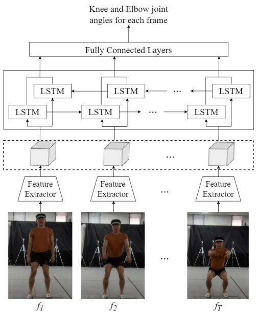
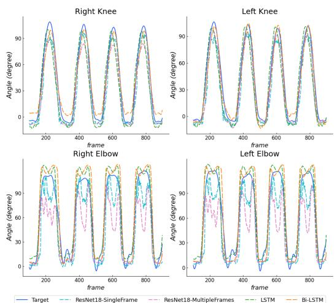
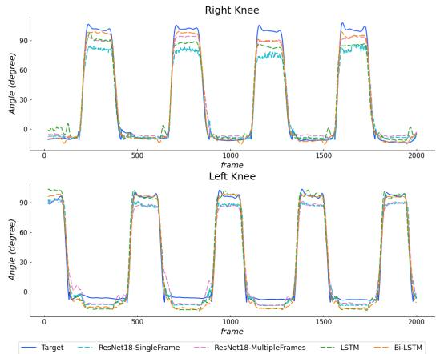

# Deep Learning Networks for View-independent Knee and Elbow Joint Angle Estimation

Ankhzaya Jamsrandorj, Konki Sravan Kumar, Muhammad Zeeshan Arshad, Kyung-Ryoul Mun, Jinwook Kim

Abstract— Vision-based human joint angle estimation is essential for remote and continuous health monitoring. Most vision-based angle estimation methods use the locations of human joints extracted using optical motion cameras, depth cameras, or human pose estimation models. This study aimed to propose a reliable and straightforward approach with deep learning networks for knee and elbow flexion/extension angle estimation from the RGB video. Fifteen healthy participants performed four daily activities in this study. The experiments were conducted with four different deep learning networks, and the networks took nine subsequent frames as input while output was knee and elbow joint angles extracted from an optical motion capture system for each frame. The BiLSTM network-based joint angles estimator can estimate both joint angles with a correlation of 0.955 for knee and 0.917 for elbow joints regardless of the camera view angles.

## I. INTRODUCTION

Continuous estimation of human joint angles enables critical clinical analysis for injury risk in the elderly, the effect of rehabilitation after surgery, and diagnosis and assess human joint movement disorders. The knee flexion/extension and elbow flexion/extension angles in the daily living activity can serve as indicators of the level of neurological and musculoskeletal disorders such as Parkinson’s disease, stroke, frailty, and cerebral palsy. Therefore, accurate and reliable knee and elbow joint angle estimation is essential for appropriate clinical intervention.

Wearable sensors such as surface electromyography (sEMG) and inertial measurement unit (IMU) are widely used for their high accuracy and capability to remotely monitor human motion outside the lab to estimate human joint angles. However, wearable sensor-based methods require the professionals to attach the sensors to the participant’s body, analyze the output signals, and cooperate highly with the participants [1]–[5]. On the other hand, vision-based methods are used for human joint angle estimation. Current visionbased methods mainly use data generated by specialized hardware or software such as optical motion cameras, depth cameras, passive marker-based systems, or human pose estimators [6]–[12]. Schmitz et al. proposed a markerless motion capture system for evaluating the accuracy of joint angles measured using a single camera. The system collected the depth map and 2D images of a testing jig using the Kinect camera. An articulated iterative closest point algorithm assuming a ball-and-socket joint at the knee was used to align these captured data with the template. Then, the system exported the virtual marker trajectories, and the joint angles were calculated using these trajectories [7]. Wang et al. proposed a computer-vision method to estimate joint angles during lifting tasks using a single camera, and the method estimated the joint angles in three steps. First, the videos were preprocessed in Detectron2 to detect 2D key points of human joints in each frame. Then the VideoPose3D model reconstructed the 3D pose using 2D key points. Finally, the joint angles were calculated by a top-down inverse dynamic biomechanics model using 3D joint coordinates [10]. Kidzinski et al. designed a machine learning model to predict the clinical gait metrics. They extracted the 2D body poses from videos using OpenPose. These human pose trajectories were fed into a neural network to estimate the knee flexion angle at maximum extension [11]. These vision-based methods entirely depend on human joint’s location extracted by using the depth-sensing cameras, passive markers tracking system, or human pose estimation models. However, the coverage area of the depth cameras is limited, and the illumination conditions of the environment can substantially impact the estimation accuracy in human joint angles. Besides, the extracted joint locations by the human pose detection system may not be the center of that joints, and this can affect joint angle estimation results. Kumar et al. proposed a videobased system using deep learning techniques to address the limitations of the vision-based methods mentioned above. A deep convolutional neural network trained with a stack of few video frames estimated the angular velocity of the human lower limb during walking on the treadmill and squat [13].

Inspired by [13], this study aimed to propose a simple, practical, and multi-view approach of using deep learning networks for the knee flexion/extension and elbow flexion/extension angle estimation.

## II. MATERIALS AND METHODS

## A. Participants

This study is based on work supported by the Institutional Review Board of the Korea Institute of Science and Technology.

A total of 15 participants (12 males and 3 females; age = 24.2 ±3.8 years, height = 170.7 ±6.4 cm, and weight = 71.7 ±16.1 kg) without any history or presence of neurological disorders participated in this experiment. All participants provided written informed consent and no violation was made during the experiment.

## B. Experimental protocol

The data was collected from an indoor environment with a video system and a motion capture system, as shown in Fig.1, and the capture area had a size of 3.68 and 2.0 meters. The motion capture system had six optical motion cameras, which tracked the position of the markers attached to the participant’s both knees and elbows, and the motion capture data was assembled at a sampling frequency of 120Hz. While timely-synchronized 4 RGB cameras simultaneously captured the video data with a resolution of Full HD and a frame rate of 60 Hz. A flash-based synchronization method was developed to generate the pulses lasting 100ms in the optical data while the digital cameras capture the flash moment. The optical motion and digital cameras were synchronized using these flash signals for each participant and each action trial.

The participants were instructed to perform four daily actions: Squat, Walking in place (WIP), One leg stand (OLS), and Arm. For the Squat activity, the participants squatted for 30 seconds. The participants were asked to walk in place at a self-selected pace in the WIP action. For the OLS activity, the participants stood on one leg and lifted another, and repeated it for the opposite leg. The participants were instructed to hold both arms parallel to the ground and bend them at the elbow. Then extend arms out to the sides, bring them to the initial pose, push the arms to the front, and return them. Participants repeated this for a minute while standing upright for the Arm action. Finally, a total of 1.29M frames were included in the dataset. The dataset details are summarized in Table I. Ground-truth metrics of both knee and elbow joint angles were computed from optical motion capture data. Each video is provided with human bounding boxes on every frame and an annotation containing the four angles: the right and left knee flexion/extension and the right and left elbow flexion/extension.

## C. Knee and elbow angle estimator development

The architecture of the proposed network was composed of two parts: A feature extraction model and an LSTM-based joint angles estimator. Fig.2 shows the architecture of the LSTM-based estimator proposed in this study. We adopted the ResNet18 pre-trained on ImageNet as the backbone feature extractor and took the nine subsequent frames as input.

TABLE I  
DATASET SUMMARY FOR KNEE AND ELBOW JOINT ANGLE ESTIMATION

<table><tr><td>No of Subjects</td><td>Action Name</td><td>Time (seconds)</td><td>Frame Rate</td><td>No of Views</td><td>Total Frames</td></tr><tr><td rowspan="4">15 (12 males and 3 females)</td><td>Squat</td><td>30 x 2</td><td rowspan="4">60fps</td><td rowspan="4">4</td><td>216000</td></tr><tr><td>Walking in place</td><td>60 x 2</td><td>432000</td></tr><tr><td>One leg stand</td><td>60 x 2</td><td>432000</td></tr><tr><td>Arm</td><td>30 x 2</td><td>216000</td></tr><tr><td colspan="5">Dataset size</td><td>1296000</td></tr></table>

  
Fig. 1. Experimental setup with four RGB cameras and an optical motion capture system.

The sequence of feature vectors was fed to the LSTM-based network, which included four bidirectional LSTM layers followed by two fully connected (FC) layers with Rectified Linear Unit (ReLU) activation function. The last FC layer had four neurons corresponding to the right and left knee flexion/extension and the right and left elbow flexion/extension angles. We ran the experiments with three different networks for the performance comparison: the ResNet18 trained with a single frame (ResNet18\_SF), the ResNet18 trained with a stack of nine frames (ResNet18\_MF), and the unidirectional LSTM network. For these networks, the last FC layer was removed and a new FC layer was added to adopt to our output.

## D. Implementation details and Evaluation

1) Data processing: We down-sampled the video and motion capture data to 30Hz. The networks’ input was the nine subsequent frames with the ground truth human bounding boxes and each knee and elbow flexion/extension angles for all nine frames. The raw frames were preprocessed by cropping the person in the frame based on the ground truth human bounding box, then pad left and right to get a square image and resized it to a size of 448 × 448. The dataset was separated by participants into three parts: data of 8 participants for the training set (345.6k frames), data of 4 participants for the validation set (172.8k frames), and the remaining 3 participants for the test set (129.6k frames).

  
Fig. 2. The architecture of the Bidirectional LSTM model.

  
Fig. 3. The estimated knee and elbow joint angles during the Squat action.

2) Training scheme: All experiments were carried out with the PyTorch framework. The weights of the networks were initialized by pre-training on the ImageNet for knee and elbow angle estimation. During all training experiments, the Mean Absolute Error (MAE) and the Adam optimizer were used with an initial learning rate of 0.001 and a batch size of 16. The learning rate was reduced two times after every three epochs.

3) Evaluation metrics: MAE (degree) and Pearson’s correlation coefficient (PCC) were used to evaluate the performance of the networks.

## III. RESULTS

Fig.3 and Fig.4 show the results of estimating the Knee and Elbow angles by four different deep learning networks during the Squat and WIP actions, respectively. The Knee and the Elbow angle estimation results while performing the OLS and Arm actions were illustrated in Fig.5 and Fig.6, respectively. It has been demonstrated that the networks can estimate the knee and elbow angles accurately during different activities.

Table II summarized the MAE and PCC of the deep learning networks for the right and left knee flexion/extension and the right and left elbow flexion/extension angles. The minimum MAE of 8.24 for the right knee angle was achieved by the LSTM model and the BiLSTM model estimated with the minimum MAEs of 7.73, 9.80, and 10.29 for the left knee, the right, and left elbow angles, respectively. The highest PCC in estimating the right knee angle was 0.975, which was achieved by the ResNet18\_SF and the BiLSTM networks. The highest PCCs of 0.976, 0.917, and 0.922 were obtained by the BiLSTM model for the left knee, the right, and left elbow angles. As shown in Table III, we analyzed the

  
Fig. 4. The estimated knee and elbow joint angles during the WIP action.

MAE of the networks on different actions separately. For the Squat activity, the minimum MAEs of 12.27 and 11.45 were obtained by the LSTM model on the knee angle estimation, whereas the BiLSTM model achieved the minimum MAEs of 9.95 and 10.26 for the elbow angle. Besides, for the WIP action, the ResNet18\_MF model estimated the right and left knee angles with the minimum MAE of 8.15 and 7.88, respectively and the estimation results of the right and left elbow angles were the MAE of 7.00 and 8.05, which the BiLSTM model achieved. For the OLS activity, the minimum MAEs of 6.64 and 7.06 were acquired by the LSTM and the BiLSTM models on the right and left knee angle estimation. In contrast, the ResNet18\_SF and ResNet18\_MF models achieved the minimum MAEs of 5.45 and 5.61 for the right and left elbow angle estimation, respectively.

Table IV and Table V showed the PCC of four deep learning networks on different actions, and it included results of the most active joint during the activities. As shown in Table IV, for the Squat and OLS, the BiLSTM model achieved the highest PCC of 0.991 and 0.993 for estimating the knee angle on average, respectively. The ResNet18\_SF model obtained the highest PCC of 0.951 on the right knee, while the ResNet18\_MF model achieved the highest PCC of 0.950 on the left knee angle estimation for the WIP action. As summarized in Table V, the BiLSTM model estimated the elbow angles with the highest PCC of 0.906 and 0.933 on average for both the WIP and Arm activities.

TABLE II  
THE KNEE AND ELBOW JOINT ANGLE ESTIMATION PERFORMANCE OFTHE FOUR NETWORKS

<table><tr><td></td><td>Model</td><td>R_Knee</td><td>L_Knee</td><td>R_Elbow</td><td>L_Elbow</td></tr><tr><td rowspan="4"> $MAE (^\circ)$ </td><td>ResNet18_SF</td><td>8.29</td><td>7.83</td><td>15.37</td><td>16.07</td></tr><tr><td>ResNet18_MF</td><td>10.17</td><td>9.34</td><td>14.64</td><td>14.28</td></tr><tr><td>LSTM</td><td>8.24</td><td>8.32</td><td>15.37</td><td>16.59</td></tr><tr><td>BiLSTM</td><td>8.67</td><td>7.73</td><td>9.80</td><td>10.29</td></tr><tr><td rowspan="4">PCC</td><td>ResNet18_SF</td><td>0.975</td><td>0.975</td><td>0.887</td><td>0.902</td></tr><tr><td>ResNet18_MF</td><td>0.974</td><td>0.968</td><td>0.882</td><td>0.900</td></tr><tr><td>LSTM</td><td>0.973</td><td>0.955</td><td>0.890</td><td>0.901</td></tr><tr><td>BiLSTM</td><td>0.975</td><td>0.976</td><td>0.917</td><td>0.922</td></tr></table>

  
Fig. 5. The estimated knee joint angle results during the OLS action.

## IV. DISCUSSION

This study proposed a novel approach of using deep learning networks to estimate the knee flexion/extension and elbow flexion/extension angles. The deep learning networks trained with a few subsequent video frames achieved promising performance, besides the simple 2D network trained with a single frame likewise achieved satisfactory results in estimating the knee and elbow joint angles regardless of camera view angles. It should be noted that this approach does not require any special sensors, markers, and human pose estimators for human joint angle estimation.

Deep learning networks estimated the joint angles with an average MAE of 8.57 and an average PCC of 0.969 for the knee joints and 14.05 and 0.900 for the elbow joints. Table VI summarized the performance of the networks on different camera view angles separately. The estimation performance of the networks for the knee flexion/extension angles was relatively good regardless of camera view angles. In contrast, camera view angles influenced the elbow flexion/extension angles estimation. As shown in Table VI, the deep learning networks estimated the elbow joint angles with higher MAE from the backside due to unseeable elbow flexions during the Squat and Arm actions. Accordingly, the networks estimation errors were lesser on the right knee and elbow joints than the left from the camera view of the right side. It was observed similarly from the opposite camera view.

TABLE III  
COMPARISON OF THE NETWORKS’ PERFORMANCE ON DIFFERENTACTIONS FOR KNEE AND ELBOW JOINT ANGLE ESTIMATION

<table><tr><td rowspan="2" colspan="2">Model</td><td colspan="4">MAE (°)</td></tr><tr><td>R_Knee</td><td>L_Knee</td><td>R_Elbow</td><td>L_Elbow</td></tr><tr><td rowspan="4">Squat</td><td>ResNet18_SF</td><td>12.66</td><td>13.26</td><td>21.54</td><td>24.43</td></tr><tr><td>ResNet18_MF</td><td>15.04</td><td>13.83</td><td>15.77</td><td>18.30</td></tr><tr><td>LSTM</td><td>12.27</td><td>11.45</td><td>22.95</td><td>25.30</td></tr><tr><td>BiLSTM</td><td>13.93</td><td>12.46</td><td>9.95</td><td>10.26</td></tr><tr><td rowspan="4">WIP</td><td>ResNet18_SF</td><td>8.67</td><td>8.21</td><td>10.32</td><td>10.02</td></tr><tr><td>ResNet18_MF</td><td>8.15</td><td>7.88</td><td>11.38</td><td>10.14</td></tr><tr><td>LSTM</td><td>10.42</td><td>11.43</td><td>7.44</td><td>8.83</td></tr><tr><td>BiLSTM</td><td>9.58</td><td>9.30</td><td>7.00</td><td>8.05</td></tr><tr><td rowspan="4">OLS</td><td>ResNet18_SF</td><td>8.37</td><td>7.38</td><td>5.45</td><td>7.55</td></tr><tr><td>ResNet18_MF</td><td>14.03</td><td>11.90</td><td>7.70</td><td>5.61</td></tr><tr><td>LSTM</td><td>6.64</td><td>8.10</td><td>9.08</td><td>8.97</td></tr><tr><td>BiLSTM</td><td>7.36</td><td>7.06</td><td>6.32</td><td>7.75</td></tr><tr><td rowspan="4">Arm</td><td>ResNet18_SF</td><td>3.47</td><td>2.47</td><td>22.72</td><td>23.76</td></tr><tr><td>ResNet18_MF</td><td>3.45</td><td>3.73</td><td>22.40</td><td>24.38</td></tr><tr><td>LSTM</td><td>3.62</td><td>2.29</td><td>21.40</td><td>23.90</td></tr><tr><td>BiLSTM</td><td>3.79</td><td>2.10</td><td>15.21</td><td>15.79</td></tr></table>

  
Fig. 6. The estimated elbow joint angle results during the Arm action.

As mentioned in the introduction section, most visionbased methods used a particular camera system and human pose estimation machines to locate human joints and track them to estimate human joint angles. Cai et al. investigated the accuracy of a single Kinect-based system in measuring upper limb joint angles when Kinect sensor placed at different distances and orientations. The upper limb joint angles were calculated based on the 3D coordinates of the trunk and upper limb joint center derived from the Kinect v2 sensor during the upper limb functional task. For the elbow joint angle estimation, the MAEs ranged from 10.20 to 28.32, depending on the placements of the Kinect sensor. The Kinect-based system achieved the minimum MAE of 10.20 when the Kinect sensor was placed at 30° to the left side for estimating the elbow flexion/extension angle [6]. Pantzar-Castilla et al. designed a system with an RGB-D camera for the knee joint angle estimation from the side view. The hip, knee, and ankle joints center were extracted from depth data and tracked during walking. Then, the knee angles were calculated using these joint center trajectories. The system estimated the knee angles with an average correlation of 0.906 [12]. Compared to these studies, our approach achieved remarkable performance in estimating the knee and elbow joint angle from the multi-camera view angles without the special camera and human pose information. We expect the proposed approach to serving as effective and practical human joint angles estimation methods for remote and continuous health monitoring.

This study has a limitation related to its generalizability. The study participants were primarily young and healthy. Therefore, applying our approach to the various participants groups, including the elderly, patients with conditions such as Parkinson’s disease, stroke, cerebral palsy, and muscular dystrophy, is in the future work plan.

TABLE IV  
COMPARISON OF THE NETWORKS’ PERFORMANCE ON DIFFERENTACTIONS FOR KNEE JOINT ANGLE ESTIMATION

<table><tr><td rowspan="2"></td><td rowspan="2">Model</td><td colspan="2">PCC</td></tr><tr><td>R_Knee</td><td>L_Knee</td></tr><tr><td rowspan="4">Squat</td><td>ResNet18_SF</td><td>0.989</td><td>0.986</td></tr><tr><td>ResNet18_MF</td><td>0.988</td><td>0.985</td></tr><tr><td>LSTM</td><td>0.969</td><td>0.966</td></tr><tr><td>BiLSTM</td><td>0.991</td><td>0.990</td></tr><tr><td rowspan="4">WIP</td><td>ResNet18_SF</td><td>0.947</td><td>0.950</td></tr><tr><td>ResNet18_MF</td><td>0.951</td><td>0.936</td></tr><tr><td>LSTM</td><td>0.906</td><td>0.913</td></tr><tr><td>BiLSTM</td><td>0.940</td><td>0.945</td></tr><tr><td rowspan="4">OLS</td><td>ResNet18_SF</td><td>0.987</td><td>0.989</td></tr><tr><td>ResNet18_MF</td><td>0.984</td><td>0.982</td></tr><tr><td>LSTM</td><td>0.989</td><td>0.987</td></tr><tr><td>BiLSTM</td><td>0.993</td><td>0.993</td></tr></table>

TABLE V

COMPARISON OF THE NETWORKS’ PERFORMANCE ON DIFFERENTACTIONS FOR ELBOW JOINT ANGLE ESTIMATION

<table><tr><td rowspan="2"></td><td rowspan="2">Model</td><td colspan="2">PCC</td></tr><tr><td>R_Elbow</td><td>L_Elbow</td></tr><tr><td rowspan="4">WIP</td><td>ResNet18_SF</td><td>0.884</td><td>0.902</td></tr><tr><td>ResNet18_MF</td><td>0.888</td><td>0.907</td></tr><tr><td>LSTM</td><td>0.882</td><td>0.903</td></tr><tr><td>BiLSTM</td><td>0.901</td><td>0.911</td></tr><tr><td rowspan="4">Arm</td><td>ResNet18_SF</td><td>0.889</td><td>0.902</td></tr><tr><td>ResNet18_MF</td><td>0.877</td><td>0.883</td></tr><tr><td>LSTM</td><td>0.898</td><td>0.898</td></tr><tr><td>BiLSTM</td><td>0.932</td><td>0.933</td></tr></table>

## V. CONCLUSIONS

This study proposed a multi-view, vision-based approach that does not require a special camera system and wearable sensors for joint angle estimation using deep learning networks. The deep learning networks trained with a few video frames showed outstanding performance in estimating the knee and elbow joint angles regardless of camera view angles. Our approach can be applied to monitor the people’s health in their homes for early diagnosis of diseases, proper treatment, and timely intervention.

## ACKNOWLEDGMENT

This work was supported in part by the High-Tech Based National Athletic Performance Improvement (Winter) Project from the Korea Sports Promotion Foundation and in part by Athletes’ training/matches data management and AI-based performance enhancement solution technology Development Project (No.1375027374).

## REFERENCES

[1] A. Kumar, A. K. Godiyal, P. Joshi, and D. Joshi, “A new force myography-based approach for continuous estimation of knee joint angle in lower limb amputees and able-bodied subjects,” IEEE Journal of Biomedical and Health Informatics, vol. 25, pp. 701–710, 2021.

TABLE VI  
COMPARISON OF THE NETWORKS’ PERFORMANCE ON DIFFERENT CAMERA VIEW ANGLES.

<table><tr><td rowspan="2" colspan="2">Model</td><td colspan="4">MAE (°)</td></tr><tr><td>R_Knee</td><td>L_Knee</td><td>R_Elbow</td><td>L_Elbow</td></tr><tr><td rowspan="4">back</td><td>ResNet18_SF</td><td>9.06</td><td>7.75</td><td>17.85</td><td>19.55</td></tr><tr><td>ResNet18_MF</td><td>13.08</td><td>10.59</td><td>15.79</td><td>16.38</td></tr><tr><td>LSTM</td><td>8.40</td><td>9.60</td><td>18.23</td><td>20.17</td></tr><tr><td>BiLSTM</td><td>8.77</td><td>7.27</td><td>12.37</td><td>12.74</td></tr><tr><td rowspan="4">left</td><td>ResNet18_SF</td><td>7.41</td><td>7.07</td><td>15.07</td><td>13.60</td></tr><tr><td>ResNet18_MF</td><td>8.29</td><td>7.47</td><td>14.90</td><td>13.59</td></tr><tr><td>LSTM</td><td>7.62</td><td>7.44</td><td>15.99</td><td>15.37</td></tr><tr><td>BiLSTM</td><td>8.70</td><td>8.06</td><td>9.60</td><td>8.90</td></tr><tr><td rowspan="4">frontal</td><td>ResNet18_SF</td><td>9.09</td><td>8.30</td><td>14.38</td><td>15.38</td></tr><tr><td>ResNet18_MF</td><td>8.52</td><td>9.40</td><td>14.02</td><td>13.64</td></tr><tr><td>LSTM</td><td>9.84</td><td>8.46</td><td>13.07</td><td>14.26</td></tr><tr><td>BiLSTM</td><td>9.11</td><td>7.33</td><td>8.70</td><td>10.49</td></tr><tr><td rowspan="4">right</td><td>ResNet18_SF</td><td>7.62</td><td>8.20</td><td>14.21</td><td>15.76</td></tr><tr><td>ResNet18_MF</td><td>10.78</td><td>9.87</td><td>13.84</td><td>13.51</td></tr><tr><td>LSTM</td><td>7.08</td><td>7.78</td><td>14.21</td><td>16.58</td></tr><tr><td>BiLSTM</td><td>8.08</td><td>8.25</td><td>8.52</td><td>9.02</td></tr></table>

[2] Z. Li, X. Guan, K. Zou, and C. Xu, “Estimation of knee movement from surface emg using random forest with principal component analysis,” Electronics, vol. 9, 2020. [Online]. Available: https://www.mdpi.com/2079-9292/9/1/43

[3] X. Ma, Y. Liu, Q. Song, and C. Wang, “Continuous estimation of knee joint angle based on surface electromyography using a long shortterm memory neural network and time-advanced feature,” Sensors, vol. 20, 2020. [Online]. Available: https://www.mdpi.com/1424- 8220/20/17/4966

[4] Y. Deng, F. Gao, and H. Chen, “Angle estimation for knee joint movement based on pca-relm algorithm,” Symmetry, vol. 12, 2020. [Online]. Available: https://www.mdpi.com/2073-8994/12/1/130

[5] H.-S. Cho, J.-H. Yang, J.-H. Lee, and J.-H. Lee, “Evaluation of joint motion sensing efficiency according to the implementation method of swcnt-coated fabric motion sensor,” Sensors, vol. 20, 2020. [Online]. Available: https://www.mdpi.com/1424-8220/20/1/284

[6] L. Cai, D. Liu, and Y. Ma, “Placement recommendations for single kinect-based motion capture system in unilateral dynamic motion analysis,” Healthcare, vol. 9, p. 1076, 1 2021.

[7] A. Schmitz, M. Ye, R. Shapiro, R. Yang, and B. Noehren, “Accuracy and repeatability of joint angles measured using a single camera markerless motion capture system,” Journal of biomechanics, vol. 47, 1 2013.

[8] F. Mateo, J. J. Carrasco, M. Aguilar-Rodríguez, E. Olivas, S. Bonanad, F. Querol, and S. Pérez-Alenda, “Assessment of kinect v2 for elbow range of motion estimation in people with haemophilia using an angle correction model,” Haemophilia, vol. 25, 1 2019.

[9] S. Örücü and M. Selek, “Design and validation of rulebased expert system by using kinect v2 for real-time athlete support,” Applied Sciences, vol. 10, 2020. [Online]. Available: https://www.mdpi.com/2076-3417/10/2/611

[10] H. Wang, Z. Xie, L. Lu, L. Li, and X. Xu, “A computervision method to estimate joint angles and l5/s1 moments during lifting tasks through a single camera,” Journal of Biomechanics, vol. 129, p. 110860, 2021. [Online]. Available: https://www.sciencedirect.com/science/article/pii/S0021929021006175

[11] Łukasz Kidzinski, B. Yang, J. L. Hicks, A. Rajagopal, S. L. ´ Delp, and M. H. Schwartz, “Deep neural networks enable quantitative movement analysis using single-camera videos,” Nature Communications, vol. 11, p. 4054, 2020. [Online]. Available: https://doi.org/10.1038/s41467-020-17807-z

[12] E. Pantzar, A. Cereatti, G. Figari, N. Valeri, G. Paolini, U. D. Croce, A. Magnuson, and J. Riad, “Knee joint sagittal plane movement in cerebral palsy: a comparative study of 2-dimensional markerless video and 3-dimensional gait analysis,” Acta Orthopaedica, vol. 89, pp. 656– 661, 1 2018.

[13] K. S. Kumar, A. Jamsarndorj, D. Jung, D. Lee, J. Kim, and K.-R. Mun, “Vision-based human joint angular velocity estimation during squat and walking on a treadmill actions,” 2021, pp. 2186–2190.