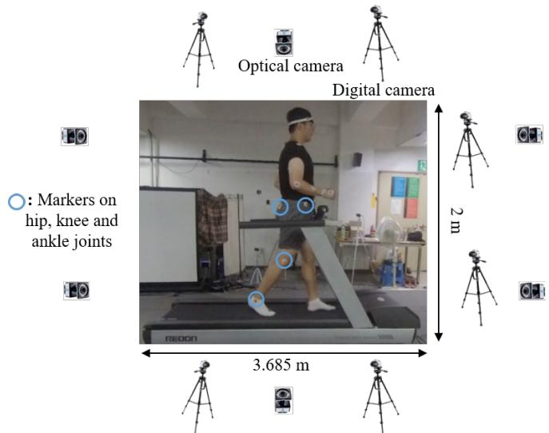
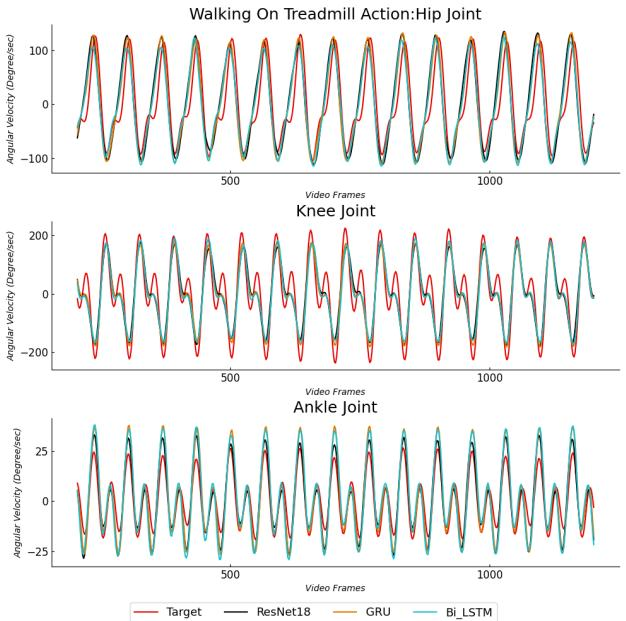

# Prediction of lower limb kinematics from vision-based system using deep learning approaches

Konki Sravan Kumar1, Ankhzaya Jamsrandorj2, Jinwook Kim1 and Kyung-Ryoul Mun1

Abstract— The joint angular velocity during daily life exercises is an important clinical outcome for injury risk index, rehabilitation progress monitoring and athlete’s performance evaluation. Recently, wearable sensors have been widely used to monitor lower limb kinematics. However, these sensors are difficult and inconvenient to use in daily life. To mitigate these limitations, this study proposes a vision-based system for estimating lower limb joint kinematics using a deep convolution neural network with bi-directional long-short term memory and gated recurrent unit network. The normalized correlation coefficient, and the mean absolute error were computed between the ground truth obtained from the optical motion capture system and estimated joint angular velocities using proposed models. The estimated results show a highest correlation 0.93 in squat and 0.92 in walking on treadmill action. Furthermore, independent model for each joint angular velocity at the hip, knee, and ankle were analyzed and compared. Among the three joint angular velocities, knee joint has a best estimated accuracy (0.96 in squat and 0.96 in walking on the treadmill). The proposed models show higher estimation accuracy under both the lateral and the frontal view regardless of the camera positions and angles. This study proves the applicability of using sensor free vision-based system to monitor the lower limb kinematics during home workouts for healthcare and rehabilitation.

## I. INTRODUCTION

Human gait is pattern of movement of the limbs, and gait parameters can reflect the human’s functional ability and health condition [1]. Among the several gait parameters, the lower body joint angular velocity during daily life exercises is an important clinical outcome for injury risk index, determine the progress during the rehabilitation of patients, diagnose early human joint movement disorders and improve athlete’s performance [2, 3]. In addition, recent studies have identified that [4, 5] joint angular velocity is the strong candidate for monitoring changes in lower limb joint powers because the joint power is a product of joint angular velocity and joint motion, which is significant parameter for clinical diagnosis of gait pathology and control of lower limb prosthesis [6, 7]. Inertial sensor-based systems are commonly used to capture the lower limb kinematics. An inertial measurement unit (IMU) sensor based system is designed to measure the knee joint angles during the human limb dynamic movement [8]. An IMU sensor-based 3D motion capture system composed of an accelerator, geomagnetic sensor and gyroscopes are effective measurement tools to record lower limb joints (knee, hip, and spine) motion during daily life actions [9]. Over the last few years, IMU sensor-based systems have drawn researcher’s attention and showed significant accuracy in joint kinematic measurements [10, 11]. However, one IMU sensor cannot be used to track movements of more than one body segment. Therefore, seven IMU sensors are usually required to track just for a lower limb movement such as pelvis, ankle, knee, and hip of each left and right side. As more IMU sensors are attached, several drawback include complex preprocessing processes (sensor-to-segment calibration and subject calibration), inconvenience to daily life and human kinematic chains that should be considered to monitor accurate lower limb kinematics [12]. In addition, the use of motion tracking systems like IMU sensors hinde the natural movements of the subjects due to tight straps for the sensor attachment, and it is still expensive, power consumption, complex handling of equipment, participant cooperation and controlled laboratory environment and plac ing markers, which are labor-intensive. Researchers have developed camera-based system to overcome the limitation of wearable sensor-based capture systems to monitor human low limb motion. The emerged deep learning framework and development of camera technology had created a new opportunity for lower limb angular velocity prediction from video frame information. Recent studies [13, 14] were intro duced a camera-based system using the OpenPose library, which records lower limb joint angles with good accuracy. However, the estimation accuracy of OpenPose library-based system relies on ground truth 2D keypoint dataset; keypoints are manually annotated and not at joint center positions. Therefore, it may not be reliable to estimate lower limb angular velocity. Moreover, these methods were developed to monitor joint angles of the participants only in lateral view and cannot track joint angles in front and back view of subjects. In our previous study, deep convolution neural network CNN architecture has been proposed to measure the lower angular velocity of the hip, knee, and ankle joints, which offers good estimation accuracy under differen camera views [15]. However, these pre-trained deep CNN frameworks still show higher errors due to time delay in the estimation results

In this study, we propose a vision-based system for estimation of lower limb joint kinematics with a deep convolution neural network with bi-directional long-short term memory recurrent (LSTM)/ gated recurrent unit (GRU) network (DeepConvLSTM/ DeepConvGRU). The proposed approach is based on an RGB camera system, which detects the joint angular velocities at hips, knees, and ankles (right and left sides) during squat and walking on treadmill actions. Estimation performance of DeepConvGRU model was quantified and compared with ground truth joint angular velocities captured by the motion captured system.

## II. METHODS

## A. Experimental Equipment and Protocol

To build the video dataset, participants were recruited by 33 healthy adult (25 – male and 8 – female). Experiments were conducted in an experimental room installed with the optical motion capture system and Xiaomi Mijia Camera 4K digital camera system. Fig.1. shows the arrangement of cameras during our experiments to obtain a video dataset. As the gold standard for recording human joint angles, a six camera optical motion capture system with a resolution of 1280×1024 (around 1.3 million pixels) and a frequency of 120Hz was used. According to the Plug-in-gait marker set, fifteen reflective markers were attached to the human limbs such as pelvis, hip, knee, thigh, shank, toe, ankle, and heel. The optical motion capture system tracks reflective markers attached to the human body and carries out the accurate 3D angles and 3D positions of all joints. The joint angular velocities are calculated by derivation of the joint angles. The capture area is 2.000 meters by 3.685 meters on the floor. Six cameras of digital camera system with a resolution of 1920×1080 and, a frame rate of 60Hz was used. Six cameras were placed in front, back and side of a participant to capture videos of squat and walking on treadmill actions within 30 seconds. We designed a digital circuit to synchronize the optical motion capture camera and digital camera systems. The optical motion capture camera system has samples of 120 frames per second (twice the value of the digital camera’s frame rate. Therefore, Annotations were downsampled with the frame rate of 120Hz to 60Hz.

  
Fig. 1: Experimental setup. The optical motion captures system tracks the markers, records the angular velocity of joints and digital cameras captures video information of participants during squat and walking on treadmill actions.

B. Deep learning framework for estimating the Joint angular velocity of lower limbs.

We propose a deep learning model (DeepConvLSTM) based on the CNN with LSTM neural network to estimate angular velocities of lower limb joints such as hips, knees, and ankles on both the right and left sides. The convolutional neural network is used to extract features (spatial domain) from the action video, while recurrent neural network is used to provide time-series prediction (time-domain). As a supervised manner, DeepConvLSTM architecture learns the time dependencies between RGB image information as inputs and joint angular velocities as outputs. First, deep learning-based feature selection technique (YOLO4) is applied to detect the human and remove the non-informative background in the action videos [16]. Then, the video frames were cropped based on the resultant human bounding box and resized to 448 × 448. Next, a 27 video frame information is considered input of the proposed DeepConvLSTM network. Then, the network is trained to output the corresponding six joint angular velocities. In this work, we employed a convolutional neural network (ResNet18) with the Bi-LSTM / GRU to predict the joint angular velocity estimation. At each time step, the extracted spatial feature from CNN layer is connected to LSTM/GRU network. Finally, the fully connected (FC) layer provides the six joint angular velocity predictions (left/ right hip flexion/extension, knee flexion/extension, and ankle dorsiflexion/plantarflexion) at each time step as shown in Fig.2.

  
Fig. 2: The DeepConvLSTM architecture. Deep CNN extracts features (spatial domain) from the action video and LSTM is used to provide time-series (time-domain) joint angular velocity predictions.

## C. DeepConvLSTM model implementation

The DeepConvLSTM was implemented using the PyTorch library in Python. The model trained with Adaptive Moment Estimation (Adam) for optimization, the mean absolute error (MAE) as the loss function and the PC configured with the CUDA 10.2 library on a GTX 2080Ti graphics card, using Ubuntu 18.04.5 LTS. The learning rate for the training network was selected to be 0.0001. The batch size was 8, and the model was trained using a sequence of 27 images with corresponding joint angular velocities in 20 epochs. To train the proposed models, Action videos of seven participants during a squat and walking on a treadmill were used for training, action videos of three participants for validation and three participants for testing.

## III. EXPERIMENTAL RESULTS

This section presents results of proposed DeepConvLSTM/ DeepConvGRU network for predicting lower limb joint angular velocities during squat and walking on treadmill actions. The difference between the angular velocities obtained from the optical motion capture system and the estimated by the DeepConvLSTM and DeepConvGRU networks were evaluated with the normalized correlation coefficients (r), and the mean absolute error (MAE). To illustrate the estimation performance of the proposed models, Fig.3. shows estimated and ground-truth angular velocities at lower limb joints during squat action. The estimated angular velocities using DeepConvGRU were better than those estimated by ResNet18 and DeepConvLSTM compared to ground truth angular velocities. The predicted angular velocities during walking on a treadmill are depicted in Fig. 4. The average of r for all the three joints of GRU, BI-LSTM and ResNet18 networks during squat and walking on a treadmill are reported in detail in Table I. The average of r of the GRU network shows a strong correlation (0.93 during squat and 0.92 during walking on treadmill) among all three models. The average r and MAE for the joint-wise angular velocity at the hip, knee, and ankle during squat were predicted by three models are presented in Table II. Among the hip, knee and ankle joints, the knee joint angular velocity estimated using the GRU model showed better accuracy in the average r. The GRU network offers a less MAE error than BI-LSTM and ResNet18 networks in all joint estimations during squat action.

  
Fig. 3: Example of estimated angular velocity at the hip, knee, and ankle joint for participants during squat action. Comparison between ground truth (Redline) captured by optical motion capture system and joint angular velocities estimated by ResNet18 (black line), GRU (orange line) and Bi-LSTM (cyan line).

  
Fig. 4: The graph shows participants estimated angular velocities at the hip, knee, and ankle joint for during walking on treadmill action. Comparison between ground truth (Redline) captured by optical motion capture system and joint angular velocities estimated by ResNet18 (black line), GRU (orange line), and Bi-LSTM (cyan line).

TABLE I: The average r for predicted joint angular velocities using proposed models in squat and walking on a treadmill actions.

<table><tr><td>Model</td><td>Squat</td><td>Walking on treadmill</td></tr><tr><td>ResNet18</td><td>0.87</td><td>0.90</td></tr><tr><td>Bi-LSTM</td><td>0.92</td><td>0.91</td></tr><tr><td>GRU</td><td>0.93</td><td>0.92</td></tr></table>

TABLE II: The average r (MAE) for hip, knee and ankle joint angular velocities using GRU, BI-LSTM and ResNet18 models during squat action.

<table><tr><td>Model</td><td>Hip Joint</td><td>Knee Joint</td><td>Ankle Joint</td></tr><tr><td>ResNet18</td><td>0.87(44.18)</td><td>0.94(30.92)</td><td>0.90(6.09)</td></tr><tr><td>Bi-LSTM</td><td>0.91(18.48)</td><td>0.96(21.56)</td><td>0.89(6.23)</td></tr><tr><td>GRU</td><td>0.94(15.13)</td><td>0.96(18.09)</td><td>0.92(5.83)</td></tr></table>

TABLE III: The average r (MAE) for hip, knee and ankle joint angular velocities using GRU, BI-LSTM and ResNet18 models during walking on treadmill action.

<table><tr><td>Model</td><td>Hip Joint</td><td>Knee Joint</td><td>Ankle Joint</td></tr><tr><td>ResNet18</td><td>0.80(27.20)</td><td>0.94(37.48)</td><td>0.84(6.05)</td></tr><tr><td>Bi-LSTM</td><td>0.89(21.05)</td><td>0.95(24.80)</td><td>0.85(5.70)</td></tr><tr><td>GRU</td><td>0.91(15.97)</td><td>0.96(20.47)</td><td>0.89(4.15)</td></tr></table>

TABLE IV: The average r for angular velocities of three participants under lateral and frontal camera views.

<table><tr><td>Subject</td><td>Side view</td><td>Front view</td></tr><tr><td>S18</td><td>0.92</td><td>0.92</td></tr><tr><td>S30</td><td>0.91</td><td>0.87</td></tr><tr><td>S31</td><td>0.93</td><td>0.92</td></tr><tr><td>Average</td><td>0.92</td><td>0.89</td></tr></table>

Table III show the average r and MAE for the hip, knee and ankle joint angular velocity during walking on a treadmill action. The average MAE of GRU network offers a less error than BI-LSTM and ResNet18 networks during squat and walking on treadmill. The average r for angular velocities of three participants under lateral and frontal camera views is demonstrated in Table IV. The average r in the lateral and front views are 0.92 and 0.89, respectively. Results imply that proposed models has higher estimation accuracy under both views regardless of the camera positions and angles.

## IV. DISCUSSION

This study introduced a vision-based system using Deep-ConvLSTM/ DeepConvGRU network for estimating the lower limb joint angular velocities during squat and walking on treadmill actions. We conducted the experimental study with the optical motion capture system to record the angular velocity and Xiaomi Mijia Camera 4K digital camera system to capture the video of actions. The proposed architectures were trained with action video information as inputs and corresponding joint angular velocities as outputs. To train the proposed models, Action videos of seven participants during a squat and walking on a treadmill were used for training, action videos of three participants for validation and three participants for testing. The difference between the angular velocities obtained from the optical motion capture system and the estimated by the DeepConvLSTM and DeepConvGRU networks were evaluated with r, and the MAE. The r measures correlation between the and estimated and ground truth angular velocities. The predicted joint angular velocities using DeepConvLSTM/ DeepConvGRU network showed a quite good match with the angular velocities obtained using an optical motion capture system during squat and walking on treadmill actions.

A reported in Table I, DeepConvGRU model provided the highest accuracy among the three deep learning architectures, 0.93 in squat and 0.92 in walking on treadmill action. The estimation performance of the independent DeepConvLSTM/ DeepConvGRU models were evaluated for each hip, knee, and ankle joint angular velocity during squat and walking on a treadmill actions. The DeepConvGRU network offers a higher r in both actions. Among the three joint angular velocities, the estimated knee joint shows higher accuracy (0.96 in squat and 0.96 in walking on the treadmill) than the estimated hip and ankle joint angular velocities. The knee joint motion in the sagittal plane is more stable between participants and the ankle joint having a higher degree of freedom; the hip joint estimation accuracy may affect by variations in physical measurements of the participants and motion artifacts due to the fluctuations of the marker at the hip joint. The average r for angular velocities of three participants under lateral and frontal camera views is demonstrated in Table IV. The average r in both lateral and front views is more than 0.90, showing that the DeepConvGRU network offers relatively higher prediction accuracy in both camera views regardless of the camera positions and angles. The average MAE for the hip, knee and ankle joint angular velocity during squat and walking on a treadmill action. The average of MAE of GRU network offers a less error than

BI-LSTM and ResNet18 networks during squat and walking on treadmill as reported in Table II and Table III. However, proposed models still show higher MAE error due to lack of accuracy in ground truth angular velocities captured by motion captured system and an offset value error can be generated from the imprecise positions of makers on the human body, and variations in physical measurements of the participants. The proposed DeepConvGRU model shows angular velocity error between 15 to 20 rad/s. Although, the higher MAE error limitation was overcome to some degree by applying a sequential network.

In our future work, the experiments should be conducted with larger group of participants, different age groups, more daily actions in different speeds and patients who have undergone gait pathologies. The proposed DeepConvGRU model will be extended to use of transformers and multi-head attention based networks for much higher angular velocity estimation. It is essential to confirm using other accurate motion captured system for ground truth annotations. Our work will be extended to estimate other gait parameter (cadence, speed, stride length, and step width).

## V. CONCLUSIONS

This paper presented a vision-based system for estimating lower limb joint angular velocity during a squat and walking on a treadmill action using Bi-LSTM and GRU recurrent neural networks. The proposed architectures were trained with action video information as inputs and corresponding joint angular velocities as outputs. The joint angular velocities estimated using the DeepConvGRU network strongly correlate with joint angular velocities measured using motion captured system and provides higher accuracy under different camera views. These estimation results demonstrate the potential to monitor joint angular velocities using video information without wearable sensors. However, proposed models still show angular velocity error between 15 to 20 rad/s due to lack of accuracy in ground truth angular velocities captured by motion-captured system. For much higher angular velocity estimation, our work will be extended to use of transformers and multi-head attention based networks. The proposed vision- based method also would be applicable to estimate other gait parameter (cadence, speed, stride length, and step width).

## ACKNOWLEDGMENT

This research was supported by the Korea Institute of Science and Technology Institutional Program (Project No. 2E31051), and the Korea Medical Device Development Fund grant funded by the Korea government (the Ministry of Science and ICT, the Ministry of Trade, Industry and Energy, the Ministry of Health & Welfare, the Ministry of Food and Drug Safety) (Project Number: 1711139131).

## REFERENCES

[1] P. Messier, C. Legault, C. Schoenlank, J. Newman, D. Martin, and P. Devita, “Risk factors and mechanisms of knee injury in runners,” Medicine Science in Sports Exercise, vol. 40, no. 11, pp. 1873–1879, Nov. 2008.

[2] R. Ibrahim, I. Kingma, V. de Boode, G. S. Faber, and J. H. van Dieen,¨ “Angular velocity, moment, and power analysis of the ankle, knee, and hip joints in the goalkeeper’s diving save in football,” Frontiers in Sports and Active Living, vol. 2, Feb 2020.

[3] J. Dicharry, “Kinematics and kinetics of gait: From lab to clinic,” Clinics in Sports Medicine, vol. 29, no. 3, pp. 347–364, Jul 2010.

[4] M. G. Browne and J. R. Franz, “Ankle power biofeedback attenuates the distal-to-proximal redistribution in older adults,” Gait Posture, vol. 71, pp. 44–49, Jun 2019.

[5] N. L. Pieper, M. D. Lewek, and J. R. Franz, “Can shank acceleration provide a clinically feasible surrogate for individual limb propulsion during walking,” Journal of Biomechanics, vol. 98, p. 109449, Jan 2020.

[6] Jiang, Gholami, Khoshnam, Eng, and Menon, “Estimation of ankle joint power during walking using two inertial sensors,” Sensors, vol. 19, no. 12, p. 2796, Jan 2019.

[7] J. F. Hafer and R. F. Zernicke, “Propulsive joint powers track with sensor-derived angular velocity: A potential tool for lab-less gait retraining,” Journal of Biomechanics, vol. 106, p. 109821, Jun 2020.

[8] M. Ajdaroski, R. Tadakala, L. Nichols, and A. Esquivel, “Validation of a device to measure knee joint angles for a dynamic movement,” Sensors, vol. 20, no. 6, p. 1747, Mar 2020.

[9] I. Tak, W. Wiertz, M. Barendrecht, and R. Langhout, “Validity of a new 3-d motion analysis tool for the assessment of knee, hip and spine joint angles during the single leg squat,” Sensors, vol. 20, no. 16, p.

4539, Aug 2020.

[10] V. Hernandez, D. Dadkhah, V. Babakeshizadeh, and D. Kulic, “Lower´ body kinematics estimation from wearable sensors for walking and running: A deep learning approach,” Gait Posture, vol. 83, Jan 2021.

[11] J. S. et al, “Prediction of lower extremity multi-joint angles during overground walking by using a single imu with a low frequency based on an lstm recurrent neural network,” Sensors, vol. 22, no. 1, p. 53, Dec 2021.

[12] Lim, Kim, and Park, “Prediction of lower limb kinetics and kinematics during walking by a single imu on the lower back using machine learning,” Sensors, vol. 20, no. 1, p. 130, Dec 2019.

[13] A. Schmitz, M. Ye, R. Shapiro, R. Yang, and B. Noehren, “Accuracy and repeatability of joint angles measured using a single camera markerless motion capture system,” Journal of Biomechanics, vol. 47, no. 2, pp. 587–591, Nov 2014.

[14] E. D’Antonio, J. Taborri, E. Palermo, S. Rossi, and F. Patane, “A \` markerless system for gait analysis based on openpose library,” in 2020 IEEE International Instrumentation and Measurement Technology Conference (I2MTC), 2020, pp. 1–6.

[15] K. S. Kumar, A. Jamsarndorj, D. Jung, D. Lee, J. Kim, and K. R. Mun, “Vision-based human joint angular velocity estimation during squat and walking on a treadmill actions,” in 2021 43rd IEEE Engineering in Medicine Biology Society (EMBC), 2021, pp. 2186–2190.

[16] A. Bochkovskiy, C. Wang, and H. Liao, “Yolov4: Optimal speed and accuracy of object detection,” ArXiv, vol. abs/2004.10934, 2020.