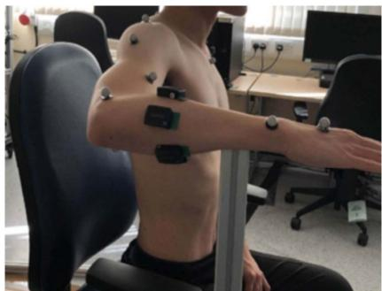
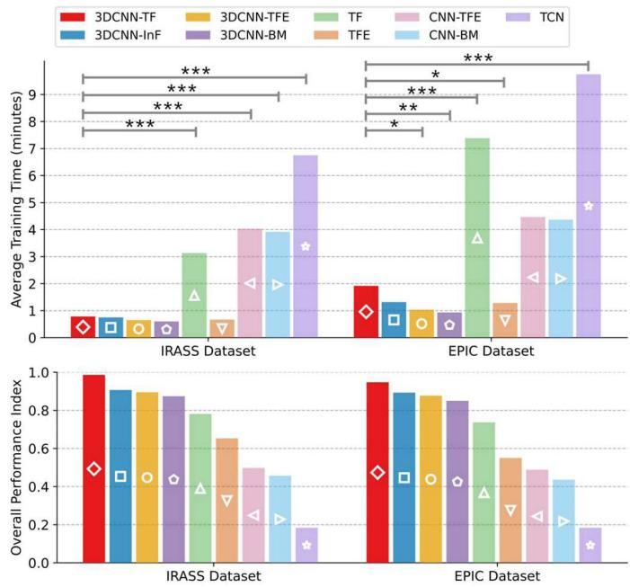
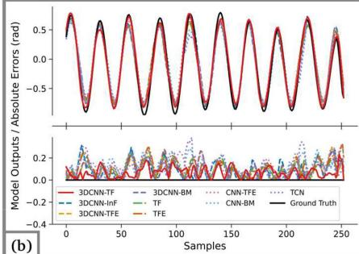
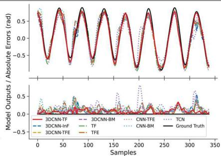
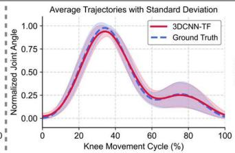

# A Transformer Framework Informed by Muscle Anatomy and Sequence-to-Sequence Translation for Continuous Joint Kinematics Prediction Using sEMG

Zijun Wei , Zhiqiang Zhang , Senior Member, IEEE, and Sheng Quan Xie , Fellow, IEEE

Abstract—The key to achieving assist-as-needed (AAN) control in rehabilitation robots lies in accurately predicting patient motion intentions. This study, for the first time, redefines motion intention prediction from the perspective of sequence-to-sequence translation by analogizing sEMG signals and joint angles to the source language and target language, respectively. The proposed 3DCNN-TF model achieves precise translation of neural control signals into kinematic representations. This model comprises three modules: an sEMG “sentence” generation module that compiles multiple sEMG sliding windows into a “sentence,” a 3DCNN module based on muscle anatomy and electrode placement to extract muscle synergy features from each “word” in the “sentence,” and a Transformer (TF) module that autoregressively generates the next joint angle as the translation result. Experimental results indicate that the 3DCNN-TF model achieves superior overall performance compared to eight baseline models and existing studies in continuously predicting wrist and knee flexion/extension angles across varying speeds. Moreover, the 3DCNN-TF achieves an optimal balance between prediction accuracy and computational efficiency while exhibiting exceptional robustness and generalizability. Specifically, the 3DCNN-TF achieves average nRMSE and R2 values of (6.2% /95.5% ) and (5.5% /96.2% ) on wrist and knee datasets, respectively, with an average training time of less than two minutes. Additionally, the 3DCNN-TF can predict joint angles up to 300 ms in advance without compromising accuracy, which is critical for real-time AAN control in rehabilitation robots.

Index Terms—Surface electromyography (sEMG), upper-limb rehabilitation, deep learning, muscle anatomy, sequence-to-sequence, continuous joint kinematics estimation methods.

## I. INTRODUCTION

PPROXIMATELY 85% of patients experience hemiparesis after a stroke, with persistent motor dysfunction in both upper and lower limbs even after rehabilitation, significantly impairing their quality of life [1]. However, most existing rehabilitation robots can only provide passive assistance based on impedance and admittance control, which is insufficient to significantly improve patients’ motor function [2]. Study [3] indicates that the key to improving rehabilitation efficiency lies in maximizing the patient’s active participation and the training intensity, rather than solely relying on robotic assistance. This aligns with the principles of neuroplasticity, which emphasizes that effective rehabilitation requires continuous and active patient involvement to induce brain and nervous system remodeling. Therefore, developing an “Assist-As-Needed” (AAN) control strategy that can precisely adjust robotic assistance in real-time based on patient’s effort levels is crucial. The key to achieving this lies in the accurate and continuous prediction of patients’ motion intentions [3]. Previous research has demonstrated that surface electromyography (sEMG), due to its non-invasive nature and portability, has been widely utilized to predict motion intentions [4]. Hence, this study will further investigate the continuous estimation of joint kinematics based on sEMG.

Based on our systematic review of 186 related studies over the past decade [4], deep learning (DL) has been extensively applied for the continuous prediction of joint kinematics and dynamics using sEMG. DL can automatically extract and select advanced features from sEMG and utilize the fitting capabilities of neural networks to establish nonlinear mappings between these features and motion intentions. The review [4] also highlighted that most current DL models focus on hybrid neural networks that combine convolutional neural networks (CNN), recurrent neural networks (RNN), and multi-head self-attention (MSA) mechanisms, such as CNN-BM (CNN-BiLSTM with MSA). These combinations have demonstrated superior prediction performance compared to models employing only CNNs or RNNs. Specifically, CNN-BM first extracts spatial features from sEMG using CNNs, then applies BiLSTM to capture long-term bidirectional contextual dependencies among these features, thereby obtaining spatiotemporal representations ofsEMG, with

MSA subsequently employed to enhance the weighting of critical spatiotemporal features.

However, the attention distribution of MSA only operates on the spatiotemporal features extracted by BiLSTM, and BiLSTM still has inherent limitations due to its recurrent structure, such as limited ability to remember long-range contextual relations, the risk of gradient vanishing or explosion during training, and lack of parallel computing [4], [5]. In contrast, the Transformer (TF) model overcomes these limitations. TF can simultaneously capture contextual relationships across all positions in the sequence without depending on sequential order, which makes it insensitive to temporal distance. Therefore, in the latest studies, TF and its variant BERT have replaced BiLSTM [4], [5], [6]. However, according to all relevant literature retrieved from PubMed, Web of Science, Scopus, and IEEE Xplore [5], [6], [7], [8], [9], [10], [11], [12], [13], [14], [15], [16], [17], [18], except for studies [7], [17], and [18], most studies have only employed the TF encoder (TFE) for the continuous estimation of joint kinematics from sEMG. This approach only exploits the TFE’s strength in capturing contextual dependencies within input sequences, overlooking the potential of the TF decoder (TFD) to generate temporally correlated target sequences based on the contextual representations provided by TFE.

Furthermore, although studies [7], [17], and [18] employed a full encoder-decoder framework, they all adopted the Informer (InF) model, which is a variant of TF [19]. In fact, InF was designed for long-term time-series forecasting, and its sparse MSA and distillation operations may lose detailed information in short sEMG feature sequences, thereby degrading predictive performance [20]. Additionally, the InF decoder generates the entire target sequence at once, rather than progressively in an autoregressive manner. Although this approach can improve inference speed and capture longer temporal dependencies, the lack of incremental feedback can lead to error accumulation, as the model cannot dynamically adjust the output [20]. Given that the non-stationary nature of sEMG requires precise capturing of short-term temporal features and high-frequency dynamics, and considering the sEMG sliding window is a short-time sequence, InF may not be optimal. Instead, using TFD with full MSA and autoregressive generation may maximize prediction accuracy.

According to the conclusions in our review, the core concept of DL models should revolve around accurately extracting spatiotemporal features from sEMG, enhancing the weights of key features, and deriving causal relationships between inputs and outputs based on the contextual dependencies among these features, while filtering out redundant features and noise as much as possible to improve predictive accuracy and robustness [4]. Additionally, the review emphasizes the importance of extracting muscle synergy (MS) features, which can further eliminate redundant and noisy components in sEMG due to individual differences, the time-varying nature of sEMG, and coupling and crosstalk between agonist and antagonist muscles. Therefore, based on these conclusions, we adopt CNN-BM as the base template and improve both CNN and BM modules to achieve better motion intention prediction performance.

Our recent study [21] on MS feature extraction has improved the CNN module in CNN-BM from four different perspectives while keeping the BM module unchanged, demonstrating that the 3DCNN-BM based on the target muscle anatomy and sEMG electrode placement achieved the most efficient MS feature extraction capability and optimal motion intention prediction performance compared to other methods. Therefore, this study continues to employ the 3DCNN from study [21] to extract MS features, with the 3DCNN-BM as one of the baseline models.

Furthermore, the underlying rationale of this study is that, according to musculoskeletal dynamics and kinematics, sEMG signals and corresponding joint angles during limb movement can be viewed as two physiological languages that represent the same neural control information in different forms. Specifically, sEMG represents implicit neural commands based on action potentials, whereas joint angles are the explicit motor outcomes of muscle contraction, implying a strong causal correspondence between them. From the perspective of language translation, using sEMG to predict joint angles resembles simultaneous interpretation, which requires the model to translate the implicit neural language of sEMG into joint angles as kinematic expressions. Therefore, this study used sequence-to-sequence (Seq2Seq) based TF to improve the BM module in 3DCNN-BM, thereby achieving precise translation from sEMG tojoint angles.

The proposed 3DCNN-TF model consists of three modules: an sEMG “sentence” generation module that interprets each sEMG sliding window as a “word” and compiles multiple “words” into a “sentence” within the allowable prediction latency, a 3DCNN module that extracts MS features from each “word” in the sEMG “sentence”, and a TF module that progressively generates the next joint angle as the translation result based on global contextual dependencies between the MS feature sequence and the prior joint angle sequence.

Notably, the TF module incorporates five key enhancements over the conventional TF architecture: an additional segment encoding is introduced to distinguish the sequential order of “words” within a “sentence”; the 3DCNN module replaces the traditional embedding layer in TFE to extract MS features as the semantic representation of each “word”; an extra causal mask is integrated into TFD to strictly enforce temporal causality during next joint angle generation; a dynamic Teacher Forcing strategy based on Scheduled Sampling [22] is adopted during the autoregressive loop training to accelerate model convergence and mitigate error accumulation; unlike conventional multi-layer TF designs, both TFE and TFD in the proposed TF module are single-layer structures, significantly reducing computational complexity while maintaining predictive performance.

The proposed 3DCNN-TF model was validated on our wrist joint dataset and the public lower-limb dataset from EPIC Lab [23]. This model was compared to eight baseline models (3DCNN-InF, 3DCNN-TFE, 3DCNN-BM, TF, TFE, CNN-TFE, CNN-BM, and TCN) for predicting wrist and knee flexion/extension angles during level-ground walking at slow, normal, and fast speeds. Experimental results demonstrated that the 3DCNN-TF model achieved optimal overall performance, balancing prediction accuracy and computational efficiency, while also exhibiting superior generalizability and robustness. Moreover, the 3DCNN-TF model could predict joint angles 300 milliseconds (ms) in advance without compromising prediction accuracy. Overall, the primary contribution of this study lies in redefining the motion intention prediction problem from the perspective of Seq2Seq translation for the first time. Specifically, it improves the BM module in the prior 3DCNN-BM [21], thereby accomplishing a comprehensive improvement to the CNN-BM framework. By analogizing sEMG signals and joint angles to the source and target languages, respectively, the proposed 3DCNN-TF model integrates the anatomical prior knowledge of target muscles with the Seq2Seq algorithm, achieving precise and anticipatory translation from sEMG signals to both wrist and knee joint angles.

  
(a)

  
(b)  
Fig. 1. Experimental protocol of the IRASS and EPIC dataset [24], [23].

## II. MATERIALS

## A. IRASS Dataset

This dataset was approved by the MaPS and Engineering Joint Faculty Research Ethics Committee of the University of Leeds (MEEC 18-002), involving 12 subjects (8 males and 4 females, aged 28.9 ± 2.8 years) who provided informed consent and participated in the experiment.

As shown in Fig. 1(a), before the experiment, all subjects were instructed to maintain an upright posture, with their elbows flexed at 90 degrees, their shoulders abducted at 90 degrees, and their hands in a neutral position. Subsequently, the maximum voluntary contraction (MVC) values for each subject were recorded to normalize the sEMG signals. During the experiment, subjects were required to perform continuous wrist flexion and extension movements, with the metacarpophalangeal (MCP) joints fully extended while avoiding the wrist ulnar and radial deviation. Each subject performed five trials, with a three-minute rest interval between trials to prevent muscle fatigue.

Wrist flexion/extension movements were recorded using the VICON motion capture system (VICON Motion Systems Ltd., U.K.) at a frequency of 250 Hz. According to the VICON upper limb model, 16 corresponding reflective markers were placed on the subjects’ right arms, enabling the VICON Nexus software to calculate the wrist joint flexion/extension angles. Meanwhile, sEMG signals from two wrist flexors: flexor carpi radialis (FCR) and flexor carpi ulnaris (FCU), and three wrist extensors: extensor carpi ulnaris (ECU), extensor carpi radialis longus (ECRL), and extensor carpi radialis brevis (ECRB), were collected using Avanti sensors (Delsys TrignoTM) at 2000 Hz. Moreover, to ensure the quality of sEMG signals, the subjects forearms were shaved and cleaned with alcohol to minimize skin impedance and motion artifacts. Electrode placement was determined according to SENIAM guidelines and confirmed through palpation and signal quality assessment. Finally, sEMG data and joint angle data were synchronized using the trigger module in VICON Nexus software and resampled at 1000 Hz.

## B. Open-Access EPIC Lab Dataset

To further evaluate the generalizability of the 3DCNN-TF model across different joints, the public lower-limb dataset from the EPIC Lab [23] was utilized. This dataset includes data from 22 healthy subjects (height $1 . 7 0 \pm 0 . 0 7 \mathrm { m }$ , weight $6 8 . 3 \pm 1 0 . 8 3 $ kg, age 21 ± 3.4 years). Detailed information for each subject can be found in [23]. For consistency with the number of subjects in the IRASS dataset, 12 subjects (6 males and 6 females) were selected from this dataset.

As illustrated in Fig. 1(b), data from these 12 subjects during level-ground walking were utilized in this study. Each subject performed circular walking at three distinct speeds: slow (0.88 ± 0.19 m/s), normal (1.17 ± 0.21 m/s), and fast $( 1 . 4 5 \pm 0 . 2 7 \mathrm { m / s } )$ with five repetitions in each of the counterclockwise and clockwise directions at each speed.

The knee flexion/extension angles were recorded using an electronic goniometer (Biometrics Ltd., Newport, U.K.) at 1000 Hz. Simultaneously, sEMG signals from 11 target muscles of the right lower limb were also collected at 1000 Hz (Biometrics Ltd., Newport, U.K.). Electrode placement was determined through palpation and in accordance with SENIAM guidelines. Furthermore, similar to the IRASS dataset, the electrode placement sites were shaved and cleaned with alcohol before the experiment. Additionally, since knee flexion/extension does not involve all 11 muscles, only the sEMG signals from six muscles associated with knee flexion/extension were used in this study: semitendinosus (ST), gracilis (GR), biceps femoris (BF), rectus femoris (RF), vastus lateralis (VL), and vastus medialis (VM).

## C. Signal Preprocessing

Given that the effective frequency range of sEMG signals is between 20-400 Hz, with components outside this range primarily consisting of motion artifacts and noise [25], a 20-400 Hz fifth-order Butterworth bandpass filter was first applied to the sEMG signals in both datasets, followed by a 50 Hz notch filter to eliminate powerline interference. To obtain smoother sEMG envelope signals for stable model training and faster convergence, full-wave rectification and a 5 Hz fifth-order Butterworth low-pass filter were subsequently applied. Finally, since MVC values were only recorded for the IRASS dataset, sEMG envelopes from the IRASS dataset were normalized based on their respective MVC values, whereas those from the EPIC dataset were normalized using Z-score normalization. As forjoint angle, both datasets were smoothed using a fifth-order Butterworth low-pass filter at 5 Hz, followed by min-max normalization to linearly scale the wrist and knee joint angle to the ranges of [-1, 1] and [0, 1], respectively.

  
Fig. 2. (a) 2D sEMG frames reconstruction of the IRASS dataset. (b) 2D sEMG frames reconstruction of the EPIC dataset. (c) The 3DCNN-BM model framework demonstrated using the IRASS dataset.

Regarding the sliding window segmentation, the control system delay in real-time applications should not exceed 300 ms to avoid noticeable system lag for users [26]. Moreover, the knee joint moves faster than the wrist joint in the experiments and excessively short windows fail to capture sufficient information, thereby degrading prediction accuracy. Conversely, longer windows introduce redundancy and increase latency without improving predictive performance. Hence, after evaluating five window sizes from 50 ms to 250 ms in increments of 50 ms, a 250 ms sliding window was applied to the IRASS dataset, and a 150 ms sliding window was applied to the EPIC dataset, both with an 80% overlap, thereby achieving an optimal balance between prediction accuracy and latency.

## III. METHODS

This section provides the details of each module within the proposed 3DCNN-TF model, along with descriptions of the eight baseline models. Additionally, the hyperparameters and loss function settings applied are discussed, as well as the performance metrics employed to quantitatively evaluate the prediction accuracy and training efficiency of each model.

## A. 3DCNN-Based MS Feature Extraction Module

This study follows the same approach as in [21] to extract MS features as semantics from sEMG video segments. Each 2D sEMG frame represents the relative contraction ratio of the target muscles at each moment across anatomical cross-sections. Thus, the stacked multi-frame sEMG video segments represent the 3D dynamic contraction process of the target muscles within this cross-section. Fig. 2(a) and (b) illustrate the reconstruction of 1D sEMG signals from the IRASS and EPIC datasets into 2D sEMG frames, respectively. Specifically, using the electrode placement sites as the anatomical cross-section, the anatomical distribution ofthe target muscles for the wrist and kneejoints was obtained through the Complete Anatomy software (3D4Medical Ltd.). Moreover, the midpoint between the center of the target muscle and the electrode was then designated as the new location of the target muscle in the 2D sEMG frames.

Fig. 2(c) shows the 3DCNN-BM model framework using the IRASS dataset as an example. With a sliding window size of 250 ms, each window contains 250 frames of 4 6 2D sEMG frames. These frames are first stacked into video segments and subsequently fed into a 3DCNN equipped with full-coverage convolutional kernels of size 4 6 to extract MS features. Batch normalization (BN) is applied to enhance training stability and accelerate convergence, and the LeakyReLU activation function is utilized to improve the nonlinear representation capability of the 3DCNN, thereby enabling comprehensive MS feature extraction. Average pooling is performed to reduce feature redundancy and noise while preserving key MS features. Subsequently, MS features of dimension 256 are passed to the BM module, comprising a single-layer BiLSTM and the MSA with eight heads. This module captures bidirectional contextual dependencies among MS feature elements and assigns higher weights to critical dependencies, thereby further emphasizing key MS information. Finally, two fully connected (FC) layers with LeakyReLU activation are employed to establish accurate nonlinear mappings between MS features and joint angles.

## B. sEMG “Sentence” Generation Module

Unlike previous studies that predicted joint angles based solely on a single sEMG sliding window, this study introduces a multi-window-to-multi-angle sentence-level translation framework from a machine translation perspective by treating the entire collected sEMG signal as a “paragraph” that needs translation. Hence, each sliding window is regarded as a “word” within this “paragraph,” where these “words” are arranged chronologically to form “sentences,” with each “sentence” consisting of an equal number of “words.” Given a maximum prediction delay of 300 ms in practical applications and an 80% sliding window overlap, each sEMG “sentence” in the IRASS and EPIC datasets comprises six 250 ms and ten 150 ms sEMG “words,” respectively. Similarly, the joint angle “words” and “sentences,” serving as the translation results for these sEMG “words” and “sentences,” are generated using the same approach.

  
Fig. 3. Proposed 3DCNN-TF model framework demonstrated using the IRASS dataset.

As shown in Fig. 3, using the IRASS dataset as an example, the output shape of the sEMG “sentence” generation module is (Batch size $\times ~ 6 ~ \times ~ 2 5 0 \times 5 )$ , indicating that each “sentence” contains six “words,” each with dimensions of $2 5 0 \times 5 .$ . These “words” are then fed into the 3DCNN module, where each “word” is reconstructed into 250 sEMG frames. Subsequently, all sEMG frames within a “sentence” are stacked into video segments and fed into the 3DCNN to extract the MS features of each “word.” Ultimately, the six “words” in each “sentence” are transformed into six 256-dimensional MS features (Batch size $\times \ 6 \times 2 5 6 )$ ), serving as the input for the subsequent TF module.

## C. Seq2Seq-Based Transformer Module

As depicted in Fig. 3, the TF module comprises four main components: position and segment encoding, MSA-based TFE, TFD with causal-masked MSA and multi-head cross-attention (MCA), and the autoregressive generation loop. Additionally, since the MS feature extraction module replaces the traditional embedding layer before TFE, only the embedding layer before TFD is retained to convert the input joint angle labels into vector representations with the same dimensions as the MS features. This allows TFD to better capture and align the cross-sequence dependencies between MS features and joint angle features.

Unlike recurrent structure based BiLSTM, the TF model processes all input data in parallel, thereby lacking an inherent understanding of sequential relationships within the input. Therefore, this study firstly utilizes a fixed positional encoding based on sine and cosine functions to mark the relative positions of elements within the MS and joint angle sequences. Moreover, additional markers are needed to help the TF module distinguish the arrangement of different “words” within the same “sentence.” Inspired by the Next Sentence Prediction (NSP) in the BERT model [27], the segment encoding based on the positional indices of “words” is added to distinguish which “word” each feature sequence belongs to. Finally, these two encodings are added to the MS and joint angle sequences before feeding them into the TFE and TFD, enabling the TF module to comprehend both local and global ordering within these feature sequences.

Unlike prior studies [5], [6], [7], [8], [9], [10], [11], [12], [13], [14], [15], [16], [17], [18] that employed multi-layer encoderdecoder structures, this study can achieve optimal performance using only a single-layer TFE and TFD, as validated through extensive experiments. As shown in Fig. 3, TFE consists of MSA and feed-forward network (FFN), each integrated with layer normalization (LN) and residual connections, denoted as LayerNorm (x + MSA (x)) and LayerNorm (x + FFN (x)). This design ensures the training stability of both MSA and FFN and mitigates the gradient vanishing issue. Furthermore, the number of attention heads and model dimensions of MSA are set to h= 8 and $d _ { \mathrm { m o d e l } } = 2 5 6$ , respectively, enabling MSA to capture global contextual dependencies within the MS sequence from eight different perspectives in parallel. Specifically, the equations for self-attention (SA) and MSA are as follows [28]:

$$
\begin{array}{l} \text { SA } (Q, K, V) = \text { softmax } \left(\frac {Q K ^ {T}}{\sqrt {d _ {k}}}\right) V \\ \text { MSA } (Q, K, V) = \text { Concat } (\text { head } _ {1}, \ldots , \text { head } _ {\text { h }}) W ^ {O} \\ \text { where   head } _ {\text { i }} = \text { SA } \left(Q W _ {i} ^ {Q}, K W _ {i} ^ {K}, V W _ {i} ^ {V}\right) \end{array}
$$

Here, the query ( Q), key ( K), and value ( V) are all derived from the linear projection of the input MS features sequence. For each attention head, the projection matrices of Q, K, and V are $W _ { i } ^ { Q } \in \mathbb { R } ^ { d _ { \mathrm { m o d e l } } \times d _ { k } }$ $W _ { i } ^ { K } \in \mathbb { R } ^ { d _ { \mathrm { m o d e l } } \times d _ { k } }$ , and $W _ { i } ^ { V } \in \mathbb { R } ^ { d _ { \mathrm { m o d e l } } \times d _ { v } ^ { \circ } }$ , respectively, with each head dimension set to $d _ { k } = d _ { v } = d _ { \mathrm { m o d e l } } ~ / h = 3 2$ . The dot product $Q K ^ { T }$ serves as the similarity score to measure correlations among elements within the MS feature sequence. Subsequently, the softmax function converts these correlations into attention weights for each MS element, which are then weighted and summed with V to highlight key information within the MS sequence. The normalization scaling factor $\sqrt { d _ { k } }$ ensures the gradient stability for softmax in high dimensions. Finally, the outputs from all attention heads are concatenated and linearly transformed via $W ^ { 0 } \in \mathbb R ^ { h d _ { v } \times d _ { \mathrm { m o d e l } } }$ to obtain the final output. The FFN further refines and memorizes critical information within the MS feature sequence through the position-wise nonlinear transformation.

Since the traditional TFD receives the complete ground truth label sequence during training, to better align the training process with the autoregressive generation during inference, causal masking is applied to the MSA in the traditional TFD, ensuring that only current and past time steps are visible during training, while future steps remain inaccessible. However, this study employs an autoregressive training loop, where TFD receives only historical steps, with future steps explicitly set to zero, thereby eliminating the need for causal masking. Nevertheless, since MSA still attends to all positions in the input sequence, causal masking is retained to prevent zero values in future time steps from distorting the attention weight distribution and to reduce unnecessary computation.

MCA is similar to MSA, except that Q is derived from the projection of known joint angle contexts, while K and V are derived from projections of the key contextual representations of MS, refined through TFE. This enables MCA to capture cross-sequence dependencies between MS and joint angles from multiple perspectives. Unlike traditional TFD, causal masking is also applied to the K and V inputs of MCA to prevent the use of future MS information when generating the current step prediction. This forces MCA to focus more on historical key MS data, avoiding assigning attention to irrelevant MS data, thereby improving prediction accuracy and computational efficiency.

Teacher Forcing used during traditional TF training employs ground true labels as input at each time step. However, during inference, traditional TF relies solely on its own past predictions, leading to exposure bias and error accumulation [22]. Therefore, this study adopts Scheduled Sampling with linear decay [22] in the autoregressive loop, dynamically adjusting the probability of using Teacher Forcing during training to gradually adapt the model to the autoregressive generation mode utilized during inference. The formula for this method is as follows:

$$
\begin{array}{c} x _ {t} = \left\{ \begin{array}{l l} y _ {t - 1} ^ {\text {true}}, & \text {if r <   p_{tf} (e)} \\ \hat {y} _ {t - 1}, & \text {if r\geq p_{tf} (e)} \end{array} \right. \\ p _ {\text {tf}} (e) = 1 - \frac {e}{E} \end{array}
$$

where e and E denote the current and total number of epochs, respectively, and r is a random number within [0, 1]. Based on the probability $p _ { \mathrm { t f } } ( e )$ , the model decides whether to use the true label $y _ { t - 1 } ^ { \mathrm { t r u e } }$ as the input $x _ { t }$ of TFD at the current time step. As depicted in Fig. 3, when r is smaller than $p _ { \mathrm { t f } } ( e )$ , TFD uses the true joint angle label $y _ { t - 1 } ^ { \mathrm { t r u e } }$ as input. Otherwise, it uses the previous step’s prediction $\hat { y } _ { t - 1 }$ . As training progresses, $p _ { \mathrm { t f } } ( e )$ gradually decreases, linearly transitioning $x _ { t }$ from initially fully relying on $y _ { t - 1 } ^ { \mathrm { t r u e } }$ to ultimately using only $\hat { y } _ { t - 1 }$ . This helps the model dynamically adjust the next prediction during inference, reducing error accumulation and improving generalizability.

## D. Baseline Models

This study employs eight baseline models, including five designed for ablation studies on the 3DCNN and TF modules, and three representative DL models from recent studies. The five ablation models comprise 3DCNN-Inf, 3DCNN-TFE, and 3DCNN-BM, which sequentially replace the TF module in the 3DCNN-TF with the Inf, TFE, and BM modules, respectively, as well as the TF and TFE models, where the 3DCNN module is entirely removed. The other three representative models are CNN-TFE, CNN-BM, and TCN.

Specifically, the Inf module in 3DCNN-Inf adopts the same architectural design as in [19]. To achieve optimal predictive performance, both the encoder and decoder in 3DCNN-Inf are set to four layers, as validated through multiple experiments. Each layer utilizes ProbSparse MSA and distillation operations. Additionally, for a fair comparison, the number of ProbSparse attention heads and the model dimensions were set to 8 and 256, respectively, identical to the 3DCNN-TF. The 3DCNN-TFE is derived from 3DCNN-TF by removing the TFD and autoregressive looping parts, retaining only the positional and segment encodings, TFE, and FC layers. The TF and TFE replace the 3DCNN module in 3DCNN-TF and 3DCNN-TFE, respectively, with an embedding layer of $d _ { \mathrm { m o d e l } } = 2 5 6 .$ , and their inputs change from MS features to preprocessed sEMG signals.

As for the representative models, CNN-TFE and CNN-BM are constructed by replacing the 3DCNN modules in 3DCNN-TFE and 3DCNN-BM with the three-channel 2DCNN using conventional $3 \times 3$ convolutional kernels, with the number of channels set to 64, 128, and 256, respectively. Finally, TCN is modified from the TCN architecture used in the EPIC dataset [29], comprising three residual blocks with channel sizes of 64, 128, and 256, respectively. Each residual block contains two 1D causal dilated convolutional layers, with the dilation factors and kernel sizes being consistent with those in [29].

## E. Model Training Settings

To minimize the impact of training environments, all models were developed and trained using the Pytorch framework on the Google Colab platform. To ensure reproducibility and fair comparisons, identical hyperparameter settings were applied across all models. Specifically, the AdamW optimizer was employed for model training, with a batch size of256 and an initial learning rate set to 0.001. An adaptive learning rate decay strategy was employed to facilitate model convergence: once the validation loss plateaued, the learning rate was progressively reduced by a factor of 0.8. Additionally, the slope of the LeakyReLU activation function was set to 0.1, and a dropout rate of 20% was applied to prevent overfitting. All of the above hyperparameter values were determined through iterative experimentation.

Moreover, to ensure convergence and fair comparisons of training times, all models were trained for 1000 epochs. The mean squared error (MSE) between the predicted and true joint angles was used as the training loss function.

For data partitioning, each subject’s data was randomly divided into 80% for training and 20% for testing. Considering the limited computational resources of rehabilitation equipment in practical applications, model training was conducted using an entry-level NVIDIA Tesla T4 GPU, which offers computational performance comparable to the NVIDIA GeForce RTX 2070. This setup simulates the operational environment of clinical devices, ensuring practical relevance of the experimental results.

## F. Performance Metrics

This study employed the normalized root mean square error (nRMSE) and the coefficient of determination $( \mathbb { R } ^ { 2 } )$ as performance metrics to evaluate the magnitude oferror and the correlation between predicted and actual joint angles, respectively. Considering the cross-dataset comparisons in this study, nRMSE, which is robust to variations in sample size and output range, was selected instead of RMSE. $\mathrm { R } ^ { 2 }$ was employed to assess the overall goodness-of-fit of each model, effectively complementing the nRMSE in performance evaluation. The formulas for these two metrics are as follows:

$$
\begin{array}{c} \text {nRMSE} = \frac {\sqrt {\frac {1}{N} \sum_ {i = 1} ^ {N} \left(\theta_ {i} - \hat {\theta} _ {i}\right) ^ {2}}}{\theta_ {\max} - \theta_ {\min}} \\ R ^ {2} = 1 - \frac {\operatorname{Var} (\theta - \hat {\theta})}{\operatorname{Var} (\theta)} \end{array}
$$

where $\theta$ and $\hat { \theta }$ represent the true and predicted joint angles, respectively, and Ndenotes the sample size. Lower nRMSE values and $\mathtt { R } ^ { 2 }$ values closer to 1 indicate higher accuracy.

In addition, unlike overall performance metrics such as RMSE and $\mathrm { R } ^ { 2 }$ , Statistical Parametric Mapping (SPM) based on twotailed t-tests was utilized to conduct continuous statistical inference across the entire time series. After dual normalization by time and joint angle for all subjects’ movement cycles, SPM was used to identify specific intervals within the cycles where significant differences existed between the predicted angles and the ground truth, with the significance level set at $\alpha = 0 . 0 5$

Notably, to further quantify the comprehensive performance of all models, an overall performance index (OPI) metric was proposed, integrating both predictive accuracy (nRMSE and $\scriptstyle \mathrm { R } ^ { 2 } )$ and computational efficiency (training time). Specifically, the OPI is calculated as follows:

$$
\begin{array}{l} \text { OPI } = w _ {P} \cdot \left[ \frac {(1 - \mathfrak {n} \mathrm{RMSE} _ {\mathrm{norm}}) + R _ {\mathrm{norm}} ^ {2}}{2} \right] \\ \quad + w _ {T} \cdot \exp (- \mathrm{Time} _ {\mathrm{norm}}) \end{array}
$$

Where $w _ { P }$ and $w _ { T }$ are the weights for prediction accuracy and training time, respectively, with $w _ { P } + ~ w _ { T } = ~ 1$ nRMSEnorm , $\bar { R } _ { \mathrm { n o r m } } ^ { 2 }$ and ${ \mathrm { T i m e } } _ { \mathrm { n o r m } }$ denote the normalized nRMSE, $\mathtt { R } ^ { 2 } .$ , and training time for each model. In this study, $w _ { P }$ and wT were both set to 0.5, balancing the importance of prediction accuracy with the practicality of the model in real application scenarios. Notably, the training time was penalized non-linearly using an exponential decay function, better reflecting the tolerance for training time in practical applications.

  
Fig. 4. nRMSE $/ \mathsf { R } ^ { 2 }$ results for all models on the IRASS dataset, along with the average nRMSE $/ \mathsf { R } ^ { 2 }$ values and corresponding standard deviations for each model. The significance level is set as 0.05 ( $p <$ 0.001, $p < 0 . 0 1$ , and ${ } * p < 0 . 0 5 { \mathrm { ) } }$

## IV. RESULTS

## A. Prediction Results of All Models

1) IRASS Dataset: Fig. 4 presents the nRMSE and $\mathrm { R } ^ { 2 }$ results for all models on the IRASS dataset. Compared with other models, 3DCNN-TF consistently demonstrated superior predictive performance across all subjects. Specifically, it achieved the lowest average nRMSE (6.2% ) and the highest average $\mathrm { R } ^ { 2 }$ (95.5% ) among the 12 subjects. Furthermore, based on the distribution of error bars in the bar chart, 3DCNN-TF exhibited the highest predictive stability, with minimal variability in the results. The performance ranking of the remaining models, from best to worst, along with their corresponding average nRMSE and $\mathrm { R } ^ { 2 }$ values, is as follows: 3DCNN-InF (7.3% /94% ), 3DCNN-TFE (7.7% /93.4% ), 3DCNN-BM (8% /92.8% ), TF (8.7% /91.5% ), TFE (9.2% /90.6% ), CNN-TFE (10.2% /88.8% ), CNN-BM (10.7% /87.4% ), and TCN (12.5% /82.6% ).

Additionally, to systematically evaluate the performance advantage of 3DCNN-TF over the other models, a one-way repeated measures ANOVA was conducted for nRMSE and $\mathtt { R } ^ { 2 } .$ with model type as the within-subject factor. Post-hoc paired t-tests with Holm-Bonferroni correction were performed to assess the differences between the 3DCNN-TF and other models, with the significance level set at $\alpha = 0 . 0 5$ . Statistical analysis revealed that 3DCNN-TF significantly outperformed all other models $( \ p < 0 . 0 5 )$ , strongly demonstrating the superior predictive performance of 3DCNN-TF on the IRASS dataset.

  
Fig. 5. nRMSE/R2 results for all models at three walking speeds on the EPIC dataset, along with the average nRMSE/R2 values and corresponding standard deviations for each model. The significance level is set as 0.05 $( * * * p < 0 . 0 0 1$ 1, $p < 0 . 0 1$ , and $\stackrel { - } { * } p < 0 . 0 5 )$ .

2) EPIC Dataset: Fig. 5 shows the nRMSE and $\mathrm { R } ^ { 2 }$ results for all models on the EPIC dataset. Except for subject S6 in the fast-walking trial, the 3DCNN-TF demonstrated the best predictive performance across other subjects in this trial, as well as in both the normal speed and slow speed walking trials. Specifically, 3DCNN-TF achieved the lowest average nRMSE and the highest average $\mathtt { R } ^ { 2 }$ across all 12 subjects at the three walking speeds: fast (5.4% /96.2% ), normal (5.2% /96.7% ), and slow (5.9% /95.7% ), with the overall average of (5.5% /96.2% ). Similarly, the error bars in the bar chart demonstrate that 3DCNN-TF consistently exhibited the lowest performance variability. The performance ranking of the other models across the three walking speeds followed the same order as in the IRASS dataset, with corresponding average nRMSE and $\mathrm { R } ^ { 2 }$ values as follows: 3DCNN-InF (6.5% /94.7% ), 3DCNN-TFE (6.9% /94.2% ), 3DCNN-BM (7.3% /93.7% ), TF (7.7% /92.8% ), TFE (8.2% /91.7% ), CNN-TFE (9.2% /89.6% ), CNN-BM (9.7% /88.3% ), and TCN (10.6% /86.2% ).

Employing the same statistical significance analysis as used in the IRASS dataset, the results revealed significant performance differences ( $p < 0 . 0 5 )$ between 3DCNN-TF and all other models, further demonstrating its superior predictive performance on the EPIC dataset. However, it is noteworthy that the performance gap between 3DCNN-TF and 3DCNN-InF narrowed in the slow-walking trials ( $p < 0 . 0 5 )$ , compared to the fast-walking and normal-walking trials $\left( \begin{array} { l } { p < 0 . 0 1 } \end{array} \right)$

3) Model Training Times and OPI Comparisons: Fig. 6 presents the training times and OPI scores of all models across both datasets. The training times of models on the IRASS dataset, ranked from shortest to longest, are as follows: 3DCNN-BM, 3DCNN-TFE, TFE, 3DCNN-InF, 3DCNN-TF, TF, CNN-BM, CNN-TFE, and TCN. On the EPIC dataset, the training time of TF significantly increased and ranked second only to TCN, which exhibited the longest training time. However, statistical analysis indicated that 3DCNN-TF had no significant difference $\cdot > 0 . 0 5 )$ in training time compared to 3DCNN-BM,

  
Fig. 6. Training times and OPI scores of all models on the IRASS dataset and the EPIC dataset. The significance level is set as 0.05 ( $\pmb { p } < 0 . 0 0 1$ , $p < 0 . 0 1$ , and p < 0.05).

3DCNN-TFE, TFE, and 3DCNN-InF on the IRASS dataset, with all these models completing training in under one minute. On the EPIC dataset, which contains on average 30% more data than IRASS, 3DCNN-TF exhibited significant differences in training time compared to all other models $( \textit { \textbf { p } } < 0 . 0 5 )$ , but its training time still remained within two minutes. Overall, although the $\mathrm { T F }$ module’s training time increased significantly with larger datasets, 3DCNN-TF still maintained relatively short training times and achieved the highest prediction accuracy. Consequently, 3DCNN-TF achieved the highest OPI scores across both datasets, significantly outperforming all baseline models.

  
Fig. 7. (a) and (b) are examples of predicted joint angles for all models on the IRASS dataset and the EPIC dataset, respectively, along with the corresponding absolute error values compared to the actual joint angles. (c) SPM analysis results of 3DCNN-TF.

## B. Representative Examples ofPredicted Joint Angles and SPM Analysis

Fig. 7(a) and (b) illustrate representative prediction examples for all models on the EPIC and IRASS datasets, respectively. Specifically, three representative subjects were selected from each dataset to visually compare the differences between actual joint angles and the predicted angles from each model, along with their corresponding absolute errors. The prediction results and errors for these six subjects reveal that, despite individual differences in movement amplitude and speed, 3DCNN-TF consistently exhibited smaller prediction errors compared to the other models. Notably, during stable movement phases between joint angle inflection points, 3DCNN-TF’s predictions were highly consistent with the actual joint angles. However, its prediction errors increased during phases of abrupt joint angle changes, suggesting room for improvement in capturing transient sEMG features. This is substantiated by the SPM results in Fig. 7(c). For the wrist, significant differences are observed during the peak flexion phase (0–22%, $p < 0 . 0 0 1 )$ and peak extension phase (49-70%, $p < 0 . 0 0 1 )$ , whereas the remaining 57% of the steady-state phase showed no significant difference. For the knee, significant differences appear only during peak flexion phase (29–36%, $p = 0 . 0 1 5 )$ , with the remaining 93% of the cycle showing no significant difference.

## C. Anticipatory Prediction Capability of3DCNN-TF

Due to the inherent electromechanical delay (EMD), sEMG signals convey motion intention information approximately 30– 150 ms before actual movement occurs [4], [7]. This not only helps reduce prediction latency but also enables models to anticipate future joint angles. As shown in Fig. 8(a), sEMG signals collected in the EPIC and IRASS datasets are temporally misaligned with their corresponding actual joint angles, with sEMG being collected ahead of time within the EMD range, thereby offering an opportunity for advance prediction. Notably, even without considering EMD, the model itself may possess an intrinsic ability to forecast future joint angles.

Therefore, this study temporally realigned sEMG with joint angles to test the effective advance prediction time range of 3DCNN-TF. As shown in Fig. 8(a), considering EMD, the sEMG signals were time-shifted forward while keeping the joint angles fixed to validate the actual EMD range and the maximum advance prediction time range for 3DCNN-TF itself. The time shift range was set from 0 to 900 ms, with a step size of 100 ms.

Fig. 8(b) shows the predictive performance of 3DCNN-TF across different advance time ranges on the EPIC and IRASS datasets. The results indicate that prediction accuracy began to degrade significantly beyond 300 ms $( \textit { \textbf { p } } < 0 . 0 5 )$ , indicating that 3DCNN-TF can predict up to 300 ms in advance without performance loss. Additionally, if a threshold of $\mathsf { R } ^ { 2 } \geq 9 0 \%$ is considered acceptable, 3DCNN-TF can predict up to 600 ms in advance. Notably, 3DCNN-TF exhibited peak performance and minimal variance at 100 ms, which aligns with the 30–150 ms EMD range, thereby verifying that the EMD in the EPIC and IRASS datasets is approximately 100 ms, while the inherent advance prediction capability of 3DCNN-TF is around 200 ms.

  
Fig. 8. (a) sEMG-angle temporal alignment before assessment. (b) 3DCNN-TF advance prediction capability on two datasets.

## V. DISCUSSION

## A. Analysis of Prediction Results for All Models

Based on the results of nRMSE, $\mathbf { R } ^ { 2 } { \mathrm { . } }$ , and training time, the proposed 3DCNN-TF model demonstrated superior prediction performance on both datasets, with an average training time of less than two minutes. The highest OPI scores further validate that 3DCNN-TF strikes the optimal balance between prediction accuracy and computational efficiency. Moreover, cross-velocity and cross-joint experiments on the EPIC and IRASS datasets further demonstrate the superior robustness and generalizability of 3DCNN-TF compared to other models.

Specifically, the average standard deviations of nRMSE and $\mathrm { R } ^ { 2 }$ for 3DCNN-TF on the IRASS dataset were 1.22% and 2.01%, respectively, both significantly lower than those of the baseline models (nRMSE: 1.37% –2.67% ; $\mathrm { R } ^ { 2 } \colon 2 . 2 3 \% - 5 . 8 9 \% \big )$ . Under three different walking speeds within the EPIC dataset, the average standard deviations of nRMSE and $\mathrm { R } ^ { 2 }$ for 3DCNN-TF were 0.86% and 1.31%, respectively, also lower than those of the baseline models (nRMSE: 1.07% –1.78% ; $\mathbf { R } ^ { 2 } { \boldsymbol { : } }$ 1.67% –4.12% ). For cross-joint comparisons, 3DCNN-TF exhibited comparable performance between the wrist and knee joints, with an average nRMSE and $\mathtt { R } ^ { 2 }$ difference of only 0.7% across the two datasets. Moreover, the average trajectories of all subjects’ wrist and knee cycles in Fig. 7(c) demonstrated excellent consistency between 3DCNN-TF predictions and the ground truth. The narrow standard deviation bands indicate strong generalizability and robustness of 3DCNN-TF across subjects, joints, and movement speeds.

Notably, although there were no significant differences in performance of 3DCNN-TF across the three walking speeds $( \mathrm { ~ \it ~ \ / ~ p ~ } > \mathrm { ~ 0 . 0 5 ) ~ }$ , other baseline models exhibited significantly superior performance at normal speed $( \textit { p } < 0 . 0 5 )$ . Moreover, average performance across all models was consistently highest at normal speed. A possible explanation is that subjects had to consciously adjust their gait and balance at unfamiliar speeds, leading to atypical motor control and muscle activation patterns. Additionally, maintaining gait stability under such conditions requires greater muscular recruitment, thereby increasing the sEMG crosstalk. As for the slightly inferior performance of 3DCNN-TF in wrist joint prediction compared to the knee joint, several factors may contribute. Firstly, the wrist joint has more degrees of freedom than the knee, and slight ulnar or radial deviations may occur during wrist flexion/extension, thereby interfering with the sEMG signals. Secondly, the EPIC dataset contains more data than the IRASS dataset, leading to an imbalance in data volume that affects model learning. Lastly, as observed in Fig. 7, walking is subconsciously controlled, exhibiting more stable rhythmic patterns (93% steady-state interval). In contrast, voluntary wrist flexion/extension involves greater variability in speed and amplitude (57% steady-state interval), posing additional challenges for model prediction.

## B. Anticipatory Prediction Capability of3DCNN-TF

Study [30] indicates that providing robotic assistance before the onset of actual muscle contraction can significantly enhance voluntary muscle activation. This rapid assistance strategy effectively improves patient rehabilitation efficiency without increasing the difficulty of motor tasks. Therefore, it is crucial to evaluate the advance prediction time range of 3DCNN-TF for future joint angles. Specifically, this time range needs to cover actuator response delay and system communication delay in the rehabilitation robot, as well as delays from signal acquisition and processing, sliding time windows, and model inference. In fact, since the sliding window operates incrementally in real-time applications, the sliding window delays for the EPIC and IRASS datasets correspond to the 20% non-overlapping portion, which are 30 ms and 50 ms, respectively. Regarding the model inference delay, the average computation time for 3DCNN-TF on the test sets of both datasets is 21 ms. Since each test set contains an average of 10 joint movement cycles, the inference delay for a single cycle is approximately 2.1 ms. Overall, given that 3DCNN-TF can predict up to 300 ms in advance, after accounting for the aforementioned delays, the remaining buffer is sufficient for real-time prediction and rapid assistance, while also mitigating the risks associated with signal loss and motion artifacts in practical prediction scenarios.

## C. Ablation Study of3DCNN-TF

1) 3DCNN Module: The ablation study of the 3DCNN module comprises two sets of comparisons. The first compares 3DCNN-TF and 3DCNN-TFE against TF and TFE, while the second compares 3DCNN-TFE and 3DCNN-BM against CNN-TFE and CNN-BM. These comparisons collectively demonstrate the significance of the 3DCNN module and its superiority over conventional CNNs.

Firstly, compared to TF and TFE, incorporating the additional 3DCNN module not only improved prediction performance by reducing the average nRMSE by 22%, but also significantly reduced training time, particularly reducing the average training time of TF by 75% . Secondly, compared to conventional CNNs, both 3DCNN-TFE and 3DCNN-BM achieved better prediction performance and training efficiency, reducing average nRMSE by 25% and training time by 81% . Moreover, the comparison between CNN-TFE and TFE further demonstrated that using conventional CNNs degrades TFE’s prediction performance while increasing unnecessary training time. This occurs because conventional CNNs process sEMG images constructed based on sliding window sizes and electrode channels, where the 3 3 2D convolution kernel is restricted to extracting only local features from sEMG images, failing to fully capture MS features from sEMG images’ spatiotemporal components. Consequently, this limits the subsequent effectiveness of TFE and BM modules.

In contrast, the 3DCNN module, informed by anatomical prior knowledge, can efficiently extract MS features from the raw sEMG. These physiologically interpretable MS features encapsulate essential motor control information [21]. Therefore, 3DCNN effectively eliminates redundant features and noise from the raw sEMG, preserving the dynamic spatiotemporal features of muscle contractions, thereby achieving refinement and compression of sEMG signals. Additionally, since the pixel count in each 2D sEMG frame is significantly lower than that of full sEMG images and the 3DCNN’s convolutional kernels can cover entire sEMG video segments, the input can be directly converted into MS features in one step. In contrast, 2DCNN extracts only local features and requires multiple pooling steps for effective feature extraction and dimensionality reduction. Overall, 3DCNN not only substantially reduces computational complexity during MS feature extraction but also provides more compact sEMG representations for subsequent TF, TFE, and BM modules. This facilitates faster training and establishes more precise contextual dependencies for key MS features in sEMG, ultimately improving the performance and efficiency.

2) TF Module: The ablation study of the TF module also consists of two sets of comparisons. The first set compares 3DCNN-TF with other models that also employ the 3DCNN (3DCNN-InF, 3DCNN-TFE, and 3DCNN-BM), while the second compares TF with TFE. These comparisons collectively validate the necessity of employing the complete TF structure.

The first comparison demonstrates that, compared to using InF, TFE, or BM following the 3DCNN, 3DCNN-TF reduced the average nRMSE by 15.2%, 19.9%, and 23.5%, respectively. The second comparison shows that the advantage of TFD does not fully rely on the quality of the input features. Even without the MS features provided by 3DCNN, TF still outperformed TFE, reducing the average nRMSE by 5.7% . These significant improvements stem from three key advantages of the complete TF architecture over InF, TFE, and BM: the complete MSA, autoregressive generation, and MCA.

Firstly, joint angle prediction from sEMG is a short-term time series forecasting task that requires capturing high-frequency dynamics and fine-grained features in sEMG. However, InF, which is designed for long-term sequence prediction, fails to fully exploit its strengths in this context. This limitation arises because InF sacrifices accuracy for computational efficiency in long-term forecasting, with its ProbSparse MSA and distillation operations based on the max pooling losing critical contextual relationships among MS features. In contrast, TF’s MSA captures complete global contextual dependencies within MS feature sequences, preserving all essential MS information. This is further evidenced by the model depth, where the single-layer TF achieves higher predictive accuracy than the four-layer InF. Additionally, the autoregressive generation of TF, as opposed to InF’s one-shot generation, dynamically adjusts the prediction strategy by utilizing historical information, thereby correcting deviations and ensuring the temporal coherence and stability of the TFD outputs. Therefore, 3DCNN-TF balances accuracy and computational efficiency more effectively than 3DCNN-InF.

Secondly, apart from autoregressive generation, comparisons between TF and TFE further highlights the importance of MCA. MCA enables TFD to dynamically screen key MS information provided by TFE that is most relevant to the next joint angle prediction based on cross-sequence contextual dependencies between current sEMG signals and historical joint angles, thereby accurately generating the joint angle for the next step.

Lastly, the comparison between TF and BM further validates the integrated effect of the three key advantages of TF. Since BM’s MSA is built atop BiLSTM, it is constrained by BiLSTM’s recurrent structure, limiting its ability to establish long-range contextual dependencies within the feature sequences, thereby degrading prediction performance. In contrast, TF can model contextual dependencies across arbitrary temporal spans in parallel and mitigate gradient vanishing or explosion issues inherent in BiLSTM. Nonetheless, these advantages of TF come at the cost of reduced computational efficiency.

## D. Comparison With Existing Studies

For the IRASS dataset, the predictive performance of 3DCNN-TF (average $\mathrm { R } ^ { 2 } = 0 . 9 6 )$ surpasses not only the 3DCNN-BM model proposed in study [21] but also three other related studies utilizing the same dataset. These include a personalized musculoskeletal (MSK) model using the direct collocation (DC) physiological parameter optimization approach [31] (average R2 = 0.88), a generative adversarial network (GAN) based on the Lagrangian equations of motion and MSK inverse dynamics [32] (average $\mathrm { R } ^ { 2 } = 0 . 9 2 )$ , and a deep Kalman filter network (DKFN) that employs CNN-LSTM to train Kalman filter parameters and gains [33] (average $\mathrm { R } ^ { 2 } = 0 . 8 7 )$ . Notably, study [21] has demonstrated that 3DCNN-BM outperforms other baseline models in that study, including GraphSAGE-BM based on graph topology, CAE-BM based on convolutional autoencoders, MCNN-BM based on multi-scale spatiotemporal convolution kernels, and other classical DL models (CNN, LSTM, BiLSTM, and CNN-BiLSTM). Therefore, it can be inferred that 3DCNN-TF also outperforms these models on the IRASS dataset.

For the EPIC dataset, the predictive performance of 3DCNN-TF (average $\mathrm { R } ^ { 2 } = 0 . 9 6 )$ exceeds that of two related studies using the same dataset. These studies are: the RNN and CNN models trained using root mean square (RMS) features of sEMG signals from the three most relevant muscles selected by non-negative matrix factorization (NMF) [34] (average $\mathrm { R } ^ { 2 } = 0 . 7 4 )$ , and a gait phase estimation model integrating Gaussian process regression (GPR), adaptive frequency oscillators (AFO), and unscented Kalman filters (UKF) [35] (average $\mathrm { R } ^ { 2 } = 0 . 8 8 )$ .

Additionally, sEMG electrodes in the second Ninapro DB2 dataset used in study [21] are distributed evenly around the forearm without targeted placement over specific muscles. Therefore, this dataset failed to strictly follow the anatomical distribution of target muscles for MS feature extraction, thus limiting the validation of 3DCNN performance. In contrast, this study precisely aligns sEMG electrode placement with the anatomical distribution of target muscles in both datasets, thereby fully demonstrating the feasibility of using 3DCNN for MS feature extraction informed by muscle anatomy.

## E. Limitations and Future Work

The two datasets and the proposed 3DCNN-TF model in this study still have several limitations. Regarding the dataset, future studies should incorporate more joint types, multi-degree-offreedom joint movements, more subjects, and longer durations of randomized and complex movements, to comprehensively evaluate the robustness and generalizability of the model. Additionally, future work should include stroke patients and test 3DCNN-TF’s real-time prediction capability to ensure its reliability in actual non-standardized rehabilitation scenarios.

Regarding the 3DCNN-TF model, in addition to reducing its reliance on the precise positioning of target muscles and sEMG electrodes during 2D sEMG frame reconstruction, it is also essential to improve the training efficiency of the TF module without losing performance. Therefore, future work could integrate explicit spatial synergy encoding based on polar coordinates, as proposed in [36], wherein electrode phase differences encode relative spatial relationships of muscle activation, thereby improving 3DCNN’s MS extraction and robustness against electrode shift. Moreover, other TF variants can be considered to reduce the computational complexity of MSA, MCA, and FFN. Additionally, the DL-based 3DCNN-TF inherently functions as a black-box tool, lacking interpretability regarding the neurophysiological mechanisms between sEMG and joint kinematics. Hence, future research could integrate MSK-based motion equations into the current MSE loss function as an additional constraint. Moreover, 3DCNN-TF could serve as the generator network, while the multi-joint hierarchical optimized Hill model from [37] could act as the discriminator network in a GAN framework. This approach would leverage MSK biomechanical priors during adversarial training to enhance both interpretability and multi-joint coordination prediction capabilities of the model, while also reducing its reliance on large-scale training datasets. Furthermore, 3DCNN-TF can be extended into a multimodal fusion framework that integrates sEMG and IMU signals to improve prediction accuracy. In addition, the model can be pre-trained on large-scale datasets to extract both subject-invariant and subject-specific MS components, followed by subject-specific fine-tuning to enable rapid few-shot transfer learning.

## VI. CONCLUSION

For the first time, this study redefines the problem of motion intention prediction from the perspective ofSeq2Seq translation, achieving an accurate translation from neural control signals to kinematic representation by analogizing sEMG and joint angles as the source and target languages, respectively. Specifically, the model input is reformulated into a “sentence” formed by stacking multiple sEMG sliding windows, where each sliding window serves as a “word” within the “sentence.” This design enables the model to capture more comprehensive temporal information, thereby overcoming the limitations of traditional approaches that rely solely on the single-window prediction. Additionally, given that previous study [21] has demonstrated that the 3DCNN based on target muscle anatomy can efficiently extract MS features from sEMG signals, this study integrates the 3DCNN module with a modified Seq2Seq-based TF module, thereby achieving precise prediction from sEMG to joint angles.

Firstly, the 3DCNN module reconstructs each “sentence” into sEMG video segments based on the anatomical distribution and electrode placement of the target muscles, thereby extracting MS features that represent the essence of neural control. This significantly enhances the model’s prediction accuracy while substantially reducing training time. Subsequently, the TF module dynamically captures global contextual dependencies between MS feature sequences and joint angle sequences from multiple perspectives through the synergistic effects of TFE, TFD, and autoregressive generation loop, ultimately generating precise joint angle predictions as translation results step by step.

Experimental results on two datasets involving wrist and knee flexion/extension tasks indicate that 3DCNN-TF achieves optimal overall performance compared to eight baseline models, striking an optimal balance between prediction accuracy and computational efficiency while exhibiting superior robustness and generalizability. Additionally, 3DCNN-TF can predict joint angles up to 300 ms in advance without loss of accuracy, highlighting its potential in real-time rehabilitation assistance.

## REFERENCES

[1] F. Xiong et al., “Emerging limb rehabilitation therapy after post-stroke motor recovery,” Front. Aging Neurosci., vol. 14, Mar. 2022, Art. no. 863379, doi: 10.3389/FNAGI.2022.863379/PDF.

[2] J. Berning, G. E. Francisco, S. H. Chang, B. J. Fregly, and M. K. O’Malley, “Myoelectric control and neuromusculoskeletal modeling: Complementary technologies for rehabilitation robotics,” Curr. Opin. Biomed. Eng., vol. 19, Sep. 2021, Art. no. 100313, doi: 10.1016/J.COBME.2021.100313.

[3] A. Basteris, S. M. Nijenhuis, A. H. A. Stienen, J. H. Buurke, G. B. Prange, and F. Amirabdollahian, “Training modalities in robot-mediated upper limb rehabilitation in stroke: A framework for classification based on a systematic review,” J. Neuroengineering Rehabil., vol. 11, no. 1, pp. 1–15, Jul. 2014, doi: 10.1186/1743-0003-11-111.

[4] Z. Wei, Z. Q. Zhang, and S. Q. Xie, “Continuous motion intention prediction using sEMG for upper-limb rehabilitation: A systematic review of model-based and model-free approaches,” IEEE Trans. Neural Syst. Rehabil. Eng., vol. 32, pp. 1487–1504, 2024, doi: 10.1109/TNSRE.2024.3383857.

[5] Z. Chen, H. Wang, H. Chen, and T. Wei, “Continuous motion finger joint angle estimation utilizing hybrid sEMG-FMG modality driven transformer-based deep learning model,” Biomed. Signal Process. Control, vol. 85, Aug. 2023, Art. no. 105030, doi: 10.1016/J.BSPC.2023.105030.

[6] C. Lin, X. Chen, W. Guo, N. Jiang, D. Farina, and J. Su, “A BERT based method for continuous estimation of cross-subject hand kinematics from surface electromyographic signals,” IEEE Trans. Neural Syst. Rehabil. Eng., vol. 31, pp. 87–96, 2023, doi: 10.1109/TNSRE.2022.3216528.

[7] T. Liang et al., “sEMG-based end-to-end continues prediction of human knee joint angles using the tightly coupled convolutional transformer model,” IEEE J. Biomed. Health Inform., vol. 27, no. 11, pp. 5272–5280, Nov. 2023, doi: 10.1109/JBHI.2023.3304639.

[8] C. Lin and X. Zhang, “Fusion inception and transformer network for continuous estimation of finger kinematics from surface electromyography,” Front. Neurorobot., vol. 18, May 2024, Art. no. 1305605, doi: 10.3389/FN-BOT.2024.1305605/BIBTEX.

[9] C. Lin and Z. He, “A rotary transformer cross-subject model for continuous estimation of finger joints kinematics and a transfer learning approach for new subjects,” Front. Neurosci., vol. 18, Mar. 2024, Art. no. 1306050, doi: 10.3389/FNINS.2024.1306050/BIBTEX.

[10] Z. An et al., “SCTNET: Shifted windows and convolution layers transformer for continuous angle estimation of finger joints using sEMG,” IEEE Sensors J., vol. 24, no. 16, pp. 27007–27016, Aug. 2024, doi: 10.1109/JSEN.2024.3423795.

[11] N. A. S. Putro, C. Avian, S. W. Prakosa, M. I. Mahali, and J. S. Leu, “Estimating finger joint angles by surface EMG signal using feature extraction and transformer-based deep learning model,” Biomed. Signal Process. Control, vol. 87, Jan. 2024, Art. no. 105447, doi: 10.1016/J.BSPC.2023.105447.

[12] Y. Bai, X. Guan, L. He, Z. Wang, Z. Li, and M. Zhu, “Estimating rotational acceleration in shoulder and elbowjoints using a transformer algorithm and a fusion of biosignals,” Sensors, vol. 24, no. 6, Mar. 2024, Art. no. 1726, doi: 10.3390/S24061726.

[13] M. Zeng, J. Gu, and Y. Feng, “Motion prediction based on sEMGtransformer for lower limb exoskeleton robot control,” in Proc. 8th IEEE Int. Conf. Adv. Robot. Mechatron., 2023, pp. 864–869, doi: 10.1109/ICARM58088.2023.10218920.

[14] Z. Weng et al., “A hybrid CNN-transformer approach for continuous fine finger motion decoding from sEMG signals,” in Proc. IEEE Int. Conf. Comput. Intell. Virtual Environ. Meas. Syst. Appl., 2024, pp. 1–6, doi: 10.1109/CIVEMSA58715.2024.10586636.

[15] X. Li, X. Zhang, L. Zhang, X. Chen, and P. Zhou, “A transformer-based multi-task learning framework for myoelectric pattern recognition supporting muscle force estimation,” IEEE Trans. Neural Syst. Rehabil. Eng., vol. 31, pp. 3255–3264, 2023, doi: 10.1109/TNSRE.2023.3298797.

[16] N. Leroux, J. Finkbeiner, and E. Neftci, “Online transformers with spiking neurons for fast prosthetic hand control,” in Proc. IEEE Biomed. Circuits Syst. Conf., 2023, pp. 1–6, doi: 10.1109/BIOCAS58349.2023.10388996.

[17] Y. Zhu et al., “Conv-informer: A data-driven method combining sEMG and lower limb joint angles for gait trajectory prediction,” in Proc. IEEE Int. Conf. Real-Time Comput. Robot., 2024, pp. 653–658, doi: 10.1109/RCAR61438.2024.10671373.

[18] X. Zhou, L. Zhang, J. Liu, J. Ye, C. Wang, and X. Wu, “A novel multistream informer used for lower extremity joint angle estimation,” in Proc. 12th Int. Conf. CYBER Technol. Automat., Control, Intell. Syst., 2022, pp. 413–419, doi: 10.1109/CYBER55403.2022.9907576.

[19] H. Zhou et al., “Informer: Beyond efficient transformer for long sequence time-series forecasting,” in Proc. AAAI Conf. Artif. Intell., 2021, vol. 35, no. 12, pp. 11106–11115, doi: 10.1609/AAAI.V35I12.17325.

[20] Q. Zhu, J. Han, K. Chai, and C. Zhao, “Time series analysis based on informer algorithms: A survey,” Symmetry, vol. 15, no. 4,Apr. 2023, Art. no. 951, doi: 10.3390/SYM15040951.

[21] Z. Wei, M. Li, Z. Q. Zhang, and S. Q. Xie, “Continuous prediction of wrist joint kinematics using surface electromyography from the perspective of muscle anatomy and muscle synergy feature extraction,” IEEE J. Biomed. Health Inform., vol. 29, no. 1, pp. 43–55, Jan. 2025, doi: 10.1109/JBHI.2024.3484994.

[22] S. Bengio, O. Vinyals, N. Jaitly, and N. Shazeer, “Scheduled sampling for sequence prediction with recurrent neural networks,” in Proc. Adv. Neural Inf. Process. Syst., 2015, vol. 28, pp. 1171–1179.

[23] J. Camargo, A. Ramanathan, W. Flanagan, and A. Young, “A comprehensive, open-source dataset of lower limb biomechanics in multiple conditions of stairs, ramps, and level-ground ambulation and transitions,” J. Biomech., vol. 119, Apr. 2021, Art. no. 110320, doi: 10.1016/J.JBIOMECH.2021.110320.

[24] Y. Zhao, Z. Zhang, Z. Li, Z. Yang, A. A. Dehghani-Sanij, and S. Xie, “An EMG-driven musculoskeletal model for estimating continuous wrist motion,” IEEE Trans. Neural Syst. Rehabil. Eng., vol. 28, no. 12, pp. 3113–3120, Dec. 2020, doi: 10.1109/TNSRE.2020.3038051.

[25] A. Demir, T. Koike-Akino, Y. Wang, M. Haruna, and D. Erdogmus, “EEG-GNN: Graph Neural networks for classification of electroencephalogram (EEG) signals,” in Proc. 43rd Annu. Int. Conf. IEEE Eng. Med. Biol. Soc., 2021, pp. 1061–1067, doi: 10.1109/EMBC46164.2021.9630194.

[26] K. Dinashi, A. Ameri, M. A. Akhaee, K. Englehart, and E. Scheme, “Compression of EMG signals using deep convolutional autoencoders,” IEEE J. Biomed. Health Inform., vol. 26, no. 7, pp. 2888–2897, Jul. 2022, doi: 10.1109/JBHI.2022.3142034.

[27] J. Devlin, M.-W. Chang, K. Lee, K. T. Google, and A. I. Language, “BERT: Pre-training of deep bidirectional transformers for language understanding,” in Proc. Conf. North, 2019, pp. 4171–4186, doi: 10.18653/V1/N19-1423.

[28] A. Vaswani et al., “Attention is all you need,” in Proc. Adv. Neural Inf. Process. Syst., 2017, vol. 30, pp. 6000–6010.

[29] S. Bai, J. Z. Kolter, and V. Koltun, “An empirical evaluation of generic convolutional and recurrent networks for sequence modeling,” CoRR, vol. abs/1803.01271, 2018, arXiv:1803.01271.

[30] A. C. Dzewaltowski and P. Malcolm, “Enhanced muscle activation using robotic assistance within the electromechanical delay: Implications for rehabilitation?,” IEEE Trans. Neural Syst. Rehabil. Eng., vol. 32, pp. 2432–2440, 2024, doi: 10.1109/TNSRE.2024.3419688.

[31] Y. Zhao et al., “Computationally efficient personalized EMG-driven musculoskeletal model of wrist joint,” IEEE Trans. Instrum. Meas., vol. 72, 2023, Art. no. 4001410, doi: 10.1109/TIM.2022.3225023.

[32] Y. Shi, S. Ma, Y. Zhao, C. Shi, and Z. Zhang, “A physics-informed low-shot adversarial learning for sEMG-based estimation of muscle force and joint kinematics,” IEEE J. Biomed. Health Inform., vol. 28, no. 3, pp. 1309–1320, Mar. 2024, doi: 10.1109/JBHI.2023.3347672.

[33] T. Bao, Y. Zhao, S. A. R. Zaidi, S. Xie, P. Yang, and Z. Zhang, “A deep Kalman filter network for hand kinematics estimation using sEMG,” Pattern Recognit. Lett., vol. 143, pp. 88–94, Mar. 2021, doi: 10.1016/J.PATREC.2021.01.001.

[34] J. Yang, Z. Lu, S. Chen, C. Liu, and H. Zhao, “Continuous kneejoint angle prediction with surface EMG,” Biomed. Signal Process. Control, vol. 95, Sep. 2024, Art. no. 106354, doi: 10.1016/J.BSPC.2024.106354.

[35] Y. You, J. Lin, S. Zhang, W. Huo, J. Han, and N. Yu, “An adaptive oscillator-driven gait phase model for continuous motion estimation across speeds,” IEEE Trans. Instrum. Meas., vol. 73, 2024, Art. no. 2514014, doi: 10.1109/TIM.2024.3381303.

[36] A. Tigrini et al., “Phasor-based myoelectric synergy features: A fast hand-crafted feature extraction scheme for boosting performance in gait phase recognition,” Sensors, vol. 24, no. 17, Sep. 2024, Art. no. 5828, doi: 10.3390/S24175828.

[37] L. Han, L. Cheng, H. Li, Y. Zou, S. Qin, and M. Zhou, “Hierarchical optimization for personalized hand and wrist musculoskeletal modeling and motion estimation,” IEEE Trans. Biomed. Eng., vol. 72, no. 1, pp. 454–465, Jan. 2025, doi: 10.1109/TBME.2024.3456235.