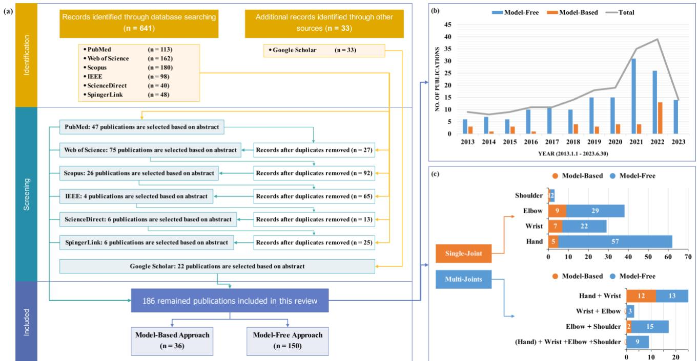

# 基于 sEMG 的上肢康复连续运动意图预测：基于模型与无模型方法的系统综述

Zijun Wei、Zhi-Qiang Zhang、Member, IEEE、Sheng Quan Xie、Fellow, IEEE

摘要——中风后持续存在的上肢功能性损伤严重影响患者的生活质量。基于患者的运动意图，利用 sEMG（表面肌电信号）精确调整机器人辅助水平，对于主动康复至关重要。本文在过去十年的研究基础上，对使用基于模型（Model-Based，MB）和无模型（Model-Free，MF）方法的上肢单关节及多关节组合运动意图连续预测研究进行了系统综述，文献来源于六个主要电子数据库中筛选出的 186 篇相关研究。综述结果表明，在受试者构成、算法鲁棒性与泛化性、以及实际应用可行性方面仍存在持续性挑战。此外，本文建议整合 MB 与 MF 两种方法的优势以改进现有算法。因此，未来研究应进一步探索结合深度学习、注意力机制、肌协同特征、运动单元特征以及闭环反馈的个性化 MB-MF 组合方法，以实现多关节复杂运动的精确、实时、长时间预测，同时进一步完善跨天数与跨受试者的迁移学习策略以实现算法的快速部署。综上，本综述总结了当前研究现状与挑战，旨在为未来基于 sEMG 的上肢运动意图预测研究提供启发。

关键词——表面肌电信号（surface electromyography, sEMG）、上肢康复、肌肉骨骼模型、深度学习、肌协同、运动单元、连续关节运动学与动力学估计方法、系统综述。

（稿件收稿日期：2023 年 12 月 14 日）

Zijun Wei、Zhi-Qiang Zhang 和 Sheng Quan Xie 均任职于英国利兹 LS2 9JT 利兹大学电气与电子工程学院机器人、自主系统与传感研究所（Institute of Robotics, Autonomous System and Sensing, School of Electrical and Electronic Engineering, University of Leeds）。电子邮箱：elzw@leeds.ac.uk；z.zhang3@leeds.ac.uk；s.q.xie@leeds.ac.uk。

## I. 引言

脑卒中（Stroke）在全球范围内是导致死亡和残疾的第二大原因，每年的发病率和死亡率都在不断上升。据[1]报道，全球约60%的患者在脑卒中康复后仍存在上肢功能性障碍。这严重阻碍了他们执行基本日常生活活动（Activities of Daily Living, ADL）的能力，显著影响了他们的生活质量。因此，加快上肢康复至关重要。关于康复机器人辅助治疗的研究[2]表明，仅依靠康复机器人的被动运动并不能改善患者的运动功能。相反，训练强度和患者的主动参与度才是改善康复效果的关键因素，而非仅仅使用机器人本身。这与神经可塑性理论相一致，其中患者的主动参与对于诱发神经可塑性和提高康复效率至关重要。此外，研究[3]还指出，当前康复机器人所提供的运动功能改善有限，凸显了对更有效的按需辅助（Assist-As-Needed, AAN）控制策略的需求，超越传统的阻抗控制和导纳控制，旨在最大化训练强度的同时确保其主动参与。因此，根据患者的运动意图精确调整机器人辅助水平对于实现主动康复至关重要。

研究[4]、[5]和[6]将患者的运动意图分为生物信号和非生物信号。生物信号包括脑电图（Electroencephalography, EEG）、肌电图（Electromyography, EMG）、肌力图（Force Myography, FMG）和机械肌图（Mechanomyography, MMG），而非生物信号则包括视频、惯性测量单元（Inertial Measurement Units, IMU）和力传感器。然而，非生物信号存在固有的时间延迟，并且当患者肢体静止时无法预测运动意图，这对脑卒中和截肢患者并不友好。相比之下，肌电图除具有50-100毫秒的机电延迟（Electromechanical Delay, EMD）从而降低预测延迟外，在实际应用中比脑电图更稳定且更不易受干扰。此外，肌电图传感器比脑电图传感器更便携、更易于佩戴。因此，使用表面肌电图（surface EMG, sEMG）来预测患者的运动意图是一种极具前景的方法。

当前基于sEMG的运动意图预测研究可分为离散分类与连续回归两大类。然而，如综述[6]所讨论，1996至2017年间仅11.6%的研究聚焦于连续回归，且关于sEMG连续运动意图估计的首篇综述直到2019年才发表[4]。此外，根据以往研究中所采用的预测方法，基于sEMG的连续回归可进一步分为基于模型（Model-Based, MB）和无模型（Model-Free, MF）两大类方法。因此，鉴于当前的研究现状以及康复机器人需要持续受控的事实，本综述将聚焦于采用MB与MF方法进行连续上肢运动意图预测（即关节运动学与动力学）的研究。

如图1所示，MF方法主要包括机器学习（Machine Learning, ML）与深度学习（Deep Learning, DL）两类方法。ML与DL的区别在于：ML需要从预处理后的sEMG信号中进行手工特征提取与选择。相比之下，DL能够从sEMG中自动提取高级特征，并利用神经网络强大的拟合能力来近似特征与运动意图之间的高度非线性关系，从而避免像ML那样依赖基于经验的最优特征集[5]。尽管端到端的MF方法训练便捷、部署迅速，但其固有的"黑箱"特性可能忽略输入与输出数据之间潜在的因果关系，进而难以泛化至训练数据之外，并存在过拟合的风险[6]、[7]、[8]。相比之下，具有内在生理因果性的MB方法能够根据肌肉激活与收缩动力学的神经生理机制，将sEMG信号转换为肌腱力，然后利用肌肉骨骼（Musculoskeletal, MSK）几何关系与牛顿运动方程由关节力矩预测关节运动学与动力学[6]。此外，多数MB研究采用了包含串联弹性（Series Elastic, SE）、收缩（Contractile, CE）、并联弹性（Parallel Elastic, PE）和黏弹性（Viscoelastic, VE）元件的Hill类型MSK模型。然而，由于患者间的生理差异，基于大量尸体标本推导出的通用比例型Hill模型可能导致显著的预测误差。因此，在MB方法的最终阶段对受试者特异性MSK模型进行参数优化，是实现精确预测所必需的[9]、[10]。

综上，本综述对实现更有效的主动康复的主要贡献体现在以下三个方面：

1) 系统收集并筛选过去十年间来自六大主要数据库的全部MB与MF研究，并描绘当前的研究版图。

2) 基于不同的单关节与多关节组合，回顾并梳理MB与MF研究的研究成果及相应局限性。

3) 总结并分析基于模型（Model-Based, MB）和无模型（Model-Free, MF）研究中的关键发现、挑战与机遇，以确定未来的研究方向。

本论文其余部分的结构安排如下：第二节介绍文献检索方法与筛选标准，并总结筛选结果。第三节基于不同的单关节与多关节组合目录，对 MB 和 MF 研究进行全面综述。第四节讨论多年来 MB 和 MF 研究中识别的关键发现、挑战与未来研究方向。最后，第五节对本综述进行总结。

  
图 1. 无模型方法与基于模型方法的连续运动意图预测过程。

## II. 方法

## A. 检索策略

为对基于 MB 和 MF 方法的研究进行全面且系统的综述，本综述首先采用检索关键词在六个主要电子数据库中进行查询，分别是 PubMed、Web of Science、Scopus、IEEE Xplore、ScienceDirect 和 SpringerLink。观察到相关研究的数量从 2012 年开始增加，因此本综述的检索时间跨度设定为过去十年，遵循 PRISMA（Preferred Reporting Items for Systematic Reviews and Meta-Analyses，系统综述与元分析优先报告条目）指南，收集 2013 年 1 月至 2023 年 6 月期间发表的所有相关文章。此外，还从 Google Scholar 中选择性纳入了相关文献，以确保检索结果的系统性与完整性。文献检索使用了以下关键词：

((EMG OR sEMG) AND (Continuous) AND (Prediction OR Estimation) AND (Shoulder OR Elbow OR Wrist OR Hand OR Finger OR Upper-Limb))

## B. 纳入与排除标准

首先，由于本综述仅关注涉及连续回归而非离散分类的研究，因此涉及模式识别、分类以及分段离散化的研究被排除在外。此外，仅纳入以英文发表且作者可获取的文献。

随后，本综述仅聚焦于由 sEMG 或 EMG 信号驱动的 MB 和 MF 研究，从而排除了那些在不采用 sEMG 或 EMG 信号的情况下专门使用其他运动意图信号进行预测的研究。被排除的信号源包括非生物信号，例如 IMU（Inertial Measurement Unit，惯性测量单元）、Kinect 相机、电阻抗断层成像（Electrical Impedance Tomography, EIT）、超声波传感器以及力敏电阻（Force-Sensitive Resistors, FSR），以及其他生物信号如 EEG（脑电图）、功能性磁共振成像（functional Magnetic Resonance Imaging, fMRI）以及近红外光谱（Near-Infrared Spectroscopy, NIRS）。

最后，本综述专注于上肢关节，因此排除了所有其他关节，如下肢关节。此外，综述中所讨论的肌肉骨骼（MSK）模型仅限于肌肉、肌腱和骨骼的宏观生理模型，不包括例如基于肌肉组织之间应力-应变关系的有限元模型。此外，MSK 模型的综述仅限人类模型，未涉及其他生物物种。

## C. 研究选择结果

如图 2(a) 所示，在所选数据库中使用指定的检索关键词共识别出 674 篇相关出版物，其中包括来自 Google Scholar 的 33 篇补充出版物。在应用纳入与排除标准后，最终有 186 篇出版物被纳入本综述，其中分别有 36 篇和 150 篇研究基于模型驱动（MB）和模型无关（MF）方法。

图 2(b) 和图 2(c) 给出了这 186 篇入选出版物的综合与分类结果。图 2(b) 表明，从 2013 年到 2020 年，关于上肢运动意图连续预测的出版物数量呈逐步增长趋势，并在 2021 年开始呈指数级增长。这一趋势表明，与模式识别中的离散分类不同，上肢运动意图的连续预测是一个新兴的研究领域，在过去三年中获得了广泛关注。图 2(c) 对比了各上肢单关节与多关节组合的当前研究现状，结果显示大多数研究集中于肘关节、腕关节和手关节，以及手-腕和肘-肩的组合。相比之下，关于其余肩关节、腕-肘关节组合以及整个上肢的研究中，基于 MF 方法的研究仅有少数，而基于 MB 方法的研究则完全缺失。

  
图 2. (a) 基于 Prisma 策略的研究选择流程图。(b) 过去十年中 MB 和 MF 方法每年出版物的具体数量。(c) 单关节和多关节组合的 MB 与 MF 研究的详细数量。

## III. 结果

在基于各单一关节与多关节组合对肌骨生物力学（Musculoskeletal Biomechanics, MB）与肌肉力（Muscle Force, MF）研究展开全面综述之前，下方图 3 展示了 MB 与 MF 研究中所采用方法的分布情况，以及这些研究中离线/在线预测、受试者/数据库以及不同受试者属性的占比分布。可以观察到，MB 研究中的方法可分为六大类别，除 Hill 模型外，将 MB 与 MF 相结合的综合方法也尤为值得关注。在涵盖 11 种方法的 MF 研究中，除备受重视的传统神经网络与深度学习（Deep Learning, DL）模型外，基于注意力机制、肌肉协同（Muscle Synergy, MS）特征以及运动单元（Motor Unit, MU）神经特征的方法也展现出良好的研究潜力，值得进一步深入探究。

为了对采用 MF 方法的研究进行全面综述，有必要对传统神经网络与 DL 模型这两个主要类别进行进一步细分。所收集的 37 项基于传统神经网络的研究可进一步划分为三类：前馈神经网络（Feedforward Neural Networks, FNNs：25 项）、传统循环神经网络（Traditional Recurrent Neural Networks, T-RNNs：11 项）以及脉冲神经网络（Spiking Neural Network, SNN：1 项）。其中，FNNs 包括人工神经网络（Artificial Neural Network, ANN）、多层感知机（Multilayer Perceptron, MLP）、反向传播神经网络（Backpropagation Neural Network, BPNN）、极限学习机（Extreme Learning Machine, ELM）、径向基函数神经网络（Radial Basis Function Neural Network, RBFNN）、小波神经网络（Wavelet Neural Network, WNN）以及广义回归神经网络（Generalized Regression Neural Network, GRNN）。T-RNNs 包括 Elman 网络（ElmanNN）、带外部输入的非线性自回归（Nonlinear AutoRegressive with eXogenous inputs, NARX）模型、时延神经网络（Time Delay Neural Network, TDNN）以及循环模糊神经网络（Recurrent Fuzzy Neural Network, RFNN）。在 44 项聚焦于 DL 的研究中，可进一步划分为四个不同类别：卷积神经网络（Convolutional Neural Networks, CNNs：12 项）、高级循环神经网络（Advanced Recurrent Neural Networks, A-RNNs：20 项）、卷积-循环混合网络（10 项）以及自编码器（Autoencoders, AEs：2 项），其中 A-RNNs 类别包括长短期记忆网络（Long Short-Term Memory, LSTM）、双向长短期记忆网络（Bidirectional LSTM, Bi-LSTM）以及门控循环单元（Gated Recurrent Unit, GRU）网络。

关于所收集研究的预测内容，针对每个上肢关节在各种角度与力的范围、速度、负载和持续时间条件下，预测了以下运动：肩关节的内旋/外旋，以及在垂直面和水平面内的内收/外展和屈曲/伸展；肘关节在垂直面和水平面内的屈曲/伸展；腕关节的屈曲/伸展、尺偏/桡偏以及旋前/旋后；掌指关节（Metacarpophalangeal，MCP）、近端指间关节（Proximal Interphalangeal，PIP）和远端指间关节（Distal Interphalangeal，DIP）的独立及同步屈曲/伸展，涵盖单指与多指运动，以及基于不同抓握力、不同物体尺寸和形状的抓取任务。此外，该研究还基于不同强度的静态等长收缩、复合协同运动和镜像运动进行了实验，并对关节运动学与动力学进行了同步预测。此外，超过三分之一的研究使用了公开的 NinaPro 数据集，以及其他公开数据集（例如 putEMG-Force [11]、Biopatrec [12] 和 KIN-MUS UJI [13]）来开发预测算法。

  
图 3. 在 MB 和 MF 研究中，不同方法类型、离线/在线预测、受试者/数据库以及受试者属性的百分比分布。

## A. MB 方法

## 1) 肩关节

与其他上肢关节相比，由于肩关节的解剖结构复杂、多自由度（DoF）运动模式多样以及 sEMG 信号采集面临的挑战，针对肩关节的研究较少。研究 [14] 将肌肉激活模型与 EMD 和 ELM 相结合，在随机运动速度下实现了延迟仅为 32 ms 的实时预测。

## 2) 肘关节

研究 [15] 和 [16] 均使用了仅包含 CE 的简化 Hill 模型。具体而言，[16] 将 Hill 模型与状态切换模型相结合用于实时预测。然而，状态切换模型存在时间延迟，并且简化模型对关节角度微小变化的鲁棒性较差。

除了研究[17]使用了包含CE、PE和SE的完整Hill模型外，研究[18]–[23]采用了仅包含CE和PE的刚体肌腱Hill模型。然而，刚体肌腱Hill模型忽略了肌肉刚度的变化，导致较大的力矩预测误差。作为改进，[20]采用了通过遗传算法（Genetic Algorithm, GA）优化的Hill模型和基于力矩平衡方程的短程刚度（Short-Range Stiffness, SRS）模型，以同时预测关节角度和时变刚度。[21]使用GA对增加了更多生理参数的Hill模型进行优化，实现了在各种运动负荷下的鲁棒性。关于其他优化算法，[23]使用非线性最小二乘法对Hill模型进行了优化。

研究[15]、[17]、[18]、[22]将MB方法和MF方法相结合。具体而言，[15]采用多项式逼近肌腱力与肘关节角度之间的关系，取代了MB方法中的MSK几何分析和运动方程。此外，[18]通过将Hill模型与时域（Time-Domain, TD）特征相结合，开发了一种使用扩展卡尔曼滤波（Extended Kalman Filter, EKF）优化的状态空间（State Space, SS）模型，用于实时闭环估计。此外，[17]比较了Hill模型和BPNN在预测肘关节等长收缩力方面的能力，得出结论：

BPNN由于关节力与sEMG之间的线性关系而提供了更优的预测性能，但缺乏模型可解释性。因此，组合MB和MF方法提供了互补的优势。例如，[22]使用RBFNN训练肌肉激活优化因子，减少了sEMG与肌肉激活之间的转换偏差，从而适应个体差异。结果表明，这种MB-MF混合方法优于单独的MB或MF方法，进一步提高了关节力矩预测的准确性。

## 3) 腕关节（Wrist Joints）

研究[24]–[27]采用了刚体肌腱Hill模型。具体而言，[24]和[25]通过敏感性分析和GA优化，平衡了Hill模型的预测精度和计算复杂度，解决了倾向于高估参数从而忽略受试者特异性的过度简化模型问题。此外，基于镜像双侧运动实验，[25]证明了该方法在同侧和对侧的表现没有统计学差异。此外，由于旋后肌是深层肌肉，难以通过sEMG直接测量，研究[26]和[27]采用了基于非负矩阵分解（Non-negative Matrix Factorization, NMF）的虚拟MS协同激活来替代旋前肌和旋后肌的肌肉激活，随后将其输入Hill模型进行预测。结果表明，该方法优于基于TD和MS特征的线性回归（Linear Regression, LR）和ANN，在各种上肢姿势下均表现出鲁棒性。

研究 [28]–[30] 将 MB 与 MF 方法相结合。具体而言，[28] 利用反向传播神经网络（Back Propagation Neural Network, BPNN）根据肌肉激活来识别不同的运动阶段，随后采用基于贝叶斯线性回归（Bayesian Linear Regression, LR）优化的肌肉骨骼（Musculoskeletal, MSK）模型进行低延迟实时关节力预测。结果突出了贝叶斯 LR 在简洁性和效率方面相对于遗传算法（Genetic Algorithm, GA）的优势。此外，[29] 引入了物理 MSK 知识作为软约束添加到卷积神经网络（Convolutional Neural Network, CNN）模型的损失函数中。该方法的预测性能不仅优于支持向量回归（Support Vector Regression, SVR）、极限学习机（Extreme Learning Machine, ELM）、多层极限学习机（Multilayer Extreme Learning Machine, ML-ELM）和 CNN，而且相比传统 CNN 具有更简单的架构，需要更少的训练数据并能更快收敛。此外，[30] 在 [29] 的工作基础上进一步研究，通过共享预训练的 CNN 参数并仅更新全连接层来实现迁移学习。结果表明，这种共享 CNN 高级 sEMG 特征提取知识的方法不仅具有出色的收敛速度和泛化能力，而且只需极少的个体数据即可实现快速迁移学习。

## 4) 手部关节

与研究 [17] 类似，研究 [31] 采用经过滤波的 sEMG 的均方根（Root Mean Square, RMS）信号作为输入，并使用相同的完整 Hill 模型进行预测。而研究 [32]–[34] 分别比较了肌肉激活模型与时域（Time Domain, TD）特征结合前馈神经网络（Feedforward Neural Network, FNN）、单输出高斯过程回归（Gaussian Process Regression, GPR）以及多输出 GPR 的性能。结果表明，使用结合经验模态分解（Empirical Mode Decomposition, EMD）的肌肉激活模型相比 TD 特征具有更优的性能。此外，由于多输出 GPR 能够有效建模关节之间的内在相关性，其性能优于 FNN 和单输出 GPR，突显了考虑肌肉协同（Muscle Synergy, MS）的重要性。

与大多数采用 Hill 模型的研究不同，研究 [35] 是唯一一项利用 Huxley 模型进行实时预测的研究。该研究采用谱方法、Galerkin 方法和平衡截断方法降低了高维 Huxley 模型的计算复杂度，并进一步采用粒子群优化（Particle Swarm Optimization, PSO）进行参数优化。最终，该方法在 Huxley 模型的预测性能和计算时间之间取得了平衡，并具有出色的跨日泛化能力。

## 5) 手腕关节

研究 [36]–[40] 采用通过全局搜索优化（GlobalSearch Optimization, GO）优化的刚性肌腱 Hill 模型。结果表明，基于所有受试者平均 Hill 模型参数的通用受试者模型表现优于受试者特异性模型、LR 和 ANN。

关于基于 MS 特征和 MU 神经特征构建的 MSK 模型，研究 [41] 提出，基于分层交替最小二乘（Hierarchical Alternating Least Squares, HALS）和 LR 的协同线性回归模型（Synergistic Linear Regression Model, SLRM）略优于传统的 MSK 方法。研究 [42]、[43] 将 MS 特征与 MSK 模型相结合，其中 [42] 将通过 NMF-HP 配合 L2 正则化约束（NMF-HP-L2）所提取的 MS 建模到 GO 优化的 Hill 模型中，相较于 Hill 模型和 NMF-Hill 模型实现了更优的预测性能和稳定性。[43] 利用通过自适应混合独立成分分析（Adaptive Mixture Independent Component Analysis, AMICA）与 NMF 得到的独立成分所提取的 MS 构建 MSK 模型，其预测性能优于传统 MSK 模型、LR 和 SVR。此外，与研究 [44]–[49] 的结论相呼应，研究 [50] 将从 HD-sEMG 和 FastICA 提取的 MU 放电频率输入到 GO 优化的 Hill 模型中。结果表明，相较于基于 TD 特征的 Hill 模型，MU-Hill 模型在精度和鲁棒性方面均显著提升。

关于基于强化学习（Reinforcement Learning, RL）的 MSK 模型，研究 [51]–[53] 在 Actor-Critic 框架下采用 DDPG 算法和近端策略优化（Proximal Policy Optimization, PPO），使多智能体能够利用基于预测关节力矩的 MSK 前向动力学模型来计算关节角度。由此得到的 RL-MSK 模型与 Hill 模型精度相当，但优于 MLP 和 NARX，并对运动速度变化具有较强的鲁棒性。然而，该方法的训练时间约为 8 小时，且缺乏对未训练新数据的泛化能力。

## 6) 肘-肩关节

研究 [54] 和 [55] 基于 Hill 模型和前向动力学构建了闭环 SS 模型。具体而言，[54] 将完整的 Hill 模型与 NARX 状态方程和 BPNN 测量方程相结合，然后采用无迹卡尔曼滤波（Unscented Kalman Filter, UKF）进行实时预测和闭环估计，其结果优于仅使用 NARX 和 BPNN 的开环估计。[55] 将刚体肌腱 Hill 模型与 sEMG 和 MMG 融合的 TD 特征相结合，构建了无迹粒子滤波（Unscented Particle Filter, UPF）优化的 SS 模型，性能优于 BPNN、SVR 和 GRNN，并显著降低了对训练数据量的需求。

## B. MF 方法

## 1) 肩关节

a) 传统神经网络：研究 [56] 将提取的 TD 和频域（Frequency-Domain, FD）特征输入具有短期记忆能力的 TDNN 中进行预测。

b) 其他方法：研究 [57] 利用快速正交搜索（Fast Orthogonal Search, FOS）的能力进行快速拟合和非线性模型的系统辨识。此外，该研究还考虑了肩部活动过程中输出力与关节角度之间的耦合效应，以提高预测精度。这种耦合效应与 Hill 模型中肌纤维和肌力之间的力-速度及力-长度关系相类似，提示将 MF 方法与 Hill 模型相结合可进一步提升预测性能。

## 2) 肘关节（Elbow Joint）

a) 线性模型：研究 [58] 将自适应加权的峰值 sEMG 信号与线性最小二乘法相结合，用于预测镜像肘部运动。研究 [59] 证明，在各种运动负载条件下，带外部输入的自回归（Autoregressive with Exogenous Input, ARX）模型的预测性能优于带外部输入的自回归滑动平均（Autoregressive Moving-Average with Exogenous Input, ARMAX）、带外部输入的自回归积分滑动平均（Autoregressive Integrated Moving-Average with Exogenous Input, ARIMAX）以及状态空间（State Space, SS）模型。

b) 机器学习：研究 [60] 利用基于树的分层投影回归（Hierarchical Projection Regression, HPR）算法和增量学习，对不同负载下的肘关节角度进行实时预测。研究 [61] 采用随机森林（Random Forests, RF）进行预测，并自动筛选显著的时间延迟特征。类似地，[62] 引入了灰色特征加权支持向量机（Gray Feature Weighted Support Vector Machines, GFWSVM），根据重要性对 sEMG 特征赋予权重。

c) 传统神经网络：研究 [63]–[66] 利用提取的时域（Time-Domain, TD）特征，分别采用 ANN、WNN 和 GRNN 预测关节角度，证明 WNN 的性能优于支持向量机（SVM）和 RBFNN。此外，[63] 指出，在关节角度和角速度预测方面，RBFNN 的性能优于 MLP。多项研究，包括 [67]–[71]，均采用了 BPNN

WEI et al.: Continuous Motion Intention Prediction Using sEMG Signals for Upper-Limb Rehabilitation: A Systematic Review of Model-Based and Model-Free Approaches.

进行预测。具体而言，[67] 通过比较通用模型和个性化模型，表明受试者间变异性会显著影响预测性能。类似地，[71] 通过对比 TD 特征和使用最大独立域适配（Maximum Independent Domain Adaptation, MIDA）提取的受试者不变特征，证实受试者间变异性大于受试者内变异性。因此，[68] 引入了遗传算法（Genetic Algorithm, GA）特征选择，以剔除受试者间的冗余和低相关性特征，从而增强跨受试者的泛化能力。最后，[72] 引入了脉冲神经网络（Spiking Neural Network, SNN），该网络模拟生物神经元的脉冲发放机制和膜电位变化，实现了与 LSTM 相当的预测精度。

关于时间序列神经网络，研究[73]和[74]采用了TDNN基于TD特征进行预测。另一方面，研究[75]和[76]将NARX模型与MLP、ElmanNN以及[77]中的自适应神经模糊推理系统（Adaptive Neuro-Fuzzy Inference System, ANFIS）相结合，基于TD特征进行预测，最终证明了ANFIS-NARX模型具有更优的预测性能。

d) 深度学习：研究[78]和[79]采用了基于TD特征的LSTM进行精确的关节角度预测。研究[80]表明CNN-LSTM优于单独的CNN和LSTM模型，强调了在所提取的高级特征之间建立长期上下文依赖关系的重要性。

e) 肌肉协同特征：研究[81]将通过多元曲线分辨-交替最小二乘法（Multivariate Curve Resolution-Alternating Least Squares, MCR-ALS）提取的MS特征输入Bi-LSTM进行预测。结果表明，与传统TD特征相比，MS特征对sEMG变化表现出更强的鲁棒性。此外，在为期五天的实验周期内，无论是受试者内还是受试者间，通过MCR-ALS提取的MS特征相比通过主成分分析（Principal Component Analysis, PCA）和非负矩阵分解（Non-negative Matrix Factorization, NMF）提取的特征均保持了更高的相关性。

f) 其他方法：研究[82]和[83]应用卡尔曼滤波（Kalman Filters, KF）在不同负载和运动速度下实现关节角度和力矩的实时预测。研究[84]和[85]采用了非线性系统辨识方法。具体而言，[84]验证了并行级联辨识（Parallel Cascade Identification, PCI）模型相对于[57]中FOS算法的优越性，而[85]则展示了与WNN耦合的Hammerstein-Wiener模型在跨日预测中的鲁棒性，尽管该方法仍需要个体校准，且其预测性能可能受到运动负载的影响。

3) 腕关节

a) 线性模型：研究[86]采用了基于TD特征的岭回归进行预测，并证明最小绝对收缩和选择算子（Least Absolute Shrinkage and Selection Operator, LASSO）是HD-sEMG通道选择的一种有效方法。此外，研究[87]指出，尽管ANN在离线实验中优于LR和NMF，但它们的在线性能并无显著差异。

b) 机器学习：研究[88]和[89]分别将时滞TD特征输入最小二乘支持向量机（Least Squares Support Vector Machine, LSSVM）和随机森林（Random Forest, RF）进行预测，性能优于SVM和BPNN。这再次凸显了考虑EMD的重要性。

c) 传统神经网络（Traditional Neural Networks）：在文献 [90] 中，将时域（TD）和频域（FD）特征输入到经遗传算法（GA）优化的极限学习机（ELM）中进行预测，取得了优于广义回归神经网络（GRNN）的结果。然而，ELM 仍然存在一定的不稳定性。文献 [91] 和 [92] 分别采用了基于时域特征的人工神经网络（ANN）和反向传播神经网络（BPNN）。值得注意的是，[91] 发现基于大范围肌肉活动叠加的 sEMG 信号优于针对局部肌肉信息的非定向 iEMG 信号，这提示应使用高密度（HD）sEMG 传感器采集更全面的肌肉活动数据。此外，文献 [93] 也采用了 BPNN，但同时融合了频域和时频域（TFD）特征作为输入，并进一步采用卡尔曼滤波（KF）进行后处理。

d) 深度学习（Deep Learning）：文献 [94] 和 [95] 证明，与 PCA 相比，基于堆叠自编码器（Stacked AutoEncoders, SAE）的深度神经网络（SAE-DNN）能够提取更具表征力的 sEMG 特征，因此预测性能优于 LR 和 SVR。

文献 [96] 和 [97] 均采用了 CNN。具体而言，[96] 使用原始 sEMG 时域图像和基于快速傅里叶变换（FFT）的频域图像进行预测，性能优于六种人工特征工程的机器学习模型，即 LR、SVR、RF、GPR 和 MLP。同时，[97] 表明基于时域图像的 CNN 优于基于梯度方向直方图（HOG）特征的 ANN。此外，该研究还采用 PCA 来证明 CNN 提取的空间特征与实际关节力矩的相关性高于聚焦像素变化的 HOG 特征和基于经验的人工特征。

文献 [98] 和 [99] 采用 LSTM 模型进行预测。其中，[98] 展示了 LSTM 在不同负载条件下的优异预测性能，而 [99] 采用 CNN-LSTM 从基于 FFT 的 sEMG 频谱图中提取时空数据，性能优于 CNN、LSTM 和传统机器学习模型。

然而，CNN-LSTM 在跨日（across days）和跨受试者（across subjects）场景下的泛化能力仍有待提升。文献 [100] 进一步验证了这一点，该研究利用 LSTM-AE，基于 CNN 特征的重构误差来评估并量化 CNN-LSTM 在跨日任务中的域偏移（domain shift），从而实现模型性能退化的监测与及时的重校准。为进一步增强跨受试者泛化能力，文献 [101] 提出一种迁移学习方法，采用双流 CNN 从源域和目标域数据中提取域不变特征（domain-invariant features），随后通过回归损失、最大均值差异（Maximum Mean Discrepancy, MMD）损失和回归对比损失（regression contrastive loss）调整 CNN 权重。

e) 运动单位神经特征：研究 [102] 将卷积盲源分离应用于输入的高密度表面肌电（HD-sEMG）的分解脉冲计数（Decomposed Spike Count, DSC）特征和残差 sEMG 时域（TD）特征，并输入到线性回归（LR）中进行预测。结果表明，与 TD 特征相比，运动单位（MU）特征对截肢者的提升效果更为显著。然而，DSC 特征忽略了 MU 之间的空间信息和交互作用。因此，研究 [103] 首先将由卷积核补偿（CKC）分解得到的运动单位脉冲序列（Motor Unit Spike Train, MUST）和运动单位动作电位（Motor Unit Action Potential, MUAP）进行卷积以重建 MU 图像，再输入到卷积神经网络（CNN）中进行预测，其性能显著优于基于 DSC 特征的 LR、支持向量回归（SVR）和人工神经网络（ANN）。研究 [104] 和 [105] 也采用了 CKC 进行 MU 分解并使用 LR 进行预测，其中 [104] 进一步对 MU 池进行了筛选以识别主导性 MU。研究结果表明，[105] 中提出的 MU 抽搐力模型优于 DSC 模型以及基于累积脉冲序列（Cumulative Spike Train, CST）的 MU 放电频率模型、

本文已被 *IEEE Transactions on Neural Systems and Rehabilitation Engineering* 录用。这是作者版本，尚未经过完整编辑，内容可能在最终出版前发生变化。引用信息：DOI 10.1109/TNSRE.2024.3383857

WEI 等：基于 sEMG 信号的上肢康复连续运动意图预测：基于模型与无模型方法的系统综述。

MUST 以及主成分分析（PCA）模型。

f) 其他方法：研究 [106] 将高斯混合回归（Gaussian Mixture Regression, GMR）统计模型应用于对称正定矩阵流形，其预测性能优于欧氏空间中的 GMR。研究 [107] 将时延 TD 特征输入到核递归最小二乘跟踪器（Kernel Recursive Least Squares Tracker, KRLS-T）中，作为一种在线非线性自适应滤波器进行预测，由于融合了非线性核回归、在线自适应估计的优势以及更低的计算成本，其性能显著优于 ANN 和核岭回归（Kernel Ridge Regression, KRR）。

## 4) 手部关节

a) 状态空间模型：研究 [108] 和 [109] 采用了基于 N4SID 参数辨识方法的 SS 模型，用于在镜像双侧运动过程中不同静态腕部姿态下手指关节角度的预测。此外，研究 [110] 利用递归最小二乘（Recursive Least Squares, RLS）进行 SS 模型参数估计，并使用卡尔曼滤波器（KF）进行后处理，最终性能优于 MLP、NARX 和 LDA 模型。

b) 线性和非线性模型：研究 [111] 基于空间滤波特征实现了 LR 用于预测，研究 [112] 将岭回归（LR 的一种扩展形式）与增量学习相结合，实现了跨天抓取任务的实时预测。然而，研究 [113] 发现非线性 KRR 在各任务上均优于 LR，强调了考虑 sEMG 与运动意图之间非线性关系的重要性。研究 [114] 和 [115] 进一步比较了线性和非线性方法，具体将线性外生输入向量自回归滑动平均模型（VARMAX）与非线性高斯过程（GP）进行对比。尽管两者性能相当，但 GP 的非线性能够建模更复杂的运动意图。然而，GP 的计算成本会随训练数据增长而上升。因此，可借鉴研究 [116] 中的稀疏伪输入高斯过程（SPGP）回归模型，或借鉴研究 [117] 中通过高斯过程潜变量模型（GPLVM）提取 MS 特征的方法加以改进。

c) 传统神经网络：研究中使用的网络包括：对握力变化具有鲁棒性的、基于梅尔谱特征的 ANN [118]、BPNN [119]、性能优于 KRLS 和 LR 的 GRNN [120]、[121]，以及 [122] 中性能优于 GRNN 的 FNN、级联 FNN（CFNN）和 RBFNN。此外，研究 [123] 将基于八个 TD 特征的深度 RF 模型与 ANN 相结合，取得了优于 GP 的预测效果。

d) 深度学习：研究中使用的 DL 网络可分为三类：CNN、RNN 和 CNN-RNN 混合网络。CNN 包括一维 CNN（1D-CNN）[124]、二维 CNN（2D-CNN）[125]、三维 CNN（3D-CNN）[126]、[127]、并行 CNN [128]–[130]、AlexNet 与 ResNet [131]、[132]，以及时间卷积网络（TCN）[133] 和大规模 TCN（LS-TCN）[134]。RNN 包括 NARX [135]、LSTM [13]、[131]、[132]、[136]–[139] 和 GRU [131]、[132]。混合类网络包括 CNN-LSTM [140]、长曝光卷积记忆网络（LE-ConvMN）[141] 和 Attention-ConvGRU [142]。

卷积神经网络（CNN）：根据[124]，由于一维卷积神经网络（1D-CNN）能够学习更深层的高级特征，同时降低数据维度并避免冗余的空间信息，因此在手指力实时预测方面表现出优于二维卷积神经网络（2D-CNN）和线性回归（LR）的性能。[125]指出，与原始表面肌电信号（sEMG）图像相比，使用时域（TD）和频域（FD）特征图像作为2D-CNN的输入可以进一步降低噪声并提高预测精度。[126]、[127]表明，三维卷积神经网络（3D-CNN）能够从多个电极视角学习更深层的肌肉解剖结构、肌肉协同（MS）和运动速度特征，从而实现对未经训练的随机新运动的预测。此外，[131]和[132]指出，AlexNet的性能优于ResNet、长短期记忆网络（LSTM）和门控循环单元（GRU）。另外，[133]证明时序卷积网络（TCN）优于LSTM，并且通过int8量化可将TCN模型大小压缩至70.9Kb，延迟为4.76ms。最后，[134]指出，sEMG信号包含与特定时间窗口内运动高度相关的原子片段，这表明CNN的卷积核大小应近似或略大于原子片段长度，以充分提取sEMG特征并最小化网络参数。因此，LS-TCN的卷积核大小与原子片段长度相似，解决了TCN的特征提取局限性，并在性能上优于TCN、循环神经网络（RNN）和SPGP。

循环神经网络（RNN）：[135]将经主成分分析（PCA）处理后的TD特征与扩展卡尔曼滤波（EKF）后处理相结合，输入到非线性自回归外生模型（NARX）中，实现了优于多层感知器（MLP）的预测结果。[13]、[137]–[139]表明LSTM在预测所有手部关节角度方面优于前馈神经网络（FNN）、径向基函数神经网络（RBFNN）和SPGP，并且对未训练数据具有泛化能力。此外，[136]采用高斯混合模型（GMM）与LSTM构建从sEMG到手部姿态的概率映射模型，该模型形成了置信区间，使LSTM-GMM优于LSTM。最后，[131]、[132]指出，尽管GRU训练速度更快，但LSTM始终能提供更稳定的预测结果。

CNN-RNN混合模型：[140]提出的CNN-LSTM结合了CNN和RNN的优点，类似于[30]，它可以通过仅重新训练全连接层来实现迁移学习。针对LSTM将多维输入展平为一维向量的缺陷（这在处理时空数据时会导致空间信息丢失），[141]提出的LE-ConvMN用2D-CNN替换了LSTM的全连接层。此外，通过逐步降低长曝光sEMG样本的维度，它可以跨多个电极通道提取高维时空特征。因此，LE-ConvMN在跨受试者和跨关节的预测及泛化方面优于SPGP和LSTM。然而，由于LE-ConvMN训练时间长且计算成本高，因此不适合实时应用。

e) 肌肉协同特征（Muscle Synergy Features）：研究 [143] 采用了常用于脑电图（EEG）分析的共同空间模式（Common Spatial Pattern, CSP）算法。结果表明，与非负矩阵分解（Non-negative Matrix Factorization, NMF）相比，由于 CSP 倾向于学习样本间的差异特征，它能够更有效地实时区分高度相关的食指与中指的指尖力信号，且不受手指间信号串扰的影响。为提升 NMF 的预测性能，研究 [144] 将哈达玛积（Hadamard product）引入 NMF（NMF-HP），以减少对非主动手指激活的错误估计。结果表明，与 LR、CSP 和 NMF 相比，NMF-HP 能为同时激活的手指提供更准确的实时估计。此外，对于 sEMG 的降维与重构，研究 [145] 和 [146] 分别使用了主成分分析（Principal Component Analysis, PCA）的扩展方法偏最小二乘回归（Partial Least Squares Regression, PLSR）以及 NMF。值得注意的是，研究 [146] 通过迭代优化 NMF 激活系数矩阵，仅使用三个肌肉协同（Muscle Synergies, MSs）便成功重构了原始 sEMG 数据。

f) 运动单元神经特征（Motor Unit Neural Features）：研究 [111] 强调，使用单极电极阵列和更多的 sEMG 通道能够降低预测误差，再次证明了使用高密度 sEMG（High-Density sEMG, HD-sEMG）的优势。因此，研究 [44]–[49] 利用快速独立成分分析（Fast Independent Component Analysis, FastICA）和运动单元（Motor Unit, MU）池细化，从 HD-sEMG 中提取与目标手指及任务相关的 MU 总放电率，然后将其输入 LR，从而可在不同腕部姿态下同时预测关节角度与指尖力。研究 [128]–[130] 首先基于 HD-sEMG 的快速傅里叶变换（Fast Fourier Transform, FFT）频谱图和均方根（Root Mean Square, RMS）时域（Time Domain, TD）图像，利用并行卷积神经网络（Convolutional Neural Network, CNN）估计 FastICA 分解后的 MU 总放电率，然后将其输入 LR 进行实时的手指力与关节角度预测。然而，该方法仍依赖于 FastICA 的准确性。

g) 注意力机制：注意力机制的潜力在文献[11]中已被初步揭示，其中梯度提升机（LightGBM）模型能够迭代地忽略不显著的特征，从而在性能上超越了 LR、MLP、SVR 和 CNN。后续研究[142]、[147]–[149]进一步引入了注意力机制，将自注意力或多头注意力模块融入 MLP、CNN 和 ConvGRU（GRU 与 1D-CNN 的组合），在精度和泛化能力方面显著优于 LSTM、GRU、TCN 和 SPGP，且训练时间短于 GRU 和 LSTM。此外，文献[150]–[152]采用了基于注意力的 Transformer 模型以实现进一步改进，包括 BERT、CNN-Transformer 以及基于长短期时间聚合（Long-Short Time Aggregation, LSTA）模块的 LSTA-Conv 网络。具体而言，BERT 在预测性能、训练时间和跨被试泛化方面明显优于 LSTM、TCN 和 LE-ConvMN；CNN-Transformer 被证明优于 CNN-LSTM、Bi-LSTM 和 Transformer；LSTA-Conv 通过结合基于自注意力的 Transformer 和多尺度 ResNet，在性能上超越了 RNN、LSTM、SPGP 和 CNN-Attention。

h) 其他方法：文献[153]采用 KF 结合 TD 特征进行预测。尽管该方法在跨被试上表现出一定的泛化能力，但其预测能力在很大程度上依赖于目标系统模型参数的精确表示。文献[119]采用基于 GA 和遗传规划的基因表达式编程（Gene Expression Programming, GEP），性能优于 BPNN。文献[154]采用对数回归模型，实现了瞬态和稳态下抓取力的实时估计，并且对 sEMG 漂移和瞬时变化具有鲁棒性。此外，与大多数基于稳态 sEMG 的方法不同，文献[155]采用结合弹性网络正则化的 LR，利用单次瞬态 sEMG 激活实现了精确的实时抓握力预测，即使对于截肢患者也取得了令人满意的结果。最后，文献[156]应用能量守恒与传递理论，指出在给定的肌肉激活水平下，各手指之间的动能和势能会动态地相互转化和分配，但所有手指的总能量保持不变。该方法首先利用 ICA 提取 MS 特征，然后在完全固定和自由运动这两种极端条件下推导各手指的能量，最后采用 ANN 学习 MS 特征与手指能量之间的实时映射关系。尽管该方法降低了计算成本和对训练样本的需求，但预测误差随能量的增长而增大，且手指屈曲的预测性能优于伸展。

## 5) 手腕关节（Hand-Wrist Joints）

a) **线性模型（Linear Models）**：研究 [157] 将时域（TD）特征与线性系统辨识相结合，比较了四种线性时间序列模型：ARX、自回归外源正则化（Autoregressive exogenous Regularized, ARXR）、输出误差（Output Error, OE）以及 ARMAX。研究结果表明，OE 模型具有更优的预测能力。

b) **机器学习（Machine Learning）**：研究 [158]–[160] 基于时域（TD）、频域（FD）和时频域（TFD）特征部署了支持向量回归（Support Vector Regression, SVR），用于关节角度和抓握力预测。研究 [161] 利用 TD 特征与基于级联决策树构建的梯度提升回归树（Gradient Boosted Regression Trees, GBRT）来预测关节角度，并具备对未训练新数据的泛化能力。

c) **传统神经网络（Traditional Neural Networks）**：研究 [122]、[162] 表明时延神经网络（Time Delay Neural Network, TDNN）也可应用于截肢患者，并发现径向基函数神经网络（Radial Basis Function Neural Network, RBFNN）优于前馈神经网络（Feedforward Neural Network, FNN）、CFNN 和广义回归神经网络（Generalized Regression Neural Network, GRNN）。然而，RBFNN 对手指抓握动作的预测误差大于对腕关节的预测误差。

d) **深度学习（Deep Learning）**：研究 [163] 采用逐通道卷积神经网络（Channel-wise-CNN）模型实现了低延迟实时预测，其中每个卷积核对应一个 sEMG 通道，并通过仅更新全连接层来实现迁移学习。基于长短期记忆网络（Long Short-Term Memory, LSTM）的研究 [164] 发现使用全部 sEMG 通道的方案优于一对一映射。文献 [165] 中的深度卡尔曼滤波网络（Deep Kalman Filtering Network, DKFN）通过 CNN 提取高级特征，并利用 LSTM 训练卡尔曼滤波（Kalman Filter, KF）参数，性能优于 CNN 和 CNN-LSTM。然而，其性能仍受 sEMG 序列长度的限制。文献 [12] 中的时序卷积（Temporal Convolution, TC）模型采用一维卷积神经网络（1D-CNN）和主成分分析（Principal Component Analysis, PCA）进行高级特征提取，使用自编码器（Autoencoder, AE）进行肌肉协同（Muscle Synergy, MS）特征的无监督学习，最终通过循环神经网络（Recurrent Neural Network, RNN）实现 MS 与运动意图之间的实时映射。该方法在 MS 重建和预测性能上优于瞬时混合模型，并展现出对未训练新数据的泛化能力。然而，AE 提取的 MS 特征在不同被试间的相关性较低，且对非活跃关节激活的抑制有限，提示可通过文献 [42] 中的 NMF-HP-L2 方法加以改进。

e) **肌肉协同特征（Muscle Synergy Features）**：与文献 [42] 类似，研究 [166] 也采用了 NMF-HP-L2 来更好地抑制非活跃关节的激活，在不同关节运动速度下提取的 MS 相关性高于 PCA、非线性主成分分析（Non-linear PCA, NLPCA）、非负矩阵分解（Non-negative Matrix Factorization, NMF）和稀疏约束非负矩阵分解（Sparse Constraint NMF, SCNMF）。

f) **其他方法（Other Methods）**：研究 [167] 利用基于高斯混合模型（Gaussian Mixture Model, GMM）和隐马尔可夫模型（Hidden Markov Model, HMM）的 GMM-HMM 统计模型，通过 Viterbi 算法和模型剪枝来计算状态概率并建立长期记忆，在准确率和计算时间上均优于 LSTM 和 GRU。

## 6) 腕-肘关节（Wrist-Elbow Joints）

三项关于腕-肘关节组合的研究均基于 MF 方法开展，且均涉及 LSTM。研究 [168] 表明，相较于经 GA 优化的 BPNN，LSTM 更适合用于同时预测多关节运动。研究 [169] 证实，采用基于相关性的特征选择与 PSO 优化的 LSTM 性能优于 BPNN，且训练时间更短。最后，研究 [170] 将 CNN-LSTM 与自注意力机制及 KF 相结合（Attention-CNN-LSTM-KF），其预测性能优于 CNN、CNN-LSTM、Attention-CNN、CNN-KF 以及 CNN-LSTM-KF，进一步凸显了采用注意力机制与 KF 后处理的裨益。

WEI 等：基于 sEMG 信号的上肢康复连续运动意图预测——基于模型与无模型方法的系统综述

## 7) 肘-肩关节

a) 传统神经网络：研究 [171] 与 [172] 分别采用 PCA 与 ICA 提取 MS 特征，并结合 MLP 与 ANN 进行预测，结果表明 ICA 在源肌肉活动分离方面优于 PCA。研究 [173] 与 [174] 采用 TD 特征与 BPNN 进行预测，其中 [174] 在 BPNN 输入前引入了 AE，通过无监督学习提取高级特征。至于基于 RNN 的研究 [175] 与 [176]，[175] 采用 TFD 特征并结合 GA 优化的 ElmanNN 进行预测，而 [176] 采用带时延的 TD 特征结合 RFNN，以增强对运动速度变化的鲁棒性。然而，尽管 GA-ElmanNN 性能优于 ElmanNN 与 GA-BPNN，但 GA 增加了实时预测的计算开销。

b) 深度学习：研究 [177] 在使用 TCN 之前先应用了压缩-激励网络（Squeeze-Excitation Network, SE-Net），其中 SE-Net 可提升主导肌肉运动特征的权重，而 TCN 能够克服 LSTM 训练时间长及梯度爆炸的问题，性能优于 BPNN 与 LSTM。研究 [178]–[180] 采用了 LSTM 与 Bi-LSTM，其中 [178] 表明 LSTM 在多关节预测能力上优于 MLP，但 sEMG 的时变特性导致 LSTM 精度随时间下降。[179] 与 [180] 均验证了 Bi-LSTM 不仅性能优于 MLP、CNN、LSTM 及 GUR，还能有效解决由肌肉形变引起的 sEMG 与关节角度之间的异步及抖动问题，并对未训练的新数据具有泛化能力。研究 [181] 与 [182] 分别将 TFD 特征与神经激活输入 CNN-LSTM 进行预测，性能优于 SVR 与 CNN，但仍需在跨日泛化方面加以改进。最后，研究 [183] 用短连接自编码器（Short-Connection AE, SCA）替代了 CNN-LSTM 中的 CNN，性能与泛化能力均优于 MLP 与 CNN。这归因于 AE 能够提取不同目标运动下 sEMG 的冗余信息，并通过短连接将其去除，从而使 SCA 能够提取类似 MS 特征的运动特异性信息。

c) 其他方法：与 SCA 类似，研究 [184] 最初采用基于相关性的冗余分割来去除冗余的多关节 sEMG，然后使用与文献 [54] 相同的 SS 模型和 KF 后处理进行实时预测。尽管其性能优于 BPNN 和 NARX，但其冗余分割的阈值选择方法仍有待改进。此外，研究 [185] 仅使用基于最小二乘估计的多参数组合 KF 进行预测，再次印证了 KF 对随机复杂运动预测的鲁棒性以及其作为后处理方法的优越性。

## 8) （手部）、腕部、肘部和肩关节

当前大多数康复机器人侧重于辅助上肢特定关节的独立运动，鲜有针对整个上肢的协调多关节训练。研究 [186] 指出，针对整个上肢的综合多关节协调训练相比单关节训练能为脑卒中患者带来更好的康复效果。然而，仅有九项基于 MF 方法的研究预测了所有上肢关节组合。

a) 传统神经网络：研究 [187] 利用 TD 特征结合 GRNN 来预测特定条件下的抓握和推拉力量。研究 [188] 发现 NARX 在预测性能上优于 TDNN。研究 [189] 表明 ElmanNN 优于 BPNN，再次强调了考虑上下文关系的重要性。

b) 深度学习：研究 [190] 和 [191] 指出，开环 LSTM 由于建模过程中存在不确定性（例如隐藏神经元数量和数据集规模）以及关节阻尼等生理效应的影响，存在较小的预测误差。因此，他们将 LSTM 与零化神经网络（Zeroing Neural Network, ZNN）和噪声容忍 ZNN（Noise-Tolerant ZNN, NTZNN）相结合，利用 ZNN 的闭环反馈构建误差函数以消除误差。最终，L-NTZNN 的性能优于 L-ZNN、L-GNN、LSTM 和 GPR。此外，研究 [192] 和 [193] 采用两个 Bi-LSTM 进行预测与迁移学习，第一个作为共享网络，新数据仅训练第二个个性化 Bi-LSTM 和全连接层。

c) 其他方法：研究 [186] 将肌肉激活输入到由 N4SID 优化的 SS 模型中进行实时预测，而研究 [194] 则将 TD 特征输入到三个并行的线性-非线性级联回归解码器中，实现低延迟实时预测。然而，尽管这些解码器运行迅速，但其非线性静态函数仍存在局限性，提示可通过神经网络进一步改进。

## IV. 讨论（DISCUSSION）

本讨论部分首先总结了过去十年关于上肢单关节与多关节组合运动意图预测的研究所取得的关键发现。随后，对该领域当前的研究局限性与挑战进行了批判性审视，从而为上肢运动意图预测算法提出了明确的未来研究方向。此外，下方的表 I 着重列出了作者认定的、在所采用的 186 篇论文中、对未来研究具有重要参考价值的那些研究。

## A. 重要发现（Significant Findings）

1) HD-sEMG 传感器与多传感器融合的优势

研究 [91]、[111]、[126]、[127] 表明，标准 sEMG 传感器除了在空间分辨率上显著低于 HD-sEMG 传感器之外，在捕获全面且高质量的肌肉激活信息方面效率也较低。HD-sEMG 凭借更宽的电极覆盖范围，能够从多个电极视角获取数据，从而降低预测误差。同时，它还大幅削弱了电极放置误差、运动伪迹以及电极位移所带来的影响。因此，HD-sEMG 在提取运动单元（MU, Motor Unit）特征以及预测性能方面相较于 sEMG 具有内在优势。在多传感器融合方面，研究 [21]、[55]、[79]、[114]、[140]、[151]、[160] 指出，将 sEMG 传感器与脑电图（EEG）、惯性测量单元（IMU）、力肌图（FMG, Force Myography）和机械肌图（MMG, Mechanomyography）传感器进行集成，可以进一步增强性能与鲁棒性，尤其是在等长收缩场景以及受到外部力干扰的情况下。

2) 闭环反馈（Closed-Loop Feedback）

与开环模型形成对照的是，研究 [18]、[54]、[55]、[190]、[191] 证明了闭环模型的优越性。这些方法包括：基于零化神经网络（ZNN）和新型零化神经网络（NTZNN）构建闭环反馈误差函数，或基于先验知识与概率分布的卡尔曼滤波（KF）后处理（例如扩展卡尔曼滤波（EKF）和无迹卡尔曼滤波（UKF）），以消除开环模型中固有的累积误差，同时实现更安全、更谨慎的控制策略。此外，基于冗余 sEMG 信息和噪声的肌肉协同（MS）与运动单元特征同样对闭环修正具有良好效果。

3) 高级特征提取、上下文关系与注意力机制

研究 [94]–[96]、[131]–[133] 使用 SAE、CNN 以及各种 CNN 变体（如 3D-CNN、TCN、AlexNet 和 ResNet）表明，深度学习（DL）的自动高级特征提取通过涵盖更丰富的 sEMG 信息，优于传统机器学习（ML）中的人工特征。此外，基于循环神经网络（RNN）的模型，如 LSTM [98] 和 Bi-LSTM [179]，能够通过长期上下文依赖关系，提高对负载和运动速度变化的鲁棒性以及多关节同时预测的准确性。因此，结合 CNN 与 RNN 的优势以同时提取时空信息（例如 CNN-LSTM [80]、[140] 和 LE-ConvMN [141]），其性能可优于仅使用 CNN 或 RNN 的方法。至于注意力机制，使用 GFWSVM、LightGBM 和 SE-Net 的研究 [11]、[62]、[177] 已证明调整关键特征权重分布的重要性。作者认为，运动过程中的 sEMG 信号可视为文本或视频，其中每个分割的 sEMG 时间窗口对应文本中的一个词或视频中的一帧，因此可采用自然语言处理（NLP）算法来建立其内在联系。能够自适应地捕获局部与全局特征间的上下文依赖关系、增强关键特征权重并具备并行计算能力的注意力机制，因而近年来得到了广泛研究。如表 I 所示，除了将注意力机制与深度学习网络相结合之外，基于注意力的模型（如 Transformer 及其变体 BERT）已成为近期研究趋势，值得进一步拓展。

## 4) 肌肉协同特征

考虑到 sEMG 信号的个体差异性与时变特性、深度肌肉 sEMG 信号采集的困难，以及运动过程中主动肌与被动肌之间的耦合和串扰现象，提取与各类运动高度相关的肌肉协同（MS）特征具有重要意义。研究 [164] 和 [19] 证实了这一点，表明即使是非参与的协同肌肉也能提供有价值的上下文信息，并且针对不同关节分别提取 MS 特征可进一步提高预测精度 [41]。此外，研究 [32]–[34]、[146] 证明 MS 特征不仅优于传统的时域（TD）特征，还能改善复杂多关节运动预测的性能，并对跨日变化和电极位移具有鲁棒性。此外，研究 [131]、[132]、[183] 指出，由于 sEMG 信号由公共成分、个体差异和随机噪声组成，MS 分析能够消除冗余的个体差异与噪声，并提取高度相关的跨被试特征，从而增强跨被试的泛化能力。如

表 I 所示，目前具有代表性的 MS 特征提取方法包括 MCR-ALS [81] 和 NMF-HP-L2 [166]。

## 5) 运动单位神经特征

运动单元（MU）信号比由运动单元动作电位（MUAPs）叠加形成的表面肌电（sEMG）信号更能直接反映从大脑传递到肌肉的神经信息。这一点已被研究 [44]–[49]、[102]、[128]–[130] 所证实，这些研究表明，MU 神经特征（如 DSC 特征、MU 放电率和 MU 图像）不仅不受运动速度影响，且包含时域（TD）特征所无法捕捉的额外信息，还对各种前臂姿态、sEMG 串扰以及电极和肌纤维位移具有更强的鲁棒性。此外，将 FastICA 和 AMICA 等 MU 分解方法与高密度表面肌电（HD-sEMG）相结合，能更有效地分离来自浅层和深层肌肉的混合信号。此外，鉴于 sEMG 与 MU 活动之间的关系比 sEMG 与关节运动学及动力学之间的关系更为直接，使用基于深度学习（DL）的方法直接预测 MU 活动，在性能、计算效率、跨受试者和跨手指的泛化能力以及长期预测的鲁棒性方面，均优于传统的 MU 分解方法和基于 TD 特征的方法 [128]。

## 6) MB-MF 方法的融合

研究 [27] 和 [24] 指出，由于无模型（MF）方法忽略了肌肉激活、肌腱力、关节力矩与关节运动之间的生理关系，并且缺乏模型可解释性，它们可能无法预测训练集中未涵盖的新动作，并存在过拟合的风险，从而降低鲁棒性。虽然基于生物力学的基于模型（MB）方法能够明确地定义 sEMG 与运动之间的精确关系，但过于复杂的 MB 模型含有大量生理参数，不利于实时应用；而过度简化的 MB 模型若不考虑个体差异，也可能增加预测误差。因此，融合 MB 与 MF 方法的优势以实现互补被提出。例如，如表 I 所示，使用径向基函数神经网络（RBFNN）训练肌肉激活优化因子 [22]，以适应某些动作的特定肌肉激活模型 [19]；或将生理性肌肉骨骼（MSK）约束添加到 CNN 损失函数中 [29]；或将 Hill 模型与 MF 方法相结合以构建状态空间（SS）模型 [54]、[55]。

## 7) 迁移学习

考虑到受试者之间固有的生理和肌肉控制策略差异，个体间变异性显著超过个体内变异性 [67], [71]。此外，基于以下事实：从多受试者训练中提取高度相关的跨受试者特征可以提高模型的泛化能力，且当前基于模型（Model-Based, MB）和无模型（Model-Free, MF）方法较长的训练时间阻碍了跨受试者的快速部署 [68]，有效的迁移学习能力变得至关重要。现有的迁移学习策略包括：在 CNN、Bi-LSTM 和 CNN-LSTM 网络中仅重新训练全连接层以实现参数共享 [30], [140], [192]；在双流 CNN 中基于领域不变特征和损失函数调整 CNN 权重 [101]；以及文献 [152] 中提出的受试者对抗知识（Subject Adversarial Knowledge, SAK）策略。

WEI 等：使用 sEMG 信号进行上肢康复的连续运动意图预测：基于模型与无模型方法的系统综述  
表 I  
186 篇采用论文中具有重要参考价值的研究

<table><tr><td>类别</td><td>方法</td><td>论文/年份</td><td>回归任务</td><td>方法描述</td><td>性能结果</td></tr>
<tr><td rowspan="3">MB 方法</td><td rowspan="2">基于肌肉协同（MS）与肌骨（MSK）模型</td><td>[42]/2022</td><td>掌指关节（MCP）与腕关节角度</td><td>基于 GO-Hill 模型的 NMF-HP-L2</td><td>R = 0.89/NRMSE = 0.16</td></tr>
<tr><td>[43]/2022</td><td>掌指关节（MCP）与腕关节角度</td><td>基于 MSK 的 AMICA-NMF</td><td>CC = 0.92/NRMSE = 0.1</td></tr>
<tr><td>基于运动单元（MU）与 Hill 模型</td><td>[50]/2022</td><td>掌指关节（MCP）与腕关节角度</td><td>基于 GO-Hill 模型的 MU 发放频率</td><td>R = 0.87/NRMSE = 0.18</td></tr>
<tr><td rowspan="10">MF 方法</td><td rowspan="2">深度学习</td><td>[126]/2022</td><td>手指角度与力</td><td>基于数据增强的 3D-CNN</td><td>CC = 0.94/MAE = 2.78°</td></tr>
<tr><td>[165]/2021</td><td>掌指关节（MCP）与腕关节角度</td><td>基于 LSTM 与卡尔曼滤波（KF）的 CNN</td><td>R² = 0.8/RMSE = 13.6°</td></tr>
<tr><td></td><td>[141]/2021</td><td>手指角度</td><td>基于 ConvLSTM 单元的 LE-ConvMN</td><td>CC = 0.82/NRMSE = 0.12</td></tr>
<tr><td></td><td>[170]/2023</td><td>肘关节与腕关节角度</td><td>基于卡尔曼滤波（KF）的 CNN-LSTM-自注意力模型</td><td>R² = 0.7</td></tr>
<tr><td rowspan="3">注意力机制</td><td>[150]/2022</td><td>手指角度</td><td>结合 GHM 与 OHEM 的 BERT</td><td>CC = 0.85/NRMSE = 0.08</td></tr>
<tr><td>[152]/2023</td><td>手指角度</td><td>结合 SAK 的 LSTA-ConvNN</td><td>CC = 0.83/RMSE = 7.93°</td></tr>
<tr><td>[103]/2020</td><td>腕关节力矩</td><td>基于重建 MU 图像的 CNN</td><td>R² = 0.88</td></tr>
<tr><td rowspan="2">运动单元（MU）神经特征</td><td>[105]/2023</td><td>腕关节力矩</td><td>基于线性回归（LR）的 MU 抽搐力模型</td><td>R² = 0.76/NRMSE = 0.11</td></tr>
<tr><td>[128]/2023</td><td>手指角度与力</td><td>由并行 CNN 预测 MU 发放率</td><td>R² = 0.78/RMSE = 10°</td></tr>
<tr><td rowspan="2">肌肉协同（MS）特征</td><td>[81]/2023</td><td>肘关节角度</td><td>基于 Bi-LSTM 的 MCR-ALS</td><td>MAE = 3.24°/CC &gt; 0.9</td></tr>
<tr><td>[166]/2023</td><td>掌指关节（MCP）与腕关节角度</td><td>NMF-HP-L2</td><td>ASNR = 2.57/R² = 0.9</td></tr>
<tr><td rowspan="5">MB-MF 混合方法</td><td>Hill 模型与径向基函数神经网络（RBFNN）</td><td>[22]/2021</td><td>肘关节力矩</td><td>基于 Hill 模型的 RBFNN 用于肌肉激活估计</td><td>CC = 0.98/NRMSE = 0.05</td></tr>
<tr><td>肌骨（MSK）软约束</td><td>[29]/2022</td><td>腕关节角度与力</td><td>基于 MSK 损失约束的 CNN</td><td>CC = 0.98/RMSE = 4.1°</td></tr>
<tr><td rowspan="2">状态空间模型</td><td>[54]/2019</td><td>肘关节与肩关节的角度和速度</td><td>由 Hill 模型构建的状态空间（SS）模型，结合 NARX 与 BPNN</td><td>RMSE = 1.15°/5.8°/s（角度/速度）</td></tr>
<tr><td></td><td></td><td></td><td></td></tr>
<tr><td>强化学习（RL）与肌骨（MSK）模型</td><td>[51]/2022</td><td>掌指关节（MCP）与腕关节角度</td><td>基于 MSK 的 DDPG-PPO 强化学习</td><td>R = 0.86/NRMSE = 0.15</td></tr>
</table>

CC/R：Pearson 相关系数，R2：决定系数，RMSE：均方根误差，NRMSE：归一化均方根误差，MAE：平均绝对误差，ASNR：平均信噪比

## B. 当前挑战

## 1) 实验方案补充

如图 3 所示，超过四分之三的研究依赖于自组织实验而非公共数据库。此外，约 90% 的实验招募的受试者少于 10 人，且平均残疾受试者比例不足 15%。此外，男性受试者的比例远高于女性。此外，由于大多数研究使用了 Ninapro 数据库（该数据库主要由简单且高度受控的动作组成），因此应采用更复杂的基于日常生活活动（ADL）的数据库（如 KIN-MUS-UJI [13] 和 Biopatrec [12]）以对所开发的预测算法进行全面测试。

关于受试者方面，除了招募更多参与者外，研究 [79]、[81]、[194] 强调，由神经损伤引起的运动控制障碍和异常肌肉激活模式会导致脑卒中患者的震颤和不平稳运动，可能会降低预测性能。因此，未来实验应纳入更多脑卒中患者以评估算法的实用性。此外，由于 sEMG 信号中的性别差异导致男性的整体预测性能更好 [136]，未来实验应平衡性别比例以测试算法跨性别的泛化能力。此外，研究 [177] 建议招募具有不同年龄、身高、体重和职业的受试者，以最大化生理变异性覆盖范围，从而增强模型的泛化能力。

关于实验内容方面，研究 [15]、[16]、[18]、[22]、[26]、[54]、[59]、[178] 指出需要在未来实验中纳入额外的鲁棒性和泛化性测试。鲁棒性测试包括：sEMG 信号串扰、漂移和电极位移；等长收缩和外部力扰动；不同上肢姿势和非目标关节运动引起的误差效应；运动速度和负载的变化；更复杂的随机运动；肌肉疲劳和皮肤出汗；以及模型的长时间预测能力。此外，针对运动速度的快速变化，研究 [62] 和 [61] 建议通过自适应滑动窗口进行改进。关于泛化性测试，由于多关节训练相比单关节训练能为脑卒中患者提供更大的治疗益处 [186]，并且考虑到当前研究表明多关节组合的预测性能差于单关节，因此有必要改进算法的多关节预测性能以及跨关节、跨日、跨受试者的泛化能力。

关于研究所采用的关节分布及 MB/MF 方法所占比例，如图 2(c) 所示，针对肩关节、腕-肘关节组合以及整个上肢进行运动意图预测的研究明显匮乏。此外，在所有纳入的 186 项研究中，仅约 20% 涉及了 MB 方法。因此，未来研究不仅应进一步探索上述肩关节及关节组合，还应加大对 MB 研究的投入，以提升发现更优上肢运动意图预测算法的潜力，并可拓展至下肢预测算法。

至于算法在实际应用中的可行性，由于离线预测性能与实时预测能力并不直接相关 [87]，且目前难以区分受试者的适应性与算法在实时预测中的真实贡献 [37]，未来算法应更加重视实时预测性能。然而，如图 3 所示，超过四分之三的研究仅进行了离线分析，缺乏实时验证。此外，由于算法预测性能还可能受受试者所穿外骨骼的电机噪声 [188] 以及人机协作中机器人与患者之间的接触力 [69] 的影响，因此需要在实际人机交互环境中进行更为严格的鲁棒性测试。

## 2) MB 与 MF 方法

关于 MB 方法，关键在于进一步平衡 MSK 模型的实时预测性能与模型参数复杂度，同时考虑肌肉刚度的变化。因此，可以进行灵敏度分析，以确定每个 MSK 参数的重要性，例如 Hill 模型中显著影响预测性能的肌腱长度比例因子和肌腱长度，这与羽状角（pennation angle）相反 [24]。MSK 参数优化方法也需要改进，例如遗传算法（GA）存在优化过程漫长且易于收敛到局部最优的问题。因此，除了开发优于 GA、GO、模拟退火（SA）和 PSO 的新型优化算法外，还可以采用增量学习和在线学习来实时更新 MSK 模型参数。关于 MF 方法，由于 Bi-LSTM 和 LSTM 模型无法并行训练，导致训练时间长，而可并行训练的 Transformer 模型计算成本高，因此具有内在因果关系的 Hill 模型可以替代它们，以建立更稳健的上下文关系。此外，当前的 MB-MF 方法仍有改进空间，例如将文献 [29] 中的 CNN 升级为 CNN-LSTM，并在损失函数中加入更多基于 Hill 模型的生理约束，同时考虑 CNN 损失与生理损失之间的权重分配。

## 3) 肌肉协同特征

当前研究中使用的 MS 特征提取方法仍需进一步改进。除了有效抑制非活跃关节激活的错误估计外，增强 MS 特征在不同天数和不同受试者之间的相关性至关重要。此外，还应考虑由关节-肌腱结构与皮肤之间的机械耦合所引起的协同运动 [144]，并在具有潜在自由度（DoF）耦合的多关节复杂运动中进行实时测试。此外，还需要应对向心收缩和离心收缩期间不同 MU 激活模式所带来的挑战 [84]。

## 4) 运动单元神经特征

当前的 MU 分解和 MU 池提纯仍需改进。研究 [44]–[49]、[105] 表明，利用所有 MU 可能会掩盖主导 MU 中的关键信息，从而导致预测误差。因此，关键在于首先增加已分解 MU 的数量，然后准确识别关节运动的主导 MU。然而，MU 分解过程耗时较长。

尽管预计算的 MU 分离矩阵可以缩短计算时间，但其性能会随时间推移而下降。因此，亟需探索用于 MU 分离矩阵的增量学习与在线学习。此外，极端 MU 放电率所引起的运动模式相似性也会降低预测性能，因此需要提升 MU 特征在复杂和极端运动中的鲁棒性。

## 5) 迁移学习

当前的迁移学习方法仍然受到计算成本以及重校准过程中硬件重置的限制[101]，在线域适应（Domain Adaptation, DA）方法仍存在显著的延迟问题[71]。此外，只有少数研究考虑了受试者内部变异性对模型泛化能力的影响。未来的研究可以探索基于肌肉骨骼（MSK）物理约束的无监督迁移学习策略，并利用日常实践中采集的无标注数据进行在线参数优化和在线迁移学习[30]。

## V. 结论与未来工作

本综述全面回顾了过去十年间针对上肢单关节与多关节组合运动意图进行连续预测的研究，详细阐述了在这些场景中所使用的基于机理（MB）和基于数据驱动（MF）的方法。显而易见，将 MB 方法与 MF 方法的优势相融合进行预测代表了未来的研究趋势。此外，为了启发未来的研究，本综述讨论了过去研究中的七项重要发现以及当前该领域面临的五大主要挑战。建议除了优化受试者结构、实验内容以及算法在实际应用中的可行性外，还应根据运动意图产生与传递的生理学本质增强算法的鲁棒性与泛化能力，尤其是聚焦于更优的运动皮层（MS）和运动单元（MU）神经特征提取。因此，未来的研究可以聚焦于以下方面（参见第四节和表 I）：

1）从生理结构与精细化优势运动单元（MU）的角度提取运动皮层（MS）特征。

2）利用个性化肌肉骨骼（MSK）模型建立运动皮层（MS）特征之间的生物力学上下文关系。

3）基于卡尔曼滤波（KFs）、冗余 sEMG 信息以及多传感器融合实现闭环反馈。

4）采用基于增量学习与在线学习的实时参数更新机制。

关于本综述的局限性，它可能遗漏了早期或来自其他数据库的同等有价值的文献。此外，它还可能遗漏了以其他语言发表的研究以及目前正处于评审过程中的研究。

总体而言，作者认为，在 sEMG 特征与运动意图之间建立一种鲁棒、精确、低延迟且可持续长时间的映射关系，对于实际的运动意图预测而言是根本性的关键。此外，除了采用跨受试者的一对一和一对多迁移学习以减少训练时间外，由多受试者训练得到的通用模型，乃至类似于大语言模型的模型库，都可以在新受试者个性化场景中的一对多和多对多情境下加以利用。

## VI. 参考文献

[1] B. Sheng, J. Zhao, Y. Zhang, S. Xie, 和 J. Tao，"基于商用设备的中风患者手部康复系统：现状与未来展望"，*Heliyon*，第 9 卷，第 3 期，2023 年 3 月，doi: 10.1016/J.HELIYON.2023.E13588。

[2] A. A. Blank, J. A. French, A. U. Pehlivan, 和 M. K. O'Malley，"机器人辅助上肢中风康复的当前趋势：促进患者参与治疗"，*Curr Phys Med Rehabil Rep*，第 2 卷，第 3 期，第 184 页，2014 年 9 月，doi: 10.1007/S40141-014-0056-Z。

[3] J. Berning, G. E. Francisco, S. H. Chang, B. J. Fregly, 和 M. K. O'Malley，"肌电控制与神经肌肉骨骼建模：康复机器人的互补技术"，*Curr Opin Biomed Eng*，第 19 卷，第 100313 页，2021 年 9 月，doi: 10.1016/J.COBME.2021.100313。

[4] L. Bi, A. Feleke, 和 C. Guan，"基于肌电信号的人体上肢连续运动运动意图预测综述：用于人机协作"，*Biomed Signal Process Control*，第 51 卷，第 113–127 页，2019 年 5 月，doi: 10.1016/J.BSPC.2019.02.011。

[5] D. Xiong, D. Zhang, X. Zhao, 和 Y. Zhao，"基于肌电信号的人机交互深度学习：综述"，*IEEE/CAA Journal of Automatica Sinica*，第 8 卷，第 3 期，第 512–533 页，2021 年 3 月，doi: 10.1109/JAS.2021.1003865。

[6] S. P. Sitole 和 F. C. S. IV，"使用肌电信号连续预测人体关节力学：基于模型和无模型方法的综述"，*IEEE Trans Med Robot Bionics*，2023 年，doi: 10.1109/TMRB.2023.3292451。

[7] M. Sartori, D. G. Llyod, 和 D. Farina，"用于个性化神经康复技术的神经数据驱动肌肉骨骼建模"，*IEEE Trans Biomed Eng*，第 63 卷，第 5 期，第 879–893 页，2016 年 5 月，doi: 10.1109/TBME.2016.2538296。

[8] C. Pizzolato 等，"基于神经肌肉骨骼建模的脊髓损伤后恢复假肢"，*Front Neurorobot*，第 13 卷，第 97 页，2019 年 12 月，doi: 10.3389/FNBOT.2019.00097/BIBTEX。

[9] C. Pizzolato 等，"将肌肉骨骼力学生物学连接至个人以进行训练和康复的仿生技术"，*Front Comput Neurosci*，第 11 卷，第 96 页，2017 年 10 月，doi: 10.3389/FNCOM.2017.00096/BIBTEX。

[10] J. V. Dos Santos, M. V. M. Ramis, V. M. Oliveira, 和 R. Z. Azzolin，"康复系统中肌肉数学建模综述"，*IECON Proceedings (Industrial Electronics Conference)*，第 2019-October 卷，第 249–254 页，2019 年 10 月，doi: 10.1109/IECON.2019.8927318。

[11] Y. Ye, C. Liu, N. Zemiti, 和 C. Yang，"基于 LightGBM 模型的肌电信号手指力估计的最优特征选择"，*2019 年第 28 届 IEEE 机器人与人类交互通信国际会议 (RO-MAN 2019)*，2019 年 10 月，doi: 10.1109/RO-MAN46459.2019.8956453。

[12] X. Hu, H. Zeng, A. Song, 和 D. Chen，"使用可穿戴阵列肌电传感器的鲁棒连续手部运动识别"，*IEEE Sens J*，第 21 卷，第 18 期，第 20596–20605 页，2021 年 9 月，doi: 10.1109/JSEN.2021.3098120。

[13] A. Salatiello 和 M. A. Giese, "基于前臂肌肉活动的日常手部动作连续解码以增强手部假体的肌电控制," Proceedings of the International Joint Conference on Neural Networks, 卷 2021-July, 2021年7月, doi: 10.1109/IJCNN52387.2021.9533327.

[14] Y. M. Aung, K. Anam 和 A. Al-Jumaily, "肩关节角度的实时连续预测," International IEEE/EMBS Conference on Neural Engineering, NER, 卷 2015-July, 页 755–758, 2015年7月, doi: 10.1109/NER.2015.7146733.

[15] M. Pang 和 S. Guo, "基于肌电信号和肌肉骨骼模型的肘关节连续预测新方法," 2013 IEEE International Conference on Robotics and Biomimetics, ROBIO 2013, 页 1240–1245, 2013, doi: 10.1109/ROBIO.2013.6739634.

[16] M. Pang, S. Guo, Q. Huang, H. Ishihara 和 H. Hirata, "基于肌电信号的上肢肘关节矢状面角度定量表示方法," J Med Biol Eng, 卷 35, 期 2, 页 165–177, 2015年4月, doi: 10.1007/S40846-015-0033-8/TABLES/3.

[17] Z. Yang, S. Guo 和 Y. Liu, "上肢肘关节等长肌力估计方法的比较," 2020 IEEE International Conference on Mechatronics and Automation, ICMA 2020, 页 1558–1563, 2020年10月, doi: 10.1109/ICMA49215.2020.9233869.

[18] J. Han, Q. Ding, A. Xiong 和 X. Zhao, "用于连续关节运动估计的状态空间肌电模型," IEEE Transactions on Industrial Electronics, 卷 62, 期 7, 页 4267–4275, 2015年7月, doi: 10.1109/TIE.2014.2387337.

[19] T. Desplenter 和 A. L. Trejos, "肘关节运动估计中肌肉激活模型的评估," Sensors 2018, Vol. 18, Page 1004, 卷 18, 期 4, 页 1004, 2018年3月, doi: 10.3390/S18041004.

[20] K. Li, J. Zhang, H. Zhang 和 M. Zhang, "人体肘关节连续运动和时变刚度估计的新方法," 2018 IEEE International Conference on Robotics and Biomimetics, ROBIO 2018, 页 299–304, 2018年7月, doi: 10.1109/ROBIO.2018.8665045.

[21] K. Li, J. Zhang, X. Liu 和 M. Zhang, "基于人体生理结构的肘关节连续运动估计," Biomed Eng Online, 卷 18, 期 1, 页 1–15, 2019年3月, doi: 10.1186/S12938-019-0653-2/FIGURES/10.

[22] D. Xu, Q. Wu 和 Y. Zhu, "基于表面肌电信号结合Hill型肌肉模型和神经网络的关节力矩估计策略开发," J Med Biol Eng, 卷 41, 期 1, 页 34–44, 2021年2月, doi: 10.1007/S40846-020-00539-2/TABLES/5.

[23] V. I. Ramírez-Vera, M. O. Mendoza-Gutiérrez 和 I. Bonilla-Gutiérrez, "用于人机交互控制的肘关节力矩估计," IFMBE Proc, 卷 86, 页 760–769, 2023, doi: 10.1007/978-3-031-18256-3_80/FIGURES/6.

[24] Y. Zhao, Z. Zhang, Z. Li, Z. Yang, A. A. Dehghani-Sanij, 和 S. Xie, "基于肌电驱动的肌肉骨骼模型用于估计连续腕部运动," IEEE  Transactions on Neural Systems and Rehabilitation Engineering, 卷 28, 第 12 期, 页 3113–3120, 2020 年 12 月, doi: 10.1109/TNSRE.2020.3038051.

[25] Y. Zhao, Z. Li, Z. Zhang, K. Qian, 和 S. Xie, "基于镜像双侧运动的肌电驱动肌肉骨骼模型用于腕部运动学估计," Biomed Signal Process Control, 卷 81, 页 104480, 2023 年 3 月, doi: 10.1016/J.BSPC.2022.104480.

[26] R. Wang, K. Zhu, Z. Zhang, J. Li, 和 L. Pan, "从多通道表面肌电信号中提取控制信息以驱动肌肉骨骼模型," 2021 年第 27 届机电一体化与机器视觉实践国际会议, M2VIP 2021, 页 253–257, 2021, doi: 10.1109/M2VIP49856.2021.9665114.

[27] J. Li, R. Wang, 和 L. Pan, "基于非负矩阵分解的增强型肌电驱动肌肉骨骼模型," Biomed Signal Process Control, 卷 79, 页 104178, 2023 年 1 月, doi: 10.1016/J.BSPC.2022.104178.

[28] S. Zhang 等, "基于表面肌电力量预测方法的腕关节肌肉力量评估系统," J Med Biol Eng, 卷 36, 第 1 期, 页 121–131, 2016 年 2 月, doi: 10.1007/S40846-016-0112- 5/FIGURES/8.

[29] J. Zhang 等, "面向肌肉骨骼建模的物理信息深度学习:从表面肌电预测肌肉力与关节运动学," IEEE Transactions on Neural Systems and Rehabilitation Engineering, 卷 31, 页 484–493, 2023, doi: 10.1109/TNSRE.2022.3226860.

[30] J. Zhang 等, "借助物理信息知识迁移提升个性化肌肉骨骼建模," IEEE Trans Instrum Meas, 卷 72, 2023, doi: 10.1109/TIM.2022.3227604.

[31] M. Pang, S. Guo, Z. Song, 和 S. Zhang, "基于表面肌电信号与 Hill 模型的连续手部抓握运动预测," 2013 年 ICME 国际复杂医学工程会议, CME 2013, 页 329–333, 2013, doi: 10.1109/ICCME.2013.6548264.

[32] J. Ngeo 等, "基于肌电信号连续关节角度估计的最优手指外骨骼控制," Proceedings of the Annual International Conference of the IEEE Engineering in Medicine and Biology Society, EMBS, 页 338–341, 2013, doi: 10.1109/EMBC.2013.6609506.

[33] J. Ngeo, T. Tamei, 和 T. Shibata, "使用多输出高斯过程从表面肌电估计连续多自由度手指关节运动学," 2014 年第 36 届 IEEE 医学与生物工程学会国际年会, EMBC 2014, 页 3537–3540, 2014 年 11 月, doi: 10.1109/EMBC.2014.6944386.

[34] J. G. Ngeo, T. Tamei, 和 T. Shibata, "利用肌电到肌肉激活模型输入进行手指运动学的连续同步估计," J Neuroeng Rehabil, 卷 11, 第 1 期, 页 1–14, 2014 年 8 月, doi: 10.1186/1743-0003-11- 122/FIGURES/8.

[35] X. Xu, H. Deng, Y. Zhang, and J. Chen, "Continuous Grasping Force Estimation With Surface EMG Based on Huxley-Type Musculoskeletal Model," IEEE Transactions on Neural Systems and Rehabilitation Engineering, 第31卷, 第346–355页, 2023, doi: 10.1109/TNSRE.2022.3214866.

[36] D. L. Crouch 和 H. Huang, "Musculoskeletal model predicts multijoint wrist and hand movement from limited EMG control signals," 载于：IEEE医学与生物工程学会国际年会论文集, EMBS, 第2015年11月期, 第1132–1135页, 2015年11月, doi: 10.1109/EMBC.2015.7318565.

[37] L. Pan, D. L. Crouch 和 H. Huang, "Myoelectric Control Based on a Generic Musculoskeletal Model: Toward a Multi-User Neural-Machine Interface," IEEE Transactions on Neural Systems and Rehabilitation Engineering, 第26卷第7期, 第1435–1442页, 2018年7月, doi: 10.1109/TNSRE.2018.2838448.

[38] L. Pan, A. Harmody 和 H. Huang, "A Reliable Multi-User EMG Interface Based on A Generic-Musculoskeletal Model against Loading Weight Changes ∗," 载于：IEEE医学与生物工程学会国际年会论文集, EMBS, 第2018年7月期, 第2104–2107页, 2018年10月, doi: 10.1109/EMBC.2018.8512685.

[39] L. Pan, D. L. Crouch 和 H. Huang, "Comparing EMG-based human-machine interfaces for estimating continuous, coordinated movements," IEEE Transactions on Neural Systems and Rehabilitation Engineering, 第27卷第10期, 第2145–2154页, 2019年10月, doi: 10.1109/TNSRE.2019.2937929.

[40] L. Pan, Z. Ding 和 J. Li, "Comparing EMG Continuous Movement Decoding With Joints Unconstrained and Constrained," IEEE Robot Autom Lett, 第7卷第4期, 第9613–9619页, 2022年10月, doi: 10.1109/LRA.2022.3191533.

[41] Y. Kim, S. Stapornchaisit, H. Kambara, N. Yoshimura 和 Y. Koike, "Muscle Synergy and Musculoskeletal Model-Based Continuous Multi-Dimensional Estimation of Wrist and Hand Motions," J Healthc Eng, 第2020卷, 2020, doi: 10.1155/2020/5451219.

[42] J. Zhao, Y. Yu, X. Sheng 和 X. Zhu, "Extracting Stable Control Information from EMG Signals to Drive a Musculoskeletal Model - A Preliminary Study," Lecture Notes in Computer Science（含Lecture Notes in Artificial Intelligence和Lecture Notes in Bioinformatics子系列），第13456 LNAI卷, 第735–746页, 2022, doi: 10.1007/978-3-031-13822-5\_66/TABLES/1.

[43] Z. He, Z. Qin 和 Y. Koike, "Continuous Estimation of Finger and Wrist Joint Angles Using a Muscle Synergy Based Musculoskeletal Model," Applied Sciences（瑞士），第12卷第8期, 第3772页, 2022年4月, doi: 10.3390/APP12083772/S1.

[44] R. Roy, D. G. Kamper 和 X. Hu, "Concurrent Decoding of Finger Kinematic and Kinetic Variables based on Motor Unit Discharges," 载于：2022年IEEE人机系统国际会议论文集, ICHMS 2022, 2022, doi: 10.1109/ICHMS56717.2022.9980636.

[45] Y. Zheng and X. Hu, "基于运动单位放电信息的手指屈伸灵巧力估计", Proceedings of the Annual International Conference of the IEEE Engineering in Medicine and Biology Society, EMBS, vol. 2020-July, pp. 3130–3133, Jul. 2020, doi: 10.1109/EMBC44109.2020.9175236.

[46] F. Xu, Y. Zheng, and X. Hu, "基于运动神经元放电活动的关节运动学与指尖力估计：初步报告", International IEEE/EMBS Conference on Neural Engineering, NER, vol. 2021-May, pp. 1035–1038, May 2021, doi: 10.1109/NER49283.2021.9441433.

[47] R. Roy, Y. Zheng, D. G. Kamper, and X. Hu, "通过运动神经元活动对手指动力学与运动学的并发连续预测", IEEE Trans Biomed Eng, vol. 70, no. 6, pp. 1911–1920, Jun. 2023, doi: 10.1109/TBME.2022.3232067.

[48] R. Roy, D. G. Kamper, and X. Hu, "用于手指动力学与运动学并发解码的优化模型选择", IEEE Access, vol. 11, pp. 17348–17358, 2023, doi: 10.1109/ACCESS.2023.3246950.

[49] N. Rubin, Y. Zheng, H. Huang, and X. Hu, "基于前臂不同姿态下运动单位放电的手指力估计", IEEE Trans Biomed Eng, vol. 69, no. 9, pp. 2767–2775, Sep. 2022, doi: 10.1109/TBME.2022.3153448.

[50] S. Yue, J. Li, and L. Pan, "用于手部和腕部运动连续估计的神经驱动肌肉骨骼模型", 2022 12th International Conference on CYBER Technology in Automation, Control, and Intelligent Systems, CYBER 2022, pp. 856–860, 2022, doi: 10.1109/CYBER55403.2022.9907258.

[51] J. Berman, R. Hinson, I. C. Lee, and H. Huang, "利用机器学习与生理学知识构建新型基于EMG的神经机器接口", IEEE Trans Biomed Eng, vol. 70, no. 4, pp. 1125–1136, Apr. 2023, doi: 10.1109/TBME.2022.3210892.

[52] W. Wu, K. R. Saul, and H. Huang, "利用强化学习从肌电图或关节运动学估计人体关节力矩：肌肉骨骼生物力学的替代方案", J Biomech Eng, vol. 143, no. 4, Apr. 2021, doi: 10.1115/1.4049333/1092397.

[53] J. Berman, R. Hinson, and H. Huang, "强化学习智能体与监督学习神经网络在基于EMG的连续运动解码中的比较", Proceedings of the Annual International Conference of the IEEE Engineering in Medicine and Biology Society, EMBS, pp. 6297–6300, 2021, doi: 10.1109/EMBC46164.2021.9630744.

[54] L. Sun, H. An, H. Ma, and J. Gao, "基于MYO的多关节实时人体意图识别", IEEE Access, vol. 8, pp. 4235–4243, 2020, doi: 10.1109/ACCESS.2019.2942108.

[55] X. Xi, C. Yang, S. M. Miran, Y. B. Zhao, S. Lin, and Z. Luo, "用于多关节角度连续估计的SEMG-MMG状态空间模型", Complexity, vol. 2020, 2020, doi: 10.1155/2020/4503271.

[56] A. Ehrampoosh, A. Yousefi-Koma, S. S. Mohtasebi, and M. Ayati, "基于肌电信号、神经网络与二次判别分析的肩关节运动学估计," 第4届 RSI 国际机器人与机电一体化会议 (ICRoM 2016), pp. 471–476, Mar. 2017, doi: 10.1109/ICROM.2016.7886786.

[57] T. Zhang, H. Sun, and Y. Zou, "基于肌电信号的人机协作系统用于人体运动意图识别与实现," Robot Comput Integr Manuf, vol. 77, p. 102359, Oct. 2022, doi: 10.1016/J.RCIM.2022.102359.

[58] Z. Song and S. Zhang, "基于 sEMG 信号的肘关节屈伸连续识别用于双侧康复的初步研究," Sensors 2016, vol. 16, no. 10, p. 1739, Oct. 2016, doi: 10.3390/S16101739.

[59] L. F. Sommer, C. Barreira, C. Noriega, F. Camargo-Junior, R. T. Moura, and A. Forner-Cordero, "基于自回归模型与表面肌电信号的肘关节角度估计," IEEE 医学与生物工程学会国际年会论文集 (EMBS), vol. 2018-July, pp. 1472–1475, Oct. 2018, doi: 10.1109/EMBC.2018.8512512.

[60] Y. Chen, X. Zhao, and J. Han, "基于分层投影回归的肌电信号在线肘关节角度估计," Neural Comput Appl, vol. 23, no. 3–4, pp. 1129–1138, Sep. 2013, doi: 10.1007/S00521-012-1045-8/FIGURES/12.

[61] F. Xiao, Y. Wang, Y. Gao, Y. Zhu, and J. Zhao, "基于多时滞特征和随机森林的肌电信号关节角度连续估计," Biomed Signal Process Control, vol. 39, pp. 303–311, Jan. 2018, doi: 10.1016/J.BSPC.2017.08.015.

[62] F. Xiao, Y. Wang, Y. Gao, Y. Zhu, and J. Zhao, "基于灰色特征加权支持向量机的多特征表面肌电信号肘关节角度连续估计," J Med Imaging Health Inform, vol. 7, no. 3, pp. 574–583, Jun. 2017, doi: 10.1166/JMIHI.2017.2054.

[63] R. Raj, R. Rejith, and K. S. Sivanandan, "基于人工神经网络模型从表面肌电信号实时识别人体前臂运动学," Procedia Technology, vol. 25, pp. 44–51, Jan. 2016, doi: 10.1016/J.PROTCY.2016.08.079.

[64] Q. Ding, X. Zhao, and J. Han, "用于日常活动中多关节运动估计的混合肌电模型," 2014 多传感器融合与信息系统智能集成国际会议论文集 (MFI 2014), Dec. 2014, doi: 10.1109/MFI.2014.6997746.

[65] Y. Luo, Y. Gao, Q. Li, J. Zhao, and X. Fei, "基于 ReliefF 特征选择 sEMG 和后置滤波的小波神经网络肘关节角度估计," 2018 IEEE 机电一体化与自动化国际会议论文集 (ICMA 2018), pp. 1287–1292, Oct. 2018, doi: 10.1109/ICMA.2018.8484538.

[66] S. Guo、Z. Yang 和 Y. Liu，"基于 GRNN 的上肢肘关节角度肌电连续预测"，《2019 年 IEEE 国际机电一体化与自动化大会论文集（ICMA 2019）》，第 2168–2173 页，2019 年 8 月，doi: 10.1109/ICMA.2019.8816401。

[67] H. Li、S. Guo、D. Bu 和 H. Wang，"基于 BPNN 的 sEMG 连续肘关节角度受试者间变异性评估"，《2022 年 IEEE 国际机电一体化与自动化大会论文集（ICMA 2022）》，第 388–393 页，2022 年，doi: 10.1109/ICMA54519.2022.9856005。

[68] H. Li、S. Guo、D. Bu 和 H. Wang，"基于两阶段遗传算法的 sEMG 特征选择方法用于与用户无关的肘关节角度连续估计"，《IEEE 仪器与测量汇刊》，第 72 卷，2023 年，doi: 10.1109/TIM.2023.3276522。

[69] Y. Huang、K. Chen、X. Zhang、K. Wang 和 J. Ota，"基于连续小波变换和反向传播神经网络的 sEMG 肘关节运动估计"，《生物医学信号处理与控制》，第 68 卷，第 102657 页，2021 年 7 月，doi: 10.1016/J.BSPC.2021.102657。

[70] Z. Lei，"基于反向传播神经网络的上肢运动估计"，《生物医学信号处理与控制》，第 49 卷，第 434–439 页，2019 年 3 月，doi: 10.1016/J.BSPC.2018.12.020。

[71] H. Li、S. Guo、H. Wang 和 D. Bu，"基于多源域自适应和 BP 神经网络的与受试者无关的 sEMG 关节角度连续估计"，《IEEE 仪器与测量汇刊》，第 72 卷，2023 年，doi: 10.1109/TIM.2022.3225015。

[72] Y. Du、J. Jin、Q. Wang 和 J. Fan，"基于脉冲神经网络的上肢肌电连续运动解码"，《IEEE 仪器与测量技术会议会议记录》，2022 年，doi: 10.1109/I2MTC48687.2022.9806710。

[73] Triwiyanto、O. Wahyunggoro、H. A. Nugroho 和 Herianto，"基于肌电信号估计肘关节角度的时延神经网络"，《2018 年第二届国际生物医学工程大会论文集：智能技术创造更美好社会（IBIOMED 2018）》，第 100–105 页，2018 年 11 月，doi: 10.1109/IBIOMED.2018.8534939。

[74] A. Ehrampoosh、A. Yousefi-Koma 和 M. Ayati，"基于模式识别与回归模型的肌电接口开发"，《2016 年人工智能与机器人会议（IRANOPEN 2016）》，第 145–150 页，2016 年 8 月，doi: 10.1109/RIOS.2016.7529505。

[75] R. Raj、R. Ramakrishna 和 K. S. Sivanandan，"基于实时表面肌电信号驱动的 PID 控制直流电机假手模型"，《生物医学工程快报》，第 6 卷，第 4 期，第 276–286 页，2016 年 11 月，doi: 10.1007/S13534-016-0240-4/METRICS。

[76] R. Raj 和 K. S. Sivanandan，"基于肌电时域参数使用神经网络与 ANFIS NARX 模型估计肘关节运动学的比较研究"，《智能与模糊系统杂志》，第 32 卷，第 1 期，第 791–805 页，2017 年 1 月，doi: 10.3233/JIFS-16070。

[77] P. Rajalakshmy, E. Jacob, 和 T. Joclyn Sharon, "使用 ANFIS 从表面肌电图信号估计肘关节角度（Estimation of elbow joint angle from surface electromyogram signals using ANFIS）," Lecture Notes in Computational Vision and Biomechanics, 第31卷, 第247–253页, 2019, doi: 10.1007/978-3-030-04061- 1\_25/FIGURES/5.

[78] Y. Chai, K. Liu, Z. Sun, G. Wang, 和 T. Shi, "基于表面肌电图的用于连续估计肘关节角度的长短期记忆网络（A Long Short Term Memory Network Based on Surface Electromyography for Continuous Estimation of Elbow Joint Angle）," 载于：2020年 IEEE 第九届数据驱动控制与学习系统会议论文集（Proceedings of 2020 IEEE 9th Data Driven Control and Learning Systems Conference），DDCLS 2020, 第522–527页, 2020年11月, doi: 10.1109/DDCLS49620.2020.9275122.

[79] V. del C. Silva-Acosta, I. Román-Godínez, S. Torres-Ramos, 和 R. A. Salido-Ruiz, "基于肌电和脑电信号的肘部屈伸连续运动自动估计（Automatic estimation of continuous elbow flexion–extension movement based on electromyographic and electroencephalographic signals）," Biomed Signal Process Control, 第70卷, 第102950页, 2021年9月, doi: 10.1016/J.BSPC.2021.102950.

[80] L. Xu, X. Chen, S. Cao, X. Zhang, 和 X. Chen, "应用于基于 sEMG 力估计的先进神经网络的可行性研究（Feasibility Study of Advanced Neural Networks Applied to sEMG-Based Force Estimation）," Sensors 2018, 第18卷, 第3226页, 第18卷, 第10期, 第3226页, 2018年9月, doi: 10.3390/S18103226.

[81] D. Zhao 等, "基于 MCR-ALS 的肌肉协同提取方法结合 LSTM 神经网络用于运动意图检测（MCR-ALS-based muscle synergy extraction method combined with LSTM neural network for motion intention detection）," Front Neurorobot, 第17卷, 第1174710页, 2023年6月, doi: 10.3389/FNBOT.2023.1174710/BIBTEX.

[82] T. Triwiyanto, O. Wahyunggoro, H. A. Nugroho, 和 H. Herianto, "评估卡尔曼滤波器在基于肌电图的肘关节角度预测中的性能（Evaluating the performance of Kalman filter on elbow joint angle prediction based on electromyography）," International Journal of Precision Engineering and Manufacturing, 第18卷, 第12期, 第1739–1748页, 2017年12月, doi: 10.1007/S12541-017-0202- 5/METRICS.

[83] L. Lu, Q. Wu, X. Chen, Z. Shao, B. Chen, 和 H. Wu, "用于软肘外骨骼的基于 sEMG 的扭矩估计控制策略开发（Development of a sEMG-based torque estimation control strategy for a soft elbow exoskeleton）," Rob Auton Syst, 第111卷, 第88–98页, 2019年1月, doi: 10.1016/J.ROBOT.2018.10.017.

[84] J. Hashemi, E. Morin, P. Mousavi, 和 K. Hashtrudi-Zaad, "通过校准和 PCI 建模增强动态 EMG-力估计（Enhanced dynamic EMG-force estimation through calibration and PCI modeling）," IEEE Transactions on Neural Systems and Rehabilitation Engineering, 第23卷, 第1期, 第41–50页, 2015年1月, doi: 10.1109/TNSRE.2014.2325713.

[85] L. F. Sommer 和 A. Forner-Cordero, "使用 Hammerstein-Wiener 模型从表面肌电图估计肘关节角度（Elbow Joint Angle Estimation from Surface Electromyography Using Hammerstein-Wiener Models）," 载于：IEEE RAS 与 EMBS 生物医学机器人学与生物力学国际会议论文集（Proceedings of the IEEE RAS and EMBS International Conference on Biomedical Robotics and Biomechatronics），2018年8月，第1044–1049页, 2018年10月, doi: 10.1109/BIOROB.2018.8487940.

[86] H. J. Hwang, J. Mathias Hahne, 和 K. R. Müller, "用于多自由度肌电假肢同时和比例控制的通道选择（Channel selection for simultaneous and proportional myoelectric prosthesis control of multiple degrees-of-freedom）," J Neural Eng, 第11卷, 第5期, 第056008页, 2014年8月, doi: 10.1088/1741-2560/11/5/056008.

[87] N. Jiang, I. Vujaklija, H. Rehbaum, B. Graimann, and D. Farina, "精确的在线肌电控制是否需要将 EMG 信号准确地映射到运动学？," IEEE Transactions on Neural Systems and Rehabilitation Engineering, vol. 22, no. 3, pp. 549–558, 2014, doi: 10.1109/TNSRE.2013.2287383.

[88] Y. Gao, Y. Luo, Q. Li, and J. Zhao, "基于时延 sEMG 特征和最小支持向量机的连续关节角度估计," ACM International Conference Proceeding Series, pp. 13–17, May 2018, doi: 10.1145/3232059.3232071.

[89] D. Bu, S. Guo, and W. Gao, "基于 sEMG 的上肢关节连续估计," Proceedings of 2019 IEEE International Conference on Mechatronics and Automation, ICMA 2019, pp. 904–909, Aug. 2019, doi: 10.1109/ICMA.2019.8816458.

[90] Y. Liu et al., "基于 GA-ELM 神经网络和表面肌电信号的不同负载下腕关节角度预测," Concurr Comput, vol. 34, no. 3, p. e6574, Feb. 2022, doi: 10.1002/CPE.6574.

[91] E. N. Kamavuako, E. J. Scheme, and K. B. Englehart, "同时进行且持续变化运动中的腕关节力矩估计：表面肌电与非靶向肌肉内肌电的对比," J Neurophysiol, vol. 109, no. 11, pp. 2658–2665, 2013, doi: 10.1152/JN.00086.2013/ASSET/IMAGES/LARGE/Z9K011131949 0007.JPEG.

[92] X. Sun, X. Zhang, Z. Lu, R. Li, H. Li, and T. Zhang, "基于 SEMG 和 BP 神经网络的腕关节角度连续估计," 9th IEEE International Conference on Cyber Technology in Automation, Control and Intelligent Systems, CYBER 2019, pp. 221–225, Jul. 2019, doi: 10.1109/CYBER46603.2019.9066565.

[93] L. Zhang, J. Long, R. G. Zhao, H. Cao, and K. Zhang, "基于多通道 EMG 信号特征和卡尔曼滤波的连续旋前–旋后运动估计：应用于外骨骼控制," Front Bioeng Biotechnol, vol. 9, p. 771255, Mar. 2022, doi: 10.3389/FBIOE.2021.771255/BIBTEX.

[94] Y. Yu, C. Chen, X. Sheng, and X. Zhu, "基于堆叠自编码器的腕关节多自由度力矩连续估计," Biomed Signal Process Control, vol. 57, p. 101733, Mar. 2020, doi: 10.1016/J.BSPC.2019.101733.

[95] Y. Yu, C. Chen, X. Sheng, and X. Zhu, "基于堆叠自编码器深度神经网络的腕关节力矩连续估计：一项初步研究," International IEEE/EMBS Conference on Neural Engineering, NER, vol. 2019-March, pp. 473–476, May 2019, doi: 10.1109/NER.2019.8716941.

[96] T. Bao, A. Zaidi, S. Xie, and Z. Zhang, "基于表面 EMG 与卷积神经网络的腕关节运动学估计," 2019 IEEE 16th International Conference on Wearable and Implantable Body Sensor Networks, BSN 2019 - Proceedings, May 2019, doi: 10.1109/BSN.2019.8771100.

[97] Y. Yu, C. Chen, J. Zhao, X. Sheng, and X. Zhu, "表面肌电图像驱动的腕关节多自由度运动力矩估计," IEEE Transactions on Industrial Electronics, vol. 69, no. 1, pp. 795–804, Jan. 2022, doi: 10.1109/TIE.2021.3050367.

[98] Y. Zhang, X. Zhang, Z. Lu, Z. Jiang, 和 T. Zhang, "一种基于 EMG 和 LSTM 的新型腕关节力矩预测方法," 第 10 届 IEEE 网络技术、自动化、控制与智能系统国际会议, CYBER 2020, 第 242–245 页, 2020 年 10 月, doi: 10.1109/CYBER50695.2020.9279119.

[99] T. Bao, S. A. R. Zaidi, S. Xie, P. Yang, 和 Z. Q. Zhang, "基于表面肌电图的腕部运动学估计 CNN-LSTM 混合模型," IEEE Trans Instrum Meas, 卷 70, 2021, doi: 10.1109/TIM.2020.3036654.

[100] T. Bao, C. Wang, P. Yang, S. Q. Xie, Z. Q. Zhang, 和 P. Zhou, "基于表面肌电图的跨日上肢运动估计中 LSTM-AE 域偏移量化," IEEE Transactions on Neural Systems and Rehabilitation Engineering, 卷 31, 第 2570–2580 页, 2023, doi: 10.1109/TNSRE.2023.3281455.

[101] T. Bao, S. A. R. Zaidi, S. Xie, P. Yang, 和 Z. Q. Zhang, "基于 sEMG 的 CNN 腕部运动学估计的跨被试域适应," IEEE Transactions on Neural Systems and Rehabilitation Engineering, 卷 29, 第 1068–1078 页, 2021, doi: 10.1109/TNSRE.2021.3086401.

[102] T. Kapelner 等, "从运动单位放电时刻预测腕部运动学以控制主动假肢," J Neuroeng Rehabil, 卷 16, 第 1 期, 第 1–11 页, 2019 年 4 月, doi: 10.1186/S12984- 019- 0516-X/FIGURES/7.

[103] Y. Yu, C. Chen, X. Sheng, 和 X. Zhu, "基于运动单位特异性图像的腕部力矩连续估计方案——一项初步研究," Conf Proc IEEE Int Conf Syst Man Cybern, 卷 2020 年 10 月, 第 3182–3187 页, 2020 年 10 月, doi: 10.1109/SMC42975.2020.9283000.

[104] C. Chen, Y. Yu, X. Sheng, 和 X. Zhu, "腕部同时连续运动期间运动单位激活的无创分析," IEEE J Biomed Health Inform, 卷 26, 第 5 期, 第 2106–2115 页, 2022 年 5 月, doi: 10.1109/JBHI.2021.3135575.

[105] C. Chen, Y. Yu, X. Sheng, J. Meng, 和 X. Zhu, "个体运动单位活动映射到连续三自由度腕部力矩: 面向肌电控制的展望," IEEE Transactions on Neural Systems and Rehabilitation Engineering, 卷 31, 第 1807–1815 页, 2023, doi: 10.1109/TNSRE.2023.3260209.

[106] N. Jaquier 和 S. Calinon, "对称正定矩阵流形上的高斯混合回归: 在基于 sEMG 的腕部运动估计中的应用," IEEE 智能机器人与系统国际会议, 卷 2017 年 9 月, 第 59–64 页, 2017 年 12 月, doi: 10.1109/IROS.2017.8202138.

[107] K. Bakshi, M. Manjunatha, 和 C. S. Kumar, "基于核递归最小二乘跟踪器的表面肌电信号无约束连续 3 自由度腕部运动估计," Biomed Signal Process Control, 卷 46, 第 104–115 页, 2018 年 9 月, doi: 10.1016/J.BSPC.2018.06.012.

[108] L. Pan、X. Sheng、D. Zhang 和 X. Zhu，"Simultaneous and proportional estimation of finger joint angles from surface EMG signals during mirrored bilateral movements"，载于 Lecture Notes in Computer Science (including subseries Lecture Notes in Artificial Intelligence and Lecture Notes in Bioinformatics)，第 8102 LNAI 卷，第 PART 1 期，第 493–499 页，2013 年，DOI：10.1007/978-3-642-40852-6\_50/COVER。

[109] L. Pan、D. Zhang、J. Liu、X. Sheng 和 X. Zhu，"Continuous estimation of finger joint angles under different static wrist motions from surface EMG signals"，载于 Biomedical Signal Processing and Control，第 14 卷，第 265–271 页，2014 年 11 月，DOI：10.1016/J.BSPC.2014.08.004。

[110] B. Dutra、A. Silveira 和 A. Pereira，"Grasping force estimation using state-space model and Kalman Filter"，载于 Biomedical Signal Processing and Control，第 70 卷，第 103036 页，2021 年 9 月，DOI：10.1016/J.BSPC.2021.103036。

[111] P. Liu、D. R. Brown、E. A. Clancy、F. Martel 和 D. Rancourt，"EMG-force estimation for multiple fingers"，载于 2013 IEEE Signal Processing in Medicine and Biology Symposium (SPMB 2013) 会议论文集，2013 年，DOI：10.1109/SPMB.2013.6736772。

[112] A. Gijsberts 等，"Stable myoelectric control of a hand prosthesis using non-linear incremental learning"，载于 Frontiers in Neurorobotics，第 8 卷，第 FEB 期，第 74950 页，2014 年 2 月，DOI：10.3389/FNBOT.2014.00008/ABSTRACT。

[113] A. Krasoulis、S. Vijayakumar 和 K. Nazarpour，"Evaluation of regression methods for the continuous decoding of finger movement from surface EMG and accelerometry"，载于 International IEEE/EMBS Conference on Neural Engineering (NER) 会议论文集，第 2015-July 卷，第 631–634 页，2015 年 7 月，DOI：10.1109/NER.2015.7146702。

[114] M. Xiloyannis、C. Gavriel、A. A. C. Thomik 和 A. A. Faisal，"Dynamic forward prediction for prosthetic hand control by integration of EMG, MMG and kinematic signals"，载于 International IEEE/EMBS Conference on Neural Engineering (NER) 会议论文集，第 2015-July 卷，第 611–614 页，2015 年 7 月，DOI：10.1109/NER.2015.7146697。

[115] M. Xiloyannis、C. Gavriel、A. A. C. Thomik 和 A. A. Faisal，"Gaussian Process Autoregression for Simultaneous Proportional Multi-Modal Prosthetic Control with Natural Hand Kinematics"，载于 IEEE Transactions on Neural Systems and Rehabilitation Engineering，第 25 卷，第 10 期，第 1785–1801 页，2017 年 10 月，DOI：10.1109/TNSRE.2017.2699598。

[116] Q. Zhang、T. Pi、R. Liu 和 C. Xiong，"Simultaneous and Proportional Estimation of Multijoint Kinematics from EMG Signals for Myocontrol of Robotic Hands"，载于 IEEE/ASME Transactions on Mechatronics，第 25 卷，第 4 期，第 1953–1960 页，2020 年 8 月，DOI：10.1109/TMECH.2020.2999532。

[117] J. Ngeo、T. Tamei、K. Ikeda 和 T. Shibata，"Modeling dynamic high-DOF finger postures from surface EMG using nonlinear synergies in latent space representation"，载于 Proceedings of the Annual International Conference of the IEEE Engineering in Medicine and Biology Society (EMBS)，第 2015-November 卷，第 2095–2098 页，2015 年 11 月，DOI：10.1109/EMBC.2015.7318801。

[118] X. Li 等，"Simultaneous hand/wrist motion recognition and continuous grasp force estimation based on nonlinear spectral sEMG features for transradial amputees," *Biomed Signal Process Control*，卷 85，页 105044，2023 年 8 月，doi: 10.1016/J.BSPC.2023.105044。

[119] R. Ma, L. Zhang, G. Li, D. Jiang, S. Xu 与 D. Chen，"Grasping force prediction based on sEMG signals," *Alexandria Engineering Journal*，卷 59，期 3，页 1135–1147，2020 年 6 月，doi: 10.1016/J.AEJ.2020.01.007。

[120] H. Mao, P. Fang 与 G. Li，"Simultaneous estimation of multifinger forces by surface electromyography and accelerometry signals," *Biomed Signal Process Control*，卷 70，页 103005，2021 年 9 月，doi: 10.1016/J.BSPC.2021.103005。

[121] H. Mao 等，"Continuous grip force estimation from surface electromyography using generalized regression neural network," *Technology and Health Care*，卷 31，期 2，页 675–689，2023 年 1 月，doi: 10.3233/THC-220283。

[122] W. Batayneh, E. Abdulhay 与 M. Alothman，"Comparing the efficiency of artificial neural networks in sEMG-based simultaneous and continuous estimation of hand kinematics," *Digital Communications and Networks*，卷 8，期 2，页 162–173，2022 年 4 月，doi: 10.1016/J.DCAN.2021.08.002。

[123] W. Hai, T. Qing, S. Na 与 Z. Xiaodong，"Simultaneous Estimation of Hand Joints' Angles Toward sEMG-Driven Human-Robot Interaction," *IEEE Access*，卷 10，页 109385–109394，2022 年，doi: 10.1109/ACCESS.2022.3212046。

[124] J. Xue 与 K. W. C. Lai，"Dynamic gripping force estimation and reconstruction in EMG-based human-machine interaction," *Biomed Signal Process Control*，卷 80，页 104216，2023 年 2 月，doi: 10.1016/J.BSPC.2022.104216。

[125] Q. Li, S. Xu 与 A. Zhang，"Continuous prediction of finger joint angles based on time series feature fusion CNN," *ACM International Conference Proceeding Series*，页 902–906，2022 年 12 月，doi: 10.1145/3584376.3584537。

[126] R. C. Simpetru, M. Osswald, D. I. Braun, D. S. Oliveira, A. L. Cakici 与 A. Del Vecchio，"Accurate Continuous Prediction of 14 Degrees of Freedom of the Hand from Myoelectrical Signals through Convolutive Deep Learning," *Proceedings of the Annual International Conference of the IEEE Engineering in Medicine and Biology Society, EMBS*，卷 2022-July，页 702–706，2022 年，doi: 10.1109/EMBC48229.2022.9870937。

[127] R. C. S. Sˆımpetru 等，"Sensing the Full Dynamics of the Human Hand with a Neural Interface and Deep Learning," *bioRxiv*，页 2022.07.29.502064，2022 年 8 月，doi: 10.1101/2022.07.29.502064。

[128] J. Fan, L. Vargas, D. G. Kamper 与 X. Hu，"Robust neural decoding for dexterous control of robotic hand kinematics," *Comput Biol Med*，卷 162，页 107139，2023 年 8 月，doi: 10.1016/J.COMPBIOMED.2023.107139。

[129] R. Roy, F. Xu, D. G. Kamper 与 X. Hu，"A generic neural network model to estimate populational neural activity for robust neural decoding," *Comput Biol Med*，卷 144，页 105359，2022 年 5 月，doi: 10.1016/J.COMPBIOMED.2022.105359。

[130] F. Xu, Y. Zheng, and X. Hu, "基于并行卷积神经网络的实时手指力预测：一项初步研究," Proceedings of the Annual International Conference of the IEEE Engineering in Medicine and Biology Society, EMBS, vol. 2020- July, pp. 3126–3129, Jul. 2020, doi: 10.1109/EMBC44109.2020.9175390.

[131] C. Ma, W. Guo, L. Xu, and G. Li, "基于 sEMG 信号和深度学习方法的手指关节角度估计," 2021 IEEE International Conference on Real-Time Computing and Robotics, RCAR 2021, pp. 638–643, Jul. 2021, doi: 10.1109/RCAR52367.2021.9517643.

[132] C. Ma et al., "一种基于深度学习连续估计的新型高效特征提取方法," IEEE Robot Autom Lett, vol. 6, no. 4, pp. 7341–7348, Oct. 2021, doi: 10.1109/LRA.2021.3097257.

[133] M. Zanghieri et al., "基于时序卷积网络在低功耗边缘微控制器上实现 sEMG 手部运动学回归," 2021 IEEE International Conference on Omni-Layer Intelligent Systems, COINS 2021, Aug. 2021, doi: 10.1109/COINS51742.2021.9524188.

[134] C. Chen, W. Guo, C. Ma, Y. Yang, Z. Wang, and C. Lin, "基于大规模时序卷积网络的 sEMG 手指运动学连续估计," Applied Sciences 2021, Vol. 11, Page 4678, vol. 11, no. 10, p. 4678, May 2021, doi: 10.3390/APP11104678.

[135] Z. Gao, R. Tang, Q. Huang, and J. He, "基于非线性自回归外生模型的面向可穿戴 sEMG 传感器的多自由度假手手指关节控制器," Sensors 2021, Vol. 21, Page 2576, vol. 21, no. 8, p. 2576, Apr. 2021, doi: 10.3390/S21082576.

[136] F. Quivira, T. Koike-Akino, Y. Wang, and D. Erdogmus, "使用循环神经网络将 sEMG 信号转换为连续手部姿态," 2018 IEEE EMBS International Conference on Biomedical and Health Informatics, BHI 2018, vol. 2018-January, pp. 166–169, Apr. 2018, doi: 10.1109/BHI.2018.8333395.

[137] C. Wang, W. Guo, H. Zhang, L. Guo, C. Huang, and C. Lin, "基于长短期记忆网络的 sEMG 抓取运动连续估计," Biomed Signal Process Control, vol. 59, p. 101774, May 2020, doi: 10.1016/J.BSPC.2019.101774.

[138] W. Guo, C. Wang, C. Lin, and C. Wang, "基于长短期记忆模型的人体手指关节角度连续估计," 2019 IEEE International Conference on Real-Time Computing and Robotics, RCAR 2019, vol. 2019-August, pp. 288–292, Aug. 2019, doi: 10.1109/RCAR47638.2019.9044013.

[139] Z. Ma, T. Pi, C. Xiong, and Q. Zhang, "日常抓取任务中基于表面 EMG 的多关节运动学连续估计," ICARM 2022 - 2022 7th IEEE International Conference on Advanced Robotics and Mechatronics, pp. 655–659, 2022, doi: 10.1109/ICARM54641.2022.9959298.

[140] A. L. Delgado, A. F. Da Rocha, A. S. Leon, A. Ruiz-Olaya, K. R. Montero, and A. L. Delis, "基于深度学习方法的 sEMG 与惯性测量关节角度估计," IEEE 医学与生物工程学会国际年度会议论文集（EMBS），第 700–703 页, 2021, doi: 10.1109/EMBC46164.2021.9630609.

[141] W. Guo et al., "长曝光卷积记忆网络用于从表面肌电信号精确估计手指运动学," J Neural Eng, 卷 18, 第 2 期, 第 026027 页, 2021 年 3 月, doi: 10.1088/1741-2552/ABD461.

[142] P. Zhao, C. Lin, J. Zhang, X. Niu, and Y. Liu, "基于 sEMG 和 Attention-ConvGRU 网络的连续手指运动学估计," Lecture Notes in Computer Science（含 Lecture Notes in Artificial Intelligence and Lecture Notes in Bioinformatics 子系列），卷 13458 LNAI, 第 345–353 页, 2022, doi: 10.1007/978-3-031-13841-6\_32/FIGURES/7.

[143] P. Kim, K. S. Kim, and S. Kim, "使用共空间模式算法从 sEMG 信号无监督实时估计指尖力," IEEE 智能机器人与系统国际会议论文集, 卷 2015-December, 第 5039–5045 页, 2015 年 12 月, doi: 10.1109/IROS.2015.7354086.

[144] P. Kim, K. S. Kim, and S. Kim, "使用 Hadamard 乘积的改进非负矩阵分解估计实时连续手指运动意图," IEEE Trans Hum Mach Syst, 卷 47, 第 6 期, 第 1089–1099 页, 2017 年 12 月, doi: 10.1109/THMS.2017.2751549.

[145] S. Zhou and K. Yin, "使用 sEMG 信号的连续手指关节角度估计," 第 2 届 IEEE 微/纳传感器人工智能、医疗与机器人国际会议论文集（NSENS 2019），第 6–10 页, 2019 年 10 月, doi: 10.1109/NSENS49395.2019.9293963.

[146] N. M. Cole and A. B. Ajiboye, "用于预测控制 FES 神经假肢手系统的非等距复杂手功能的肌肉协同," J Neural Eng, 卷 16, 第 5 期, 第 056018 页, 2019 年 8 月, doi: 10.1088/1741-2552/AB2D47.

[147] Z. Yu, H. Wang, and W. Yu, "基于 Attention-MLP 与 sEMG 信号的手指关节角度估计," J Phys Conf Ser, 卷 2113, 第 1 期, 第 012081 页, 2021 年 11 月, doi: 10.1088/1742-6596/2113/1/012081.

[148] Y. Geng et al., "用于从表面肌电连续估计手指运动学的 CNN-注意力网络," IEEE Robot Autom Lett, 卷 7, 第 3 期, 第 6297–6304 页, 2022 年 7 月, doi: 10.1109/LRA.2022.3169448.

[149] W. Guo et al., "用于从表面肌电信号精确估计手指运动学的多注意力特征融合网络," IEEE Trans Hum Mach Syst, 卷 53, 第 3 期, 第 512–519 页, 2023 年 6 月, doi: 10.1109/THMS.2023.3252817.

[150] C. Lin, X. Chen, W. Guo, N. Jiang, D. Farina, and J. Su, "一种基于 BERT 的跨受试者手部运动学连续估计方法：基于表面肌电信号," IEEE Transactions on Neural Systems and Rehabilitation Engineering, 卷 31, 第 87–96 页, 2023, doi: 10.1109/TNSRE.2022.3216528.

[151] Z. Chen, H. Wang, H. Chen, and T. Wei, "基于混合 sEMG-FMG 模态驱动的 Transformer 深度学习模型的连续运动手指关节角度估计," *Biomed Signal Process Control*, vol. 85, p. 105030, Aug. 2023, doi: 10.1016/J.BSPC.2023.105030.

[152] Y. Long, Y. Geng, C. Dai, and G. Li, "基于迁移学习的新用户手指关节角度连续估计跨被试通用模型," *IEEE J Biomed Health Inform*, vol. 27, no. 4, pp. 1914–1925, Apr. 2023, doi: 10.1109/JBHI.2023.3234989.

[153] H. Zhang, X. Zhou, Z. Yang, L. Tian, Y. Zheng, and G. Li, "利用卡尔曼解码方法从表面肌电信号追踪手指运动学," *2022 IEEE International Conference on Cyborg and Bionic Systems, CBS 2022*, pp. 153–158, 2023, doi: 10.1109/CBS55922.2023.10115330.

[154] M. Kim, J. Lee, and K. Kim, "具有可靠抓握力估计以补偿时变 sEMG 特征的遥操作系统," *Proc IEEE Int Conf Robot Autom*, vol. 2016-June, pp. 5561–5567, Jun. 2016, doi: 10.1109/ICRA.2016.7487773.

[155] I. J. R. Martinez, A. Mannini, F. Clemente, and C. Cipriani, "基于瞬态肌电信号的在线抓握力估计," *IEEE Transactions on Neural Systems and Rehabilitation Engineering*, vol. 28, no. 10, pp. 2333–2341, Oct. 2020, doi: 10.1109/TNSRE.2020.3022587.

[156] G. Liu, L. Wang, and J. Wang, "用于连续 sEMG 解码的新型能量-运动模型：从肌肉能量到运动模式," *J Neural Eng*, vol. 18, no. 1, p. 016019, Feb. 2021, doi: 10.1088/1741-2552/ABBECE.

[157] S. Karimimehr, P. Ghaderi, and M. E. Andani, "使用无创表面传感器估计手部运动学：一种线性系统辨识方法," *2015 22nd Iranian Conference on Biomedical Engineering, ICBME 2015*, pp. 239–244, Feb. 2016, doi: 10.1109/ICBME.2015.7404149.

[158] R. Alazrai, D. Alabed, N. Alnuman, A. Khalifeh, and Y. Mowafi, "基于小波特征和支持向量回归的 sEMG 手部关节角度连续估计," *ACM International Conference Proceeding Series*, pp. 65–68, Oct. 2016, doi: 10.1145/3051488.3051498.

[159] R. Alazrai, D. Alabed, N. Alnuman, A. Khalifeh, and Y. Mowafi, "基于表面肌电信号和离散小波变换的手腕与手指关节角度估计方法," *IECBES 2016 - IEEE-EMBS Conference on Biomedical Engineering and Sciences*, pp. 596–599, 2016, doi: 10.1109/IECBES.2016.7843519.

[160] H. Mao, Y. Zheng, C. Ma, K. Wu, G. Li, and P. Fang, "利用表面肌电和加速度信号同时估计抓握力与腕部角度," *Biomed Signal Process Control*, vol. 79, p. 104088, Jan. 2023, doi: 10.1016/J.BSPC.2022.104088.

[161] R. Alazrai, A. Khalifeh, N. Alnuman, D. Alabed, 和 Y. Mowafi，"An ensemble-based regression approach for continuous estimation of wrist and fingers movements from surface electromyography"（基于集成回归方法从表面肌电信号连续估计腕部与手指运动），Proceedings of the Annual International Conference of the IEEE Engineering in Medicine and Biology Society, EMBS，第 2016-October 卷，第 319–322 页，2016 年 10 月，doi: 10.1109/EMBC.2016.7590704。

[162] H. Kawasaki, M. Kayukawa, H. Sakaeda, 和 T. Mouri，"Learning system for myoelectric prosthetic hand control by forearm amputees"（面向前臂截肢患者的肌电假手控制系统），IEEE RO-MAN 2014 - 23rd IEEE International Symposium on Robot and Human Interactive Communication: Human-Robot Co-Existence: Adaptive Interfaces and Systems for Daily Life, Therapy, Assistance and Socially Engaging Interactions，第 899–904 页，2014 年 10 月，doi: 10.1109/ROMAN.2014.6926367。

[163] Z. Qin, Z. He, Y. Li, S. Saetia, 和 Y. Koike，"A CW-CNN regression model-based real-time system for virtual hand control"（基于 CW-CNN 回归模型的虚拟手部实时控制系统），Front Neurorobot，第 16 卷，第 1072365 页，2022 年 12 月，doi: 10.3389/FNBOT.2022.1072365/BIBTEX。

[164] A. E. Olsson, N. Malešević, A. Björkman, 和 C. Antfolk，"End-to-End Estimation of Hand- and Wrist Forces From Raw Intramuscular EMG Signals Using LSTM Networks"（基于 LSTM 网络从原始肌内肌电信号端到端估计手部和腕部力），Front Neurosci，第 15 卷，第 777329 页，2021 年 11 月，doi: 10.3389/FNINS.2021.777329/BIBTEX。

[165] T. Bao, Y. Zhao, S. A. R. Zaidi, S. Xie, P. Yang, 和 Z. Zhang，"A deep Kalman filter network for hand kinematics estimation using sEMG"（基于 sEMG 估计手部运动学的深度卡尔曼滤波网络），Pattern Recognit Lett，第 143 卷，第 88–94 页，2021 年 3 月，doi: 10.1016/J.PATREC.2021.01.001。

[166] M. Meng, G. Zhou, Y. Ma, 和 X. Xi，"Continuous estimation of multi-DOF movement from sEMG based on non-negative matrix factorization and L2 regulation"（基于非负矩阵分解与 L2 正则化从 sEMG 连续估计多自由度运动），Med Biol Eng Comput，第 61 卷，第 7 期，第 1675–1686 页，2023 年 7 月，doi: 10.1007/S11517-023-02807- 0/FIGURES/F。

[167] K. Zheng, S. Liu, J. Yang, M. Al-Selwi, 和 J. Li，"sEMG-Based Continuous Hand Action Prediction by Using Key State Transition and Model Pruning"（基于关键状态转移与模型剪枝的 sEMG 连续手部动作预测），Sensors 2022, Vol. 22, Page 9949，第 22 卷，第 24 期，第 9949 页，2022 年 12 月，doi: 10.3390/S22249949。

[168] Z. Ruan, Q. Ai, K. Chen, L. Ma, Q. Liu, 和 W. Meng，"Simultaneous and Continuous Motion Estimation of Upper Limb Based on SEMG and LSTM"（基于 SEMG 与 LSTM 的上肢同步连续运动估计），Lecture Notes in Computer Science (including subseries Lecture Notes in Artificial Intelligence and Lecture Notes in Bioinformatics)，第 13013 LNAI 卷，第 313–324 页，2021 年，doi: 10.1007/978-3-030-89095-7\_31/FIGURES/9。

[169] G. Tang, J. Sheng, D. Wang, 和 S. Men，"Continuous Estimation of Human Upper Limb Joint Angles by Using PSO-LSTM Model"（基于 PSO-LSTM 模型的人体上肢关节角度连续估计），IEEE Access，第 9 卷，第 17986–17997 页，2021 年，doi: 10.1109/ACCESS.2020.3047828。

[170] A. Zhang, Q. Li, Z. Li, 和 J. Li，"Upper Limb Movement Decoding Scheme Based on Surface Electromyography Using Attention-Based Kalman Filter Scheme"（基于表面肌电信号采用注意力卡尔曼滤波方案的上肢运动解码方案），IEEE Transactions on Neural Systems and Rehabilitation Engineering，第 31 卷，第 1878–1887 页，2023 年，doi: 10.1109/TNSRE.2023.3262269。

[171] Q. Zhang, R. Liu, W. Chen, and C. Xiong，"基于表面肌电信号同时连续估计肩肘运动学"，Frontiers in Neuroscience，第 11 卷，5 月期，第 253504 页，2017 年 5 月，doi: 10.3389/FNINS.2017.00280/BIBTEX。

[172] Q. Zhang, C. Zheng, and C. Xiong，"基于肌电信号的肩肘关节角度估计用于直观肌电控制"，发表于：2015 年 IEEE 网络技术在自动化、控制与智能系统国际会议（IEEE-CYBER 2015），第 1912–1916 页，2015 年 10 月，doi: 10.1109/CYBER.2015.7288239。

[173] Y. M. Aung and A. Al-Jumaily，"基于表面肌电信号的上肢关节角度估计"，International Journal of Advanced Robotic Systems，第 10 卷，2013 年 10 月，doi: 10.5772/56717/ASSET/IMAGES/LARGE/10.5772\_56717- FIG15.JPEG。

[174] Y. Huang, K. Chen, X. Zhang, K. Wang, and J. Ota，"基于反向传播神经网络和自编码器从表面肌电信号估计人体手臂关节力矩"，Biomedical Signal Processing and Control，第 62 卷，第 102051 页，2020 年 9 月，doi: 10.1016/J.BSPC.2020.102051。

[175] J. Wang et al.，"基于 GA-Elman 神经网络利用表面肌电信号连续估计上肢关节角度"，Mathematical Problems in Engineering，第 2020 卷，2020 年，doi: 10.1155/2020/4065351。

[176] A. G. Feleke, L. Bi, and W. Fei，"基于肌电信号的 3D 手部运动意图预测用于人机信息传递"，Sensors，第 21 卷，第 4 期，第 1316 页，2021 年 2 月，doi: 10.3390/S21041316。

[177] X. Liu et al.，"用于上肢关节角度连续估计的 SE-TCN 网络"，Mathematical Biosciences and Engineering，第 20 卷，第 2 期，第 3237–3260 页，2023 年，doi: 10.3934/MBE.2023152。

[178] Y. Chen et al.，"基于表面肌电信号与深度学习的上肢关节角度连续估计模型"，IEEE Access，第 7 卷，第 174940–174950 页，2019 年，doi: 10.1109/ACCESS.2019.2956951。

[179] C. Ma et al.，"基于双向 LSTM 网络利用表面肌电信号估计连续上肢运动"，IEEE Robotics and Automation Letters，第 6 卷，第 4 期，第 7217–7224 页，2021 年 10 月，doi: 10.1109/LRA.2021.3097272。

[180] L. Wen, J. Xu, D. Li, X. Pei, and J. Wang，"基于多分解特征与 BiLSTM 网络利用表面肌电信号连续估计上肢关节角度"，Biomedical Signal Processing and Control，第 80 卷，第 104303 页，2023 年 2 月，doi: 10.1016/J.BSPC.2022.104303。

[181] P. Xia, J. Hu, and Y. Peng，"基于肌电信号与循环卷积神经网络深度学习的肢体运动估计"，Artificial Organs，第 42 卷，第 5 期，第 E67–E77 页，2018 年 5 月，doi: 10.1111/AOR.13004。

[182] C. Li, X. Zhang, H. Li, and H. Xu，"基于 CNN-LSTM 的上肢肩肘力矩连续表面肌电估计方法"，发表于：2021 年 IEEE 机器人学与仿生学国际会议（ROBIO 2021），第 1390–1395 页，2021 年，doi: 10.1109/ROBIO54168.2021.9739373。

[183] C. Ma, C. Lin, O. W. Samuel, L. Xu, and G. Li, "Continuous estimation of upper limb joint angle from sEMG signals based on SCA-LSTM deep learning approach," *Biomed Signal Process Control*, vol. 61, p. 102024, Aug. 2020, doi: 10.1016/J.BSPC.2020.102024.

[183] C. Ma、C. Lin、O. W. Samuel、L. Xu 和 G. Li，"基于 SCA-LSTM 深度学习方法从 sEMG 信号连续估计上肢关节角度"，*生物医学信号处理与控制（Biomed Signal Process Control）*，第 61 卷，第 102024 页，2020 年 8 月，doi: 10.1016/J.BSPC.2020.102024。

[184] Q. Ding, J. Han, and X. Zhao, "Continuous Estimation of Human Multi-Joint Angles from sEMG Using a State-Space Model," *IEEE Transactions on Neural Systems and Rehabilitation Engineering*, vol. 25, no. 9, pp. 1518–1528, Sep. 2017, doi: 10.1109/TNSRE.2016.2639527.

[184] Q. Ding、J. Han 和 X. Zhao，"使用状态空间模型从 sEMG 连续估计人体多关节角度"，*IEEE 神经系统与康复工程汇刊（IEEE Transactions on Neural Systems and Rehabilitation Engineering）*，第 25 卷，第 9 期，第 1518–1528 页，2017 年 9 月，doi: 10.1109/TNSRE.2016.2639527。

[185] H. ElMohandes, S. Eldawlatly, J. M. C. Audí, R. Ruff, and K. P. Hoffmann, "A multi-Kalman filter-based approach for decoding arm kinematics from EMG recordings," *Biomed Eng Online*, vol. 21, no. 1, pp. 1–18, Dec. 2022, doi: 10.1186/S12938-022-01030-6/FIGURES/14.

[185] H. ElMohandes、S. Eldawlatly、J. M. C. Audí、R. Ruff 和 K. P. Hoffmann，"基于多卡尔曼滤波方法从 EMG 记录中解码手臂运动学"，*生物医学工程在线（Biomed Eng Online）*，第 21 卷，第 1 期，第 1–18 页，2022 年 12 月，doi: 10.1186/S12938-022-01030-6/FIGURES/14。

[186] C. Xie, Q. Yang, Y. Huang, S. Su, T. Xu, and R. Song, "A Hybrid Arm-Hand Rehabilitation Robot with EMG-Based Admittance Controller," *IEEE Trans Biomed Circuits Syst*, vol. 15, no. 6, pp. 1334–1342, Dec. 2021, doi: 10.1109/TBCAS.2021.3130090.

[186] C. Xie、Q. Yang、Y. Huang、S. Su、T. Xu 和 R. Song，"基于 EMG 导纳控制的臂-手混合康复机器人"，*IEEE 生物医学电路与系统汇刊（IEEE Trans Biomed Circuits Syst）*，第 15 卷，第 6 期，第 1334–1342 页，2021 年 12 月，doi: 10.1109/TBCAS.2021.3130090。

[187] C. Wu, H. Zeng, A. Song, and B. Xu, "Grip force and 3D push-pull force estimation based on sEMG and GRNN," *Front Neurosci*, vol. 11, no. JUN, p. 251824, Jun. 2017, doi: 10.3389/FNINS.2017.00343/BIBTEX.

[187] C. Wu、H. Zeng、A. Song 和 B. Xu，"基于 sEMG 和 GRNN 的抓握力与三维推拉力估计"，*神经科学前沿（Front Neurosci）*，第 11 卷，6 月刊，第 251824 页，2017 年 6 月，doi: 10.3389/FNINS.2017.00343/BIBTEX。

[188] J. Liu, S. H. Kang, D. Xu, Y. Ren, S. J. Lee, and L. Q. Zhang, "EMG-Based continuous and simultaneous estimation of arm kinematics in able-bodied individuals and stroke survivors," *Front Neurosci*, vol. 11, p. 241025, Aug. 2017, doi: 10.3389/FNINS.2017.00480/BIBTEX.

[188] J. Liu、S. H. Kang、D. Xu、Y. Ren、S. J. Lee 和 L. Q. Zhang，"基于 EMG 的健康个体与脑卒中幸存者手臂运动学的连续同步估计"，*神经科学前沿（Front Neurosci）*，第 11 卷，第 241025 页，2017 年 8 月，doi: 10.3389/FNINS.2017.00480/BIBTEX。

[189] Y. Liu, G. Wang, Z. Tian, K. Liu, and Z. Sun, "Upper Limb Multi-Joint Angle Estimation Based on Multichannel sEMG Signals Using Elman Neural Network," *2022 IEEE International Conference on Real-Time Computing and Robotics, RCAR 2022*, pp. 278–283, 2022, doi: 10.1109/RCAR54675.2022.9872197.

[189] Y. Liu、G. Wang、Z. Tian、K. Liu 和 Z. Sun，"基于多通道 sEMG 信号使用 Elman 神经网络估计上肢多关节角度"，*2022 IEEE 实时计算与机器人国际会议（RCAR 2022）论文集*，第 278–283 页，2022 年，doi: 10.1109/RCAR54675.2022.9872197。

[190] Y. Chai, K. Liu, C. Li, Z. Sun, L. Jin, and T. Shi, "A novel method based on long short term memory network and discrete-time zeroing neural algorithm for upper-limb continuous estimation using sEMG signals," *Biomed Signal Process Control*, vol. 67, p. 102416, May 2021, doi: 10.1016/J.BSPC.2021.102416.

[190] Y. Chai、K. Liu、C. Li、Z. Sun、L. Jin 和 T. Shi，"基于长短期记忆网络与离散时间归零神经算法的上肢连续估计新方法（使用 sEMG 信号）"，*生物医学信号处理与控制（Biomed Signal Process Control）*，第 67 卷，第 102416 页，2021 年 5 月，doi: 10.1016/J.BSPC.2021.102416。

[191] B. Zhang, X. Lan, Y. Liu, G. Wang, and Z. Sun, "sEMG-based continuous motion estimation of upper limb using a novel noise-tolerant zeroing neurodynamic model combined with LSTM network," *Digit Signal Process*, vol. 133, p. 103828, Mar. 2023, doi: 10.1016/J.DSP.2022.103828.

[191] B. Zhang、X. Lan、Y. Liu、G. Wang 和 Z. Sun，"结合新型抗噪归零神经动力学模型与 LSTM 网络的基于 sEMG 的上肢连续运动估计"，*数字信号处理（Digit Signal Process）*，第 133 卷，第 103828 页，2023 年 3 月，doi: 10.1016/J.DSP.2022.103828。

[192] Y. Xing, C. Lv, Y. Liu, Y. Zhao, and D. Cao, "Continuous Driver Steering Intention Prediction Considering Neuromuscular Dynamics and Driving Postures," *Conf Proc IEEE Int Conf Syst Man Cybern*, vol. 2020-October, pp. 4404–4409, Oct. 2020, doi: 10.1109/SMC42975.2020.9283327.

[192] Y. Xing、C. Lv、Y. Liu、Y. Zhao 和 D. Cao，"考虑神经肌肉动力学与驾驶姿态的驾驶员转向意图连续预测"，*IEEE 国际系统、人与控制论会议论文集（Conf Proc IEEE Int Conf Syst Man Cybern）*，2020 年 10 月卷，第 4404–4409 页，2020 年 10 月，doi: 10.1109/SMC42975.2020.9283327。

[193] Y. Xing, C. Lv, Y. hui Liu, Y. Zhao, D. Cao, and S. Kawahara, "Hybrid-Learning-Based Driver Steering Intention Prediction using Neuromuscular Dynamics," *IEEE Transactions on Industrial Electronics*, 2021, doi: 10.1109/TIE.2021.3059537.

[193] Y. Xing、C. Lv、Y. hui Liu、Y. Zhao、D. Cao 和 S. Kawahara，"基于混合学习的驾驶员转向意图预测（使用神经肌肉动力学）"，*IEEE 工业电子汇刊（IEEE Transactions on Industrial Electronics）*，2021 年，doi: 10.1109/TIE.2021.3059537。

[194] J. Liu, Y. Ren, D. Xu, S. H. Kang, and L. Q. Zhang, "基于肌电信号的实时线性-非线性级联回归解码方法用于健康人与脑卒中患者的肩部、肘部和腕部运动解码," *IEEE Transactions on Biomedical Engineering*, 卷 67, 第 5 期, 页 1272–1281, 2020 年 5 月, doi: 10.1109/TBME.2019.2935182.