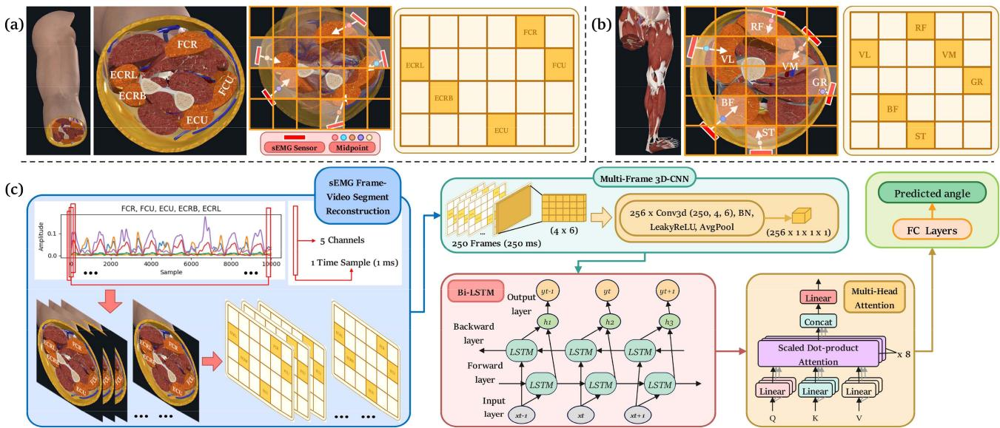
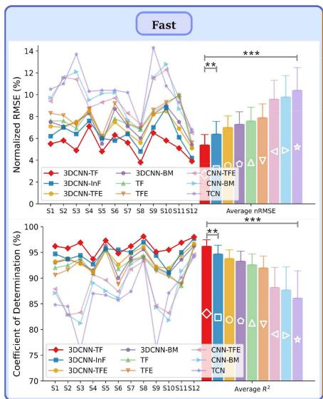
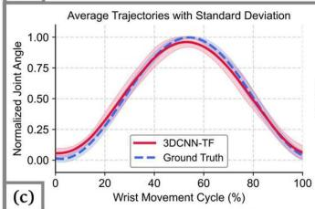
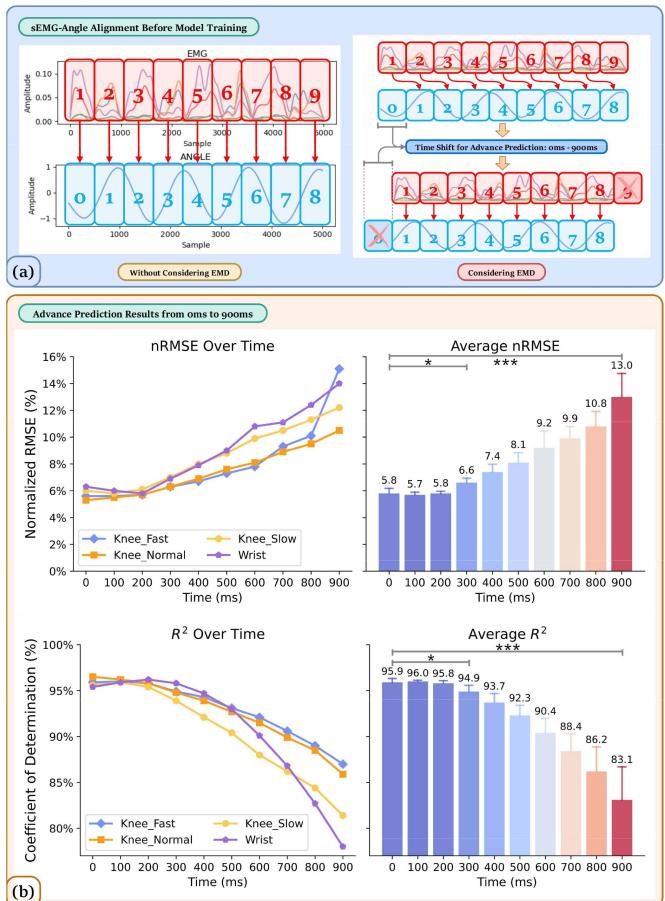

# 一种融合肌肉解剖学信息的 Transformer 序列到序列翻译框架：基于 sEMG 的连续关节运动学预测

Zijun Wei , Zhiqiang Zhang ，高级会员，IEEE，以及 Sheng Quan Xie ，会士，IEEE

摘要——实现康复机器人按需辅助（AAN）控制的关键在于准确预测患者的运动意图。本研究首次从序列到序列翻译的视角重新定义运动意图预测问题，将 sEMG 信号类比为源语言，将关节角度类比为目标语言。所提出的 3DCNN-TF 模型实现了神经控制信号到运动学表示的精确翻译。该模型包含三个模块：一个 sEMG "句子"生成模块，用于将多个 sEMG 滑动窗口编译为"句子"；一个基于肌肉解剖学和电极放置的 3DCNN 模块，用于从"句子"中的每个"词"提取肌肉协同特征；以及一个 Transformer（TF）模块，自回归地生成下一时刻的关节角度作为翻译结果。实验结果表明，3DCNN-TF 模型在以不同速度连续预测腕关节和膝关节屈/伸角度方面，相较于八个基线模型和已有研究均实现了更优的整体性能。此外，3DCNN-TF 在预测精度与计算效率之间取得了最优平衡，并展现出卓越的鲁棒性和泛化能力。具体而言，3DCNN-TF 在腕关节和膝关节数据集上分别取得了平均 nRMSE 和 R2 值为（6.2%/95.5%）和（5.5%/96.2%），平均训练时间不超过两分钟。此外，3DCNN-TF 能够在不损失精度的前提下提前 300 毫秒预测关节角度，这对于康复机器人的实时 AAN 控制至关重要。

索引词——表面肌电（sEMG）、上肢康复、深度学习、肌肉解剖学、序列到序列、连续关节运动学估计方法。

## I. 引言

约85%的脑卒中（stroke）患者在发病后会出现偏瘫（hemiparesis），即使经过康复训练，其上下肢仍存在持续性的运动功能障碍，严重影响患者的生活质量[1]。然而，现有的大多数康复机器人仅能基于阻抗（impedance）和导纳（admittance）控制提供被动辅助，无法显著改善患者的运动功能[2]。研究[3]指出，提高康复效率的关键在于最大限度地激发患者的主动参与度与训练强度，而非单纯依赖机器人的辅助。这与神经可塑性（neuroplasticity）的原理相一致，该原理强调有效的康复需要患者持续且主动的参与，以诱导大脑和神经系统的重塑。因此，开发一种能够根据患者的用力水平实时精确调整机器人辅助的"按需辅助"（Assist-As-Needed，AAN）控制策略至关重要。实现这一目标的核心在于对患者的运动意图进行准确且连续的预测[3]。已有研究表明，表面肌电信号（surface electromyography，sEMG）因其无创性和便携性，已被广泛用于运动意图的预测[4]。因此，本研究将进一步探究基于sEMG的关节运动学连续估计方法。

基于我们对过去十年间186项相关研究的系统综述[4]，深度学习（deep learning，DL）已被广泛应用于利用sEMG进行关节运动学与动力学的连续预测。深度学习能够自动提取并筛选sEMG中的高级特征，并利用神经网络的拟合能力建立这些特征与运动意图之间的非线性映射关系。该综述[4]还指出，当前大多数深度学习模型聚焦于融合卷积神经网络（convolutional neural network，CNN）、循环神经网络（recurrent neural network，RNN）和多头自注意力（multi-head self-attention，MSA）机制的混合神经网络，例如CNN-BM（带有多头自注意力的CNN-BiLSTM模型）。与仅使用CNN或RNN的模型相比，这类组合模型展现出了更优越的预测性能。具体而言，CNN-BM首先利用CNN从sEMG中提取空间特征，随后采用BiLSTM捕捉这些特征之间的长期双向上下文依赖关系，从而获得sEMG的时空表征，并通过多头自注意力机制（MSA）增强对关键时空特征的加权。

然而，多头自注意力（Multi-head Self-Attention, MSA）的注意力分布仅作用于由双向长短期记忆网络（Bidirectional Long Short-Term Memory, BiLSTM）所提取的时空特征之上，而 BiLSTM 由于其循环结构仍存在固有局限性，例如记忆长距离上下文关系的能力有限、训练过程中存在梯度消失或爆炸的风险，以及缺乏并行计算能力 [4], [5]。相比之下，Transformer（TF）模型克服了这些局限性。TF 能够同时捕获序列中所有位置的上下文关系，而不依赖于顺序，因此对时间距离不敏感。因此，在最新的研究中，TF 及其变体 BERT 已取代了 BiLSTM [4], [5], [6]。然而，根据从 PubMed、Web of Science、Scopus 和 IEEE Xplore 检索到的所有相关文献 [5], [6], [7], [8], [9], [10], [11], [12], [13], [14], [15], [16], [17], [18]，除了文献 [7]、[17] 和 [18] 外，大多数研究仅采用 TF 编码器（TF Encoder, TFE）从 sEMG 连续估计关节运动学。这种方法仅利用了 TFE 在捕获输入序列上下文依赖方面的优势，而忽略了 TF 解码器（TF Decoder, TFD）基于 TFE 所提供的上下文表示来生成时序相关目标序列的潜力。

此外，尽管文献 [7]、[17] 和 [18] 采用了完整的编码器–解码器框架，但它们均采用了 Informer（InF）模型，它是 TF [19] 的一个变体。事实上，InF 是为长期时间序列预测而设计的，其稀疏 MSA 和蒸馏操作可能会丢失短 sEMG 特征序列中的细节信息，从而降低预测性能 [20]。此外，InF 解码器一次性生成整个目标序列，而非以自回归方式逐步生成。尽管这种方法可以提高推理速度并捕获更长的时间依赖关系，但缺乏增量反馈会导致误差累积，因为模型无法动态调整输出 [20]。鉴于 sEMG 的非平稳特性需要精确捕获短期时间特征和高频动态，并考虑到 sEMG 滑动窗口是一个短时间序列，InF 可能并非最优选择。相反，使用具有完整 MSA 和自回归生成的 TFD 可能会最大化预测精度。

根据我们综述所得出的结论，深度学习（Deep Learning, DL）模型的核心概念应围绕以下方面展开：从表面肌电信号（surface electromyography, sEMG）中准确提取时空特征，增强关键特征的权重，并基于这些特征之间的上下文依赖推导出输入与输出之间的因果关系，同时尽可能滤除冗余特征与噪声，以提高预测精度和鲁棒性 [4]。此外，该综述还强调了提取肌肉协同（muscle synergy, MS）特征的重要性，这可以进一步消除 sEMG 中因个体差异、sEMG 的时变性以及主动肌与拮抗肌之间的耦合和串扰所导致的冗余与噪声成分。因此，基于这些结论，我们采用 CNN-BM 作为基础模板，并分别对 CNN 模块和 BM 模块进行改进，以获得更优的运动意图预测性能。

我们近期关于 MS 特征提取的研究 [21] 从四个不同角度对 CNN-BM 中的 CNN 模块进行了改进，同时保持 BM 模块不变，结果证明：相较于其他方法，基于目标肌肉解剖结构和 sEMG 电极放置位置设计的 3DCNN-BM 实现了最高效的 MS 特征提取能力，并具有最优的运动意图预测性能。因此，本研究继续采用文献 [21] 中的 3DCNN 来提取 MS 特征，并将 3DCNN-BM 作为基线模型之一。

此外，本研究的理论基础在于：根据肌肉骨骼动力学与运动学原理，肢体运动过程中的 sEMG 信号与相应的关节角度可被视为以不同形式表征同一神经控制信息的两种生理语言。具体而言，sEMG 是基于动作电位的隐性神经指令，而关节角度则是肌肉收缩的显性运动结果，这两者之间存在强烈的因果对应关系。从语言翻译的角度看，利用 sEMG 预测关节角度类似于同声传译，这要求模型将 sEMG 的隐性神经语言翻译为关节角度这一运动学表达。因此，本研究采用基于序列到序列（sequence-to-sequence, Seq2Seq）的 Transformer（TF）来改进 3DCNN-BM 中的 BM 模块，从而实现从 sEMG 到关节角度的精确翻译。

所提出的 3DCNN-TF 模型由三个模块组成：sEMG "句子"生成模块，将每个 sEMG 滑动窗口解释为一个 "词"，并在允许的预测延迟范围内将多个 "词" 组合成一个 "句子"；3DCNN 模块，用于从 sEMG "句子"中的每个 "词"提取 MS 特征；TF 模块，基于 MS 特征序列与先验关节角度序列之间的全局上下文依赖，逐步生成下一个关节角度作为翻译结果。

值得注意的是，TF 模块相较于传统 TF 架构融入了五项关键改进：引入额外的段编码（segment encoding），以区分"句子"内"单词"的先后顺序；3DCNN 模块取代了 TFE 中传统的嵌入层，用于提取多尺度（Multi-Scale, MS）特征，作为每个"单词"的语义表示；TFD 中额外集成了一个因果掩码（causal mask），以在下一关节角度生成过程中严格保证时间因果性；在自回归循环训练中采用了基于计划采样（Scheduled Sampling）[22] 的动态 Teacher Forcing 策略，以加速模型收敛并缓解误差累积；与传统的多层 TF 设计不同，所提 TF 模块中的 TFE 与 TFD 均为单层结构，在保持预测性能的同时显著降低了计算复杂度。

所提出的 3DCNN-TF 模型在自建腕关节数据集以及 EPIC Lab [23] 公开的下肢数据集上进行了验证。该模型与八种基线模型（3DCNN-InF、3DCNN-TFE、3DCNN-BM、TF、TFE、CNN-TFE、CNN-BM 和 TCN）进行了比较，用于在慢速、正常和快速三种速度下的水平地面行走过程中预测腕关节及膝关节的屈伸角度。实验结果表明，3DCNN-TF 模型取得了最优的整体性能，在预测精度和计算效率之间取得了良好的平衡，同时表现出更出色的泛化能力与鲁棒性。此外，3DCNN-TF 模型能够在不损失预测精度的前提下，提前 300 毫秒（ms）预测关节角度。总体而言，本研究的主要贡献在于首次从 Seq2Seq 机器翻译的视角重新定义了运动意图预测问题。具体而言，它改进了先前提出的 3DCNN-BM [21] 中的 BM 模块，从而对 CNN-BM 框架实现了全面提升。通过将 sEMG 信号与关节角度分别类比为源语言和目标语言，所提出的 3DCNN-TF 模型将目标肌肉的解剖学先验知识与 Seq2Seq 算法相融合，实现了从 sEMG 信号到腕关节及膝关节角度的精确且具有前瞻性的"翻译"。

  
(a)

  
(b)  
图 1. IRASS 和 EPIC 数据集 [24]、[23] 的实验协议。

## II. 材料（MATERIALS）

## A. IRASS 数据集

该数据集经利兹大学 MaPS 与工程联合学院研究伦理委员会（MaPS and Engineering Joint Faculty Research Ethics Committee of the University of Leeds）批准（MEEC 18-002），共纳入 12 名受试者（男性 8 名、女性 4 名，年龄 28.9 ± 2.8 岁），所有受试者均签署了知情同意书并参与了实验。

如图1(a)所示，实验前，所有受试者被要求保持直立姿势，肘关节屈曲90度，肩关节外展90度，双手处于中立位。随后，记录每位受试者的最大自主收缩（maximum voluntary contraction，MVC）值，以对表面肌电（surface electromyography，sEMG）信号进行归一化处理。实验期间，受试者需要进行连续的腕关节屈伸运动，掌指（metacarpophalangeal，MCP）关节完全伸展，同时避免腕关节的尺偏和桡偏。每位受试者进行五次试验，每次试验间隔三分钟休息时间，以防止肌肉疲劳。

腕关节屈伸运动使用VICON运动捕捉系统（VICON Motion Systems Ltd., U.K.）以250 Hz的频率进行记录。根据VICON上肢模型，在受试者右臂上放置16个对应的反光标记点，使VICON Nexus软件能够计算腕关节屈伸角度。同时，使用Avanti传感器（Delsys TrignoTM）以2000 Hz的频率采集两块腕屈肌——桡侧腕屈肌（flexor carpi radialis，FCR）和尺侧腕屈肌（flexor carpi ulnaris，FCU）——以及三块腕伸肌——尺侧腕伸肌（extensor carpi ulnaris，ECU）、桡侧腕长伸肌（extensor carpi radialis longus，ECRL）和桡侧腕短伸肌（extensor carpi radialis brevis，ECRB）——的sEMG信号。此外，为确保sEMG信号的质量，剃除受试者前臂的毛发并用酒精清洁，以最小化皮肤阻抗和运动伪迹。电极放置根据SENIAM指南确定，并通过触诊和信号质量评估加以确认。最后，使用VICON Nexus软件中的触发模块将sEMG数据和关节角度数据进行同步，并以1000 Hz的频率进行重采样。

## B. 开放访问的EPIC Lab数据集

为进一步评估3DCNN-TF模型在不同关节间的泛化能力，使用了来自EPIC Lab [23] 的公共下肢数据集。该数据集包含22名健康受试者的数据（身高 $1 . 7 0 \pm 0 . 0 7 \mathrm { m }$，体重 $6 8 . 3 \pm 1 0 . 8 3 $ kg，年龄21 ± 3.4岁）。每位受试者的详细信息见 [23]。为与IRASS数据集中的受试者数量保持一致，从该数据集中选取了12名受试者（6名男性和6名女性）。

如图1(b)所示，本研究使用了这些12名受试者在平地步态行走时的数据。每位受试者以三种不同速度进行环形行走：慢速（0.88 ± 0.19 m/s）、常速（1.17 ± 0.21 m/s）和快速 $( 1 . 4 5 \pm 0 . 2 7 \mathrm { m / s } )$，在每种速度下分别按逆时针和顺时针方向各重复五次。

膝关节屈伸角度使用电子测角仪（Biometrics Ltd., Newport, U.K.）以 1000 Hz 采样率记录。同时，右侧下肢 11 块目标肌肉的 sEMG 信号也以 1000 Hz 采样率同步采集（Biometrics Ltd., Newport, U.K.）。电极放置位置通过触诊并依据 SENIAM 指南确定。此外，与 IRASS 数据集类似，实验前对电极放置部位进行了剃毛处理并用酒精清洁。进一步地，由于膝关节屈伸运动并不涉及全部 11 块肌肉，本研究仅使用与膝关节屈伸相关的 6 块肌肉的 sEMG 信号：半腱肌（ST）、股薄肌（GR）、股二头肌（BF）、股直肌（RF）、股外侧肌（VL）和股内侧肌（VM）。

## C. 信号预处理（Signal Preprocessing）

鉴于 sEMG 信号的有效频率范围介于 20–400 Hz 之间，该范围之外的成分主要由运动伪迹和噪声构成 [25]，首先对两个数据集中的 sEMG 信号施加 20–400 Hz 的五阶 Butterworth 带通滤波器，随后施加 50 Hz 陷波滤波器以消除工频干扰。为获得更为平滑的 sEMG 包络信号以实现稳定的模型训练与更快的收敛速度，接着进行了全波整流，并施加 5 Hz 的五阶 Butterworth 低通滤波器。最后，由于仅在 IRASS 数据集中记录了最大自主收缩（MVC）值，IRASS 数据集的 sEMG 包络依据各自对应的 MVC 值进行归一化，而 EPIC 数据集的 sEMG 包络则采用 Z-score 归一化处理。至于关节角度，两个数据集均采用 5 Hz 的五阶 Butterworth 低通滤波器进行平滑，随后通过最小-最大归一化分别将腕关节和膝关节角度线性缩放至 [-1, 1] 和 [0, 1] 的范围。

  
图 2.（a）IRASS 数据集的二维 sEMG 帧重构。（b）EPIC 数据集的二维 sEMG 帧重构。（c）以 IRASS 数据集为例展示的 3DCNN-BM 模型框架。

关于滑动窗口分割，实时应用中的控制系统延迟不应超过 300 ms，以避免用户感受到明显的系统滞后 [26]。此外，实验中膝关节的运动速度比腕关节更快，过短的窗口无法捕获足够的信息，从而降低预测精度；相反，过长的窗口则会引入冗余并增加延迟，却无法提升预测性能。因此，在以 50 ms 为步长对 50 ms 至 250 ms 的五种窗口长度进行评估后，对 IRASS 数据集采用 250 ms 的滑动窗口，对 EPIC 数据集采用 150 ms 的滑动窗口，两者的重叠率均为 80%，从而在预测精度与延迟之间实现了最优平衡。

## III. 方法（METHODS）

本节详细阐述了所提出的 3DCNN-TF 模型中各个模块的具体结构，并描述了八个基线模型的细节。同时，本节还将介绍所采用的超参数与损失函数设置，以及用于定量评估各模型预测精度与训练效率的性能指标。

## A. 基于 3DCNN 的 MS 特征提取模块

本研究沿用文献 [21] 中的方法，从 sEMG 视频片段中提取 MS 特征作为语义信息。每一帧二维 sEMG 图像表示在解剖横截面上各时刻目标肌肉的相对收缩比率。因此，堆叠而成的多帧 sEMG 视频片段即可表征该横截面上目标肌肉的三维动态收缩过程。图 2(a) 和 (b) 分别展示了从 IRASS 数据集与 EPIC 数据集中的一维 sEMG 信号重构为二维 sEMG 帧的过程。具体而言，以电极放置位置作为解剖横截面，通过 Complete Anatomy 软件（3D4Medical Ltd.）获取腕关节和膝关节目标肌肉的解剖分布。此外，目标肌肉中心与电极中点之间的中点被指定为目标肌肉在二维 sEMG 帧中的新位置。

图 2(c) 展示了以 IRASS 数据集为例的 3DCNN-BM 模型框架。采用 250 ms 的滑动窗口，每个窗口包含 250×4×6 个二维 sEMG 帧。这些帧首先堆叠为视频片段，随后输入到一个配备 4×6 全覆盖卷积核的三维卷积神经网络（3DCNN）中以提取 MS 特征。批归一化（Batch Normalization, BN）用于提升训练稳定性并加速收敛；LeakyReLU 激活函数则用于增强 3DCNN 的非线性表征能力，从而实现全面的 MS 特征提取。平均池化用于在保留关键 MS 特征的同时降低特征冗余和噪声。随后，维度为 256 的 MS 特征被传递至 BM 模块，该模块由单层 BiLSTM 与八头的多头自注意力（MSA）组成。该模块捕获 MS 特征元素之间的双向上下文依赖关系，并对关键依赖赋予更高权重，从而进一步突出关键的 MS 信息。最后，采用两个带有 LeakyReLU 激活函数的全连接（FC）层，在 MS 特征与关节角度之间建立精确的非线性映射关系。

## B. sEMG"句子"生成模块

不同于以往仅基于单一 sEMG 滑动窗口预测关节角度的研究，本研究从机器翻译视角出发，提出了一种多窗口到多角度的句子级翻译框架，将采集到的整个 sEMG 信号视为需要翻译的「段落」。因此，每个滑动窗口被视为该「段落」中的一个「词」，这些「词」按时间顺序排列形成「句子」，每个「句子」由相同数量的「词」组成。考虑到实际应用中 300 ms 的最大预测延迟以及 80% 的滑动窗口重叠率，IRASS 和 EPIC 数据集中的每个 sEMG「句子」分别由六个 250 ms 和十个 150 ms 的 sEMG「词」组成。类似地，作为这些 sEMG「词」和「句子」的翻译结果，关节角度「词」和「句子」也采用相同方式生成。

  
图 3. 使用 IRASS 数据集演示的所提出的 3DCNN-TF 模型框架。

如图 3 所示，以 IRASS 数据集为例，sEMG「句子」生成模块的输出形状为 $(Batch size \times ~ 6 ~ \times ~ 2 5 0 \times 5 )$，表示每个「句子」包含六个「词」，每个「词」的维度为 $2 5 0 \times 5 .$ 。这些「词」随后被送入 3DCNN 模块，其中每个「词」被重建为 250 个 sEMG 帧。随后，每个「句子」内的所有 sEMG 帧被堆叠为视频段，并送入 3DCNN 以提取每个「词」的 MS 特征。最终，每个「句子」中的六个「词」被转换为六个 256 维的 MS 特征 $(Batch size \times \ 6 \times 2 5 6 )$ )，作为后续 TF 模块的输入。

## C. 基于 Seq2Seq 的 Transformer 模块

如图 3 所示，TF 模块由四个主要组件构成：位置编码与段编码、基于 MSA 的 TFE、具有因果掩码 MSA 和多头交叉注意力（MCA）的 TFD，以及自回归生成循环。此外，由于 MS 特征提取模块替代了 TFE 之前的传统嵌入层，因此仅保留 TFD 之前的嵌入层，用于将输入的关节角度标签转换为与 MS 特征具有相同维度的向量表示。这使得 TFD 能够更好地捕捉和比对 MS 特征与关节角度特征之间的跨序列依赖关系。

与基于循环结构的 BiLSTM 不同，TF 模型并行处理所有输入数据，因此缺乏对输入中序列关系的内在理解。因此，本研究首先采用基于正弦和余弦函数的固定位置编码（positional encoding），来标记 MS 和关节角度序列中各元素的相对位置。此外，还需要额外的标记来帮助 TF 模块区分同一"句子"中不同"词"的排列。受 BERT 模型 [27] 中下一句预测（Next Sentence Prediction, NSP）的启发，本研究添加了基于"词"位置索引的段编码（segment encoding），以区分每个特征序列属于哪个"词"。最后，将这两种编码加到 MS 和关节角度序列上，再送入 TFE 和 TFD，从而使 TF 模块能够理解这些特征序列中的局部和全局顺序。

与以往采用多层编码器-解码器结构的研究 [5]、[6]、[7]、[8]、[9]、[10]、[11]、[12]、[13]、[14]、[15]、[16]、[17]、[18] 不同，本研究仅使用单层 TFE 和 TFD 即可达到最优性能，这一点已通过大量实验验证。如图 3 所示，TFE 由 MSA 和前馈网络（feed-forward network, FFN）组成，每部分均集成了层归一化（layer normalization, LN）和残差连接，表示为 LayerNorm (x + MSA (x)) 和 LayerNorm (x + FFN (x))。这种设计确保了 MSA 和 FFN 的训练稳定性，并缓解了梯度消失问题。此外，MSA 的注意力头数和模型维度分别设置为 h= 8 和 $d _ { \mathrm { m o d e l } } = 2 5 6$，使 MSA 能够从八个不同角度并行捕捉 MS 序列中的全局上下文依赖关系。具体而言，自注意力（self-attention, SA）和 MSA 的公式如下 [28]：

$$
\begin{array}{l} \text { SA } (Q, K, V) = \text { softmax } \left(\frac {Q K ^ {T}}{\sqrt {d _ {k}}}\right) V \\ \text { MSA } (Q, K, V) = \text { Concat } (\text { head } _ {1}, \ldots , \text { head } _ {\text { h }}) W ^ {O} \\ \text { where   head } _{\text { i }} = \text { SA } \left(Q W _ {i} ^ {Q}, K W _ {i} ^ {K}, V W _ {i} ^ {V}\right) \end{array}
$$

这里，查询（Query, Q）、键（Key, K）和值（Value, V）均来源于输入 MS 特征序列的线性投影。对于每个注意力头，Q、K、V 的投影矩阵分别为 $W _ { i } ^ { Q } \in \mathbb { R } ^ { d _ { \mathrm { m o d e l } } \times d _ { k } }$、$W _ { i } ^ { K } \in \mathbb { R } ^ { d _ { \mathrm { m o d e l } } \times d _ { k } }$ 和 $W _ { i } ^ { V } \in \mathbb { R } ^ { d _ { \mathrm { m o d e l } } \times d _ { v } ^ { \circ } }$，其中每个头的维度设置为 $d _ { k } = d _ { v } = d _ { \mathrm { m o d e l } } ~ / h = 3 2$。点积 $Q K ^ { T }$ 用作相似度分数，用于衡量 MS 特征序列内部元素之间的相关性。随后，softmax 函数将这些相关性转换为每个 MS 元素的注意力权重，然后与 V 进行加权求和，以突出 MS 序列中的关键信息。归一化缩放因子 $\sqrt { d _ { k } }$ 确保了 softmax 在高维度下的梯度稳定性。最后，所有注意力头的输出被拼接起来，并通过 $W ^ { 0 } \in \mathbb R ^ { h d _ { v } \times d _ { \mathrm { m o d e l } } }$ 进行线性变换，以获得最终输出。FFN 通过逐位置非线性变换进一步精炼并记忆 MS 特征序列中的关键信息。

由于传统 TFD 在训练过程中接收完整的真实标签序列，为了使训练过程与推理时的自回归生成更好地对齐，在传统 TFD 中对 MSA 应用了因果掩码（causal masking），以确保在训练期间只能看到当前和过去的时间步，而未来的时间步不可访问。然而，本研究采用自回归训练循环，其中 TFD 仅接收历史时间步，未来的时间步被显式设置为零，因此不再需要因果掩码。尽管如此，由于 MSA 仍然关注输入序列中的所有位置，因此保留因果掩码以防止未来时间步中的零值扭曲注意力权重分布，并减少不必要的计算。

MCA 与 MSA 类似，不同之处在于 Q 来自已知关节角度上下文的投影，而 K 和 V 来自经过 TFE 精炼的 MS 关键上下文表示的投影。这使得 MCA 能够从多个视角捕捉 MS 与关节角度之间的跨序列依赖关系。与传统 TFD 不同，MCA 同样对其 K 和 V 输入应用了因果掩码，以防止在生成当前时间步预测时使用未来的 MS 信息。这迫使 MCA 更加关注历史的关键 MS 数据，避免将注意力分配到无关的 MS 数据上，从而提高了预测精度和计算效率。

传统的 Teacher Forcing（TF）训练在每个时间步以真实标签作为输入。然而，在推理阶段，传统的 TF 完全依赖自身过去的预测，导致暴露偏差和误差累积 [22]。因此，本研究在自回归循环中采用带线性衰减的 Scheduled Sampling（计划采样）[22]，动态调整训练过程中使用 Teacher Forcing 的概率，使模型逐步适应推理时使用的自回归生成模式。该方法的公式如下：

$$
\begin{array}{c} x _ {t} = \left\{ \begin{array}{l l} y _ { t - 1} ^ {\text {true}}, & \text {if r <   p_{tf} (e)} \\ \hat {y} _ { t - 1}, & \text {if r\geq p_{tf} (e)} \end{array} \right. \\ p _ {\text {tf}} (e) = 1 - \frac {e}{E} \end{array}
$$

其中，e 和 E 分别表示当前训练轮次（epoch）和总训练轮次，r 是 [0, 1] 区间内的随机数。根据概率 $p _ { \mathrm { t f } } ( e )$，模型决定在当前时间步是否将真实标签 $y _ { t - 1 } ^ { \mathrm { t r u e } }$ 作为 TFD 的输入 $x _ { t }$。如图 3 所示，当 r 小于 $p _ { \mathrm { t f } } ( e )$ 时，TFD 使用真实的关节角度标签 $y _ { t - 1 } ^ { \mathrm { t r u e } }$ 作为输入；否则，使用前一步的预测值 $\hat { y } _ { t - 1 }$。随着训练的进行，$p _ { \mathrm { t f } } ( e )$ 逐渐减小，使 $x _ { t }$ 由最初完全依赖 $y _ { t - 1 } ^ { \mathrm { t r u e } }$ 线性过渡到最终仅使用 $\hat { y } _ { t - 1 }$。这有助于模型在推理过程中动态调整下一时刻的预测，减少误差累积，提高泛化能力。

## D. 基线模型（Baseline Models）

本研究采用八个基线模型，包括五个用于对 3DCNN 和 TF 模块进行消融研究的模型，以及三个来自近期研究的代表性深度学习模型。五个消融模型包括 3DCNN-Inf、3DCNN-TFE 和 3DCNN-BM，它们分别将 3DCNN-TF 中的 TF 模块替换为 Inf、TFE 和 BM 模块；以及 TF 和 TFE 模型，这两者完全去除了 3DCNN 模块。另外三个代表性模型为 CNN-TFE、CNN-BM 和 TCN。

具体而言，3DCNN-Inf中的Inf模块沿用了文献[19]中相同的架构设计。为实现最优预测性能，经多次实验验证，3DCNN-Inf的编码器和解码器均设置为四层。每一层均采用ProbSparse多头自注意力（ProbSparse MSA）和蒸馏操作。此外，为保证公平比较，ProbSparse注意力头数与模型维度分别设为8和256，与3DCNN-TF保持一致。3DCNN-TFE由3DCNN-TF去除TFD（时频分解）和自回归循环部分得到，仅保留位置编码、段编码、TFE（时频嵌入）和FC（全连接）层。TF和TFE分别将3DCNN-TF和3DCNN-TFE中的3DCNN模块替换为$d _ { \mathrm { m o d e l } } = 2 5 6 .$的嵌入层，并将输入由MS（肌肉骨骼）特征改为预处理后的sEMG（表面肌电）信号。

至于代表性模型，CNN-TFE和CNN-BM通过将3DCNN-TFE和3DCNN-BM中的3DCNN模块替换为采用常规$3 \times 3$卷积核的三通道2DCNN构建而成，通道数分别设置为64、128和256。最后，TCN（时间卷积网络）由EPIC数据集[29]中所用的TCN架构修改而来，包含三个残差块，通道数分别为64、128和256。每个残差块包含两层一维因果膨胀卷积层，其膨胀因子与卷积核大小与文献[29]保持一致。

## E. 模型训练设置

为最大限度地减少训练环境的影响，所有模型均采用PyTorch框架在Google Colab平台上开发与训练。为确保可复现性与公平比较，所有模型均采用相同的超参数设置。具体而言，模型训练使用AdamW优化器，批量大小为256，初始学习率设为0.001。采用自适应学习率衰减策略以促进模型收敛：当验证损失进入平台期后，学习率按0.8的因子逐步降低。此外，LeakyReLU激活函数的斜率设为0.1，并采用20%的Dropout率以防止过拟合。上述所有超参数值均通过反复实验确定。

此外，为确保收敛性与训练时间的公平比较，所有模型均训练1000个epoch。采用预测关节角度与真实关节角度之间的均方误差（MSE）作为训练损失函数。

在数据划分方面，每个受试者的数据被随机分为 80% 用于训练和 20% 用于测试。考虑到实际应用中康复设备的有限计算资源，模型训练采用了入门级的 NVIDIA Tesla T4 GPU，其计算性能与 NVIDIA GeForce RTX 2070 相当。该设置模拟了临床设备的运行环境，确保了实验结果的实用相关性。

## F. 性能指标

本研究采用归一化均方根误差（normalized root mean square error, nRMSE）和决定系数 $( \mathbb { R } ^ { 2 } )$ 作为性能指标，分别评估误差大小以及预测关节角度与实际关节角度之间的相关性。考虑到本研究中的跨数据集比较，选用了对样本量和输出范围变化具有鲁棒性的 nRMSE，而非 RMSE。采用 $ \mathrm { R } ^ { 2 } $ 来评估每个模型的总体拟合优度，有效弥补了 nRMSE 在性能评估中的不足。这两个指标的公式如下：

$$
\begin{array}{c} \text {nRMSE} = \frac {\sqrt {\frac {1}{N} \sum_ {i = 1} ^ {N} \left(\theta_ {i} - \hat {\theta} _ {i}\right) ^ {2}}}{\theta_ _{\max} - \theta_ _{\min}} \\ R ^ {2} = 1 - \frac {\operatorname{Var} (\theta - \hat {\theta})}{\operatorname{Var} (\theta)} \end{array}
$$

其中 $\theta$ 和 $\hat { \theta }$ 分别表示真实关节角度和预测关节角度，N 表示样本量。nRMSE 值越低、$ \mathtt { R } ^ { 2 } $ 值越接近 1，表明精度越高。

此外，与 RMSE 和 $ \mathrm { R } ^ { 2 } $ 等总体性能指标不同，本研究采用基于双尾 t 检验的统计参数映射（Statistical Parametric Mapping, SPM）在整个时间序列上进行连续统计推断。在对所有受试者的运动周期进行时间和关节角度的双重归一化后，使用 SPM 识别周期内预测角度与真实值之间存在显著差异的特定区间，显著性水平设定为 $\alpha = 0 . 0 5$

值得注意的是，为进一步量化所有模型的综合性能，本研究提出了一个综合性能指数（overall performance index, OPI）指标，综合了预测精度（nRMSE 和 $ \scriptstyle \mathrm { R } ^ { 2 } $）和计算效率（训练时间）。具体而言，OPI 的计算公式如下：

$$
\begin{array}{l} \text { OPI } = w _ {P} \cdot \left[ \frac {(1 - \mathfrak {n} \mathrm{RMSE} _ {\mathrm{norm}}) + R _ {\mathrm{norm}} ^ {2}}{2} \right] \\ \quad + w _ {T} \cdot \exp (- \mathrm{Time} _ {\mathrm{norm}}) \end{array}
$$

Where $w _ { P }$ and $w _ { T }$ are the weights for prediction accuracy and training time, respectively, with $w _ { P } + ~ w _ { T } = ~ 1$ nRMSEnorm , $\bar { R } _ { \mathrm { n o r m } } ^ { 2 }$ and ${ \mathrm { T i m e } } _ { \mathrm { n o r m } }$ denote the normalized nRMSE, $\mathtt { R } ^ { 2 } .$ , and training time for each model. In this study, $w _ { P }$ and wT were both set to 0.5, balancing the importance of prediction accuracy with the practicality of the model in real application scenarios. Notably, the training time was penalized non-linearly using an exponential decay function, better reflecting the tolerance for training time in practical applications.

  
Fig. 4. nRMSE $/ \mathsf { R } ^ { 2 }$ results for all models on the IRASS dataset, along with the average nRMSE $/ \mathsf { R } ^ { 2 }$ values and corresponding standard deviations for each model. The significance level is set as 0.05 ( $p <$ 0.001, $p < 0 . 0 1$ , and ${ } * p < 0 . 0 5 { \mathrm { ) } }$

## IV. RESULTS

## A. Prediction Results of All Models

1) IRASS Dataset: Fig. 4 presents the nRMSE and $\mathrm { R } ^ { 2 }$ results for all models on the IRASS dataset. Compared with other models, 3DCNN-TF consistently demonstrated superior predictive performance across all subjects. Specifically, it achieved the lowest average nRMSE (6.2% ) and the highest average $\mathrm { R } ^ { 2 }$ (95.5% ) among the 12 subjects. Furthermore, based on the distribution of error bars in the bar chart, 3DCNN-TF exhibited the highest predictive stability, with minimal variability in the results. The performance ranking of the remaining models, from best to worst, along with their corresponding average nRMSE and $\mathrm { R } ^ { 2 }$ values, is as follows: 3DCNN-InF (7.3% /94% ), 3DCNN-TFE (7.7% /93.4% ), 3DCNN-BM (8% /92.8% ), TF (8.7% /91.5% ), TFE (9.2% /90.6% ), CNN-TFE (10.2% /88.8% ), CNN-BM (10.7% /87.4% ), and TCN (12.5% /82.6% ).

Additionally, to systematically evaluate the performance advantage of 3DCNN-TF over the other models, a one-way repeated measures ANOVA was conducted for nRMSE and $\mathtt { R } ^ { 2 } .$ with model type as the within-subject factor. Post-hoc paired t-tests with Holm-Bonferroni correction were performed to assess the differences between the 3DCNN-TF and other models, with the significance level set at $\alpha = 0 . 0 5$ . Statistical analysis revealed that 3DCNN-TF significantly outperformed all other models $( \ p < 0 . 0 5 )$ , strongly demonstrating the superior predictive performance of 3DCNN-TF on the IRASS dataset.

图 5. 所有模型在 EPIC 数据集上三种步行速度下的 nRMSE/R2 结果，以及每个模型对应的平均 nRMSE/R2 值与相应的标准差。显著性水平设定为 0.05（$* * * p < 0 . 0 0 1$、$p < 0 . 0 1$ 和 $\stackrel { - } { * } p < 0 . 0 5$）。

2) EPIC 数据集：图 5 展示了所有模型在 EPIC 数据集上的 nRMSE 和 $\mathrm { R } ^ { 2 }$ 结果。除了快速步行试验中的受试者 S6 外，3DCNN-TF 在该试验的其他受试者以及正常速度和慢速步行试验中均表现出最佳的预测性能。具体而言，3DCNN-TF 在三种步行速度下对全部 12 名受试者均取得了最低的平均 nRMSE 和最高的平均 $\mathtt { R } ^ { 2 }$：快速（5.4%/96.2%）、正常（5.2%/96.7%）和慢速（5.9%/95.7%），总体平均值为（5.5%/96.2%）。同样，柱状图中的误差条表明 3DCNN-TF 一致地表现出最低的性能变异性。其他模型在三种步行速度下的性能排序与在 IRASS 数据集中的顺序相同，对应的平均 nRMSE 和 $\mathrm { R } ^ { 2 }$ 值如下：3DCNN-InF（6.5%/94.7%）、3DCNN-TFE（6.9%/94.2%）、3DCNN-BM（7.3%/93.7%）、TF（7.7%/92.8%）、TFE（8.2%/91.7%）、CNN-TFE（9.2%/89.6%）、CNN-BM（9.7%/88.3%）和 TCN（10.6%/86.2%）。

采用与 IRASS 数据集相同的统计显著性分析方法，结果显示 3DCNN-TF 与所有其他模型之间均存在显著的性能差异（$p < 0 . 0 5$），进一步证明了其在 EPIC 数据集上优越的预测性能。然而值得注意的是，与快速步行和正常步行试验（$\begin{array} { l } { p < 0 . 0 1 } \end{array}$）相比，3DCNN-TF 与 3DCNN-InF 之间的性能差距在慢速步行试验中有所缩小（$p < 0 . 0 5$）。

3) 模型训练时间与 OPI 比较：图 6 展示了所有模型在两个数据集上的训练时间和 OPI 分数。模型在 IRASS 数据集上的训练时间从短到长排序如下：3DCNN-BM、3DCNN-TFE、TFE、3DCNN-InF、3DCNN-TF、TF、CNN-BM、CNN-TFE 和 TCN。在 EPIC 数据集上，TF 的训练时间显著增加，排名仅次于 TCN，而 TCN 表现出最长的训练时间。然而，统计分析表明 3DCNN-TF 与 3DCNN-BM 相比在训练时间上没有显著差异（$p > 0 . 0 5$），

图 6. 所有模型在 IRASS 数据集和 EPIC 数据集上的训练时间与 OPI 分数。显著性水平设定为 0.05（$\pmb { p } < 0 . 0 0 1$、$p < 0 . 0 1$ 和 $p < 0 . 0 5$）。

3DCNN-TFE、TFE 和 3DCNN-InF 在 IRASS 数据集上的训练，所有这些模型均在不到一分钟内完成训练。在平均数据量比 IRASS 多 30% 的 EPIC 数据集上，3DCNN-TF 与所有其他模型的训练时间存在显著差异 $( \textit { \textbf { p } } < 0 . 0 5 )$，但其训练时间仍保持在两分钟以内。总体而言，尽管 TF 模块的训练时间随数据集增大而显著增加，3DCNN-TF 仍保持了相对较短的训练时间并达到了最高的预测精度。因此，3DCNN-TF 在两个数据集上都取得了最高的 OPI 分数，显著优于所有基线模型。

图 7. (a) 和 (b) 分别为所有模型在 IRASS 数据集和 EPIC 数据集上预测关节角度的示例，以及与实际关节角度相比的对应绝对误差值。(c) 3DCNN-TF 的 SPM 分析结果。

## B. 预测关节角度的代表性示例与 SPM 分析

图 7（a）和（b）分别展示了所有模型在 EPIC 和 IRASS 数据集上的代表性预测示例。具体地，从每个数据集中各选取了三个代表性受试者，以直观地比较各模型预测关节角度与真实关节角度之间的差别，并给出对应的绝对误差。这六位受试者的预测结果与误差表明，尽管在运动幅度和速度上存在个体差异，3DCNN-TF 一致地表现出比其他模型更小的预测误差。值得注意的是，在关节角度转折点之间的稳定运动阶段，3DCNN-TF 的预测结果与真实关节角度高度一致。然而，在关节角度发生突变时，其预测误差有所增大，表明在捕捉 sEMG 瞬态特征方面仍有改进空间。这一点由图 7（c）所示的 SPM 结果得到证实。对于腕关节，在屈曲峰值阶段（0–22%，$p < 0.001$）和伸展峰值阶段（49–70%，$p < 0.001$）观察到显著差异，而在占整个稳态相 57% 的其余阶段则没有显著差异。对于膝关节，仅在屈曲峰值阶段（29–36%，$p = 0.015$）出现显著差异，而在整个周期其余 93% 的时段内没有显著差异。

## C. 3DCNN-TF 的提前预测能力

由于固有的机电延迟（electromechanical delay, EMD），sEMG 信号能够比实际运动提前约 30–150 ms 传递运动意图信息 [4]、[7]。这不仅有助于降低预测延迟，还使模型能够预测未来的关节角度。如图 8（a）所示，EPIC 和 IRASS 数据集中采集的 sEMG 信号与其对应的真实关节角度在时间上并不对齐，sEMG 在 EMD 范围内被提前采集，从而为提前预测提供了可能。值得注意的是，即使不考虑 EMD，模型本身也可能具备预测未来关节角度的内在能力。

因此，本研究将 sEMG 与关节角度在时间上重新对齐，以测试 3DCNN-TF 有效的提前预测时间范围。如图 8（a）所示，考虑 EMD 后，将 sEMG 信号向前做时间平移，同时保持关节角度不变，以此验证实际的 EMD 范围以及 3DCNN-TF 本身的最大提前预测时间范围。时间平移范围设为 0 至 900 ms，步长为 100 ms。

图8(b)展示了3DCNN-TF在EPIC和IRASS数据集上不同提前时间范围内的预测性能。结果表明，预测精度在超过300 ms后开始显著下降（$p<0.05$），这表明3DCNN-TF可以提前预测长达300 ms而不会出现性能下降。此外，如果认为$R^2 \geq 90\%$的阈值是可接受的，那么3DCNN-TF可以提前预测长达600 ms。值得注意的是，3DCNN-TF在100 ms时表现出最佳性能且方差最小，这与30–150 ms的EMD范围相吻合，从而验证了EPIC和IRASS数据集中的EMD约为100 ms，而3DCNN-TF的固有提前预测能力约为200 ms。

  
图8. (a) 评估前的sEMG-角度时间对齐。(b) 3DCNN-TF在两个数据集上的提前预测能力。

## V. 讨论

## A. 所有模型的预测结果分析

根据nRMSE、$R^2$和训练时间的结果，所提出的3DCNN-TF模型在两个数据集上均表现出优越的预测性能，平均训练时间不到两分钟。最高的OPI分数进一步验证了3DCNN-TF在预测精度和计算效率之间达到了最佳平衡。此外，在EPIC和IRASS数据集上进行的跨速度和跨关节实验进一步证明了3DCNN-TF相比其他模型具有更优越的鲁棒性和泛化能力。

具体而言，3DCNN-TF在IRASS数据集上nRMSE和$R^2$的平均标准差分别为1.22%和2.01%，均显著低于基线模型（nRMSE：1.37%–2.67%；$R^2$：2.23%–5.89%）。在EPIC数据集中三种不同行走速度下，3DCNN-TF的nRMSE和$R^2$的平均标准差分别为0.86%和1.31%，同样低于基线模型（nRMSE：1.07%–1.78%；$R^2$：1.67%–4.12%）。对于跨关节比较，3DCNN-TF在腕关节和膝关节之间表现出可比的性能，在两个数据集上平均nRMSE和$R^2$差异仅为0.7%。此外，图7(c)中所有受试者腕关节和膝关节周期的平均轨迹证明了3DCNN-TF预测与真实值之间的一致性极佳。狭窄的标准差区间表明3DCNN-TF在受试者、关节和运动速度之间具有强大的泛化能力和鲁棒性。

值得注意的是，尽管 3DCNN-TF 在三种步行速度下的性能没有显著差异 $( \mathrm { ~ \it ~ \ / ~ p ~ } > \mathrm { ~ 0 . 0 5 ) ~ }$，但其他基线模型在正常速度下表现出显著优越的性能 $( \textit { p } < 0 . 0 5 )$。此外，所有模型在正常速度下的平均性能始终最高。一种可能的解释是，受试者必须在不熟悉的速度下有意识地调整其步态和平衡，从而导致非典型的运动控制和肌肉激活模式。此外，在此类条件下维持步态稳定性需要更多的肌肉募集，进而增加 sEMG 串扰。至于 3DCNN-TF 在腕关节预测方面相较于膝关节略显不足的性能，可能有以下几个原因。首先，腕关节的自由度比膝关节多，腕部屈伸过程中可能出现轻微的尺偏或桡偏，从而干扰 sEMG 信号。其次，EPIC 数据集比 IRASS 数据集包含更多数据，导致数据量上的不平衡，进而影响模型学习。最后，如图 7 所示，步行受下意识控制，表现出更稳定的节律模式（93% 稳态区间）。相比之下，自主腕部屈伸在速度和幅度上表现出更大的变异性（57% 稳态区间），给模型预测带来了额外的挑战。

## B. 3DCNN-TF 的前瞻预测能力

研究 [30] 表明，在实际肌肉收缩发生之前提供机器人辅助可显著增强自主肌肉激活。这种快速辅助策略在不增加运动任务难度的情况下，有效提高了患者的康复效率。因此，评估 3DCNN-TF 对未来关节角度的提前预测时间范围至关重要。具体而言，该时间范围需涵盖康复机器人中执行器的响应延迟和系统通信延迟，以及信号采集与处理、滑动时间窗口和模型推理所带来的延迟。事实上，由于滑动窗口在实时应用中以增量方式运行，EPIC 和 IRASS 数据集的滑动窗口延迟分别对应 20% 的非重叠部分，即 30 ms 和 50 ms。在模型推理延迟方面，3DCNN-TF 在两个数据集测试集上的平均计算时间为 21 ms。由于每个测试集平均包含 10 个关节运动周期，单个周期的推理延迟约为 2.1 ms。总体而言，鉴于 3DCNN-TF 最多可提前 300 ms 进行预测，在扣除上述延迟后，剩余的缓冲足以支持实时预测和快速辅助，同时也降低了实际预测场景中与信号丢失和运动伪影相关的风险。

## C. 3DCNN-TF 的消融研究（Ablation Study of 3DCNN-TF）

1) 3DCNN 模块：3DCNN 模块的消融研究包含两组对比。第一组将 3DCNN-TF 和 3DCNN-TFE 与 TF 和 TFE 进行对比，第二组将 3DCNN-TFE 和 3DCNN-BM 与 CNN-TFE 和 CNN-BM 进行对比。这些对比共同证明了 3DCNN 模块的重要性及其相对于传统 CNN 的优越性。

首先，与 TF 和 TFE 相比，引入额外的 3DCNN 模块不仅通过将平均 nRMSE 降低 22% 提升了预测性能，还显著缩短了训练时间，特别是将 TF 的平均训练时间缩短了 75%。其次，与传统 CNN 相比，3DCNN-TFE 和 3DCNN-BM 均实现了更好的预测性能和训练效率，平均 nRMSE 降低了 25%，训练时间缩短了 81%。此外，CNN-TFE 与 TFE 的对比进一步表明，使用传统 CNN 会降低 TFE 的预测性能，同时增加不必要的训练时间。这是因为传统 CNN 处理基于滑动窗口大小和电极通道构建的 sEMG 图像时，其 $3 \times 3$ 的 2D 卷积核只能从 sEMG 图像中提取局部特征，无法充分捕获 sEMG 图像时空成分中的肌肉协同（MS, Muscle Synergy）特征。这进而限制了后续 TFE 和 BM 模块的效果。

相比之下，3DCNN 模块基于解剖学先验知识，能够从原始 sEMG 中高效提取 MS 特征。这些具有生理学可解释性的 MS 特征包含了基本的运动控制信息 [21]。因此，3DCNN 有效地消除了原始 sEMG 中的冗余特征和噪声，保留了肌肉收缩的动态时空特征，从而实现 sEMG 信号的精炼与压缩。此外，由于每个 2D sEMG 帧的像素数显著低于完整 sEMG 图像，且 3DCNN 的卷积核可覆盖整个 sEMG 视频片段，因此输入可以一步直接转化为 MS 特征。而 2DCNN 仅提取局部特征，需要多次池化步骤才能完成有效的特征提取和降维。总体而言，3DCNN 不仅大幅降低了 MS 特征提取过程中的计算复杂度，还为后续的 TF、TFE 和 BM 模块提供了更紧凑的 sEMG 表示。这有助于加快训练速度，并为 sEMG 中关键 MS 特征建立更精确的上下文依赖关系，最终提升性能与效率。

2) TF 模块：TF 模块的消融研究同样包含两组对比。第一组将 3DCNN-TF 与同样采用 3DCNN 的其他模型（3DCNN-InF、3DCNN-TFE 和 3DCNN-BM）进行对比，第二组将 TF 与 TFE 进行对比。这些对比共同验证了采用完整 TF 结构的必要性。

第一个对比表明，在 3DCNN 之后使用 TF，相比使用 InF、TFE 或 BM，分别将平均 nRMSE 降低了 15.2%、19.9% 和 23.5%。第二个对比显示，TFD 的优势并不完全依赖于输入特征的质量。即使没有 3DCNN 提供的 MS 特征，TF 仍优于 TFE，将平均 nRMSE 降低了 5.7%。这些显著的提升源于完整 TF 架构相对于 InF、TFE 和 BM 的三个关键优势：完整的 MSA、自回归生成以及 MCA。

首先，从 sEMG 预测关节角度是一项短期时间序列预测任务，需要捕捉 sEMG 中的高频动态与细粒度特征。然而，InF 专为长期序列预测而设计，无法在此场景中充分发挥其优势。这一局限源于 InF 在长期预测中以计算效率换取准确性，其 ProbSparse MSA 以及基于最大池化的蒸馏操作会丢失 MS 特征之间的关键上下文关系。相比之下，TF 的 MSA 能够捕捉 MS 特征序列内的完整全局上下文依赖，保留所有必要的 MS 信息。模型深度也进一步证明了这一点：单层 TF 即达到了比四层 InF 更高的预测精度。此外，TF 的自回归生成（而非 InF 的一次性生成）通过利用历史信息动态调整预测策略，从而修正偏差并保证 TFD 输出的时间一致性与稳定性。因此，3DCNN-TF 在准确性与计算效率之间的平衡优于 3DCNN-InF。

其次，除自回归生成外，TF 与 TFE 的对比进一步凸显了 MCA 的重要性。MCA 使 TFD 能够基于当前 sEMG 信号与历史关节角度之间的跨序列上下文依赖，动态筛选 TFE 提供的、与下一步关节角度预测最相关的关键 MS 信息，从而准确生成下一步的关节角度。

最后，TF 与 BM 的对比进一步验证了 TF 上述三个关键优势的综合效用。由于 BM 的 MSA 构建于 BiLSTM 之上，其能力受到 BiLSTM 循环结构的约束，难以在特征序列内部建立长程上下文依赖，从而降低了预测性能。相比之下，TF 能够以并行方式建模跨越任意时间跨度的上下文依赖，并缓解 BiLSTM 中固有的梯度消失或梯度爆炸问题。然而，TF 的这些优势以计算效率的降低为代价。

## D. 与现有研究的对比

对于 IRASS 数据集，3DCNN-TF 的预测性能（平均 $\mathrm { R } ^ { 2 } = 0 . 9 6$）不仅超越了研究 [21] 中提出的 3DCNN-BM 模型，也优于另外三项使用同一数据集的相关研究。这些研究包括：采用直接配点（Direct Collocation, DC）生理参数优化方法的个性化肌肉骨骼（Musculoskeletal, MSK）模型 [31]（平均 R2 = 0.88）、基于拉格朗日运动方程与 MSK 逆动力学的生成对抗网络（Generative Adversarial Network, GAN）[32]（平均 $\mathrm { R } ^ { 2 } = 0 . 9 2$），以及利用 CNN-LSTM 训练卡尔曼滤波器参数与增益的深度卡尔曼滤波网络（Deep Kalman Filter Network, DKFN）[33]（平均 $\mathrm { R } ^ { 2 } = 0 . 8 7$）。值得注意的是，研究 [21] 已证明 3DCNN-BM 优于该研究中的其他基线模型，包括基于图拓扑的 GraphSAGE-BM、基于卷积自编码器的 CAE-BM、基于多尺度时空卷积核的 MCNN-BM，以及其他经典深度学习模型（CNN、LSTM、BiLSTM 和 CNN-BiLSTM）。因此，可以推断 3DCNN-TF 在 IRASS 数据集上同样优于这些模型。

对于 EPIC 数据集，3DCNN-TF 的预测性能（平均 $\mathrm { R } ^ { 2 } = 0 . 9 6$）优于两项使用同一数据集的相关研究。这些研究分别是：使用由非负矩阵分解（Non-negative Matrix Factorization, NMF）选出的三块最相关肌肉的 sEMG 信号均方根（Root Mean Square, RMS）特征训练的 RNN 和 CNN 模型 [34]（平均 $\mathrm { R } ^ { 2 } = 0 . 7 4$），以及融合高斯过程回归（Gaussian Process Regression, GPR）、自适应频率振荡器（Adaptive Frequency Oscillators, AFO）和无迹卡尔曼滤波器（Unscented Kalman Filters, UKF）的步态相位估计模型 [35]（平均 $\mathrm { R } ^ { 2 } = 0 . 8 8$）。

此外，研究 [21] 中使用的第二个 Ninapro DB2 数据集，其 sEMG 电极均匀分布于前臂周围，并未针对特定肌肉进行定位放置。因此，该数据集未能严格遵循目标肌肉的解剖学分布来提取 MS 特征，从而限制了对 3DCNN 性能的验证。相比之下，本研究在两个数据集中均将 sEMG 电极的放置位置与目标肌肉的解剖学分布精确对齐，从而充分证明了利用肌肉解剖学信息、通过 3DCNN 进行 MS 特征提取的可行性。

## E. 局限性与未来工作

本研究中的两个数据集以及所提出的 3DCNN-TF 模型仍存在若干局限性。关于数据集，未来研究应纳入更多关节类型、多自由度关节运动、更多受试者，以及更长时间的随机与复杂运动，以全面评估模型的鲁棒性与泛化能力。此外，未来工作还应纳入脑卒中患者，并测试 3DCNN-TF 的实时预测能力，以确保其在实际非标准化康复场景中的可靠性。

关于 3DCNN-TF 模型，除了降低其在二维 sEMG 帧重建过程中对目标肌肉和 sEMG 电极精确定位的依赖外，还必须在不损失性能的前提下提高 TF（Transformer）模块的训练效率。因此，未来工作可整合文献 [36] 中提出的基于极坐标的显式空间协同编码，其中电极相位差编码肌肉激活的相对空间关系，从而提升 3DCNN 对 MS（Muscle Synergy，肌肉协同）特征的提取能力及其对电极偏移的鲁棒性。

此外，可考虑其他 TF 变体以降低 MSA（Multi-head Self-Attention）、 MCA（Multi-head Cross-Attention）和 FFN（Feed-Forward Network）的计算复杂度。此外，基于深度学习的 3DCNN-TF 本质上是一种黑箱工具，缺乏关于 sEMG 与关节运动学之间神经生理学机制的可解释性。因此，未来研究可将基于 MSK（Musculoskeletal）模型的运动方程作为附加约束集成到当前的 MSE（Mean Squared Error）损失函数中。此外，3DCNN-TF 可作为生成器网络，而文献 [37] 中的多关节分层优化 Hill 模型可作为 GAN（Generative Adversarial Network）框架中的判别器网络。该方法将在对抗训练过程中利用 MSK 生物力学先验，以提高模型的可解释性和多关节协调预测能力，同时降低其对大规模训练数据集的依赖。

此外，3DCNN-TF 可扩展为融合 sEMG 和 IMU（Inertial Measurement Unit）信号的多模态融合框架，以提升预测精度。此外，模型可在大规模数据集上进行预训练，以提取与受试者无关及受试者特定的 MS 成分，然后进行受试者特定的微调，以实现快速少样本迁移学习。

## VI. 结论

本研究首次从 Seq2Seq（Sequence-to-Sequence，序列到序列）翻译的视角重新定义了运动意图预测问题，通过将 sEMG 和关节角分别类比为源语言和目标语言，实现了从神经控制信号到运动学表示的精确翻译。具体而言，模型输入被重新构建为由多个 sEMG 滑动窗口堆叠而成的"句子"，其中每个滑动窗口充当"句子"中的一个"词"。该设计使模型能够捕获更全面的时间信息，从而克服了传统方法仅依赖单窗口预测的局限性。此外，鉴于先前研究 [21] 已证明基于目标肌肉解剖结构的 3DCNN 能够从 sEMG 信号中有效提取 MS 特征，本研究将 3DCNN 模块与改进的基于 Seq2Seq 的 TF 模块相结合，从而实现了从 sEMG 到关节角的精确预测。

首先，3DCNN 模块基于目标肌肉的解剖学分布和电极放置位置，将每个"句子"重建为 sEMG 视频片段，从而提取出表征神经控制本质的 MS 特征。这显著提升了模型的预测精度，同时大幅缩短了训练时间。随后，TF 模块通过 TFE、TFD 与自回归生成回路的协同作用，从多个角度动态捕捉 MS 特征序列与关节角度序列之间的全局上下文依赖关系，最终逐步生成精确的关节角度预测，作为翻译结果。

在涉及腕部与膝关节屈伸任务的两个数据集上的实验结果表明，相较于八种基线模型，3DCNN-TF 取得了最优的综合性能，在预测精度与计算效率之间达到了最佳平衡，并展现出卓越的鲁棒性与泛化能力。同时，3DCNN-TF 能够在不损失精度的前提下提前至多 300 ms 预测关节角度，凸显了其在实时康复辅助中的潜力。

## 参考文献

[1] F. Xiong 等，"中风后运动恢复中的新兴肢体康复治疗"，《Front. Aging Neurosci.》（老龄化神经科学前沿），第 14 卷，2022 年 3 月，文章编号 863379，doi: 10.3389/FNAGI.2022.863379/PDF。

[2] J. Berning, G. E. Francisco, S. H. Chang, B. J. Fregly 和 M. K. O'Malley，"肌电控制与神经肌肉骨骼建模：康复机器人的互补技术"，《Curr. Opin. Biomed. Eng.》（生物医学工程当代观点），第 19 卷，2021 年 9 月，文章编号 100313，doi: 10.1016/J.COBME.2021.100313。

[3] A. Basteris, S. M. Nijenhuis, A. H. A. Stienen, J. H. Buurke, G. B. Prange 和 F. Amirabdollahian，"机器人介导的中风上肢康复中的训练模式：基于系统综述的分类框架"，《J. Neuroengineering Rehabil.》（神经工程与康复杂志），第 11 卷，第 1 期，第 1–15 页，2014 年 7 月，doi: 10.1186/1743-0003-11-111。

[4] Z. Wei, Z. Q. Zhang 和 S. Q. Xie，"基于 sEMG 的上肢康复连续运动意图预测：基于模型与无模型方法的系统综述"，《IEEE Trans. Neural Syst. Rehabil. Eng.》（IEEE 神经系统与康复工程汇刊），第 32 卷，第 1487–1504 页，2024 年，doi: 10.1109/TNSRE.2024.3383857。

[5] Z. Chen, H. Wang, H. Chen 和 T. Wei，"基于 Transformer 深度学习模型的 sEMG-FMG 混合模态驱动连续运动手指关节角度估计"，《Biomed. Signal Process. Control》（生物医学信号处理与控制），第 85 卷，2023 年 8 月，文章编号 105030，doi: 10.1016/J.BSPC.2023.105030。

[6] C. Lin, X. Chen, W. Guo, N. Jiang, D. Farina 和 J. Su，"基于 BERT 的表面肌电信号跨受试者手部运动学连续估计方法"，《IEEE Trans. Neural Syst. Rehabil. Eng.》（IEEE 神经系统与康复工程汇刊），第 31 卷，第 87–96 页，2023 年，doi: 10.1109/TNSRE.2022.3216528。

[7] T. Liang et al., "基于表面肌电信号的端到端紧密耦合卷积 Transformer 模型对人体膝关节角度的连续预测（sEMG-based end-to-end continues prediction of human knee joint angles using the tightly coupled convolutional transformer model），" IEEE J. Biomed. Health Inform., vol. 27, no. 11, pp. 5272–5280, Nov. 2023, doi: 10.1109/JBHI.2023.3304639.

[8] C. Lin and X. Zhang, "融合 Inception 与 Transformer 网络从表面肌电信号连续估计手指运动学（Fusion inception and transformer network for continuous estimation of finger kinematics from surface electromyography），" Front. Neurorobot., vol. 18, May 2024, Art. no. 1305605, doi: 10.3389/FN-BOT.2024.1305605/BIBTEX.

[9] C. Lin and Z. He, "用于手指关节运动学连续估计的旋转 Transformer 跨受试者模型及面向新受试者的迁移学习方法（A rotary transformer cross-subject model for continuous estimation of finger joints kinematics and a transfer learning approach for new subjects），" Front. Neurosci., vol. 18, Mar. 2024, Art. no. 1306050, doi: 10.3389/FNINS.2024.1306050/BIBTEX.

[10] Z. An et al., "SCTNET：基于移位窗口与卷积层 Transformer 利用表面肌电信号连续估计手指关节角度（Shifted windows and convolution layers transformer for continuous angle estimation of finger joints using sEMG），" IEEE Sensors J., vol. 24, no. 16, pp. 27007–27016, Aug. 2024, doi: 10.1109/JSEN.2024.3423795.

[11] N. A. S. Putro, C. Avian, S. W. Prakosa, M. I. Mahali, and J. S. Leu, "利用特征提取与基于 Transformer 的深度学习模型通过表面肌电信号估计手指关节角度（Estimating finger joint angles by surface EMG signal using feature extraction and transformer-based deep learning model），" Biomed. Signal Process. Control, vol. 87, Jan. 2024, Art. no. 105447, doi: 10.1016/J.BSPC.2023.105447.

[12] Y. Bai, X. Guan, L. He, Z. Wang, Z. Li, and M. Zhu, "基于 Transformer 算法与生物信号融合的肩肘关节旋转加速度估计（Estimating rotational acceleration in shoulder and elbow joints using a transformer algorithm and a fusion of biosignals），" Sensors, vol. 24, no. 6, Mar. 2024, Art. no. 1726, doi: 10.3390/S24061726.

[13] M. Zeng, J. Gu, and Y. Feng, "基于 sEMG-Transformer 的下肢外骨骼机器人运动预测控制（Motion prediction based on sEMG-transformer for lower limb exoskeleton robot control），" 发表于第 8 届 IEEE 先进机器人与机电一体化国际会议论文集（Proc. 8th IEEE Int. Conf. Adv. Robot. Mechatron.），2023 年，第 864–869 页，doi: 10.1109/ICARM58088.2023.10218920.

[14] Z. Weng et al., "一种用于从表面肌电信号连续解码手指精细运动的 CNN-Transformer 混合方法（A hybrid CNN-transformer approach for continuous fine finger motion decoding from sEMG signals），" 发表于 IEEE 计算智能与虚拟环境测量系统及应用国际会议论文集（Proc. IEEE Int. Conf. Comput. Intell. Virtual Environ. Meas. Syst. Appl.），2024 年，第 1–6 页，doi: 10.1109/CIVEMSA58715.2024.10586636.

[15] X. Li, X. Zhang, L. Zhang, X. Chen, and P. Zhou, "基于 Transformer 的多任务学习框架用于支持肌肉力估计的肌电模式识别（A transformer-based multi-task learning framework for myoelectric pattern recognition supporting muscle force estimation），" IEEE Trans. Neural Syst. Rehabil. Eng., vol. 31, pp. 3255–3264, 2023, doi: 10.1109/TNSRE.2023.3298797.

[16] N. Leroux, J. Finkbeiner, and E. Neftci, "用于假肢手快速控制的脉冲神经元在线 Transformer（Online transformers with spiking neurons for fast prosthetic hand control），" 发表于 IEEE 生物医学电路与系统会议论文集（Proc. IEEE Biomed. Circuits Syst. Conf.），2023 年，第 1–6 页，doi: 10.1109/BIOCAS58349.2023.10388996.

[17] Y. Zhu et al., "Conv-Informer：结合表面肌电信号与下肢关节角度的数据驱动步态轨迹预测方法（A data-driven method combining sEMG and lower limb joint angles for gait trajectory prediction），" 发表于 IEEE 实时计算与机器人国际会议论文集（Proc. IEEE Int. Conf. Real-Time Comput. Robot.），2024 年，第 653–658 页，doi: 10.1109/RCAR61438.2024.10671373.

[18] X. Zhou, L. Zhang, J. Liu, J. Ye, C. Wang, and X. Wu, "一种用于下肢关节角度估计的新型多流 Informer," 载于 第十二届 IEEE 网络技术、自动化、控制与智能系统国际会议论文集, 2022, pp. 413–419, doi: 10.1109/CYBER55403.2022.9907576.

[19] H. Zhou et al., "Informer：超越高效 Transformer 的长序列时间序列预测模型," 载于 AAAI 人工智能会议论文集, 2021, vol. 35, no. 12, pp. 11106–11115, doi: 10.1609/AAAI.V35I12.17325.

[20] Q. Zhu, J. Han, K. Chai, and C. Zhao, "基于 Informer 算法的时间序列分析综述," Symmetry, vol. 15, no. 4, 2023 年 4 月, 文章编号 951, doi: 10.3390/SYM15040951.

[21] Z. Wei, M. Li, Z. Q. Zhang, and S. Q. Xie, "从肌肉解剖与肌肉协同特征提取视角利用表面肌电信号连续预测腕关节运动学," IEEE 生物医学与健康信息学杂志, vol. 29, no. 1, pp. 43–55, 2025 年 1 月, doi: 10.1109/JBHI.2024.3484994.

[22] S. Bengio, O. Vinyals, N. Jaitly, and N. Shazeer, "循环神经网络序列预测中的计划采样," 载于 神经信息处理系统进展大会论文集, 2015, vol. 28, pp. 1171–1179.

[23] J. Camargo, A. Ramanathan, W. Flanagan, and A. Young, "楼梯、斜坡与平地行走及其过渡等多种条件下下肢生物力学的综合性开源数据集," 生物力学杂志, vol. 119, 2021 年 4 月, 文章编号 110320, doi: 10.1016/J.JBIOMECH.2021.110320.

[24] Y. Zhao, Z. Zhang, Z. Li, Z. Yang, A. A. Dehghani-Sanij, and S. Xie, "一种用于估计腕关节连续运动的肌电驱动肌肉骨骼模型," IEEE 神经系统和康复工程汇刊, vol. 28, no. 12, pp. 3113–3120, 2020 年 12 月, doi: 10.1109/TNSRE.2020.3038051.

[25] A. Demir, T. Koike-Akino, Y. Wang, M. Haruna, and D. Erdogmus, "EEG-GNN：用于脑电图（EEG）信号分类的图神经网络," 载于 第 43 届 IEEE 医学与生物工程学会国际年会论文集, 2021, pp. 1061–1067, doi: 10.1109/EMBC46164.2021.9630194.

[26] K. Dinashi, A. Ameri, M. A. Akhaee, K. Englehart, and E. Scheme, "使用深度卷积自编码器压缩肌电信号," IEEE 生物医学与健康信息学杂志, vol. 26, no. 7, pp. 2888–2897, 2022 年 7 月, doi: 10.1109/JBHI.2022.3142034.

[27] J. Devlin, M.-W. Chang, K. Lee, K. T. Google, and A. I. Language, "BERT：用于语言理解的深度双向 Transformer 预训练," 载于 计算语言学协会北美分会会议论文集, 2019, pp. 4171–4186, doi: 10.18653/V1/N19-1423.

[28] A. Vaswani et al., "Attention is All You Need," 载于 神经信息处理系统进展大会论文集, 2017, vol. 30, pp. 6000–6010.

[29] S. Bai, J. Z. Kolter, and V. Koltun, "用于序列建模的通用卷积与循环网络的实证评估," CoRR, vol. abs/1803.01271, 2018, arXiv:1803.01271.

[30] A. C. Dzewaltowski and P. Malcolm, "在机电延迟内使用机器人辅助增强肌肉激活：对康复的启示？," IEEE Trans. Neural Syst. Rehabil. Eng., vol. 32, pp. 2432–2440, 2024, doi: 10.1109/TNSRE.2024.3419688.

[31] Y. Zhao et al., "计算高效的个人化肌电驱动腕关节肌肉骨骼模型," IEEE Trans. Instrum. Meas., vol. 72, 2023, Art. no. 4001410, doi: 10.1109/TIM.2022.3225023.

[32] Y. Shi, S. Ma, Y. Zhao, C. Shi, and Z. Zhang, "基于物理信息的小样本对抗学习用于基于 sEMG 的肌肉力和关节运动学估计," IEEE J. Biomed. Health Inform., vol. 28, no. 3, pp. 1309–1320, Mar. 2024, doi: 10.1109/JBHI.2023.3347672.

[33] T. Bao, Y. Zhao, S. A. R. Zaidi, S. Xie, P. Yang, and Z. Zhang, "使用 sEMG 估计手部运动学的深度卡尔曼滤波网络," Pattern Recognit. Lett., vol. 143, pp. 88–94, Mar. 2021, doi: 10.1016/J.PATREC.2021.01.001.

[34] J. Yang, Z. Lu, S. Chen, C. Liu, and H. Zhao, "基于表面肌电的连续膝关节角度预测," Biomed. Signal Process. Control, vol. 95, Sep. 2024, Art. no. 106354, doi: 10.1016/J.BSPC.2024.106354.

[35] Y. You, J. Lin, S. Zhang, W. Huo, J. Han, and N. Yu, "跨速度连续运动估计的自适应振荡器驱动步态相位模型," IEEE Trans. Instrum. Meas., vol. 73, 2024, Art. no. 2514014, doi: 10.1109/TIM.2024.3381303.

[36] A. Tigrini et al., "基于相量的肌电协同特征：一种用于提升步态相位识别性能的快速手工特征提取方案," Sensors, vol. 24, no. 17, Sep. 2024, Art. no. 5828, doi: 10.3390/S24175828.

[37] L. Han, L. Cheng, H. Li, Y. Zou, S. Qin, and M. Zhou, "面向个人化手部和腕部肌肉骨骼建模及运动估计的分层优化," IEEE Trans. Biomed. Eng., vol. 72, no. 1, pp. 454–465, Jan. 2025, doi: 10.1109/TBME.2024.3456235.