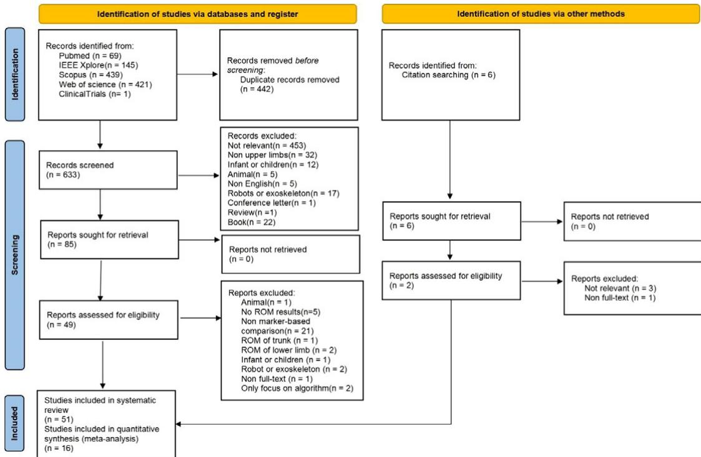
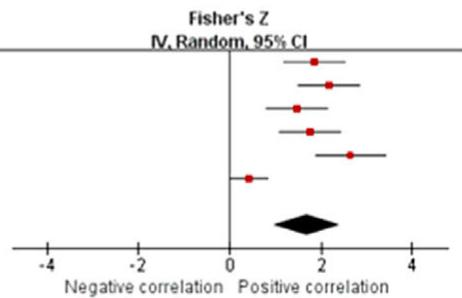
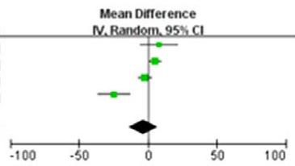
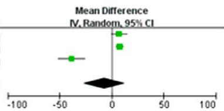
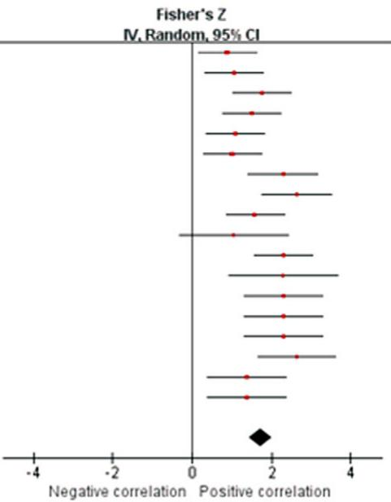
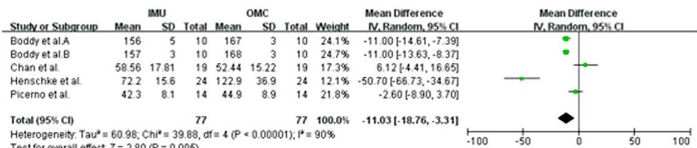
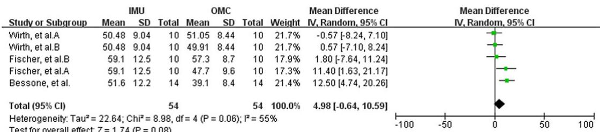
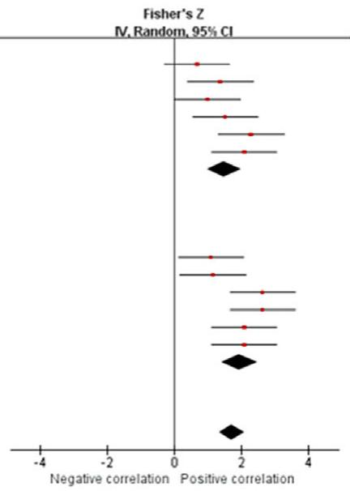
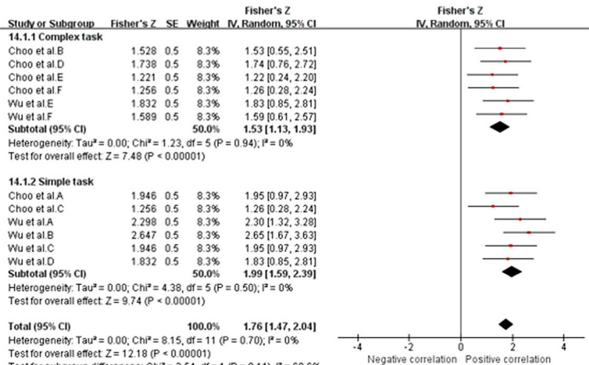
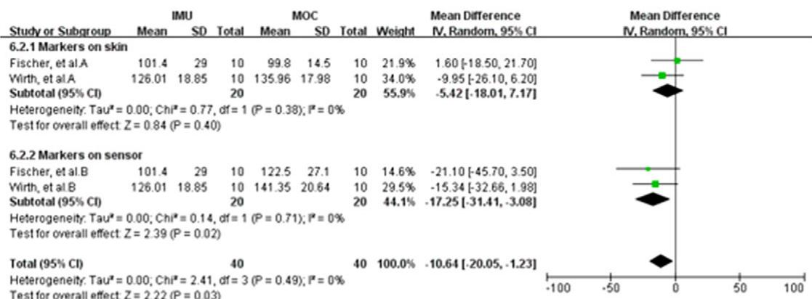

# 惯性测量单元在上肢关节活动度测量中的同时效度：系统综述与 meta 分析

Jinfeng Li<sup>1</sup> , Fanji Qiu<sup>2</sup> , Liaoyan Gan<sup>3</sup> and Li-Shan Chou<sup>1</sup>

<sup>1</sup>Department of Kinesiology, Iowa State University, Ames, IA, USA

<sup>2</sup>Movement Biomechanics, Institute of Sport Sciences, Humboldt-Universität zu Berlin, Berlin, Germany

<sup>3</sup>Faculty of Kinesiology, Sport, and Recreation, College of Health Science, University of Alberta, Edmonton, AB, Canada Corresponding author: Li-Shan Chou; Email: chou@iastate.edu

收稿日期：2023 年 6 月 29 日；修订日期：2024 年 2 月 12 日；接受日期：2024 年 5 月 10 日

关键词：惯性测量单元（Inertial Measurement Unit, IMU）；运动分析；上肢

## 摘要

惯性测量单元（Inertial Measurement Units, IMUs）已被证明是测量人体上肢关节活动度（range of motion, RoM）的有效工具。尽管已有若干研究报告了惯性测量单元相对于金标准（光学运动捕捉系统，Optical Motion Capture System, OMC）的效度，但目前仍缺少对惯性测量单元在上肢关节活动度测量中准确性的定量总结。因此，本系统综述与 meta 分析的主要目的在于确定惯性测量单元在成人上肢活动度测量中的同时效度（concurrent validity）。共有 51 篇文献被纳入系统综述，其中 16 篇的数据被汇总用于 meta 分析。同时效度结果显示：肩关节屈伸（皮尔逊相关系数 r = 0.969 [0.935, 0.986]，ICC = 0.935 [0.749, 0.984]，平均差 = 3.19（p = 0.55））、肘关节屈伸（皮尔逊相关系数 r = 0.954 [0.929, 0.970]，ICC = 0.929 [0.814, 0.974]，平均差 = 10.61（p = 0.36））、腕关节屈伸（皮尔逊相关系数 r = 0.974 [0.945, 0.988]，平均差 = 4.20（p = 0.58））的同时效度为极好；肩关节外展内收（皮尔逊相关系数 r = 0.919 [0.848, 0.957]，ICC = 0.840 [0.430, 0.963]，平均差 = 7.10（p = 0.50））、肘关节旋前旋后（皮尔逊相关系数 r = 0.966 [0.939, 0.981]，ICC = 0.821 [0.696, 0.900]）的同时效度为良好至极好。对于肩关节内外旋（皮尔逊相关系数 r = 0.939 [0.894, 0.965]，平均差 = 9.13（p < 0.0001）），结果存在一定的不一致性。综上所述，本研究结果支持将惯性测量单元作为测量上肢活动度的可行工具，但对于某些特定关节运动，如肩关节旋转和腕关节尺桡偏，惯性测量单元的测量结果需谨慎使用。

## 1. 背景

关节活动度（Range of motion, RoM）描述了在关节或身体特定部位周围可实现的运动范围。测量关节活动度在临床评估中至关重要，例如在评估肩关节活动度以诊断和分期冻结肩时（Ješić et al., 2022）。准确且可靠的关节活动度测量对于临床医生制定诊断与治疗策略至关重要。在临床环境中，量角器因其经济实惠、便携易用而成为关节活动度测量的常用工具。然而，它们存在显著的局限性。首先，量角器只能测量单一平面内的关节角度和静态位置，这限制了它们评估动态关节运动的能力。其次，使用量角器所获测量的可靠性和准确性差异很大。肩关节和肘关节关节活动度测量的组内相关系数（intraclass correlation coefficients, ICCs）分别为 0.76 至 0.94 和 0.36 至 0.91（Muir et al., 2010; Walmsley et al., 2018）。这种测量可靠性的差异可能源于被测关节的解剖学特异性以及评估者经验水平的不同。因此，量角器应被视为关节活动度测量的基础工具。其较大的测量误差使其在更精确的临床研究和运动学研究中的应用受到限制。

商用基于标记点的运动捕捉系统，也称为光学运动捕捉系统（optical motion capture systems, OMCs），例如 Vicon（Vicon Motion Systems Ltd., Oxford, UK），被广泛视为临床人体运动分析和生物力学研究的「金标准」（Nagymáté and Kiss, 2018; Valevicius et al., 2018），一项系统综述指出在步态测量中矢状面的评估者内误差小于 $4.0^{\circ}$，冠状面小于 $2.0^{\circ}$（McGinley et al., 2009）。对于这类系统，被动反光标记被策略性地放置在身体上特定的骨性标志上，对应于待分析的节段。这些标记将光线反射回相机，使相关的生物力学模型能够在空间中重建三维人体运动（Colyer et al., 2018）。然而，这些系统存在相当大的局限性：成本高昂、缺乏便携性、需要专门的实验室环境，并且涉及冗长的设置和校准流程（Sessa et al., 2013; Wu et al., 2022），这使得这些系统难以在常规临床中使用。此外，标记被衣物遮挡会显著影响结果的可靠性，限制了基于标记点的系统在真实场景中的应用（van der Kruk and Reijne, 2018）。

惯性测量单元（Inertial Measurement Units, IMUs），即可穿戴传感器，已成为能够克服上述局限的一种替代方法。IMU 由于其便携性和经济性，广泛应用于人体运动学分析和临床步态评估中。典型情况下，IMU 由三轴加速度计、三轴陀螺仪，以及（可选的）三轴磁力计组成（Seel 等, 2014）。使用者可通过数据融合算法与生物力学模型，估计身体各环节在三维空间中的运动学参数（Poitras 等, 2019）。因此，使用多个 IMU 可为在日常生活中采集上肢运动参数提供可能。尽管 IMU 作为运动追踪工具展现出良好前景，但在其被广泛采用之前，仍需进行全面的计量学验证，以确保其有效性与可靠性。已有大量研究检验了 IMU 在测量不同运动中人体运动学参数时的有效性与可靠性。目前已有多篇针对 IMU 测量下肢运动学有效性与可靠性的系统综述与荟萃分析（Kobsar 等, 2020；Zeng 等, 2022），其结果表明，IMU 是测量下肢关节活动度（Range of Motion, RoM）的可靠工具。在上肢研究领域，Walmsley 等（2018）的一项系统综述分析了 2018 年之前开展的 22 项研究，发现尽管 IMU 在体内测量中的误差范围高于 OMC 系统，但通过大量定制化设置，仍可实现小于 $5 ^ { \circ }$ 的误差。此外，另一项系统综述（Poitras 等, 2019）强调了 IMU 在测量上肢关节运动时较宽的误差范围：在与 OMC 系统比较时，肩关节的均方根误差（Root Mean Square Error, RMSE）为 $0.2°$ $64.5°$，肘关节为 $0.2°$ $30.6°$，腕关节为 $2.2°$ $30°$。然而，关于 IMU 在上肢运动分析中测量有效性的荟萃分析，文献中仍存在明显空白。尽管已有部分文章对上肢关节运动的 IMU 测量有效性进行了系统综述，但其主要以定性总结为主，目前仍缺乏高质量的荟萃分析对 IMU 的测量有效性进行定量评估，并对测量误差的统计学显著性进行检验。因此，在将 IMU 系统常规应用于评估之前，必须对其进行定量验证。本综述研究的主要目标包括：（1）概述现有商用可穿戴传感器的特性；（2）通过对比 IMU 与 OMC，定量总结现有的心理测量学特性；（3）为 IMU 用于上肢 RoM 测量提供循证支持。

## 2. 方法

## 2.1. 方案与注册

## 2.2. 检索策略

本系统综述和荟萃分析遵循了系统综述和荟萃分析优先报告条目（Preferred Reporting Items for Systematic Reviews and Meta-Analyses, PRISMA）指南（Page 等，2021），方案已于 2022 年 12 月 28 日在国际系统综述前瞻性注册平台（International Prospective Register of Systematic Review）注册（PROSPERO 编号：CRD42022384738）。我们通过检索 PubMed、Web of Science、Scopus、IEEE Xplore 电子数据库以及 ClinicalTrials 注册系统，筛选了 2016 年 1 月 1 日至 2022 年 12 月 19 日期间发表的相关研究。检索词包括可穿戴传感器（wearable sensor）、运动分析（motion analysis）、关节活动度（range of motion）、上肢（upper limbs）以及光学动作捕捉系统（optical motion capture system）。PubMed 中的具体检索策略包括：(wearable sens\*[Title/Abstract] OR inertial motion unit\*[Title/Abstract] OR inertial movement unit\*[Title/Abstract] OR inertial sens\*[Title/Abstract] OR sensor[Title/Abstract] OR accelerometer\*[Title/Abstract] OR gyro scope\*[Title/Abstract]) AND (movement\*analysis[Title/Abstract] OR motion analysis\*[Title/Abstract] OR motion track\*[Title/Abstract] OR track\* motion\*[Title/Abstract] OR measurement system\*[Title Abstract] OR movement[Title/Abstract]) AND (joint angle\*[Title/Abstract] OR angle\*[Title/Abstract] OR kinematic\*[Title/Abstract] OR range of motion\*[Title/Abstract]) AND (upper limb\*[Title/Abstract] OR upper extremit\*[Title/Abstract] OR arm\*[Title/Abstract] OR elbow\*[Title/Abstract] OR wrist\*[Title Abstract] OR shoulder\*[Title/Abstract] OR humerus\*[Title/Abstract]) AND (motion capture system [Title/Abstract] OR 3D motion capture[Title/Abstract] OR marker\*[Title/Abstract] OR optical[Title/ Abstract] OR camera\*[Title/Abstract] OR optoelectronic[Title/Abstract]) NOT (review[Title/Abstract]) AND (Filter: 2016–2022)。不同数据库的基本检索词相似，仅有细微调整。此外，我们还通过查阅既往综述文章的参考文献进行了手工检索。所有数据库的完整检索策略见表 1。

## 2.3. 纳入与排除标准

符合以下标准的研究被纳入本系统综述：（1）评估了惯性测量单元（Inertial Measurement Unit, IMU）的效度，（2）测量并报告了具体的上肢关节活动度结果，（3）将 IMU 捕获的测量值与基于标记的动作捕捉系统进行了比较，（4）研究对象为人类，（5）以英文发表。排除标准如下：（1）无相关结局指标，（2）未与标准的基于标记的动作捕捉系统进行比较，（3）仅评估下肢运动，（4）仅评估非自然人体运动，（5）动物模型研究，（6）仅评估儿童和婴幼儿，（7）非研究类文章或无全文，（8）以其他语言发表。纳入与排除标准的更多细节见补充文件 1。

## 2.4. 研究筛选

所有检索结果均录入文献管理工具（Endnote X9，Thomson Reuters，纽约，美国），并由 Endnote 自动去除重复文献。两位作者（Li 和 Qiu）独立筛选检索到的标题与摘要，以纳入符合标准的文章，然后阅读全文以确定最终是否合格。如遇分歧，由第三位评审者（Gan）通过协商共识解决。

## 2.5. 偏倚风险与证据水平的评估

纳入的研究依据《心理测量学研究设计批判性评估》（Critical Appraisal of Study Design for Psychometric Articles）进行评估。为了使其更适合评估惯性测量单元（IMU）的心理测量学特性，Kobsar 等（Kobsar et al., 2020）对检查清单进行了修订。该修订后的评估检查清单包含五个不同领域共 12 个条目：（1）研究问题、（2）研究设计、（3）测量、（4）分析以及（5）建议。每个条目的评分为 0、1 或 2 分，总分最高为 24 分。各条目的具体评分标准与描述见补充文件 2（Supplementary file 2）。需要指出的是，第 6 题仅适用于方法学中涉及可靠性测试的文献（即患者再评估），并非所有纳入本综述的文献都需要对该特定条目进行评估。因此，与该条目不相关的文献总分上限为 22 分。最初，两位评审者（Li 和 Qiu）同时评估了三篇文章，针对每个条目进行讨论并达成共识；随后，两位评审者使用相同标准分别独立评估其余文献。两位评分者之间的一致性采用 Cohen's kappa 系数（Cohen's kappa coefficient）进行评估。一般认为 Cohen's kappa 系数大于 0.60 表示一致性水平可接受（Henry 等，Henry et al., 2016）。两位评分者通过讨论解决了大多数分歧，若仍无法达成共识，则邀请第三位评分者（Gan）进行裁决。

Table 1. 完整检索策略（Complete search strategy）

```clojure
Search strategy in PubMed
((((((((((wearable sens*[Title/Abstract]) OR (inertial motion unit*[Title/Abstract])) OR (inertial movement unit*[Title/Abstract])) OR (inertial sens*[Title/Abstract])) OR (sensor[Title/Abstract])) OR (accelerometer*[Title/Abstract])) OR (gyroscope*[Title/Abstract])) AND (((((((movement* analysis[Title/Abstract])) OR (motion analysis*[Title/Abstract])) OR (motion track*[Title/Abstract])) OR (track* motion*[Title/Abstract])) OR (measurement system*[Title/Abstract])) OR (movement[Title/Abstract]))) AND (((((joint angle* [Title/Abstract])) OR (angle*[Title/Abstract])) OR (kinematic*[Title/Abstract])) OR (range of motion*[Title/Abstract]))) AND (((((((upper limb*[Title/Abstract])) OR (upper extremit*[Title/Abstract])) OR (arm*[Title/Abstract])) OR (elbow*[Title/Abstract])) OR (wrist*[Title/Abstract])) OR (shoulder*[Title/Abstract])) OR (humerus*[Title/Abstract]))) AND (((((motion capture system[Title/Abstract])) OR (3D motion capture[Title/Abstract])) OR (marker*[Title/Abstract])) OR (optical[Title/Abstract])) OR (camera*[Title/Abstract])) OR (optoelectronic[Title/Abstract])) NOT (review[Title/ Abstract]) AND (Filter:2016-2022)
Search strategy in Scopus
(TITLE-ABS-KEY (wearable AND sens* OR inertial AND motion AND unit* OR inertial AND movement AND unit* OR inertial AND sens* OR sensor)) AND (TITLE-ABS-KEY (movement* AND analysis OR motion AND analysis* OR motion AND track* OR track* AND motion* OR measurement AND system* OR movement)) AND (TITLE-ABS-KEY (joint AND angle* OR angle* OR kinematic* OR range AND of AND motion*)) AND (TITLE-ABS- KEY (upper AND limb* OR upper AND extremit* OR arm* OR elbow* OR wrist* OR shoulder* OR humerus*)) AND (TITLE-ABS-KEY (motion AND capture AND system OR 3D AND motion AND capture OR marker* OR optical OR camera*))
```

\*（星号）用于替换任意数量的字符，例如 extremit\* 可匹配 "extremity" 与 "extremities"。

根据得分百分比，所纳入文献的质量可分为四个等级（Kobsar et al., 2020）：（1）得分百分比大于 85% 的归为高质量（HQ）；（2）介于 70% 至 85% 之间的归为中等质量（MQ）；（3）介于 50% 至 70% 之间的归为低质量（LQ）；（4）低于 50% 的视为极低质量（VLQ）。质量评估的结果随后被用于确定证据等级（van Tulder et al., 2003）：

（1）强（Strong）：多项高质量（HQ）研究的结果一致。

（2）中等（Moderate）：多项中等质量（MQ）研究的结果一致，和/或仅有一项高质量（HQ）研究。

（3）有限（Limited）：多项低质量（LQ）研究的结果一致，和/或仅有一项中等质量（MQ）研究。

（4）非常有限（Very limited）：多项极低质量（VLQ）研究的结果一致，和/或仅有一项低质量（LQ）研究。

（5）矛盾（Conflicting）：多项试验的结果不一致，无论研究质量如何。

## 2.6. 数据提取（Data extraction）

数据提取与结果汇总由两位独立评价员（Li 和 Qiu）完成，提取的数据录入 Microsoft Excel。若出现分歧，由第三位研究者（Gan）介入裁决。从研究中提取的数据包括以下信息：(1) 研究信息（作者与发表年份），(2) 样本量，(3) 可穿戴传感器信息（传感器品牌、采样率、数据融合算法/滤波器、校准方法与佩戴位置），(4) 参考系统，(5) 测量关节和/或运动（肩、肘、腕，或特定复合运动），以及 (6) 结果与统计参数。

由于本荟萃分析（meta-analysis）仅评估 IMU 相对于基于标记点的动作捕捉系统在测量上肢活动度（RoM）方面的效度，因此提取的统计指标包括：均值 ± 标准差（SD）、ICC、Pearson 相关系数 r、均方根误差（RMSE）、偏倚（平均差）、一致性界限（LoA），以及其他统计量（即决定系数 $[r^{2}]$ 与多重相关系数 [CMC]）。随后，根据不同的上肢关节与关节运动平面，提取的数据被分为以下组别：肩关节（屈/伸、外展/内收以及内/外旋）、肘关节/前臂（屈/伸以及旋前/旋后），以及腕关节（屈/伸以及尺偏/桡偏）。

## 2.7. 统计分析

荟萃分析使用 Review Manager 5.4.1 版（The Cochrane Collaboration，哥本哈根，丹麦）完成。基于均值 ± SD、ICC 与 Pearson r 对效度结果进行荟萃分析。ICC 的一致性度量参照 Han（2020）进行解读：(1) 差（< 0.500），(2) 中等（0.500<sub>–</sub>0.749），(3) 良好（0.750<sub>–</sub>0.899），以及 (4) 优秀（≥ 0.900）；r 的解读参照 Wahyuni 与 Purwanto（2020）：(1) 极弱相关（< 0.2），(2) 弱相关（0.2–0.4），(3) 中等相关（0.4–0.6），(4) 强相关（0.6–0.8），以及 (5) 极强相关（> 0.8）。点估计的权重基于纳入研究的样本量，并考虑了 ICC 与 r 两个参数的非正态性。需要进行 Fisher Z 变换（Cozzolino, 2009; Kobsar et al., 2020），随后再变换回 ICC/r 用于报告，相关公式如下（Kobsar et al., 2020; Zeng et al., 2022）：

$$
F i s h e r ^ {\prime} s Z _ {I C C / r} = 0. 5 * \frac {1 + I C C / r}{1 - I C C / r},
$$

$$
S E _ {r} = \sqrt {\frac {1}{n - 3}},
$$

$$
S E _ {I C C} = \sqrt {\frac {1}{(n - 3 / 2)}},
$$

$$
S u m m a r y \frac {I C C}{r} = \frac {e ^ {2 Z} - 1}{e ^ {2 Z} + 1}.
$$

Sensitivity analysis was considered when there was heterogeneity among the studies and the number of studies was greater than or equal to three. Heterogeneity in the data was assessed using $\mathrm { T a u } ^ { 2 }$ and $I ^ { 2 }$ statistics. $\mathrm { A T a u } ^ { 2 }$ value of0 indicates an absence ofheterogeneity. $I ^ { 2 }$ values are interpreted as follows: less than 25% indicates low heterogeneity, 26–50% suggests moderate heterogeneity, and over 75% points to high heterogeneity (Higgins et al., 2003; Walmsley et al., 2018; Zeng et al., 2022). When the $\setminus { }$ value exceeded $5 0 \% ,$ a sensitivity analysis was conducted. This involves sequentially excluding each included study and then performing a meta-analysis on the remaining studies. If, after exclusion, the $I ^ { 2 }$ decreases to below $50 \%$ and the meta-analysis results remain unchanged, it indicates robustness in the original metaanalysis findings. Conversely, ifthe $I ^ { 2 }$ decreases below 50% but the results ofthe meta-analysis change, it suggests non-robustness in the original meta-analysis outcomes. The level of significance was $p < 0 . 0 5$ Given the heterogeneity of the trial conditions of the included studies, a random effects model was used with 95% CI (Huedo-Medina et al., 2006). When the number ofstudies was sufficient $\left( n \geq 3 \right)$ (Zeng et al., 2022), subgroup analyses were conducted to explore possible associations between the study character istics and the validity of the IMUs measurements.

## 3. 结果

## 3.1. 纳入研究的特征

我们的检索策略通过数据库和交叉参考文献共识别出 1,081 篇文章。去除重复文献后，剩余 639 篇文章。在筛选标题、摘要和全文后，共有 51 篇文章被纳入本系统综述。展示筛选过程的 PRISMA 流程图见图 1。这些研究共纳入了 491 名成年人的数据（样本量：9.6 (5.8)；样本量中位数：10；范围：1–24）。可穿戴传感器最常见的采样频率为 100 Hz（n = 15，范围：20–1,000 Hz）。所有纳入文章的特征见表 2。

## 3.2. 纳入研究的偏倚风险

七篇文章被评为高质量（HQ, High Quality），14 篇为中等质量（MQ, Medium Quality），23 篇为低质量（LQ, Low Quality），7 篇为极低质量（VLQ, Very Low Quality）（表 3）。两位评估者之间的一致性是可接受的（Cohen's kappa = 0.65；95% CI = 0.59<sub>–</sub>0.71）。超过一半的纳入文章在 Q1（背景与研究问题，Background & Research Question）、Q8（方案，Protocol）和 Q12（结论/建议，Conclusion/Recommendations）中获得了最高分，但只有三篇文章（5.7%）报告了完整的样本量计算过程（Q5：样本，Sample）。

  
Figure 1. 基于 PRISMA 2020 流程图的研究筛选。

## 3.3. 可穿戴传感器的特征

常用的商用 IMU 系统包括 Xsens（n = 13）、APDM/Opal（n = 4）和 Perception Neuron $( n = 4 )$；值得注意的是，有七项研究使用了定制化的 IMU 系统。共有 32 篇论文报告了数据采集前的校准过程。静态解剖学校准较为常用（n = 24），动态解剖学校准则开展了 5 次（n = 5）。

## 3.4. 可穿戴传感器的效度（Validity of the wearable sensors）

以 Vicon 系统（n = 22）、OptiTrack（n = 12）、Qualisys（n = 6）、Smart DX（n = 4）及其他系统（n = 7）作为参考系统来评估效度。尽管在数据提取阶段纳入了许多与 IMU 效度相关的统计参数，但通过分析我们发现，由于研究数量的限制以及所报告结果（如 RMSE 和 LoA）的不一致性，仅有 mean ± SD、ICC 和 Pearson's r 这三项统计量能够纳入元分析。对于未纳入元分析的研究，我们还在补充文件 3（Supplementary file 3）中对所提取的数据进行了定量汇总，这些数据在讨论元分析结果时作为补充和参考使用。

### 3.4.1. 肩关节屈伸（Shoulder flexion/extension）

来自七项研究（三项高质量 HQ、两项中等至低质量 MQ to LQ，以及两项极低质量 VLQ；Poitras et al., 2019；Ligorio et al., 2020；Truppa et al., 2021a,b；Choo et al., 2022；Slade et al., 2022；Wu et al., 2022）的数据表明，在肩关节屈伸测量中，IMU 与光学运动捕捉系统（Optical Motion Capture, OMC）之间存在非常强的相关性（总样本量 n = 60；r = 0.969，95% CI [0.935, 0.986]；Tau<sup>2</sup> = 0.51；I<sup>2</sup> = 73%）（图 2a）。敏感性分析显示，即便剔除 Poitras et al. (2019) 的研究后，结果依然稳健 $( I ^ { 2 } = \dot { 4 } 3 \%$，r = 0.954 [0.914, 0.976]）。基于所纳入研究的质量，该结果的证据等级为强。

表 2<sub>.</sub> 所纳入研究的基本信息（Basic information of included studies）

<table><tr><td colspan="2">研究信息</td><td></td><td></td><td></td><td></td><td></td><td></td><td rowspan="2">基于标记点的动作捕捉系统</td><td colspan="4">测量的关节和/或运动</td></tr>
<tr><td>作者</td><td>年份</td><td>样本量 (N)</td><td>传感器品牌</td><td>传感器采样率 (Hz)</td><td>数据融合算法/滤波器</td><td>传感器放置位置（仅上肢）</td><td>标定方法</td><td>肩部</td><td>肘部/前臂</td><td>腕部</td><td>特定任务</td></tr>
<tr><td>Abbasi-Kesbi 等</td><td>2018</td><td>1</td><td>MPU-9150 (InvenSense)</td><td>50</td><td>互补滤波器 + L2 范数全变差算法</td><td>S1：腕部 S2：肘部 S3：肩部（参考）</td><td>N/A</td><td>Qualisys</td><td>N/A</td><td>屈/伸</td><td>屈/伸</td><td>动作 1：将腕部和肘部关节角度同时从初始状态逆时针改变 90 度，然后恢复到初始状态 动作 2：同时进行角度变化，直到腕部达到 150 度、肘部达到 90 度</td></tr>
<tr><td>Alarcon-Aldana 等</td><td>2022</td><td>1</td><td>定制款 (Imocap-GIS)</td><td>60（默认）</td><td>卡尔曼滤波器 + Madwik 滤波器</td><td>S1：上臂（臂段外侧下三分之一处） S2：前臂（前臂下三分之一处）</td><td>静态标定</td><td>OptiTrack</td><td>N/A</td><td>屈/伸 旋前/旋后</td><td>N/A</td><td>N/A</td></tr>
<tr><td>Barreto 等</td><td>2021</td><td>10</td><td>Xsens</td><td>240</td><td>N/A</td><td>S1：肩部（肩胛冈中部） S2：上臂（肘部上方外侧） S3：前臂（腕部内侧） S4：手部（背侧）</td><td>N-pose + 行走 + N-pose</td><td>Qualisys</td><td>外展/内收 屈/伸 内/外旋</td><td>屈/伸</td><td>屈/伸</td><td>后手翻</td></tr>
<tr><td>Bessone 等</td><td>2022</td><td>14</td><td>Aktos-t 系统</td><td>143</td><td>10 Hz 二阶巴特沃斯滤波器</td><td>S1：上臂 S2：前臂 S3：手部</td><td>T-pose</td><td>Vicon</td><td>屈/伸 外展/内收</td><td>屈/伸</td><td>屈/伸 尺偏</td><td>1. 重复性运动测试 2. 行走 3. 蹲跳</td></tr>
<tr><td>Boddy 等</td><td>2019</td><td>10</td><td>MotusBASEBALL</td><td>1,000</td><td>N/A</td><td>S：前臂（内上髁下方两指宽处）</td><td>N/A</td><td>OptiTrack</td><td>旋转</td><td>N/A</td><td>N/A</td><td>棒球投球</td></tr>
<tr><td>Callejas-Cuervo 等</td><td>2017</td><td>1</td><td>定制款 (MPU-9150)</td><td>30</td><td>卡尔曼滤波器</td><td>S1：上臂（肱骨外部） S2：前臂（桡骨茎突与尺骨茎突之间）</td><td>N/A</td><td>Qualisys</td><td>N/A</td><td>屈/伸</td><td>N/A</td><td>N/A</td></tr>
<tr><td colspan="2">研究信息</td><td rowspan="2">样本量 (N)</td><td rowspan="2">传感器品牌</td><td rowspan="2">传感器采样率 (Hz)</td><td rowspan="2">数据融合算法/滤波器</td><td rowspan="2">传感器放置位置（仅上肢）</td><td rowspan="2">标定方法</td><td rowspan="2">基于标记点的动作捕捉系统</td><td colspan="4">测量的关节和/或运动</td></tr>
<tr><td>作者</td><td>年份</td><td>肩部</td><td>肘部/前臂</td><td>腕部</td><td>特定任务</td></tr>
<tr><td>Camp 等</td><td>2021</td><td>10</td><td>MotusBASEBALL</td><td>1,000</td><td>N/A</td><td>S：前臂（内上髁下方两指宽处）</td><td>N/A</td><td>Raptor</td><td>旋转</td><td>N/A</td><td>N/A</td><td>棒球投球</td></tr>
<tr><td>Chan 等</td><td>2022</td><td>19</td><td>XCLR8 IMU</td><td>20</td><td>N/A</td><td>S1：前臂</td><td>N/A</td><td>Motion Analysis Corp.</td><td>屈/伸 外旋 外展</td><td>N/A</td><td>N/A</td><td>N/A</td></tr>
<tr><td>Chapman 等</td><td>2019</td><td>10</td><td>APDM</td><td>128</td><td>5 Hz 五阶巴特沃斯滤波器</td><td>S1：肱骨 S2：胸骨（参考）</td><td>N/A</td><td>OptiTrack</td><td>屈 外展 内/外旋</td><td>N/A</td><td>N/A</td><td>N/A</td></tr>
<tr><td>Chen 等</td><td>2020</td><td>14</td><td>APDM</td><td>128</td><td>卡尔曼滤波器与互补滤波器对比</td><td>S1：上臂 S2：前臂 S3：手部</td><td>静止标定</td><td>OptiTrack</td><td>N/A</td><td>N/A</td><td>N/A</td><td>1. 抓握木钉 2. 将木钉转移至卸载容器 3. 将手返回材料供给容器抓取下一根木钉</td></tr>
<tr><td>Choo 等</td><td>2022</td><td>7</td><td>PNS（Perception Neuron）</td><td>120</td><td>N/A</td><td>S1：上臂 S2：腕部 S3：手部</td><td>Perception Neuron 四步标定</td><td>Vicon</td><td>屈/伸 外展/内收</td><td>屈/伸</td><td>N/A</td><td>1. 原地行走 2. 距离行走 3. 原地慢跑 4. 距离慢跑 5. 原地地板球腕部射门 6. 移动中腕部射门</td></tr>
<tr><td>Contreras-Gonzalez 等</td><td>2020</td><td>9</td><td>LP-RESEARCH (LPMS-URS2)</td><td>400</td><td>卡尔曼滤波器</td><td>S1：肩部（肩端） S2：肘部（肘部起始处）</td><td>功能性标定</td><td>OptiTrack</td><td>外展/内收 屈/伸 水平内收 旋转</td><td>N/A</td><td>N/A</td><td>N/A</td></tr>
<tr><td>Digo 等</td><td>2022</td><td>6</td><td>Xsens</td><td>50</td><td>梯度下降算法</td><td>S1：右上臂 S2：右前臂 S3：胸廓</td><td>代数四元数</td><td>OptiTrack</td><td>上抬</td><td>屈/伸</td><td>N/A</td><td>将盒子放在桌面上标记的十字上</td></tr>
<tr><td>Dufour 等</td><td>2021</td><td>11</td><td>Xsens</td><td>100</td><td>N/A</td><td>S1：胸部 S2：上臂</td><td>N/A</td><td>OptiTrack</td><td>上抬</td><td>N/A</td><td>N/A</td><td>用右手将一颗小螺丝放入位于其前方 0.56 米处的小箱中</td></tr>
<tr><td>Rovini 等</td><td>2019</td><td>20</td><td>SensHand (DAPHNE)</td><td>100</td><td>定制算法</td><td>S1：前臂</td><td>N/A</td><td>SMART DX</td><td>N/A</td><td>N/A</td><td>N/A</td><td>前臂旋前-旋后</td></tr>
</table>

表 2（续）

<table><tr><td colspan="2">研究信息</td><td></td><td></td><td></td><td></td><td></td><td></td><td></td><td colspan="4">测量的关节和/或运动</td></tr><tr><td>作者</td><td>年份</td><td>样本量 (N)</td><td>传感器品牌</td><td>传感器采样率 (Hz)</td><td>数据融合算法/滤波器</td><td>传感器放置位置（仅上肢）</td><td>校准方法</td><td>基于标记点的运动捕捉系统</td><td>肩关节</td><td>肘/前臂</td><td>腕关节</td><td>特定任务</td></tr><tr><td>Ertzgaard 等</td><td>2016</td><td>10</td><td>定制</td><td>100</td><td>卡尔曼滤波器</td><td>S1：上身 S2：上臂 S3：前臂</td><td>功能性校准</td><td>CodaMotion</td><td>屈/伸 外展/内收 外旋/内旋</td><td>屈 旋前/旋后</td><td>不适用</td><td>1. 一个提起和放下的任务：受试者将 4 个圆锥体从桌子上的较低位置向前移动到较高位置 2. 一个投掷和接取的任务，主要涉及肘关节屈曲 3. 手从起始位置移动到头顶，再到肩部，然后手背相击（鼓掌），手移动到膝盖，再到脚趾 4. 手从起始位置移动到耳朵，再到眼睛，再到嘴</td></tr><tr><td>Esfahani 等</td><td>2018</td><td>1</td><td>定制</td><td>100</td><td>带自适应方法的卡尔曼滤波器</td><td>S1：手 S2：前臂 S3：上臂 S4：胸骨</td><td>加速度计校准 + 陀螺仪校准</td><td>Vicon</td><td>屈 (45, 90, 135, 180) 伸 外展 (45, 90, 135, 180) 内旋/外旋</td><td>不适用</td><td>不适用</td><td>不适用</td></tr><tr><td>Fantozzi 等</td><td>2016</td><td>8</td><td>APDM</td><td>128</td><td>基于卡尔曼的算法</td><td>S1：胸骨 S2：肱骨 S3：前臂（略高于尺骨和桡骨茎突） S4：手</td><td>静态校准 + 功能性校准</td><td>SMART DX</td><td>屈/伸 外展/内收 内旋/外旋</td><td>屈/伸 旋前/旋后</td><td>屈/伸 桡尺偏</td><td>自由泳 蛙泳</td></tr><tr><td>Fischer 等</td><td>2021</td><td>10</td><td>IMU DyCare</td><td>104</td><td>不适用</td><td>S1：手 S2：前臂</td><td>不适用</td><td>Vicon</td><td>不适用</td><td>不适用</td><td>屈/伸 桡尺角</td><td>飞镖投掷动作任务</td></tr></table>

（续）

<table><tr><td colspan="2">研究信息</td><td colspan="7"></td><td colspan="4">测量的关节和/或运动</td></tr><tr><td>作者</td><td>年份</td><td>样本量 (N)</td><td>传感器品牌</td><td>传感器采样率 (Hz)</td><td>数据融合算法/滤波器</td><td>传感器放置位置（仅上肢）</td><td>标定方法</td><td>基于标记点的运动捕捉系统</td><td>肩</td><td>肘/前臂</td><td>腕</td><td>具体任务</td></tr><tr><td>Goreham 等</td><td>2022</td><td>15</td><td>Notch</td><td>40</td><td>不适用</td><td>S1：胸骨S2：前臂（远端与近端节段标志点之间距离的 50%）S3：上臂</td><td>静态和动态标定</td><td>OptiTrack</td><td>屈曲/伸展外展/内收内旋/外旋</td><td>屈曲/伸展</td><td>不适用</td><td>1. 手到后口袋2. 手到对侧肩3. 手到头顶</td></tr><tr><td>Guignard 等</td><td>2021</td><td>5</td><td>Hikob Fox</td><td>100</td><td>6 Hz，4 阶 Butterworth 滤波器</td><td>S1：上臂S2：前臂（远端与近端节段标志点之间距离的 50%）</td><td>功能性标定</td><td>OptiTrack</td><td>不适用</td><td>屈曲/伸展旋前/旋后</td><td>不适用</td><td>1. 行走2. 爬行3. 划船</td></tr><tr><td>Henschke 等</td><td>2022</td><td>24</td><td>Wave Track</td><td>147</td><td>不适用</td><td>S1：胸骨（颈静脉切迹下方 10 cm）S2：上臂（肩峰下方 15 cm）</td><td>T 姿势</td><td>Vicon</td><td>外展/内收外旋/内旋垂直屈曲/伸展水平屈曲/伸展</td><td>不适用</td><td>不适用</td><td>多平面肩肘运动</td></tr><tr><td>Hubaut 等</td><td>2022</td><td>10</td><td>Dramco KUL</td><td>50</td><td>6 Hz，4 阶 Butterworth 滤波器</td><td>S1：前臂中部S2：上臂中部S3：第 7 颈椎</td><td>不适用</td><td>Vicon</td><td>不适用</td><td>不适用</td><td>不适用</td><td>1. 推动杆2. 用杆抓取重物3. 拉动杆</td></tr><tr><td>Humadi 等</td><td>2021</td><td>10</td><td>Xsens</td><td>60</td><td>一维 3 阶中值滤波器</td><td>S1：上臂S2：前臂S3：手部</td><td>N 姿势</td><td>Vicon</td><td>内收屈曲旋转</td><td>屈曲/伸展</td><td>不适用</td><td>1. 打包2. 包裹检查3. 够取物体</td></tr><tr><td>Laidig 等</td><td>2017</td><td>1</td><td>Xsens</td><td>不适用</td><td>不适用</td><td>S1：靠近肘部的上臂S2：靠近腕部的前臂</td><td>解剖学标定</td><td>Vicon</td><td>不适用</td><td>屈曲/伸展旋前/旋后</td><td>不适用</td><td>不适用</td></tr><tr><td>Ligorio 等</td><td>2017</td><td>15</td><td>YEI technology</td><td>220</td><td>卡尔曼滤波器</td><td>S1：靠近肘部的上臂S2：靠近腕部的前臂</td><td>功能性标定 + 静态 N 姿势</td><td>Vicon</td><td>不适用</td><td>屈曲/伸展旋前/旋后</td><td>不适用</td><td>不适用</td></tr><tr><td>Ligorio 等</td><td>2020</td><td>10</td><td>Pivot</td><td>100</td><td>卡尔曼滤波器</td><td>S1：手部S2：前臂S3：上臂S4：胸骨</td><td>N 姿势</td><td>Vicon</td><td>屈曲/伸展外展/内收内旋/外旋</td><td>屈曲/伸展提携角旋前/旋后</td><td>屈曲伸展外展/内收内旋/外旋</td><td>拜日式</td></tr><tr><td>Lin 等</td><td>2021</td><td>13</td><td>自制（WISN）</td><td>75</td><td>基于四元数的互补非线性滤波器</td><td>S1：胸骨（剑突）S2：上臂（肩峰与肱骨外上髁之间的中点）S3：前臂（鹰嘴与尺骨茎突之间的中点）</td><td>不适用</td><td>Vicon</td><td>屈曲/伸展外展外旋/内旋</td><td>不适用</td><td>不适用</td><td>不适用</td></tr></table>

您发送的内容似乎是表格标题的残片（「Table 2 Continued」，其中 "u" 带 `<sub>` 下标标签）。这看起来不像是需要翻译的完整段落或表格内容，而只是文档中的一个片段标记。

如果您希望我翻译某段内容，请提供：

1. **完整的表格**（含 `<table>` 结构或 Markdown 表格语法），我会把表题译为「表 2（续）」，并把单元格里的英文换成中文。
2. **表格所在的正文段落**，以便我理解上下文。
3. 或者，如果原文本身就是"Table 2 (Continued)"，那对应的中文应为**「表 2（续）」**——这是科研论文表格跨页时的标准译法。

请补全内容，我再为您翻译。

<table><tr><td colspan="2">研究信息</td><td></td><td></td><td></td><td></td><td></td><td></td><td></td><td colspan="4">测量关节和/或运动</td></tr>
<tr><td>作者</td><td>年份</td><td>样本量 (N)</td><td>传感器品牌</td><td>传感器采样率 (Hz)</td><td>数据融合算法/滤波器</td><td>传感器放置位置（仅上肢）</td><td>标定方法</td><td>基于标记点的运动捕捉系统</td><td>肩</td><td>肘/前臂</td><td>腕</td><td>具体任务</td></tr>
<tr><td>Marta 等</td><td>2020</td><td>2</td><td>自定义（Customized）</td><td>20</td><td>卡尔曼滤波</td><td>S1：躯干 S2：上臂 S3：前臂</td><td>静态 + 动态标定</td><td>Smart DX</td><td>屈/伸 外展/内收</td><td>不适用</td><td>不适用</td><td>不适用</td></tr>
<tr><td>Mavor 等</td><td>2020</td><td>20</td><td>Xsens</td><td>240</td><td>不适用</td><td>S1：胸骨 S2：上臂 S3：前臂 S4：手</td><td>不适用</td><td>Vicon</td><td>屈/伸 外展/内收 轴向旋转</td><td>屈/伸 外展/内收 轴向旋转</td><td>不适用</td><td>1. 跪姿至俯卧 2. 跪姿至跑步 3. 俯卧至跑步 4. 行走 5. 俯卧至跪姿 6. 跑步至跪姿 7. 跑步至俯卧 8. 跑步</td></tr>
<tr><td>Mihcin 等</td><td>2019</td><td>1</td><td>Smartsuit Pro</td><td>100</td><td>不适用</td><td>S1：手 S2：前臂 S3：上臂 S4：肩</td><td>不适用</td><td>OptiTrack</td><td>屈曲</td><td>屈曲</td><td>不适用</td><td>肩和肘屈曲运动均从手掌贴于身体两侧开始，然后受试者将右/左臂沿身体前方举至头顶最高点</td></tr>
<tr><td>Morrow 等</td><td>2017</td><td>6</td><td>APDM</td><td>80</td><td>6 Hz 四阶巴特沃斯滤波</td><td>S1：胸骨 S2：上臂 S3：前臂</td><td>静态标定</td><td>Motion Analysis Corp.</td><td>上举</td><td>屈曲</td><td>不适用</td><td>外科手术任务</td></tr>
<tr><td>Muller 等</td><td>2017</td><td>1</td><td>Xsens</td><td>不适用</td><td>梯度下降算法</td><td>S1：上臂 S2：腕</td><td>不适用</td><td>Vicon</td><td>不适用</td><td>屈/伸 旋前/旋后</td><td>不适用</td><td>抓握门把手、转动把手并打开门</td></tr>
<tr><td>Ohberg 等</td><td>2019</td><td>20</td><td>MoLab POSE</td><td>128</td><td>不适用</td><td>S1：剑突 S2：上臂 S3：前臂</td><td>不适用</td><td>Qualisys</td><td>屈/伸 外展/内收 内旋/外旋</td><td>屈/伸 内旋/外旋</td><td>不适用</td><td>1. 饮水任务 2. 指鼻任务</td></tr>
<tr><td>Pedro 等</td><td>2021</td><td>18</td><td>Xsens</td><td>不适用</td><td>不适用</td><td>S1：胸骨 S2：上臂 S3：前臂（靠近腕部） S4：手</td><td>不适用</td><td>Qualisys</td><td>屈/伸 外展/内收 内旋/外旋</td><td>屈/伸 旋前/旋后</td><td>屈/伸</td><td>尽可能快速地将球击向一块 3×2 的悬挂棉布以缓冲球体</td></tr>
<tr><td>Picerno 等</td><td>2019</td><td>14</td><td>Xsens</td><td>100</td><td>不适用</td><td>S1：胸廓 S2：上臂 S3：前臂</td><td>解剖学标定</td><td>Smat DX</td><td>上举 轴向旋转</td><td>屈/伸 旋前/旋后</td><td>不适用</td><td>不适用</td></tr>
<tr><td>Poitras 等</td><td>2019</td><td>16</td><td>Xsens</td><td>60</td><td>不适用</td><td>S1：肩 S2：胸骨 S3：上臂 S4：前臂</td><td>N-pose 姿态</td><td>Vicon</td><td>屈曲 外展</td><td>不适用</td><td>不适用</td><td>举升任务</td></tr>
</table>

您好，我这边没有收到需要翻译的英文论文内容。您只发送了 "(continued)"，看起来像是某段内容的延续，但我无法看到之前的上下文。

请将需要翻译的英文论文 Markdown 内容粘贴过来，我会按照以下规则完整翻译：

- 公式 `$...$` / `$$...$$`、代码块、图片引用、URL、DOI、文献编号原样保留
- 散文正文、表格文字、图题、参考文献标题译成中文
- 专有名词首次出现时附英文原文，人名、机构名、模型/数据集名保留英文

请提供论文正文，我立即开始翻译。

<table><tr><td colspan="2">研究信息</td><td rowspan="2">样本量 (N)</td><td rowspan="2">传感器品牌</td><td rowspan="2">传感器采样率 (Hz)</td><td rowspan="2">数据融合算法/滤波器</td><td rowspan="2">传感器放置位置（仅上肢）</td><td rowspan="2">校准方法</td><td rowspan="2">基于标记点的运动捕捉系统</td><td colspan="4">测量的关节和/或运动</td></tr><tr><td>作者</td><td>年份</td><td>肩关节</td><td>肘/前臂</td><td>腕</td><td>特定任务</td></tr><tr><td>Robert-Lachaine 等</td><td>2020</td><td>5</td><td>Perception Neuron</td><td>120</td><td>动态时间规整算法 (Dynamic time wrapping algorithm)</td><td>S1: 胸骨 (sternum)S2: 上臂 (upper arms)S3: 前臂 (forearms)</td><td>静态姿势 + A姿势 + T姿势 + S姿势</td><td>Optotrak</td><td>屈/伸外展/内收内旋/外旋</td><td>屈/伸旋前/旋后</td><td>屈/伸</td><td>将五个空箱子一个一个地从平台四个角的站点搬运</td></tr><tr><td>Robert-Lachaine 等</td><td>2017b</td><td>12</td><td>Xsens</td><td>30</td><td>无</td><td>S1: 胸骨 (sternum)S2: 上臂 (upper arms)S3: 前臂 (forearms)S4: 手 (hands)</td><td>T姿势</td><td>Optotrak</td><td>屈/伸外展/内收内旋/外旋</td><td>屈/伸旋前/旋后</td><td>屈/伸</td><td>将五个空箱子一个一个地从平台四个角的站点搬运</td></tr><tr><td>Robert-Lachaine 等</td><td>2017a</td><td>12</td><td>Xsens</td><td>30</td><td>无</td><td>S1: 胸骨 (sternum)S2: 上臂 (upper arms)S3: 前臂 (forearms)S4: 手 (hands)</td><td>T姿势 + N姿势</td><td>Optotrak</td><td>无</td><td>无</td><td>无</td><td>1. 转向步态2. 深蹲取箱</td></tr><tr><td>Ruiz-Malagon 等</td><td>2022</td><td>15</td><td>NOTCH</td><td>100/250/500</td><td>无</td><td>S1: 上臂 (upper arm)S2: 前臂 (forearm)</td><td>静态姿势</td><td>Qualisys</td><td>无</td><td>屈/伸旋前/旋后</td><td>无</td><td>击球</td></tr><tr><td>Schall 等</td><td>2016</td><td>6</td><td>I2 M Motion Tracking</td><td>20</td><td>互补加权算法 (Complementary weighting algorithm)</td><td>S1: 胸骨切迹 (sternal notch)S2: 上臂 (upper arm)</td><td>无</td><td>Vicon</td><td>上抬</td><td>无</td><td>无</td><td>挤奶器安装任务</td></tr><tr><td>Sers 等</td><td>2020</td><td>8</td><td>Perception Neuron</td><td>120</td><td>无</td><td>S1: 上脊柱 (C7) (upper spine C7)S2: 肱骨中心 (center of humerus)S3: 肩峰 (acromions)</td><td>Perception Neuron 四步校准</td><td>Vicon</td><td>外展</td><td>无</td><td>无</td><td>无</td></tr><tr><td>Shepherd 等</td><td>2017</td><td>4</td><td>SABELSense</td><td>100</td><td>航向参考系统方向滤波器 (Heading Reference System orientation filter)</td><td>S1: 远端桡尺关节上方 (superior to the distal radioulnar articulation)</td><td>T姿势</td><td>Vicon</td><td>屈/伸外展/内收</td><td>屈/伸</td><td>屈/伸</td><td>同步投球</td></tr><tr><td>Slade 等</td><td>2022</td><td>5</td><td>OpenSenseRT</td><td>30</td><td>Mahony 滤波器 (Mahony filter)</td><td>S1: 上臂 (upper arms)S2: 前臂 (forearms)S3: 手 (hands)S4: 躯干 (torso)</td><td>静态校准</td><td>OptiTrack</td><td>屈 内收 旋转</td><td>屈</td><td>屈</td><td>1. 从桌上拿起一把刀2. 切割3. 把刀放回桌上</td></tr><tr><td>Truppa 等</td><td>2021a</td><td>10</td><td>TuringSense</td><td>100</td><td>Madgwick 滤波器对比 Mahony 滤波器对比自定义滤波器 (Masgwick filter versus Mahony filter versus Customized filter)</td><td>S1: 手 (hand)S2: 前臂 (forearm)S3: 上臂 (upper arm)S4: 躯干 (trunk)</td><td>无</td><td>Vicon</td><td>屈/伸外展/内收内旋/外旋</td><td>屈/伸携带角旋前/旋后</td><td>屈 伸外展/内收内旋/外旋</td><td>拜日式</td></tr></table>

Table 2 续表

<table><tr><td colspan="2">研究信息</td><td></td><td></td><td></td><td></td><td></td><td></td><td></td><td colspan="4">测量的关节和/或运动</td></tr>
<tr><td>作者</td><td>年份</td><td>样本量 (N)</td><td>传感器品牌</td><td>传感器采样率 (Hz)</td><td>数据融合算法/滤波器</td><td>传感器放置位置（仅上肢）</td><td>校准方法</td><td>基于标记点的运动捕捉系统</td><td>肩</td><td>肘/前臂</td><td>腕</td><td>特定任务</td></tr>
<tr><td>Truppa et al.</td><td>2021b</td><td>5</td><td>TuringSense</td><td>100</td><td>扩展卡尔曼滤波器 (Extend Kalman filter)</td><td>S1：手部<br>S2：前臂<br>S3：上臂<br>S4：躯干</td><td>N-pose 姿态</td><td>Vicon</td><td>屈/伸<br>外展/内收<br>内旋<br>外旋</td><td>屈/伸<br>提携角<br>旋前/旋后</td><td>屈/伸<br>外展/内收<br>内旋/外旋</td><td>拜日式 (Sun salutation)</td></tr>
<tr><td>Truppa et al.</td><td>2022</td><td>10</td><td>TuringSense</td><td>100</td><td>鲁棒无迹卡尔曼滤波器 (Robust unscented Kalman filter)</td><td>S1：手部<br>S2：前臂<br>S3：上臂<br>S4：躯干</td><td>N-pose 姿态</td><td>Vicon</td><td>屈/伸<br>外展/内收<br>内旋<br>外旋</td><td>屈/伸<br>提携角<br>旋前/旋后</td><td>屈/伸<br>外展/内收<br>内旋/外旋</td><td>拜日式 (Sun salutation)</td></tr>
<tr><td>Wells et al.</td><td>2019</td><td>9</td><td>Xsens</td><td>100</td><td>卡尔曼滤波器 (Kalman filter)</td><td>S1：上臂<br>S2：前臂</td><td>解剖学标定 + 功能性标定</td><td>Vicon</td><td>不适用 (N/A)</td><td>屈/伸<br>旋前/旋后</td><td>不适用 (N/A)</td><td>不适用 (N/A)</td></tr>
<tr><td>Wirth et al.</td><td>2019</td><td>10</td><td>DyCare Lynx</td><td>102.4</td><td>不适用 (N/A)</td><td>S1：手部<br>S2：前臂</td><td>不适用 (N/A)</td><td>Vicon</td><td>不适用 (N/A)</td><td>不适用 (N/A)</td><td>屈/伸<br>桡偏–尺偏</td><td>不适用 (N/A)</td></tr>
<tr><td>Wu et al.</td><td>2022</td><td>7</td><td>Perception Neuron</td><td>100</td><td>不适用 (N/A)</td><td>S1：肩部（肩胛骨上部）<br>S2：上脊柱<br>S3：上臂（肘外侧上方）<br>S4：前臂（腕外侧正上方）</td><td>静态标定</td><td>OptiTrack</td><td>屈/伸<br>外展/内收<br>内旋/外旋</td><td>屈/伸<br>旋前/旋后</td><td>不适用 (N/A)</td><td>过肩举箱 (Lifting box over the shoulder)</td></tr>
</table>

缩略语：Abd = 外展 (abduction)；Add = 内收 (adduction)；ER = 外旋 (external rotation)；Ext = 伸展 (extension)；Flex = 屈曲 (flexion)；IR = 内旋 (internal rotation)；Pron = 旋前 (pronation)；Supi = 旋后 (supination)；N/A = 不适用 (not applicable)。

Table 3. 纳入研究根据心理测量学研究设计的批判性评估工具（Critical Appraisal of Study Design for Psychometric Articles）的偏倚风险评估

<table><tr><td colspan="2">研究信息</td><td>研究问题</td><td colspan="5">研究设计</td><td colspan="2">测量</td><td colspan="3">分析</td><td colspan="2">推荐</td><td colspan="2">总分</td><td>质量</td></tr><tr><td>作者</td><td>年份</td><td>Q1</td><td>Q2</td><td>Q3</td><td>Q4</td><td>Q5</td><td>Q6</td><td>Q7</td><td>Q8</td><td>Q9</td><td>Q10</td><td>Q11</td><td>Q12</td><td>/24</td><td>%</td><td></td></tr><tr><td>Abbasi-Kesbi et al.</td><td>2018</td><td>2</td><td>0</td><td>0</td><td>1</td><td>0</td><td>N/A</td><td>1</td><td>1</td><td>2</td><td>2</td><td>1</td><td>1</td><td>11</td><td>50.0</td><td>低质量 (LQ)</td></tr><tr><td>Alarcon-Aldana et al.</td><td>2022</td><td>2</td><td>0</td><td>1</td><td>1</td><td>0</td><td>N/A</td><td>2</td><td>2</td><td>2</td><td>1</td><td>0</td><td>2</td><td>13</td><td>59.1</td><td>低质量 (LQ)</td></tr><tr><td>Barreto et al.</td><td>2021</td><td>2</td><td>2</td><td>2</td><td>2</td><td>2</td><td>N/A</td><td>2</td><td>2</td><td>2</td><td>1</td><td>1</td><td>2</td><td>20</td><td>90.9</td><td>高质量 (HQ)</td></tr><tr><td>Bessone et al.</td><td>2022</td><td>2</td><td>1</td><td>1</td><td>1</td><td>1</td><td>N/A</td><td>2</td><td>2</td><td>1</td><td>2</td><td>2</td><td>2</td><td>17</td><td>77.3</td><td>中等质量 (MQ)</td></tr><tr><td>Boddy et al.</td><td>2019</td><td>1</td><td>1</td><td>1</td><td>1</td><td>1</td><td>N/A</td><td>1</td><td>2</td><td>1</td><td>2</td><td>1</td><td>1</td><td>13</td><td>59.1</td><td>低质量 (LQ)</td></tr><tr><td>Callejas-Cuervo et al.</td><td>2017</td><td>1</td><td>0</td><td>0</td><td>1</td><td>0</td><td>N/A</td><td>1</td><td>1</td><td>0</td><td>1</td><td>0</td><td>1</td><td>6</td><td>27.3</td><td>极低质量 (VLQ)</td></tr><tr><td>Camp et al.</td><td>2021</td><td>2</td><td>2</td><td>1</td><td>1</td><td>1</td><td>N/A</td><td>2</td><td>2</td><td>1</td><td>1</td><td>1</td><td>2</td><td>16</td><td>72.7</td><td>中等质量 (MQ)</td></tr><tr><td>Chan et al.</td><td>2022</td><td>2</td><td>1</td><td>2</td><td>2</td><td>2</td><td>N/A</td><td>2</td><td>2</td><td>2</td><td>2</td><td>2</td><td>2</td><td>21</td><td>95.5</td><td>高质量 (HQ)</td></tr><tr><td>Chapman et al.</td><td>2019</td><td>2</td><td>1</td><td>2</td><td>1</td><td>1</td><td>N/A</td><td>1</td><td>2</td><td>2</td><td>1</td><td>1</td><td>1</td><td>13</td><td>59.1</td><td>低质量 (LQ)</td></tr><tr><td>Chen et al.</td><td>2020</td><td>1</td><td>2</td><td>1</td><td>0</td><td>1</td><td>N/A</td><td>2</td><td>2</td><td>1</td><td>0</td><td>0</td><td>1</td><td>11</td><td>50.0</td><td>低质量 (LQ)</td></tr><tr><td>Choo et al.</td><td>2022</td><td>2</td><td>2</td><td>2</td><td>2</td><td>1</td><td>N/A</td><td>1</td><td>2</td><td>2</td><td>2</td><td>2</td><td>1</td><td>19</td><td>86.4</td><td>高质量 (HQ)</td></tr><tr><td>Contreras et al.</td><td>2020</td><td>2</td><td>1</td><td>1</td><td>0</td><td>1</td><td>N/A</td><td>1</td><td>2</td><td>1</td><td>1</td><td>1</td><td>1</td><td>12</td><td>54.5</td><td>低质量 (LQ)</td></tr><tr><td>Digo et al.</td><td>2022</td><td>1</td><td>1</td><td>2</td><td>1</td><td>1</td><td>N/A</td><td>1</td><td>1</td><td>1</td><td>1</td><td>0</td><td>1</td><td>11</td><td>50.0</td><td>低质量 (LQ)</td></tr><tr><td>Dufour et al.</td><td>2021</td><td>1</td><td>1</td><td>1</td><td>1</td><td>1</td><td>N/A</td><td>2</td><td>2</td><td>1</td><td>1</td><td>1</td><td>1</td><td>13</td><td>59.1</td><td>低质量 (LQ)</td></td><tr><td>Rovini et al.</td><td>2019</td><td>0</td><td>1</td><td>1</td><td>2</td><td>1</td><td>N/A</td><td>1</td><td>1</td><td>1</td><td>1</td><td>1</td><td>2</td><td>12</td><td>54.5</td><td>低质量 (LQ)</td></tr><tr><td>Ertzgaard et al.</td><td>2016</td><td>2</td><td>2</td><td>1</td><td>1</td><td>1</td><td>2</td><td>1</td><td>1</td><td>1</td><td>2</td><td>1</td><td>2</td><td>17</td><td>70.8</td><td>中等质量 (MQ)</td></tr><tr><td>Esfahani et al.</td><td>2018</td><td>2</td><td>1</td><td>0</td><td>0</td><td>0</td><td>N/A</td><td>2</td><td>2</td><td>2</td><td>2</td><td>1</td><td>1</td><td>13</td><td>59.1</td><td>低质量 (LQ)</td></tr><tr><td>Fantozzi et al.</td><td>2016</td><td>2</td><td>2</td><td>1</td><td>2</td><td>1</td><td>N/A</td><td>2</td><td>2</td><td>1</td><td>1</td><td>1</td><td>2</td><td>17</td><td>77.2</td><td>中等质量 (MQ)</td></tr><tr><td>Fischer et al.</td><td>2021</td><td>2</td><td>2</td><td>1</td><td>1</td><td>1</td><td>2</td><td>1</td><td>2</td><td>1</td><td>1</td><td>1</td><td>2</td><td>17</td><td>70.8</td><td>中等质量 (MQ)</td></tr><tr><td>Goreham et al.</td><td>2022</td><td>1</td><td>1</td><td>1</td><td>2</td><td>1</td><td>N/A</td><td>2</td><td>2</td><td>2</td><td>1</td><td>2</td><td>1</td><td>16</td><td>72.7</td><td>中等质量 (MQ)</td></tr><tr><td>Guignard et al.</td><td>2021</td><td>2</td><td>1</td><td>1</td><td>2</td><td>1</td><td>2</td><td>2</td><td>2</td><td>2</td><td>2</td><td>2</td><td>2</td><td>21</td><td>87.5</td><td>高质量 (HQ)</td></tr><tr><td>Henschke et al.</td><td>2022</td><td>2</td><td>2</td><td>2</td><td>2</td><td>1</td><td>N/A</td><td>2</td><td>2</td><td>2</td><td>2</td><td>1</td><td>2</td><td>20</td><td>90.9</td><td>高质量 (HQ)</td></tr><tr><td>Hubaut et al.</td><td>2022</td><td>1</td><td>2</td><td>1</td><td>0</td><td>1</td><td>N/A</td><td>2</td><td>2</td><td>1</td><td>1</td><td>1</td><td>1</td><td>13</td><td>59.1</td><td>低质量 (LQ)</td></tr><tr><td>Humadi et al.</td><td>2021</td><td>2</td><td>2</td><td>1</td><td>1</td><td>1</td><td>1</td><td>1</td><td>2</td><td>2</td><td>1</td><td>1</td><td>2</td><td>17</td><td>70.8</td><td>中等质量 (MQ)</td></tr><tr><td>Laidig et al.</td><td>2017</td><td>0</td><td>0</td><td>0</td><td>0</td><td>0</td><td>N/A</td><td>1</td><td>0</td><td>1</td><td>0</td><td>0</td><td>1</td><td>3</td><td>13.6</td><td>极低质量 (VLQ)</td></tr><tr><td>Ligorio et al.</td><td>2017</td><td>1</td><td>1</td><td>1</td><td>0</td><td>1</td><td>2</td><td>2</td><td>2</td><td>1</td><td>1</td><td>0</td><td>1</td><td>13</td><td>54.2</td><td>低质量 (LQ)</td></tr><tr><td>Ligorio et al.</td><td>2020</td><td>0</td><td>1</td><td>0</td><td>0</td><td>1</td><td>N/A</td><td>1</td><td>1</td><td>1</td><td>1</td><td>0</td><td>1</td><td>7</td><td>31.8</td><td>极低质量 (VLQ)</td></tr><tr><td>Lin et al.</td><td>2021</td><td>2</td><td>2</td><td>0</td><td>1</td><td>1</td><td>2</td><td>2</td><td>2</td><td>1</td><td>1</td><td>1</td><td>2</td><td>17</td><td>70.8</td><td>中等质量 (MQ)</td></tr><tr><td>Marta et al.</td><td>2020</td><td>1</td><td>0</td><td>1</td><td>1</td><td>0</td><td>N/A</td><td>1</td><td>1</td><td>2</td><td>0</td><td>0</td><td>1</td><td>8</td><td>36.4</td><td>极低质量 (VLQ)</td></tr><tr><td>Mavor et al.</td><td>2020</td><td>2</td><td>1</td><td>0</td><td>1</td><td>1</td><td>N/A</td><td>1</td><td>1</td><td>1</td><td>0</td><td>1</td><td>2</td><td>11</td><td>50.0</td><td>低质量 (LQ)</td></tr><tr><td>Mihcin,et al.</td><td>2019</td><td>1</td><td>0</td><td>0</td><td>0</td><td>0</td><td>N/A</td><td>1</td><td>1</td><td>1</td><td>1</td><td>1</td><td>1</td><td>7</td><td>31.8</td><td>极低质量 (VLQ)</td></tr><tr><td>Morrow et al.</td><td>2017</td><td>1</td><td>1</td><td>1</td><td>1</td><td>1</td><td>N/A</td><td>2</td><td>1</td><td>1</td><td>2</td><td>1</td><td>1</td><td>13</td><td>59.1</td><td>低质量 (LQ)</td></tr><tr><td>Muller et al.</td><td>2017</td><td>1</td><td>0</td><td>0</td><td>0</td><td>0</td><td>N/A</td><td>1</td><td>0</td><td>0</td><td>0</td><td>0</td><td>1</td><td>3</td><td>13.6</td><td>极低质量 (VLQ)</td></tr><tr><td>Ohberg et al.</td><td>2019</td><td>2</td><td>2</td><td>1</td><td>1</td><td>1</td><td>2</td><td>1</td><td>1</td><td>1</td><td>2</td><td>1</td><td>2</td><td>17</td><td>70.8</td><td>中等质量 (MQ)</td></tr><tr><td>Pedro et al.</td><td>2021</td><td>2</td><td>2</td><td>1</td><td>1</td><td>1</td><td>N/A</td><td>1</td><td>1</td><td>1</td><td>1</td><td>1</td><td>1</td><td>13</td><td>59.1</td><td>低质量 (LQ)</td></tr><tr><td>Picerno et al.</td><td>2019</td><td>1</td><td>1</td><td>1</td><td>1</td><td>1</td><td>N/A</td><td>1</td><td>1</td><td>2</td><td>1</td><td>1</td><td>2</td><td>13</td><td>59.1</td><td>低质量 (LQ)</td></tr><tr><td>Poitras et al.</td><td>2019</td><td>2</td><td>2</td><td>2</td><td>2</td><td>2</td><td>N/A</td><td>1</td><td>2</td><td>2</td><td>2</td><td>1</td><td>2</td><td>20</td><td>90.9</td><td>高质量 (HQ)</td></tr><tr><td>Robert-Lachaine et al.</td><td>2020</td><td>2</td><td>1</td><td>0</td><td>1</td><td>0</td><td>N/A</td><td>2</td><td>1</td><td>1</td><td>1</td><td>0</td><td>2</td><td>11</td><td>50.0</td><td>低质量 (LQ)</td></tr><tr><td>Robert-Lachaine et al.</td><td>2017b</td><td>2</td><td>2</td><td>0</td><td>1</td><td>1</td><td>N/A</td><td>1</td><td>2</td><td>2</td><td>2</td><td>1</td><td>2</td><td>16</td><td>72.7</td><td>中等质量 (MQ)</td></tr><tr><td>Robert-Lachaine et al.</td><td>2017a</td><td>1</td><td>1</td><td>0</td><td>0</td><td>1</td><td>2</td><td>1</td><td>1</td><td>1</td><td>2</td><td>1</td><td>2</td><td>13</td><td>54.2</td><td>低质量 (LQ)</td></tr><tr><td>Ruiz-Malagon et al.</td><td>2022</td><td>2</td><td>2</td><td>1</td><td>1</td><td>1</td><td>2</td><td>2</td><td>2</td><td>2</td><td>2</td><td>1</td><td>2</td><td>20</td><td>83.3</td><td>中等质量 (MQ)</td></tr><tr><td>Schall et al.</td><td>2016</td><td>1</td><td>1</td><td>1</td><td>1</td><td>1</td><td>2</td><td>2</td><td>2</td><td>2</td><td>1</td><td>1</td><td>2</td><td>17</td><td>70.8</td><td>中等质量 (MQ)</td></tr><tr><td>Sers et al.</td><td>2020</td><td>1</td><td>2</td><td>1</td><td>1</td><td>1</td><td>N/A</td><td>2</td><td>2</td><td>2</td><td>2</td><td>1</td><td>2</td><td>17</td><td>77.3</td><td>中等质量 (MQ)</td></tr><tr><td>Shepherd et al.</td><td>2017</td><td>1</td><td>1</td><td>1</td><td>1</td><td>1</td><td>N/A</td><td>1</td><td>1</td><td>1</td><td>1</td><td>1</td><td>1</td><td>11</td><td>50.0</td><td>低质量 (LQ)</td></tr><tr><td>Slade et al.</td><td>2022</td><td>2</td><td>2</td><td>1</td><td>1</td><td>1</td><td>N/A</td><td>2</td><td>2</td><td>1</td><td>1</td><td>1</td><td>2</td><td>16</td><td>72.7</td><td>中等质量 (MQ)</td></tr><tr><td>Truppa et al.</td><td>2021a</td><td>1</td><td>1</td><td>0</td><td>0</td><td>1</td><td>N/A</td><td>1</td><td>0</td><td>1</td><td>0</td><td>0</td><td>1</td><td>6</td><td>27.3</td><td>极低质量 (VLQ)</td></tr><tr><td>Truppa et al.</td><td>2021b</td><td>2</td><td>2</td><td>0</td><td>1</td><td>1</td><td>N/A</td><td>2</td><td>1</td><td>1</td><td>1</td><td>0</td><td>2</td><td>13</td><td>59.1</td><td>低质量 (LQ)</td></tr><tr><td>Truppa et al.</td><td>2022</td><td>2</td><td>1</td><td>1</td><td>0</td><td>1</td><td>N/A</td><td>2</td><td>1</td><td>2</td><td>0</td><td>0</td><td>1</td><td>11</td><td>50.0</td><td>低质量 (LQ)</td></tr><tr><td>Wells et al.</td><td>2019</td><td>1</td><td>1</td><td>0</td><td>0</td><td>1</td><td>N/A</td><td>2</td><td>2</td><td>1</td><td>1</td><td>0</td><td>1</td><td>11</td><td>50.0</td><td>低质量 (LQ)</td></tr><tr><td>Wirth et al.</td><td>2019</td><td>2</td><td>2</td><td>0</td><td>0</td><td>1</td><td>N/A</td><td>2</td><td>1</td><td>1</td><td>1</td><td>0</td><td>2</td><td>12</td><td>54.5</td><td>低质量 (LQ)</td></tr><tr><td>Wu et al.</td><td>2022</td><td>2</td><td>2</td><td>2</td><td>2</td><td>1</td><td>2</td><td>1</td><td>2</td><td>2</td><td>2</td><td>2</td><td>2</td><td>22</td><td>91.7</td><td>高质量 (HQ)</td></tr></table>

## a Pearson 相关系数 r

<table><tr><td>研究或亚组</td><td>Fisher&#x27;s Z</td><td>SE</td><td>权重</td><td>Fisher&#x27;s Z，逆方差法，随机效应模型，95% CI</td></tr><tr><td>Choo et al.A</td><td>1.099</td><td>0.5</td><td>5.1%</td><td>1.10 [0.12, 2.08]</td></tr><tr><td>Choo et al.B</td><td>0.678</td><td>0.5</td><td>5.1%</td><td>0.68 [-0.30, 1.66]</td></tr><tr><td>Choo et al.C</td><td>1.157</td><td>0.5</td><td>5.1%</td><td>1.16 [0.18, 2.14]</td></tr><tr><td>Choo et al.D</td><td>1.376</td><td>0.5</td><td>5.1%</td><td>1.38 [0.40, 2.36]</td></tr><tr><td>Choo et al.E</td><td>0.996</td><td>0.5</td><td>5.1%</td><td>1.00 [0.02, 1.98]</td></tr><tr><td>Choo et al.F</td><td>1.528</td><td>0.5</td><td>5.1%</td><td>1.53 [0.55, 2.51]</td></tr><tr><td>Ligorio et al.</td><td>1.946</td><td>0.378</td><td>5.9%</td><td>1.95 [1.21, 2.69]</td></tr><tr><td>Poitras et al.A</td><td>2.06</td><td>0.277</td><td>6.6%</td><td>2.06 [1.52, 2.60]</td></tr><tr><td>Poitras et al.B</td><td>3.453</td><td>0.277</td><td>6.6%</td><td>3.45 [2.91, 4.00]</td></tr><tr><td>Poitras et al.C</td><td>3.25</td><td>0.277</td><td>6.6%</td><td>3.25 [2.71, 3.79]</td></tr><tr><td>Slade et al.</td><td>2.127</td><td>0.707</td><td>3.8%</td><td>2.13 [0.74, 3.51]</td></tr><tr><td>Truppa et al. 2021A</td><td>2.647</td><td>0.378</td><td>5.9%</td><td>2.65 [1.91, 3.39]</td></tr><tr><td>Truppa et al. 2021B</td><td>2.647</td><td>0.707</td><td>3.8%</td><td>2.65 [1.26, 4.03]</td></tr><tr><td>Wu et al.A</td><td>2.647</td><td>0.5</td><td>5.1%</td><td>2.65 [1.67, 3.63]</td></tr><tr><td>Wu et al.B</td><td>2.647</td><td>0.5</td><td>5.1%</td><td>2.65 [1.67, 3.63]</td></tr><tr><td>Wu et al.C</td><td>2.092</td><td>0.5</td><td>5.1%</td><td>2.09 [1.11, 3.07]</td></tr><tr><td>Wu et al.D</td><td>2.092</td><td>0.5</td><td>5.1%</td><td>2.09 [1.11, 3.07]</td></tr><tr><td>Wu et al.E</td><td>2.298</td><td>0.5</td><td>5.1%</td><td>2.30 [1.32, 3.28]</td></tr><tr><td>Wu et al.F</td><td>2.092</td><td>0.5</td><td>5.1%</td><td>2.09 [1.11, 3.07]</td></tr><tr><td>总计 (95% CI)</td><td></td><td></td><td>100.0%</td><td>2.08 [1.70, 2.46]</td></tr></table>

异质性。Tau = 0.51；Chi² = 67.38，df = 18 (P < 0.00001)；I² = 73%  
总体效应检验 Z = 10.61 (P < 0.00001)


## b ICC（组内相关系数）

<table><tr><td>研究或亚组</td><td>Fisher's Z</td><td>标准误</td><td>权重</td><td>Fisher's Z IV，随机，95% CI</td></tr>
<tr><td>Ertzgaard et al.A</td><td>1.853</td><td>0.343</td><td>16.5%</td><td>1.85 [1.18, 2.53]</td></tr>
<tr><td>Ertzgaard et al.B</td><td>2.185</td><td>0.343</td><td>16.5%</td><td>2.19 [1.51, 2.86]</td></tr>
<tr><td>Ertzgaard et al.C</td><td>1.483</td><td>0.343</td><td>16.5%</td><td>1.48 [0.81, 2.16]</td></tr>
<tr><td>Ertzgaard et al.D</td><td>1.764</td><td>0.343</td><td>16.5%</td><td>1.76 [1.09, 2.44]</td></tr>
<tr><td>Fantozzi et al.</td><td>2.647</td><td>0.392</td><td>15.8%</td><td>2.65 [1.88, 3.42]</td></tr>
<tr><td>Henschke et al.</td><td>0.414</td><td>0.211</td><td>18.1%</td><td>0.41 [0.00, 0.83]</td></tr>
<tr><td>总计 (95% CI)</td><td></td><td></td><td>100.0%</td><td>1.70 [0.97, 2.42]</td></tr>
</table>

异质性：Tau²= 0.71；Chi²= 40.12，df= 5（P < 0.00001）；I²= 88%
总体效应检验 Z= 4.60（P < 0.00001）



## c 均数差

异质性：Tau²= 91.55；Chi²= 25.59，df= 3（P < 0.0001）；I²= 88%

总体效应检验 Z= 0.60（P = 0.55）



图 2. 肩部屈伸（Shoulder flexion/extension）。森林图展示使用惯性测量单元（IMU）测量肩部屈伸的有效性。红色方块代表 Fisher's Z；绿色方块代表均数差；横线表示 95% 置信区间（CI）；黑色菱形代表合并后的总数据。图（a）描述 Pearson's r 的结果：Choo et al. A（原地行走）、B（距离行走）、C（原地慢跑）、D（距离慢跑）、E（原地腕部投掷）、F（距离腕部投掷）；Poitras et al. A（60° 关节活动度）、B（90° 关节活动度）、C（120° 关节活动度）；Wu et al. A（快速简单任务（屈））、B（慢速简单任务（屈））、C（快速简单任务（伸））、D（慢速简单任务（伸））、E（快速复杂任务）、F（慢速复杂任务）。图（b）描述组内相关系数（ICC）的结果：Ertzgaard et al. A（圆锥任务）、B（投掷任务）、C（协调任务一）、D（协调任务二）。图（c）描述均数差的结果：Chan et al. A（屈）、B（伸）。CI，置信区间（confidence interval）；IV，逆方差（inverse variance）；SE，标准误（standard error）。

<table><tr><td rowspan="2">研究或亚组</td><td colspan="2">IMU</td><td colspan="5">OMC</td><td rowspan="2">均值差 逆方差 随机效应 95% 置信区间</td></tr><tr><td>均值</td><td>标准差</td><td>总数</td><td>均值</td><td>标准差</td><td>总数</td><td>权重</td></tr><tr><td>Bessone, et al.</td><td>96.3</td><td>8.6</td><td>14</td><td>89.4</td><td>11.7</td><td>14</td><td>33.8%</td><td>6.90 [-0.71, 14.51]</td></tr><tr><td>Chan et al.</td><td>92.42</td><td>4.48</td><td>19</td><td>84.87</td><td>6.19</td><td>19</td><td>35.1%</td><td>7.55 [4.11, 10.99]</td></tr><tr><td>Henschke et al.</td><td>155.2</td><td>19.9</td><td>24</td><td>194</td><td>24.9</td><td>24</td><td>31.1%</td><td>-38.80 [-51.55, -26.05]</td></tr><tr><td>合计 (95% 置信区间)</td><td></td><td></td><td>57</td><td></td><td></td><td>57</td><td>100.0%</td><td>-7.10 [-27.56, 13.35]</td></tr></table>

## a 皮尔逊相关系数 r

<table><tr><td>研究或亚组</td><td>Fisher's Z</td><td>标准误</td><td>权重</td><td>逆方差 随机效应 95% 置信区间</td></tr><tr><td>Choo et al.A</td><td>1.02</td><td>0.5</td><td>5.5%</td><td>1.02 [0.04, 2.00]</td></tr><tr><td>Choo et al.B</td><td>0.793</td><td>0.5</td><td>5.5%</td><td>0.79 [-0.19, 1.77]</td></tr><tr><td>Choo et al.C</td><td>1.071</td><td>0.5</td><td>5.5%</td><td>1.07 [0.09, 2.05]</td></tr><tr><td>Choo et al.D</td><td>1.333</td><td>0.5</td><td>5.5%</td><td>1.33 [0.35, 2.31]</td></tr><tr><td>Choo et al.E</td><td>0.662</td><td>0.5</td><td>5.5%</td><td>0.66 [-0.32, 1.64]</td></tr><tr><td>Choo et al.F</td><td>0.549</td><td>0.5</td><td>5.5%</td><td>0.55 [-0.43, 1.53]</td></tr><tr><td>Fantozzi et al.A</td><td>1.832</td><td>0.447</td><td>6.1%</td><td>1.83 [0.96, 2.71]</td></tr><tr><td>Fantozzi et al.B</td><td>2.647</td><td>0.447</td><td>6.1%</td><td>2.65 [1.77, 3.52]</td></tr><tr><td>Ligorio et al.</td><td>1.658</td><td>0.378</td><td>7.0%</td><td>1.66 [0.92, 2.40]</td></tr><tr><td>Slade et al.</td><td>1.337</td><td>0.707</td><td>3.7%</td><td>1.34 [-0.05, 2.72]</td></tr><tr><td>Truppa et al. 2021A</td><td>2.647</td><td>0.378</td><td>7.0%</td><td>2.65 [1.91, 3.39]</td></tr><tr><td>Truppa et al. 2021B</td><td>2.298</td><td>0.707</td><td>3.7%</td><td>2.30 [0.91, 3.68]</td></tr><tr><td>Wu et al.A</td><td>1.221</td><td>0.5</td><td>5.5%</td><td>1.22 [0.24, 2.20]</td></tr><tr><td>Wu et al.B</td><td>1.256</td><td>0.5</td><td>5.5%</td><td>1.26 [0.28, 2.24]</td></tr><tr><td>Wu et al.C</td><td>2.298</td><td>0.5</td><td>5.5%</td><td>2.30 [1.32, 3.28]</td></tr><tr><td>Wu et al.D</td><td>2.647</td><td>0.5</td><td>5.5%</td><td>2.65 [1.67, 3.63]</td></tr><tr><td>Wu et al.E</td><td>1.376</td><td>0.5</td><td>5.5%</td><td>1.38 [0.40, 2.36]</td></tr><tr><td>Wu et al.F</td><td>1.472</td><td>0.5</td><td>5.5%</td><td>1.47 [0.49, 2.45]</td></tr><tr><td>合计 (95% 置信区间)</td><td></td><td></td><td>100.0%</td><td>1.58 [1.25, 1.91]</td></tr></table>

异质性：Tau² = 0.26；Chi² = 35.49，df= 17 (P = 0.005)；I²= 52%  
总体效应检验 Z= 9.41 (P < 0.00001)

## a 皮尔逊 r（Pearson's r）

## b ICC

<table><tr><td>Study or Subgroup</td><td>Fisher&#x27;s Z</td><td>SE</td><td>Weight</td><td>IV, Random, 95% CI</td></tr>
<tr><td>Ertzgaard et al.A</td><td>1.371</td><td>0.343</td><td>19.6%</td><td>1.37 [0.70, 2.04]</td></tr>
<tr><td>Ertzgaard et al.B</td><td>1.148</td><td>0.343</td><td>19.6%</td><td>1.15 [0.48, 1.82]</td></tr>
<tr><td>Ertzgaard et al.C</td><td>1.822</td><td>0.343</td><td>19.6%</td><td>1.82 [1.15, 2.49]</td></tr>
<tr><td>Ertzgaard et al.D</td><td>1.792</td><td>0.343</td><td>19.6%</td><td>1.79 [1.12, 2.46]</td></tr>
<tr><td>Henschke et al.</td><td>0.075</td><td>0.211</td><td>21.7%</td><td>0.07 [-0.34, 0.49]</td></tr>
<tr><td>Total (95% CI)</td><td></td><td></td><td>100.0%</td><td>1.22 [0.46, 1.98]</td></tr></table>

异质性：Tau²= 0.65；Chi²= 31.53，df= 4（P < 0.00001）；I²= 87%  
总体效应检验：Z= 3.14（P = 0.002）

## c 平均差（Mean difference）

异质性：Tau²= 307.30；Chi²= 47.66，df= 2（P < 0.00001）；I²= 96%

  
总体效应检验：Z= 0.68（P = 0.50）

图 3. 肩部外展/内收（Shoulder abduction/adduction）。森林图显示了使用 IMU 测量肩部外展/内收的有效性。红色方块代表 Fisher's Z；绿色方块代表平均差；横线表示 95% CI，黑色菱形表示汇总数据。面板 (a) 描述了皮尔逊 r 的结果：Choo et al. A（原地行走）、B（距离行走）、C（原地慢跑）、D（距离慢跑）、E（原地腕部击球）、F（距离腕部击球）；Fantozzi et al. A（自由泳任务）、B（蛙泳任务）；Wu et al. A（快速简单任务（屈曲））、B（慢速简单任务（屈曲））、C（快速简单任务（伸展））、D（慢速简单任务（伸展））、E（快速复杂任务）、F（慢速复杂任务）。面板 (b) 描述了 ICC 的结果：Ertzgaard et al. A（锥筒任务）、B（投掷任务）、C（协调任务一）、D（协调任务二）。面板 (c) 描述了平均差的结果。CI，置信区间（confidence interval）；IV，逆方差（inverse variance）；SD，标准差（standard deviation）；SE，标准误（standard error）。

<table><tr><td>研究或亚组</td><td>Fisher's Z</td><td>标准误</td><td>权重</td><td>逆方差, 随机效应, 95% CI</td></tr>
<tr><td>Boddy et al.A</td><td>0.887</td><td>0.378</td><td>6.6%</td><td>0.89 [0.15, 1.63]</td></tr>
<tr><td>Boddy et al.B</td><td>1.056</td><td>0.378</td><td>6.6%</td><td>1.06 [0.32, 1.80]</td></tr>
<tr><td>Ertzgaard et al.A</td><td>1.764</td><td>0.378</td><td>6.6%</td><td>1.76 [1.02, 2.50]</td></tr>
<tr><td>Ertzgaard et al.B</td><td>1.499</td><td>0.378</td><td>6.6%</td><td>1.50 [0.76, 2.24]</td></tr>
<tr><td>Ertzgaard et al.C</td><td>1.096</td><td>0.378</td><td>6.6%</td><td>1.10 [0.36, 1.84]</td></tr>
<tr><td>Ertzgaard et al.D</td><td>1.015</td><td>0.378</td><td>6.6%</td><td>1.01 [0.27, 1.76]</td></tr>
<tr><td>Fantozzi et al.A</td><td>2.298</td><td>0.447</td><td>5.6%</td><td>2.30 [1.42, 3.17]</td></tr>
<tr><td>Fantozzi et al.B</td><td>2.647</td><td>0.447</td><td>5.6%</td><td>2.65 [1.77, 3.52]</td></tr>
<tr><td>Ligorio et al.</td><td>1.589</td><td>0.378</td><td>6.6%</td><td>1.59 [0.85, 2.33]</td></tr>
<tr><td>Slade et al.</td><td>1.05</td><td>0.707</td><td>3.1%</td><td>1.05 [-0.34, 2.44]</td></tr>
<tr><td>Truppa et al. 2021A</td><td>2.298</td><td>0.378</td><td>6.6%</td><td>2.30 [1.56, 3.04]</td></tr>
<tr><td>Truppa et al. 2021B</td><td>2.298</td><td>0.707</td><td>3.1%</td><td>2.30 [0.91, 3.68]</td></tr>
<tr><td>Wu et al.A</td><td>2.298</td><td>0.5</td><td>5.0%</td><td>2.30 [1.32, 3.28]</td></tr>
<tr><td>Wu et al.B</td><td>2.298</td><td>0.5</td><td>5.0%</td><td>2.30 [1.32, 3.28]</td></tr>
<tr><td>Wu et al.C</td><td>2.298</td><td>0.5</td><td>5.0%</td><td>2.30 [1.32, 3.28]</td></tr>
<tr><td>Wu et al.D</td><td>2.647</td><td>0.5</td><td>5.0%</td><td>2.65 [1.67, 3.63]</td></tr>
<tr><td>Wu et al.E</td><td>1.376</td><td>0.5</td><td>5.0%</td><td>1.38 [0.40, 2.36]</td></tr>
<tr><td>Wu et al.F</td><td>1.376</td><td>0.5</td><td>5.0%</td><td>1.38 [0.40, 2.36]</td></tr>
<tr><td>总计 (95% CI)</td><td></td><td></td><td>100.0%</td><td>1.73 [1.44, 2.02]</td></tr>
</table>

异质性: Tau² = 0.18; Chi² = 32.82, df = 17 (P = 0.01); I² = 48%  
总体效应检验 Z = 11.87 (P < 0.00001)



## b 均数差（Mean Difference）

  
异质性. Tau² = 60.98; Chi² = 39.88, df = 4 (P < 0.00001); I² = 90%  
总体效应检验 Z = 2.80 (P = 0.005)

Figure 4. 肩部内旋/外旋。森林图展示了使用 IMU 测量肩部旋转的效度。红色方块代表 Fisher's Z；绿色方块代表均差（mean difference）；横线表示 95% 置信区间（CI）；黑色菱形表示汇总数据。图（a）展示了 Pearson's r 的结果：Boddy 等人（2019）A（快速球，fastball），B（慢速球，off-speed）；Ertzgaard 等人 A（圆锥任务，cone task），B（投掷任务，throw task），C（协调任务一，coordination task one），D（协调任务二，coordination task two）；Fantozzi 等人 A（爬泳任务，front-crawl task），B（蛙泳任务，breaststroke task）；Wu 等人 A（快速简单任务（屈曲），fast sample task (flexion)），B（慢速简单任务（屈曲），slow simple task (flexion)），C（快速简单任务（伸展），fast simple task (extension)），D（慢速简单任务（伸展），slow simple task (extension)），E（快速复杂任务，fast complex task），F（慢速复杂任务，slow complex task）。图（b）展示了均差的结果：Boddy 等人 A（快速球，fastball），B（慢速球，off-speed）。CI，置信区间（confidence interval）；IV，逆方差（inverse variance）；SD，标准差（standard deviation）；SE，标准误（standard error）。

三项研究（1 项高质量（HQ）和 2 项中等质量（MQ）；Ertzgaard 等人，2016；Fantozzi 等人，2016；Henschke 等人，2022）的数据表明，使用 IMU 与 OMC 测量肩部屈伸具有极佳的一致性（总样本量 n = 42；ICC = 0.935，95% CI [0.749, 0.984]；Tau<sup>2</sup> = 0.71；$I ^ { 2 }$ = 88%）（图 2b）。敏感分析显示，在排除 Henschke 等人（2022）的研究后，$I ^ { 2 }$ 下降至 32%，ICC 变为 0.961 [0.920, 0.982]。敏感分析表明结果具有稳健性。根据所纳入研究的质量，该结果的证据等级为中等。

## a Pearson's r

<table><tr><td>研究或亚组</td><td>Fisher's Z</td><td>标准误</td><td>权重</td><td>IV，随机效应模型，95% 置信区间</td></tr><tr><td>Choo et al.A</td><td>1.946</td><td>0.5</td><td>5.3%</td><td>1.95 [0.97, 2.93]</td></tr><tr><td>Choo et al.B</td><td>1.528</td><td>0.5</td><td>5.3%</td><td>1.53 [0.55, 2.51]</td></tr><tr><td>Choo et al.C</td><td>1.256</td><td>0.5</td><td>5.3%</td><td>1.26 [0.28, 2.24]</td></tr><tr><td>Choo et al.D</td><td>1.738</td><td>0.5</td><td>5.3%</td><td>1.74 [0.76, 2.72]</td></tr><tr><td>Choo et al.E</td><td>1.221</td><td>0.5</td><td>5.3%</td><td>1.22 [0.24, 2.20]</td></tr><tr><td>Choo et al.F</td><td>1.256</td><td>0.5</td><td>5.3%</td><td>1.26 [0.28, 2.24]</td></tr><tr><td>Fantozzi et al.A</td><td>1.946</td><td>0.447</td><td>6.6%</td><td>1.95 [1.07, 2.82]</td></tr><tr><td>Fantozzi et al.B</td><td>2.647</td><td>0.447</td><td>6.6%</td><td>2.65 [1.77, 3.52]</td></tr><tr><td>Ligorio et al.</td><td>1.832</td><td>0.378</td><td>9.2%</td><td>1.83 [1.09, 2.57]</td></tr><tr><td>Slade et al.</td><td>2.515</td><td>0.707</td><td>2.6%</td><td>2.52 [1.13, 3.90]</td></tr><tr><td>Truppa et al. 2021A</td><td>2.092</td><td>0.378</td><td>9.2%</td><td>2.09 [1.35, 2.83]</td></tr><tr><td>Truppa et al. 2021B</td><td>1.376</td><td>0.707</td><td>2.6%</td><td>1.38 [-0.01, 2.76]</td></tr><tr><td>Wu et al.A</td><td>2.298</td><td>0.5</td><td>5.3%</td><td>2.30 [1.32, 3.28]</td></tr><tr><td>Wu et al.B</td><td>2.647</td><td>0.5</td><td>5.3%</td><td>2.65 [1.67, 3.63]</td></tr><tr><td>Wu et al.C</td><td>1.946</td><td>0.5</td><td>5.3%</td><td>1.95 [0.97, 2.93]</td></tr><tr><td>Wu et al.D</td><td>1.832</td><td>0.5</td><td>5.3%</td><td>1.83 [0.85, 2.81]</td></tr><tr><td>Wu et al.E</td><td>1.832</td><td>0.5</td><td>5.3%</td><td>1.83 [0.85, 2.81]</td></tr><tr><td>Wu et al.F</td><td>1.589</td><td>0.5</td><td>5.3%</td><td>1.59 [0.61, 2.57]</td></tr><tr><td>合计（95% CI）</td><td></td><td></td><td>100.0%</td><td>1.88 [1.65, 2.10]</td></tr></table>

异质性：Tau² = 0.00；χ² = 13.48，df = 17（P = 0.70）；I² = 0%  
总体效应检验：Z = 16.36（P < 0.00001）


## b 组内相关系数（ICC）

<table><tr><td>研究或亚组</td><td>Fisher's Z</td><td>标准误</td><td>权重</td><td>Fisher's Z IV，随机效应模型，95% 置信区间</td></tr><tr><td>Ertzgaard et al.A</td><td>2.41</td><td>0.343</td><td>25.0%</td><td>2.41 [1.74, 3.08]</td></tr>
<tr><td>Ertzgaard et al.B</td><td>1.238</td><td>0.343</td><td>25.0%</td><td>1.24 [0.57, 1.91]</td></tr>
<tr><td>Ertzgaard et al.C</td><td>1.551</td><td>0.343</td><td>25.0%</td><td>1.55 [0.88, 2.22]</td></tr>
<tr><td>Ertzgaard et al.D</td><td>1.412</td><td>0.343</td><td>25.0%</td><td>1.41 [0.74, 2.08]</td></tr>
<tr><td>合计（95% CI）</td><td></td><td></td><td>100.0%</td><td>1.65 [1.14, 2.16]</td></tr>
</table>

异质性：Tau² = 0.15；χ² = 6.92，df = 3（P = 0.07）；I² = 57%  
总体效应检验：Z = 6.35（P < 0.00001）

## c Mean difference（均数差）

Heterogeneity（异质性）. Tau= 243.84; ChP= 9.14, df= 1 (P = 0.002); = 89%  
Test for overall effect（总体效应检验）Z= 0.91 (P = 0.36)

图 5. 肘关节屈伸（Elbow flexion/extension）。森林图显示了使用 IMU 测量的肘关节屈伸的有效性。红色方块代表 Fisher's Z；绿色方块代表均数差（mean difference）；横线表示 95% CI，黑色菱形表示汇总数据。Panel (a) 描述了 Pearson's r 的结果：Choo et al. A（stationary walk），B（distance walk），C（stationary jog），D（distance jog），E（stationary wrist shot），F（distance wrist shot）；Fantozzi et al. A（front-crawl task），B（breaststroke task）；Wu et al. A（fast sample task (flexion)），B（slow simple task (flexion)），C（fast simple task (extension)），D（slow simple task (extension)），E（fast complex task），F（slow complex task）。Panel (b) 描述了 ICC 的结果：Ertzgaard et al. A（cone task），B（throw task），C（coordination task one），D（coordination task two）。Panel (c) 描述了均数差（mean difference）的结果。CI，confidence interval（置信区间）；IV，inverse variance（逆方差）；SD，standard deviation（标准差）；SE，standard error（标准误）。

## a Pearson's r

<table><tr><td>研究或亚组（Study or Subgroup）</td><td>Fisher&#x27;s Z</td><td>SE</td><td>权重（Weight）</td><td>IV, Random, 95% CI</td></tr>
<tr><td>Fantozzi et al.A</td><td>1.589</td><td>0.447</td><td>11.6%</td><td>1.59 [0.71, 2.47]</td></tr>
<tr><td>Fantozzi et al.B</td><td>2.647</td><td>0.447</td><td>11.6%</td><td>2.65 [1.77, 3.52]</td></tr>
<tr><td>Truppa et al. 2021A</td><td>1.832</td><td>0.378</td><td>16.3%</td><td>1.83 [1.09, 2.57]</td></tr>
<tr><td>Truppa et al. 2021B</td><td>1.946</td><td>0.707</td><td>4.7%</td><td>1.95 [0.56, 3.33]</td></tr>
<tr><td>Wu et al.A</td><td>2.647</td><td>0.5</td><td>9.3%</td><td>2.65 [1.67, 3.63]</td></tr>
<tr><td>Wu et al.B</td><td>2.647</td><td>0.5</td><td>9.3%</td><td>2.65 [1.67, 3.63]</td></tr>
<tr><td>Wu et al.C</td><td>2.092</td><td>0.5</td><td>9.3%</td><td>2.09 [1.11, 3.07]</td></tr>
<tr><td>Wu et al.D</td><td>2.092</td><td>0.5</td><td>9.3%</td><td>2.09 [1.11, 3.07]</td></tr>
<tr><td>Wu et al.E</td><td>1.422</td><td>0.5</td><td>9.3%</td><td>1.42 [0.44, 2.40]</td></tr>
<tr><td>Wu et al.F</td><td>1.472</td><td>0.5</td><td>9.3%</td><td>1.47 [0.49, 2.45]</td></tr>
</table>

异质性（Heterogeneity）：Tau² = 0.00；Chi²= 8.97, df= 9 (P = 0.44)；I²= 0%  
总体效应检验（Test for overall effect）Z= 13.33 (P < 0.00001)

## b ICC


<table><tr><td>研究或亚组</td><td>Fisher's Z</td><td>SE</td><td>权重</td><td>Fisher's Z IV，随机效应，95% CI</td></tr>
<tr><td>Ertzgaard et al.A</td><td>0.833</td><td>0.343</td><td>20.0%</td><td>0.83 [0.16, 1.51]</td></tr>
<tr><td>Ertzgaard et al.B</td><td>1.053</td><td>0.343</td><td>20.0%</td><td>1.05 [0.38, 1.73]</td></tr>
<tr><td>Ertzgaard et al.C</td><td>1.077</td><td>0.343</td><td>20.0%</td><td>1.08 [0.40, 1.75]</td></tr>
<tr><td>Ertzgaard et al.D</td><td>1.121</td><td>0.343</td><td>20.0%</td><td>1.12 [0.45, 1.79]</td></tr>
<tr><td>Ligorio et al.</td><td>1.738</td><td>0.343</td><td>20.0%</td><td>1.74 [1.07, 2.41]</td></tr>
<tr><td>合计 (95% CI)</td><td></td><td></td><td>100.0%</td><td>1.16 [0.86, 1.47]</td></tr>
</table>

整体效应检验：Z = 7.59 (P < 0.00001)  
异质性：Tau²= 0.00; Chi²= 3.92, df= 4 (P = 0.42); I²= 0%


图 6. 肘关节旋前/旋后（Elbow pronation/supination）。森林图展示了使用 IMU 测量肘关节旋前/旋后的效度。红色方块代表 Fisher's Z；绿色方块代表均数差；横线表示 95% CI，黑色菱形表示汇总数据。(a) 面板描述 Pearson's r 的结果：Fantozzi et al. A（自由泳任务），B（蛙泳任务）；Wu et al. A（快速简单任务（屈曲）），B（慢速简单任务（屈曲）），C（快速简单任务（伸展）），D（慢速简单任务（伸展）），E（快速复杂任务），F（慢速复杂任务）。(b) 面板描述 ICC 的结果：Ertzgaard et al. A（圆锥任务），B（投掷任务），C（协调任务一），D（协调任务二）。CI，置信区间（confidence interval）；IV，逆方差（inverse variance）；SE，标准误（standard error）。

三项研究（两项高质量（HQ）和一项中等质量（MQ）；Bessone et al., 2022; Chan et al., 2022; Henschke et al., 2022）的数据表明，IMU 和 OMC 在肩关节屈曲/伸展测量方面无显著差异（总样本量 $n = 5 7 ;$ 均数差 = 3.19，95% CI [ 13.57, 7.18]; Tau<sup>2</sup> = 91.55; $I ^ { 2 } { = } 8 8 ^ { \circ } { \% } ; Z { = } 0 . 6 0 ( p { = } 0 . 5 5 ) ) ( \mathrm { F i g u r e } 2 \mathrm { c } )$ 。进行了敏感性分析，结果显示当排除 Henschke et al. (2022) 的研究后，$\dot { I } ^ { 2 }$ 降至 67%，均数差为 2.39 [ 4.04, 8.82]，Z 值为 0.73 (p = 0.47)。该分析表明结果是稳健的。基于纳入研究的质量，该结果证据等级为强。

## 3.4.2. 肩关节外展/内收（Shoulder abduction/adduction）

来自七项研究（两项高质量，三项中等至低质量，两项极低质量；Fantozzi 等, 2016; Ligorio 等, 2020; Truppa 等, 2021a,b; Choo 等, 2022; Slade 等, 2022; Wu 等, 2022）的数据表明，IMU 与 OMC 在肩关节外展/内收测量上存在非常强的相关性（总 n = 52；r = 0.919，95% CI [0.848, 0.957]；Tau<sup>2</sup> = 0.29；I<sup>2</sup> = 52%）（图 3a）。在进行敏感性分析并排除 Truppa 等 (2021a) 的研究后，$I ^ { 2 }$ 降至 41%，而 Pearson's r

## a Pearson's r

<table><tr><td>研究或亚组</td><td>Fisher's Z</td><td>SE</td><td>权重</td><td>Fisher's Z IV, 随机效应, 95% CI</td></tr><tr><td>Fantozzi 等 A</td><td>1.946</td><td>0.447</td><td>19.2%</td><td>1.95 [1.07, 2.82]</td></tr><tr><td>Fantozzi 等 B</td><td>2.298</td><td>0.447</td><td>19.2%</td><td>2.30 [1.42, 3.17]</td></tr><tr><td>Ligorio 等</td><td>2.298</td><td>0.378</td><td>26.9%</td><td>2.30 [1.56, 3.04]</td></tr><tr><td>Truppa 等 2021A</td><td>1.946</td><td>0.378</td><td>26.9%</td><td>1.95 [1.21, 2.69]</td></tr><tr><td>Truppa 等 2021B</td><td>2.647</td><td>0.707</td><td>7.7%</td><td>2.65 [1.26, 4.03]</td></tr><tr><td>总计 (95% CI)</td><td></td><td></td><td>100.0%</td><td>2.16 [1.78, 2.55]</td></tr></table>

异质性：Tau²= 0.00；Chi²= 1.25, df= 4 (P = 0.87)：I²= 0%  
总体效应检验 Z= 11.03 (P < 0.00001)


## b 平均差

  
异质性。Tau\* = 194.87；Chi\*= 13.26, df= 4 (P = 0.01)；= 70%  
总体效应检验 Z= 0.56 (P = 0.58)

图 7. 腕关节屈/伸。森林图显示了使用 IMU 测量的腕关节屈/伸的有效性。红色方块表示 Fisher's Z；绿色方块表示平均差；横线表示 95% CI；黑色菱形表示汇总数据。(a) 面板描述了 Pearson's r 的结果：Fantozzi 等 A（自由泳任务），B（蛙泳任务）。(b) 面板描述了平均差的结果：Wirth 等 A（皮肤上的标记点），B（传感器上的标记点）；Fischer 等 A（皮肤上的标记点），B（传感器上的标记点）。CI，置信区间；IV，逆方差；SD，标准差；SE，标准误。

仍保持在 0.905，置信区间为 [0.831, 0.948]。敏感性分析表明结果是稳健的。根据所纳入研究的质量，该结果的证据水平为强。

两项研究（1项高质量和1项中等质量；Ertzgaard等人，2016年；Henschke等人，2022年）的数据表明，IMU和OMC在肩关节外展/内收测量方面具有良好的一致性（总n = 34；ICC = 0.840，95% CI [0.430, 0.963]；Tau<sup>2</sup> = 0.65；I<sup>2</sup> = 87%）（图3b）。由于研究数量不足，无法进行敏感性分析。根据纳入研究的质量，该结果的证据水平为中等。

三项研究（2项高质量和1项中等质量；Bessone等人，2022年；Chan等人，2022年；Henschke等人，2022年）的数据表明，IMU和OMC在肩关节外展/内收测量方面无显著测量差异（总n = 57；均数差 = 7.10，95% CI [ 27.56, 13.35]；Tau<sup>2</sup> = 307.30；I<sup>2</sup> = 96%；Z = 0.68 (p = 0.50)）（图3c）。在排除Henschke等人（2022年）的研究后，敏感性分析显示$I ^ { 2 }$降至0%，均数差为7.44 [4.31, 10.57]，Z值为$4 . 6 6 ( p < 0 . 0 0 0 0 1 )$。敏感性分析表明结果不稳健。根据纳入研究的质量，该结果的证据水平为强。

## 3.4.3. 肩关节内旋/外旋

七项研究（1项高质量、4项中等至低质量、以及2项极低质量；Ertzgaard等人，2016年；Fantozzi等人，$2 0 1 6 ;$；Boddy等人，2019年；Ligorio等人，2020年；Truppa等人，2021a,b；Slade等人，2022年；Wu等人，2022年）

  
Test for overall effect: Z = 1.74 (P = 0.08)

图8. 腕关节尺偏/桡偏。森林图显示使用IMU测量的腕关节尺偏/桡偏的有效性。绿色方块代表均数差；条形表示95% CI，黑色菱形为总数据。描述均数差结果的图：Wirth等人A（标记在皮肤上）、B（标记在传感器上）；Fischer等人A（标记在皮肤上）、B（标记在传感器上）。CI，置信区间；IV，逆方差法；SD，标准差。

的数据表明，IMU和OMC在肩关节内旋/外旋测量方面具有非常强的关系（总$n = 6 4 ; r = 0 . 9 3 9 , 9 5 \% \mathrm { C I } [ 0 . 8 9 4 , 0 . 9 6 5 ] ; \mathrm { T a u } ^ { 2 } = 0 . 1 8 ; I ^ { 2 } = 4 8 \%$）（图4a）。根据纳入研究的质量，该结果的证据水平为中等。

四项研究（两项高质量（HQ）和两项低质量（LQ）；Boddy 等人，2019；Picerno 等人，2019；Chan 等人，2022；Henschke 等人，2022）的数据表明，IMU 与 OMC 在肩关节内/外旋测量中存在显著测量差异（总样本量 $n = 67$；平均差 $= 11.03$，95% CI $[-18.76, -3.31]$；$\mathrm{Tau}^{2} = 60.98$；$I^{2} = 90\%$；$Z = 2.80$（$p = 0.005$））（图 4b）。敏感性分析显示，在排除 Chan 等人（2022）和 Henschke 等人（2022）的研究后，$\dot{I}^{2}$ 值降至 67%，平均差为 $-9.13$ $[-13.09, -5.17]$，Z 分数为 4.52（$p < 0.00001$）。敏感性分析显示结果稳健。根据纳入研究的质量，此结果的证据等级为强。

### 3.4.4. 肘关节屈/伸（Elbow flexion/extension）

七项研究（两项高质量（HQ）、三项中等至低质量（MQ 至 LQ）以及两项极低质量（VLQ）；Fantozzi 等人，2016；Ligorio 等人，2020；Truppa 等人，2021a,b；Choo 等人，2022；Slade 等人，2022；Wu 等人，2022）的数据表明，IMU 与 OMC 在肘关节屈/伸测量中具有非常强的相关性（总样本量 $n = 52$；$r = 0.954$，95% CI $[0.929, 0.970]$；$\mathrm{Tau}^{2} = 0.00$；$I^{2} = 0\%$）（图 5a）。根据纳入研究的质量，此结果的证据等级为强。

一项中等质量（MQ）研究（Ertzgaard 等人，2016）的数据表明，IMU 与 OMC 在肘关节屈/伸（flex./ext.）测量中具有极佳的一致性（总样本量 $n = 10$；$\bar{\mathrm{ICC}} = 0.929$，95% CI $[0.814, 0.974]$；$\mathrm{Tau}^{2} = 0.15$；$I^{2} = 57\%$）。根据纳入研究的质量，此结果的证据等级为有限。

两项研究（一项高质量（HQ）和一项中等质量（MQ）；Bessone 等人，2022；Henschke 等人，2022）的数据表明，IMU 与 OMC 在肩关节屈/伸测量中无显著测量差异（总样本量 $n = 38$；平均差 $= 10.61$，95% CI $[-12.32, 33.54]$；$\mathrm{Tau}^{2} = 243.84$；$I^{2} = 89\%$；$Z = 0.91$（$p = 0.36$））（图 5b）。由于研究数量不足，无法进行敏感性分析。根据纳入研究的质量，此结果的证据等级为中等。

### 3.4.5. 肘关节旋前/旋后（Elbow pronation/supination）

Data from four studies (one HQ, two MQ to LQ, and one VLQ; Fantozzi et al., 2016; Truppa et al., 2021a, b; Wu et al., 2022) suggest that very strong relationship between IMU and OMC for elbow pronation/ supination measurements (total n = 30; r = 0.966, 95% CI [0.939, 0.981]; Tau<sup>2</sup> = 0.00; I<sup>2</sup> = 0%) (Figure 6a). Based on the quality of the included studies, the level of evidence for this result is moderate. Data from two studies (Ertzgaard et al., 2016; Ligorio et al., 2020) suggest that good consistency between IMU and OMC for elbow pronation/supination measurements (total n = 20; ICC = 0.821, 95% CI [0.696,

11.1.2 Simple task

<table><tr><td>Study or Subgroup</td><td>Fisher&#x27;s Z</td><td>SE</td><td>Weight</td><td>Fisher&#x27;s ZIV, Random, 95% CI</td><td>Fisher&#x27;s ZIV, Random, 95% CI</td></tr>
<tr><td colspan="6">11.1.1 Complex task</td></tr>
<tr><td>Choo et al.B</td><td>0.678</td><td>0.5</td><td>8.3%</td><td>0.68 [-0.30, 1.66]</td><td></td></tr>
<tr><td>Choo et al.D</td><td>1.376</td><td>0.5</td><td>8.3%</td><td>1.38 [0.40, 2.36]</td><td></td></tr>
<tr><td>Choo et al.E</td><td>0.996</td><td>0.5</td><td>8.3%</td><td>1.00 [0.02, 1.98]</td><td></td></tr>
<tr><td>Choo et al.F</td><td>1.528</td><td>0.5</td><td>8.3%</td><td>1.53 [0.55, 2.51]</td><td></td></tr>
<tr><td>Wu et al.E</td><td>2.298</td><td>0.5</td><td>8.3%</td><td>2.30 [1.32, 3.28]</td><td></td></tr>
<tr><td>Wu et al.F</td><td>2.092</td><td>0.5</td><td>8.3%</td><td>2.09 [1.11, 3.07]</td><td></td></tr>
<tr><td>Subtotal (95% CI)</td><td></td><td></td><td>50.0%</td><td>1.49 [1.00, 1.99]</td><td></td></tr>
</table>

Test for overall effect Z= 5.89 (P < 0.00001)

## a Pearson's r on shoulder flexion/extension

Heterogeneity: Tau²= 0.14; Chi²= 7.73, df= 5 (P = 0.17); 2= 35%

<table><tr><td>Choo et al.A</td><td>1.099</td><td>0.5</td><td>8.3%</td><td>1.10 [0.12, 2.08]</td></tr>
<tr><td>Choo et al.C</td><td>1.157</td><td>0.5</td><td>8.3%</td><td>1.16 [0.18, 2.14]</td></tr>
<tr><td>Wu et al.A</td><td>2.647</td><td>0.5</td><td>8.3%</td><td>2.65 [1.67, 3.63]</td></tr>
<tr><td>Wu et al.B</td><td>2.647</td><td>0.5</td><td>8.3%</td><td>2.65 [1.67, 3.63]</td></tr>
<tr><td>Wu et al.C</td><td>2.092</td><td>0.5</td><td>8.3%</td><td>2.09 [1.11, 3.07]</td></tr>
<tr><td>Wu et al.D</td><td>2.092</td><td>0.5</td><td>8.3%</td><td>2.09 [1.11, 3.07]</td></tr>
<tr><td>Subtotal (95% CI)</td><td></td><td></td><td>50.0%</td><td>1.96 [1.41, 2.51]</td></tr>
</table>

Heterogeneity:Tau²=0.22; Chi²= 9.46, df=5(P= 0.09);I²= 47%  
Test for overall effect Z = 6.97 (P < 0.00001)  
100.0% 1.73[1.35, 2.10]

  
Heterogeneity: Tau2= 0.20; Chi²= 19.74, df= 11 $( P = 0 . 0 5 ) : P = 4 4 \%$  
Test for overall effect Z= 8.92 (P < 0.00001)  
Test for subarouo differences: Chi²= 1.48. df= 1 (P = 0.22). = 32.6%

## b Pearson's r on shoulder abduction/adduction

<table><tr><td>研究或亚组</td><td>Fisher's Z</td><td>SE</td><td>权重</td><td>IV，随机效应，95% CI</td></tr>
<tr><td colspan="5">12.1.1 复杂任务</td></tr>
<tr><td>Choo et al.B</td><td>0.793</td><td>0.5</td><td>8.3%</td><td>0.79 [-0.19, 1.77]</td></tr>
<tr><td>Choo et al.D</td><td>1.333</td><td>0.5</td><td>8.3%</td><td>1.33 [0.35, 2.31]</td></tr>
<tr><td>Choo et al.E</td><td>0.662</td><td>0.5</td><td>8.3%</td><td>0.66 [-0.32, 1.64]</td></tr>
<tr><td>Choo et al.F</td><td>0.549</td><td>0.5</td><td>8.3%</td><td>0.55 [-0.43, 1.53]</td></tr>
<tr><td>Wu et al.E</td><td>1.376</td><td>0.5</td><td>8.3%</td><td>1.38 [0.40, 2.36]</td></tr>
<tr><td>Wu et al.F</td><td>1.472</td><td>0.5</td><td>8.3%</td><td>1.47 [0.49, 2.45]</td></tr>
<tr><td>小计（95% CI）</td><td></td><td></td><td>50.0%</td><td>1.03 [0.63, 1.43]</td></tr>
</table>

异质性：Tau²= 0.00；Chi²= 3.32，df= 5（P = 0.65）；I²= 0%
整体效应检验 Z= 5.05（P < 0.00001）

<table><tr><td colspan="5">12.1.2 简单任务</td></tr>
<tr><td>Choo et al.A</td><td>1.02</td><td>0.5</td><td>8.3%</td><td>1.02 [0.04, 2.00]</td></tr>
<tr><td>Choo et al.C</td><td>1.071</td><td>0.5</td><td>8.3%</td><td>1.07 [0.09, 2.05]</td></tr>
<tr><td>Wu et al.A</td><td>1.221</td><td>0.5</td><td>8.3%</td><td>1.22 [0.24, 2.20]</td></tr>
<tr><td>Wu et al.B</td><td>1.256</td><td>0.5</td><td>8.3%</td><td>1.26 [0.28, 2.24]</td></tr>
<tr><td>Wu et al.C</td><td>2.298</td><td>0.5</td><td>8.3%</td><td>2.30 [1.32, 3.28]</td></tr>
<tr><td>Wu et al.D</td><td>2.647</td><td>0.5</td><td>8.3%</td><td>2.65 [1.67, 3.63]</td></tr>
<tr><td>小计（95% CI）</td><td></td><td></td><td>50.0%</td><td>1.59 [1.02, 2.15]</td></tr>
</table>

异质性：Tau²= 0.24；Chi²= 9.84，df= 5（P = 0.08）；I²= 49%
整体效应检验 Z= 5.54（P < 0.00001）
总计（95% CI）

  
100.0% 1.31 [0.96, 1.66]  
异质性：Tau²= 0.13；Chi²= 16.85，df= 11（P = 0.11）；I²= 35%  
整体效应检验 Z= 7.32（P < 0.00001）  
亚组差异检验：Chi²= 2.49，df= 1（P = 0.11），I²= 59.8%

图9. 运动任务复杂度。基于亚组分析展示IMU（Inertial Measurement Unit，惯性测量单元）在不同运动任务复杂度下测量关节活动范围的有效性。红色方块代表Fisher's Z；绿色方块代表均值差；横线表示95% CI，黑色菱形表示合并数据。图（a）描述Pearson's r测量肩关节屈伸的结果。图（b）描述Pearson's r测量肩关节外展/内收的结果。图（c）描述Pearson's r测量肩关节内旋/外旋的结果。图（d）描述Pearson's r测量肘关节屈伸的结果。图（e）描述均值差测量肩关节内旋/外旋的结果。（续）

总计（95% CI）100.0% 1.57 [1.24, 1.90]

## c. Pearson's r测量肩关节内旋/外旋

<table><tr><td>研究或亚组</td><td>Fisher's Z</td><td>标准误</td><td>权重</td><td>Fisher's Z（IV，随机，95% CI）</td><td>Fisher's Z（IV，随机，95% CI）</td></tr>
<tr><td colspan="6">13.1.1 复杂任务</td></tr>
<tr><td>Boddy et al. A</td><td>0.887</td><td>0.378</td><td>9.6%</td><td>0.89 [0.15, 1.63]</td><td></td></tr>
<tr><td>Boddy et al. B</td><td>1.056</td><td>0.378</td><td>9.6%</td><td>1.06 [0.32, 1.80]</td><td></td></tr>
<tr><td>Ertzgaard et al. C</td><td>1.096</td><td>0.378</td><td>9.6%</td><td>1.10 [0.36, 1.84]</td><td></td></tr>
<tr><td>Ertzgaard et al. D</td><td>1.015</td><td>0.378</td><td>9.6%</td><td>1.01 [0.27, 1.76]</td><td></td></tr>
<tr><td>Wu et al. E</td><td>1.376</td><td>0.5</td><td>7.1%</td><td>1.38 [0.40, 2.36]</td><td></td></tr>
<tr><td>Wu et al. F</td><td>1.376</td><td>0.5</td><td>7.1%</td><td>1.38 [0.40, 2.36]</td><td></td></tr>
<tr><td>小计（95% CI）</td><td></td><td></td><td>52.5%</td><td>1.09 [0.77, 1.42]</td><td></td></tr>
</table>

异质性：Tau² = 0.00；Chi² = 0.99, df = 5（P = 0.96）；I² = 0%
总体效应检验：Z = 6.56（P < 0.00001）

<table><tr><td>Ertzgaard et al. A</td><td>1.764</td><td>0.378</td><td>9.6%</td><td>1.76 [1.02, 2.50]</td><td></td></tr>
<tr><td>Ertzgaard et al. B</td><td>1.499</td><td>0.378</td><td>9.6%</td><td>1.50 [0.76, 2.24]</td><td></td></tr>
<tr><td>Wu et al. A</td><td>2.298</td><td>0.5</td><td>7.1%</td><td>2.30 [1.32, 3.28]</td><td></td></tr>
<tr><td>Wu et al. B</td><td>2.298</td><td>0.5</td><td>7.1%</td><td>2.30 [1.32, 3.28]</td><td></td></tr>
<tr><td>Wu et al. C</td><td>2.298</td><td>0.5</td><td>7.1%</td><td>2.30 [1.32, 3.28]</td><td></td></tr>
<tr><td>Wu et al. D</td><td>2.647</td><td>0.5</td><td>7.1%</td><td>2.65 [1.67, 3.63]</td><td></td></tr>
<tr><td>小计（95% CI）</td><td></td><td></td><td>47.5%</td><td>2.03 [1.68, 2.39]</td><td></td></tr>
</table>

异质性：Tau² = 0.00；Chi² = 4.85, df = 5（P = 0.43）；I² = 0%
总体效应检验：Z = 11.14（P < 0.00001）
异质性：Tau² = 0.15；Chi² = 20.28, df = 11（P = 0.04）；I² = 46%


总体效应检验：Z = 9.29（P < 0.00001）
亚组差异检验：Chi² = 14.44, df = 1（P = 0.0001）, I² = 93.1%

## d 肘关节屈伸的 Pearson's r


亚组差异检验：Chi² = 2.54, df = 1（P = 0.11）, I² = 60.6%

图 9（续）

## e 肩关节内外旋的均数差


总体效应检验：Z = 2.81（P = 0.005）
亚组差异检验：Chi² = 7.29, df = 1（P = 0.007）, I² = 86.3%

图 9（续）

## 3.4.6. 腕关节屈伸

0.900]；Tau² = 0.00；I² = 0%）（图 6b）。基于纳入研究的质量，该结果的证据水平有限。

四项研究（两篇中等质量（MQ）至低质量（LQ）和两篇极低质量（VLQ）；Fantozzi 等，2016；Ligorio 等，2020；Truppa 等，2021a,b）的数据表明，IMU 与 OMC 在腕关节屈/伸测量方面存在非常强的相关性（总 n = 33；r = 0.974，95% CI [0.945, 0.988]；Tau<sup>2</sup> = 0.00；I<sup>2</sup> = 0%）（图 7a）。基于所纳入研究的质量，该结果的证据等级为中等。

三项研究（两篇中等质量（MQ）和一篇低质量（LQ）；Wirth 等，2019；Fischer 等，2021；Bessone 等，2022）的数据表明，IMU 与 OMC 在腕关节屈/伸测量方面无显著差异（总 n = 34；平均差 = 4.20，95% CI [ 18.96, 10.57]；Tau<sup>2</sup> = 194.87；I<sup>2</sup> = 70%；Z = 0.56 (p = 0.58)）（图 7b）。敏感性分析显示，在排除 Bessone 等（2022）的研究后，I<sup>2</sup> 值下降至 0%。此外，平均差为 10.64，95% 置信区间为 [ 20.05, 1.23]，Z 分数为 2.22（p = 0.03）。敏感性分析显示结果不稳健。基于所纳入研究的质量，该结果的证据等级为中等。

## 3.4.7. 腕关节尺偏/桡偏

三项研究（两篇中等质量（MQ）和一篇低质量（LQ）；Wirth 等，2019；Fischer 等，2021；Bessone 等，2022）的数据表明，IMU 测量的腕关节尺偏/桡偏的有效性（总 n = 34；平均差 = 4.98，95% CI [ 0.64, 10.59]；Tau<sup>2</sup> = 22.64；I<sup>2</sup> = 55%；Z = 1.74 (p = 0.08)）（图 8）。敏感性分析显示，在排除 Wirth 等（2019）的研究后，I<sup>2</sup> 降低至 38%，平均差为 8.85 [2.27, 15.42]，Z 分数为 2.64（p = 0.008）。敏感性分析显示结果不稳健。基于所纳入研究的质量，该结果的证据等级为中等。

## 3.5. 亚组分析

亚组分析的选择主要基于两个关键考虑因素。首先，亚组分类需要具有实际意义，并可能影响 IMU 测量的有效性，例如不同的融合算法、所测运动的复杂性等等。其次，需要有

## a 腕关节屈/伸的平均差

  
异质性。Tau² = 0.00；χ² = 2.41，df = 3（P = 0.49）；I² = 0%  
整体效应检验：Z = 2.22（P = 0.03）  
亚组差异检验：χ² = 1.50，df = 1（P = 0.22）。I² = 33.2%

## b 腕关节尺偏/桡偏的平均差

  
整体效应检验 Z = 1.07（P = 0.29）  
亚组差异检验：χ² = 0.35，df = 1（P = 0.55）。I² = 0%

图 10. 标记位置。亚组分析展示了在不同标记位置下 IMU 测量关节活动度的有效性。绿色方块表示均值差；误差棒表示 95% 置信区间；黑色菱形表示合并数据。(a) 面板描述了测量腕关节屈/伸的均值差结果。(b) 面板描述了测量腕关节尺偏/桡偏的均值差结果。

对于相应亚组，本研究仅在样本量充足时进行亚组分析（至少三项研究且不少于 20 名受试者）。通过阅读纳入的文献并比较不同研究之间的特征，本研究主要基于两种不同分类进行亚组分析：任务的复杂度与标记位置。然而，需要注意关于融合算法的一个局限性，该算法对 IMU 的数据处理至关重要。我们观察到，大多数研究未详细报告所使用的算法参数。这种缺乏详细报告的情况使我们难以对算法进行有效的归纳和分类以用于亚组分析。因此，本研究未能将融合算法单独划分为一个亚组。

## 3.5.1. 运动任务的复杂度

基于上肢运动任务的复杂度，本研究将所纳入的运动任务分为复杂任务（CTs）或简单任务（STs）。复杂任务定义为涉及多个运动平面的上肢运动，例如投掷棒球或移动物体。简单任务指仅在一个运动平面内发生的上肢运动，例如肩关节的简单屈曲和伸展。此外，步行过程中上肢的摆臂运动具有周期性，且主要发生在矢状面内，因此也被归类为简单运动任务。

亚组分析结果显示，在复杂运动任务下 IMU 测量肩关节屈曲/伸展的有效性与简单运动任务下相同（CT：Pearson's $r = 0 . 9 0 3$ [0.762, 0.963]；ST：Pearson's $r = 0 . 9 6 1 \ [ 0 . 8 8 7 , 0 . 9 8 7 ]$）（图 9a）。在复杂运动任务下 IMU 测量肩关节外展/内收的有效性低于简单运动任务（CT：Pearson's $r = 0 . 7 7 4$ [0.558, 0.892]；ST：Pearson's $r = 0 . 9 2 0 \ [ 0 . 7 7 0 , 0 . 9 7 3 ]$）（图 9b）。在复杂运动任务下 IMU 测量肩关节内旋/外旋的有效性低于简单运动任务（CT：Pearson's $r = 0 . 7 9 7$ [0.647, 0.890]；ST：Pearson's $r = 0 . 9 6 6 [ 0 . 9 3 3 , 0 . 9 8 3 ]$）（图 9c）。在复杂运动任务下 IMU 测量肘关节屈曲/伸展的有效性与简单运动任务下相同（CT：Pearson's $r = 0 . 9 1 0 \ [ 0 . 8 1 1 , 0 . 9 5 9 ]$；ST：Pearson's $r = 0 . 9 6 3$ [0.920, 0.983]）（图 9d）。亚组分析结果显示，对于肩关节内旋/外旋，CT 与 ST 中 IMU 与 OMC 测量结果之间均显示出显著的均值差异（$( p < 0 . 0 0 0 0 1$ 和 0.005）（图 9e）。

## 3.5.2. 标记点的放置（Placements of Markers）

绝大多数纳入研究使用了标准的标记点放置方式，但两项研究（Wirth 等，2019；Fischer 等，2021）对标记点放置在皮肤上和传感器上时的关节活动范围（joint RoM）测量结果进行了比较。亚组分析结果显示，对于腕关节屈曲/伸展，当标记点放置在传感器上时，IMU 与 OMC 之间的关节活动范围测量结果存在统计学显著差异（均值差 = 17.25 [31.41, 3.08]，Z = 2.39（p = 0.02）），而当标记点放置在皮肤上时，两种测量结果之间无统计学显著差异（均值差 = 5.42 [18.01, 7.17]，Z = 0.84（p = 0.40））（图 10a）。对于腕关节尺偏/桡偏，标记点放置在皮肤上和传感器上时均未显示出显著差异（$p = 0 . 4 0$ 和 0.73）（图 10b）。

## 4. 讨论（Discussion）

## 4.1. 主要发现（Principal Findings）

本系统综述概述了用于测量上肢运动的惯性测量单元（Inertial Measurement Unit, IMU）的特征，并评估其在测量上肢关节活动度（Range of Motion, RoM）方面相对于基于标志点的运动捕捉系统（marker-based motion capture systems）的同步效度。本综述共纳入51篇文章，并对文献中的数据进行了定量整合与元分析。据我们所知，这是首个关于IMU测量上肢RoM效度的元分析研究，因此与方法和数据提取相关的参考文献较为匮乏。本文所采用的研究方法主要依据系统综述与元分析优先报告条目（Preferred Reporting Items for Systematic Reviews and Meta-Analyses, PRISMA）所推荐的元分析流程，以及先前针对IMU测量上下肢运动学参数的系统综述和/或元分析研究（Walmsley等人，2018；Kobsar等人，2020；Zeng等人，2022）。

与基于标志点的运动捕捉系统不同，在测量人体运动学参数时，关于IMU的放置位置尚未形成共识。既往研究也得出了相同结论。Kobsar等人（2020）和Zeng等人（2022）的系统综述均指出，在测量下肢运动学参数时，相关文献所报告的IMU放置位置存在差异；类似的结论也出现在上肢运动学的测量中。本综述发现，即使是同一品牌的IMU，各研究对其放置位置的描述也存在差异。事实上，我们发现一些商用IMU仅提供有限或模糊的解剖位置描述（如上臂或前臂）来指导其放置。在缺乏相对统一的IMU放置规范的情况下，测量结果的不一致性将不可避免地产生。

IMU 系统的标定方法也不一致。大多数研究采用静态标定（static calibration），也称为解剖学标定（anatomical calibration），这是制造商所推荐的，其主要目的是为关节建立解剖学参考系统，例如 T-pose（参与者肩关节外展 $9 0 ^ { \circ }$，手掌朝向地面）和 S-pose（参与者膝关节弯曲约 $4 5 ^ { \circ }$，手臂置于身前并与地面保持平行）。动态标定（dynamic calibration），也称为功能性标定（functional calibration），是一种基于待测关节运动模式而定制的标定方法，可用于估计关节的旋转轴；例如，在测量肘关节运动时，需要预先标定屈伸轴和旋前–旋后轴。声称采用动态标定的大部分文献并未描述具体的标定方法，导致其方法学缺乏可重复性。此外，一项研究 (Ligorio et al., 2017) 比较了解剖学标定和动态标定对 IMU 测量肘关节角度准确性的影响，发现动态标定更具针对性，这表明在估计肘关节角度时，功能性标定方法比解剖学标定方法更为准确。

此外，IMU 数据处理主要使用三种数据融合算法：卡尔曼（Kalman）滤波、互补滤波以及定制化算法。经典卡尔曼滤波算法是最常见的传感器信号降噪模型之一，其基于递归贝叶斯滤波，并假设噪声服从高斯分布（Marta et al., 2020）。基于卡尔曼算法的一些其他滤波器，例如扩展卡尔曼滤波算法（EKF；Truppa et al., 2021），也被用于处理 IMU 信号。然而，卡尔曼滤波器具有复杂的数学模型，对非专业人员不够友好，因此出现了更简单的互补滤波器。互补滤波器同时包含低通和高通滤波器。低通滤波器可消除加速度计在振动等情况下的高频噪声，而高通滤波器则可消除陀螺仪漂移等低频噪声。Chen et al. (2020) 比较了四种数据融合算法在上肢运动学 IMU 测量中的有效性，其中包括卡尔曼滤波和互补滤波。结果显示，与参考系统（OMC）相比，四种算法的峰值关节角度测量误差均小于 $4 . 5 ^ { \circ }$，作者认为互补滤波可与更复杂的卡尔曼滤波相媲美。然而，在所纳入文献中近一半（43%）未报告所使用的数据融合算法，原因可能是大多数商用可穿戴传感器使用内置信号处理软件并嵌入算法，因此使用者并不清楚所用算法的类型。此外，许多文献采用了各种自定义算法（Truppa et al., 2021, 2022; Yang et al., 2022），这种不一致性与以往的综述文章（Zeng et al., 2022）相似，导致难以定量评估不同算法对 IMU 测量有效性的影响。

本综述聚焦于惯性测量单元（IMU）在测量成年人上肢三大关节、七自由度（肩关节：3 自由度、肘关节：2 自由度、腕关节：2 自由度）关节活动度（RoM）方面的有效性。与以往综述（Walmsley et al., 2018; Poitras et al., 2019）类似，本综述发现 IMU 在测量上肢关节矢状面运动（屈曲与伸展）方面具有较高的有效性。然而，IMU 在测量肩关节内收–外展以及肘关节旋前–旋后时的有效性相对较低，但仍处于可接受范围内。上述结果的证据等级为中等和/或较强。值得注意的是，肩关节旋转的结果存在分歧。Pearson 相关系数 r 显示 IMU 与光学运动捕捉（OMC）系统之间具有极好的一致性，但两种测量系统平均差值之间的差异具有统计学显著性。此外，尽管 Meta 分析结果显示 IMU 与 OMC 系统在测量腕关节尺偏–桡偏方面无显著差异，但 p 值为 0.08，因此尚不能得出明确结论，未来仍需更多高质量研究。如上所述，许多纳入的文献仅报告了均方根误差（RMSE）和一致性界限（LoA）等统计学参数。由于这些结果缺乏同质性，无法进行 Meta 分析。本综述中，肩关节 3 自由度的 RMSE 均为 $1 6 ^ { \circ }$ 或更低（Callejas-Cuervo et al., 2017; Mavor et al., 2020; Lin et al., 2021; Bessone et al., 2022; Choo et al., 2022），肘关节屈伸的 RMSE 在 1.9° 至 27.1° 之间，肘关节旋前–旋后的 RMSE 在 $6 ^ { \circ }$ 至 $1 6 . 7 ^ { \circ }$ 之间（Fantozzi et al., 2016; Mavor et al., 2020; Bessone et al., 2022）。这些发现与 Poitras 等人（2019）报道的结果基本一致。

尽管本综述未讨论 IMU 测量上肢 RoM 的可靠性，但此问题已在以往的系统综述中有所报道（Walmsley et al., 2018; Poitras et al., 2019）。Walmsley 等人（2018）报告，肩关节 2 自由度具有充分至极好的一致性（ICC 0.68–0.81），肘关节 2 自由度为较差至中等一致性（ICC 0.16–0.83），腕关节 2 自由度整体一致性最高，ICC 值在 0.65 至 0.89 之间。Poitras 等人（2019）的文章中也发现了类似结论，结果显示肘关节可靠性为较差至良好（ICC = 0.2 至 0.77），且所有关节运动均具有良好至极好的评分者内可靠性（CMC 和 ICC 在 0.79 至 0.96 之间）。然而，与有效性研究相比，关于 IMU 测量结果可靠性的文献较少，且上述综述文章中仅纳入少量参考文献，因此这些结论的证据等级不足。

运动的复杂性可能影响IMU测量的有效性。亚组分析表明，在复杂运动中IMU测量的有效性低于简单运动，尤其在肩关节的内收–外展和内旋–外旋方面，IMU与OMC测量之间的一致性仅为中等。Walmsley等人（2018）的研究结果支持了这一结论。未来需要进一步研究，以探讨影响复杂运动中IMU测量有效性的因素，并制定适当的策略来提高基于IMU的测量在这些场景中的准确性。

我们采用敏感性分析来减轻荟萃分析中的异质性。异质性的主要来源涉及三项特定文献（Wirth等人，2019；Bessone等人，2022；Henschke等人，2022）。在进一步阅读全文后发现，这三项研究使用的IMU品牌知名度较低，缺乏基于大样本的充分可靠性和有效性验证。因此，这些文献中的研究被视为探索性心理测量学研究，其结论可用于提升IMU产品的性能。部分可穿戴传感器主要面向临床医生和物理治疗师设计，其测量精度可能无法满足实验室要求。因此，建议实验室使用者在使用当前的IMU系统前，评估其是否具有相应的心理测量学研究报告。在针对肩关节屈伸和旋转平均差的敏感性分析中，排除部分研究后I<sup>2</sup>值有所下降，但未低于50%。这表明剩余研究之间仍存在中等程度的异质性。因此，这两部分的研究结果应谨慎对待，需认识到研究间持续存在的变异性。

关节活动度（RoM, Range of Motion）的计算以峰值关节角度之间的差异为前提。然而，一个潜在的问题是，即使 IMU 测量的峰值关节角度与参考系统存在很大差异，仍有可能获得相同的 RoM。虽然我们评估的研究中很少有提供峰值关节角度数据，但部分资料给出了 IMU 和 OMC 两个系统的绝对关节角度曲线，大多数曲线表明这两个系统的测量曲线相对可比。然而，Bessone 等人（2022）对 Vicon（OMC）和 aktos-t（IMU）两个系统进行了比较，发现尽管在测量肩关节和肘关节总 RoM 方面观察到中等到良好的一致性，但在两个关节运动峰值角度的测量上却存在显著差异。尽管我们这项系统综述的结果为基于 IMU 的上肢 RoM 测量有效性提供了支持性证据，但仍需进一步研究以确定基于 IMU 的峰值关节角度测量的准确性。

在实际应用中，IMU 固有的局限性和缺点不容忽视。IMU 的一个显著问题是漂移，即传感器的测量值随时间发生渐进偏移，这在将加速度数据进行积分以计算速度和位置的过程中尤为明显，会导致累积误差。此外，IMU 对环境影响敏感，例如温度变化、电磁场和振动，所有这些都可能显著损害传感器精度。IMU 的另一个挑战，特别是在可穿戴应用中，是其因依赖电池供电而导致的工作时长有限。这一限制在长期监测或跟踪任务中成为一个重大问题。此外，IMU 设备的尺寸和设计可能影响用户舒适度和接受度，尤其是在需要长时间佩戴的场景中。最后，虽然 IMU 擅长测量加速度和旋转变化，但它们并不直接提供空间信息。获取位置数据需要额外的处理和积分，可能会进一步引入误差。

## 4.2. 对未来研究的建议

最后，值得指出的是，我们纳入的研究中超过一半被评估为具有低或极低的（low or very low）方法学质量，这一发现与此前若干系统综述的结果一致（Walmsley et al., 2018；Poitras et al., 2019；Kobsar et al., 2020；Zeng et al., 2022）。此外，我们综述的大部分文献并未提供关于样本量估算方法的信息，且超过一半的研究样本仅包含10名或更少的受试者，这进一步削弱了本研究所得结论的稳健性。同样重要的是，由于缺乏标准化的效度结果报告指南，导致纳入文献之间的统计参数存在显著差异，从而限制了可用于数据整合和荟萃分析（meta-analysis）的来源数量。因此，未来研究必须考虑上述发现，着力提升其研究的方法学质量。

## 4.3. 综述局限性（Review limitations）

本系统综述仅考察了惯性测量单元（IMU）技术在测量上肢关节活动范围（RoM）方面的效度（validity），而未涉及其信度（reliability）。此外，由于我们综述的所有文献均为比较IMU与基于标记点的动作捕捉系统（marker-based motion capture systems）的研究，因此IMU的适用性仅限于实验室环境。相应地，我们研究的结论不能轻易外推用于评估IMU在真实工作环境中的测量性能。未来的综述应着重评估IMU在非实验室环境中的测量表现。

鉴于商用IMU系统的更新与迭代速度很快，加之已有一篇系统综述汇总了2016年之前的相关研究（Walmsley et al., 2018），我们的系统综述仅纳入2016年之后发表的文献，这一因素可能引入潜在偏倚并影响我们结论的准确性。尽管我们纳入的研究数量相当可观（51项研究），但大部分文献质量为低到中等，仅13.4%为高质量研究。这种偏倚风险的升高可能会影响我们研究结果的效度。此外，我们综述所纳入研究的样本量范围为1至24名受试者。通常而言，对于心理测量学研究，理想的样本量应超过50（Mokkink et al., 2010）。这种相对较小的样本量也可能为我们的结论带来额外的偏倚，并导致后续的误读。

此外，纳入研究的异质性是另一个潜在的偏倚来源。目前尚无标准化的 IMU 测量流程。在本综述纳入的 51 项研究中，对所使用的标准系统校准方法、数据融合算法和生物力学模型尚未达成共识。此外，不同的研究使用了多种结果参数（ICC、r、RMSE、LoA 等），这使得提取高质量数据和开展准确的 meta 分析变得困难。

在本研究中，meta 分析采用了与 Zeng 等人（2022）相似的数据纳入方法。该方法要求对同一研究中不同任务的 IMU 测量效度结果进行 meta 分析。该方法的主要优点是能够纳入更大的样本量，从而提高统计检验的效率。然而，该方法也存在潜在的缺陷。重复纳入来自同一项研究的数据可能会掩盖不同研究之间存在的异质性。此外，如果某项研究使用了更可靠的融合算法或测量误差更低的 IMU，则在相同实验条件下重复纳入数据可能会高估 IMU 的测量效度。相反，使用算法可靠性较低或测量误差较大的研究则可能导致效度被低估。因此，尽管这种方法允许更广泛地纳入数据，但它也在 IMU 测量效度的整体评估中引入了偏倚风险。

## 5. 结论

本系统综述的结果表明，IMU 是测量上肢关节活动度（RoM）的一种有前景的工具，与基于标记点的运动捕捉系统（OMC）相比，具有良好到极佳的一致性和非常强的相关性。然而，在使用 IMU 测量某些关节运动（例如肩关节内外旋和腕关节尺桡偏）时建议谨慎。亚组分析显示，在测量跨多个运动平面的复杂上肢运动时，IMU 的效度低于 OMC。为了促进实际应用，需要进一步的研究和标准化，以建立关于传感器放置、校准方法和数据融合算法的指南。

## 缩写

Abd 外展　Add 内收　CMC 复相关系数　ER 外旋　Ext 伸展　Flex 屈曲　HQ 高质量　ICC 组内相关系数　IMUs 惯性测量单元　IR 内旋　LoA 一致性界限　LQ 低质量　MQ 中等质量　OMC 基于标记点的运动捕捉系统　PRISMA 系统综述和 meta 分析优先报告条目　Pron 旋前　RMSE 均方根误差　SD 标准差　Supi 旋后　VLQ 极低质量。

补充材料。本文的补充材料可在 https://doi.org/10.1017/wtc.2024.6 获取。

数据可用性声明。本系统综述中报告的所有数据和材料均来自同行评审出版物。

作者贡献。J.L. 和 L.-S.C. 提出了研究构思与设计思路。J.L.、F.Q. 和 L.G. 筛选了纳入研究并提取数据。J.L.、F.Q. 和 L.G. 评估了文献质量，并从纳入文章中提取数据。J.L. 完成了统计分析并撰写了初稿。L.-S.C. 对论文中重要的学术内容进行了批判性修订。通讯作者可获取研究中所有的数据，并对是否投稿发表具有最终决定权。所有作者均批准了最终稿。

资助声明。本研究未接受任何资助，也无任何商业实体参与。

竞争利益。作者声明不存在竞争利益。

伦理标准。不适用。

## 参考文献

Abbasi-Kesbi R and Nikfarjam A (2018) 用于精确手部位置监测的微型传感器系统. IEEE Sensors Journal 18(6), 2577–2584. https://doi.org/10.1109/jsen.2018.2795751

ó , , ó (2022) 一种利用惯性及磁性动作捕捉系统数字信号的运动学信息采集方法. Sensors 22(13), 4898. https://doi.org/10.3390 s22134898

Barreto J, Peixoto C, Cabral S, Williams AM, Casanova F, Pedro B and Veloso AP (2021) 使用惯性测量单元对体操技术中三维关节角度的同步效度验证. Electronics 10(11), 1251. https://doi.org/10.3390/electronics10111251

Bessone V, Hoschele N, Schwirtz A and Seiberl W (2022) 一种基于不同动态运动的新型惯性测量单元系统在未来现场应用中的效度验证. Sports Biomechanics 21(6), 685–700. https://doi.org/10.1080 14763141.2019.1671486

Boddy KJ, Marsh JA, Caravan A, Lindley KE, Scheffey JO and O'Connell ME (2019) 探索可穿戴传感器作为投球动作中基于标记点动作捕捉的替代方案. PeerJ 7, e6365. https://doi.org/10.7717/peerj.6365

Callejas-Cuervo M, Gutierrez RM and Hernandez AI (2017) 基于关节活动度 MEMS 的低成本高可及性远程康复测量平台：肘关节案例研究. Journal of Bodywork and Movement Therapies 21(3), 574–581. https://doi.org/10.1016/j.jbmt.2016.08.016

Camp CL, Loushin S, Nezlek S, Fiegen AP, Christoffer D and Kaufman K (2021) 可穿戴传感器在棒球投球动作研究中是否有效且可靠？一项与基于标记点动作捕捉的独立比较. American Journal of Sports Medicine 49(11), 3094–3101. https://doi.org/10.1177/03635465211029017

Chan LYT, Chua CS, Chou SM, Seah RYB, Huang Y, Luo Y and Bin Abd Razak HR (2022) 使用市售可穿戴传感器评估肩关节活动度——一项效度验证研究. Mhealth 8, 30. https://doi.org/10.21037/mhealth-22-

Chapman RM, Torchia MT, Bell JE and Van Citters DW (2019) 使用惯性测量单元评估健康老年人在日常生活活动中的肩部生物力学：高最大抬举高度可实现但很少被使用. 美国机械工程师学会生物医学工程学报（Journal of Biomechanical Engineering-Transactions of the Asme）141(4), 0410011–0410017. https://doi.org/10.1115/1.4042433

Chen H, Schall MC and Fethke NB (2020) 使用惯性测量单元测量上臂抬举角度：传感器融合算法与陀螺仪模型的探索. 应用人体工程学（Applied Ergonomics）89, 103187. https://doi.org/10.1016/j.apergo.2020.103187

Choo CZY, Chow JY and Komar J (2022) Perception Neuron 系统用于全身运动捕捉的验证. PLoS One 17(1), e0262730. https://doi.org/10.1371/journal.pone.0262730

Colyer SL, Evans M, Cosker DP and Salo AIT (2018) 基于视觉的运动分析演变及集成先进计算机视觉方法以开发无标记系统的综述. 运动医学开放（Sports Med Open）4(1), 24. https://doi.org/10.1186/s40798-018-0139-y

Contreras-González AF, Ferre M, Sánchez-Urán MÁ, Sáez-Sáez FJ and Haro FB (2020) 基于角位移传感器的可穿戴设备上肢位置高效估计. 传感器（Sensors, Switzerland）20(22), 1–20. https://doi.org/10.3390/s20226452

Cozzolino M (2009) 书评：《循证康复：实践指南》（第 2 版，2008 年）. 卫生保健中的职业治疗（Occupational Therapy in Health Care）23(1), 75–76. https://doi.org/10.1080/07380570802552858

Digo E, Gastaldi L, Antonelli M, Pastorelli S, Cereatti A and Caruso M (2022) 在典型工业手势中使用 IMU 实时估计上肢运动学. 计算机科学程序（Procedia Computer Science）200, 1041–1047.

Dufour JS, Aurand AM, Weston EB, Haritos CN, Souchereau RA and Marras WS (2021) 职业环境中的关节动态运动作为潜在肌肉骨骼损伤风险的指标. 应用生物力学学报（Journal of Applied Biomechanics）37(3), 196–203. https://doi.org/10.1123/jab.2020-0213

Ertzgaard P, Ohberg F, Gerdle B and Grip H (2016) 使用运动学暴露变异分析与便携式惯性传感器评估活动中手臂功能的新方法——一项效度研究. 徒手治疗（Manual Therapy）21, 241–249. https://doi.org/10.1016/j.math.2015.09.004

Esfahani MIM, Akbari A, Zobeiri O, Rashedi E and Parnianpour M (2018) 沙里夫人体运动测量系统（SHARIF-HMIS）：开发与验证. 医学工程与物理（Medical Engineering & Physics）61, 87–94. https://doi.org/10.1016/j.medengphy.2018.07.008

Fantozzi S, Giovanardi A, Magalhaes FA, Di Michele R, Cortesi M and Gatta G (2016) 使用可穿戴惯性-磁测量单元评估模拟游泳期间上肢的三维关节运动学. 体育科学学报（Journal of Sports Sciences）34(11), 1073–1080. https://doi.org/10.1080/02640414.2015.1088659

Fischer G, Wirth MA, Balocco S and Calcagni M (2021) 使用惯性测量单元对飞镖投掷动作中腕部运动的体内测量。Sensors 21(16), 5623.

Goreham JA, MacLean KFE and Ladouceur M (2022) 低成本惯性测量单元系统在量化简单和复杂上肢关节角度方面的验证。Journal of Biomechanics 134, 111000.

Guignard B, Ayad O, Baillet H, Mell F, Escobar DS, Boulanger J and Seifert L (2021) 惯性测量单元（IMU）测量角度的有效性、可靠性和准确性：在游泳中的应用。Sports Biomechanics, 1–33.

(2020) 关于数据质量评估的统计度量。Journal of Geographic Information System, 178–187.

Henry F, Herwindiati D, Mulyono S and Hendryli J (2016) 使用逻辑回归模型和卫星图像进行甘蔗地分类。IOP Conference Series: Materials Science and Engineering 185, 012024.

(2022) 使用商用传感器–软件系统评估惯性测量单元在肩部运动学中的有效性：一项验证研究。Health Science Reports 5(5), e772.

Higgins JP, Thompson SG, Deeks JJ and Altman DG (2003) 测量荟萃分析中的不一致性。BMJ 327(7414), 557–560.

Hubaut R, Guichard R, Greenfield J and Blandeau M (2022) 一种用于分析井盖搬运过程中肌肉骨骼疾患风险的嵌入式运动捕捉与肌电采集装置的验证。Sensors 22(2), 436.

Huedo-Medina TB, Sánchez-Meca J, Marín-Martínez F and Botella J (2006) 评估荟萃分析中的异质性：Q统计量还是I<sup>2</sup>指数？Psychological Methods 11, 193–206.

Humadi A, Nazarahari M, Ahmad R and Rouhani H (2021) 使用可穿戴惯性测量单元进行仪器化人体工程学风险评估：关节角度约定的影响。IEEE Access 9, 7293–7305.

Ješić T, Grabljevec K and Kuret Z (2022) 冻结肩患者的功能状态、疼痛与肩部活动度：一项前瞻性研究。Ortopedia Traumatologia Rehabilitacia 24(6), 385–391.

Kobsar D, Charlton JM, Tse CTF, Esculier J-F, Graffos A, Krowchuk NM and Hunt MA (2020) 可穿戴惯性传感器在健康成人步行中的有效性与可靠性：系统综述与荟萃分析。Journal of Neuroengineering and Rehabilitation 17(1), 62.

Laidig D, Müller P and Seel T (2017) 在受扰磁场中基于IMU的肘部角度测量的自动解剖学标定。Current Directions in Biomedical Engineering 3(2), 167–170.

Ligorio G, Bergamini E, Truppa L, Guaitolini M, Raggi M, Mannini A and Garofalo P (2020) 一种无磁力计的可穿戴运动捕捉系统：面向真实世界应用的创新方案. IEEE Sensors Journal 20(15), 8844–8857. https://doi.org/10.1109/JSEN.2020.2983695

Ligorio G, Zanotto D, Sabatini AM and Agrawal SK (2017) 一种用于实时肘关节角度估计的基于磁惯性传感器的新型功能标定方法. Journal of Biomechanics 54, 106–110. https://doi.org/10.1016/j.jbiomech.2017.01.024

Lin YC, Tsai YJ, Hsu YL, Yen MH and Wang JS (2021) 使用可穿戴惯性传感器网络评估肩关节活动度. IEEE Sensors Journal 21(13), 15330–15341. https://doi.org/10.1109/jsen.2021.3073569

Marta G, Alessandra P, Simona F, Andrea C, Dario B, Stefano S and Stefano M (2020) 用于促进与监测水中运动的可穿戴生物反馈服：一项可行性研究. IEEE Transactions on Instrumentation and Measurement 69(4), 1219–1231. https://doi.org/10.1109/tim.2019.2911756

Mavor MP, Ross GB, Clouthier AL, Karakolis T and Graham RB (2020) 针对军事任务的惯性测量单元服的验证. Sensors 20(15), 4280. https://doi.org/10.3390/s20154280

McGinley JL, Baker R, Wolfe R and Morris ME (2009) 三维步态运动学测量的可靠性：系统综述. Gait & Posture 29(3), 360–369. https://doi.org/10.1016/j.gaitpost.2008.09.003

Mihcin S, Kose H, Cizmeciogullari S, Ciklacandir S, Kocak M, Tosun A and Akan A (2019) 针对生物力学建模的可穿戴运动捕捉系统研究. 见：2019 IEEE International Symposium on Medical Measurements and Applications (MeMeA). 土耳其伊斯坦布尔：IEEE，第 1–5 页.

Mokkink L, Terwee C, Patrick D, Alonso J, Stratford P, Knol D and De Vet H (2010) COSMIN 研究就健康相关的患者报告结局的测量属性分类、特徵定义达成国际共识. Journal of Clinical Epidemiology, 737–745. https://doi.org/10.1016/j.jclinepi.2010.02.006

Morrow MMB, Lowndes B, Fortune E, Kaufman KR and Hallbeck MS (2017) 上肢运动学的惯性测量单元验证. Journal of Applied Biomechanics 33(3), 227–232. https://doi.org/10.1123/jab.2016-0120

Muir SW, Corea CL and Beaupre L (2010) 临床状态变化的评估：盂肱关节活动度评估的可靠性与一致性测量. North American Journal of Sports Physical Therapy: NAJSPT 5(3), 98.

Muller P, Begin MA, Schauer T and Seel T (2017) 基于惯性传感器的免对齐自标定肘关节角度测量. IEEE Journal of Biomedical and Health Informatics (2), 312–319. https://doi.org/10.1109/jbhi.2016.2639537

Nagymáté G and Kiss RM (2018) OptiTrack 运动捕捉系统在人体运动分析中的应用：系统文献综述. Recent Innovations in Mechatronics 5(1), 1–9. https://doi.org/10.17667/riim.2018.1/13

Öhberg F, Bäcklund T, Sundström N and Grip H (2019) 便携式传感器为上肢功能评估提供可靠的运动学测量. *Sensors (Switzerland)* 19(5), 1241. https://doi.org/10.3390/s19051241

Page MJ, Moher D, Bossuyt PM, Boutron I, Hoffmann TC, Mulrow CD and McKenzie JE (2021) PRISMA 2020 解释与阐述：系统综述报告的最新指南与示例. *BMJ* 372, n160. https://doi.org/10.1136/bmj. n160

Pedro B, Cabral S and Veloso AP (2021) 惯性测量系统在网球正手击球中的同时效度. *Journal of Biomechanics* 121, 110410. https://doi.org/10.1016/j.jbiomech.2021.110410

Picerno P, Caliandro P, Iacovelli C, Simbolotti C, Crabolu M, Pani D and Cereatti A (2019) 使用可穿戴磁性与惯性测量单元的上肢关节运动学：一种基于骨性标志识别的解剖学标定程序. *Scientific Reports* 9, 14449. https://doi.org/10.1038/s41598-019-50759-z

Poitras I, Bielmann M, Campeau-Lecours A, Mercier C, Bouyer LJ and Roy JS (2019) 肩关节处可穿戴传感器的效度：结合无线肌电传感器与惯性测量单元进行工作场所体力评估. *Sensors* 19(8), 1885. https://doi.org/10.3390/s19081885

Poitras I, Dupuis F, Bielmann M, Campeau-Lecours A, Mercier C, Bouyer LJ and Roy J-S (2019) 可穿戴传感器在关节角度估计中的效度与信度：一项系统综述. *Sensors (Basel)* 19(7), 1555.

Robert-Lachaine X, Mecheri H, Larue C and Plamondon A (2017a) 全身运动分析中惯性测量单元单姿态标定的准确度与可重复性. *Gait & Posture* 54, 80–86. https://doi.org/10.1016/j.gaitpost.2017.02.029

Robert-Lachaine X, Mecheri H, Larue C and Plamondon A (2017b) 使用光电系统对全身运动分析中惯性测量单元的验证. *Medical & Biological Engineering & Computing* 55(4), 609–619. https://doi.org/10.1007/s11517-016-1537-2

Robert-Lachaine X, Mecheri H, Muller A, Larue C and Plamondon A (2020) 一种用于全身运动分析的低成本惯性运动捕捉系统的验证. *Journal of Biomechanics* 99, 109520. https://doi.org/10.1016/j.jbiomech.2019.109520

i i , i , i , i S, i C (2019) Senshand 在帕金森病运动评估中的精度视觉光学评估. 见：2019 年 IEEE 测量与网络国际研讨会 (M&N). 意大利卡塔尼亚：IEEE，(pp. 1–6).

Ruiz-Malagón EJ, Delgado-García G, Castro-Infantes S, Ritacco-Real M and Soto-Hermoso VM (2022) NOTCH® 惯性传感器在不同采样频率下测量网球正手肘关节角度的效度与信度. *Measurement: Journal of the International Measurement Confederation* 201, 111666. https://doi.org/10.1016/j.measurement.2022.111666

Schall MC, Fethke NB, Chen H, Oyama S and Douphrate DI (2016) 基于现场职业研究的惯性测量单元系统的准确性与重复性. Ergonomics 59(4), 591–602. https://doi.org/10.1080/00140139.2015.1079335

Seel T, Raisch J and Schauer T (2014) 基于IMU的步态分析关节角度测量. Sensors (Basel) 14(4), 6891 6909. https://doi.org/10.3390/s140406891

Sers R, Forrester S, Moss E, Ward S, Ma JJ and Zecca M (2020) 感知神经元惯性动作捕捉系统用于上肢运动分析的有效性. Measurement 149, 107024. https://doi.org/10.1016/j.measurement.2019.107024

Sessa S, Zecca M, Lin Z, Bartolomeo L, Ishii H and Takanishi A (2013) 惯性测量单元性能评估方法学. Journal of Intelligent & Robotic Systems (2), 143 157. https://doi.org/10.1007/s10846-012-9772-8

Shepherd JB, Giblin G, Pepping GJ, Thiel D and Rowlands D (2017) 用于精英无挡板篮球投篮生物力学表现分析的单腕戴惯性传感器开发与验证. IEEE Sensors Letters 1(5), 1–4. https://doi.org/10.1109/lsens.2017.2750695

Slade P, Habib A, Hicks JL and Delp SL (2022) 一种用于实时三维人体运动测量的开源可穿戴系统. IEEE Transactions on Biomedical Engineering 69(2), 678–688. https://doi.org/10.1109/tbme.2021.3103201

Truppa L, Bergamini E, Garofalo P, Costantini M, Fiorentino C, Vannozzi G and Mannini A (2021a) 一种具有在线偏差补偿的运动跟踪创新传感器融合算法：在瑜伽关节角度估计中的应用. IEEE Sensors Journal 21(19), 21285–21294. https://doi.org/10.1109/jsen.2021.3101295

Truppa L, Bergamini E, Garofalo P, Vannozzi G, Sabatini AM and Mannini A (2022) 基于无磁四元数的鲁棒无迹卡尔曼滤波用于上肢运动学分析. IEEE Sensors Journal 23(3), 3212 3219. https://doi.org/10.1109/JSEN.2022.3225931

Truppa L, Garofalo P, Raggi M, Bergamini E, Vannozzi G, Sabatini AM, Ieee. (2021b) 用于瑜伽上肢运动学评估的无磁扩展卡尔曼滤波. 论文发表于第43届IEEE医学与生物工程学会国际年会（IEEE EMBC），线上会议.

Valevicius AM, Jun PY, Hebert JS and Vette AH (2018) 使用光学动作捕捉分析功能性上肢任务中正常上肢运动学：一项系统综述. Journal of Electromyography and Kinesiology 40, 1 15. https://doi.org/10.1016/j.jelekin.2018.02.011

van der Kruk E and Reijne MM (2018) 运动应用中人体动作捕捉系统的准确性：最新综述. European Journal of Sport Science 18(6), 806 819. https://doi.org/10.1080/17461391.2018.1463397

van Tulder M, Furlan A, Bombardier C, Bouter L and the Editorial Board of the Cochrane Collaboration Back Review Group (2003) Updated method guidelines for systematic reviews in the Cochrane Collaboration Back Review Group. Spine 28 (12), 1290–1299.

van Tulder M, Furlan A, Bombardier C, Bouter L 以及 Cochrane Collaboration Back Review Group 编辑委员会（2003）《Cochrane 协作组背痛评估小组系统评价的方法学指南更新》。《脊柱》（Spine）28（12），1290–1299。

Wahyuni T and Purwanto K (2020) Students' conceptual understanding on acid-base titration and its relationship with drawing skills on a titration curve. Journal of Physics: Conference Series 1440, 012018. https://doi.org/10.1088/1742-6596/1440/1/012018

Wahyuni T 与 Purwanto K（2020）《学生对酸碱滴定的概念性理解及其与滴定曲线绘图技能的关系》。《物理学报：会议系列》（Journal of Physics: Conference Series）1440，012018。https://doi.org/10.1088/1742-6596/1440/1/012018

Walmsley C, Williams S, Grisbrook T, Elliott C, Imms C and Campbell A (2018) Measurement of upper limb range of motion using wearable sensors: A systematic review. Sports Medicine - Open 4, 53. https://doi.org/10.1186/s40798-018-0167-7

Walmsley C、Williams S、Grisbrook T、Elliott C、Imms C 与 Campbell A（2018）《使用可穿戴传感器测量上肢关节活动度：一项系统评价》。《运动医学—开放获取》（Sports Medicine - Open）4，53。https://doi.org/10.1186/s40798-018-0167-7

Wells D, Alderson J, Camomilla V, Donnelly C, Elliott B and Cereatti A (2019) Elbow joint kinematics during cricket bowling using magneto-inertial sensors: A feasibility study. Journal of Sports Sciences 37(5), 515–524. https://doi.org/10.1080/02640414.2018.1512845

Wells D、Alderson J、Camomilla V、Donnelly C、Elliott B 与 Cereatti A（2019）《使用磁惯性传感器测量板球投球过程中的肘关节运动学：一项可行性研究》。《体育科学杂志》（Journal of Sports Sciences）37(5)，515–524。https://doi.org/10.1080/02640414.2018.1512845

Wirth MA, Fischer G, Verdú J, Reissner L, Balocco S and Calcagni M (2019) Comparison of a new inertial sensor based system with an optoelectronic motion capture system for motion analysis of healthy human wrist joints. Sensors (Basel) 19(23), 5297. https://doi.org/10.3390/s19235297

Wirth MA、Fischer G、Verdú J、Reissner L、Balocco S 与 Calcagni M（2019）《一种新型基于惯性传感器的系统与光电运动捕捉系统在健康人腕关节运动分析中的比较》。《传感器》（巴塞尔）（Sensors (Basel)）19(23)，5297。https://doi.org/10.3390/s19235297

Wu YW, Tao K, Chen Q, Tian YS and Sun LX (2022) A comprehensive analysis of the validity and reliability of the perception neuron studio for upper-body motion capture. Sensors 22(18), 6954. https://doi.org/10.3390/s22186954

Wu YW、Tao K、Chen Q、Tian YS 与 Sun LX（2022）《Perception Neuron Studio 用于上半身运动捕捉的有效性与可靠性综合分析》。《传感器》（Sensors）22(18)，6954。https://doi.org/10.3390/s22186954

Yang HR, Wang Y, Wang HQ, Shi YD, Zhu LF, Kuang YJ and Yang Y (2022) Multi-inertial sensor-based arm 3D motion tracking using Elman neural network. Journal of Sensors 2022, 1–11. https://doi.org/10.1155/2022/3926417

Yang HR、Wang Y、Wang HQ、Shi YD、Zhu LF、Kuang YJ 与 Yang Y（2022）《基于多惯性传感器并使用 Elman 神经网络的手臂三维运动跟踪》。《传感器杂志》（Journal of Sensors）2022，1–11。https://doi.org/10.1155/2022/3926417

Zeng Z, Liu Y, Hu X, Tang M and Wang L (2022) Validity and reliability of inertial measurement units on lower extremity kinematics during running: A systematic review and meta-analysis. Sports Medicine - Open 8(1), 86. https://doi.org/10.1186/s40798-022-00477-0

Zeng Z、Liu Y、Hu X、Tang M 与 Wang L（2022）《惯性测量单元在跑步过程中下肢运动学方面的有效性与可靠性：一项系统评价与荟萃分析》。《运动医学—开放获取》（Sports Medicine - Open）8(1)，86。https://doi.org/10.1186/s40798-022-00477-0