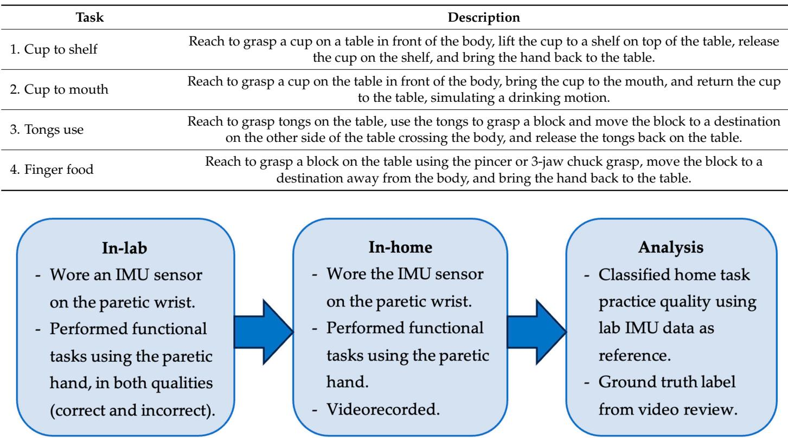
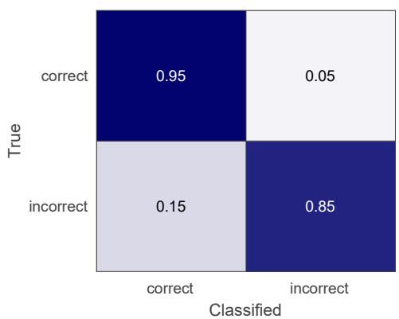
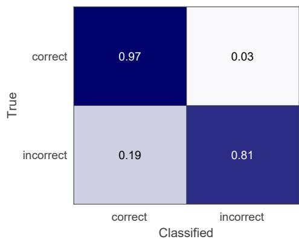
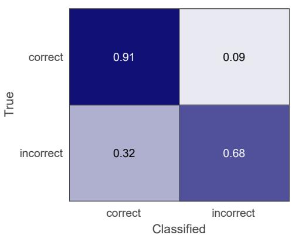
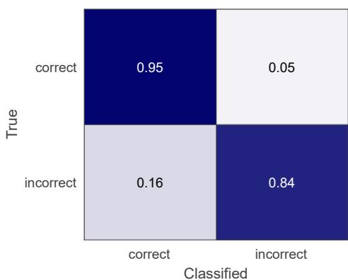
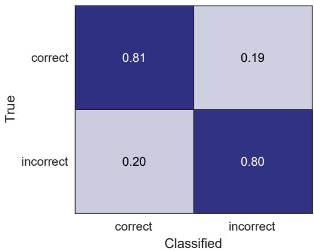
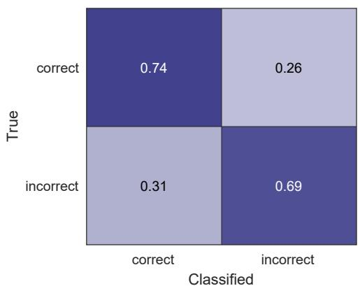

# 可穿戴传感器用于监测脑卒中幸存者居家上肢任务练习质量

Na Jin Seo 1,2,3,\*，Kristen Coupland 2,3，Christian Finetto 2,3，Gabrielle Scronce 2,3

1 南卡罗来纳医科大学健康职业学院康复科学系，美国南卡罗来纳州查尔斯顿 29425

2 南卡罗来纳医科大学健康职业学院健康科学与研究系，美国南卡罗来纳州查尔斯顿 29425；coupland@musc.edu（K.C.）；finetto@musc.edu（C.F.）；scronce@musc.edu（G.S.）

3 Ralph H. Johnson 退伍军人医疗保健系统（VA Health Care System），美国南卡罗来纳州查尔斯顿 29401

\* 通讯作者：seon@musc.edu；电话：+1-843-792-0084

摘要：许多脑卒中（stroke）幸存者存在持续的上肢功能障碍，限制了其在日常生活活动中的表现。上肢功能的恢复需要大量重复的、针对特定任务（task-specific）的练习。脑卒中幸存者通常被要求在家中进行任务练习，以补充康复治疗。任务练习的质量较差（例如采用代偿性运动模式）会导致适应不良的神经可塑性（maladaptive neuroplasticity）和欠佳的运动功能恢复。目前尚缺乏能够在远程环境中监测脑卒中幸存者居家任务练习运动质量的工具。本研究旨在评估使用可穿戴惯性测量单元（IMU, Inertial Measurement Unit）对居家运动质量进行分类的可行性。十九名脑卒中幸存者在偏瘫侧手腕佩戴 IMU 传感器，先在实验室中完成四项功能性上肢任务，随后在家中进行这些任务并自行录像。实验室数据作为参考数据，采用动态时间规整（Dynamic Time Warping, DTW）对居家运动质量进行分类。错误和正确的运动质量由治疗师标注。在所有任务合并的情况下，居家任务练习的运动质量分类准确率达到 92%，F1 分数为 0.95。本研究进一步调查了导致误分类的运动类型。实验结果支持构建居家运动质量监测系统以辅助脑卒中后上肢康复的可行性。

引用格式：Seo, N.J.; Coupland, K.; Finetto, C.; Scronce, G. Wearable Sensor to Monitor Quality of Upper Limb Task Practice for Stroke Survivors at Home. Sensors 2024, 24, 554. https://doi.org/10.3390/s24020554

学术编辑：Giorgio Biagetti 和 Paolo Crippa

收稿日期：2023 年 12 月 22 日　修订日期：2024 年 1 月 10 日　接受日期：2024 年 1 月 12 日　发表日期：2024 年 1 月 16 日

版权：© 2024 作者。授权方 MDPI，瑞士巴塞尔。本文采用知识共享署名（Creative Commons Attribution, CC BY）许可证（https://creativecommons.org/licenses/by/4.0/）开放获取。

关键词：卒中；上肢；康复；加速度计；惯性测量单元（IMU）；可穿戴传感器；机器学习；远程监测；家庭监测

## 1. 引言

卒中（stroke）是全球范围内导致长期残疾的主要原因之一[1]。仅在美国，就有近700万名卒中幸存者[2]。约有3%的成年人口曾经历过卒中，预计到2030年美国与此相关的费用将增至2400亿美元[3]。约77%的卒中幸存者存在上肢运动功能障碍[4–6]。上肢运动功能障碍会削弱个体执行日常生活活动（如自我护理、个人卫生、就业和休闲娱乐）的能力，从而降低其独立性和生活质量[7,8]。

先前的研究表明，卒中幸存者可以通过大量重复的任务练习恢复其上肢功能[9–12]。然而，仅在患者的治疗就诊时间内无法完成如此大量的任务练习[13–15]。为了弥补治疗就诊时间的有限性，康复治疗师通常会开具由自我导向的上肢任务练习组成的家庭训练计划，让患者在家中完成[16]。与未坚持或坚持程度较低的患者相比，坚持家庭训练计划程度更高的患者已被证明可获得更大的运动功能恢复[17,18]。因此，对家庭训练计划的依从性水平在卒中后运动功能恢复中发挥着重要作用[16–21]。此外，如果患者在家中不练习新学到的功能性动作，其在治疗就诊中获得的运动能力可能无法转化为日常生活活动能力，患者也可能无法实现功能性改善[14,18]。

为了使家庭训练有效，不仅任务练习的数量重要，其质量同样重要，因为在任务练习中使用代偿性动作无法解决卒中后的运动功能障碍，并可能导致不良适应性的可塑性，从而阻碍运动功能的恢复[22–24]。因此，如表1所示，近年来许多研究致力于开发监测卒中后康复运动质量的系统。这些先前研究的优势在于，它们通过佩戴在手腕上的惯性测量单元（IMU）传感器采集上肢运动数据，便于患者在家庭环境中使用。

这些先前研究的主要局限性在于，尽管这些系统是为家庭使用开发的，但对其准确性的测试仅在实验室环境中进行。为了支持在患者家中使用该监测系统，有必要在家庭中进行验证。此外，大多数研究对粗大运动类别进行分类，而不考虑运动质量（例如，包括喝水在内的功能性动作 vs. 写字 vs. 步行期间的非功能性手臂运动）。一项研究在手臂抬起任务中区分了代偿性运动模式与正确动作 [25]。然而，该任务在日常活动的相关性方面有一定局限性，因为日常活动通常涉及使用手进行物体操作。另一项研究区分了多种代表性功能任务练习的运动质量 [26]，但仅测试了健康成年人。因此，使用腕戴式 IMU（Inertial Measurement Unit，惯性测量单元）传感器检测脑卒中幸存者在执行功能任务时是否存在代偿性运动模式所导致的细微差异尚未得到研究。为此，本研究的目标是探讨使用腕戴式 IMU 传感器在家庭环境中监测脑卒中幸存者在功能任务练习中运动质量的可行性。

Table 1. Summary of previous research classifying upper limb movement types using data from wristworn IMU sensors for rehabilitation purposes (RF = random forest, CNN = convolutional neural net work, DTW = dynamic time warping, LSTM = Long Short-Term Memory, LDA = linear discriminant analysis, SVM = support vector machine, KNN = K-Nearest Neighbors, CT = classification trees).

表 1. 既往使用腕戴式 IMU 传感器数据对上肢运动类型进行分类以用于康复目的的研究综述（RF = 随机森林，CNN = 卷积神经网络，DTW = 动态时间规整，LSTM = 长短期记忆网络，LDA = 线性判别分析，SVM = 支持向量机，KNN = K 近邻，CT = 分类树）。

<table><tr><td>Reference</td><td>Participant</td><td>Method</td><td>Setting</td><td>Finding</td></tr><tr><td>Bochniewicz 2017 [27]</td><td>10 healthy persons, 10 stroke survivors</td><td>RF</td><td>Lab</td><td>Classified functional vs. nonfunctional movement</td></tr><tr><td>David 2021 [28]</td><td>5 healthy persons, 5 hemiparetic patients</td><td>Thresholding</td><td>Lab</td><td>Classified functional vs. nonfunctional movement</td></tr><tr><td>Gomez-Arrunategui 2022 [29]</td><td>12 stroke survivors</td><td>RF, CNN</td><td>Lab</td><td>Detected reach time and number of reaching gestures during prescribed tasks.</td></tr><tr><td>Lee 2018 [25]</td><td>9 healthy persons, 11 stroke survivors</td><td>RF</td><td>Lab</td><td>Classified quality of arm raise</td></tr><tr><td>Bhagat 2020 [30]</td><td>2 persons with spinal cord injury</td><td>DTW, LSTM</td><td>Lab</td><td>Classified cylindrical vs. pincer grasp (to pick up a water bottle vs. pen)</td></tr><tr><td>Li 2023 [26]</td><td>20 healthy persons</td><td>LSTM</td><td>Lab</td><td>Classified functional task practice quality</td></tr><tr><td>Lui 2019 [31]</td><td>11 healthy persons</td><td>LDA, SVM, KNN, CT</td><td>Lab</td><td>Classified pre-selected upper limb movements</td></tr></table>

<table><tr><td>参考文献</td><td>参与者</td><td>方法</td><td>环境</td><td>发现</td></tr><tr><td>Bochniewicz 2017 [27]</td><td>10 名健康人，10 名脑卒中幸存者</td><td>RF</td><td>实验室</td><td>区分了功能性运动与非功能性运动</td></tr><tr><td>David 2021 [28]</td><td>5 名健康人，5 名偏瘫患者</td><td>阈值法</td><td>实验室</td><td>区分了功能性运动与非功能性运动</td></tr><tr><td>Gomez-Arrunategui 2022 [29]</td><td>12 名脑卒中幸存者</td><td>RF, CNN</td><td>实验室</td><td>在规定任务中检测了触及时间及触及动作的次数</td></tr><tr><td>Lee 2018 [25]</td><td>9 名健康人，11 名脑卒中幸存者</td><td>RF</td><td>实验室</td><td>区分了手臂抬起的质量</td></tr><tr><td>Bhagat 2020 [30]</td><td>2 名脊髓损伤患者</td><td>DTW, LSTM</td><td>实验室</td><td>区分了柱状抓握与捏取抓握（拿起水瓶 vs. 笔）</td></tr><tr><td>Li 2023 [26]</td><td>20 名健康人</td><td>LSTM</td><td>实验室</td><td>区分了功能任务练习的质量</td></tr><tr><td>Lui 2019 [31]</td><td>11 名健康人</td><td>LDA, SVM, KNN, CT</td><td>实验室</td><td>区分了预先选择的上肢运动</td></tr></table>

## 2. Materials and Methods

## 2.1. Participants

## 2. 材料与方法

## 2.1. 参与者

十九名伴有上肢偏瘫的成年卒中幸存者参与了本研究。他们的人口学信息汇总于表 2。所有受试者均具备一定的手部运动能力，能够完成涉及物体操控的功能性任务练习。受试者未合并以下情况：限制关节活动的骨科疾病、既往神经系统疾病、腕部皮肤完整性受损，以及会影响理解指令和/或签署知情同意书的语言障碍或认知障碍。所有受试者在研究流程开始前均签署了书面知情同意书。

表 2. 受试者特征。

<table><tr><td>特征</td><td>描述性统计</td></tr><tr><td>年龄（均数 ± 标准差，岁）</td><td>61 ± 12</td></tr><tr><td>性别（男/女）</td><td>12/7</td></tr><tr><td>卒中后病程（均数 ± 标准差，年）</td><td>4 ± 3</td></tr><tr><td>卒中类型（缺血性/出血性）</td><td>14/5</td></tr><tr><td>卒中后运动恢复 Fugl-Meyer 评定量表上肢部分（Fugl-Meyer Assessment of Motor Recovery after Stroke—Upper Extremity，均数 ± 标准差，满分 66 分）</td><td>45 ± 9</td></tr></tr>

## 2.2. 实验流程

研究流程依据本系统的预期应用场景进行设计。治疗师在临床康复训练中为患者确定合适的治疗目标，并开具家庭练习处方。随后，使用腕戴式惯性测量单元（Inertial Measurement Unit, IMU）监测家庭练习的质量，即评估患者是否遵循了在临床康复训练中所学的运动模式。练习质量的评估方式为：使用动态时间规整（Dynamic Time Warping, DTW）算法，将家庭练习中的运动与临床康复时的参考运动进行比较。

首先，参与者来到实验室，在偏瘫手腕上佩戴惯性测量单元（IMU）传感器（ActiGraph GT9X link，ActiGraph Corporation，Pensacola，FL，USA），使用偏瘫手完成4项功能性任务。一位作业治疗师观察他们的动作质量，并识别出每位参与者的代偿性运动模式。随后，治疗师提供反馈以纠正参与者的运动模式，类似于典型的临床治疗会话。本研究使用的4项功能性任务在表3中描述。这些任务的更多细节以及任务说明和图片可以在Li等人2023年的研究[26]中找到。这些任务是从任务实践手册[32]中所规定的家庭练习项目中挑选出来作为代表性的功能性任务，难度各异。具体而言，任务1和任务2需要圆柱抓握，而任务1还需要肩关节屈曲。任务3和任务4相对比任务1和任务2更难，因为它们对手部的控制和灵巧性要求更高。如果参与者在某项任务中没有表现出不正确的运动模式，则会被指示模拟他们应当避免的代偿性运动模式。每种动作质量执行3到6次试验。这个试验次数在标准护理康复治疗会话中是可行的[13]。每次试验的开始和结束都由治疗师通过按下电脑上的按钮进行时间标记。试验由治疗师根据动作质量标注为正确或不正确（代偿性或不完整）。

在实验环节结束时，参与者被指示在另一天在家练习这4项功能性任务。他们被要求使用在实验环节学到的正确运动模式，每项任务执行75次试验。他们获得了一个IMU传感器在家佩戴于偏瘫手腕处。由于卒中幸存者在家使用的便利性，选择了IMU传感器，因为它只需要像手表一样将IMU传感器佩戴在手腕上，从而增加了可行性。为了获取真实标签（ground truth），参与者还在家录像自己进行功能性任务练习的过程。这些视频后来由作业治疗师审查，以划分每次试验的开始和结束，并标注每次试验的动作质量。这位作业治疗师拥有15年治疗卒中幸存者的经验。治疗师还记录了每种不正确运动的类型（例如，躯干屈曲和前臂异常旋后），以便于结果的解释。该流程总结于图1。

表 3. 四项功能性任务的描述。1. 将杯子放到桌面顶部的架子上

Figure 1. Flow chart of the procedure.

**分析** IMU 传感器以 100 Hz 的采样率同时在实验室和家庭环境中三维记录加速度、陀螺仪和磁力计数据。在实验室获取的 IMU 传感器数据被用作正确与错误运动模式的参考数据。在家庭获取的 IMU 传感器数据通过动态时间规整（Dynamic Time Warping, DTW）[33] 与实验室参考数据进行比较，以分类每个家庭试验的运动质量。

## 2.3. 分析

我们采用受试者特异性分类方法，以受试者在实验室采集的数据作为参考，与其在家庭环境中采集的数据进行比较。我们采用这种受试者特异性方法，是因为个体脑卒中幸存者会根据其损伤程度、损伤特征以及所使用的代偿策略，以不同方式执行上肢任务。因此，我们选用 DTW 算法，因为 DTW 能够实现患者特异性分类。DTW 还能适应不同的运动试验时长 [25,33]。以往使用 DTW 应用于 IMU 数据的研究能够区分圆柱抓握与捏取抓握 [30]、患侧手臂上举时的代偿动作 [25]，以及不同的练习 [33]。

对于实验室数据，探索了多种数据处理和动态时间规整（Dynamic Time Warping, DTW）方法，并选择能在统计上区分给定参与者不同运动类型试验的最佳方法，用于分析其家庭数据。为每位参与者选择最佳方法的理由在于：不同个体具有不同的损伤特征和代偿策略，这些特征和策略可能通过不同的方法得到更好的检测。只有经治疗师明确判定为正确或错误动作的试验才被用作实验室参考数据。探索不同方法包括使用不同组合的惯性测量单元（Inertial Measurement Unit, IMU）数据，即去除重力后的加速度、重力矢量、陀螺仪和磁力计这三个维度的数据。重力矢量通过六轴卡尔曼滤波器（MATLAB 中的 `imufilter` 函数，MathWorks 公司，美国马萨诸塞州纳蒂克）从加速度计和陀螺仪数据估计传感器方向来计算。从加速度数据中减去重力矢量，以获得去除重力后的加速度。探索不同方法还包括数据归一化（按每个轴的标准差进行归一化）或不进行归一化，以及 DTW 的各种最大规整尺寸（MATLAB `dtw` 函数的 `maxsamp` 变量范围从采样频率的一半到 4 倍采样频率）。为应对 DTW 产生的不同数据长度，将规整后的数据投影回原始测试数据，并以一致的采样率按原始测试数据长度计算 DTW 距离。

对于每种方法，计算同一运动类型所有试验之间的 DTW 距离，并在不同运动质量（正确与错误）的两种不同运动类型试验之间计算 DTW 距离。针对所有运动类型，获得了 DTW 距离两组聚类（同一运动类型内 vs. 不同运动质量的两种不同运动类型之间）比较的 p 值。p 值通过单侧 t 检验获得，备择假设为同一运动类型内的 DTW 距离小于两种不同运动类型之间的 DTW 距离。最大 p 值用于表示给定参与者在给定 DTW 方法下运动质量的统计可分辨性。选择 p 值最小或 p 值 < 0.05 的方法。

If multiple methods were able to statistically distinguish trials of different descriptions, then the accuracy of classifying each lab trial in reference to all other lab data was examined using a leave-one-trial-out approach for each method. The method that resulted in the highest accuracy was chosen. If multiple methods performed well for both statistical discernability and lab accuracy, then the method including acceleration without gravity, gravity vector, and gyroscope data with normalization with a longer warping size was chosen. The magnetometer was not considered to provide valuable information about the movement patterns as it relates to the orientation relative to the earth which can change between the lab and home.

Once the best data processing and DTW method was chosen from the lab data for a given participant, the method was applied to analyze that participant's home data. For each home trial, DTW distances against each of the lab trials were computed. The movement quality label for the lab trial with the minimum DTW distance was used to classify the movement quality of the home trial.

The confusion matrices, along with accuracy and the F1 score, were examined for the classification results. Classification results were examined for all tasks combined as well as for each task. Classification results for individual movement types were also examined. To examine the necessity of collecting gyroscope data in addition to acceleration data at the expense of shorter battery life, the classification accuracy utilizing all available data, including gyroscope, was compared against that using only acceleration data.

## 3. Results

The results of the movement quality classification for home task practices based on in-lab reference data are shown in confusion matrices in Figure 2. Specifically, Figure 2A shows the results for all tasks and participants' data combined. The overall accuracy was 92%. The overall F1 score was 0.95. The results for each task are shown in Figure 2B–E. The accuracy was 94%, 95%, 86%, and 93% for task 1 through 4. The F1 score was 0.96, 0.97, 0.91, and 0.96 for task 1 through 4. Across participants, accuracy varied. For task 1, the accuracy ranged from 80% to 100% for individual participants, with a median of 95%. For task 2, the accuracy ranged from 86% to 100% for individual participants, with a median of 97%. For task 3, the range was 68% to 100%, with a median of 86%. For task 4, it ranged from 72% to 100%, with a median of 97%.

  
(A) All tasks combined

  
(B) Task 1

  
(C) Task 2

  
(D) Task 3

  
(E) 任务4  
图2. 使用包含陀螺仪在内的全部可用数据，所有任务（A）以及四个独立任务（B–E）在家庭场景下正确与错误动作的分类结果。单元格颜色越深表示准确率越高。

一名参与者在执行任务2时，单次家庭试验与实验室参考数据之间DTW距离分布的示例如图3所示。具体而言，根据治疗师对视频的回顾，该单次家庭试验采用的是肩外展动作。该家庭试验的DTW距离是针对实验室数据中3种动作类型（每种各6次试验）计算的，分别是肩外展、正确动作以及无法抓握杯子。DTW距离分布显示，与实验室中正确动作模式的试验以及参与者无法抓握杯子的试验相比，该单次家庭试验与实验室中肩外展试验之间的DTW距离更小。

  
Figure 3. A box plot showing an example DTW distance distribution for a single home task practice trial against lab reference data with 3 movement types (shoulder abduction, correct movement, and unable to grasp the cup) for task 2. Each dot represents the DTW distance between the single home trial and one lab trial. The home trial was performed with shoulder abduction. The DTW distance was smaller between the home trial and the lab trials performed with shoulder abduction. The DTW distance was larger against the lab trials performed correctly and against the lab trials in which the participant was unable to grasp the cup.

仅使用加速度数据（未使用陀螺仪数据）对家庭任务练习进行动作质量分类的结果如图 4 中的混淆矩阵所示。所有任务合并后的准确率为 81%，F1 分数（精确率与召回率的调和平均值）为 0.88。各任务的准确率分别为：任务 1 至任务 4 依次为 89%、95%、73% 和 88%。

为进一步了解这一趋势，对各类动作的分类结果进行了进一步分析（表 4）。在错误动作中，家庭练习中最常观察到的动作类型是躯干和/或肩部参与的代偿动作（例如，伸手时躯干屈曲，抬举时耸肩或肩外展）。此 0.81 0.19类动作类型约占家庭练习中观察到的错误动作的一半。该动作类型的分类正确率（作为错误动作识别）灵敏度为 86%。

Table 4. Incomplete movement types observed from home, their classification sensitivity, and 0.20 0.80associated observations.

<table><tr><td>Movement Type</td><td>Sensitivity</td><td>Observations</td></tr><tr><td>Compensatory trunk and/or shoulder involvement</td><td>86%</td><td>Trunk flexion for reaching and shoulder hike or shoulder abduction for lifting were identified.</td></tr><tr><td>Unable to complete</td><td>68%</td><td>Classification errors were from earlier object drop and repeated grip attempts in tasks 3–4 and object drop after release in task 1.</td></tr><tr><td>Use of the nonparetic hand to assist</td><td>62%</td><td>Classification errors were from the participants who exhibited this movement type at home but not in the lab. This movement type occurred most for task 3, the most difficult task.</td></tr><tr><td>Compensatory grip</td><td>83%</td><td>Use of key grip or whole hand grip instead of precision grip for task 4 and noncylindrical grip for task 1 were identified. Classification errors were from dragging of the object for task 3 misclassified as correct.</td></tr></table>

  
(A) All tasks combined

  
(B) Task 1

  
(C) Task 2

  
(D) Task 3

  
(E) Task 4  
Figure 4. Classification results of the correct vs. incorrect movements at home for all tasks (A) and ach of the four tasks (B–E) using only acceleration data. The darker cell color indicates higher each of the four tasks (B–E) using only acceleration data. The darker cell color indicates higher percent accuracy.

进一步检查了各动作类型的分类结果，以理解其趋势（表 4）。在错误动作中，在家中观察到的最常见动作类型是使用躯干和肩部的代偿性动作（例如，伸手时的躯干屈曲、肩部上提或肩部外展）。第二常见的错误动作类型是未能完成任务（例如，无法抓握、在到达目的地前掉落），约占家中观察到的错误动作的 23%。该动作类型的分类灵敏度为 68%。分类错误主要来自任务 3–4，即在参与者将偏瘫手（paretic hand）移向目的地时方块掉落。反复尝试抓握未成功也导致了任务 3–4 的错误分类。在较小程度上，分类错误来自任务 1，即在参与者放置杯子或将偏瘫手返回桌面时杯子从架上掉落。

另一种观察到的错误动作类型是使用非偏瘫手（nonparetic hand）协助完成任务。使用非偏瘫手的动作类型约占家中观察到的错误动作的 13%。大多数发生在任务 3 中，可能是因为任务 3 是 4 项任务中最困难的。该动作类型的分类灵敏度为 62%。有趣的是，在实验室中仅观察到 3 名参与者使用非偏瘫手。然而，在家中，另有 5 名参与者使用了非偏瘫手。由于这 5 名参与者在实验室中没有表现出这种动作类型（即使用非偏瘫手），因此参考数据中缺少该动作类型，可以理解为何他们在家里使用该动作类型的数据无法被高精度分类。

在家中观察到的最后一种错误动作类型是代偿性握持（compensatory grip）（例如，任务 4 使用钥匙握或全手握代替精确握，任务 1 使用非圆柱形握）。该动作类型约占家中观察到的错误动作的 13%。该动作类型被正确分类（作为错误动作），灵敏度为 83%。分类错误主要来自参与者拖动夹子或方块的任务 3。

## 4. 讨论

本研究考察了是否可以使用通过腕戴式惯性测量单元（Inertial Measurement Unit, IMU）传感器采集的数据进行动态时间规整（Dynamic Time Warping, DTW）建模，以辨别脑卒中幸存者在家庭中进行功能性任务练习时的上肢运动质量。具体而言，本研究采用了个体特异性建模（person-specific modeling），以解释脑卒中幸存者之间异质的运动模式，并聚焦于每位脑卒中幸存者待检测的代偿性运动模式。在实验室获取的每位参与者的数据被用作对其家庭数据进行分类的参考。家庭数据的真值标签通过视频回顾获得。总体而言，脑卒中幸存者家庭任务练习的运动质量分类准确率为 92%。家庭中正确运动的分类灵敏度为 95%，而家庭中错误运动的分类灵敏度为 78%。据我们所知，本研究是首个评估脑卒中幸存者家庭运动质量监测性能的研究。

本研究的分类结果与先前在实验室研究中观察到的结果相当。具体而言，一项先前的研究使用随机森林（random forest）检测神经典型成年人（neurotypical adults）和脑卒中幸存者在简单抬臂任务中的代偿运动时，F1 分数（F1 score）为 0.84 [25]。另一项研究使用长短期记忆网络（long short-term memory, LSTM）检测神经典型成年人在功能性任务中的代偿性运动和不完整运动时，F1 分数为 0.89 [26]。本研究在脑卒中幸存者中获得了 0.95 的 F1 分数，这可能归因于与其他研究相比所采用的个体特异性建模方法。

考虑到本研究所使用的数据仅来自佩戴于患侧手腕（paretic wrist）上的一个 IMU 传感器，且仅以每位参与者在实验室中有限次数的运动质量试验作为参考数据采用 DTW 方法，这些分类结果被认为适用于其预期的临床目的。来自躯干和肩部的代偿以及代偿性抓握策略（如在任务 4 中使用钥匙抓握（key grip）或全手抓握（whole hand grip）替代精确抓握（precision grip））的分类效果相对较好。躯干和肩部的姿态会影响前臂的方向，因此可能影响手腕的运动，从而使躯干/肩部代偿的参与得以被检测到。在任务 4 中抓握姿态也可被辨别，这可能是因为精确抓握涉及放慢手部速度并稳定手腕伸展以充分定位指尖围绕方块的位置，而钥匙抓握或全手抓握通常涉及更大的加速度且不对手部位置进行精细调整。综上所述，本研究的结果表明，使用腕戴式 IMU 传感器和 DTW 方法，可以检测到脑卒中幸存者在执行功能性任务时存在与不存在代偿性运动模式之间的细微差异。

在家中对错误动作分类的灵敏度较低，似乎是由于家中出现了实验室中未使用的新型动作类型，包括使用非瘫痪手辅助、未能检测到的物体掉落、物体拖拽，以及难以与任务完成相区分的反复抓握尝试——具体涉及任务 3–4 中抓握夹子、抓握方块以及先释放方块再释放夹子的过程。这些不足可通过以下方式加以解决。对于使用非瘫痪手辅助完成任务的情况，可通过在非瘫痪手腕上再佩戴一个 IMU 传感器来加以检测。瘫痪手释放物体后物体的掉落，可通过在物体上加装另一个传感器来检测其运动。练习任务的设计可采用不同的起始与结束位置高度（例如抓取时位置较高、释放时位置较低），以防止出现拖拽的可能性。使用不同的起始与结束位置还可在抓取与释放动作之间引入一个垂直方向的运动，从而有助于更好地区分反复的抓握尝试与任务的真正完成。

此外，对于在家中观察到、而实验室中未曾出现的新型动作类型，可通过借鉴更大规模数据集来推断动作质量加以解决。例如，Li 等人（2023）[26] 收集了一个大规模数据集，涵盖多种由多名受试者多次重复执行的错误动作类型，并据此开发了一个用于动作质量分类的深度学习模型。尽管该研究使用的是无卒中人群模拟偏瘫上肢运动的数据，但类似的方法可考虑应用于大量具有不同损伤程度和特征的脑卒中幸存者。基于该大规模数据集开发的模型，可通过迁移学习（transfer learning）[34]，利用来自个体患者的小量数据进行微调。

使用包括陀螺仪数据在内的所有可用数据，与仅使用加速度数据相比，可获得更好的分类结果。这一发现与已有文献[35]一致。仅采集加速度数据时，传感器充电一次后可每天 24 小时持续采集数周；而同时采集包括陀螺仪在内的所有数据时，电池在充电后仅能维持一到两天便会耗尽。因此，若要利用全部 IMU 数据以提高分类精度，就意味着 IMU 数据的采集需要仅限于居家任务练习时段，而不能扩展到全天的日常生活活动中，以避免让患者在家中频繁为传感器充电。随着电池续航能力的不断提升，这一权衡在未来有望得到解决。

本研究的重要贡献在于，它支持了在家庭环境中监测脑卒中幸存者任务练习动作质量的技术可行性。正如先前的研究 [18,36] 所证实的，仅使用 1 个腕戴式 IMU 传感器简便易行，可满足长期居家使用的可行性要求。此外，本研究仅在实验室采集了少量任务练习的试验数据作为参考数据，用于对更多的居家数据进行分类。所需的实验室试验次数完全处于标准康复治疗课程中可行的试验次数范围 [13] 之内，因此最大程度地提升了向临床场景转化的潜力。本研究中腕戴式 IMU 传感器的分类准确性与基于摄像头的传感器及运动检测算法相当或更优 [37]。DTW 算法足够简单，可在家用智能手机应用中实现，无需服务器连接。这种简便性进一步提升了可用性，并增强了其向潜在临床实施转化的可行性 [38]。

这项工作的预期影响是开发一套用于脑卒中幸存者居家任务练习的客观质量监测系统。目前，脑卒中幸存者对居家练习的依从性通常通过自我报告来评估 [19,39]，而众所周知，这种方式并不准确 [19,20]。客观质量监测至关重要，因为有效的居家练习要求以正确的动作模式完成任务、避免使用代偿策略，以促进神经可塑性并恢复脑卒中后的运动功能 [22–24]。尽管居家练习在数量上的依从程度与运动恢复之间的关联已得到研究 [17,18]，但居家练习质量与运动恢复之间的关联尚未被研究，这正是由于目前缺乏此类客观监测能力。该客观居家任务练习质量监测系统可被纳入康复干预试验中的转化方案包 [40–42]，以增加脑卒中幸存者在真实世界中对偏瘫手的使用。因此，本研究为未来开展创新性研究、探讨居家任务练习质量监测系统在改善脑卒中幸存者运动恢复方面的临床效用铺平了道路。

若有效，该客观质量监测系统可在临床实践中实施，以改善运动恢复。我们设想通过以下方式将该技术整合到临床实践与康复方案中。该客观监测系统可在家庭中对任务练习的质量进行评估，向患者提供反馈以改善家庭任务练习中的动作质量，并向临床医生提供一份摘要报告，作为远程监测时审阅之用 [43]。在面对面的治疗预约中，该摘要报告可为治疗师与脑卒中幸存者提供机会，通过演示、可视化及借助器械来增加正确动作模式的使用 [44]，并就高质量家庭任务练习对恢复的重要性展开讨论。高比例的高质量家庭练习可作为患者要达成的目标。若出现高比例的低质量动作，可能提示临床医生所布置的任务对患者的能力而言过难，需要调整任务难度以达到最佳挑战水平，确保患者的参与度，从而促进依从性与恢复 [32,45]。腕戴式设备与智能手机应用相结合的监测系统可与其他康复技术（如活动追踪 [46]、提醒活动 [47,48]、作为运动康复辅助手段的感觉刺激 [18,36,49] 以及家庭锻炼追踪 [50]）相整合，以进一步增强效果。最终，这些努力有望为脑卒中后最大程度的运动恢复提供高效的康复服务。

本研究存在一定局限性，未来研究可致力于解决这些局限。在本研究中，若其未在某项任务中表现出不正确的动作模式，则会指示其模拟一种应避免的代偿性动作模式。考虑到患者个体特异性的动态时间规整（Dynamic Time Warping, DTW）算法，未来研究可在考察准确性的前提下，探索使用针对个体患者运动技能水平量身定制的患者特异性任务，以满足实际实施的需要。此外，本研究仅考察了四项功能性任务。这一有限的任务范围可能无法全面代表脑卒中综合康复所需的多样化活动。未来研究可考察更广泛的任务谱系，以增强其适用性与相关性。同样地，未来研究可纳入更广泛的患者群体，以考察该技术的可行性与可用性在不同严重程度与损伤特征的脑卒中幸存者中的普适性。此类研究将增强其与更广泛的脑卒中幸存者群体的相关性。此外，本研究仅采用了一个腕戴式惯性测量单元（Inertial Measurement Unit, IMU）传感器。未来可探索使用附加传感器（例如佩戴于非偏瘫侧手腕或所操作物体上的传感器），以提高准确度，如上所述。

在家任务重复的次数是通过视频回顾进行分段的。未来研究可以使用专为卒中患者设计的智能手机应用程序，让其在家中指示每次任务重复的开始和结束，以减轻卒中患者手动计数的负担以及研究人员进行视频回顾的工作量。这种包含定制智能手机应用程序和传感器的系统应从卒中患者 [36] 和临床医生 [51] 两个角度评估其技术接受度和可用性，因为深入了解实际应用中的挑战、用户友好性和接受度对于成功的临床实施至关重要 [38]。虽然本研究侧重于该系统的技术可行性和即时准确性，但并未提供长期临床结局的数据。未来研究可探讨家庭任务练习质量监测系统在改善卒中患者运动功能和生活质量方面的临床效用。

## 5. 结论（Conclusions）

综上所述，本研究证明了使用腕戴式 IMU 传感器和 DTW 算法客观监测卒中患者家庭任务练习运动质量的可行性。我们仅使用了在实验室中从每位参与者获得的少量运动数据作为参考数据，来对个体在家中自行进行的任务练习进行分类。据我们所知，这是首次针对卒中患者在家庭环境中开展此类运动质量监测的研究。本研究的结果鼓励未来研究探讨家庭任务练习质量与卒中患者运动恢复之间的直接关联，以及通过个性化反馈来提升任务练习质量以促进卒中患者运动恢复的效果。客观运动质量监测系统的临床实施有望提供一种远程监测手段，并提高康复治疗服务的效率，从而改善患者结局。

作者贡献（Author Contributions）：概念化，N.J.S. 和 G.S.；方法学，N.J.S.、K.C.、G.S. 和 C.F.；软件，C.F.；验证，N.J.S. 和 C.F.；形式分析，N.J.S.；调查，N.J.S.、K.C.、G.S. 和 C.F.；资源，N.J.S.；数据管理，K.C. 和 C.F.；撰写——原稿准备，N.J.S.；撰写——审阅与编辑，N.J.S.、K.C.、G.S. 和 C.F.；可视化，N.J.S.；监督，N.J.S.；项目管理，N.J.S.；经费获取，N.J.S. 和 G.S.。所有作者均已阅读并同意发表的手稿版本。

经费资助（Funding）：本研究由 NIH/NICHD P2C HD101913 试点资助和 NIH/NIGMS P20 GM109040 资助。

伦理审查委员会声明（Institutional Review Board Statement）：本研究根据《赫尔辛基宣言》开展，并经 Medical University of South Carolina 机构审查委员会批准（Pro00107753，批准日期：2021 年 3 月 31 日）。

知情同意声明：在所有参与者参加研究之前，已获得其书面知情同意。

数据可用性声明：数据可根据要求共享。

致谢：我们感谢 Nader Naghavi、Adam Baker、Feng Luo 和 Mingqi Li 在本研究初期的帮助。

利益冲突：作者声明无利益冲突。资助者在研究设计、数据收集、分析或解读、论文撰写以及发表结果的决定中均未发挥作用。

## 参考文献

1. Katan, M.; Luft, A. 中风的全球负担. *Semin. Neurol.* 2018, 38, 208–211. [CrossRef] [PubMed]

2. Tsao, C.W.; Aday, A.W.; Almarzooq, Z.J; Anderson, C.A.; Arora, P; Avery, C.L; Baker-Smith, C.M.; Beaton, A.Z.; Boehme, A.K.; Buxton, A.E. 心脏病与中风统计-2023 更新：美国心脏协会报告. *Circulation* 2023, 147, e93–e621. [CrossRef] [PubMed]

3. Ovbiagele, B.; Goldstein, L.B.; Higashida, R.T.; Howard, V.J.; Johnston, S.C.; Khavjou, O.A.; Lackland, D.T.; Lichtman, J.H.; Mohl, S.; Sacco, R.L.; et al. 预测美国中风的未来：美国心脏协会和美国卒中协会的政策声明. *Stroke* 2013, 44, 2361–2375. [CrossRef] [PubMed]

4. Hendricks, H.T.; Van Limbeek, L.; Geurts, A.C.; Zwarts, M.I. 中风后的运动功能恢复：文献的系统综述. *Arch. Phys. Med. Rehabil.* 2002, 83, 1629–1637. [CrossRef] [PubMed]

5. Lawrence, E.S.; Coshall, C.; Dundas, R.; Stewart, J.; Rudd, A.G.; Howard, R.; Wolfe, C.D. 多民族人群中急性中风损伤和残疾患病率的估计. *Stroke* 2001, 32, 1279–1284. [CrossRef] [PubMed]

6. Sathian, K.; Buxbaum, L.J.; Cohen, L.G.; Krakauer, J.W.; Lang, C.E.; Corbetta, M.; Fitzpatrick, S.M. 动作障碍的神经学原理与康复：常见临床缺陷. *Neurorehabil. Neural. Repair* 2011, 25 (Suppl. S5), 21S–32S. [CrossRef] [PubMed]

7. Dobkin, B.H. 临床实践：中风后的康复. *N. Engl. J. Med.* 2005, 352, 1677–1684.

8. Stewart, J.C.; Cramer, S.C. 患者报告的测量指标为中风后运动功能提供独特见解. *Stroke* 2013, 44, 1111–1116. [CrossRef]

9. Dobkin, B.H. 中风康复策略. *Lancet Neurol.* 2004, 3, 528–536. [CrossRef]

10. Schaefer, S.Y.; Patterson, C.B.; Lang, C.E. 中风后不同运动任务之间的训练迁移：对上肢神经康复任务特异性方法的意义. *Neurorehabil. Neural. Repair* 2013, 27, 602–612. [CrossRef]

11. Lohse, K.R.; Lang, C.E.; Boyd, L.A. 更多更好吗？使用元数据探索中风康复中的剂量-反应关系. *Stroke* 2014, 45, 2053–2058. [CrossRef] [PubMed]

12. Winstein, C.; Kim, B.; Kim, S.; Martinez, C.; Schweighofer, N. 剂量很重要：卒中后慢性期运动治疗的IIb期随机对照试验. *Stroke* **2019**, *50*, 1831–1837. [CrossRef] [PubMed]

13. Lang, C.E.; MacDonald, J.R.; Reisman, D.S.; Boyd, L.; Kimberley, T.J.; Schindler-Ivens, S.M.; Hornby, T.G.; Ross, S.A.; Scheets, P.L. 卒中康复期间所提供的运动练习量的观察. *Arch. Phys. Med. Rehabil.* **2009**, *90*, 1692–1698. [CrossRef]

14. Lang, C.E.; Strube, M.J.; Bland, M.D.; Waddell, K.J.; Cherry-Allen, K.M.; Nudo, R.J.; Dromerick, A.W.; Birkenmeier, R.L. 卒中后至少6个月患者任务特异性上肢训练的剂量反应：一项II期单盲随机对照试验. *Ann. Neurol.* **2016**, *80*, 342–354. [CrossRef] [PubMed]

15. Schneider, E.J.; Lannin, N.A.; Ada, L.; Schmidt, J. 增加常规康复量可改善卒中后活动能力：一篇系统综述. *J. Physiother.* **2016**, *62*, 182–187. [CrossRef] [PubMed]

16. Miller, K.K.; Porter, R.E.; DeBaun-Sprague, E.; Van Puymbroeck, M.; Schmid, A.A. 卒中后运动：康复出院后患者的依从性与信念. *Top. Stroke Rehabil.* **2017**, *24*, 142–148. [CrossRef]

17. Gunnes, M.; Indredavik, B.; Langhammer, B.; Lydersen, S.; Ihle-Hansen, H.; Dahl, A.E.; Askim, T. LAST研究中所实施的体力活动与运动方案的依从性与卒中后功能恢复之间的关联. *Arch. Phys. Med. Rehabil.* **2019**, *100*, 2251–2259. [CrossRef]

18. Scronce, G.; Ramakrishnan, V.; Vatinno, A.A.; Seo, N.J. 自我导向家庭治疗的依从性联合TheraBracelet对卒中后手部恢复的影响：一项初步研究. *Stroke Res. Treat.* **2023**, *2023*, 3682898. [CrossRef]

19. Levy, T.; Laver, K.; Killington, M.; Lannin, N.; Crotty, M. 卒中患者体力运动建议依从性测量工具的系统综述. *Clin. Rehabil.* **2019**, *33*, 535–545. [CrossRef]

20. Waddell, K.J.; Lang, C.E. 测量临床外上肢活动量的自我报告法与传感器法比较. *Arch. Phys. Med. Rehabil.* **2018**, *99*, 1913–1916. [CrossRef]

21. Mahmood, A.; Solomon, J.M.; English, C.; Bhaskaran, U.; Menon, G.; Manikandan, N. 印度社区居住卒中幸存者家庭运动依从性的测量. *Physiother. Res. Int.* **2020**, *25*, e1827. [CrossRef] [PubMed]

22. Cirstea, M.C.; Levin, M.F. 卒中幸存者练习中手臂运动模式和终点控制的改善取决于反馈类型. *Neurorehabil. Neural. Repair* **2007**, *21*, 398–411. [CrossRef] [PubMed]

23. Jones, T.A. 卒中后运动代偿及其对神经重组的影响. *Nat. Rev. Neurosci.* **2017**, *18*, 267–280. [CrossRef] [PubMed]

24. Jang, S.H. 卒中后与运动功能相关的适应不良可塑性：一篇综述. *NeuroRehabilitation* **2013**, *32*, 311–316. [CrossRef]

25. Lee, S.I.; Adans-Dester, C.P.; Grimaldi, M.; Dowling, A.V.; Horak, P.C.; Black-Schaffer, R.M.; Bonato, P.; Gwin, J.T. 在家庭与社区环境中开展脑卒中康复：基于可穿戴传感器的上肢运动训练方法. IEEE J. Transl. Eng. Health Med. 2018, 6, 2100411. [CrossRef]

26. Li, M.; Scronce, G.; Finetto, C.; Coupland, K.; Zhong, M.; Lambert, M.E.; Baker, A.; Luo, F.; Seo, N.J. 应用深度学习算法监测上肢任务练习. Sensors 2023, 23, 6110. [CrossRef]

27. Bochniewicz, E.M.; Emmer, G.: McLeod, A.: Barth, I.: Dromerick, A.W.; Lum, P. 使用单个腕戴式传感器与机器学习测量脑卒中后功能性手臂运动. J. Stroke Cerebrovasc. Dis. 2017, 26, 2880–2887. [CrossRef]

28. David, A.; ReethaJanetSureka, S.; Gayathri, S.; Annamalai, S.J.; Samuelkamleshkumar, S.; Kuruvilla, A.; Magimairaj, H.P.; Varadhan, S.K.; Balasubramanian, S. 使用惯性测量单元量化偏瘫患者手臂相对使用程度. J. Rehabil. Assist. Technol. Eng. 2021, 8, 20556683211019694. [CrossRef]

29. Gomez-Arrunategui, J.P.; Eng, J.J.; Hodgson, A.J. 脑卒中后手臂运动监测：面向康复与家庭场景的应用. IEEE Trans. Neural Syst. Rehabil. Eng. 2022, 30, 2312–2321. [CrossRef] [PubMed]

30. Bhagat, N.; King, K.; Ramdeo, R.; Stein, A.; Bouton, C. 通过深度学习从手臂轨迹推断抓握方式以实现四肢瘫痪患者功能性手部运动. Bioelectron. Med. 2020, 6, 17. [CrossRef]

31. Lui, J.; Menon, C. 热传感器能否提高单只腕戴惯性设备的手臂运动分类精度？ Biomed. Eng. Online 2019, 18, 53. [CrossRef] [PubMed]

32. Lang, C.E.; Birkenmeier, R.L. 脑卒中或残疾后上肢任务特异性训练：作业治疗与物理治疗手册；AOTA Press：美国马里兰州贝塞斯达，2013年。

33. Yurtman, A.; Barshan, B. 基于可穿戴传感器信号的多模板动态时间规整自动评估物理治疗练习. Comput. Methods Programs Biomed. 2014, 117, 189–207. [CrossRef] [PubMed]

34. Williams, H.E.; Hebert, J.S.; Pilarski, P.M.; Shehata, A.W. 基于循环卷积神经网络分类与迁移学习的位置感知肌电假肢控制病例系列. IEEE Int. Conf. Rehabil. Robot. 2023, 2023, 1–6.

35. Totty, M.S.; Wade, E. 用于无创分类日常生活活动的肌肉激活与惯性运动数据. IEEE Trans. Biomed. Eng. 2018, 65, 1069–1076.

36. Seo, N.J.; Enders, L.R.; Fortune, A.; Cain, S.; Vatinno, A.A.; Schuster, E.; Ramakrishnan, V.; Feng, W. 一期安全性试验：脑卒中幸存者使用腕戴振动器进行长时间每日外周感觉刺激. Transl. Stroke Res. 2020, 11, 204–213. [CrossRef] [PubMed]

37. Seo, N.J.; Crocher, V.; Spaho, E.; Ewert, C.R.; Fathi, M.F.; Hur, P.; Lum, S.A.; Humanitzki, E.M.; Kelly, A.L.; Ramakrishnan, V.; et al. 使用 Kinect(R) 传感器捕捉上肢粗大运动类别. *Am. J. Occup. Ther.* 2019, 73, p1–p7304205090. [CrossRef] [PubMed]

38. Morrow, C.M.; Johnson, E.; Simpson, K.N.; Seo, N.J. 决定美国新型脑卒中后感觉运动康复设备采用的影响因素. *IEEE Trans. Neural Syst. Rehabil. Eng.* 2021, 29, 1213–1222. [CrossRef] [PubMed]

39. Donoso Brown, E.V.; Nolfi, D.; Wallace, S.E.; Eskander, J.; Hoffman, J.M. 脑卒中后康复中支持与测量依从性的家庭训练方案实践：一项范围综述. *Top. Stroke Rehabil.* 2020, 27, 377–400. [CrossRef]

40. Takebayashi, T.; Koyama, T.; Amano, S.; Hanada, K.; Tabusadani, M.; Hosomi, M.; Marumoto, K.; Takahashi, K.; Domen, K. 脑卒中后偏瘫患者接受强化诱导运动疗法（有无转化方案）的 6 个月随访：一项准随机对照试验. *Clin. Rehabil.* 2013, 27, 418–426. [CrossRef]

41. Taub, E.; Uswatte, G.; Mark, V.W.; Morris, D.M.; Barman, J.; Bowman, M.H.; Bryson, C.; Delgado, A.; Bishop-McKay, S. 增强慢性脑卒中患者在真实世界中使用受累较重上肢的方法：强化诱导运动疗法的转化方案. *Stroke* 2013, 44, 1383–1388. [CrossRef]

42. Seo, N.J.; Ramakrishnan, V.; Woodbury, M.L.; Bonilha, L.; Finetto, C.; Schranz, C.; Scronce, G.; Coupland, K.; Blaschke, J.; Baker, A.; et al. 治疗中伴随感觉刺激以增强脑卒中后手功能恢复. *Trials* 2022, 23, 262. [CrossRef] [PubMed]

43. Swanson, V.A.; Chan, V.; Cruz-Coble, B.; Alcantara, C.M.; Scott, D.; Jones, M.; Zondervan, D.K.; Khan, N.; Ichimura, J.; Reinkensmeyer, D.J. 新冠疫情期间推广居家康复锻炼的传感器增强活动管理系统试点研究：治疗师体验、报销与实施建议. *Int. J. Environ. Res. Public Health* 2021, 18, 10186. [CrossRef] [PubMed]

44. Michaelsen, S.M.; Dannenbaum, R.; Levin, M.F. 脑卒中后手臂恢复中采用躯干约束的任务特异性训练：随机对照试验. *Stroke* 2006, 37, 186–192. [CrossRef]

45. Guadagnoli, M.A.; Lee, T.D. 挑战点：用于概念化各种练习条件对运动学习影响的框架. *J. Mot. Behav.* 2004, 36, 212–224. [CrossRef] [PubMed]

46. Held, J.P.O.; Luft, A.R.; Veerbeek, J.M. 通过跟踪反馈设备诱导脑卒中后真实世界鼓励性上肢使用：一项多中心、评估者盲法随机对照试验的研究方案. *Front. Neurol.* 2018, 9, 13. [CrossRef]

47. Signal, N.E.; McLaren, R.; Rashid, U.; Vandal, A.; King, M.; Almesfer, F.; Henderson, J.; Taylor, D. 触觉提示增加住院脑卒中康复期间患侧上肢运动：一项多周期随机交叉研究. JMIR Mhealth Uhealth 2020, 8, e17036. [CrossRef]

48. Wei, W.X.; Fong, K.N.; Chung, R.C.; Cheung, H.K.; Chow, E.S. 使用可穿戴设备进行"提醒运动"以促进亚急性脑卒中后上肢恢复：一项多中心随机对照研究. IEEE Trans. Neural Syst. Rehabil. Eng. 2019, 27, 51–59. [CrossRef] [PubMed]

49. Seo, N.J.; Woodbury, M.L.; Bonilha, L.; Ramakrishnan, V.; Kautz, S.A.; Downey, R.J.; Dellenbach, B.H.; Lauer, A.W.; Roark, C.M.; Landers, L.E.; 等. 任务练习治疗中应用 TheraBracelet 刺激改善脑卒中后上肢功能：一项初步随机对照研究. Phys. Ther. 2019, 99, 319–328. [CrossRef]

50. Jones, M.; Collier, G.; Reinkensmeyer, D.J.; DeRuyter, F.; Dzivak, J.; Zondervan, D.; Morris, J. 大数据分析与传感器增强的活动管理以提高门诊医疗康复的效果与效率. Int. J. Environ. Res. Public Health 2020, 17, 748. [CrossRef] [PubMed]

51. Judy, L.M.; Morrow, C.; Seo, N.J. 开发并评估一种高效的培训方案以促进新型神经康复设备的采用. J. Rehabil. Assist. Technol. Eng. 2023, 10, 20556683231158552. [CrossRef] [PubMed]

免责声明/出版者注：所有出版物中陈述的观点、意见和数据仅代表各作者和贡献者的个人意见，并不代表 MDPI 和/或编辑本人的立场。MDPI 和/或编辑本人对因本文内容中所提及的任何想法、方法、说明或产品而对人身或财产造成的任何损害不承担任何责任。