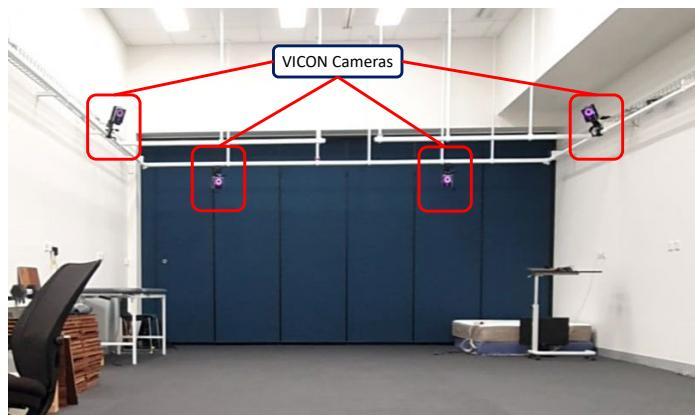
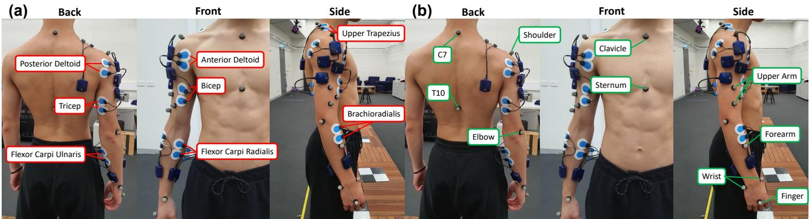
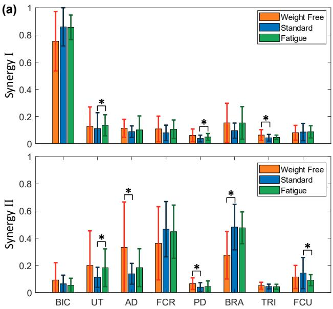
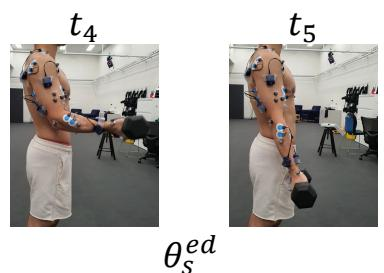

# 二头肌弯举中疲劳诱发代偿动作的分析：为可穿戴传感器部署提供见解

Ming Xuan Chua、Yoshiro Okubo、Shuhua Peng、Thanh Nho Do、Chun Hui Wang 以及 Liao Wu，IEEE 会员（Member, IEEE）

摘要—二头肌弯举（Bicep Curls）康复中的一个常见挑战是肌肉代偿，即当主要肌群因损伤或疲劳而无法发力时，患者会采用替代的运动模式，从而显著降低康复效果。随着康复从临床向家庭环境转变这一日益增长的趋势，这一问题变得更加突出，因为物理治疗师的持续监测和纠正受到限制。开发能够检测肌肉代偿的可穿戴传感器对于应对这一挑战至关重要。本研究旨在通过对二头肌弯举中肌肉代偿的全面研究，为可穿戴传感器的最优部署提供见解。我们在 12 名健康受试者处于标准和疲劳两个阶段时，从上肢 8 块肌肉采集了上肢关节运动学数据与表面肌电图信号（surface electromyography, sEMG）。从 sEMG 信号中提取了两个肌肉协同模块，并与关节运动学数据进行了全面的联合分析。我们的研究结果揭示了前臂肌肉相对于肩部肌肉贡献比例的变化，同时两个协同模块的激活幅度均显著增加。此外，在疲劳阶段肩关节的运动更为显著。这些结果表明，在部署可穿戴传感器以有效检测代偿动作时，应聚焦于肩部肌肉活动与关节运动。

关键词—疲劳诱发代偿动作、肌肉协同、康复、二头肌弯举、可穿戴传感器

## I. 引言

二头肌弯举（Bicep Curl）训练常被用于上肢疾病（如肱二头肌腱炎 [1]）的康复。肱二头肌腱炎是由反复的过头动作或年龄相关的磨损等原因引起的肱二头肌腱的炎症。该病的治疗通常包括高次数、低重量的肱二头肌弯举练习，其在炎症缓解后用于强化肱二头肌（Bicep Brachii）。整个康复过程包括四个步骤：1）疼痛管理；2）增加柔韧性与关节活动度（range of motion, ROM）；3）恢复肌肉力量；4）专项运动功能训练 [2]。肱二头肌腱炎的康复可能是一个漫长的治疗过程，要求患者首先在医院或诊所接受监督下的治疗（通常在急性期），随后在家中持续进行训练较长时间直至完全康复。

肌肉代偿（muscle compensation）是康复治疗中经常出现的一个突出问题，包括涉及肱二头肌弯举（bicep curls）的上肢康复。该术语描述了患者的行为模式：他们在完成特定动作时，由于肌肉疲劳或疼痛，并没有使用目标肌肉，而是无意识地选择其他肌肉来执行所指示的动作。因此，康复治疗的有效性会显著降低，并可能造成进一步的伤害。如果康复治疗持续时间较长，不正确的肌肉使用甚至可能导致永久性的姿势偏差[3]。

当患者在医院或诊所接受康复治疗时，物理治疗师（physiotherapists）可以通过直接观察和指导来识别并纠正肌肉代偿。然而，由于康复过程缺乏监督，在家进行康复时检测肌肉代偿则具有挑战性。随着人口老龄化导致需求急剧增长，康复正从诊所向家庭转移，这一问题变得日益严重。多项研究表明，医院之外的支持连续性是有限的[4]。Moksnes 等人[5]也证明，病人居所中心地位的下降会增加其遭受严重伤害的可能性。

虚拟现实（virtual reality）[6]、远程医疗（telehealth）[7]、可穿戴传感器（wearable sensors）[8]、机械臂（robotic arms）[9]以及外骨骼（exoskeletons）[10]、[11]等技术的最新进展缓解了上述难题。特别是，可穿戴传感器的进步为该问题提供了一种替代解决方案。虽然目前关于在肱二头肌弯举中识别肌肉代偿的研究报道较少，但已有学者针对其他类似动作提出了相关传感器，例如够取物体[12]、行走[13]、坐姿[14]以及坐立转换[15]。总体而言，这些传感器可以分为两类。第一类用于采集与人体运动相关的物理参数。该类中的典型示例包括无标记摄像头（marker-free cameras）[16]、动作捕捉系统（motion capture systems）[17]、惯性测量单元（inertial measurement units）[18]–[20]、应变传感器（strain sensors）[21]以及压力传感器（pressure sensors）[12]、[22]。第二类主要基于表面肌电信号（surface electromyography, sEMG），可直接检测患者的肌肉活动[23]–[31]。

肌肉协同（muscle synergies）分析已被广泛用于比较不同阶段之间的肌肉协调。它主要通过一种数据降维算法——非负矩阵分解（Non Negative Matrix Factorization, NNMF）来提取。Dupuis 等人 [32] 使用基于 sEMG 传感器的肌肉协同分析，研究了疲劳状态下伸手任务中肩部运动的变化。Hajiloo 等人 [26] 研究了跑步过程中下肢肌肉在疲劳前后肌肉协同模式的变化，发现多块肌肉的相对权重和激活程度存在显著差异。Thomas 等人 [33] 提出了类似的工作，即在肩关节移动手柄过程中识别肌肉协同。Matsunaga 等人 [34] 还发现，在单腿落地过程中，臀大肌疲劳需要腘绳肌进行代偿。这些研究表明，肌肉协同分析能够反映受试者状态的变化，包括疲劳状态。然而，这些研究均未对弯举（bicep curls）过程中的代偿运动进行探讨。这些工作提供了重要的肌肉贡献特征，可用于区分运动过程中的不同状态。然而，将肌肉协同模式的变化与传感器开发相结合的研究仍然有限。

虽然弯举（Bicep Curls）主要由肘关节的屈伸动作构成，但其代偿运动可能涉及肩部的上提-下沉、肩部的屈伸以及腕关节的屈伸 [35], [36]。在此过程中，多块肌肉可能被激活，包括：

• 主缩肌：肱二头肌（Biceps Brachii, BIC）；

• 协同肌：肱肌（Brachialis, BR）和肱桡肌（Brachioradialis, BRA）；

• 稳定肌：三角肌前束（Anterior Deltoid, AD）、三角肌后束（Posterior Deltoid, PD）、上斜方肌（Upper Trapezius, UT）、尺侧腕屈肌（Flexor Carpi Ulnaris, FCU）和桡侧腕屈肌（Flexor Carpi Radialis, FCR）；以及

• 拮抗肌：肱三头肌（Triceps, TRI）。

因此，要对弯举（Bicep Curl）运动进行完整采集与全面分析，需要一组机械传感器和 sEMG 传感器以观察上述所有关节和肌肉。可以预见，所开发的可穿戴传感器将较为复杂且成本效益不佳 [37]。因此，有必要对弯举中的代偿运动进行系统分析，以降低标准弯举运动与疲劳状态下弯举运动之间特征的维度，从而简化传感器的设计与部署。据作者所知，这在现有文献中尚未得到研究。

为此，在本研究中，我们使用动作捕捉（motion capture）系统，在标准肱二头肌弯举（Bicep Curl）和疲劳状态肱二头肌弯举下，采集肩部和手臂关节的运动学参数，包括肩部上提-下沉、肩部屈曲-伸展、肘部屈曲-伸展以及腕部屈曲-伸展。虽然此处使用动作捕捉系统进行分析，但我们指出，研究结果同样适用于其他能够测量关节运动的机械传感器。此外，我们使用表面肌电图（surface electromyography, sEMG）传感器测量八块肌肉，包括 BIC、BRA、UT、TRI、FCU、FCR、AD 和 PD。BR 肌被排除，因为它是深层肌肉，因此无法通过 sEMG 进行有效测量。选择动作捕捉系统和 sEMG 传感器的依据在于，两者均具有较高的准确度，并广泛应用于运动分析领域 [8]。考虑到本研究旨在识别标准肱二头肌弯举与疲劳肱二头肌弯举之间的真实差异（ground truth differences），这些传感器将是最为合适的选择。为了比较哪些肌肉子集对代偿动作的贡献最大，我们采用 NNMF 算法从 sEMG 信号中提取肌肉协同（muscle synergy）。

本文的贡献体现在以下两个方面：

• 识别出无负重、标准以及疲劳三种状态肱二头肌弯举之间在肌肉协同和关节运动学上的显著差异。

• 基于 sEMG 数据与关节运动学的比较，提出一种用于检测肱二头肌弯举中由疲劳引发的代偿动作的最优指标。

本文所呈现的研究结果有望为家用康复场景中可穿戴传感器的优化开发与部署提供指导，从而实现对肱二头肌弯举过程中肌肉代偿动作的自动检测。

## II. 数据采集（Data Collection）

### A. 受试者（Participants）

本研究共招募了十二名男性受试者。受试者的年龄介于 18 至 35 岁之间，体重介于 65 kg 至 90 kg 之间，身高介于 165 cm 至 185 cm 之间。他们均无身体损伤、残疾或中风病史。其自述的每周运动时长从一小时到七小时以上不等。表 I 列出了受试者的人口统计学信息。本实验经新南威尔士大学（University of New South Wales, UNSW）人体研究伦理委员会批准，参考编号为 HC220573。所有受试者均提供了书面知情同意书。受试者参与本研究均为自愿行为，并可在论文发表之前的任何时间终止其参与。

表 I：受试者人口统计学信息

<table><tr><td>受试者</td><td>年龄（岁）</td><td>身高（cm）</td><td>体重（kg）</td><td>每周运动时长（小时）</td></tr><tr><td>1</td><td>18-23</td><td>175-180</td><td>60-70</td><td>3-5</td></tr><tr><td>2</td><td>18-23</td><td>175-180</td><td>70-80</td><td>5-7</td></tr><tr><td>3</td><td>24-29</td><td>175-180</td><td>70-80</td><td>3-5</td></tr><tr><td>4</td><td>30-35</td><td>175-180</td><td>80-90</td><td>1-3</td></tr><tr><td>5</td><td>24-29</td><td>175-180</td><td>60-70</td><td>5-7</td></tr><tr><td>6</td><td>18-23</td><td>170-175</td><td>70-80</td><td>7+</td></tr><tr><td>7</td><td>18-23</td><td>175-180</td><td>60-70</td><td>5-7</td></tr><tr><td>8</td><td>18-23</td><td>180-185</td><td>70-80</td><td>5-7</td></tr><tr><td>9</td><td>18-23</td><td>170-175</td><td>60-70</td><td>5-7</td></tr><tr><td>10</td><td>18-23</td><td>175-180</td><td>70-80</td><td>1-3</td></tr><tr><td>11</td><td>18-23</td><td>165-170</td><td>70-80</td><td>7+</td></tr><tr><td>12</td><td>24-29</td><td>170-175</td><td>70-80</td><td>5-7</td></tr></table>

## B. 实验设置

实验在澳大利亚 NeuRA 的跌倒、平衡与伤害研究中心（Falls, Balance, and Injury Research Centre，FBIRC）步态实验室（Gait Lab）进行。实验场景如图 1 所示。

实验使用了八台运动捕捉摄像机（Vantage，VICON Motion Systems，英国）和八个 sEMG 传感器（Myon 320，zFlo Motion，美国）。根据 VICON Motion System 编著的《Upper Limb Model Product Guide》[38]，在受试者身体上放置十三个反光标记点以捕捉其运动学信息。采用 VICON Right Upper Limb 模型来计算肩部屈伸 $\theta _ { s } ^ { f e }$、肘部屈伸 $\theta _ { e } ^ { f e }$、腕部屈伸 $\theta _ { w } ^ { f e }$ 以及肩部升降 $\theta _ { s } ^ { e d }$ 的角度，各角度的定义如图 2 所示。具体而言，

  
(a)  
图 1：使用 VICON 运动捕捉摄像机的实验场景。

• 肩部屈伸 $\theta _ { s } ^ { f e }$ 描述肩关节的向前和向上运动，定义为矢状面上臂与躯干之间的夹角（零度表示肩部完全屈曲并与躯干对齐的状态）；

• 肘部屈伸 $\theta _ { e } ^ { f e }$ 表示肘关节的弯曲运动，定义为矢状面上臂与前臂之间的夹角（零度表示肘部完全屈曲的状态）；

• 腕部屈伸 $\theta _ { w } ^ { f e }$ 表示腕关节的弯曲运动，定义为矢状面前臂与腕部之间的夹角（零度表示腕部完全屈曲的状态）；

• 肩部上提-下压 $\theta _ { s } ^ { e d }$ 描述肩关节的向上运动，定义为锁骨到肩带的连线与锁骨到第七颈椎（C7）的连线在冠状面上的夹角。

数据采样频率为 100Hz。

如图 3 所示，表面肌电（sEMG）传感器被放置在每位受试者右臂和肩部的八块不同肌肉上，包括肱二头肌（BIC）、肱肌（BRA）、上斜方肌（UT）、肱三头肌（TRI）、尺侧腕屈肌（FCU）、桡侧腕屈肌（FCR）、三角肌前束（AD）和三角肌后束（PD）。电极的放置依据 SENIAM 指南 [23]、[39]。数据采样频率为 1000Hz。

## C. 实验方案

1) 弯举方案：本研究选用标准弯举动作作为运动形式，受试者在实验前接受了训练，以确保他们能够正确完成同一形式的弯举动作。要求受试者将右肘关节旋后，使掌心朝上。然后，要求受试者在保持上臂贴近躯干的同时屈曲肘关节。当手腕到达肩部高度时，要求受试者将肘关节伸展回起始位置。在研究过程中，受试者需在节拍器 30 次/分钟的节奏引导下，用 5 公斤哑铃完成五次弯举。本研究将一次弯举循环定义为从受试者开始屈曲肘关节到其肘关节返回起始位置所经历的时间。

图 2：本研究中弯举动作的四个关节角度。（a）矢状面视图。（b）冠状面视图。红色虚线表示参考线；紫色线连接锁骨和肩锁关节；蓝色、绿色和黄色线分别表示上臂、前臂和手腕。箭头指示正方向。

2) 疲劳方案：本研究在数据采集阶段使用博格 CR-10 量表（Borg CR-10 Scale）[23] 来判定疲劳。受试者需在运动过程中进行自我评估。疲劳阶段的判定标准为：当受试者的自觉用力程度评分（Rated Perceived Exertion, RPE）达到 7 级时（即受试者无法完成一个完整的循环时，或受试者口头表示无法继续执行任务时）。多项文献 [40] 已证实，sEMG 信号是反映肌肉疲劳的良好指标。当肌肉发生疲劳时，sEMG 信号的幅值增大，其中值频率降低。鉴于 RPE 是一项主观的、由受试者自我评定的量表，本研究在数据采集后计算了 sEMG 信号的最大均方根（RMS）幅值和中值频率，以验证受试者关于其疲劳状态的陈述。

3) 实验流程：研究者在当天对受试者进行了检查，以确保他们满足所有纳入标准。然后，收集受试者的数据，如体重、身高和运动习惯，并向受试者解释肱二头肌弯举方案和疲劳方案。表面肌电（sEMG）传感器和 VICON 标记点被放置在图 3 所示的位置。然后，指导受试者在无负重条件下完成五次肱二头肌弯举重复，在标准条件下使用 5kg 哑铃完成五次重复，以及在疲劳条件下使用 5kg 哑铃完成五次重复。

## III. 方法

## A. 数据预处理

对肱二头肌弯举的测量数据进行了分析，取五个周期并取平均值以减少差异。收集到的 sEMG 数据首先使用带通滤波器（30Hz-80Hz）进行滤波以去除噪声 [40]。然后使用 MATLAB 中的 'envelope' 函数获取信号的包络。

  
图 3：受试者身上 sEMG 传感器和 VICON 标记点的放置位置。(a) sEMG 传感器 (b) VICON 标记点

1) 疲劳分析：为验证疲劳的存在，从标准条件和疲劳条件下收集的原始 sEMG 信号 $E _ { r a w }$ 中提取均方根振幅 $E _ { R M S }$ 和中位频率 $E _ { f r e q } .$。信号的中位频率使用 MATLAB 中的 'medfreq' 函数计算。

$$
E _ { R M S } = \sqrt { \frac { 1 } { n } \sum _ { i } E _ { i } ^ { 2 } }\tag{1}
$$

$$
E _ { f r e q } = \mathrm { m e d f r e q } ( E _ { r a w } )\tag{2}
$$

## B. 肌肉协同

肌肉协同是由单一神经指令信号募集的肌肉共同激活模式。它反映了我们的肌肉如何协同工作以完成任何涉及时间序列和肌肉贡献的运动。本研究使用 MATLAB 默认的 'nnmf' 函数将滤波后的 sEMG 包络 $\boldsymbol { E } \in \mathbb { R } ^ { m \times t }$ 分解为协同向量 $W \in \mathbb { R } ^ { m \times n }$ 和激活系数 $C \in \mathbb { R } ^ { n \times t }$，如公式所示

$$
W , C = \tt n n m f ( \it E ) , \quad \operatorname* { m i n } _ { W , C } | W \times C - E |\tag{3}
$$

其中 $m , n ,$ 和 t 分别表示观测的肌肉数量、协同数量和数据点数量。有关该方法的更多细节，请读者参阅 [41]。

1) 相对肌肉协同：在提取所有受试者的肌肉协同后，使用 L2 归一化 [41] 将数据归一化到 [0 1] 之间的值，以便进行受试者间的比较。然后将归一化系数 $D$ 的逆集成到激活中。L2 归一化的数学模型以及相对肌肉协同 $w$ 和激活模式 $c$ 的计算如下所示

$$
w = W \times D ^ { - 1 } , \quad c = D \times C\tag{4}
$$

其中

$$
D = \sqrt { \sum _ { i = 1 } ^ { n } \lVert W _ { i } \rVert }\tag{5}
$$

2) 方差解释率（Variance Accounted For, VAF）：肌肉协同的数量通过权重协同系数、激活系数与 sEMG 包络三者乘积之间的 VAF 值来确定。协同数量的定义为：在满足 VAF ≥ 0.9 且增长率小于 3% 条件下的最少协同数量。VAF 的数学模型如下所示。

$$
V A F = 1 - \frac { ( E - w \times c ) ^ { 2 } } { E ^ { 2 } }\tag{6}
$$

3) 余弦相似度（Cosine Similarity）：余弦相似度用于度量两个向量之间的余弦夹角，本研究采用它来比较并匹配协同。公式如下所示。

$$
\cos ( V _ { 1 } , V _ { 2 } ) = \frac { V _ { 1 } \cdot V _ { 2 } } { \Vert V _ { 1 } \Vert \Vert V _ { 2 } \Vert }\tag{7}
$$

4) 单块肌肉疲劳识别：在计算不同条件下弯举动作的肌肉协同后，我们可以识别所选肌肉之间相对贡献的变化。这种变化可以解释为中枢神经系统为维持动作执行性能而调整肌肉募集策略的改变。因此，我们选取了在肌肉协同模型中变化最显著的肌肉子集，并将其 RMS（均方根）幅值的增量列成表格。

## C. 运动学

VICON 软件根据 VICON 标记点的坐标和 VICON 上肢模型（VICON Upper Limb Model），输出多种关节运动学参数，包括肩关节屈伸、外展-内收、上提-下沉、内-外旋，肘关节屈伸，以及腕关节屈伸。随后，采用滑动均值（move mean）算法对这些关节角度轨迹进行滤波处理，窗口大小为整体数据长度的 1%。

1) 时间尺度归一化：本研究观察到的关节运动学 $\textbf { \textit { J } } \in \textbf { \textit { R } } ^ { j \times d }$ 采用样条插值方法进行分段和归一化，其中 j 和 d 分别表示观察到的关节运动学数量和数据长度。根据第 II-C1 节中所定义的弯举动作描述，关节运动学 J 被归一化为 ℓ 个数据点，以便进行比较。弯举动作被划分为上提阶段（lifting-up phase）和下放阶段（lowering-down phase）。上提阶段范围为 0% 至 50%，下放阶段范围为 50% 至 100%。归一化通过 MATLAB 中的 'interp1' 函数实现。

$$
\| J \| _ { t } : = \operatorname { i n t e r p } 1 ( J , \ell )\tag{8}
$$

2) 受试者间的相似性与差异性：在对所有受试者完成的弯举动作时间尺度进行归一化后，可得到平均归一化关节运动学 $\bar { J } \in \mathbb { R } ^ { j \times \ell }$，其计算公式如下：

$$
\bar { J } = \frac { 1 } { s } \sum _ { i = 1 } ^ { s } \| J _ { i } \| _ { t } .\tag{9}
$$

其中，s 表示受试者的总人数。

然后，对于所有数据点，平均关节运动学 J¯ 与每位受试者个体关节运动学 $\| J \| _ { t }$ 之间的平均差异由下式给出：

$$
\mathcal { I } = \omega ( \bar { J } , \lVert J \rVert )\tag{10}
$$

其中 $\omega ( \cdot , \cdot )$ 为辅助函数，定义如下：

$$
\omega ( x , y ) : = \frac { 1 } { n } \sum _ { i = 1 } ^ { n } ( x _ { i } - y _ { i } ) , \quad \forall x , y \in \mathbb { R } ^ { n } .\tag{11}
$$

接着，通过计算 $\mathcal { I }$ 的均值与标准差，分别评估关节运动学相对于其平均关节运动学的相似性 $\overline { { \mathcal { I } } }$ 与离散度 $\sigma _ { \mathcal { I } }$，如下所示：

$$
\overline { { \mathcal { T } } } = \frac { 1 } { s } \sum _ { i = 1 } ^ { s } \mathcal { T } _ { i }\tag{12}
$$

$$
\sigma _ { \mathcal { T } } = \sqrt { \frac { 1 } { s - 1 } \sum _ { i = 1 } ^ { s } ( \mathcal { T } _ { i } - \overline { { \mathcal { T } } } ) ^ { 2 } }\tag{13}
$$

## D. 统计分析

使用 MATLAB 进行统计分析，p 值设定为 5%。数据的正态性采用夏皮罗-威尔克检验（Shapiro-Wilk test）进行检验，方差齐性采用莱文检验（Levene's test）进行检验。若两个条件均满足，则配对 t 检验（Pair t-test）是最适用的检验方法；否则，应使用威尔科克森符号秩检验（Wilcoxon signed rank test）来实现该目的。由于本研究的样本量较小（12），低于中心极限定理（Central Limit Theorem）成立所需最低样本量（30）的一般指南，因此采用了威尔科克森符号秩检验，因为所比较的数据为配对数据，且不要求数据服从正态分布。

## IV. 结果

本研究展示了在无负重、标准与疲劳三种状态下肱二头肌弯举的肌肉协同与关节运动学特征。同时，我们提供了上述各模式下的关节运动学数据。此外，我们还讨论了这几种状态下肱二头肌弯举的一般差异，并探讨了观察和捕捉这些状态之间变化所需动员的肌肉。

## A. 肌电图的中位频率与均方根分析

本节概述了在标准二头肌弯举与疲劳状态下所有肌肉信号的中位频率（median frequency）和均方根振幅（RMS amplitude）的变化，如图 4 所示。结果显示，AD、FCU、PD 和 TRI 肌肉的中位频率显著降低。与标准状态相比，所有肌肉的中位频率在疲劳状态下下降了 0.50% 至 7.01%。使用 Wilcoxon 符号秩检验（Wilcoxon signed rank test）对两种状态下半数肌肉的中位频率进行分析，结果显示具有统计学显著差异（p 值 < 0.05），表明在所有受试者中，标准状态和疲劳状态下肌肉的中位频率存在可测量的差异。BIC 肌肉的 p 值为 0.054，较为接近阈值。值得注意的是，对抗肌（antagonist muscle）TRI 和协同肌（synergist muscle）BRA 均出现了疲劳现象，这与 Boyas 等人 [42] 和 Wang 等人 [43] 关于重复运动诱发疲劳过程中协同肌和对抗肌在频域变化方面的研究结果一致。因此，可以得出结论：受试者已达到疲劳状态。

结果显示，与标准状态相比，疲劳状态下所有肌肉表面肌电（sEMG）信号的均方根振幅均显著增加，增幅范围为 17.2% 至 127.2%。使用 Wilcoxon 符号秩检验对该效应进行检验，结果显示，所有肌肉均方根振幅的增加均具有统计学显著意义（p 值 < 0.05）。从理论上讲，sEMG 信号的均方根值会受到疲劳和肌肉所施加的力的影响。考虑到运动强度、关节活动范围（ROM）和负荷保持不变，可以得出结论：均方根值的变化既包含疲劳因素，也包含为维持运动表现而发生的肌肉募集策略的变化。

## B. 最小肌肉协同（Minimum Muscle Synergy）

所有状态下不同肌肉协同数量对应的总体方差解释率（VAF）值如图 5 所示。该值基于公式 6 计算得出。结果显示，当最小肌肉协同数量选为 2 时，所有状态下的 VAF 值均达到 90%，且增长率不超过 3%。这表明条件的变化并未改变肌肉协调的复杂性。因此，我们从所有受试者和所有状态中提取了两个肌肉协同。

## C. 肌肉协同分析（Muscle Synergy Analysis）

所有受试者的肌肉协同模式均已提取，并如图 6 所示。非负矩阵分解（NNMF）算法输出了协同成分和激活模式，但未按任何特定顺序进行排列。利用余弦相似度（cosine similarity），我们对肌肉协同进行了区分，并以特定顺序进行了分组。我们将 BIC 肌肉相对贡献最高的协同定义为协同 I（Synergy I），其余的则定义为协同 II（Synergy II）。所有阶段的协同 I 均包含 BIC 肌肉的高权重贡献，范围为总权重的 75% 至 86%，代表本研究的主要动作——肘关节屈曲。

  
图 4：疲劳度指标。(a) 受试者的平均中位频率。(b) 受试者的平均 RMS 幅值。蓝色柱状图及误差棒表示在标准条件下采集的 sEMG 的平均中位频率和平均 RMS 幅值。相比之下，绿色柱状图及误差棒则表示在疲劳条件下的数据。

  
图 5：不同协同数量在各阶段下的平均 VAF 值。橙色曲线表示无负重条件下的平均 VAF 值；蓝色曲线表示标准条件下的平均 VAF 值；绿色曲线表示疲劳条件下的平均 VAF 值。

1) 无负重弯举（Weight-Free Bicep Curl）：在该组中，平均 VAF 为 94.5%，标准差为 2.38%。协同 II（Synergy II）由肩部肌肉和前臂肌肉贡献相对均衡构成。UT、AD、FCR 和 BRA 肌肉的相对贡献相近，范围介于 19.9% 至 36.2% 之间。

2) 标准弯举（Standard Bicep Curl）：在标准条件下，我们注意到与无负重弯举相比，协同 II 下若干肌肉的贡献发生了显著变化。我们观察到肩部肌肉（如 UT 和 AD）的相对贡献分别由 19.9% 和 33.3% 下降至 11.2% 和 13.8%。我们注意到前臂肌肉（如 FCR 和 BRA）的相对贡献分别由 36.2% 和 27.5% 增加至 46.6% 和 48.1%。然而，基于 Wilcoxon 符号秩检验（Wilcoxon signed rank test），仅有 AD、PD 和 BRA 肌肉的变化具有统计显著性。此外，协同 I 中各肌肉的相对贡献未出现可见变化。值得注意的是，TRI 肌肉的相对贡献从 6.25% 显著下降至 4.56%，具有统计学意义。

3) 疲劳弯举（Fatigue Bicep Curl）：在疲劳条件下，我们注意到与标准弯举相比，协同 II 下若干肌肉的贡献发生了显著变化。我们观察到肩部肌肉（如 UT 和 AD）的相对贡献分别由 11.2% 和 13.8% 增加至 18.2% 和 18.3%。我们还注意到前臂肌肉（如 FCR 和 FCU）的相对贡献略有下降，分别由 46.6% 和 14.3% 减少至 44.7% 和 9.06%。根据 Wilcoxon 符号秩检验，仅 UT 和 FCU 肌肉相对贡献的变化具有统计显著性。与标准条件类似，协同 I 中各肌肉的相对贡献未出现可见变化。值得注意的是，在此条件下，PD 和 UT 肌肉相较于标准弯举条件存在显著差异。

4) 激活（Activation）：本节展示了受试者间的平均激活模式。对于协同模式 I（Synergy I），在无负重（weight-free）条件下，激活的均方根（RMS）幅值约为 0.19，并且在二头肌弯举（bicep curl）整个周期内保持不变。在标准（standard）条件下，RMS 幅值增至约 0.86，可以看出在约 50% 弯举周期处出现急剧减小，之后趋于稳定。最后，在疲劳（fatigue）条件下，激活的 RMS 幅值增至约 1.3。在此条件下，曲线形状呈正弦波，起始于较早阶段，在约 10% 弯举周期处达到第一个峰值，在约 50% 弯举周期处达到第一个谷值，随后形成第二个曲线，其幅值约为第一个曲线的一半。

对于协同模式 II（Synergy II），我们在无负重条件下观察到了与协同模式 I 相似的激活模式。在标准条件下，RMS 幅值增至约 0.88，并且呈现从起始到约 20% 弯举周期的上升趋势，保持恒定至约 50% 弯举周期，随后减小。最后，在疲劳条件下，激活的 RMS 幅值增至约 1.3。曲线形状呈正弦波，在约 30% 弯举周期处达到第一个峰值，在约 60% 弯举周期处达到第一个谷值，随后形成第二个峰值，其幅值为第一个峰值的一半。

## D. 运动学（Kinematics）

在本研究中，采集了关节运动学数据，包括肘关节屈伸（elbow flexion-extension）、肩关节屈伸（shoulder flexion-extension）、肩关节抬降（shoulder elevation-depression）以及腕关节屈伸（wrist flexion-extension）。与此同时，受试者在不同条件下进行二头肌弯举练习。结果如图 7 所示，每位受试者的运动学数据与平均运动学数据之间的差异列于表 II 中。

1) 肘关节屈伸（Elbow Flexion - Extension）：我们注意到肘关节屈伸的运动范围相似，均为 50 至 150 度。在无负重和负重条件下，运动轨迹无明显差异。在疲劳条件下，我们注意到在举起阶段出现右移现象，峰值出现位置从约 30% 弯举周期延后至 40% 弯举周期。受试者间的准确性和相似性在无负重条件下最低，其次是疲劳条件，最后是标准条件。

2) 肩部屈曲–伸展（Shoulder Flexion - Extension）：比较三个阶段，肩部以相似的轨迹屈曲。在无负重条件下，肩部保持稳定，几乎没有发生屈曲。在标准条件下，我们注意到起始位置降低了大约 –10 度，表明受试者由于哑铃的存在而轻微屈曲至躯干中心之后。肩部在肱二头肌弯举周期约 30% 时轻微屈曲约 10 度，并在约 60% 时回到原位。在疲劳条件下，我们注意到相较于标准条件，肩部屈曲更为明显，在肱二头肌弯举周期约 20% 时屈曲约 20 度，并在约 80% 时回到原位。在受试者间的准确性和相似性方面，疲劳条件下最低，其次是无负重条件，然后是标准条件。

3) 肩部上提–下压（Shoulder Elevation - Depression）：在无负重条件下，肩部起始角度约为 15 度，在肱二头肌弯举约 30% 时上提，在约 40% 时达到 25 度，并在约 70% 时回到约 15 度。在标准条件下，肩部在整个周期中保持稳定，起始角度约为 16 度，在肱二头肌弯举约 25% 时达到 20 度的峰值。在疲劳条件下，我们注意到与无负重条件相似的模式。不同之处在于，肩部在肱二头肌弯举周期约 20% 时更为剧烈地上提至 30 度，并在周期约 70% 时回到初始水平。在受试者间的准确性和相似性方面，无负重条件下最低，其次是标准条件，然后是疲劳条件。

4) 腕部屈曲–伸展（Wrist Flexion - Extension）：与肩关节不同，所有三种条件下的腕部屈曲角度在整个周期内保持恒定。唯一的区别是所有三个阶段的初始角度在各条件下依次减小。无负重条件、标准条件和疲劳条件下的腕部屈曲–伸展初始角度分别约为 –17 度、–21 度和 –29 度。关于受试者间的准确性和相似性，无负重条件下最高，其次是标准条件和疲劳条件。

表 II：单个受试者与平均关节轨迹之间的相似度与差异。

<table><tr><td rowspan="2">关节轨迹</td><td colspan="2">无负重</td><td colspan="2">标准</td><td colspan="2">疲劳</td></tr><tr><td>J (度)</td><td> $\sigma _ { \mathcal { I } }$  (度)</td><td> $\overline { { \mathcal { I } } }$  (度)</td><td> $\sigma _ { \mathcal { I } }$  (度)</td><td> $\overline { { \mathcal { I } } }$  (度)</td><td> $\sigma _ { \mathcal { I } }$  (度)</td></tr><tr><td> $\overline { { \theta _ { e } ^ { f e } } }$ </td><td>14.2</td><td>18.2</td><td>9.39</td><td>11.8</td><td>11.8</td><td>14.8</td></tr><tr><td> $\theta _ { s } ^ { f e }$ </td><td>8.60</td><td>11.7</td><td>6.38</td><td>8.71</td><td>10.7</td><td>13.4</td></tr><tr><td> $\theta _ { s } ^ { e d }$ </td><td>7.61</td><td>9.51</td><td>6.47</td><td>7.85</td><td>5.32</td><td>6.45</td></tr><tr><td> $\theta _ { w } ^ { \bar { f } e }$ </td><td>5.17</td><td>6.67</td><td>10.5</td><td>12.8</td><td>10.2</td><td>13.2</td></tr></table>

## V. 讨论

本研究首次考察了受试者在无负重、标准以及疲劳条件下进行二头肌弯举时肩部与肢体肌肉协调的差异。从结果中我们观察到，RMS 与中位频率与受试者的 RPE 量表呈正相关。从中位频率分析中我们注意到，二头肌弯举练习中的协同肌、部分固定肌以及拮抗肌均出现了疲劳。

## A. 肌肉协同

所有条件下所发现的协同数量均为两个，表明肌肉协调的复杂度没有显著变化。从结果部分来看，协同 I 在不同条件之间未观察到显著差异，因此，下面的讨论将聚焦于协同 II。在本研究中，当受试者进行二头肌弯举练习时，我们注意到肌肉贡献从肩部肌肉向前臂肌肉发生了转移，这一差异具有统计学显著性。负重降低了腕部的稳定性，需要更大的力量来适应逐渐增加的运动强度。当受试者在疲劳条件下进行二头肌弯举练习时，我们注意到肌肉贡献从前臂肌肉向肩部肌肉发生了转移。与 Liu 等人 [23] 的研究结果（其表明 FCU、FCR 和 BRA 肌肉的相干性随疲劳增加）相比，我们发现负荷从前臂肌肉转移到了肩部肌肉。然而，他们的研究并未纳入肩部肌肉，这可能导致了上述结论。

无负重 标准 疲劳

�1  

  
图 6：各阶段之间的肌肉协同（Muscle Synergy）与激活曲线（Activation Profiles）。（a）各阶段之间的肌肉协同比较。橙色柱条表示无负重条件下的平均协同；蓝色柱条表示标准条件下的平均协同；绿色柱条表示疲劳条件下的平均协同。每个柱状图的误差棒表示数据的标准差。柱状图顶部的 ∗ 标记表示数据集之间存在统计差异。（b）各阶段之间的激活曲线。橙色线表示无负重条件下的平均激活曲线；蓝色线表示负重条件下的平均激活曲线；绿色线表示疲劳条件下的平均激活曲线。阴影区域表示标准误。

  
(a)

  
(b)

  
(c)

  
(d)  
图 7：弯举（Bicep Curl）的关节运动学（Joint Kinematics）。弯举动作被划分为五个阶段。图像展示了受试者在每个阶段执行弯举时的姿态。橙色线表示无负重条件下的平均关节运动学；蓝色线表示标准条件下的平均关节运动学；绿色线表示疲劳条件下的平均关节运动学。其对应的阴影区域表示轨迹的标准误。（a）肘部屈伸（Elbow Flexion - Extension）（b）肩部屈伸（Shoulder Flexion - Extension）（c）肩部上抬与下沉（Shoulder Elevation - Depression）（d）腕部屈伸（Wrist Flexion - Extension）

## B. 激活模式（Activation Patterns）

与协同模式相比，激活模式提供了更具洞察力的信息。在所有条件下，激活曲线的幅值均有所增大。这种变化是由不同条件下完成肱二头肌弯举所需努力程度增加所引起的。对于协同模式 I，相关肌肉在肱二头肌弯举开始时被激活，表明这是弯举的向心收缩阶段。在等长收缩阶段（弯举进行至约 50% 时），激活幅度急剧下降，随后在离心收缩阶段保持恒定。对于协同模式 II，肌肉在向心收缩阶段逐渐被激活，这是由于当哑铃远离躯干时，为稳定握姿所需的努力不断增加。在等长收缩阶段（弯举进行至约 50% 时），激活幅度在离心收缩阶段保持恒定。在疲劳条件下，协同模式 I 在起始阶段被高度激活，以代偿肌肉力量生成能力的下降。一旦动作启动，激活幅度随之降低，并在等长收缩阶段达到第一个低谷。在离心收缩阶段，激活幅度逐渐上升，以控制哑铃的下落。在协同模式 II 中，激活幅度逐渐增大，并在弯举进行至约 25% 和 75% 处达到峰值——这两个时刻对应于向心收缩和离心收缩阶段中哑铃与躯干之间距离最大的位置，从而提供额外的握力稳定。

## C. 运动学（Kinematics）

结果表明，肱二头肌弯举（肘关节屈曲）的运动学指标并未显著改变关节活动范围。然而，无负重条件下的平均角度差异最大，这可能是由于在完成肱二头肌弯举时难以保持稳定的节奏所致。此外，我们注意到在不同条件下肩关节出现了明显变化。结果显示，肩关节屈伸运动以及肩关节上抬-下沉运动均发生了显著变化。中枢神经系统通过调节肩关节来辅助肱二头肌弯举动作。有趣的是，疲劳条件下肩关节上抬-下沉运动的角度差异和不一致性是所有条件中最低的，这表明受试者倾向于通过抬高肩部来代偿疲劳。另一方面，疲劳条件下肩关节屈伸运动的角度差异和不一致性是所有条件中最高的，这表明在疲劳状态下引入过度的肩关节屈曲是不稳定且不一致的。最后，结果显示，在不同条件下腕关节的稳定性逐渐下降。

## D. 对传感器开发的启示（Insights for Sensor Development）

从结果中，我们注意到在标准状态和疲劳状态之间，肩部肌肉（尤其是 UT）的相对贡献存在统计学显著增加。另一方面，我们注意到前臂肌肉（尤其是 FCU）的相对贡献存在统计学显著下降。将这些信息与图 4 中的 RMS 幅值图和中位频率图相结合，我们可以得出结论：当受试者出现疲劳时，UT 和 FCU 的 sEMG 信号 RMS 幅值相较于标准状态将分别增加 127% 和 17.2%。然而，两块肌肉中位频率的变化不具有统计学显著性，因此不能断定这两块肌肉均处于疲劳状态。RMS 的变化应主要反映肌肉力贡献的变化。然而，由于 FCU 的 RMS 变化不显著，我们不建议将 FCU 选作最佳指标。

类似地，我们观察到肩部出现了显著的运动幅度变化。肩部上提-下压（elevation-depression）的活动范围从 [16, 20] 度增大到 [20, 30] 度，增大约 6 度；而肩部屈曲-伸展（flexion-extension）的活动范围从 [- 10, 0] 度增大到 [0, 20] 度，增大约 10 度。这两组数据均能有效捕捉从标准状态到疲劳状态的转变。简而言之，我们的研究发现，当疲劳发生时：

• UT 肌肉的相对贡献增加了约 62.5%，UT 肌肉的 sEMG 信号 RMS 幅值增加了 127%。

• 肩关节运动更加剧烈，包括肩部上提-下压运动和肩部屈曲-伸展运动的幅值均有所增大。

从生物力学角度而言，上斜方肌（upper trapezius muscle）是肩部上提运动的主要原动肌。结合上述发现，我们可以得出结论：中枢神经系统募集上斜方肌以执行肱二头肌弯举（Bicep Curl）动作，从而导致肩部上提-下压运动过度。基于上述发现，我们可以提出在肱二头肌弯举练习中使用不同指标检测疲劳的建议。在已知受试者进行肱二头肌弯举、不改变负荷并保持恒定活动范围（ROM）的前提下，未来研究可通过以下方式检测疲劳：

• 采集 UT 肌肉的 sEMG 信号或监测其肌肉力。预计疲劳发生时将出现显著增大。或者

• 采集肩关节运动学的活动范围（ROM）。预计疲劳发生时将出现显著增大。

## E. 局限性

本研究聚焦于与弯举（Bicep Curls）直接相关的手臂肌肉与关节。未来工作中可直接从本研究拓展的方向包括：利用不同传感器开发可穿戴传感器以识别患者状态。相关传感器包括惯性测量单元（IMU）、摄像头、sEMG 传感器、机械肌图（MMG）传感器以及弯曲传感器 [44]。在实验过程中，我们要求受试者保持静止并将动作局限于上肢，以尽量分离其他肌肉的贡献。然而，其他肌肉（如核心躯干肌）也可能参与弯举中的代偿运动。进一步研究这些肌肉在弯举代偿中的作用或许是值得开展的方向。此外，未来研究可利用生物力学建模软件（如 OpenSim 和 Anybody）来探索在不同条件（速度、握法、负重等）下弯举运动的肌肉贡献情况。另外，EMG 传感器具有高度灵敏性，其在肌肉上的放置位置尤为关键。考虑到我们关于可穿戴传感器开发的建议（包括使用 sEMG 传感器检测 UT 肌肉），患者可能因未受过专业训练而错位放置传感器，而本研究并未考虑传感器错位放置对结果的影响。未来研究可设计可穿戴传感器以降低或探究错位放置的影响。

## VI. 结论（CONCLUSION）

本研究分别在无负重、标准与疲劳三种条件下，对肌肉协同模式与关节运动学进行了考察。与标准阶段相比，本研究发现协同模式中前臂肌肉向肩部肌肉发生了相对贡献的转移，且两条协同模式的激活幅值均显著增加。此外，疲劳阶段在肩关节处捕捉到了更为明显的运动。本工作为运动科学与康复领域识别疲劳诱发的肌肉代偿提供了有价值的见解，并为开发能够捕捉疲劳阶段的可穿戴传感器建立了数值基准。基于本研究的发现，团队目前正在研究新型应变式可穿戴传感器，拟部署于肩部周围，用于自动检测弯举中由疲劳诱发的代偿运动。

## VII. 致谢（ACKNOWLEDGEMENT）

我们衷心感谢胡楠（Nan Hu）医生（UNSW 临床医学学院）就统计分析方面给予的建议，以及 Mohit Shivdasani 副教授和 Luca Modenese 博士（UNSW 生物医学工程研究生院）就 sEMG 处理方面给予的建议。我们同样感谢 UNSW 机械与制造工程学院以及 NeuRA 跌倒、平衡与损伤研究中心为本研究完成所提供的资源。

## 参考文献（REFERENCES）

[1] C. A. Churgay，"肱二头肌肌腱炎与肌腱病的诊断与治疗（Diagnosis and treatment of biceps tendinitis and tendinosis），"*美国家庭医生（American family physician）*，第 80 卷，第 5 期，第 470–476 页，2009 年。

[2] Physiopedia, "Rehabilitation in sport physiopedia,", 2022, [在线；访问日期 2024 年 1 月 17 日]。[在线]。获取地址: https://www.physio-pedia.com/index.php?title=Rehabilitation in Sport&oldid=323414

[3] M. F. Levin, J. A. Kleim, 和 S. L. Wolf, "中风后患者中'运动恢复'和'代偿'意味着什么？" 《Neurorehabilitation and Neural Repair》（神经康复与神经修复），第 23 卷，第 4 期，第 313–319 页，2009 年。

[4] C. Van Walraven, M. Mamdani, J. Fang, 和 P. C. Austin, "出院后医疗连续性与患者结局" 《Journal of General Internal Medicine》（全科内科学杂志），第 19 卷，第 6 期，第 624–631 页，2004 年。

[5] H. Ø. Moksnes, C. Schafer, M. S. Rasmussen, H. L. Søberg, O. Røise, A. Anke, C. Røe, P. A. Næss, C. Gaarder, E. Helseth 等, "挪威中重度创伤后急性护理出院去向相关因素：一项前瞻性人群研究" 《Injury Epidemiology》（伤害流行病学），第 10 卷，第 1 期，第 20 页，2023 年。

[6] M. Lin, J. Huang, J. Fu, Y. Sun, 和 Q. Fang, "基于虚拟现实的运动想象训练系统结合肌电实时反馈用于中风后康复" 《IEEE Transactions on Neural Systems and Rehabilitation Engineering》（IEEE 神经系统和康复工程汇刊），第 31 卷，第 1–10 页，2022 年。

[7] A. Arntz, F. Weber, M. Handgraaf, K. Lalla, K. Korniloff, K.-P. Murtonen, J. Chichaeva, A. Kidritsch, M. Heller, E. Sakellari 等, "家庭数字康复中的技术：范围综述" 《JMIR Rehabilitation and Assistive Technologies》（JMIR 康复与辅助技术），第 10 卷，第 1 期，第 e43615 页，2023 年。

[8] X. Wang, Y. Fu, B. Ye, J. Babineau, Y. Ding, 和 A. Mihailidis, "中风患者上肢活动的基于技术的代偿评估与检测：系统综述" 《Journal of Medical Internet Research》（医学互联网研究杂志），第 24 卷，第 6 期，第 e34307 页，2022 年。

[9] C. Nicholson-Smith, V. Mehrabi, S. F. Atashzar, 和 R. V. Patel, "多功能上下肢中风康复机器人" 《IEEE Transactions on Medical Robotics and Bionics》（IEEE 医疗机器人和仿生学汇刊），第 2 卷，第 4 期，第 549–552 页，2020 年。

[10] Y. Liu, S. Guo, Z. Yang, H. Hirata, 和 T. Tamiya, "具有增强治疗师-患者远程交互的家庭远程康复系统：可行性研究" 《IEEE Journal of Biomedical and Health Informatics》（IEEE 生物医学与健康信息学杂志），第 26 卷，第 8 期，第 4176–4186 页，2022 年。

[11] M. A. Darmanian, M. X. Chua, 和 L. Wu, "完全便携且可隐藏的轻量级上肢辅助外衣" 发表于 2023 年第 45 届 IEEE 医学与生物工程学会年会（EMBC）。IEEE，2023 年，第 1–4 页。

[12] S. Cai, G. Li, E. Su, X. Wei, S. Huang, K. Ma, H. Zheng, 和 L. Xie, "中风患者代偿模式的实时检测以减少机器人康复治疗中的代偿" 《IEEE Journal of Biomedical and Health Informatics》（IEEE 生物医学与健康信息学杂志），第 24 卷，第 9 期，第 2630–2638 页，2020 年。

[13] G. Durandau, W. F. Rampeltshammer, H. v. d. Kooij, and M. Sartori，"基于神经力学模型的双侧踝关节外骨骼自适应控制：不同行走条件下的生物关节力矩与肌电信号降低"，IEEE 机器人学汇刊（IEEE Transactions on Robotics），第 38 卷，第 3 期，第 1380–1394 页，2022 年。

[14] M. Zaltieri, D. L. Presti, M. Bravi, M. A. Caponero, S. Sterzi, E. Schena, and C. Massaroni，"基于多传感器光纤布拉格光栅的可穿戴系统在办公室工作人员坐姿识别与呼吸频率评估中的应用"，IEEE 生物医学工程汇刊（IEEE Transactions on Biomedical Engineering），第 70 卷，第 5 期，第 1673–1682 页，2022 年。

[15] J. He, D. Liu, M. Hou, A. Luo, S. Wang, and Y. Ma，"偏瘫脑卒中患者坐-站与站-坐任务中关节间协调分析"，2023 年。

[16] R. Sugai, S. Maeda, R. Shibuya, Y. Sekiguchi, S.-I. Izumi, M. Hayashibe, and D. Owaki，"基于 LSTM 网络的无标记运动捕捉系统在脑卒中患者行走地面反作用力估计中的应用"，IEEE 医学机器人与仿生学汇刊（IEEE Transactions on Medical Robotics and Bionics），2023 年。

[17] X. Zhao, S. Li 等，"不同水平羽毛球运动员后场正手高远球下肢动作的生物力学分析"，应用仿生学与生物力学（Applied Bionics and Biomechanics），第 2019 卷，2019 年。

[18] G. Nguyen, J. Maclean, and L. Stirling，"利用可穿戴惯性测量单元量化脑卒中后患者代偿性躯干运动"，IEEE 传感器期刊（IEEE Sensors Journal），第 21 卷，第 13 期，第 15349–15360 页，2021 年。

[19] H. Zhao, H. Xu, Z. Wang, L. Wang, S. Qiu, D. Peng, J. Li, and J. Jiang，"基于可穿戴传感器网络的偏瘫步态分析与评估"，信息融合（Information Fusion），第 90 卷，第 382–391 页，2023 年。

[20] B. Oubre, J.-F. Daneault, K. Boyer, J. H. Kim, M. Jasim, P. Bonato, and S. I. Lee，"用于膝关节运动学长期门诊监测的简易低成本可穿戴传感器"，IEEE 生物医学工程汇刊（IEEE Transactions on Biomedical Engineering），第 67 卷，第 12 期，第 3483–3490 页，2020 年。

[21] P. Eizentals, A. Katashev, A. Oks, and G. Semjonova，"用于代偿性运动再训练辅助的智能衬衫系统：可行性研究"，健康与技术（Health and Technology），第 10 卷，第 861–874 页，2020 年。

[22] S. Cai, G. Li, S. Huang, H. Zheng, and L. Xie，"利用机器学习方法通过压力分布床垫自动检测代偿性运动模式：初步研究"，IEEE 访问（IEEE Access），第 7 卷，第 80300–80309 页，2019 年。

[23] X. Liu, B. Yang, T. Liang, J. Li, C. Lou, H. Wang, and X. Liu，"基于肌肉功能网络的运动过程中肌肉代偿分析"，IEEE 传感器期刊（IEEE Sensors Journal），第 22 卷，第 3 期，第 2370–2378 页，2021 年。

[24] T. Afzal, F. Zhu, S.-C. Tseng, J. A. Lincoln, G. E. Francisco, H. Su, and S.-H. Chang，"多发性硬化患者外骨骼辅助行走期间肌肉协同评估"，IEEE 生物医学工程汇刊（IEEE Transactions on Biomedical Engineering），第 69 卷，第 10 期，第 3265–3274 页，2022 年。

[25] A. Asemi, K. Maghooli, F. N. Rahatabad, and H. Azadeh, "基于手臂和手部肌肉协同的手写签名验证," Biomedical Signal Processing and Control, vol. 76, p. 103697, 2022.

[26] B. Hajiloo, M. Anbarian, H. Esmaeili, and M. Mirzapour, "疲劳对跑步过程中选定下肢肌肉协同的影响," Journal of Biomechanics, vol. 103, p. 109692, 2020.

[27] M. Ghislieri, M. Knaflitz, L. Labanca, G. Barone, L. Bragonzoni, M. G. Benedetti, and V. Agostini, "单腿站立期间的肌肉协同评估," IEEE Transactions on Neural Systems and Rehabilitation Engineering, vol. 28, no. 12, pp. 2914–2922, 2020.

[28] K. Kubota, H. Hanawa, M. Yokoyama, S. Kita, K. Hirata, T. Fujino, T. Kokubun, T. Ishibashi, and N. Kanemura, "肌肉协同分析在膝关节骨关节炎患者步态分析中的实用性," IEEE Transactions on Neural Systems and Rehabilitation Engineering, vol. 29, pp. 239–248, 2020.

[29] Y.-X. Liu and E. M. Gutierrez-Farewik, "运动模式转换期间的关节运动学、动力学及肌肉协同模式," IEEE Transactions on Biomedical Engineering, vol. 70, no. 3, pp. 1062–1071, 2022.

[30] Y. Sheng, J. Zeng, J. Liu, and H. Liu, "基于度量的肌肉协同一致性用于上肢运动功能," IEEE Transactions on Instrumentation and Measurement, vol. 71, pp. 1–11, 2021.

[31] N. Yang, Q. An, H. Yamakawa, Y. Tamura, A. Yamashita, and H. Asama, "人体起立动作中采用不同策略的肌肉协同结构," Advanced Robotics, vol. 31, no. 1-2, pp. 40–54, 2017.

[32] F. Dupuis, G. Sole, C. Wassinger, M. Bielmann, L. J. Bouyer, and J.-S. Roy, "重复性上肢运动任务所诱发的疲劳对虚拟现实环境中上肢够取任务期间躯干和肩部运动学的影响," PloS one, vol. 16, no. 4, p. e0249403, 2021.

[33] S. J. Thomas, G. C. Castillo, M. Topley, and R. W. Paul, "疲劳对棒球运动员肩部肌肉协同的影响," Sports Health, vol. 15, no. 2, pp. 282–289, 2023.

[34] N. Matsunaga, Y. Okubo, S. Isagawa, J. Niitsuma, T. Otsudo, Y. Sawada, and K. Akasaka, "臀大肌的肌肉疲劳改变单腿落地期间的肌肉协同," Journal of Bodywork and Movement Therapies, vol. 27, pp. 493–499, 2021.

[35] T. R. Baechle and R. W. Earle, 力量训练与体能训练精要. Human kinetics, 2008.

[36] C. Kennedy-Armbruster and M. Yoke, 团体运动指导方法. Human Kinetics, 2014.

[37] I. Vourganas, V. Stankovic, L. Stankovic, A. Kerr 等, "促进卒中自我康复技术使用的因素：综述," JMIR Biomedical Engineering, vol. 4, no. 1, p. e13732, 2019.

[38] V. M. S. Lmt, "上肢模型," 可访问于 https://www.vicon.com/software/models-and-scripts/upper-limb-model/ (2007-07-01).

[39] P. R. Merletti, "Seniam," 可访问于 http://seniam.org/.

[40] P. Konard, "肌电基础（The abc of emg）," 可访问于 https://www.noraxon.com/wp-content/uploads/2014/12/ABC-EMG-ISBN.pdf (4/3/2006).

[41] N. A. Turpin, S. Uriac, 和 G. Dalleau, "如何改进肌肉协同分析方法学？," *European journal of applied physiology*, vol. 121, no. 4, pp. 1009–1025, 2021.

[42] S. Boyas, O. Maïsetti, 和 A. Guevel, "在训练与未训练受试者执行疲劳性双侧等长多关节任务期间躯干与大腿肌群表面肌电参数的变化," *Journal of Electromyography and Kinesiology*, vol. 19, no. 2, pp. 259–268, 2009.

[43] L. Wang, X. Song, H. Yang, C. Wang, Q. Shao, H. Tao, M. Qiao, W. Niu, 和 X. Liu, "年轻成人在极低力水平下长时间等长疲劳性肘屈伸过程中拮抗肌是否发生疲劳？," *Frontiers in Physiology*, vol. 13, p. 956639, 2022.

[44] L. Guo, Z. Lu, 和 L. Yao, "基于手势识别的人机交互感知技术：综述," *IEEE Transactions on Human-Machine Systems*, vol. 51, no. 4, pp. 300–309, 2021.