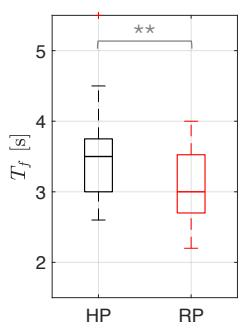

# 通过自适应协作机器人减轻假肢使用者的代偿性运动

Marta Lagomarsino1, Robin Arbaud1,2, Francesco Tassi1, and Arash Ajoudani1

摘要— 假肢使用者能够恢复部分肢体功能，但完整的自然肢体活动度却很少能够复原，这常常导致代偿性运动（compensatory movements），进而引发不适、效率低下以及长期的躯体劳损。为应对这一问题，我们提出了一种新颖的人机协作框架，旨在通过利用假肢使用者的残余运动能力并兼顾任务需求，来减轻上肢假肢使用者的代偿机制。我们的方法引入了个性化的运动能力模型，该模型可量化关节特异性的功能限制以及代偿运动的代价。该模型被集成到一个受约束的优化框架中，用于计算用户在执行任务时的最优姿态，在功能性与舒适性之间取得平衡。该方案引导协作机器人重构任务环境，从而促进有效的交互。我们使用一种用于单指截肢的新型体动力（body-powered）假肢装置对该框架进行了验证；该装置通过与手部的协同闭合来增强抓握能力，但会对腕部施加约束。初步实验中，我们让健康受试者将该假肢作为额外（supernumerary）手指佩戴，结果表明：将用户特异性运动能力模型嵌入其中的机器人在交接任务中优于人类搭档，既提高了假肢使用者抓握的效率，又减少了功能关节的代偿性运动。这些结果凸显了协作机器人作为有效的工作场所和护理助手的潜力，有助于促进假肢的包容性以及更好地将其融入日常任务。

关键词— 机器人辅助运动能力；人机接口与机器人应用

## I. 引言

失去肢体或手指会对个人的身体能力和心理健康产生深远的影响。假肢装置旨在通过恢复功能并使用户能够重新获得日常生活与工作相关活动中的独立性来缓解这些问题。假肢可分为三类：被动式（passive）、自身动力式（body-powered）和外部动力式（externally powered）[1]。被动式装置主要侧重于恢复外观而非机械功能[2]，然而，它们仍有助于恢复对掌抓握能力[3]。相比之下，自身动力式装置利用另一块肌肉或肢体的运动来控制假肢，提供了一种在机械和功能上更为简单的解决方案[4]、[1]。外部动力式装置依赖执行器（通常是电动或气动的）来恢复更精细的控制和灵巧性，但代价是复杂性增加、对电源的依赖以及更高的费用[5]、[6]。相比之下，自身动力式装置由于其简洁性与直观易用性，在功能性和可用性之间取得了平衡。

尽管假肢有诸多益处，但它们仍然远未能复现自然肢体的全部功能[7]。它们常常对用户的身体活动能力施加限制，导致代偿机制的产生，这可能涉及不舒适的非人体工程学姿势或低效的运动模式[8]、[9]。对于自身动力式系统而言尤为如此，因为其在设计上要求某些肌肉除了其正常用途之外，还要用于控制假肢[10]、[11]。随着时间的推移，这些代偿行为可能导致劳损、不适，甚至长期的生理问题。不幸的是，这些挑战在假肢装置的设计和评估中经常被忽视。为了弥补这一空白，研究人体运动学如何有效地适应残余损伤和假肢的限制，为提升用户舒适度、效率与整体体验提供了机会。

除了个体适配之外，假肢使用者所处的环境（如工作场所、护理机构和家庭）也可以进行改造，以支持更符合人体工程学且功能更完善的交互。在这一背景下，协作机器人（CoBots）构成了一个有前景的解决方案[12]。协作机器人已展现出通过在线调整交互姿态[13]或在共同搬运与协同操作任务中优化共享运动动力学[14]、[15]来改善身体层面人体工程学的能力。它们还通过调节与用户之间的接近程度和反应速度以平衡安全性、用户压力与生产力，从而促进认知层面人体工程学的提升[16]。尽管一些初步尝试旨在为存在功能障碍的用户提供便利，但这些方法往往侧重于用机器人系统完全替代受损肢体的功能[17]、[18]，或在笛卡尔空间中限制受损手臂的运动[19]。然而，这类策略忽视了假肢使用者在关节层面和任务层面所面临的细微约束。此外，这些方法未能充分利用活动受限用户的残余功能，可能反而强化其无能力感和挫败感。

本文通过引入一种人机协作框架，朝着应对上述挑战迈出了新的一步，该框架支持上肢假肢使用者克服关节层面的限制、利用其残余运动，同时避免有害的代偿机制。我们提出了一个针对假肢使用者关节特异性功能限制的模型，并对功能正常关节中代偿机制所产生的代价进行了量化。该模型为一个优化问题提供了依据，该优化问题在满足任务约束的前提下，计算出以功能性和舒适性方式执行协作任务的最佳用户姿态。其解指导机器人重新配置任务环境，从而促进所推荐姿态的采用。最后，我们展示了一种面向单指截肢者的新型动力驱动假肢装置，该装置通过协同手部闭合动作增强抓握能力，但会对腕部运动形成约束。该装置作为验证所提方法的试验平台。

  
图1. 评估假肢使用者运动多样性并减轻代偿运动同时遵循任务约束的程序概览。

本文其余部分组织如下：第二节描述了上肢功能障碍的建模以及用于机器人辅助促进的优化问题的构建，以最小化受限关节的使用并降低与代偿机制相关的代价。第三节展示了在交接任务中验证所提方法的实验研究。第四节对结果进行了讨论，并展望了未来工作的潜在方向。

## II. 方法

缓解上肢假肢使用者代偿运动的提议方案如图 1 所示。在离线阶段，我们首先对使用者的运动多样性进行建模，并缩放一个数字模型以自动匹配其特定的身体尺寸。在交互阶段，我们持续监测假肢使用者的姿势，并最终根据建模得到的残余活动能力以及假肢本身的限制来修正运动范围（Range of Motion，RoM）。由此，我们计算当前的代偿运动代价，将其定义为功能关节相对于自然、舒适姿势的偏离程度。随后求解一个带约束的优化问题，以确定一个在使用者活动能力约束和任务要求下仍然可行的、更舒适且具功能性的姿势。最后，规划一条机器人辅助运动，以帮助使用者采用该姿势。

## A. 假肢使用者运动学模型

本研究通过为每个关节分配一个局部坐标系来建模假肢使用者的运动学，其中 $\mathrm { x - , \ y - , }$ 轴和 z-轴分别定义外展/内收、屈曲/伸展以及内旋/外旋的旋转轴，如文献 [20] 所述。为了考虑手臂的运动学冗余，手臂被表示为一个具有 7 个自由度（Degrees-of-Freedom，DoF）的系统，记作 $\pmb q ^ { H } \in \mathbb { R } ^ { 7 }$，由两段刚体连杆组成：上臂 $( l _ { \mathrm { h u m e r u s } } )$ 与前臂 $(  { l _ { \mathrm { r a d i u s } } } )$ [21]。

还在 L5 腰椎处分配了一个坐标系，通过第一个关节角 $q _ { 1 } ^ { H }$ 以及连杆 $l _ { \mathrm { s p i n e } }$ 来表示脊柱屈曲。这一纳入反映了文献中关于躯干运动增多作为代偿机制被广泛记载的事实 [11]。所得到的模型共具有 M = 8 个自由度，其中与尺寸相关的参数可调整以适配不同的手臂和躯干尺寸。

肩部被建模为球窝关节，提供外展/内收 $( q _ { 2 } ^ { H } )$、屈曲/伸展 $( q _ { 3 } ^ { H } )$ 和内旋/外旋 $( q _ { 4 } ^ { \bar { H } } )$。肘部由一个铰链关节和一个枢轴关节组成，允许前臂屈曲/伸展 $( q _ { 5 } ^ { H } )$ 与旋前/旋后 $( q _ { 6 } ^ { H } )$。最后，腕关节被建模为髁状关节，可实现腕部的屈曲/伸展 $( q _ { 7 } ^ { \overline { { { H } } } } )$ 和尺偏/桡偏 $( q _ { 8 } ^ { H } )$。表 I 给出了该运动学模型所使用的 Denavit-Hartenberg（DH）参数。

表 I  
所采用的人体运动学模型的 Denavit-Hartenberg 参数。

| 轴, i | $\theta_i$ | $a_i$ | $\alpha_i$ | $d_i$ |
|---|---|---|---|---|
| 1 | $q_1^H$ | $l_{\mathrm{spine}}^z$ | $\frac{\pi}{2}$ | $-l_{\mathrm{spine}}^y$ |
| 2 | $q_2^H$ | $0$ | $-\frac{\pi}{2}$ | $-l_{\mathrm{spine}}^x$ |
| 3 | $q_3^H + \frac{\pi}{2}$ | $0$ | $\frac{\pi}{2}$ | $0$ |
| 4 | $q_4^H - \frac{\pi}{2}$ | $-l_{\mathrm{humerus}}^x$ | $-\frac{\pi}{2}$ | $-l_{\mathrm{humerus}}^z$ |
| 5 | $q_5^H + \pi$ | $0$ | $\frac{\pi}{2}$ | $-l_{\mathrm{humerus}}^y$ |
| 6 | $q_6^H + \frac{\pi}{2}$ | $-l_{\mathrm{radius}}^y$ | $-\frac{\pi}{2}$ | $-\Delta l_{\mathrm{radius}}^z$ |
| 7 | $q_7^H + \frac{\pi}{2}$ | $0$ | $\frac{\pi}{2}$ | $-l_{\mathrm{radius}}^x$ |
| 手 | $q_8^H$ | $0$ | $0$ | $0$ |

假肢通过恢复部分功能来辅助使用者，但可能无法完全复制自然肢体的活动能力，并且会对相邻关节施加限制。例如，佩戴部分手部假肢可能会限制腕关节的活动范围，进而导致肘关节和/或肩关节出现代偿性动作。为了在模型中捕捉这些约束，我们定义了一个对角矩阵 $\mathbf { W } _ { \mathrm { i m p a i r e d } } ^ { H } \in \mathbb { R } ^ { M \times M }$。该矩阵通过优先使用健康关节或由假肢支撑的关节的活动，并降低或完全限制受损或被锁定关节的活动能力，从而修正运动学模型。这使得对关节部分或完全损伤进行灵活建模成为可能。对于功能完全丧失的关节，我们设 $\mathbf { W } _ { \mathrm { i m p a i r e d } } ^ { H } ( i , i ) = \mathbf { \bar { 1 } }$，而对于部分受损的关节，则按比例定义，以反映「除非必要否则尽量少用」的偏好。在临床实践中，标准化的损伤指数被用于评估关节炎、损伤或神经损伤等疾病患者关节的功能状态 [22]。这些指数可用于在 $\mathbf { W } _ { \mathrm { i m p a i r e d } } ^ { H }$ 中定义特定的关节限制，从而帮助将运动学模型个性化，以适应每位假肢使用者的特定需求和能力。

用于量化在时刻 $k$ 代偿机制影响的代价 $\Psi ( k ) \in \mathbb { R }$ 计算如下：

$$
\boldsymbol { \Psi } [ k ] = \left. \left( \mathbf { I } - \mathbf { W } _ { \mathrm { i m p a i r e d } } ^ { H } \right) \left( \pmb { q } ^ { H } [ k ] - \pmb { q } _ { \mathrm { n } } ^ { H } \right) \right. ^ { 2 } ,\tag{1}
$$

其中 $\mathbf{ \pmb { q } _ { \mathrm { n } } ^ { H } }$ 表示自然姿态，代表使用者的一种中立且舒适的手臂/躯干构型。该代价衡量了功能性关节偏离该自然姿态的程度。它与文献中已有的度量（如「瞬时关节使用度」或「人体工效学代价」）[23]、[13] 一致，但在此通过引入权重以考虑每个关节所期望的活动能力（由矩阵 $\left( \mathbf { I } - \mathbf { W } _ { \mathrm { i m p a i r e d } } ^ { H } \right)$ 定义）而得到改进。这一修改提供了一种更精确且更具个性化的评估方式，用于评估与舒适且功能性姿态的对齐程度，并针对使用者的特定损伤和需求进行了量身定制。

## B. 针对假肢使用者的机器人反应式辅助（Robot Reactive Facilitation for Prosthesis Users）

机器人反应性促进（reactive facilitation）的目标是引导假肢使用者以更有效的方式完成交互任务，避免为了补偿由假肢施加或未完全解决的约束而采取的不自然姿势。为实现这一目标，机器人生成旨在促进人类采用该推荐构型的运动。最优姿势最小化部分受损关节的使用，完全限制被锁定关节的运动，并促使健康的零空间关节（null-space joints）在整个交互过程中与舒适且功能性的姿势对齐。

机器人的反应性行为被表述为一个在线优化问题，该问题考虑了使用者的受损运动能力、运动学约束、任务需求以及安全距离阈值。该优化由以下代价函数和约束定义：

$$
\begin{array} { r l r } { \underset { \boldsymbol { q } ^ { H } } { \operatorname* { m i n } } } & { \left\| \mathbf { W } _ { \mathrm { i m p a i r e d } } ^ { H } \left( \boldsymbol { q } ^ { H } - \boldsymbol { q } _ { \mathrm { m } } ^ { H } \right) \right\| ^ { 2 } + \alpha \left\| \left( \mathbf { I } - \mathbf { W } _ { \mathrm { i m p a i r e d } } ^ { H } \right) \left( \boldsymbol { q } ^ { H } - \boldsymbol { q } _ { \mathrm { n } } ^ { H } \right) \right\| } \\ { \mathrm { s . t . } } & { \boldsymbol { q } ^ { H } \in [ \boldsymbol { q } _ { \mathrm { m i n , i m p a i r e d } } ^ { H } , \boldsymbol { q } _ { \mathrm { m a x , i m p a i r e d } } ^ { H } ] , } \\ & { } & { x _ { \mathrm { o b j } } ( \boldsymbol { q } ^ { H } ) \in \chi _ { \mathrm { t a x k } } ^ { R } , } \\ & { } & { p _ { \mathrm { o b j } } ( \boldsymbol { q } ^ { H } ) = p _ { \mathrm { t a x k } } , } \\ & { } & { d _ { \mathrm { o b j } } ^ { H } \geq d _ { \mathrm { s a f e ~ t h } } , } \\ & { } & { d _ { \mathrm { e l l o w } } ^ { H } \geq d _ { \mathrm { e l b o w ~ t h } } , } \end{array}
$$

其中 $\pmb{q}_{\mathrm{m}}^{H}$ 是当前测量的人体姿态，$\pmb{q}_{\mathrm{n}}^{H}$ 表示健康个体的自然且舒适的姿态。在代价函数中，第一项旨在最小化完全或部分受损关节相对于其当前构型的偏差。这一目标通过矩阵 $\mathbf{W}_{\mathrm{impaired}}^{H}$ 来实现，该矩阵根据每个关节功能受限的严重程度对平方距离进行加权，从而有效地优先最小化功能受限更严重的关节的位移。第二项则最小化代偿机制的代价 $\Psi$，即功能正常的关节相对于标称最舒适的手臂／躯干构型的平方距离，并按其期望的活动能力进行加权。参数 $\alpha \in \mathbb{R}$ 是一个缩放因子，它降低了第二项的重要性。这反映了在保持受损关节当前位置的优先级的同时，对健康的、未受限关节的舒适位姿进行温和的促进。

优化约束确保关节角度 $\pmb{q}^H$ 保持在可行的受损范围内，该范围是通过缩减标准 RoM 以考虑用户特定的损伤而得出的。对于假肢用户，这种缩减通过使用矩阵 $\mathbf{W}_{\mathrm{impaired}}^H$ 来修改健康关节边界 $\pmb{q}_{\mathrm{min}}^{H}$ 和 $\pmb{q}_{\mathrm{max}}^{H}$ 来建模，具体如下：

$$
\begin{array}{r l} & {\pmb{q}_{\mathrm{min,impaired}}^{H} = \pmb{q}_{\mathrm{min}}^{H} + \mathbf{W}_{\mathrm{impaired}}^{H} \big( (\pmb{q}_{\mathrm{m}}^{H} - \zeta) - \pmb{q}_{\mathrm{min}}^{H} \big),} \\ & {\pmb{q}_{\mathrm{max,impaired}}^{H} = \pmb{q}_{\mathrm{max}}^{H} - \mathbf{W}_{\mathrm{impaired}}^{H} \big( \pmb{q}_{\mathrm{max}}^{H} - (\pmb{q}_{\mathrm{m}}^{H} + \zeta) \big),} \end{array}\tag{3}
$$

其中参数 $\zeta \in \mathbb { R }$ 允许对关节角度进行微小调节，即使在严重受损的关节中也是如此。任务特定约束确保物体或工具的位置 $\pmb { x } _ { \mathrm { o b j } }$（在人与环境交互过程中将位于人手中，即 ${ \pmb x } _ { \mathrm { 0 b j } } = { \pmb x } _ { \mathrm { 0 b j } } ( { \pmb q } ^ { H } )$）位于机器人的任务空间 $\dot { x } _ { \mathrm { t a s k } } ^ { R }$ 内，并满足任务目标。具体而言，我们考虑在特定笛卡尔坐标 $p _ { \mathrm { o b j } } =$ $\{ x _ { \mathrm { o b j } } ; y _ { \mathrm { o b j } } ; z _ { \mathrm { o b j } } \} \ \in \ \mathbb { R }$ 上施加等式约束以匹配任务需求 ptask。最后，物体与用户身体之间的水平距离 $d _ { \mathrm { o b j } } ^ { H } \in \mathbb { R }$ 必须超过安全阈值 $d _ { \mathrm { s a f e \ t h } }$，用户肘部与骨盆之间的水平距离 $d _ { \mathrm { e l b o w } } ^ { H }$ 必须超过 $d _ { \mathrm { e l b o w \ t h } }$，以确保合适的肘部姿态。

## C. 手指假肢系统（Finger Prosthesis System）

在本研究中，我们提出了一种新型的力驱动（body-powered）手指假肢装置，专门设计用于增强单指截肢患者的抓握能力，其特征是具有机械耦合机制，能够实现与手的协同闭合。该假肢具有一个欠驱动三关节手指，其运动由单根肌腱控制。当肌腱未被主动牵拉时，弹性元件将手指带回张开位置。如图 2 所示，我们围绕腕部护具构建了一个可穿戴原型，并附加了一个 3D 打印部件。该部件固定一个滑轮，肌腱通过该滑轮重新布线。肌腱的另一端连接到一个指环上，使用者需要将其戴在控制假肢的手指上。弯曲该手指将拉动肌腱并使假肢弯曲。此外，可通过丝杠机构改变滑轮位置来调节肌腱的预紧力。为了测试目的，我们将设计的假肢安装为位于食指附近的额外手指（supernumerary finger）。这种配置允许未受损的个体模拟假肢使用者的体验。

需要特别注意的是，虽然假肢增强了抓握功能，但它也对腕部屈伸和尺偏/桡偏施加了约束。这些限制可以通过将 $\mathbf { W } _ { \mathrm { i m p a i r e d } } ^ { H }$ 的最后两个对角元素设置为 1 来编码，从而告知优化过程腕部被固定的情况。

  
图 2. 用于测试所提出的、作为额外手指（supernumerary finger）的身体动力假肢（body-powered prosthesis）的可穿戴原型机实物图。

## III. 实验

## A. 实验设置与协议

实验在两名健康人体受试者上进行，以评估所提方法在促进与假肢设备之间实现功能性且舒适性交互方面的有效性1。受试者包括受试者 1，一名身高 1.83 m 的 29 岁男性，以及受试者 2，一名身高 1.58 m 的 28 岁女性。刻意选择差异化的身体特征，以验证该方法对不同人体测量学特征的适应能力。

实验任务要求受试者抓握一把热熔胶枪（hot-melt glue pistol），该胶枪相对于其骨盆处于不同的横向距离，即 $y _ { \mathrm { t a s k } } = \{ 0 . 0 5 \mathrm { m } ; - 0 . 2 0 \mathrm { m } ; - 0 . 4 5 \mathrm { m } \}$。为了模拟较为真实的假肢使用者场景，受试者在执行任务时佩戴所提假肢设备，并将其配置为额外手指（supernumerary finger）（见图 2）。任务开始前，受试者先进行了与假肢的熟悉阶段。实验布置包括一张位于假肢使用者前方的桌子，桌面上用三条胶带标记出物体可能被递送过来的潜在横向方向。健康运动范围（RoM）取自文献 [24]，而假肢使用者的标称姿态 $\boldsymbol { q } _ { \mathrm { n } } ^ { H }$ 则基于快速上肢评估（Rapid Upper Limb Assessment, RULA）工具 [25] 定义为最符合人体工学的姿态，其中肘部屈曲为 $9 0°$，其余所有关节角度均设为 $0 ^ { \circ }$。参数设置如下：$\alpha = 0 . 1 0$，$\zeta = 5 ^ { \circ }$，距人体骨盆的 $d _ { \mathrm { s a f e \ t h } } = 0 . 2 0 \mathrm { m }$，以及 $d _ { \mathrm { e l b o w \ t h } } = 0 . 2 5 \mathrm { m }$

实验包含两个环节：人工传递（Human Passing, HP）和机器人传递（Robot Passing, RP）。在 HP 环节中，一位人类参与者针对每个横向距离 $y _ { \mathrm { t a s k } }$ 都会向假肢用户传递一次物体，模拟工业场景中人类同事或在辅助情境中护理人员参与的典型交接场景。我们招募了五名健康参与者（四男一女，年龄 28.2±2.4 岁）作为该条件下的物体传递者。在 RP 环节中，任务由一台 Franka Emika Panda 机械臂协作完成，该机械臂以 1 kHz 频率进行控制，并配备 Robotiq 2-Finger Gripper 2F-85 夹爪。机器人通过求解式 (2) 中定义的约束优化问题在线优化物体交接位姿，该问题在 C++ 环境中通过 ALGLIB 库的增广拉格朗日方法实现2。为确保执行过程的平滑性，我们生成了 B 样条轨迹以达到优化后的交接位姿，并由机器人笛卡尔阻抗控制器进行跟踪，与文献 [16] 中的方法一致。机器人在不同的 $y _ { \mathrm { t a s k } }$ 条件下重复进行了五次物体传递，以确保与 HP 条件进行一致的对比。

我们使用了一套可穿戴的 MVN Biomech 套装（Xsens Tech.BV），该套装配备有惯性测量单元传感器，用于测量身体节段长度并自动为受试者定制运动学模型和数字人体模型网格。

运动捕捉系统在实验全过程中持续追踪假肢用户的动作。

事后统计分析将机器人辅助（RP）条件相对于基线人工传递（HP）条件的有效性进行了对比，重点关注将用户损伤模型嵌入机器人行为中所产生的影响。首先，使用 Anderson-Darling 检验对采集到的数据进行正态性检验。若确认满足正态性，则进行重复测量方差分析（ANOVA）。若不满足正态性，则使用非参数 Friedman 检验来评估显著性差异。针对假肢用户的动作计算了三项性能指标：

• 任务时长 $( T _ { f } )$：假肢用户完成接近和抓握阶段所花费的时间，从抓握主体首次动作开始测量，直至他/她完全控制住物体为止；

• 功能关节使用率（Ψ¯）：在时长 $T _ { f }$ 内计算（时间采样 $k = 1 , \dots , K _ { f } )$），公式为：

$$
\bar { \Psi } = \frac { 1 } { K _ { f } } \sum _ { k = 1 } ^ { K _ { f } } \Psi [ k ] ,\tag{4}
$$

其中 $\Psi [ k ]$ 是与功能关节执行的代偿机制相关的代价，由式 (1) 定义；

• 关节运动平滑度（J）：定义为：

$$
J = \Delta t \sum _ { k = 1 } ^ { K _ { f } } \| \ddot { \pmb q } _ { \mathrm { m } } ^ { H } [ k ] \| ^ { 2 } ,\tag{5}
$$

其中 $\Delta t$ 是 Xsens 系统的数据采样率，$\because \pmb { q } _ { \mathrm { ~ m ~ } } ^ { H } \in \mathbb { R } ^ { M }$ 是由关节速度测量值经数值推导得到的关节急动度向量。

## B. 实验结果

图 3 展示了中指和附加（supernumerary）假肢手指在运动中的连续帧，以说明由耦合机制实现的渐进屈曲运动。

针对特定假肢使用者定制的运动感知（mobility-aware）优化结果如图 4 所示，揭示了其在不同身体特征和任务约束下有效配置人机交互的能力。根据运动跟踪数据，数字模型被自动缩放以匹配两位使用者的人体测量学特征。机器人遵守了任务要求，即与使用者骨盆保持不同的横向距离，并遵守任务特定的物体定位区域（图中以绿色平面标示）。更重要的是，机器人调整了交接物体的位置和姿态，以完全消除手腕运动并减轻代偿性运动。每个子图还报告了在理想情况下——即人类采用由优化得出的最优姿态时——与代偿机制相关的代价 $\Psi$。

  
图 3. 使用者手指与假肢手指协调屈曲运动的示意图。

图 5 比较了参与者 3 所执行的人体到假肢使用者交接（HP）与优化后的机器人交接（RP）场景。尽管人类传递者旨在方便假肢使用者的抓取，但由此产生的物体传递姿态因腕部阻挡而要求使用者做出显著的代偿性动作。具体而言，如图 5 左下图所示，假肢使用者表现出更大的肘部屈曲（紫色曲线）、大幅度的肩部屈曲（橙色曲线）以及抬高的肘部姿态，这诱发了更大的肩部外旋（黄色曲线）和前臂旋前（绿色曲线）。此外，假肢使用者需要约一秒钟时间在该构型下稳定假肢抓取。另外，运动起始阶段的犹豫表明运动规划的神经机制需求略有增加，这一点也由假肢使用者所报告。相比之下，针对假肢使用者活动能力受限而量身优化的机器人交接能够实现更易接近且更高效的抓取。机器人的协助诱导使用者采用一种与通过考虑活动能力的优化问题所获得的优化构型 $\pmb { q } _ { * } ^ { H }$ 紧密对齐的姿态（在图 5 右下图中以虚线表示）。虽然优化姿态建议更多地依赖肘部屈曲并减少肩部屈曲，但使用者实际采用的构型在肘部和肩部之间具有更为均衡的屈曲分布。尽管因使用者对冗余解析的略有不同而导致这些细微偏差，与 HP 条件相比，优化后的机器人协助显著降低了交互姿态下以及整个接近阶段的代偿性运动成本 Ψ。

  
图 4. 在桌面上与人体骨盆不同横向距离处，针对不同人体测量量身优化的机器人到假肢使用者交接构型。

  
图 5. 由参与者执行的人体到假肢使用者交接（HP）与适应假肢使用者活动能力受限的优化机器人交接（RP）之间的比较。

  
图 6. 人体传递（HP）与机器人传递（RP）条件之间的统计学比较：（左）接近阶段的持续时间，表明机器人交接的效率有所提升；（右）接近阶段内代偿性运动成本 Ψ¯ 的平均值，突显功能关节使用量的减少。显著性水平以 $^ { * * } p < 0 . 0 1$ 标示。

对所有测试的 $y _ { \mathrm { t a s k } }$ 值在 HP 与 $R P$ 条件间进行的统计分析表明，机器人交接显著提升了假肢使用者抓握的效率与舒适度。事实上，接近阶段时长出现了显著缩短，如图 6 左侧箱线图所示。此外，与补偿运动相关的测量代价，即交互姿态下的 $\Psi ( t _ { \mathrm { i n t e r a c t i o n } } )$，以及代表功能关节使用情况的平均代价 Ψ¯，均呈现出显著下降，如图 6 右侧箱线图所示。如预期，两种交接条件下腕部关节位移的范数始终保持在接近零的水平。然而，在 HP 条件下，腕部位移偶尔可达 6°，表明在某些情况下，假肢使用者不得不违反腕部约束以实现抓握。关于关节运动的平滑度，接近阶段关节急动度平方的积分（J）由于监测系统与数值求导所引入的数值波动，未以箱线图形式呈现，但两种条件（HP 与 RP）之间的比较仍给出了一致且有意义的结论。在机器人交接条件下，J 值显著下降了 52.7%（$( p <$ 0.01）），表明抓握接近过程更加平滑、更加顺畅。

## 四、讨论与结论

在这项工作中，我们提出了一种新颖的在线方法，用于缓解手臂活动受限的假肢使用者的代偿性运动——这是一个经常被忽视却可能导致长期伤害的问题。我们的方法包括为假肢使用者建立一个个性化的活动模型，并将其集成到一个约束优化框架（constrained optimisation framework）中。该框架以兼具功能性与舒适性的方式计算执行任务时的最佳用户姿势，同时考虑任务需求，并将结果告知机器人，使机器人能够相应地重新配置任务以促进用户采用该姿势。我们使用健康受试者开展了初步实验，让其使用所提出的身动力手指假肢（body-powered finger prosthesis）作为额外手指（supernumerary finger）。结果表明，嵌入了用户特定活动模型的机器人助手优于人类伙伴。在减少功能关节中的代偿性运动以及提升假肢使用者在交接任务中的抓握效率两方面均观察到了改进。这些发现对于将协作机器人引入工作场所和护理助理场景、推动包容性以及促进假肢设备无缝融入用户的日常生活而言具有广阔前景。尽管这些结果令人鼓舞，但我们注意到用户在关节使用冗余的解决方案上存在一定偏差，从而导致性能略有差异。未来的工作将聚焦于为用户提供关于配置其功能关节的指导，可能通过我们在仿真中开发的视觉反馈界面，或振动触觉（vibrotactile）反馈系统[26]来实现。此外，我们计划使用能够应对更复杂截肢情况的假肢设备来测试该框架，例如涉及肘部的截肢，并考虑部分损伤的情形。最后，我们的目标是将该框架扩展到更复杂的交互任务，进一步评估其在多样化真实场景中提升假肢设备可用性的潜力。

## 参考文献

[1] I. Imbinto, C. Peccia, M. Controzzi, A. G. Cutti, A. Davalli, R. Sacchetti, and C. Cipriani, "手部部分截肢的治疗：一种工程学视角," *IEEE reviews in biomedical engineering*, vol. 9, pp. 32–48, 2016.

[2] M. C. Goiato, D. N. Mancuso, P. M. Ferreira, and D. M. Dos Santos, "手指假肢：重建的艺术," *J Coll Physicians Surg Pak*, vol. 19, no. 10, pp. 670–671, 2009.

[3] C. M. Fraser, "单侧上肢截肢者对美容性与功能性假肢使用情况的评估," *Prosthetics and Orthotics International*, vol. 22, no. 3, pp. 216–223, 1998.

[4] S. L. Carey, D. J. Lura, and M. J. Highsmith, "肌电假肢与身动力上肢假肢的差异：系统文献综述," *Journal of Rehabilitation Research & Development*, vol. 52, no. 3, 2015.

[5] G. Milazzo, S. Lemerle, G. Grioli, A. Bicchi, and M. G. Catalano, "一种可变刚度假肢肘关节的设计、表征与验证," *IEEE Transactions on Robotics*, 2024.

[6] A. Marinelli, N. Boccardo, F. Tessari, D. Di Domenico, G. Caserta, M. Canepa, G. Gini, G. Barresi, M. Laffranchi, and L. De Michieli, "上肢主动假肢：当前现状与即将到来的突破综述," *Progress in Biomedical Engineering*, vol. 5, no. 1, p. 012001, 2023.

[7] M. Bumbaširevic, A. Lesic, T. Palibrk, D. Milovanovic, M. Zoka, T. Kravic-Stevovi´c, and S. Raspopovic, "从外科医生视角看仿生肢体的现状," *EFORT open reviews*, vol. 5, no. 2, pp. 65–72, 2020.

[8] S. L. Carey, M. J. Highsmith, M. E. Maitland, and R. V. Dubey, "前臂截肢假肢使用者在常见任务中的代偿性运动," *Clinical Biomechanics*, vol. 23, no. 9, pp. 1128–1135, 2008.

[9] A. J. Metzger, A. W. Dromerick, R. J. Holley, and P. S. Lum, "假肢上肢够取任务中代偿性躯干运动的特征化分析," *Archives of physical medicine and rehabilitation*, vol. 93, no. 11, pp. 2029–2034, 2012.

[10] S. M. Engdahl, C. Lee, and D. H. Gates, "日常活动中体动力假肢与肌电假肢使用者代偿性运动的比较," *Clinical Biomechanics*, vol. 97, p. 105713, 2022.

[11] A. M. Valevicius, Q. A. Boser, C. S. Chapman, P. M. Pilarski, A. H. Vette, and J. S. Hebert, "体动力假肢使用者的代偿策略揭示其主要依赖躯干运动且与技能水平相关," *Clinical Biomechanics*, vol. 72, pp. 122–129, 2020.

[12] A. Nanavati, V. Ranganeni, and M. Cakmak, "物理辅助机器人：面向肢体残障人士的移动与操作机器人系统综述," *Annual Review of Control, Robotics, and Autonomous Systems*, vol. 7, pp. 123–147, 2024.

[13] A. Bestick, R. Pandya, R. Bajcsy, and A. Dragan, "学习人类对手传递的人体工程学偏好," 载于 *Proceedings of International Conference on Robotics and Automation (ICRA)*, 2018, pp. 3257–64.

[14] W. Kim, M. Lorenzini, P. Balatti, P. Nguyen, U. Pattacini, V. Tikhanoff, L. Peternel, C. Fantacci, L. Natale, G. Metta, and A. Ajoudani, "人机协作可适应工作站：改善工人人体工程学与生产力的可重构框架," *IEEE Robotics & Automation Magazine*, pp. 14–26, 2019.

[15] F. Ferraguti, R. Villa, C. T. Landi, A. M. Zanchettin, P. Rocco, and C. Secchi, "面向物理与人体工程学人机协作的统一架构," *Robotica*, vol. 38, no. 4, pp. 669–683, 2020.

[16] M. Lagomarsino, M. Lorenzini, E. De Momi, and A. Ajoudani, "PRO-MIND：工业场景下机器人运动接近度与反应性优化以调节安全限度、人类压力与生产率," *IEEE Transactions on Robotics*, vol. 41, pp. 2067–2085, 2025.

[17] D. Torielli, L. Bertoni, L. Muratore, and N. Tsagarakis, "面向上肢功能障碍人群有效机器人辅助的激光引导交互界面," *IEEE Robotics and Automation Letters*, 2024.

[18] S. Poirier, F. Routhier, and A. Campeau-Lecours, "面向上肢残障人士辅助机器人的语音控制接口原型（Voice control interface prototype for assistive robots for people living with upper limb disabilities）"，发表于 国际康复机器人会议（International Conference on Rehabilitation Robotics, ICORR）论文集。IEEE，2019年，第46–52页。

[19] P. Ardon, M. E. Cabrera, E. Pairet, R. P. A. Petrick, S. Ramamoorthy, K. S. Lohan, and M. Cakmak, "考虑人体手臂运动约束的可供性感知交接（Affordance-aware handovers with human arm mobility constraints）"，IEEE Robotics and Automation Letters，第3136–3143页，2021年。

[20] M. Leonori, M. Lorenzini, L. Fortini, J. M. Gandarias, and A. Ajoudani, "Xsens 动作捕捉与机器人操作系统（ROS）之间的桥梁：赋予机器人在线三维人体运动跟踪能力（The bridge between xsens motion-capture and robot operating system (ros): Enabling robots with online 3d human motion tracking）"，arXiv 预印本 arXiv:2306.17738，2023年。

[21] A. Bertomeu-Motos, A. Blanco, F. J. Badesa, J. A. Barios, L. Zollo, and N. Garcia-Aracil, "末端执行器机器人辅助康复治疗中的人体手臂关节重建算法（Human arm joints reconstruction algorithm in rehabilitation therapies assisted by end-effector robotic devices）"，Journal of NeuroEngineering and Rehabilitation，第1–11页，2018年。

[22] R. D. Rondinelli, E. Genovese, R. T. Katz, T. G. Mayer, K. L. Mueller, M. I. Ranavaya, and C. R. Brigham, "《AMA 永久性损伤评估指南》，2023年（Ama guides® to the evaluation of permanent impairment, 2023）"，载于《AMA 永久性损伤评估指南》（AMA Guides® to the Evaluation of Permanent Impairment）。美国医学协会（American Medical Association），2023年。

[23] S. Gholami, M. Lorenzini, E. De Momi, and A. Ajoudani, "遥操作界面的定量物理人体工效学评估（Quantitative physical ergonomics assessment of teleoperation interfaces）"，IEEE Transactions on Human-Machine Systems，第169–180页，2022年。

[24] M. Whitmore, J. Boyer, and K. Holubec, "《NASA-STD-3001 航天飞行人系统标准与人员整合设计手册》（NASA-STD-3001, space flight human-system standard and the human integration design handbook）"，发表于 工业与系统工程研究会议（Industrial and Systems Engineering Research Conference），2012年。

[25] L. McAtamney and N. Corlett, "快速上肢评估（Rapid upper limb assessment, RULA）"，载于《人因与工效学方法手册》（Handbook of Human Factors and Ergonomics Methods）。CRC 出版社（CRC Press），2004年，第86–96页。

[26] M. Lorenzini, S. Ciotti, J. M. Gandarias, S. Fani, M. Bianchi, and A. Ajoudani, "用于肢体姿态调整的振动触觉与滑压触觉反馈装置性能分析（Performance analysis of vibrotactile and slide-and-squeeze haptic feedback devices for limbs postural adjustment）"，发表于 机器人与人交互通信国际研讨会（International Symposium on Robot and Human Interactive Communication, RO-MAN）论文集。IEEE，2022年，第707–713页。