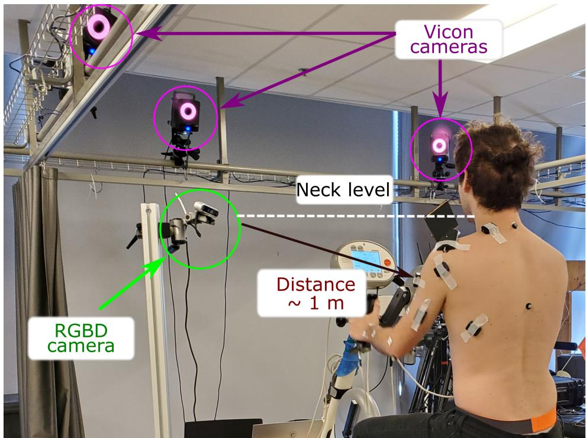
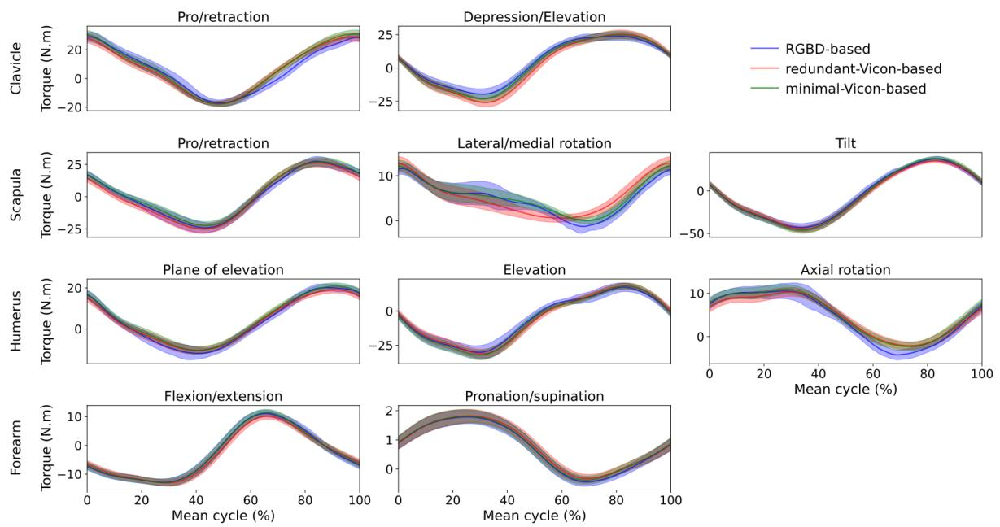

# Real-time, accurate, and open source upper-limb musculoskeletal analysis using a single RGBD camera

Amedeo Ceglia1,\*, Kael Facon2, Mickael Begon1,3, and Lama Seoud4

1Institute of Biomedical Engineering, University of Montreal, Montreal, QC Canada

2Ecole d'ingenieurs informatique Paris, Le Kremlin-Bicêtre, France

3School of Kinesiology and Human Kinetics, University of Montreal, Montreal, QC Canada

4Department of Computer Engineering and Software Engineering, Polytechnique Montreal,

Montreal, QC, Canada

Corresponding author: Amedeo Ceglia, amedeo.ceglia@umontreal.ca

## Abstract

Biomechanical biofeedback may enhance rehabilitation and provide clinicians with more objective task evaluation. These feedbacks often rely on expensive motion capture systems, which restricts their widespread use, leading to the development of computer vision-based methods. These methods are subject to large joint angle errors, considering the upper limb, and exclude the scapula and clavicle motion in the analysis. Our open-source approach offers a user-friendly solution for high-fidelity upper-limb kinematics using a single low-cost RGBD camera and includes semi-automatic skin marker labeling. Real-time biomechanical analysis, ranging from kinematics to muscle force estimation, was conducted on eight participants performing a handcycling motion to demonstrate the applicability of our approach on the upper limb. Markers were recorded by the RGBD camera and an optoelectronic camera system, considered as a reference. Muscle activity and external load were recorded using eight EMG and instrumented hand pedals, respectively. Bland-Altman analysis revealed significant agreements in the 3D markers' positions between the two motion capture methods, with errors averaging 3.3±3.9 mm. For the biomechanical analysis, the level of agreement was sensitive to whether the same marker set was used. For example, joint angle differences averaging 2.3±2.8° when using the same marker set, compared to 4.5±2.9° otherwise. Biofeedback from the RGBD camera was provided at 63 Hz. Our study introduces a novel method for using an RGBD camera as a low-cost motion capture solution, emphasizing its potential for accurate kinematic reconstruction and comprehensive upper-limb biomechanical studies.

Keywords— motion capture, computer vision, RGBD camera, upper limb biomechanics

## 1 Introduction

Real-time biomechanical feedback is highly relevant to improve or guide rehabilitation [GPC13]. Feedbacks may include joint kinematics [BBC+16], joint kinetics [FMH+04], or muscle activity [Bol03]. Joint kinematics is often required for subsequent biomechanical analyses and relies on fast and straightforward algorithms (e.g., inverse kinematics) based on motion capture data.

动作捕捉通常基于光电摄像系统（optoelectronic camera systems）来追踪放置在骨性标志点上的反光或主动标记物。该技术精度很高，标记位置误差小于一毫米 [TR20]，因此在临床应用中具有稳健性，并被用作评估新兴动作捕捉技术的参考。然而，由于成本高昂且安装复杂，在临床或体育环境中使用光电系统仍面临挑战。因此，研究人员开发了经济可行的替代系统以应对这些局限。其中三种技术作为最常用的替代方案尤为突出。

第一种技术基于放置于身体节段预定位置的惯性测量单元（inertial measurement units, IMUs）[NWK20]。IMU 的优势在于几乎可在任何着装情况下兼容衣物，并适用于受限空间。然而，在长时间任务中陀螺仪可能产生漂移，磁力计的电磁场也会受到干扰，导致与基于标记的系统对比时，下肢关节角度估计误差约为 10° [SDLC22]，上肢误差最高可达 30° [HKWE22]。另一项局限在于上肢模型的过度简化——仅使用单一的胸肱关节（humerothoracic joint），而未分别对胸锁关节（sternoclavicular joint）、肩锁关节（acromioclavicular joint）和盂肱关节（glenohumeral joint）进行建模。因此，肩胛骨（scapula）在上肢康复中具有重要意义 [VT00]，却在此类模型中被忽略。

第二种技术采用一组经过同步和标定的彩色（RGB）相机，结合深度学习算法来无标记地识别三维人体姿态。该算法通过各已标定相机提供的二维姿态推导出三维姿态，从而检测出一系列代表关节中心的关键点 $[ \mathrm { L M D } ^ { + } 2 2 ]$。然后利用这些关键点的三维位置来计算关节角度。此类无标记系统可缩短实验时间且侵入性更低，因其可在穿着衣物的情况下使用。然而，与基于标记的系统类似，基于相机的系统成本较高、占用空间较大，且难以实现精确的标定。所有相机必须进行同步并联合标定，因为最终的三维姿态精度依赖于多视角几何。此外，姿态估计对计算资源要求高，需要高性能 GPU 硬件，因此不适合用于实时生物反馈或嵌入式部署。该方法前景可观，但依赖于带标注的图像数据，而用户对这些标注的可靠性知之甚少。视具体应用场景而定，其精度可能不足，尤其是手臂的内/外旋误差最高可达 $2 3 ^ { \circ } \ [ \mathrm { L M D } ^ { + } 2 2 ]$。此外，与基于 IMU 的技术类似，其模型仅包含一个简化的胸肱关节（不包括锁骨（clavicle）和肩胛骨）。

最后一种技术基于单个相机（可带有或不带有深度测量）结合机器学习，利用预训练数据来定位关节中心并计算关节角度，如文献 [BDMM+24] 所示。由于仅使用一个相机，无需外部相机标定或同步，因此是一种经济且用户友好的方法。该技术与前一种方法存在类似的缺陷，包括标注图像不准确以及关节中心定位误差，可能导致上肢运动产生多达 $25^{\circ}$ 的误差 [SBS+19]。此外，当无法获取深度测量时，输入信息（二维图像）有限，需要算法做出众多假设以推断三维姿态估计。与上述两种技术一样，该模型也对肩关节进行了简化。

鉴于上述情况，一些方法，例如使用光学深度相机（RGBD）的方法，已在提供低成本、实时、基于标记的运动捕捉系统方面展现出良好的效果。值得注意的是，据我们所知，这些方法尚未被应用于上肢的生物力学分析。在 [YYS+16] 中观察到，红外图像与反光标记的联合使用会降低标记周围深度信息的精度；而在 [TCF+18] 中，算法的鲁棒性要求使用大半径的球形标记，这限制了其在 上肢运动捕捉中的适用性。

在本研究中，我们提出了一种开源且用户友好的方法，使用单个低成本 RGBD 相机与 13 个扁平白色皮肤标记来记录上肢运动学（kinematics）。我们的主要目标是开发一种简单、快速且经济高效的系统，用于在临床环境中捕捉运动学数据。我们实现了一种半自动标记标注算法，并基于肌肉骨骼模型构建了一个生物力学框架。我们将所提方法与基于标记的方法进行了对比，后者被视为参考基准。我们的评估涵盖了标记的三维位置、生物力学结果以及时间性能。其目标是提供一种全面的上肢运动捕捉解决方案，在精度与生态可用性之间取得平衡。

## 2 方法

## 2.1 数据采集

八名健康参与者（3名女性；年龄：$2 5 . 9 \pm 1 2 . 2$ 岁；身高：$1 7 5 . 8 \pm 8 . 5$ 厘米；体重：$7 0 . 2 \pm 8 . 4 \mathrm { k g }$）在签署知情同意书后参与了本研究。本实验已获得蒙特利尔大学（Université de Montréal）伦理委员会批准（#2023-4743）。采用单个立体视觉RGBD相机（RealSense D455，Intel，美国）以60 Hz的频率、848x480像素分辨率同时记录彩色（RGB）和深度图像帧。该相机放置在距离胸腔约一米处，大致与参与者的颈部对齐。13个方形白色标记（$（ \sim 2 \times 2$ 厘米））被放置在躯干和左上肢的预定位置，以检测关键骨骼标志点并减少软组织伪影[BDLB17]（图1）。使用一台14相机运动捕捉系统（T40s，维康（Vicon），英国牛津）以120 Hz的频率记录13个放置在白色标记中心的半球形（1毫米）反光标记，以及5个额外的放置在躯干背面和手臂内侧的10毫米反光标记（图1）。为了公平比较两种方法，我们放置了更多的反光标记以进一步评估标记冗余度的影响，因为光电系统可以轻松采集大量标记。「最小维康基础」（minimal-Vicon-based）一词指使用与RGBD方法相同的标记集，而「冗余维康基础」（redundant-Vicon based）则指使用额外的标记。由于缩减标记集中背部标记不可用，使用人体测量卡尺手动测量第七颈椎（C7）与胸骨柄之间的距离，以用于后续的模型缩放。参与者装备了经过验证的定制肩峰标记簇[CMB24]，能够从前视图估计肩胛骨的骨骼标志点（肩峰角、肩胛冈三角和下角），无需光学标定。肌肉活动以2160 Hz的频率记录，使用八个表面肌电传感器（Trigno EMG Wireless System，Delsys，美国），在剃毛并清洁皮肤后放置于胸大肌（major）、肱二头肌（长头）、肱三头肌（长头）、上斜方肌、三角肌（前束、中束、后束）和背阔肌处。手摇车配备了仪器化手部踏板（Sensix，法国），以100 Hz的频率记录三维力和力矩。实验装置如图2所示。肌电和反光标记数据使用Nexus 2.11（维康（Vicon），英国牛津）进行同步。在Vicon上记录触发信号，并与Biosiglive[CVB23]同时使用，以同时启动RGBD和手部踏板的记录。要求参与者完成两次5秒钟的最大努力手摇车测试，保持60 RPM的节奏，中间间隔2分钟休息。所得信号用于标准化肌电信号，以便后续进行肌肉力估计。最后，参与者执行一个解剖学姿势（用于肌肉骨骼模型sc

aling) 和在 15、20、30 和 40 W 下进行的 2 分钟手动踏板试验，均以 60 RPM 完成。

  
图 1：参与者佩戴白色标记、反光标记（位于方块中心）以及左臂上的 EMG 传感器。右侧显示了肩峰标志组（acromion cluster）的手动校准 [CMB24]。设备上的刻度便于通过附带的 Python 代码从三维标志组的标记位置提取解剖学骨性标志点。

## 2.2 从 RGBD 相机提取标记轨迹

开发了 RGBDMocap Python 软件包 [CFBS24]，用于检测并标记 RGB 图像中的标记点（xc 和 yc 标记位置），然后获取其对应的深度（z）位置。使用预先实现的 RealSense® 算法对齐彩色图像和深度图像，以为每个彩色像素建立相应的深度值。标记的标识通过四步工作流程实现，以确保在每一帧中进行检测（如图 3 所示），其描述如下：1) 初始化（仅在第一帧执行一次）；2) 标记点的二维预测；3) 标记点的二维校正；4) 标记点的三维校正。

## 2.2.1 初始化

为了提供稳健、快速且资源高效的检测，图像被分割为三个不同的区域：胸腔（thorax）、肩部（shoulder）和手臂（arm）。我们使用 Python 多进程包（multiprocessing）[Hun19] 对这三个区域进行并行处理。所有后续的初始化程序均单独应用于每个区域。为方便操作流程，开发了一个图形用户界面（GUI）（图 4）。对图像施加了滤波器以改善身体上白色标记的检测，这反映了为每台光电子相机（optoelectronic camera）进行的初始参数调节。具体而言，首先使用对齐后的深度图像去除背景。随后应用模糊滤波器，通过平滑边缘来增强图像。然后使用 OpenCV 函数 [How13] 应用对比度受限的自适应直方图均衡化（contrast-limited adaptive histogram equalization）（对比度限制的阈值以及行和列中分块的大小是根据经验为每个区域选择的）。最后，应用二值化阈值以增强白色标记的可见性。采用 OpenCV 库中的斑点（blob）检测器（即图像中某些属性近似恒定的区域）来自动检测白色方形标记。该检测器使用白色范围颜色、面积、圆度和凸度等条件来识别连通像素组。这些条件在 GUI 中（图 4-a））针对每个区域和每位参与者进行了手动调整，以提供最佳的斑点检测。一旦相机定位完成且首个参与者的参数确定，这些参数对后续参与者也能产生相当好的效果。尽管如此，仍建议对每位参与者进行微调。之后，用户对每个白色标记进行一次标记，形成后续预测步骤的初始值（图 4-b））。初始化完成后，对每一帧采用该三步方法进行处理。

## 2.2.2 标记二维预测

由于运动会在图像中引入噪声和光照变化，斑点检测器可能会检测到假阳性斑点或在图像中遗漏某些白色标记。因此，仅通过检测斑点并寻找最近邻来跟踪轨迹是不够的。采用了利用标记先前位置的预测步骤来估计标记的后续位置。为提高算法的稳健性，独立使用了两种预测方法：

• 一个光流检测器通过分析前一帧图像与当前图像之间的差异来跟踪每个先前标记的轨迹。使用在 [B+01] 中实现的基于金字塔的稀疏迭代版 Lucas-Kanade 方法，跟踪在

  
图 2：实验装置，展示了参与者进行手摇车（hand cycling）运动时 RGBD 相机的放置位置以及部分 Vicon 相机。

图 3：基于 RGBD 相机的标记点跟踪软件架构。

图 4：图形用户界面，包括 a）手臂区域的团块检测，b）人工标记点标注。

使用了 OpenCV。该算法通过跟踪像素强度随时间的变化来估计特定像素的位置。初始标注的标记点位置被用作初始位置。

- 卡尔曼滤波器利用标记点先前位置与速度，预测其二维位置。该方法完全依赖于已检测团块的位置。通过采用协方差矩阵，滤波器对当前位置进行预测。卡尔曼滤波器的实现借助 OpenCV 完成，以标记点位置与速度作为状态变量。已标注标记点的初始位置被用作滤波器的初始状态。

## 2.2.3 标记点二维修正

将估计得到的标记点位置与图像中已检测到的团块位置进行比较。若预测位置与已检测团块之间的距离小于 10 个像素，则该标记点被判定为可见，并将其位置替换为该团块的位置；否则，估计位置保持不变，并将该标记点判定为不可见。在距离相机 1 米处，标记点的平均尺寸约为 10×10 像素。两种跟踪方法得到的标记点位置通过对其可见标记点的位置取平均进行融合。在两种方法均未检测到可见标记点的情况下，将保留其最后已知位置进入下一步骤。尽管该方法在标记点可见时表现良好，但在团块无法被持续检测的情况下会出现问题，导致不确定性。因此，在三维空间中引入了一个使用所有标记点共同参与的额外修正步骤，以缓解上述问题。

## 2.2.4 标记点三维修正

前述步骤（第 2.2.2 和 2.2.3 节）只能通过二维彩色图像实现标记点的跟踪。然而，本节利用 RGBD 相机的完整能力，在三维相机空间中完成跟踪。为此，基于初始的三维标记点位置构建了一个三维铰接模型，该模型由四个环节（胸部、肩部、上臂和前臂）通过球窝关节相连，而胸部环节在空间中自由运动。将前序步骤（第 2.2.2–2.2.3 节）中得到的二维标记点位置与深度图相结合，利用 RGBD 相机的默认内参（intrinsic parameters）在相机坐标系下恢复出三维标记点位置。然后，基于扩展卡尔曼滤波器（Extended Kalman Filter, EKF）[FCBL10] 的逆向运动学算法被应用于这些三维标记点位置，以估计模型的关节角，算法使用 Biorbd 库 [MB21] 实现。EKF 是一种常见的传感器融合方法，其目标是在已知含噪测量值（即标记点）的情况下，通过最小化误差协方差矩阵的迹来估计非线性系统的状态（此处为关节角和角速度）。这些关节角给出了模型及各环节在相机三维空间中的位姿估计。随后，通过正向运动学从关节角推算出标记点的位置。这些三维位置通过 RealSense® 重投影函数及相机内参被反投影到图像坐标中。最后，执行第 2.2.3 节中所述的相同的二维校正步骤，基于斑点检测从正向运动学结果中得到校正后的二维标记点位置。随后，这些最终的二维标记点位置被用于卡尔曼校正以及作为光流输入位置，为下一帧的标记点预测提供校正后的初始值。

## 2.3 RGBD – Vicon 配准

第 2.2 节使我们能够检索到摄像机坐标系 $( x _ { c } , y _ { c } , z _ { c } )$ 中的标记点位置。为了对通过 RGBD 获取的三维位置与 Vicon 动作捕捉系统所提供的三维位置进行有意义的比较，有必要将两个系统的三维位置表示在同一坐标系内。在摄像机坐标系 $( x _ { c } , y _ { c } , z _ { c } )$ 内对标记点三维位置进行了评估，以便沿着每个摄像机轴评估误差，因为彩色图像 $( x _ { c } , y _ { c } )$ 和深度图像 $( z _ { c } )$ 来自不同的传感器。对于生物力学分析，位置在 Vicon 坐标系 $( x _ { \nu } , y _ { \nu } , z _ { \nu } )$ 中定义，该坐标系由竖直方向的 z 轴定义。坐标系变换通过一个最优变换矩阵实现，该矩阵旨在最小化初始同步帧对上标记点的误差。随后，将 RGBD-to-Vicon 旋转-平移矩阵应用于变换所有帧中所有 RGBD 标记点的三维位置。类似地，使用该矩阵的逆矩阵将每个 Vicon 标记点变换到 RGBD 坐标系中。此外，RGBD 录制可能无法始终保持 60 Hz 的帧率，如摄像机提供的不连续帧号所示。这些帧号中的间隔被用于在 60 Hz 频率下插值数据以填补缺失的帧。然后，使用线性插值来匹配 Vicon 系统的帧率（120 Hz）。这种方法便于在 RGBD 和 Vicon 系统之间比较时间序列数据。后续章节（第 2.4 节）将采用在 Vicon 坐标系中表示的经过变换的 RGBD 标记点位置。

## 2.4 实时生物力学框架

开发了一个实时生物力学框架，并将其应用于使用两个动作捕捉系统并考虑两组标记点（即 RGBD、minimal-Vicon 和 redundant-Vicon）所采集的数据。该框架包括逆运动学（用于从标记点位置计算关节角度）、逆动力学（用于计算关节力矩）以及静态优化（用于估计肌力）。

## 2.4.1 肌肉骨骼模型

该肌肉骨骼模型基于 Wu 等人的上肢模型 $[\mathrm{WLB}^{+16}]$，包含五个环节（胸廓、锁骨、肩胛骨、上臂和前臂），具有 10 个自由度（两个胸锁关节旋转、三个肩锁关节旋转、三个盂肱关节旋转，以及肘关节屈曲和旋前/旋后）。每个运动捕捉方法均使用一次静态试验对模型进行缩放，得到三个独立的缩放模型。胸廓宽度（前后方向）使用从胸骨柄到第七颈椎（C7）之间的测量值进行缩放。该模型由 31 块 Hill 型肌肉驱动，每块肌肉均包含并联的收缩元件和被动元件。为加速计算，将肌腱视为刚体 $[\mathrm{MUSD13}]$。此外，由于所关注的运动较慢（60 RPM），肌肉直接由其激活水平控制（忽略具有机电延迟的神经激励动力学 $[\mathrm{NK01}]$）。对于一块肌肉 $m$，由激活水平 ($a$) 和肌肉运动学（标准化肌肉纤维长度 $\tilde{l}_m$ 和速度 $\widetilde{\nu}_m$）计算得到的力 $(f^m)$ 表示为：

$$
f^m = f_o^m (a f^{act}(\tilde{l}_m) f^{\nu}(\widetilde{\nu}_m) + f^{pas}(\tilde{l}_m)) \cos \alpha, \tag{1}
$$

其中 $f_o^m$ 是肌肉的最大等长力，$f^{act}(\tilde{l}_m)$、$f^{\nu}(\widetilde{\nu}_m)$ 和 $f^{pas}(\tilde{l}_m)$ 分别是主动力-长度关系、力-速度关系和被动力-长度关系；α 是肌肉的羽状角 $[\mathrm{DGKRF16}]$。

## 2.4.2 逆向运动学

首先，对标记点的轨迹进行平滑处理，方法是施加一个跨 14 帧（延迟 7 帧）的滑动平均窗口。然后，使用在 Biorbd 软件中实现的 EKF（扩展卡尔曼滤波）$[\mathrm{FCBL10}]$ 进行逆向运动学计算，其状态量为关节角度 $q$、速度 $\dot{q}$ 和加速度 $\ddot{q}$。有关使用 EKF 进行逆向运动学的更多信息，读者可参考 $[\mathrm{JLWK20}]$。

## 2.4.3 逆向动力学

关节力矩 (τ) 由关节运动学 $(q, \dot{q}, \ddot{q})$（来自 EKF 的输出）、外力 $(F_{ext})$（由踏板力传感器测得）和环节惯性参数（已包含在模型中）计算得出：

$$
\tau = M(q) \ddot{q} + N(q, \dot{q}) + G(q) + C^T(q) F_{ext} \tag{2}
$$

其中 $M(q)$、$N(q, \dot{q})$、$G(q)$ 和 $C(q)$ 分别是质量矩阵、科里奥利力和离心力向量、重力效应向量以及手部力作用点的雅可比矩阵。

## 2.4.4 基于肌电信号的静态优化

静态优化用于估计肌肉力，其对应于一个最小二乘问题，旨在根据关节力矩（由逆动力学提供）以及实验肌电图（EMG），寻找最优的肌肉激活（**a**）。在离线状态下，于手摇自行车测试之前，对最大手摇自行车测试的 EMG 信号进行带通滤波（10-425 Hz）、整流以及低通滤波（5 Hz），所用滤波器为四阶 Butterworth 滤波器。然后，通过计算最大努力测试中 1 秒内最高值的均值，获得每块记录肌肉的激活值。静态优化定义如下：

$$
\begin{array} { r } { \displaystyle \operatorname* { m i n } _ { a , \tau ^ { r e s } } \sum _ { k = 1 } ^ { n _ { e m g } } \omega _ { e m g } \| e m g _ { k } - a _ { k } ^ { i n f } \| ^ { 2 } + \sum _ { i = 1 } ^ { n _ { m u s c l e s } - n _ { e m g } } \omega _ { a } \| a _ { i } ^ { n i n f } \| ^ { 2 } } \\ { + \sum _ { j = 1 } ^ { n _ { \mathrm { j o i n t s } } } \omega _ { \tau } \| \tau _ { j } - ( \tau _ { j } ^ { m } + \tau _ { j } ^ { r e s } ) \| ^ { 2 } + \omega _ { r e s } \| \tau _ { j } ^ { r e s } \| ^ { 2 } } \end{array}\tag{3a}
$$

$$
\forall t , \pmb { a } \in \mathcal { A } , \pmb { \tau } ^ { r e s } \in \mathcal { T }\tag{3b}
$$

其中 $a ^ { i n f }$ 和 $a ^ { n i n f }$ 分别为已知的（informed）与未知的（non-informed）肌肉激活。$\tau$ 对应于由逆动力学（式 2）获得的关节力矩，$\tau ^ { r e s }$ 为建模关节内部刚度的残余关节力矩，$\tau ^ { m }$ 为通过式 4 计算得到的肌肉力矩。$emg$ 代表八路记录的 EMG 信号。$\omega _ { a }$、$\omega _ { e m g }$、$\omega _ { \tau }$ 以及 $\omega _ { r e s }$ 分别表示用于最小化肌肉激活、跟踪实验 EMG、跟踪逆动力学力矩以及最小化残余力矩的权重。式 3b 确保肌肉激活处于 0 到 1 之间的生理学范围，并将残余力矩约束在 -5 N·m 到 5 N·m 之间。穿过关节 $j$ 的肌肉所产生的关节力矩 $m$ 为：

$$
\tau _ { j } ^ { m } = \sum _ { i = 1 } ^ { n _ { \mathrm { m u s c l e s } } } \Gamma _ { i } \cdot f _ { i } ^ { m }\tag{4}
$$

其中 $\Gamma _ { i }$ 为肌肉 $i$ 的力臂，通过肌肉长度的雅可比矩阵计算得到。尽管已设定了上述边界，但优化过程中并未加入额外的约束条件以保证成功求解。然而，必须将关节力矩跟踪的权重设置得足够高，以确保实现忠实跟踪。该优化使用 Acados [VFK+22] 求解，借助线性求解器 Blasfeo 的高效实现以及 QP 求解器 OSQP [SBG+20]，可实现快速求解。

## 2.5 数据分析（Data analysis）

对 RGBD 动捕（RGDmocap）系统的评估聚焦于两个关键方面：1) 标记位置的精度及误差在生物力学分析结果中的传播，与 Vicon 系统的对比；2) 整体生物反馈延迟。首先，两套系统之间的对比分析通过三种不同的方法开展：1) 计算 RGBD 标记位置与基于 Vicon 方法所获位置之间的绝对误差；2) 考察生物力学研究结果中的误差传播；3) 探究 RGBD 方法中的标记冗余对生物力学结果的影响。在 RGBD 相机坐标系内，通过 Bland–Altman 分析 [BA07] 评估了两种不同方法（即 Vicon 和 RGBD）所获三维标记位置之间的一致性。具体而言，采用偏差（bias）与一致性界限（limits of agreement, LoA）来评估一致性。在分析中，Bland–Altman 差值沿 $x_c$ 与 $y_c$ 轴均值计算，对应于彩色图像平面内的误差，沿 $z_c$ 轴计算则对应于深度值带来的误差。Bland–Altman 沿 $z_c$ 轴的均值被计算出来，以探讨标记到相机距离的影响。相同的分析被应用于生物力学研究结果，包括关节角度、关节力矩与肌肉力。此处，一致性通过以下途径评估：将基于 RGBD 的方法与最简-Vicon（minimal-Vicon）方法分别与冗余-Vicon（redundancy-Vicon）方法（作为参考方法）进行对比，并将基于 RGBD 的方法与最简-Vicon 方法进行对比。这一思路产生了三项不同的分析，旨在评估各方法间的一致性，并考察结果对所采集标记数量的依赖性。为便于阅读，使用以下记号：RGBD 对比冗余-Vicon（RGBDvRED）、最简-Vicon 对比冗余-Vicon（MINvRED）、以及 RGBD 对比最简-Vicon（RGBDvMIN）。

要适用于临床情境，反馈必须实时、低延迟地提供。为评估基于 RGBD 方法的实时能力，对运动与结果之间的延迟进行了评估。该延迟包含为每一帧获取标记位置并计算生物力学结果所需的时间。标记过滤（第 2.4.2 节）所引入的延迟也被纳入考虑。跟踪算法与生物力学分析运行于一台笔记本电脑（Intel® CoreTM i7-6700HQ CPU @ 2.60 GHz），操作系统为 Ubuntu 20.04 LTS。

## 3 结果

## 3.1 三维标记位置

标记点的三维轨迹在两个动作捕捉系统中呈现出一致的模式（图 5）。所有试验和受试者的标记点轨迹均方根误差（RMSE）平均为 $3.32 \pm 3.94$ mm，进一步支持了这一观察。Bland-Altman 分析（图 6）显示数据点在图上均匀分布，表明标记点深度对两个系统之间一致性的影响很小。图像平面（图 6-a，由 $x$ 和 $y_{c}$ 轴构成）内的一致性优于深度方向 $z$（图 6-b）的一致性，前者的一致性界限更窄（分别为 $(-2.70$ mm, $2.79$ mm）与 $(-3.87$ mm, $3.65$ mm）。两种情况下，偏倚均接近于零。

图 5：一名受试者 120 个运动周期三维标记点轨迹的均值，分别针对 minimal-Vicon（红色）和基于 RGBD 的（蓝色）动作捕捉方法。

图 6：标记点位置的 Bland-Altman 图，位置在 RGBD 相机坐标系中表示，每个标记点由单个点表示，按受试者特定颜色区分。差异沿图像平面（a）、深度方向（b）以及所有方向的均值（c）计算。

图 7：一名受试者 120 个周期关节角度的均值（实线）及 ± 一个标准差（阴影区域），分别针对基于 RGBD 的方法（蓝色）、带冗余标记的 Vicon（红色）以及 minimal-Vicon（绿色）。

表 1：三种方法各节段的缩放因子（所有受试者所有方向的均值）

<table><tr><td>节段</td><td>RGBD</td><td colspan="2">Vicon</td></tr><tr><td>胸廓</td><td> $1.06 \pm 0.04$ </td><td>冗余 $1.06 \pm 0.05$ </td><td>最少 $1.07 \pm 0.04$ </td></tr><tr><td>锁骨</td><td> $1.10 \pm 0.09$ </td><td> $1.08 \pm 0.08$ </td><td> $1.09 \pm 0.08$ </td></tr><tr><td>肩胛骨</td><td> $1.21 \pm 0.04$ </td><td> $1.21 \pm 0.05$ </td><td> $1.21 \pm 0.05$ </td></tr><tr><td>肱骨</td><td> $0.98 \pm 0.08$ </td><td> $0.98 \pm 0.07$ </td><td> $0.97 \pm 0.07$ </td></tr><tr><td>前臂</td><td> $0.99 \pm 0.06$ </td><td> $1.01 \pm 0.07$ </td><td> $0.99 \pm 0.05$ </td></tr><tr><td></td><td></td><td></td><td></td></tr></tr></table>

## 3.2 生物力学结果

三种方法在所有受试者中均生成了具有可比体形缩放系数的个性化模型（表 1）。RGBDvMIN 在关节角度上的 RMSD 为 $2 . 3 4 \pm 2 . 7 9 ^ { \circ }$，其平均差异约为 RGBDvRED 和 MINvRED 的一半。关节力矩也呈现类似趋势，RGBDvMIN 的 RMSD 达到 0.88±1.86 N.m（表 2）。此外，RGBDvMIN 在肌肉力上的 RMSD 平均差异为 3.55±13.68 N，约为 RGBDvRED 或 MINvRED 的三分之一（表 2）。

这些结果得到了 Bland-Altman 分析的支持，其中 RGBDvMIN 在关节角度（-4.53° 至 5.01°）和关节力矩（-1.70 N.m, 1.40 N.m）上的一致性界限约为 RGBDvRED 和 MINvRED 的一半。同样，RGBDvMIN 在肌肉力上的一致性界限（-19.96 N, 16.79 N）比其他两次比较窄一半以上。在所有比较中，偏倚均接近零，其中 RGBDvRED 比较中肌肉力的偏倚值最高（但仍较低），为 -2.12 N。对于每个结果指标，分析显示 RGBD 方法和最小 Vicon 方法与冗余 Vicon 方法之间的一致性水平相近。

图 7-9 全面展示了某位受试者在 40 W 阻力下平均周期内的关节角度、力矩和肌肉力。三种方法的关节角度呈现出相同的模式，但冗余 Vicon 与其他方法之间存在一些可察觉的偏移，尤其是在胸锁关节（sternoclavicular）和肩锁关节（acromioclavicular）上。两种标记点较少的方法之间几乎不存在偏移。RGBD 方法提供的轨迹噪声更大，尤其是肩胛骨旋转与倾斜以及前臂旋前/旋后。三种方法提供的关节力矩（图 8）几乎完全重合，但 RGBD 方法由于关节角度噪声更大，其标准差区域也相应更大。肌肉力在周期内的起始时刻几乎相同，但冗余 Vicon 方法与其他两种方法相比在幅度上存在可见的偏移（图 9）。

  
图 8：单一受试者 120 个周期的关节力矩平均值（实线）及 ± 一个标准差（阴影区域），分别对应 RGBD 方法（蓝色）、冗余 Vicon 方法（红色）和最小 Vicon 方法（绿色）。

  
图 9：单一受试者 120 个周期的九块肌肉力平均值（实线）及 ± 一个标准差（阴影区域），分别对应 RGBD 方法（蓝色）、冗余 Vicon 方法（红色）和最小 Vicon 方法（绿色）。

表2：关节角度、关节力矩和肌肉力的均方根偏差（RMSD）和一个标准差（SD），以及Bland-Altman一致性限值（LOA）和偏倚。结果展示了基于RGBD（红绿蓝深度）的方法和最小Vicon方法与冗余Vicon方法的比较，以及基于RGBD的方法与最小Vicon方法之间的比较

<table><tr><td rowspan="2"></td><td rowspan="2"></td><td rowspan="2">RMSD</td><td rowspan="2">SD</td><td colspan="2">LOA</td><td rowspan="2">偏倚</td></tr>
<tr><td>下限</td><td>上限</td></tr>
<tr><td rowspan="3">关节角度（°）</td><td>RGBD 与冗余比较</td><td>4.50</td><td>2.85</td><td>-12.13</td><td>11.22</td><td>-0.46</td></tr>
<tr><td>最小与冗余比较</td><td>4.46</td><td>0.84</td><td>-13.28</td><td>11.89</td><td>-0.70</td></tr>
<tr><td>RGBD 与最小比较</td><td>2.34</td><td>2.79</td><td>-4.53</td><td>5.01</td><td>0.24</td></tr>
<tr><td rowspan="3">关节力矩（N.m）</td><td>RGBD 与冗余比较</td><td>2.26</td><td>2.49</td><td>-3.83</td><td>5.07</td><td>0.62</td></tr>
<tr><td>最小与冗余比较</td><td>2.25</td><td>1.56</td><td>-4.19</td><td>5.73</td><td>0.77</td></tr>
<tr><td>RGBD 与最小比较</td><td>0.88</td><td>1.86</td><td>-1.70</td><td>1.40</td><td>-0.15</td></tr>
<tr><td rowspan="3">肌肉力（N）</td><td>RGBD 与冗余比较</td><td>10.70</td><td>20.89</td><td>-51.64</td><td>47.40</td><td>-2.12</td></tr>
<tr><td>最小与冗余比较</td><td>10.60</td><td>17.55</td><td>-51.65</td><td>50.58</td><td>-0.53</td></tr>
<tr><td>RGBD 与最小比较</td><td>3.55</td><td>13.68</td><td>-19.96</td><td>16.79</td><td>-1.58</td></tr></table>

表3：每帧每个引入延迟的均值和标准差（SD）

<table><tr><td colspan="2"></td><td colspan="2">延迟（ms）</td></tr>
<tr><td rowspan="2">跟踪</td><td>二维跟踪与校正</td><td>均值 7.64</td><td>SD 1.83</td></tr>
<tr><td></td><td>2.71</td><td></td></tr>
<tr><td></td><td>三维校正</td><td>0.47</td><td>0.58</td></tr>
<tr><td rowspan="2">生物力学分析</td><td>逆运动学</td><td></td><td>0.042</td></tr>
<tr><td>逆动力学</td><td>0.31</td><td>0.051</td></tr>
<tr><td>总计</td><td>静态优化与肌肉力计算</td><td>3.94 15.07</td><td>1.54 4.04</td></tr></table>

## 3.3 时间性能

表 3 概述了每个任务所引入的延迟，从 RGBD 跟踪到生物力学分析。由于三个区域的并行处理，所有受试者的 RGBD 跟踪总延迟为 10.35±2.41 毫秒，对应的跟踪频率为 94 Hz，超过了相机的 FPS（60 Hz）。一旦获取到标记轨迹，生物力学分析所引入的延迟约为 4.72±1.63 毫秒，对应的求解速率为 211 Hz，显著超过相机的 FPS。反馈延迟同样受到采用实时移动平均方法对标记进行滤波的影响，该方法引入了近七帧的延迟。鉴于系统刷新率固定为 120 Hz，这导致每帧总延迟为 58 毫秒。然而，该延迟不影响算法频率，其均值约为 63 Hz（15.07±4.04 毫秒，表 3）。综合考虑跟踪、生物力学分析以及标记滤波所引入的延迟，从记录数据中获得估计值的延迟约为 73.07±4.04 毫秒。

## 4 讨论（Discussion）

我们的目标是评估使用单个 RGBD 相机进行上肢生物力学分析的可行性。我们提出了一种半自动标记算法和一种高效的 EMG 驱动的生物力学流程，从而基于单个 RGBD 相机提供实时反馈。我们的结果表明，我们的方法能够产生准确的实时三维标记轨迹，从而实现全面的上肢生物力学评估。所提供的人性化图形界面简化了跟踪算法的使用，而单相机配置使其易于安装，适合临床环境。此外，我们的方法支持从正面进行记录，能够捕捉到大部分上肢骨骼结构，包括肩胛骨和锁骨。

## 4.1 标记精度（Marker accuracy）

基于 RGBD 的动捕（mocap）所提供的三维标记位置与基于 Vicon 的动捕所提供的位置具有良好到较强的一致性，Bland-Altman 分析说明了这一点。接近零的偏差（-0.21 mm）以及处于（-3.05 mm，3.48 mm）范围内的一致性界限，均低于由标记布放（最高可达 9 mm [SJC+09]）或软组织伪影（最高可达 18 mm [AADS21]）所引起的误差。尽管标记到相机的距离对一致性水平的影响不大，但在深度轴上观察到的一致性界限比图像平面上的更宽。这表明三维空间中可能存在较高比例的误差，源自深度图像分辨率或其与 RGB 图像之间的错位。通过提高相机分辨率或对单个相机进行深度重校准 [DTLC17]，此类误差有望得到缓解。

## 4.2 低传播误差（Low propagated errors）

已知增加标记点数量能够提升运动学估计精度，除了增加标记点之外，还可通过数值技术进行评估，例如使用运动链（BWY08）。然而，即便临床医师在标记点放置方面具备丰富经验，过多的标记点放置仍可能非常耗时。我们使用 RGBD 相机所采用的标记点数量与其他临床上肢标记点方案一致，例如使用 7 个（VRD15）、8 个（BSK+23）或 $12$ 个（$\mathrm{[NFB^{+}18]}$）标记点。我们的评估结果表明，对于每个 biomechanical outcome，当使用相同的标记点方案时，由偏差和一致性界限（limits of agreement）所反映的一致性水平是相似的。在比较两种 minimal 方法时，其一致性水平是 minimal 方法与 redundant 方法之间所观察到的两倍，这强调与使用两种不同的运动捕捉方法相比，标记点方案对 biomechanical outcomes 的影响更大。正如 Noble 等人（$\mathrm{[NFB^{+}18]}$）所做的那样，在胸廓上放置标记点簇（marker cluster）有望减轻胸廓初始朝向不正确的问题，从而提高相连关节的角度精度。尽管如此，RGBD 方法与 minimal-Vicon 方法之间的对比仍显示出良好的一致性，关节角度的一致性界限范围为 $-4.53^{\circ} \mathrm{to} 5.01^{\circ}$。RGBD 方法与 redundant-Vicon 方法之间的关节角度估计误差（$\sim 5^{\circ}$）低于文献中报道的上肢 IMU 系统（$\sim 30^{\circ} \backslash \mathrm{[HKWE22]}$）或无标记系统（$\sim 23^{\circ} \lbrack \mathrm{LMD^{+}22} \rbrack$）的误差。这些数值处于运动学重建方法通常观察到的变异范围内，该方法在脑瘫儿童上肢分析中可使不同 session 之间产生高达 10° 的误差（$\mathrm{[JFB^{+}11]}$）。类似地，Uchida 等人（US22）报告的关节力矩估计误差最高可达 26.6 N.m（峰值的 17%），而在我们研究中，关节力矩的一致性界限介于 $-1.70 \mathrm{N.m to} 1.40 \mathrm{N.m}$（约为关节力矩最大值的 7%，即 ±25 N.m.）。我们观察到在关节力矩计算上的一致性高于肌肉力估计的一致性。这可归因于关节运动学的差异，关节运动学通过力臂（moment arm）或肌肉长度的变化影响肌肉力估计。Blache 和 Begon（BB17）对此进行了论证。然而，尽管存在这些差异，所有方法均产生了相似的肌肉力模式，由此产生的 onset 根据所使用阈值的不同可能是一致的。

## 4.3 延迟（Latency）

Waltermate 等人 [WSH+16] 表明，高于 75 毫秒的延迟会影响运动表现和感知。本工作的最终目标是促进实时生物反馈以引导康复动作，因此我们系统所引入的延迟成为一个关键因素。我们开发了一条基于 Python 多进程（multiprocessing）的高效标记点标注流程，使得获取已标注标记点的延迟为 10.6 毫秒（94 赫兹），显著超过了相机的帧率。这确保了我们的算法能够及时提供已标注的标记点，即使在使用更高帧率的相机时也是如此。对于生物力学流程，我们使用了基于 C++ 的库进行肌肉骨骼建模（biorbd）和静态优化（acados），其输出延迟为 4.7 毫秒（213 赫兹），也显著超过了相机的帧率。然而，对标记点轨迹进行滤波的需求会带来每帧 58 毫秒的显著延迟。因此，反馈能够以 73.07 毫秒的延迟进行交付，这与 75 毫秒的目标处于同一数量级。该频率有可能通过并行执行标记点获取和生物力学分析来进一步提升。此外，标记点滤波可以使用卡尔曼滤波（Kalman filter）来完成，据估计可将延迟大幅降低至接近 0 毫秒 [SNPW08]。

## 4.4 临床意义

针对我们的新型低成本运动捕捉系统，我们设计了一个图形界面，以简化其在从研究到临床应用的各种场景中的使用。该跟踪算法是半自动的，便于设置流程的开展；尽管如此，初始帧仍需进行手动标注。为了提高效率，可以集成迭代最近点（ICP）方法，利用预先实现的模型自动完成初始帧的标注 [YPDQ09]。此外，我们可以引入一个标定步骤，直接从相机建立以 z 轴为垂直方向正向的坐标系。这可以通过使用带有白色标记点的三维形状（例如 Vicon 系统所使用的标定五标记点校准棒），或者使用集成在相机中的惯性传感器来实现。本研究下一步的工作是在临床环境中、由临床医生参与的情况下对该系统进行评估。

本研究存在一些局限性。首先，相机以非恒定的 60 Hz 帧率运行，这可能会影响时间相关分析。然而，这一局限性可以得到有效处理，因为相机会提供图像计数（image count），从而可以使用插值方法检测并处理任何不连续性。此外，由于所选相机并非面向研究用途，将相机与肌电图（EMG）或测力板等其他设备同步存在挑战。biosiglive [CVB23] 等外部工具可以帮助从各种来源获取数据，但仍需进一步开发。我们低成本运动捕捉系统的一个未来目标可以是开发一个嵌入式系统，以更可靠地促进数据分发。未来工作将利用我们的自动标注算法来提供带标注的深度图像，这些图像可用于训练一种基于骨性标志点的全新无标记点姿态估计机器学习模型。

## 5 结论（Conclusion）

我们证明了使用单一低成本的 RGBD 相机和白色皮肤标志点，可以实现与光电系统相媲美的上肢生物力学分析。通过开发半自动标注算法和基于肌电信息（EMG-informed）的生物力学流程，我们基于单一 RGBD 相机提供了实时反馈。我们的方法提供了准确的实时三维标志点轨迹，便于进行全面的上肢生物力学评估。凭借其用户友好的界面和单相机设置，我们的系统非常适用于临床场景。在考虑相同数量的已记录标志点时，我们观察到 RGBD 与 Vicon 方法之间具有很强的一致性。然而，我们强调了标志点冗余度不足对逆运动学的影响，导致使用 RGBD 和最小 Vicon 系统的结果与使用冗余 Vicon 系统的结果之间出现显著差异。总体而言，我们的研究结果凸显了 RGBD 相机作为上肢生物力学分析经济高效替代方案的潜力，并具有在后续研究中进一步优化与提升的空间。

## 6 利益冲突声明（Conflict of interest statement）

作者声明，他们不存在任何已知的可能影响本文所报告工作的竞争性经济利益或个人关系。

## 7 作者贡献（Authors contributions）

AC、MB 和 LS：概念化（conceptualization）。AC 和 KF：数据管理（data curation）。AC、MB 和 LS：方法学（methodology）。AC 和 KF：软件（software）。MB 和 LS：指导（supervision）。AC：撰写初稿（writing-original draft）。MB 和 LS：撰写审阅与编辑（writing-review & editing）。AC 和 MB：经费获取（Funding acquisition）。所有作者均已阅读并同意发表稿件的最终版本。

## 8 资助（Funding）

本工作得到加拿大自然科学与工程研究委员会（Natural Sciences and Engineering Research Council of Canada, NSERC）通过 CREATE OPSIDIAN 项目、发现基金 RGPIN/04978-2019，以及魁北克自然与技术研究基金（Fonds de recherche du Quebec – Nature et technologies, FRQNT）的资助。

## 参考文献（References）

[AADS21] Andrea Ancillao, Erwin Aertbelien, and Joris De Schutter. Effect of the soft tissue artifact on marker measurements and on the calculation of the helical axis of the knee during a gait cycle: A study on the cams-knee data set. Human Movement Science, 80:102866, 2021.

[B+01] Jean-Yves Bouguet et al. Pyramidal implementation of the affine lucas kanade feature tracker description of the algorithm. Intel corporation, 5(1-10):4, 2001.

[BA07] J Martin Bland and Douglas G Altman. Agreement between methods of measurement with multiple observations per individual. Journal ofbiopharmaceutical statistics, 17(4):571–582, 2007.

[BB17] Yoann Blache and Mickael Begon. Influence of shoulder kinematic estimate on joint and muscle mechanics predicted by musculoskeletal model. IEEE Transactions on Biomedical Engineering, 65(4):715–722, 2017.

[BBC+16] Matteo Bigoni, Silvia Baudo, Veronica Cimolin, Nicola Cau, Manuela Galli, Lucia Pianta, Elena Tacchini, Paolo Capodaglio, and Alessandro Mauro. Does kinematics add meaningful information to clinical assessment in post-stroke upper limb rehabilitation? a case report. Journal ofphysical therapy science, 28(8):2408– 2413, 2016.

[BDLB17] Yoann Blache, Raphael Dumas, Arian Lundberg, and Mickael Begon. Main component of soft tissue artifact of the upper-limbs with respect to different functional, daily life and sports movements. J. Biomech., 62:39– 46, 2017.

[BDMM+24] Michele Boldo, Roberto Di Marco, Enrico Martini, Mauro Nardon, Matteo Bertucco, and Nicola Bombieri. On the reliability of single-camera markerless systems for overground gait monitoring. Computers in biology and medicine, page 108101, 2024.

[Bol03] Jeffrey E Bolek. A preliminary study of modification of gait in real-time using surface electromyography. Applied psychophysiology and biofeedback, 28:129–138, 2003.

[BSK+23] Monika Błaszczyszyn, Agnieszka Szczesna, Mariusz Konieczny, Paweł Pakosz, Stefan Balko, and Zbigniew Borysiuk. Quantitative assessment of upper limb movement in post-stroke adults for identification of sensitive measures in reaching and lifting activities. Journal ofClinical Medicine, 12(9):3333, 2023.

[BWY08] Mickael Begon, Pierre-Brice Wieber, and Maurice Raymond Yeadon. Kinematics estimation of straddled movements on high bar from a limited number of skin markers using a chain model. Journal ofbiomechanics, 41(3):581–586, 2008.

[CFBS24] Amedeo Ceglia, Kael Facon, Mickael Begon, and Lama Seoud. Rgbd mocap, 2024. https://github. com/aceglia/rgbd\_mocap.

[CMB24] Amedeo Ceglia, Lucas Mulhaupt, and Mickael Begon. Dispositif innovant pour reconstruire la cinematique de la scapula. In Proceedings of the XXII congres de la Soci\` et´ e Francophone d’analyse du mouvement chez´ l’enfant et l’adulte, 2024.

[CVB23] Amedeo Ceglia, Felipe Verdugo, and Mickael Begon. Biosiglive：一个用于实时生物信号处理的开源 Python 包. Journal ofOpen Source Software, 8(83):5091, 2023.

[DGKRF16] Friedl De Groote, Allison L Kinney, Anil V Rao, and Benjamin J Fregly. 针对求解肌肉冗余问题的直接配点最优控制问题公式评估. Annals of biomedical engineering, 44(10):2922–2936, 2016.

[DTLC17] Walid Darwish, Shenjun Tang, Wenbin Li, and Wu Chen. 一种用于商用 RGB-D 传感器的新型标定方法. Sensors, 17(6):1204, 2017.

[FCBL10] V Fohanno, F Colloud, M Begon, and P Lacouture. 使用扩展卡尔曼滤波算法估计皮划艇的三维运动学：初步研究. Computer Methods in Biomechanics and Biomedical Engineering, 13(S1):55–56, 2010.

[FMH+04] Virginie G Femery, Pierre G Moretto, Jean-Michel G Hespel, Andre Thévenon, and Ghislaine Lensel. 一种用于足部减负的实时足底压力反馈装置. Archives ofphysical medicine and rehabilitation, 85(10):1724–1728, 2004.

[GPC13] Oonagh M Giggins, Ulrik McCarthy Persson, and Brian Caulfield. 康复中的生物反馈. Journal ofneuroengineering and rehabilitation, 10(1):1–11, 2013.

[HKWE22] Jakob Henschke, Hannes Kaplick, Monique Wochatz, and Tilman Engel. 使用商用传感器-软件系统评估惯性测量单元用于肩部运动学的有效性：验证研究. Health Science Reports, 5(5):e772, 2022.

[How13] Joseph Howse. 使用 Python 的 OpenCV 计算机视觉，第 27 卷. Packt Publishing Birmingham, UK, 2013.

[Hun19] John Hunt. 多进程处理. 载于：Advanced Guide to Python 3 Programming，第 363–376 页. Springer, 2019.

[JFB+11] Ellen Jaspers, Hilde Feys, Herman Bruyninckx, Andrea Cutti, Jaap Harlaar, Guy Molenaers, and Kaat Desloovere. 偏瘫型脑瘫儿童上肢运动学的可靠性. Gait & posture, 33(4):568–575, 2011.

[JLWK20] Vladimir Joukov, Jonathan FS Lin, Kevin Westermann, and Dana Kulic. 通过约束扩展卡尔曼滤波的实时无标签标记点姿态估计. 载于：Proceedings of the 2018 International Symposium on Experimental Robotics，第 762–771 页. Springer, 2020.

[LMD+22] Bhrigu K Lahkar, Antoine Muller, Raphael Dumas, Lionel Reveret, and Thomas Robert. 无标记运动捕捉系统在拳击运动中估计上肢运动学的准确性. Frontiers in Sports and Active Living, 4:939980, 2022.

[MB21] Benjamin Michaud and Mickael Begon. biorbd：一个用于分析和模拟人体生物力学的 C++、Python 和 MATLAB 库. Journal ofOpen Source Software, 6(57):2562, 2021.

[MUSD13] Matthew Millard, Thomas Uchida, Ajay Seth, and Scott L Delp. 屈伸计算肌肉：肌腱动力学的建模与仿真. Journal ofbiomechanical engineering, 135(2), 2013.

[NFB+18] Jonathan J Noble, Nicola RD Fry, Carly R Bingham, Rebecca H East, 和 Adam P Shortland. 上肢的一种实用临床运动学模型. Proceedings of the Institution of Mechanical Engineers, Part H: Journal of Engineering in Medicine, 232(2):207–212, 2018.

[NK01] RR Neptune 和 SA Kautz. 肌肉激活与去激活动力学：快速周期性人体运动表现中的支配性特性？. Exercise and Sport Sciences Reviews, 29(2):76–81, 2001.

[NWK20] Wesley Niswander, Wei Wang, 和 Kimberly Kontson. 用于下肢关节运动学测量的IMU传感器位置优化. Sensors, 20(21):5993, 2020.

[SBG+20] Bartolomeo Stellato, Goran Banjac, Paul Goulart, Alberto Bemporad, 和 Stephen Boyd. OSQP：一种用于二次规划的算子分裂求解器. Math. Program. Comput., 12(4):637–672, 2020.

[SBS+19] Joe Sarsfield, David Brown, Nasser Sherkat, Caroline Langensiepen, James Lewis, Mohammad Taheri, Christopher McCollin, Cleveland Barnett, Louise Selwood, Penny Standen, 等. 用于技术监督康复应用的基于深度传感器的姿态估计算法的临床评估. International Journal of Medical Informatics, 121:30–38, 2019.

[SDLC22] Zhenyu Shuai, Anqi Dong, Haoyang Liu, 和 Yixiong Cui. 用于量化功能性运动中下肢关节角度的惯性测量系统的信度与效度. Sensors, 22(3):863, 2022.

[SJC+09] Patrick Salvia, S Van Sint Jan, A Crouan, L Vanderkerken, Fedor Moiseev, Victor Sholukha, Celine Mahieu, Olivier Snoeck, 和 Marcel Rooze. 两种方法标定肩部解剖标志的精度：一种类石膏协议与一种新型解剖触诊器方法. Gait & Posture, 29(4):587–591, 2009.

[SNPW08] Pascal Spincemaille, Thanh D Nguyen, Martin R Prince, 和 Yi Wang. 用于实时导航处理的卡尔曼滤波. Magnetic Resonance in Medicine: An Official Journal of the International Society for Magnetic Resonance in Medicine, 60(1):158–168, 2008.

[TCF+18] Alessandro Timmi, Gino Coates, Karine Fortin, David Ackland, Adam L Bryant, Ian Gordon, 和 Peter Pivonka. 基于低成本Microsoft Kinect v2传感器的新型标记点跟踪方法的精度. Medical Engineering & Physics, 59:63–69, 2018.

[TR20] Matt Topley 和 James G Richards. 现有光电运动捕捉系统的比较. Journal of Biomechanics, 106:109820, 2020.

[US22] Thomas K Uchida 和 Ajay Seth. 结论还是幻觉：量化基于标记点的运动捕捉中由标志点配准和模型缩放误差引起的逆分析不确定性. Frontiers in Bioengineering and Biotechnology, 10:874725, 2022.

[VFK+22] Robin Verschueren, Gianluca Frison, Dimitris Kouzoupis, Jonathan Frey, Niels van Duijkeren, Andrea Zanelli, Branimir Novoselnik, Thivaharan Albin, Rien Quirynen, and Moritz Diehl. acados——一种用于快速嵌入式最优控制的模块化开源框架. 数学规划计算（Math. Prog. Computation）, 14(1):147–183, 2022.

[VRD15] Athanasios Vanezis, Mark A Robinson, and Nikolaos Darras. 关于上肢功能三维运动学评估的 elepap 临床方案的可靠性. 步态与姿势（Gait & Posture）, 41(2):431–439, 2015.

[VT00] Michael L Voight and Brian C Thomson. 肩胛骨在肩部损伤康复中的作用. 运动训练杂志（Journal of Athletic Training）, 35(3):364, 2000.

[WLB+16] Wen Wu, Peter VS Lee, Adam L Bryant, Mary Galea, and David C Ackland. 肩部肌肉与关节功能评估中的受试者特异性肌肉骨骼建模. 生物力学杂志（J. Biomech.）, 49(15):3626–3634, 2016.

[WSH+16] Thomas Waltemate, Irene Senna, Felix Hulsmann, Marieke Rohde, Stefan Kopp, Marc Ernst, and Mario¨ Botsch. 延迟对虚拟现实闭环交互中感知判断与运动表现的影响. 见：第 22 届 ACM 虚拟现实软件与技术会议论文集, 第 27–35 页, 2016.

[YPDQ09] Shihui Ying, Jigen Peng, Shaoyi Du, and Hong Qiao. 一种基于 ICP 的三维数据配准尺度拉伸方法. IEEE 自动化科学与工程汇刊（IEEE Transactions on Automation Science and Engineering）, 6(3):559–565, 2009.

[YYS+16] Minxiang Ye, Cheng Yang, Vladimir Stankovic, Lina Stankovic, and Andrew Kerr. 一种用于远程康复的深度相机运动分析框架：运动捕捉与以人为中心的运动学分析. IEEE 信号处理选题杂志（IEEE Journal of Selected Topics in Signal Processing）, 10(5):877–887, 2016.