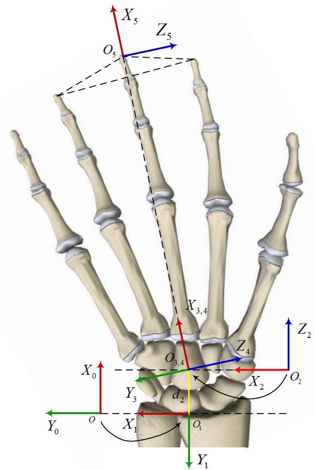
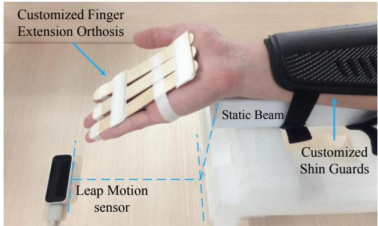
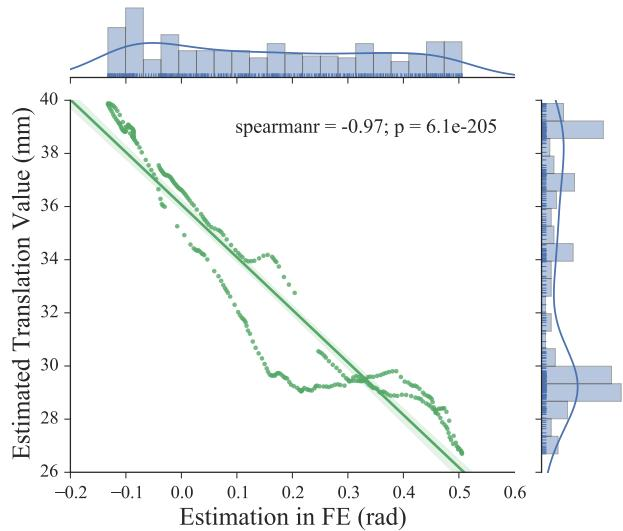
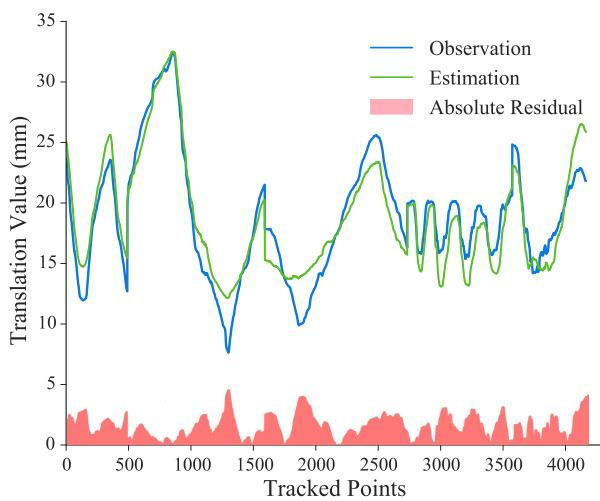
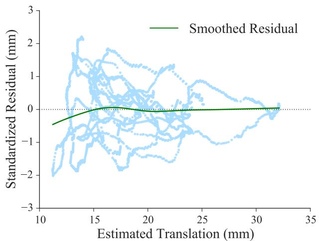

# 一种用于人机交互的改进腕部运动学模型（An Improved Wrist Kinematic Model for Human-Robot Interaction）

Ningbo Yu1 and Chang Xu2

摘要（Abstract）— 人体运动学对于与人体进行物理交互的康复及辅助机器人系统具有根本性的重要意义。腕部在灵巧的人机交互中扮演着核心角色，但传统的腕部运动学模型过度简化，存在固有的不精确性；而其生物力学模型又过于复杂，难以应用于机器人领域。本研究建立了一个改进的腕部运动学模型。通过无创、无标记的光学追踪技术，我们对腕部的在体（in vivo）运动学行为进行了研究。数据分析表明，在腕骨（carpal）旋转过程中存在可测量的动态轴线，这从原理上证明了若使用传统腕部模型，腕部与机器人表示之间必然存在错位（misalignment）。随后，我们提出了一种新颖的腕部运动学模型，该模型融合了刚体变换（rigid body transformation）与一个随轴线位置变化的移动副项（prismatic term），用以指示动态轴线的位置。通过将腕部角度耦合并进行非线性回归（nonlinear regression），已实现对该项的精确且实时的估计。所提出的模型不仅准确，而且便于应用，能够将解剖学行为转化为机器人实现与功能评估，从而实现精确且灵巧的人机交互。

## I. 引言（INTRODUCTION）

神经康复治疗（neurorehabilitation therapies）旨在在中枢或外周神经系统损伤后，促进上肢功能的部分或完全恢复 [1]、[2]。相较于传统的限制性诱导治疗方法，机器人辅助治疗（robot-assisted therapies）已在自适应参与（adaptive engagement）、康复过程的定量评估以及临床评估方面展现出潜在优势 [3]、[4]、[5]。此外，对于康复与辅助应用中的人体物理交互（physical human-robot interaction）而言，人体运动学具有根本性的重要意义。

运动追踪与运动学分析始终伴随着机器人神经康复治疗以及人机交互 [6]、[7]。上肢运动学在笛卡尔空间与关节空间中的评估，以及机器人外骨骼的人体工程学设计，本质上都依赖于精确的骨骼建模 [8]、[9]。具体而言，由于八块腕骨之间的关节活动以及腕关节内部解剖结构上的差异性，对腕关节运动学进行建模与量化颇具挑战。传统模型将上肢的骨骼结构近似为由刚性环节通过万向关节连接而成的系统 [3]、[10]。然而，由于假设腕关节仅存在旋转运动，并且将上肢解耦为相互独立的环节，不可避免地会出现机器人设备与人关节之间的不良对位偏差以及参数化运动学求解的不一致 [7]。上肢精细的耦合机制与灵巧运动无法通过过度简化的传统运动学模型得到充分研究与解释。因此，针对腕关节的功能评估以及康复器械的机械实现，在运动学分析与生物力学评价方面将存在缺陷。

不同于传统的运动学模型，部分研究已对耦合肢体生物力学进行了定量研究。在肌肉协同收缩条件下，对耦合手臂阻抗——通过惯性、阻尼与刚度等动态特性进行度量——进行了测量与估计 [11]。远端手臂的柔性运动对于灵巧操作至关重要，这些耦合关节的被动刚度同样得到了定量估计 [12].

除机器人康复研究外，腕关节与前臂的生物力学研究为关节运动学提供了详尽的描述性数据与合理的估算。已有研究提出了一种改进的前臂弹性运动学模型，该模型合理地解释了桡尺近侧关节中桡骨与尺骨之间的相对运动（即前臂骨之间的位移），而非将桡尺关节简单地描述为万向关节 [13]。针对腕部运动过程中腕骨运动学的体外与体内研究均表明，腕关节旋转并不存在固定的瞬时螺旋轴，并且由于腕骨之间存在显著的相对平移，复杂的腕关节无法简化为万向关节 [14]、[15]。为了评估腕关节的运动学与动力学特性，主要腕骨的旋转行为已得到定量描述，并定义了更为真实的坐标系 [16]、[17]。

然而，生物力学研究中呈现的解剖学特征与运动学行为均针对各块独立的腕骨进行阐释，且其专用的坐标系无法应用于机器人神经康复的功能评估。人机交互涉及末端执行器与远端关节的整体运动。这些生物力学坐标系过于复杂，以至于面向机器人评估的运动学分析难以从不同腕骨的独立行为中得出可行结论。

为应对上述过度简化及适用性不足的问题，基于远端臂关节耦合的解剖学调研与生物力学行为，本研究旨在建立一个更精确的腕关节运动学模型，使其更适用于将解剖学行为转化为机器人实现，并通过精确的灵巧人机交互进行功能评估。本研究采用无标记非侵入式光学追踪方法，对腕关节屈伸（FE）过程中腕关节的活体运动学行为进行了研究。通过 25 名健康未受伤受试者的实验，验证了该改进运动学模型的可行性与精度，并通过非线性回归定量论证了平移旋转轴的合理性。

## II. 方法

## A. 上肢常规模型

假设人体骨骼由刚性骨段构成，并通过无摩擦的万向关节相互连接，上肢常规运动学模型被引入，以活动范围（ROMs）与自由度（DOFs）对人体运动进行近似描述。

上肢包含三段刚性骨骼，在解剖学上分别描述为上臂、前臂与手（视为单一刚体段）。三处万向关节连接这些骨段，分别为肩关节、肘关节和腕关节 [10]。在假定这些关节仅发生旋转运动的前提下，可建立力学平衡方程，并提出共 7 个自由度的上肢常规运动学模型，如图 1 所示。常规坐标系 {0} 的原点位于两肩中点，三个坐标系位于复合肩关节的中心。人腕关节被视作具有 2 个自由度的万向关节：外展-内收（桡尺偏，RUD）$( X _ { 6 } Y _ { 6 } Z _ { 6 } )$ 与屈伸（FE）$( X _ { 7 } Y _ { 7 } Z _ { 7 } )$。末端执行器坐标系 {8} 位于伸展的指尖处，如图 1 所示。因此，末端执行器（人手）的位置与姿态可通过正运动学计算得到，关节空间中的角度运动则可通过逆运动学进行近似求解。

图 1. 上肢的传统模型 [10]。右上肢被建模为由三个万向关节连接的三段刚体，这三个关节分别是肩关节、肘关节和腕关节，分别记作 {1}、{4} 和 {6}。末端执行器（end-effector）的位置与姿态在坐标系 {8} 中相对于基坐标系 {0} 进行描述。上肢的 7 个自由度（7 DOFs）运动通过连续坐标系之间的旋转角 $\theta _ { i }$ 来描述。

图 2. 左手处于功能性中立腕关节位置时腕骨与掌骨的掌侧视图 [18]。由于腕骨列排列对运动学行为的约束，腕关节运动表现为桡腕关节（radiocarpal joint）和腕中关节（midcarpal joint）的组合运动，其旋转轴在头状骨（capitate）内并不固定。

## B. 腕关节运动中的腕骨运动学行为

腕骨区域由八块形状精巧、形态复杂的腕骨组成，这些腕骨之间相互连接形成关节，并与掌骨及远端桡尺关节产生复杂的相互作用。从左手腕关节的掌侧视图（如图 2 所示）可见，这些腕骨排列成近侧列（proximal row）和远侧列（distal row）。从近侧列的前面观来看，舟骨（scaphoid）、月骨（lunate）、三角骨（triquetrum）和豌豆骨（pisiform）由外侧至内侧依次排列；远侧列则由外侧至内侧依次由大多角骨（trapezium）、小多角骨（trapezoid）、头状骨（capitate）和钩骨（hamate）构成 [19]。

受腕骨间韧带（carpal ligaments）约束并结合独特的几何关节结构，每块腕骨具有六个自由度（six degrees of freedom, DOF），使腕部具有近乎半球形的运动范围，并导致腕骨运动学（carpal kinematics）的复杂性。因此，很难基于单块腕骨的运动学行为来精确描述完整的腕部运动 [17]。根据临床实践的解剖学基础，桡腕关节（radiocarpal joint）、腕骨间关节（intercarpal joint，包括近排腕骨间关节、中腕关节和远排腕骨间关节）和腕掌关节（carpometacarpal joint）共同构成腕部的整体关节 [18]。以往的研究解释了将腕部运动简化为桡腕关节和中腕关节运动的依据，其基础是将近排和远排腕骨视为刚性紧密的结构 [19]，[20]。桡腕关节是一个典型的髁状关节（condyloid joint），由近排腕骨与桡骨远端之间形成的两条轴线构成，允许屈伸（FE）、外展-内收和环转的双轴运动。同一腕骨排内的腕骨由韧带增强，呈现出一致的运动学行为，导致近排和远排关节内实际上没有相对运动 [20]。因此，腕骨间关节的运动与桡腕关节由同一肌肉驱动，并局限于中腕关节。基于腕骨的解剖学特征和合理简化的腕骨节段，复杂的腕部运动可描述为额状面内的屈伸（FE）、矢状面内的桡尺偏（RUD）和环转运动，这些运动主要发生在桡腕关节和中腕关节的联合运动中。

表 I  
改进模型的 D-H 参数

<table><tr><td>2</td><td> $\alpha _ { i - 1 }$ </td><td> $a _ { i - 1 }$ </td><td> $d _ { i }$ </td><td> $\theta _ { i }$ </td><td> $\beta _ { i }$ </td></tr><tr><td>1</td><td>0</td><td>0</td><td>0</td><td> $9 0 ^ { \circ }$ </td><td></td></tr><tr><td>2</td><td> $9 0 ^ { \circ }$ </td><td>0</td><td> $d _ { 2 }$ </td><td> $_ 0$ </td><td></td></tr><tr><td>3</td><td> $- 9 0 ^ { \circ }$ </td><td>0</td><td>0</td><td> $\theta _ { 3 }$ </td><td> $\beta _ { 3 } - 9 0 ^ { \circ }$ </td></tr><tr><td>4</td><td> $9 0 ^ { \circ }$ </td><td>0</td><td>0</td><td> $\theta _ { 4 }$ </td><td> $\beta _ { 4 }$ </td></tr><tr><td>5</td><td>0</td><td>a4</td><td>0</td><td>0</td><td></td></tr></table>

此外，头状骨（capitate）被称为远排腕骨的拱顶石（keystone），头状骨与远端第三掌骨之间的运动相对较小。头状骨还在近端与手舟骨（scaphoid）和月骨（lunate）形成关节连接 [20]。从临床功能和生物力学两方面来看，由于头状骨位置突出，能够反映腕部运动，因此在腕部屈伸和桡尺偏过程中将旋转轴定位于头状骨内是合理的。

根据传统模型，坐标系被建模为一个具有2个自由度的万向铰链（universal joint）。仅能描述绕枢轴点（pivot point）的旋转运动，而沿轴的线性位移则被排除在传统运动学模型之外。然而，无论是在体外（in vitro）还是体内（in vivo）研究中，关于腕关节运动期间腕骨的运动学均表明，腕骨旋转的中心并非固定于头状骨（capitate）的近端极。研究报告指出，枢轴点的位置存在变化，且腕骨存在明显可测量的平移[14]、[15]。人体腕关节屈伸（flexion/extension, FE）与桡尺偏（radial/ulnar deviation, RUD）的运动学远比传统模型所示的简化固定铰链或简单关节更为复杂，并呈现出独特的腕骨机制，而非如上肢传统模型所描述的那样。

## C. 腕关节运动的改进运动学模型

相较于上肢传统模型（参见图1）——该模型表明腕骨旋转发生在单一枢轴点周围，且腕关节类似于万向铰链——所提出的改进模型（参见图3）引入了一个移动副（prismatic joint），并结合2个自由度的转动副（revolute joints），可定位旋转中心并以更精确的方式描述各轴的平移行为。该模型为腕骨行为提供了符合生物力学的合理描述，并能更准确地估计腕关节运动学及上肢运动中末端执行器（end-effector，即指尖）的位置与姿态。

根据 Denavit-Hartenberg (D-H) 约定 [21]，改进坐标系的原点位于桡腕关节内的桡骨月骨近端关节面处（如图 3 所示）。X₀ 正轴平行于桡骨长轴并指向远端。Y₀ 正轴沿尺侧方向穿过桡骨茎突，并与 X₀ 轴垂直。坐标系 {1} 与 {0} 具有相同的原点，按照右手定则绕 Z₁ 轴相对 {0} 旋转 90°。坐标系 {2}、{3} 和 {4} 的一致原点位于初始构型（无屈伸或桡尺偏运动）的头状骨内，作为全腕运动中心的指示。由于第三掌骨与头状骨之间的相对运动在临床上可忽略不计，且安装夹具将中指与手掌刚性约束在一起（如图 1 所示），X₃,₄,₅ 轴和 Z₂ 轴与从 O₂ 到中指指尖 O₅ 的远端直线重合。沿 Z₂ 轴的平移记为 d₂，表示全腕运动旋转中心位置的变化。X₂ 正轴和 Y₃ 正轴在初始时与 Y₀ 重合。Z₃ 正轴表示桡尺偏向掌侧的旋转轴。桡尺偏角度 β₃（尺偏为正）由绕 Z₃ 轴的旋转 θ₃ 导出（如表 I 所示）。坐标系 {4} 绕 X₃ 轴相对 {3} 旋转 90°。Z₄ 正轴表示屈伸向桡侧的旋转轴，角度 θ₄ 等于 β₄，屈曲时为正。坐标系 {5} 位于由食指、中指和无名指指尖定义的平面内，由于夹具约束，该平面与掌侧面重合。它表示末端执行器的位置和姿态。

  
图 3. 改进的腕部运动学模型以右手腕掌侧视图展示。关于基坐标系 {0}，末端执行器的位置和姿态在坐标系 {5} 中描述，{5} 位于由三个指尖定义的平面内。腕部的 2 自由度运动通过坐标系 {3} 和 {4} 中的旋转角度描述，分别表示桡尺偏和屈伸角度。平移参数 d₂ 表示全腕运动旋转中心的可变位置。

## D. 改进模型的运动学分析

1) 正向运动学（Forward kinematics）：改进的运动学模型引入了一个移动关节（如图 3 中的关节 2），并结合转动关节（如图 3 中的关节 3 和关节 4），基于生物力学原理描述腕部运动中的腕骨行为。坐标系 {i} 相对于 {i-1} 的一般变换矩阵由下式给出

$$
\begin{array} { r l r } & { \mathbf { \zeta } _ { i } ^ { i - 1 } T = R o t _ { X } \left( \alpha _ { i - 1 } \right) T r a n s _ { X } \left( a _ { i - 1 } \right) R o t _ { Z } \left( \theta _ { i } \right) T r a n s _ { Z } } \\ & { \mathbf { \zeta } } & { = \left[ \begin{array} { c c c c } { c \theta _ { i } } & { - s \theta _ { i } } & { 0 } & { a _ { i - 1 } } \\ { s \theta _ { i } c \alpha _ { i - 1 } } & { c \theta _ { i } c \alpha _ { i - 1 } } & { - s \alpha _ { i - 1 } } & { - s \alpha _ { i - 1 } d _ { i } } \\ { s \theta _ { i } s \alpha _ { i - 1 } } & { c \theta _ { i } s \alpha _ { i - 1 } } & { c \alpha _ { i - 1 } } & { c \alpha _ { i - 1 } d _ { i } } \\ { 0 } & { 0 } & { 0 } & { 1 } \end{array} \right] } \end{array}\tag{1}
$$

其中 $c \theta _ { i }$ 和 $s \theta _ { i }$ 分别表示 $\cos \theta _ { i }$ 和 $\sin \theta _ { i }$，$R o t _ { Z } \left( \Theta \right)$ 和 $T r a n s _ { Q } \left( q \right)$ 分别表示旋转算子和平移算子。改进模型的正向运动学由一般齐次变换和 D-H 参数推导得到。两个相邻关节之间的变换矩阵计算如下：

$$
{ \mathrm { ~  ~ { ~ \sigma ~ } ~ } _ { 1 } ^ { 0 } T = \left[ \begin{array} { c c c c } { { 0 } } & { { - 1 } } & { { 0 } } & { { 0 } } \\ { { 1 } } & { { 0 } } & { { 0 } } & { { 0 } } \\ { { 0 } } & { { 0 } } & { { 1 } } & { { 0 } } \\ { { 0 } } & { { 0 } } & { { 0 } } & { { 1 } } \end{array} \right] \qquad { \mathrm { ~  ~ { ~ \sigma ~ } ~ } _ { 2 } ^ { 1 } T = \left[ \begin{array} { c c c c } { { 1 } } & { { 0 } } & { { 0 } } & { { 0 } } \\ { { 0 } } & { { 0 } } & { { - 1 } } & { { - d _ { 2 } } } \\ { { 0 } } & { { 1 } } & { { 0 } } & { { 0 } } \\ { { 0 } } & { { 0 } } & { { 0 } } & { { 1 } } \end{array} \right] } }
$$

$$
{ } _ { 3 } ^ { 2 } T = \left[ { \begin{array} { c c c c } { c _ { 3 } } & { - s _ { 3 } } & { 0 } & { 0 } \\ { 0 } & { 0 } & { 1 } & { 0 } \\ { - s _ { 3 } } & { - c _ { 3 } } & { 0 } & { 0 } \\ { 0 } & { 0 } & { 0 } & { 1 } \end{array} } \right] { \mathrm { ~ } } { \mathrm { ~ } } _ { 4 } ^ { 3 } T = \left[ { \begin{array} { c c c c } { c _ { 4 } } & { - s _ { 4 } } & { 0 } & { 0 } \\ { 0 } & { 0 } & { - 1 } & { 0 } \\ { s _ { 4 } } & { c _ { 4 } } & { 0 } & { 0 } \\ { 0 } & { 0 } & { 0 } & { 1 } \end{array} } \right]
$$

$$
{ \begin{array} { l } { { \frac { 4 } { 5 } } T = { \left[ \begin{array} { l l l l } { 1 } & { 0 } & { 0 } & { a _ { 4 } } \\ { 0 } & { 1 } & { 0 } & { 0 } \\ { 0 } & { 0 } & { 1 } & { 0 } \\ { 0 } & { 0 } & { 0 } & { 1 } \end{array} \right] } } \end{array} }\tag{2}
$$

为确定改进模型中末端执行器的位姿，计算相对于原点坐标系 $\{0\}$ 的正运动学如下：

$$
\begin{array} { r l } & { \frac { 0 } { 5 } T = \phantom { \frac { 1 } { 1 } } T _ { 2 } ^ { 1 } T _ { 3 } ^ { 2 } T _ { 4 } ^ { 3 } T _ { 5 } ^ { 4 } T } \\ & { \phantom { \frac { 0 } { 5 } } = \left[ \begin{array} { c c c c } { - s _ { 3 } c _ { 4 } } & { s _ { 3 } s _ { 4 } } & { c _ { 3 } } & { d _ { 2 } - a _ { 4 } s _ { 3 } c _ { 4 } } \\ { c _ { 3 } c _ { 4 } } & { - c _ { 3 } s _ { 4 } } & { s _ { 3 } } & { a _ { 4 } c _ { 3 } c _ { 4 } } \\ { s _ { 4 } } & { c _ { 4 } } & { 0 } & { a _ { 4 } s _ { 4 } } \\ { 0 } & { 0 } & { 0 } & { 1 } \end{array} \right] . } \end{array}\tag{3}
$$

2) 逆运动学：依据光学传感器在笛卡尔空间中所检测到的末端执行器位姿，逆运动学确定腕部运动过程中关节空间的旋转角度与轴向位置。如图 4 所示，传感器在坐标系 $\{L\}$ 中检测中指指尖的离散位置与姿态。$X_L$ 轴水平放置且与设备边缘平行，并与腕部坐标系中的 $Y_0$ 轴平行。$Y_L$ 轴的正方向垂直于 $X_0 Y_0$ 平面，并指向掌侧（volar）方向。

  
图 4. 通过 Leap Motion 记录坐标系 $\{5\}$ 相对于 $\{L\}$ 的位置与姿态。连接 $\{L\}$ 与 $\{0\}$ 的齐次变换矩阵由实验配置导出。

为进行逆运动学计算，需将末端执行器的位姿数据变换至改进模型中。给定光学传感器坐标系、原点坐标系及旋转矩阵，分别记为 $\{L\}$、$\{0\}$ 与 $R(\theta)$，则连接两坐标系的齐次变换矩阵描述为

$$
{ \bf \Phi } _ { L } ^ { 0 } T = \left[ \begin{array} { c c } { { \bf \Phi } _ { L } ^ { 0 } R \left( \theta \right) } & { { } ^ { 0 } P _ { L O R G } } \\ { { } ^ { 0 } { \bf \Phi } } & { { } ^ { 1 } } \end{array} \right] { \bf \Phi } _ { L } ^ { 0 } R \left( \theta \right) = \left[ \begin{array} { c c c } { { \bf \Phi } _ { 0 } } & { { } ^ { 0 } } & { { - 1 } } \\ { { - 1 } } & { { 0 } } & { { 0 } } \\ { { 0 } } & { { 1 } } & { { 0 } } \end{array} \right]\tag{4}
$$

其中 ${ } ^ { 0 } P _ { L O R G }$ 表示原点 $O _ { L }$ 相对于坐标系 {0} 的位置，该位置根据实验配置测得。由光学传感器追踪的末端执行器 {5} 的离散位置和姿态相对于坐标系 {L} 描述，记作 $_ 5 ^ { L } T$。对相对于原始坐标系 {0} 检测到的姿态施加齐次变换：

$$
\begin{array} { c } { { \begin{array} { c c c c } { { \mathrm { \ S } } } & { { T = \mathrm { { } } _ { L } ^ { 0 } T _ { 5 } ^ { L } T } } & { { } } & { { } } \\ { { } } & { { } } & { { } } \\ { { \mathrm { \ S } } } & { { { } o _ { x } } } & { { a _ { x } } } & { { p _ { x } } } \\ { { \mathrm { \ S } } } & { { \scriptstyle { \mathcal { O } } } } & { { a _ { y } } } & { { p _ { y } } } \\ { { \scriptstyle n _ { z } } } & { { \scriptstyle o _ { z } } } & { { a _ { z } } } & { { p _ { z } } } \\ { { 0 } } & { { \scriptstyle 0 } } & { { 0 } } & { { 1 } } \end{array} } } } \end{array}\tag{5}
$$

根据由（3）式正运动学推导得到的结果，FE 中的角度 $\theta _ { 4 }$、RUD 中的 $\theta _ { 3 } , \beta _ { 3 }$ 以及平移量 $d _ { 2 }$ 可由追踪数据计算得到：

$$
\theta _ { 4 } = \beta _ { 4 } = \arcsin \left( p _ { z } / a _ { 4 } \right)\tag{6}
$$

$$
\theta _ { 3 } = \arcsin \left( a _ { y } \right) , \beta _ { 3 } = \theta _ { 3 } + \frac { \pi } { 2 }\tag{7}
$$

$$
d _ { 2 } = p _ { x } - a _ { 4 } n _ { x }\tag{8}
$$

因此，FE 和 RUD 中相对于中立位的腕关节旋转角度可基于上肢姿态进行估算。平移参数 $d _ { 2 }$ 表示腕关节轴线的变化，并证明由于不可忽略的线性平移，腕关节不能被建模为一个简化的万向节。

3) 耦合关节拟合：沿腕关节轴线的明显平移与耦合的腕关节旋转密切相关。先前的研究表明[20]，不同受试者中可以观察到统计上一致的腕关节运动学行为。因此，应用模型参数拟合过程以找出腕关节旋转中心（由移动关节中的 $d _ { 2 }$ 描述）与耦合腕关节角运动（RUD 中的 $\beta _ { 3 }$ 和 FE 中的 $\beta _ { 4 }$）之间的精确数值方程。建立了一个非线性回归模型，将观测数据点集 $( x _ { i } , y _ { \mathrm { i } } , z _ { i } )$（其中 $( x , y , z )$ 表示 $( \beta _ { 3 } , \beta _ { 4 } , d _ { 2 } )$，$i = 1 , 2 , \dots , N$）拟合到一个非线性函数，该函数为由下式描述的二元二次多项式：

$$
{ \hat { z } } = { \frac { a _ { 1 } + a _ { 3 } x + a _ { 5 } y + a _ { 7 } x ^ { 2 } + a _ { 9 } y ^ { 2 } + a _ { 1 1 } x y } { 1 + a _ { 2 } x + a _ { 4 } y + a _ { 6 } x ^ { 2 } + a _ { 8 } y ^ { 2 } + a _ { 1 0 } x y } }\tag{9}
$$

其中未知参数 $a _ { j } \ ( j = 1 , \ldots , 1 0 )$ 通过简单遗传算法（Simple Genetic Algorithm, SGA）进行优化，以最小化观测数据集与估计数据集之间的误差平方和（Sum of Square Error, SSE）

$$
S S E = \sum _ { i = 1 } ^ { N } \varepsilon _ { i } ^ { 2 } = \sum _ { i = 1 } ^ { N } \left[ w _ { i } ( z _ { i } - \hat { z } _ { i } ) ^ { 2 } \right]\tag{10}
$$

其中 $\varepsilon _ { i }$ 为残差项，$w _ { i }$ 为权重，设为 1。$a _ { j }$ 的候选解通过实数编码向量编码至染色体中，初始种群规模根据经验设为 20。父代染色体通过随机选择进行配对，交叉算子采用均匀交叉方法，交叉概率根据经验设为 0.85。一般而言，变异率设为 0.005，鉴于算法整体的收敛速度与计算成本，该值相对较低。

采用拟合优度指标来描述估计参数 $a _ { j }$ 与观测值之间的拟合程度。标准化残差 $r _ { i }$ 由 $\varepsilon _ { i }$ 与平均残差 $\bar { \varepsilon }$ 推导得出

$$
r _ { i } = \frac { \varepsilon _ { i } } { \sqrt { \frac { 1 } { N - 1 } \displaystyle \sum _ { i = 1 } ^ { N } \left( \varepsilon _ { i } - \bar { \varepsilon } \right) ^ { 2 } } }\tag{11}
$$

均方根误差（Root Mean Square Error, RMSE）表示估计值与观测值之间的偏差，通常被视为一种尺度依赖型残差度量

$$
\begin{array} { r } { \displaystyle R M S E = \sqrt { M S E } = \sqrt { S S E / N } } \\ { = \sqrt { \frac { 1 } { N } \displaystyle \sum _ { i = 1 } ^ { N } \left[ w _ { i } ( z _ { i } - \hat { z } _ { i } ) ^ { 2 } \right] } } \end{array}\tag{12}
$$

决定系数，记为 $R ^ { 2 }$ ，表示估计在反映观测变化方面的拟合优度，其计算方法为估计值与观测值之间相关系数的平方

  
图 5. 实验装置与配置，包括定制的指伸矫形器与护胫板，用于约束手部和前臂的无关运动。

$$
\begin{array} { r l r } { R ^ { 2 } = \frac { S S R } { S S T } = 1 - \frac { S S E } { S S T } } \\ { \underset { = } { \overset { N } { \sum } } \left[ w _ { i } ( \hat { z } _ { i } - \bar { z } _ { i } ) ^ { 2 } \right] } & { = 1 - \frac { \underset { i = 1 } { \overset { N } { \sum } } \left[ w _ { i } ( z _ { i } - \hat { z } _ { i } ) ^ { 2 } \right] } { \underset { i = 1 } { \overset { N } { \sum } } \left[ w _ { i } ( z _ { i } - \bar { z } _ { i } ) ^ { 2 } \right] } } \end{array}\tag{13}
$$

SSR 表示回归平方和（regression sum of squares）。SST 表示总平方和（total sum of squares），与数据方差成正比。$R ^ { 2 }$ 在统计学上介于 0 到 1 之间，$R ^ { 2 }$ 为 1 表示估计结果完全拟合观测值。

## E. 受试者与实验流程

实验旨在追踪人体上肢运动并验证所提出的改进运动学模型。在获得知情同意后，招募了 25 名年龄在 21 至 27 岁之间的健康年轻受试者（其中女性 4 名，年龄 $2 2 . 8 \pm 1 . 3$ 岁；男性 21 名，年龄 $2 4 . 6 \pm 1 . 2$ 岁）参与实验。所有受试者均无影响前臂运动的上肢病变或慢性疾病的影像学或病史证据。本研究采用光学传感器追踪并研究每名受试者右手腕的运动。根据爱丁堡利手量表（Edinburgh Handedness Inventory）[22]，所有受试者均表现为右手优势。本研究无需伦理审批。

通过 Leap Motion 传感器记录每名受试者在腕关节屈伸（FE）运动过程中的前臂运动。Leap Motion 传感器为追踪人类手部和手指的运动，并在近距离操作空间内记录前臂的离散位置与手势提供了创新性解决方案 [23]、[24]、[25]。针对该光学设备追踪精度和鲁棒性的研究表明，在静态与动态测量中均达到了 0.7 mm 的总体平均精度。在实验条件下，目标位置与测量位置之间的偏差小于 0.2 mm，且与坐标轴无关 [26]。另一项研究显示，所获得的标准差介于 0.0081 mm 至 0.49 mm 之间 [27]。上述研究表明，Leap Motion 传感器是一款精度与可靠性较高的追踪系统，专用于检测人类手部的运动。

如图5所示，所有志愿者坐在实验台旁边，将前臂放置在轴向静止的横梁上，与横梁长轴平行，肘关节屈曲约 $9 0 °$ ，肩关节外展约 $4 5 ^ { \circ }$ 。前臂由定制的护胫约束，并持续固定在静止横梁上，从而在前臂中不产生旋前-旋后（pronation-supination, PS）运动。定制的手指伸展矫形器固定在受试者的手掌上，约束食指、中指和无名指的指间关节、掌指关节和腕掌关节之间的相对运动，这些手指伸展并与手掌掌侧平面重合。中指沿桡骨长轴在远端被专门固定，确保中指与根据国际生物力学学会（International Society of Biomechanics, ISB）建议[28]所定义的头状骨（capitate）$Y$ 轴共线。腕部相对于桡骨的功能中立位根据ISB建议定义，前臂的中立位定义为处于中立PS位置。除了中立位外，还要求受试者在屈曲 $3 0 ^ { \circ }$ 至伸展 $1 0 ^ { \circ }$ 的范围内平稳地旋转腕部。被跟踪手部的轨迹由可视化应用程序同时显示。要求受试者在40秒内缓慢完成FE运动中的10个循环，以确保准确跟踪。一个典型的循环运动包括从中立位运动到伸展位，然后到屈曲位，最后回到中立位。

## III. 结果

提取并展示了实验数据以验证改进模型的可行性和准确性。如图6所示，平移参数 $d _ { 2 }$ 表明腕部旋转轴的位置并非固定在单一点上。 $d _ { 2 }$ 的值在一个FE运动循环中明显变化。与FE中的角度相比，腕部伸展时由较大 $d _ { 2 }$ 所表示的旋转轴位置比腕部屈曲时的位置更靠近远端。对FE中 $d _ { 2 }$ 与 $\beta _ { 4 }$ 进行了线性回归分析。Spearman秩相关系数为 $- 0 . 9 7 \ ( p = 6 . 1 e ^ { - \bar { 2 } 0 5 } )$ ，表明 $d _ { 2 }$ 与 $\beta _ { 4 }$ 之间存在统计学上的高度相关性，负相关表明当 $\beta _ { 4 }$ 增加时 $d _ { 2 }$ 趋于减小。可以得出结论：腕骨关节不能被建模为简单关节，腕骨旋转轴在腕部伸展时向远端移动，在腕部屈曲时向近端移动。这些结果与之前的生物力学研究[20]一致。

  
图6. 一个FE运动循环中可测量平移参数 $d _ { 2 }$ 的计算。

  
图 7. 基于九名受试者追踪数据的平移参数 d₂ 与估计腕部角度 β₃,₄ 之间的非线性回归结果。

随机选取九名受试者（两名女性，年龄 22.0±1.4；七名男性，年龄 25.0±1.4）的追踪数据用于模型参数拟合过程。由逆运动学（inverse kinematics）得出的 β₃,₄ 数据被组合在一起，用于拟合精确估计 d₂ 的非线性函数，如式(7)所述。未知参数 aⱼ (j=1,…,10) 通过 SGA 进行优化，拟合结果如图 7 所示

  
图 8. 通过平滑标准化残差对回归性能的解释。

  
图 9. 十六名受试者由计算得到的 d₂ 与估计的 d̂₂ 所得残差的箱线图。

并由下式描述

$$
\begin{array} { r l } & { \hat { d } _ { 2 } = } \\ & { \frac { 1 8 . 0 0 - 2 9 0 . 9 3 \beta _ { 3 } - 2 9 . 4 6 \beta _ { 4 } + 2 5 6 3 . 0 9 \beta _ { 3 } ^ { 2 } + 3 7 . 0 1 \beta _ { 4 } ^ { 2 } - 6 0 6 . 5 3 \beta _ { 3 } \beta _ { 4 } } { 1 - 1 0 . 6 0 \beta _ { 3 } - 2 . 2 3 \beta _ { 4 } + 9 4 . 6 2 \beta _ { 3 } ^ { 2 } + 2 . 1 2 \beta _ { 4 } ^ { 2 } - 2 5 . 7 5 \beta _ { 3 } \beta _ { 4 } } } \end{array}\tag{14}
$$

标准化残差 rᵢ 通过局部加权散点平滑（LOWESS）方法进行计算与分析。如图 8 所示，残差图近似呈对称分布，散点聚集在 rᵢ = 0 的直线附近。除了 rᵢ 之外，SSE、RMSE、相关系数（R）以及 R² 的数值分别为 7565.68、1.35、0.96 和 0.93。上述所有统计结果均证实了拟合过程的准确性，并阐明了旋转轴与耦合腕部角度之间的定量关联。

左侧十六名受试者的追踪数据（其中女性 2 名，年龄 $2 3 . 5 \pm 0 . 7$；男性 14 名，年龄 $2 4 . 8 \pm 1 . 5$）被用于验证拟合公式 (14)。每位受试者的腕部角度 $\beta _ { 3 , 4 }$ 由改进模型的逆运动学计算得出，并通过公式 (14) 用于估算 $d _ { 2 }$。将估算值 $\hat { d } _ { 2 }$ 与由公式 (8) 导出的 $d _ { 2 }$ 计算结果进行比较，以说明改进模型在十六名受试者中的精度。如图 9 所示，所有受试者的整体残差值落在 -12 mm 至 10 mm 的范围内。所有受试者的 $\hat { d } _ { 2 }$ 与 $d _ { 2 }$ 之间的总体平均偏差为 $- 0 . 3 9 \pm 3 . 1 4$ mm，所有受试者的平均百分比误差为 $8 . 0 0 \pm 3 . 2 7 \%$。可以得出结论，所提出的公式准确地估算了非固定旋转轴的位置，且结果在二十名受试者中具有统计学一致性。

## IV. 讨论

### A. 腕部生物力学的一致性

实验招募了 25 名无远端上肢病变的健康年轻受试者，其中女性 4 名，男性 21 名。先前的研究表明，未受伤受试者之间的腕骨运动学具有高度一致性。受试者之间在体内腕骨行为和远端上肢生物力学机制方面的差异在统计上可忽略不计，且右腕与左腕之间的差异不显著 [20]。此外，男性与女性之间所表现的旋转轴位置差异与受试者的解剖尺寸相关 [17]。研究指出，腕部运动参数与性别无关，而浮动轴的位置与腕骨体积及中性质心位置相关 [15], [20]。因此，基于先前有关个体腕骨运动学一致性的证据，根据所述的受试者招募标准进行验证实验是合理的。

### B. 腕骨运动学的测量

以往生物力学研究报告了体内（in vivo）与体外（in vitro）实验技术之间的显著差异。在体外研究中，反射性针和标记物被植入腕骨内 [14]、[29]。这种有创植入技术可能会改变上覆肌腱和周围软组织的运动学特征。运动学标记物施加的外部约束会干扰单个腕骨的运动以及腕部内部的力学交互。肌肉的正常收缩和肌腱载荷由附加机构进行模拟，由此不可避免地产生与体内模拟的未知偏差，并且肌肉动力学的细微变化可能会显著影响腕部运动 [14]。体内研究通常采用计算机断层扫描（CT），而涉及安全辐射暴露的问题可能会限制扫描方案的持续时间和实验样本的数量 [17]、[30]。与植入式测量和扫描技术相比，所提出的无创无标记方法为人机交互提供了更适用的远端手臂光学追踪解决方案，并真实地恢复了腕部的自然运动。此外，研究报告了静态与动态腕部运动之间在统计学上可忽略的差异，并且从静态扫描程序获得的追踪数据近似于动态被动腕骨运动学。可以得出结论：腕骨运动学可以通过静态或动态方式进行测量 [16]。因此，在相对较慢的运动速度下进行所提出的光学追踪程序是合理的。

## C. 机器人神经康复的实施原理

神经康复的功能评估和机器人康复设备的机械实现根本上基于人体生物力学合理的运动学模型 [6]、[7]。在假设解耦腕关节中仅存在旋转运动的情况下，传统上肢运动学模型无法精确估计末端执行器和腕关节的姿态。这种不可避免的局限性以及关节运动学与机器人评估之间不期望的未对准将在关节空间中为康复评估带来不可靠的参数。所提出的改进腕部运动学模型已经证实了腕骨旋转中可测量非固定轴的存在，并基于耦合腕部角度提供了轴位置的精确估计。因此，基于该精确模型在关节空间中对远端手臂进行运动学评估是可行且有效的，为神经康复提供了客观的定量测量。此外，Denavit-Hartenberg（D-H）参数表示法是一种通用且标准化的机器人表示法 [8]。所提出的腕部运动学模型可以直接应用于机器人领域，对于外骨骼和机器人神经康复评估的机器人实现至关重要。

## V. 结论

上肢运动学的精确评估是深入理解人机物理交互、从而实现机器人神经康复与辅助的关键。尤其是，人体腕关节的真实生物力学建模对于辅助外骨骼的符合人体工程学设计以及人机协作至关重要。在本研究中，所提出的改进运动学模型验证了腕骨旋转中可测量的非固定轴的存在，这印证了先前研究所指出的观点——机器人表示与人体关节之间不可避免地会出现错位与过度简化。通过将腕关节角度耦合并进行非线性回归，实现了轴位置的精确估计。在未受伤受试者上开展的实验，结合光学跟踪方法与基于机器人建模的数值优化，验证了该改进模型的有效性。因此，基于所提出的模型，对远端手臂在关节空间中的运动学评估是可行且有效的，能够为人机物理交互以及机器人神经康复的量化实现提供支撑。

## 参考文献

[1] V. Klamroth-Marganska, J. Blanco, K. Campen, A. Curt, V. Dietz, T. Ettlin, M. Felder, B. Fellinghauer, M. Guidali, A. Kollmar, et al., "中风后手臂的三维、任务特异性机器人治疗：一项多中心、平行组随机试验," *Lancet. Neurol.*, 卷 13, 期 2, 页 159–166, 2014.

[2] J.-C. Metzger, O. Lambercy, A. Califfi, D. Dinacci, C. Petrillo, P. Rossi, F. M. Conti, and R. Gassert, "机器人辅助治疗中评估驱动的运动难度选择与适应：一项使用手部康复机器人的初步研究," *J. Neuroeng. Rehabil.*, 卷 11, 期 1, 页 1, 2014.

[3] P. Maciejasz, J. Eschweiler, K. Gerlach-Hahn, A. Jansen-Troy, and S. Leonhardt, "上肢康复机器人装置综述," *J. Neuroeng. Rehabil.*, 卷 11, 期 1, 页 1, 2014.

[4] S. F. Atashzar, M. Shahbazi, O. Samotus, M. Tavakoli, M. S. Jog, and R. V. Patel, "上肢病理性震颤的特征化分析：在增强型触觉康复系统设计中的应用," *IEEE Journal of Selected Topics in Signal Processing*, 卷 10, 期 5, 页 888–903, 2016.

[5] C. Xu, S. Li, K. Wang, Z. Hou, and N. Yu, "双侧手臂康复训练中瘫痪侧肢体灵活性与双侧肢体协调性的定量评估," 载于 *2017 国际康复机器人大会 (ICORR)*. IEEE, 2017, 页 634–639.

[6] M. D. Rinderknecht, O. Lambercy, V. Raible, I. Busching, A. Sehle, J. Liepert, and R. Gassert, "中风后手部本体感觉缺损的快速客观评估的可靠性、效度及临床可行性," *Journal of neuroengineering and rehabilitation*, 卷 15, 期 1, 页 47, 2018.

[7] T. Nef, M. Guidali, and R. Riener, "ARMin III——具有符合人体工程学肩部驱动的上肢治疗外骨骼," *Appl. Bionics. Biomech.*, 卷 6, 期 2, 页 127–142, 2009.

[8] V. J. Santos and F. J. Valero-Cuevas, "所报告的解剖学变异性天然地导致人类拇指 Denavit-Hartenberg 参数的多模态分布," *IEEE 汇刊：生物医学工程*, 第53卷, 第2期, 第155–163页, 2006年.

[9] K. Wang, S. Li, C. Xu, and N. Yu, "用于手臂康复训练与评估的扩展运动学模型," 发表于 *2016年先进机器人与机电一体化国际会议 (ICARM)*. IEEE, 2016年, 第117–121页.

[10] M. Babaiasl, S. H. Mahdioun, P. Jaryani, and M. Yazdani, "中风后上肢机器人辅助康复的技术与临床方面综述," *残疾人康复辅助技术*, 第11卷, 第4期, 第263–280页, 2016年.

[11] H. Patel, G. O'Neill, and P. Artemiadis, "关于肌肉共收缩对三维人体手臂阻抗的影响," *IEEE 汇刊：生物医学工程*, 第61卷, 第10期, 第2602–2608页, 2014年.

[12] D. Formica, S. K. Charles, L. Zollo, E. Guglielmelli, N. Hogan, and H. I. Krebs, "腕关节与前臂的被动刚度," *神经生理学杂志*, 第108卷, 第4期, 第1158–1166页, 2012年.

[13] A. Kecskemethy and A. Weinberg, "用于生物保真医学诊断的人体前臂改进型弹-运动学模型," *多体系统动力学*, 第14卷, 第1期, 第1–21页, 2005年.

[14] R. M. Patterson, C. L. Nicodemus, S. F. Viegas, K. W. Elder, and J. Rosenblatt, "正常腕关节的高速三维运动学分析," *手外科杂志*, 第23卷, 第3期, 第446–453页, 1998年.

[15] C. Neu, J. Crisco, and S. Wolfe, "腕屈伸与桡尺偏运动中桡-头状关节的体内运动学行为," *生物力学杂志*, 第34卷, 第11期, 第1429–1438页, 2001年.

[16] M. Foumani, S. Strackee, R. Jonges, L. Blankevoort, A. Zwinderman, B. Carelsen, and G. Streekstra, "腕屈伸与桡尺偏运动中腕骨体内三维运动学:动态运动与逐步静态腕位," *生物力学杂志*, 第42卷, 第16期, 第2664–2671页, 2009年.

[17] J. C. Coburn, M. A. Upal, and J. J. Crisco, "腕部腕骨的坐标系," *生物力学杂志*, 第40卷, 第1期, 第203–209页, 2007年.

[18] S. Standring, *格氏解剖学电子书:临床实践的解剖学基础*. Elsevier Health Sciences, 2015年.

[19] R. Drake, A. W. Vogl, and A. W. Mitchell, *学生版格氏解剖学*. Elsevier Health Sciences, 2014年.

[20] S. W. Wolfe, C. Neu, and J. J. Crisco, "屈曲与伸展过程中舟骨、月骨与头状骨的体内运动学," *手外科杂志*, 第25卷, 第5期, 第860–869页, 2000年.

[21] J. Denavit and R. S. Hartenberg, "基于矩阵的低副机构运动学记号," *应用力学杂志*, 第22卷, 第215–221页, 1955年.

[22] R. C. Oldfield, "利手性的评估与分析:爱丁堡量表," *神经心理学*, 第9卷, 第1期, 第97–113页, 1971年.

[23] M. Iosa, G. Morone, A. Fusco, M. Castagnoli, F. R. Fusco, L. Pratesi, and S. Paolucci, "基于Leap Motion控制的电子游戏疗法用于亚急性脑卒中老年患者的康复：一项可行性初步研究," *Top. Stroke Rehabil.*, 卷 22, 期 4, 页 306–316, 2015.

[24] N. Yu, C. Xu, H. Li, K. Wang, L. Wang, and J. Liu, "融合触觉与手势传感器用于双手协调与灵巧操作的康复," *Sensors*, 卷 16, 期 3, 页 395, 2016.

[25] C. Xu, H. Li, K. Wang, J. Liu, and N. Yu, "基于手势与触觉接口的手臂协调与操作功能双臂康复方法," 载于 *IEEE 机器人与仿生学国际会议论文集 (ROBIO)*, 中国珠海, 2015年12月, 页 309–313.

[26] F. Weichert, D. Bachmann, B. Rudak, and D. Fisseler, "Leap Motion控制器精度与鲁棒性分析," *Sensors*, 卷 13, 期 5, 页 6380–6393, 2013.

[27] J. Guna, G. Jakus, M. Pogacnik, S. Tomaˇ ziˇ c, and J. Sodnik, "Leap Motion传感器精度与可靠性分析及其在静态与动态跟踪中的适用性," *Sensors*, 卷 14, 期 2, 页 3702–3720, 2014.

[28] G. Wu, F. C. Van der Helm, H. D. Veeger, M. Makhsous, P. Van Roy, C. Anglin, J. Nagels, A. R. Karduna, K. McQuade, X. Wang, et al., "国际生物力学学会 (ISB) 关于人体关节运动报告中各关节坐标系定义的建议 第二部分：肩、肘、腕与手," *J. Biomech.*, 卷 38, 期 5, 页 981–992, 2005.

[29] C. Neu, R. McGovern, and J. Crisco, "三种表面配准方法在三维腕骨研究中的运动学精度," *J. Biomech. Eng.*, 卷 122, 期 5, 页 528–533, 2000.

[30] N. Yu, N. Estevez, M.-C. Hepp-Reymond, S. S. Kollias, and R. Riener,´ "使用磁共振兼容机械臂对上肢相关脑激活的fMRI评估," *Int. J. Comput. Assist. Radiol. Surg.*, 卷 6, 期 3, 页 447–455, 2011.