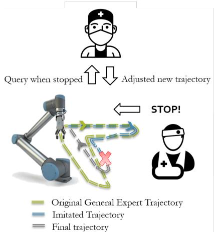
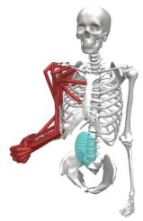
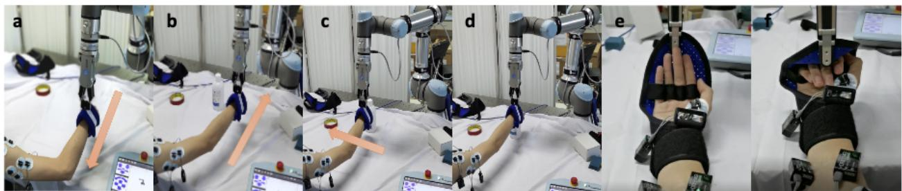
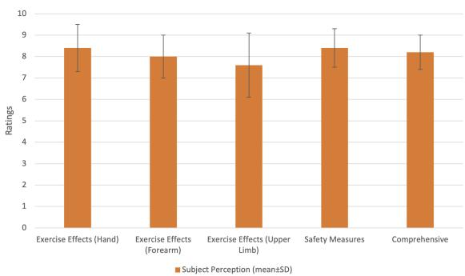

基于协作机器人的自适应学习上肢康复训练系统

Jun Hong Lim, Kaibo He, Zeji Yi, Chen Hou, Chen Zhang, Yanan Sui, Luming Li

摘要—运动功能障碍患者的康复训练通常需要在康复中心使用专用设备。基于家庭的多用途训练将显著提高治疗的可及性并降低医疗成本。虽然在家中配备一套康复机器人不太现实，但我们研究了使用通用协作机器人进行康复治疗的可行性。在本研究中，我们开发了一个使用通用机械臂并结合人体运动反馈与偏好的多用途上肢康复训练新系统。我们将表面肌电图（surface electromyography）、力/力矩传感器（force/torque sensors）、RGB-D 相机（彩色与深度相机）以及机器人控制器集成于机器人操作系统（Robot Operating System, ROS）中，以实现系统的感知、通信与控制。系统采用模仿学习（imitation learning）方法来模仿专家提供的训练轨迹，这些轨迹能够根据受试者的能力进行自适应调整，从而促进家庭训练的开展。该康复系统能够使用基于夹爪的末端执行器（gripper-based end-effector）进行大运动功能和精细运动技能训练。我们在 Gazebo 中对系统控制进行了仿真，并在 OpenSim 中对训练效果（肌肉激活水平）进行了仿真，同时通过人体受试者评估了其真实性能。对于所有入组的受试者而言，在相同条件下，相比于由康复治疗师辅助的康复训练，我们的系统取得了更好的训练效果。本研究证明了将协作机器人用于家庭运动康复训练的可行性。

临床意义—该协作机器人系统能够提供与专用康复机器人相当的安全、有效的训练，使便捷的家庭康复训练成为可能。

## I. 引言

康复训练对于运动功能障碍患者的康复至关重要。患者需要在配备专用设备的专门康复中心，由经验丰富的治疗师开展密集且重复的训练，以增强肌肉力量和神经可塑性。这是他们重获运动功能并回归正常生活的主要途径。对于患有中风等神经系统疾病及损伤的患者而言，上肢运动功能障碍是常见的后遗症。一旦患者病情稳定且可确立康复目标，就应立即开始训练。It can help strength weak muscles to prevent muscle atrophy and recover motor functions, avoiding hand edema or shoulder joint subluxation due to lack of movement.

机器人系统，包括专用机器人和通用机器人，因其能够稳定地执行重复任务而被广泛应用于康复治疗。专用机器人通常被设计用于训练特定任务，而通用机器人可用于多种场景，与专用系统相比具有更高的自由度，并且更具成本效益。

  
图 1：根据受试者能力调整的训练

在过去的几十年中，已开发出多种用于上肢康复的专用机器人康复设备和控制系统 [2]、[11]、[12]。这些康复机器人和辅助控制系统可在治疗师监督或不监督的情况下引导患者完成训练过程。它们还可以帮助收集训练数据，以便治疗师评估患者的当前状况。

关于将通用协作机器人应用于康复任务的研究尝试较为有限。协作机器人（Cobots）能够与人类协同工作，并且通常符合安全标准，显示出在康复过程中部署的潜力。Kyrkjebø 等人 [3] 尝试通过限制工作空间来补充内置安全机制，从而提高协作机器人的安全性。他们的结果表明，使用协作机器人辅助康复训练是可行的。Nielsen 等人将动态运动基元与力反馈相结合，用于预先记录和学习康复任务，以适应不同的手臂长度 [4]。[5] 中的另一项工作使用了具有 7 自由度的 KUKA 机械臂。该机械臂结合了按需辅助（assist-as-needed）原则，可为不同辅助需求的患者提供激励。上述所有方法都提出了一种实现重复任务的主要方式，且患者能够较为独立地练习日常活动，从而减少所需的监督。

获取康复中心服务的过程耗时且费用高昂，加上资源有限地区的人手短缺，可能会延迟患者的康复阶段。解决该问题的一种可能方式是使用远程训练系统，提供与面对面训练相当的效果。在本工作中，我们提出了一种基于协作机器人的远程自适应上肢训练系统。该系统将协作机器人、电影摄像机、运动传感器、治疗师和受试者集成在一个平台中。它能够执行不同类型的训练，并达到与常见康复机器人相当的训练效果，证明了部署通用协作机器人在家中促进个性化康复训练、从而减少频繁前往康复中心的可行性。

(c)  
  
图 2：所提出的远程系统概述

## II. 方法

我们提出了一种用于辅助康复训练的新型远程系统，并将其与 ROS（Robot Operating System，机器人操作系统）平台集成，以实现一组硬件之间的通信（如图 2 所示）。我们采用了基于夹爪（gripper-based）的末端执行器，用于引导那些使用以往末端执行器方法无法完成的精细运动任务。受试者可能过于虚弱而无法握住夹爪，因此我们在医生和治疗师的协助下开发了这一康复任务，这对于脑卒中早期康复训练而言非常重要。所提出的系统通过 Gazebo 和 OpenSim 仿真进行了验证。我们通过表面肌电信号（sEMG）并与经验丰富的训练师进行对比实验，检验了训练效果，以揭示其在多用途康复中的可行性。

受试者由协作机器人（Cobot）的末端执行器引导完成训练。动作、手势与康复时长依据脑卒中指南进行设计，并结合经验丰富的内科医生与治疗师的指导、修订与建议，以服务于急性期患者 [1]、[16]。本文提出了两项任务：一项用于粗大运动层面的上肢康复，另一项用于精细运动层面的手部康复。对于上肢康复，我们选择了日常生活活动（ADL, Activities of Daily Living）中的基本任务，该任务在日常生活中至关重要。对于手部康复，我们选择了手指训练任务，以促进手指的灵活性。在握拳与张拳的过程中，该任务会激活整个手部与前臂的肌肉。因此，它为急性期患者提供了更好的训练效率，帮助他们逐步建立肌肉力量。受试者前臂佩戴了一件辅助装置（如图 7(e) 和 (f) 所示），其抓握位置由 Kinect 相机通过计算机视觉方法 [8] 进行实时识别。

  
(a)

  
(b)

  
图 3：(a) 在 Gazebo 中具有视觉与运动反馈的训练系统仿真。(b) 在 OpenSim 中粗大运动层面训练的仿真。(c) 在 OpenSim 中精细运动层面训练的仿真。

如图 3(a) 所示，我们搭建了一个 Gazebo 仿真环境。摄像机的布置能够清晰观察工作空间，RGB-D 图像被传输到我们的系统中，用于识别受试者辅助设备的抓握点。由于身体限制（如活动范围）所产生的阻力由力/扭矩传感器追踪，并同时上报给控制器进行分析。我们为紧急情况设定了一个阻力阈值，若 $\begin{array} { r } { \textbf { \textit { F } } \ge \ \boldsymbol { F _ { s a f \epsilon } } } \end{array}$（45N），协作机器人（Cobot）触发紧急停止，因为进一步的动作可能导致额外伤害。我们根据视觉识别为每位受试者设定了起点。该仿真被用于验证任务可行性，模仿学习智能体也利用该环境，基于通用专家数据学习自适应控制策略。专家轨迹和模仿轨迹在 Gazebo 和 OpenSim 仿真器中进行仿真，以确保其安全性，并评估相应的肌肉激活率，以优化第 II 节中描述的任务。

安全是我们对丰富人机交互任务的首要考虑。除了出厂默认的安全配置之外，协作机器人的安全配置被设为三个阶段，由受试者的体能、康复臂的活动范围（ROM）及其康复阶段所决定。这些阶段在工作空间确定、训练过程中施加的加速度和速度方面有所不同。

OpenSim[6] 是一个开源的基于模型的生物力学仿真软件，被广泛用于人体运动学与动力学分析。我们在 OpenSim 中构建了两个肌肉骨骼模型，以验证目标肌肉能否被有效激活。如图 3 所示，针对手臂康复，我们基于 [7] 构建了一个上半身模型，主要包括手、手臂和肩膀的骨骼与肌肉。针对手部康复，我们构建了一个上肢模型，其中包括手部和前臂详细而精确的骨骼与肌肉。

在仿真中，我们从 Gazebo 仿真中获得了协作机器人末端执行器的初始轨迹（初始夹爪轨迹）。然后我们使用该轨迹驱动肌肉骨骼模型，并计算肌肉激活情况。根据肌肉激活结果，我们与临床专家讨论以调整任务，生成新的轨迹，并再次驱动模型以计算肌肉激活结果。经过若干次调整，我们获得了合适的任务并验证了其有效性。

模仿学习使智能体能够从专家演示中学习策略/轨迹。它在康复机器人领域具有很大的应用潜力。对于远程训练，治疗师不在现场指导协作机器人完成康复任务。相反，他们可以提供通常适用于受试者的轨迹。这充当了专家标注的参考。学习智能体在受试者侧通过模仿学习执行该轨迹，并根据身体条件和个人偏好进行调整。

与自动驾驶车辆不同，康复训练中并没有轨道边界来限制智能体。每个受试者都有由其生物条件决定的不同边界。在我们的方法中，如图 1 所示，当轨迹对受试者来说太困难时，他们可以按下"停止"按钮。这类似于自动驾驶中违反轨道边界。基于这一原理，我们采用了受 HG-DAgger [17] 启发的模仿方法，并进行了修改以适应我们的问题。

在我们的系统中，提供的专家轨迹会一直部署到受试者标记了负面反馈为止，然后由专家调整训练任务。停止状态将被标记为不良状态。之前的那些状态被视为可接受状态。然后，专家将提供调整后的后续轨迹，并从该状态使用调整后的轨迹恢复训练。该过程将重复，直到受试者接受整个轨迹。最终轨迹将被训练并导出针对该受试者个性化的策略。

从训练模型为新的专家数据测试集执行的实际轨迹如图 4 所示。该模型通过预测轨迹 $( x _ { g } , y _ { g } , z _ { g } )$ 与原始专家轨迹 $( x _ { i } , y _ { i } , z _ { i } )$ 之间的距离的 RMSE 进行评估。

从受试者角度获得的反馈也是有价值的，因为它直接反映了他们在训练过程中与协作臂交互的感受。为了接收和研究这些反馈，我们设计了一份调查问卷，以在通过我们的康复系统训练后获取他们对手臂和手部锻炼程度、所采取的安全措施以及任务整体综合评分的看法。

  
图 4：从训练模型为另一条新的专家轨迹（红线）执行的实际轨迹（蓝色）。红色区域是专家可接受区域。RMSE 约为 1e − 2m。

## III. 实验与结果

我们招募了五名健康受试者，以评估本康复系统所提供训练的安全性与可行性。两种任务的初始专家轨迹均由专家使用仿真器来模拟合适的轨迹，并利用 OpenSim 和 Gazebo 仿真器进行验证，以确保在人体受试者上执行时的安全性。所有受试者均被充分告知，并要求其在训练过程中保持放松和被动状态。还告知他们

(a) 手臂康复目标肌肉  
  
(b) 手部康复目标肌肉  
图 5：用于评估训练效果所选取的目标肌肉（采用自 Noraxon MR3 程序中所示肌肉的图示）

  
Rest（静息）Assisted by trained people（由训练人员辅助）Cobot（协作机器人）

(a) 粗大动作训练中的肌肉激活  
  
(b) 精细动作训练中的肌肉激活

图 6：基于原始表面肌电（sEMG）数据的每位受试者在进行康复训练时的肌肉激活情况，以每位受试者最大自主等长收缩（Maximum voluntary isometric contraction）的百分比表示。（肌肉缩略语如图 5 所示。）

提供阻力以模拟运动障碍，从而评估基于力/扭矩（Force/Torque, F/T）传感器的自适应系统，并基于模仿学习生成个性化的训练方案。

为了量化地测量肌肉激活，我们针对日常生活活动（Activities of Daily Living, ADL）任务选择了与上肢运动相关的六块目标肌肉，针对手指训练任务选择了五块目标肌肉，分别如图 5 (a) 和 (b) 所示。为每位受试者测量并分析了 11 通道的表面肌电（sEMG）数据，以验证是否达到了特定的肌肉激活率。随后，使用经过训练的专业人员在与协作机器人相同的附着点握住的情况下，执行相同的训练任务，并重复实验。所测得的肌肉激活率被用于比较。

实验中进行两种不同的训练情形，包括手臂康复任务和手部康复任务（如图 7 所示）。按照临床医生的建议，以 5 分钟为间隔进行训练。当受试者认为协作机器人处于 BAD STATE（不良状态）时，提供一个按钮使其停止执行。如果发生这种情况，专家将按照第 II 节所述接管控制。在每次训练间隔之间还设置了 20 秒的休息时间。

使用无线肌电传感器（Noraxon Inc.），并按照指南正确放置，以测量肌肉激活。受试者在静息状态下和训练过程中的表面肌电信号被记录下来，并在图 6 中以对比形式展示。

数据经过平滑处理（采用 100 毫秒窗口的均方根（RMS））、时间归一化、跨重复周期求平均、放大，并去除了心电（ECG）伪迹。

我们将协作机器人（Cobot）引导下的肌肉激活率与由治疗师辅助训练的情况进行了比较（两者的贴合点、运动轨迹以及给受试者的指导语均保持一致）。为了对 sEMG（surface Electromyography，表面肌电）测量值进行归一化以便于比较，我们在相同的姿势和条件下记录了每位受试者的最大自主等长收缩（Maximum Voluntarily Isometric Contraction, MVIC）值，并将测得的 sEMG 值与之相除。MVIC 是一种常用的人体肌肉力量标准化测量方法 [13]、[14]、[15]。我们对所有受试者的数值取平均，结果如图 6 所示。实验结果清楚地表明，与由治疗师辅助训练相比，使用本系统进行训练能够显著提高 MVIC 值。

与由治疗师辅助康复时的肌肉激活率相比，协作机器人辅助康复任务中每块目标肌肉均表现出更高的激活量。在粗级训练中，目标肌肉平均提高了 11.6（±5.9）%；在精细级训练中，目标肌肉平均提高了 14.6（±5.3）%。

实验结果清楚地反映出在所设计的训练动作中肌肉被有效激活，并且握拳任务能够在训练过程中有效激活整个前臂的肌肉。在两种任务中，由协作机器人辅助训练时受试者的肌肉激活程度均显著高于由治疗师辅助训练时。这一结果可能源于以下几个原因：1. 受试者的运动范围更大，使协作机器人在每个训练周期中都能够充分拉伸前臂，因此训练表现更为稳定。2. 协作机器人施加的力大于治疗师所能施加的力。治疗师在面对新受试者时往往会有所保留，因为其身体状况未知；而协作机器人配备了自适应方法，能够主动调整施加的强度，使受试者发挥到自身极限。3. 末端执行器使训练过程更为有效。末端执行器提供了更好的支撑与包裹作用，因此施加的力更加均匀，并且能够施加更大的合力。

除上述几点之外，在实际康复治疗中还有其他因素会影响治疗师的训练表现。在本实验中，我们为治疗师在每项任务之间提供了充分的休息时间，且训练时长固定为 10 分钟。然而，实际治疗师的工作强度要大得多，因此疲劳不可避免。将所提出的各项任务交替进行甚至组合进行，将有助于有效地训练整个上肢肌肉。因此，本文所提出的系统是可行的，提供了一种有效的方法来增强肌肉力量，并在康复早期阶段（此时受试者可能尚无法自主完成标准动作）预防手臂的挛缩和畸形。

此外，我们在实验后对受试者进行了关于训练效果的问卷调查。结果如图 8 所示，采用 1 到 10 的评分量表，分数越高代表评价越好。从受试者的角度来看，这一结果进一步印证了所设计的任务对肌肉激活的训练效果。受试者对训练的安全性以及手臂和手部的训练效果给出了较高的评分。所有受试者均表示，如果有需要，愿意推荐使用我们所设计的构型和任务进行训练。

  
图 7：受试者接受基于日常任务的自动化训练（图 8(a)(b)(c) 粗大运动层面的手臂康复训练）以及精细手指训练（图 8(d)(e) 精细层面的手部康复训练）(a) 后缩收缩 (b) 前伸伸展 (c) 手臂旋转拉伸 (d) 带引导抓取 (e) 张开手掌 (f) 握拳保持

  
图 8：受试者对协同训练的感知评价

## IV. 结论（CONCLUSION）

我们提出了一种新颖的适应性辅助康复训练系统，该系统基于协作机器人（Cobot）集成相机、力传感器和机器人控制器。我们考察了两项具有代表性的任务：一项粗大运动层面的训练任务和一项精细运动层面的训练任务。在每项任务中，智能体从专家示教中学习策略，并能够根据受试者的身体能力进行调整。我们的工作提供了一个一体化平台，并验证了面向运动功能障碍个体、利用通用机器人开发居家个性化远程上肢训练系统的可行性。

## 致谢（ACKNOWLEDGMENT）

本研究得到国家重点研发计划（2021YFE0111800）、北京市科技计划项目（Z211100003521006）、科技创新 2030 — 重大项目（2022ZD0209400）以及水木清华学者计划（2019SM133）的支持。本论文中所涉及的人体受试者实验已获得清华大学伦理审查委员会（IRB）的批准。作者感谢 Lim Soon Bock 博士及其团队所提供的医学建议。

## 参考文献（REFERENCES）

[1] Hebert Debbie 等. 加拿大卒中最佳实践建议：卒中康复实践指南，2015 年更新. 国际卒中杂志（International Journal of Stroke）. ;11.

[2] Chen 等. 上肢康复机器人辅助控制系统.  IEEE 神经系统和康复工程 transactions（IEEE Transactions on Neural Systems and Rehabilitation Engineering）. ;24.

[3] Kyrkjebø Erik 等. UR5 工业机器人在脑卒中后上肢机器人康复中的可行性研究. 见：2018 年 IEEE/RSJ 智能机器人与系统国际会议（IROS）论文集，第 1–6 页，IEEE，2018.

[4] Nielsen Jacob 等. Individualised and adaptive upper limb rehabilitation with industrial robot using dynamic movement primitives. 发表于 ICRA 2017 Workshop on Advances and challenges on the development, testing and assessment of assistive and rehabilitation robots: Experiences from engineering and human science research；1:40，2017.

[5] Becker Sebastian 等. Controlling of a ROS-based robotic system in accordance to the assist-as-needed principle in end-effector based rehabilitation systems. Current Directions in Biomedical Engineering.

[6] Delp Scott L 等. OpenSim: open-source software to create and analyze dynamic simulations of movement. IEEE transactions on biomedical engineering. ；54.

[7] Raabe Margaret E 等. An investigation of jogging biomechanics using the full-body lumbar spine model: Model development and validation. Journal of biomechanics.

[8] Bradski Gary，Kaehler Adrian. OpenCV. Dr. Dobb’s journal of software tools. 2000；3.

[9] Sui Yanan，Gotovos Alkis，Burdick Joel，Krause Andreas. Safe exploration for optimization with Gaussian processes. 发表于 International Conference on Machine Learning：997–1005，PMLR，2015.

[10] Sui Yanan，Zhuang Vincent，Burdick Joel W，Yue Yisong. Multidueling bandits with dependent arms. 发表于 Proceedings of the Conference on Uncertainty in Artificial Intelligence，2017.

[11] Aprile Irene 等. Upper limb robotic rehabilitation after stroke: a multicenter, randomized clinical trial. Journal of Neurologic Physical Therapy.

[12] Mazzoleni Stefano 等. Combining upper limb robotic rehabilitation with other therapeutic approaches after stroke: current status, rationale, and challenges. BioMed research international. 2017.

[13] Meldrum Dara 等. Maximum voluntary isometric contraction: Reference values and clinical application. Amyotrophic lateral sclerosis : official publication of the World Federation of Neurology Research Group on Motor Neuron Diseases. 2007；8：47-55.

[14] Lee 等. Comparison of maximum voluntary isometric contraction of the biceps on various posture and respiration conditions for normalization of electromyography data. Journal of Physical Therapy Science. 2016；28：3007-3010.

[15] Visser 等. Comparison of maximal voluntary isometric contraction and hand-held dynamometry in measuring muscle strength of patients with progressive lower motor neuron syndrome. Neuromuscul Disord. 2003；9.

[16] Powers 等. American Heart Association Stroke Council. 2018 guidelines for the early management of patients with acute ischemic stroke: a guideline for healthcare professionals from the American Heart Association/American Stroke Association. Stroke. 2018；49：e46-99.

[17] Kelly 等. HG-DAgger: Interactive Imitation Learning with Human Experts. 2019：8077-8083.

[18] Abbeel Pieter 等. Apprenticeship Learning via Inverse Reinforcement Learning. 发表于 Proceedings of the Twenty-First International Conference on Machine Learning ICML ’04：1，2004.