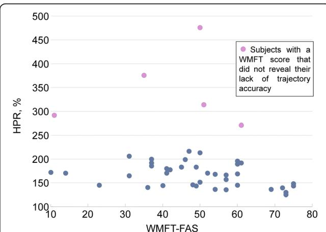

RESEARCH

Open Access

# 脑卒中患者上肢功能评估的器械化指标：一项验证研究

Maria Longhi1、Andrea Merlo1,2\*、Paolo Prati1、Meris Giacobbi1 和 Davide Mazzoli1

## 摘要

背景：机器人外骨骼越来越多地被用于上肢（Upper Limb, UL）运动的客观、定量评估。一组在使用 Armeo®Spring 进行机器人辅助够物任务（reaching tasks）过程中计算所得的器械化指标已被证明可评估上肢功能。本研究旨在检验该指标体系在评估脑卒中患者上肢功能时的构念效度。

方法：本研究纳入了 44 名年龄在 45 至 79 岁之间的脑卒中患者，其 Wolf 运动功能测试能力评分（WMFT-FAS）在 10 至 75 之间，肩肘部位的 Motricity 指数（MI）在 14 至 33 之间，因此涵盖了广泛的损伤程度。残余上肢功能通过 WMFT-FAS 和 WMFT-TIME 进行评估，同时也通过一组 9 个数值化指标进行评估，这些指标根据 Armeo®Spring 设备"垂直捕获（Vertical Capture）"任务中获得的 3D 末端轨迹计算运动准确性、速度和 smoothness（运动平滑度）。为探讨哪些变量更能反映运动控制缺陷，采用 Mann-Whitney U 检验将患者的指标与 25 名健康受试者所得指标进行比较。为探讨指标之间的内在关系以及在评估准确性、速度和平滑度方面的构念效度，进行了因子分析。为验证指标的同期效度，采用 Spearman 相关系数将其分别与 WMFT-FAS 和 WMFT-TIME 进行比较。

结果：脑卒中受试者中有 7 项指标与健康对照者存在显著差异，效应量在 0.35–0.74 之间。因子分析证实指标的特定子集归属于准确性、速度和平滑度三个维度（区分效度）。一项准确性指标、两项速度指标和两项平滑度指标与 WMFT-FAS 和 WMFT-TIME 显著相关（|rho| = 0.31–0.50）（同期效度）。每个评估的运动维度中各有一项指标被证明具有构念效度（区分效度和同期效度），并被予以选定。此外，这些指标能够在 WMFT 等级相同的患者中检测出准确性、速度和/或平滑度的差异。

结论：所提出的基于指标的上肢功能评估可用于整合并支持脑卒中患者上肢功能的临床评估。

关键词：上肢、机器人指标、效度、卒中、康复

## 研究背景

上肢损伤是脑卒中幸存者中最显著且最持久的躯体功能障碍，据报道约 70% 的患者在脑卒中发病后入院时即存在该损伤[1]。这可能导致其执行日常活动所需的够取能力大幅下降，并进而降低其独立性[2]。量化脑卒中患者的够取能力对于评估运动和功能的初始丧失至关重要，也是康复过程中追踪运动功能恢复所必需的，目前主要依赖临床量表。该领域最常用的评分系统包括用于评估运动损伤的 Fugl-Meyer 运动表现评定量表（Fugl-Meyer Motor Performance Assessment, FMA）[3–6]，以及用于评估上肢功能的 WMFT（Wolf Motor Function Test）[7–9]。根据《国际功能、残疾和健康分类》（International Classification of Functioning, Disability and Health, ICF）[10]，FMA 仅涉及身体功能域，而 WMFT 在 ICF 类别中被归类为活动量表，因为它衡量的是功能性活动的变化[11]。这些量表在评估脑卒中患者上肢功能时已证明具有可靠性[12]和有效性[13–15]，尽管仍存在一些较小的局限性[16–18]，例如需要特定设备、执行时间较长、对培训的要求较高，以及对康复过程中运动表现细微变化的敏感性不足。

上肢（upper limb, UL）运动的恢复（如有）通常在中风后的亚急性期开始，并依托个性化康复方案的支持，而康复方案的积极成效已知取决于重复性、强度和任务导向性 [19]。因此，用于在上肢执行重复性任务时提供支持的机器人设备与外骨骼已被引入整体治疗中，旨在恢复上肢功能 [20–22]。除在康复实践中的应用之外，嵌入式传感器的可用性还可使其进一步用作评估设备。事实上，上肢机器人康复设备最近已被用作客观且准确的评估工具，以监测病情进展 [23] 并收集总结个体表现的定量数据 [24]。据相关文献报道，基于机器人的测试持续时间通常不少于 30–40 分钟 [25–27]，从机器人辅助的上肢轨迹中提取的参数数量在各研究间差异显著——从 Roher 及其同事 [28] 研究中的 5 个平滑度参数，到 Einav 等人 [25] 论文中用于构建单一综合得分的 22 个指标不等。一般而言，正如 Nordin 等人 [29] 的综述所总结，文献中已提出若干指标用于描述中风患者的上肢损伤，涉及运动规划、准确性、协调性、效率、速度、加速度、 jerk度（jerkiness）以及运动子单元的数量。然而，对其度量学特征及与临床量表的同时效度的完整分析仍属空白 [29]。

我们最近开发了一款定制的独立软件，通过提供一套旨在评估上肢（Upper Limb, UL）运动准确性、速度和平滑度的指标及相关参考值 [30]，提升了市售外骨骼（Armeo®Spring，Hocoma AG，瑞士）的实用性。在用于脑卒中患者时，根据患者损伤程度的不同，该评估可在 5 至 15 分钟内完成。所得指标易于与临床专业人员分享，因为它们直接反映了运动准确性、速度以及平滑度缺失（jerkiness，即运动的不流畅性），这些都是上肢损伤的临床方面。事实上，准确性的丧失可能与躯体感觉的减退有关，速度的下降归因于轻瘫（paresis），而平滑度的丧失则与肌张力异常相关 [31]。在用于临床评估之前，这些指标必须通过与临床量表的对比加以验证 [27]。为此，我们通过器械指标对上肢功能评估的有效性进行了检验，方法包括：量化这些指标区分脑卒中患者与健康受试者的能力，识别评估上肢运动不同维度的指标，并验证其与临床参照标准之间的相关性。其目的是为临床医生提供一种客观、定量且易于使用的评估工具，以改善神经系统疾病中的上肢功能评估。

## 方法

## 受试者

在两年（2012–2013）期间入住我院康复科的 44 名脑卒中患者，由其主诊医生选择接受机器人治疗，并纳入本研究。纳入标准为：(1) 首次单侧缺血性或出血性脑卒中导致的上肢偏瘫；(2) 无严重认知缺陷；(3) 能够坐起（躯干控制测试（Trunk Control Test, TCT）中"坐位平衡"项目评分 ≥12），且能在椅子上保持活动一小时而无心脏、呼吸和/或疼痛方面的不适主诉；(4) 在减负荷条件下能够主动活动肩关节和肘关节（肩、肘 MI 均 ≥14 [32]）。排除标准为：(1) 严重的认知感知缺陷（共济失调、失用症、单侧忽略、感觉性失语）；(2) 肩部疼痛或半脱位，或其他影响够取能力的神经/神经肌肉或骨科疾病；(3) 严重视力低下。

本研究基于2012年至2013年临床常规中可获得的数据进行的回顾性分析。所有患者均签署了知情同意书，同意本研究中的数据处理及匿名数据和结果的发表。本回顾性研究的开展未以任何方式影响患者的治疗。研究遵循标准伦理原则开展，并经本院内部科学委员会批准；本院已获得当地伦理委员会（Comitato Etico IRST IRCCS e Area Vasta Romagna, CEIIAV）开展临床研究的正式批准。

本研究所使用的正常参考数据来自25名健康的右利手个体样本，年龄介于21至74岁之间（平均年龄 = 46 ± 20 岁），数据可见于参考文献[30]。

在该正常受试者样本中，各项指标未受年龄影响。

## 临床评估

每位受试者的残余上肢（Upper Limb, UL）功能均通过临床和仪器两种方式进行评估。上肢运动能力采用Wolf运动功能测试（Wolf Motor Function Test, WMFT）进行临床评估，该测试对应于国际功能、残疾和健康分类（International Classification of Functioning, Disability and Health, ICF）[11]中的活动维度，因其能够通过广泛的功能性任务对运动能力进行定量测量，并评估执行时间、运动质量和力量。

WMFT包含17个项目：其中两项与受试者的力量相关，其余15项与受试者的功能性能力相关。

平均执行时间（WMFT-TIME），以秒为单位，等于各任务执行时间之和（每个任务上限为120秒）除以任务数量。

总分，也称为功能能力评分（Functional Ability Score, WMFT-FAS），为15项项目得分（采用0到5的6点顺序量表）之和。

总分最高为75分，分数越低表示功能水平越低。

最后，本文报告了躯干控制测试（Trunk Control Test, TCT）中"坐位平衡"项目的评分，以及肩部和肘部的运动力指数（Motricity Index, MI）评分，以在临床上描述患者的功能水平。

受试者特征见表1。

表1 样本的人口学和临床特征

<table><tr><td>特征</td><td>N = 44</td></tr><tr><td>年龄，均值 ± 标准差（范围）</td><td>62 ± 9 (45–79)</td></tr><tr><td>性别，男/女</td><td>32/12</td></tr><tr><td>疾病类型</td><td></td></tr><tr><td>脑缺血</td><td>27</td></tr><tr><td>脑出血</td><td>17</td></tr><tr><td>受累侧，左/右</td><td>24/20</td></tr><tr><td>病变后月数，均值 ± 标准差（范围）</td><td>2.7 ± 3.6 (0.4–19)</td></tr><tr><td>WMFT-FAS，均值 ± 标准差（范围）</td><td>48 ± 16 (10–75)</td></tr><tr><td>WMFT-TIME，秒，均值 ± 标准差（范围）</td><td>18.5 ± 24.5 (2.1–81.5)</td></tr><tr><td>肩部MI，均值 ± 标准差（范围）</td><td>21 ± 6 (14–33)</td></tr><tr><td>肘部MI，均值 ± 标准差（范围）</td><td>23 ± 5 (14–33)</td></tr></tr>

## 机器人评估

上肢运动能力通过基于 Armeo®Spring「纵向捕捉」任务中三维端点轨迹的一组数值指标进行仪器化评估，如参考文献 [30] 所述。Armeo®Spring 装置是一种上肢外骨骼，配备七个角度计和一个压力传感器，允许自由的三维手臂运动并提供可调至五个等级的手臂重量支撑。位于机器人臂末端的握把包含一个压力传感器，用于测量手部握力。屏幕上显示并使用受试者手部位置的可视化反馈，应用于一套康复游戏和测试练习中。在本研究中，通过设置特定的软件注册表键来获取并存储原始传感器数据和端点轨迹，如设备手册所述。

在任何数据采集之前，物理治疗师调整外骨骼使其舒适地贴合受试者的手臂，并将重量支撑设定为最低等级，在该等级下患者能够保持前臂处于水平位置并能在 45 度的屈曲范围内活动其上肢。受试者在佩戴装置的同时练习进行几次自由辅助运动，然后被要求按照下述方式尝试完成「纵向捕捉」任务两次（选择最简单的难度等级），不必在意结果，目的是熟悉该设备。

「纵向捕捉」任务的目的是评估患者的功能水平。在该任务中，一个目标（瓢虫）出现在显示器上，受试者必须将由端点位置控制的光标放置到该目标上。当击中目标时，目标消失，屏幕上出现一个新的目标。目标的数量和目标覆盖的区域都随着练习难度等级的增加而增加，难度等级范围为 1 到 4。

经过约五分钟的练习后，每位受试者根据自身能力在最大难度等级下执行三次「纵向捕捉」任务重复测量，该等级为患者达到最高目标数量（通常为 100%）的四个等级中最高的等级。由于这一选择，数据始终代表每位受试者根据其残余能力所达到的最佳表现，并且可以与 WMFT 评估的表现进行分组和比较。基于三维端点轨迹计算了一组指标。这些指标在表 2 中汇总，并在参考文献 [30] 中进行了详细描述。

## 统计分析

为了探索能够区分脑卒中患者和健康受试者的数值指标，采用非参数 Mann-Whitney U 检验将患者的各项指标与来自健康、右利手的参考个体所获得的指标进行比较。如参考文献 [27] 所述，效应量（ES）通过将 Z 分数除以参与者总数的平方根来计算：$E S = Z / \sqrt { N }$

Table 2 基于三维末端执行器轨迹计算的指标，用于评估上肢（UL）运动的准确性、速度与流畅度

<table><tr><td>指标，单位</td><td>描述</td></tr>
<tr><td colspan="2">准确性指标</td></tr>
<tr><td>HPR, %</td><td>全局手部路径比值（Global Hand Path Ratio），定义为到达运动过程中末端执行器轨迹的长度与起点至目标点之间最短距离的比值，以百分比表示。对于直线运动，HPR 等于 100%，并随轨迹曲率的增加以及异常运动的出现而增大。</td></tr>
<tr><td>locHPR, %</td><td>局部手部路径比值（Local Hand Path Ratio），定义为末端执行器轨迹的长度与以目标点为中心、半径为 2.5 厘米的圆内最短轨迹长度的比值，以百分比表示。对于朝向目标的直线运动，locHPR 等于 100%；若受试者在到达目标过程中存在多次调整，则该值会增大。</td></tr>
<tr><td>vertOS 和 horOS, cm</td><td>垂直超调量（Vertical Overshoot）和水平超调量（Horizontal Overshoot），定义为在由起点和目标点所界定区域之外的垂直和水平方向上的超出量（若有）。</td></tr>
<tr><td colspan="2">速度指标</td></tr>
<tr><td>maxVel, cm/s</td><td>三维末端执行器轨迹在每次单次到达运动中速度曲线的最大速度。</td></tr>
<tr><td>meanVel, cm/s</td><td>三维末端执行器轨迹在每次单次到达运动中速度曲线的平均速度。</td></tr>
<tr><td>meanVel/maxVel, %</td><td>平均速度与最大速度的比值，以百分比表示。该比值揭示了运动是否具有快速运动伴停顿与再启动的特征。</td></tr>
<tr><td colspan="2">流畅性指标</td></tr>
<tr><td>NVelPeaks, adim</td><td>速度曲线中的局部峰值数量。该指标计算完成单次到达运动所使用的部分运动数量，也称为运动单元（movement units）数量。</td></tr>
<tr><td>NormJerk, adim</td><td>归一化加加速度（normalized jerk），用于衡量轨迹的流畅度。NormJerk 通过对三维末端执行器轨迹进行数值微分，并采用截止频率为 10 赫兹（Hz）的零相位滞后低通巴特沃斯（Butterworth）滤波器计算得到。对于纯正弦轨迹，NormJerk 趋近于 1；而在存在加速度变化的情况下，该值会显著增大。</td></tr>
</table>

为了验证这些指标在评估脑卒中患者上肢运动的准确性、速度和流畅性时的区分效度，进行了因子分析。在完整数据集上应用主成分分析（Principal Component Analysis, PCA），以在表征上肢运动的指标集合中选取最具显著性的特征。被视为显著的最小主成分（Principal Components, PCs）数量采用 Kaiser 准则确定，即仅考虑特征值大于一的主成分。对每个主成分进行 Varimax 旋转，以获得一组同质且显著的变量[33]。采用 Kaiser-Meyer-Olkin（KMO）指标评估分析的充分性[34]。

然后采用相关性分析来验证这些指标与公认临床参考标准之间的同时效度。所考察参数与 WMFT-FAS 和 WMFT-TIME 之间的相关性通过 Spearman 秩相关系数进行分析。相关系数强度的解读依据 Guilford[35] 的标准：0.0–0.2 为几乎无相关；0.2–0.4 为弱相关；0.4–0.7 为中等相关；0.7–1.0 为强相关。由于样本量为 44 名受试者，在中等效应量（即 |rho| = 0.3）情况下，我们将能够以 66% 的检验功效正确拒绝无相关的零假设；而在大效应量（即 |rho| ≥ 0.5）情况下，检验功效至少为 98%。功效分析在 G-POWER 中进行，显著性水平 alpha 设为 0.05，样本量为 44。

这些分析使我们可以从现有的指标集合中，根据其对病理状态的敏感性、评估上肢运动特定维度的能力以及与临床参考标准的同时效度，筛选出最适用于分析脑卒中患者上肢运动的指标。

统计分析使用 SPSS 统计软件（版本 21.0，SPSS Inc.，芝加哥，伊利诺伊州，美国）进行。所有分析的统计学显著性水平设为 5%。

## 结果

## 指标区分脑卒中患者与健康受试者的能力

样本中各指标的均值见表 3，并附相应的正常参考值。正如预期，患者的指标值与正常值之间存在统计学显著差异。

ES 取值范围介于 0.35 至 0.74 之间，且对于评估运动轨迹平滑度缺失的指标，该值更高。两个具体指标——速度曲线中的峰值数（NVelPeaks）和归一化急动度（Normalized Jerk，NormJerk）——展现了区分正常受试者与病理性受试者的最佳能力。总体而言，根据 Cohen 的 ES 解释规则，在所研究的三个领域中，至少有一个指标达到了从中等到大不等的区分病理状态的能力。基于 ES，应选择全局手部路径比（Hand Path Ratio，HPR）来评估准确性，选择平均速度（meanVel）来评估速度，以及选择 NVelPeaks 来评估轨迹平滑度的缺失。

表 3 脑卒中患者和健康受试者的指标值。标注了 $1 0 ^ { \mathrm { t h } } \ – 9 0 ^ { \mathrm { t h } }$ 百分位数范围

<table><tr><td>指标</td><td>健康受试者</td><td>脑卒中受试者</td><td>|效应量|</td></tr>
<tr><td>HPR, %</td><td>121–154</td><td> $136–273 ^{\dagger}$ </td><td>0.58</td></tr>
<tr><td>水平超调量（horOS）, cm</td><td>0.8–2.2</td><td> $1.1–3.6 ^{\dagger}$ </td><td>0.35</td></tr>
<tr><td>垂直超调量（vertOS）, cm</td><td>0.6–1.7</td><td>0.3–1.8</td><td>-</td></tr>
<tr><td>局部手部路径比（locHPR）, %</td><td>129–231</td><td>132–371</td><td>-</td></tr>
<tr><td>平均速度（meanVel）, cm/s</td><td>1.8–3.5</td><td> $1.0–2.8^{**}$ </td><td>0.55</td></tr>
<tr><td>最大速度（maxVel）, cm/s</td><td>5.1–10.0</td><td> $3.1–10.1 ^{*}$ </td><td>0.42</td></tr>
<tr><td>平均速度/最大速度（meanVel/maxVel）, %</td><td>34.4–40.1</td><td> $27.6–37.2^{**}$ </td><td>0.52</td></tr>
<tr><td>速度曲线峰值数（NVelPeaks）, 无量纲</td><td>1.3–1.8</td><td> $1.4–4.7 ^{\dagger}$ </td><td>0.74</td></tr>
<tr><td>归一化急动度（NormJerk）, 无量纲</td><td>72–356</td><td> $227–24\ 823 ^{\dagger}$ </td><td>0.63</td></tr></table>

用于评估上肢伸手运动的仪器化指标（$1 0 ^ { \mathrm { t h } } - 9 0 ^ { \mathrm { t h } }$ 百分位数范围）在健康受试者（N = 25）和本研究纳入的脑卒中患者样本（N = 44）中的取值。统计比较通过非参数 Mann-Whitney U 检验进行评估。效应量针对显著差异进行报告。图例：\*p < 0.05；\*\*p < 0.01；†p < 0.00

## 指标的区分效度

因子分析识别出三个显著因子，解释了全部参数方差的87%。KMO值为0.707，因此确认适合进行因子分析。图1展示了旋转过程的输出结果。所有预期用于评估运动准确性的指标（见表2）均聚集在因子1中，两个评估运动平滑度的指标聚集在因子2中，而两个评估速度的指标——平均速度（meanVel）与最大速度（maxVel）——聚集在因子3中。对于这些指标，其在评估上肢（Upper Limb, UL）运动某一特定维度（例如平滑度）方面的区分能力得到了证实。平均速度与最大速度之比（meanVel/maxVel）未明确归入某一特定维度，因此被排除在进一步分析之外。

## 指标的同期效度

通过将所提出的指标与作为参考标准的临床量表WMFT进行比较，采用相关分析来验证这些指标的同期效度。如表4所示，一部分指标与WMFT之间存在弱至中等程度的相关性，且具有统计学意义。

  
图1 因子分析结果的可视化展示。除meanVel/maxVel外，其余所有指标均明确归入某一特定因子。因子1对应运动轨迹的准确性，因子2对应轨迹的平滑度，因子3对应速度

表4 Spearman相关系数（rho）及统计学显著性（P值），分别为WMFT功能能力评分（WMFT-FAS）和平均执行时间（WMFT-TIME）与九个器械指标之间的相关性，这些器械指标用于评估Armeo®Spring辅助上肢够取任务执行过程中轨迹的准确性、速度与平滑度

<table><tr><td rowspan="2">指标</td><td colspan="2">WMFT-FAS</td><td colspan="2">WMFT-TIME</td></tr><tr><td>rho</td><td>P值</td><td>rho</td><td>P值</td></tr><tr><td>HPR, %</td><td>-0.36</td><td>0.018</td><td>0.44</td><td>0.003</td></tr><tr><td>horOs, cm</td><td>-0.10</td><td>0.524</td><td>0.10</td><td>0.501</td></tr><tr><td>verOs, cm</td><td>0.036</td><td>0.815</td><td>0.07</td><td>0.659</td></tr><tr><td>locHPR, %</td><td>-0.22</td><td>0.145</td><td>0.23</td><td>0.132</td></tr><tr><td>meanVel, cm/s</td><td>0.31</td><td>0.039</td><td>-0.26</td><td>0.082</td></tr><tr><td>maxVel, cm/s</td><td>0.15</td><td>0.328</td><td>-0.10</td><td>0.514</td></tr><tr><td>meanVel/maxVel, %</td><td>0.45</td><td>0.002</td><td>-0.44</td><td>0.003</td></tr><tr><td>NVelPeaks, adim</td><td>-0.50</td><td>0.001</td><td>0.56</td><td>&lt;0.001</td></tr><tr><td>NormJerk, adim</td><td>-0.50</td><td>0.001</td><td>0.55</td><td>&lt;0.001</td></tr></tr>

加粗字体用于突出具有统计显著性的相关性（P < 0.05）。在这些结果中，WMFT 与局部准确性指标 locHPR 之间缺乏相关性，可能受到第二类错误的影响。

各指标与 WMFT-FAS 和 WMFT-TIME 之间的相关系数具有相似的绝对值和相反的符号。这一结果是由于 WMFT-TIME 随患者康复而减小，而 WMFT-FAS 随患者康复而增大。WMFT-FAS 越低，运动的准确性和/或速度和/或平滑度就越低。同样，WMFT-TIME 越长，准确性、速度和/或平滑度就越低。

在描述运动准确性的指标中，HPR 与整个动作过程中的整体准确性相关，与 WMFT-FAS 和 WMFT-TIME 均相关，而局部准确性指标和过冲指标（表 2）则均无相关性。因此，HPR 可用于对个体上肢（upper limb, UL）运动准确性进行定量评估。在基于末端速度的指标中，meanVel 与 WMFT-FAS 相关，并与 WMFT-TIME 几乎达到显著相关（p = 0.082）。因此，在脑卒中患者中，meanVel 可用于对个体上肢整体速度进行定量评估。评估轨迹平滑度的指标与 WMFT-FAS 和 WMFT-TIME 均呈现出极强的显著相关性（p < 0.001），可用于对个体上肢运动平滑度进行定量评估。

## 指标的构念效度

表 5 总结了各指标在脑卒中患者与健康受试者比较中的效应量（ES）、区分效度和同时效度方面的表现。根据表 5，我们为每个评估的运动领域分别选取了一个指标：准确性选取 HPR，速度选取 meanVel，平滑度选取 NVelPeaks。我们认为，速度曲线中的峰值数（即单个伸手任务中的运动单元数）优于 NormJerk 变量，原因在于其计算简便且易于与临床医生共享。

## 指标对临床常规的附加价值

指标对临床评估的附加价值可见于图 2 和图 3。图 2 展示了 HPR 与 WMFT-FAS 的散点图。可以观察到一条粗略的线性趋势。有趣的是，部分患者数据明显偏离这一趋势；也就是说，WMFT-FAS 相同的患者可能具有显著不同的 HPR 值。

图 3 展示了一位样本患者各项指标（indices）的图形化呈现。在该图中，每个单独的伸手动作都计算了相应指标，并按运动方向分组，再相对于正常参考值进行归一化处理。因此，正常值位于圆周上，低于正常值的点位于圆周内部，高于正常值的点位于圆周外部。图 3 有助于识别上肢（Upper Limb, UL）运动受损的方向。方向 1–7 和 2–8 是该患者指标最差的方向。

## 讨论

在本研究中，我们验证了一组基于 Armeo®Spring 设备末端轨迹计算的仪器化指标的有效性（这些指标先前已在文献 [30] 中有所描述），用于评估亚急性脑卒中患者的上肢运动表现。更具体而言，我们分析了以下三个方面：指标区分脑卒中患者与健康受试者的能力；指标在不同运动维度评估中的判别效度；指标与 WMFT（Wolf 运动功能测试，临床用于评估上肢残余功能的参考量表）之间的同时效度。同时具备上述三种特性即被用以论证这些指标的构念效度。本研究的主要结果是遴选并验证了三个分别从准确性、速度和运动平滑度角度评估亚急性脑卒中患者上肢残余运动能力的指标。

我们的结果证实了 Hand Path Ratio（手部路径比，HPR）在评估运动执行与控制总体难度方面的有效性 [29]。在本研究中，受累侧患者的 HPR 几乎比健康个体高出 40%（p < 0.001），并且在区分脑卒中患者与正

表 5 总结：在本研究开展的上肢评估中，用于界定构念效度的各项结果汇总

<table><tr><td>指标，单位</td><td>效应量 ≥ 0.5 脑卒中患者 vs. 正常受试者</td><td>运动域的区分效度</td><td>与 WMFT 的同时效度</td><td>结构效度</td></tr>
<tr><td colspan="5">准确性指标</td></tr>
<tr><td>HPR, %</td><td>是</td><td>是</td><td>是</td><td>是</td></tr>
<tr><td>locHPR, %</td><td>否</td><td>是</td><td>否</td><td></td></tr>
<tr><td>vertOS 和 horOS, cm</td><td>否</td><td>是</td><td>否</td><td></td></tr>
<tr><td colspan="5">速度指标</td></tr>
<tr><td>meanVel, cm/s</td><td>是</td><td>是</td><td>是</td><td>是</td></tr>
<tr><td>maxVel, cm/s</td><td>否</td><td>是</td><td>否</td><td></td></tr>
<tr><td>meanVel/maxVel, %</td><td>是</td><td>否</td><td>是</td><td></td></tr>
<tr><td colspan="5">平滑性指标</td></tr>
<tr><td>NVelPeaks, adim</td><td>是</td><td>是</td><td>是</td><td>是</td></tr>
<tr><td>NormJerk, adim</td><td>是</td><td>是</td><td>是</td><td>是</td></tr>
</table>

对于每个运动域，至少有一个指标满足了结构效度的所有要求。

subjects (|ES = 0.58|)，与 Coderre 等人 [36] 和 Otaka 等人 [27] 的先前研究一致。HPR 与 WMFT-FAS 和 WMFT-TIME 显示出中等相关性（rho \~ 0.4），并且从因子分析来看，它归属于准确性域，并受到缺乏平滑性域的轻微影响。该结果与现有文献相似，其中基于末端轨迹的运动准确性测量与脑卒中患者临床症状的严重程度相关，正如 Nordin 等人 [29] 在系统综述中所总结的那样。除了这些相似之处之外，本研究中用于评估脑卒中患者残余上肢（UL）能力的方法相对于文献提供了两方面的改进。首先，可调节的减重支持装置（adjustable weight support）的使用允许从疾病的早期、亚急性阶段开始即对功能受损的患者进行评估。其次，所选任务能够识别功能最受影响的运动方向，如图 3 所示，这一目标在 Nordin 等人 [29] 综述的结论中也被提出，并与 Colombo、Micera 等人 [37] 先前的结论相一致。

  
图 2 HPR 与 WMFT-FAS 的散点图。一般而言，当 WMFT-FAS 增大时 HPR 减小。然而，对于图中突出显示的少数受试者，WMFT-FAS 的临床评估并未揭示出运动准确性控制方面的缺失。由于采用了减重支持装置，即便是样本中功能受损最严重的患者也能在最简单难度水平上以 80% 至 100% 的成功率完成该任务。

评估局部准确性的指标的有效性未经验证。只有少数受试者在将光标保持在由起点和终点所界定的矩形范围内时存在困难，该情况通过水平超调（horizontal overshooting，horOS）和垂直超调（vertical overshooting，verOS）进行评估。可以合理地推测，由于设备提供的重力支撑，其超调量与正常受试者相当。同样，由局部 HPR（local HPR，locHPR）评估的目标区域内的控制能力不足，既无法区分脑卒中患者与健康受试者，也未与临床参考标准显著相关。最后，与 WMFT-FAS 和 WMFT-TIME 同时缺乏同时效度（表 4），因此这些用于评估脑卒中患者局部准确性的指标不再适合进一步使用。

与正常参考值相比，本样本中的平均速度显著降低，按 Cohen 分类法（Cohen's classification）为中等效应量（medium ES）。该指标与 WMFT-FAS 和 WMFT-TIME 呈中等相关，且从因子分析来看，其明显归入速度域，而对其他域的贡献可忽略不计。这些结果证明了 meanVel 在评估脑卒中患者上肢（upper limb，UL）运动损伤方面的有效性，这与文献中的发现相一致——文献报道了够取运动（reaching movements）过程中的平均终点速度能够区分急性与慢性脑卒中患者 [29]，并与急性患者的 FMA 评分相关 [28, 37]。

图 3 基于 Armeo®Spring 设备"Vertical Capture"任务连续重复三次，对样本中一名患者计算所得指标的可视化表示。与时钟类似，数字表示特定方向的运动（例如 1–7 或 3–9）。指标按运动方向分组，并归一化到该方向的正常参考值。然后计算并绘制中位数值。由于归一化处理，接近正常参考值的数值靠近圆周；大于正常的数值位于圆周之外（依据 HPR），小于正常的数值位于圆周之内（依据 meanVel）。该表示提供了对一名患者上肢运动损伤的概览。该受试者表现为速度降低的顿挫性运动，但仍表现出对运动轨迹的充分控制。方向 1–7 和 2–8 似乎受损最为严重。在水平运动（方向 3–9）中获得了更好的整体准确度（HPR），可能源于更强的控制能力，尽管顿挫性（NVelPeaks）导致了更低的速度（meanVel）。

在我们这项研究中，最大速度与上肢（upper limb, UL）能力的临床指标之间不存在相关性。这一结果可由以下事实解释：WMFT 评估的是患者的整体表现，因此与平均速度相关，而不是与尽快完成任务的能力相关。在涉及外骨骼和机器人设备的文献中，在少数针对 MIT-Manus 的研究 [28, 38] 中发现峰值速度与临床评分相关。然而，该设备要求手部进行平面运动，因此与 Armeo®Spring 设备中"Vertical Capture"任务所需的三维运动有所不同。在我们这项研究中，平均速度比峰值速度更能区分脑卒中患者与健康受试者。这一区分与我们先前在 HPR 与 locHPR 之间发现的差异类似。事实上，meanVel 是一个全局指标，依赖于整个伸手动作的执行，而峰值速度是一个局部指标，并未考虑伸手动作的其他任何特征。可与 Edwards 等人 [14] 的研究进行一项有趣的比较。他们研究了一组亚急性脑卒中患者，其上肢运动表现与我们的样本相似（病变后 42 ± 40 天招募），并通过评估 WMFT 以及从运动捕捉数据计算得到的一组运动学变量来进行研究。有趣的是，他们在伸手任务中测得的手腕峰值速度（62 ± 35 cm/s）远高于我们样本中获得的值。相反，在抓取小圆柱体的"reach to grasp"（伸手抓握）任务中，峰值速度较低（11 ± 9 cm/s），与本研究中获得的值相似。前一项差异可通过以下原因解释：在本研究中，由于上肢被固定在外骨骼上，受试者在辅助任务期间无法将躯干向目标方向前倾。在伸手抓取目标时，躯干前倾是肘关节伸展受损的脑卒中患者使用的主要代偿机制，并导致更高的末端执行器速度 [39]。后一项相似性可通过伸手运动末端需要类似的控制来解释，这可能导致任务期间出现类似的低峰值速度。本研究使用的外骨骼可实现对躯干代偿机制的控制，这是 Nordin 及其同事 [29] 在综述中推荐的上肢功能器械评估的一项进一步改进。

在本研究中，通过两个平滑度指标（NVelPeak 和 NormJerk）评估了急动运动（jerky movements）的存在。在伸手够物运动中，速度峰值的数量反映了"子运动"（sub-movements）[28, 38]或"运动单元"（movement units）[40, 41]的存在，并且当平滑度改善时趋于减少 [42]。在我们关于上肢（UL）三维运动的研究中，这两个指标在区分患者与健康个体方面表现出较高的能力（|ES| = 0.74 和 |ES| = 0.63），并且与临床参考标准之间存在统计学显著的（p < 0.001）中等至较大相关性（rho = 0.50–0.56），在整个指标集中描述脑卒中（stroke）患者能力方面表现最佳。因子分析（Factor analysis）证实，NVelPeak 和 NormJerk 属于平滑度缺乏的特定领域，明显不同于运动准确性和速度。这些结果似乎与脑卒中后受试者运动损伤的病理生理学一致，其特征是募集（recruitment）和去募集（de-recruitment）受损、对快速牵张的反射亢进（痉挛，spasticity）、肌肉缩短伴随僵硬增加、异常的肌肉模式和协同收缩（co-contractions），从而导致运动片段化（movement fragmentation）[43]。在文献中，速度曲线中的峰值数量已被用于量化脑卒中患者在 2D [28] 和 3D-Space [14, 44] 空间中执行的伸手够物任务的轨迹平滑度，并被发现与运动恢复的临床阶段相关，这与我们的结果一致。同样地，Colombo 等 [45] 和 Otaka 等 [27] 获得的手部速度曲线峰值数量与包括 WMFT-FAS 在内的临床量表显著相关。有趣的是，这些结果是使用各种机器人设备和外骨骼（exoskeletons）获得的，因此表明在伸手够物任务中，末端点（endpoint）速度曲线的峰值数量可作为平滑度损伤的评估工具，而与所用机器人设备的类型无关。

虽然已发表的结果大多针对慢性脑卒中患者，但本研究所描述的机器人评估是基于疾病亚急性期（sub-acute stage）患者样本中各项指标的验证，而这一阶段正是大多数康复治疗开展的时期，也是对上肢（UL）功能表现评估需求最为迫切的时期。本研究对早期脑卒中患者的关注超越了现有文献的范围——在现有文献中，临床指标的验证往往在慢性期患者中进行 [27, 38, 46]。慢性期患者通常临床状态稳定且更易招募，但潜在恢复程度较低。所选设备提供的 UL 减重支持使得评估亚急性住院患者成为可能，从而允许在康复初期就对力量极弱的患者进行测试。对重度受损住院患者的纳入同样超越了现有文献的范围。如 MI 测量所示（见表 1），患者的瘫痪程度从中度到正常不等（即肘部和/或肩部分别为 MI = 14 和 MI = 33），因此涵盖了极广泛的运动损害范围，使本研究结果具有外部效度（external validity）。在该方法中，除了识别最受累的方向性运动外，还可通过在康复期间反复进行器械化测量，追踪脑卒中患者运动恢复的纵向变化。

选择 WMFT 作为参考标准（如同文献 [14] 中那样）对于本研究的验证目的是恰当的。事实上，WMFT 量表依据 ICF 活动域（activity domain）评估整体 UL 功能限制 [10, 11]。相比之下，其他用于机器人指标研究的 UL 评估临床量表，如 FMA 和 Brunnstrom 恢复阶段，仅关注与 ICF 身体功能和结构域（body function and structure domain）相关的运动损害。此外，本研究所选的「垂直捕捉（Vertical Capture）」任务允许评估三维（3D）够取运动，而这类运动对许多日常活动至关重要 [27]，因此优于平面机器人所要求的二维（2D）运动，且更接近 WMFT 在功能临床评估中的设定。由于这些指标是根据使用 Armeo®Spring 设备执行「垂直捕捉」任务时所采集的数据计算得出的，因此必须仅将该特定任务用于评估 UL 功能，而不能在康复期间用作训练任务。

我们认为这些指标能够为脑卒中患者上肢（UL）康复提供快速而有用的支持，因为它们可以在康复训练开始前由同一操作员在同一地点、无需任何特殊准备即可获得。此外，仪器化指标可以多次重复以获得平均值，相较于由临床量表获得的单一评分，其结果更为稳健[26]。最后，这些指标能够在 Wolf 运动功能测试功能能力评分（WMFT-FAS）与 WMFT 时间（WMFT-TIME）相同的患者中检测到准确性、速度或平滑度方面的差异，表明在评估脑卒中患者运动恢复方面比临床量表具有更高的灵敏度，这与已有文献相符[26]。因此，这些指标既可以用于改进上肢康复中的临床决策，也可以用于评估所实施治疗的有效性。

本研究存在一些局限性。我们未控制目标在屏幕上出现的位置，它们由设备软件随机生成。因此，如果患者仅能完成最简单的任务（等级 1），且仅有不超过随机生成的 12 个目标，则对最受损方向性运动的识别可能不够准确。按照每位患者能力在最大难度水平下采集连续三次试验，应当可以尽可能减小这种可能的误差。

从方法学角度来看，应开展两次评估之间的可重复性研究，以确定所选指标的最小显著变化[30]，针对符合相同纳入/排除标准的患者。还应开展纵向研究，以评估所选指标相对于脑卒中患者上肢运动能力临床改善的反应度和预期变化。最后，未来研究可以在其他神经系统疾病中验证该组指标的使用。

## 结论

手轨迹比、平均速度以及速度曲线峰值数量这三个所研究指标的构念效度已得到证实，它们分别评估运动的准确性、速度和平滑度，可作为工具，用于在亚急性恢复阶段对脑卒中患者的上肢功能临床评估加以补充。

## 缩略语

ADL，日常生活活动（activities of daily life）；ES，效应量（effect size）；FMA，Fugl-Meyer 运动表现评定（Fugl-Meyer Motor Performance Assessment）；horOS，水平过冲（horizontal overshooting）；HPR，整体手轨迹比（global Hand Path Ratio）；ICF，国际功能、残疾和健康分类（International Classification of Function, Disability and Health）；KMO，Kaiser-Meyer-Olkin 检验（Kaiser-Meyer-Olkin）；locHPR，局部手轨迹比（local HPR）；maxVel，最大速度（maximum velocity）；meanVel/maxVel，平均速度与最大速度之比（ratio between mean and maximum velocity）；meanVel，平均速度（mean velocity）；MI，运动指数（Motricity Index）；NormJerk，归一化急动度（Normalized Jerk）；NVelPeaks，速度曲线峰值数量（number of peaks in the velocity profiles）；PCA，主成分分析（Principal Component Analysis）；PCs，主成分（Principal Components）；TCT，躯干控制测试（trunk control test）；UL，上肢（upper limb）；verOS，垂直过冲（vertical overshooting）；WMFT，Wolf 运动功能测试（Wolf Motor Function Test）

## 致谢

作者们感谢 Emilia Ruscelli 在数据收集方面的协助。

## 资助

本研究及其发表的全部费用均由本机构资助：Sol et Salus - Ospedale Privato Accreditato - Via S.Salvador, 204–47922 Rimini - Torre Pedrera, Italy。

## 数据与材料的可用性

此阶段暂不共享数据。对这些数据的进一步研究正在进行中。

## 作者贡献

ML：构思与设计、数据解读、稿件撰写。AM：构思与设计、数据分析与解读、稿件撰写。PP：数据采集、数据解读。MG：数据采集、结果讨论。DM：构思与设计、数据解读、研究协调。所有作者均对稿件进行了批判性修订，并已最终批准待发表版本。

## 作者信息

Maria Longhi、Andrea Merlo 与 Davide Mazzoli 是本项目的高级研究员。Maria Longhi，邮箱：m.longhi@soletsalus.com。Andrea Merlo，邮箱：andrea.merlo@ausl.re.it。Paolo Prati，邮箱：p.prati@soletsalus.com。Meris Giacobbi，邮箱：m.giacobbi@soletsalus.com。Davide Mazzoli，邮箱：lamb@soletsalus.com。

## 利益冲突

作者声明不存在任何利益冲突。

## 出版同意

所有患者均已知情同意本研究中对数据的处理，并允许发布匿名数据与结果。

## 伦理审批与参与同意

关于伦理审批与参与本研究同意的声明见方法部分的"参与者"小节。

收稿日期：2015 年 12 月 11 日　接受日期：2016 年 6 月 3 日　在线发表：2016 年 6 月 8 日

## 参考文献

1. Nakayama H, Jorgensen HS, Raaschou HO, Olsen TS. 卒中患者上肢功能的恢复：哥本哈根卒中研究。Arch Phys Med Rehabil. 1994;75:394–8.

2. Jørgensen HS, Nakayama H, Raaschou HO, Vive-Larsen J, Støier M, Olsen TS. 卒中的结局与恢复时间进程。第二部分：恢复的时间进程。哥本哈根卒中研究。Arch Phys Med Rehabil. 1995;76:406–12.

3. Fugl-Meyer AR, Jaasko L, Leyman I, Olsson S, Steglind S. 卒中后偏瘫患者：1. 一种用于评估身体功能的方法。Scand J Rehabil Med. 1975;7(1):13–31.

4. Van Wijck FM, Pandyan AD, Johnson GR, Barnes MP. 神经康复中运动功能缺损的评估：仪器的使用模式。Neurorehabil Neural Repair. 2001;15(1):23–30.

5. McCrea PH, Eng JJ, Hodgson AJ. 够物的生物力学：对获得性脑损伤患者的临床意义。Disabil Rehabil. 2002;24(10):534–41.

6. Alon G, McBride K. C5 或 C6 四肢瘫患者使用神经假体获得特定的功能改善。Arch Phys Med Rehabil. 2003;84(1):119–24.

7. Wolf SL, Lecraw DE, Barton LA, Jann BB. 强迫使用偏瘫上肢以逆转慢性脑卒中和头部损伤患者习得性废用的效果. *Exp Neurol*. 1989;104(2):125–32.

8. Wolf SL, Catlin PA, Ellis M, Archer AL, Morgan B, Piacentino A. 将 Wolf 运动功能测试评估为脑卒中后研究结局指标的研究. *Stroke*. 2001;32(7):1635–9.

9. Shaw SE, Morris DM, Uswatte G, McKay S, Meythaler JM, Taub E. 创伤性脑损伤后恢复上肢功能的强制性运动疗法. *JRRD*. 2005;42(6):769–78.

10. 国际功能、残疾和健康分类（International Classification of Functioning, Disability and Health, ICF）；第10版（ICD-10），2010年版，© 世界卫生组织 2011。http://www.who.int/classifications/icf/en/.

11. Sivan M, O’Connor RJ, Makower S. 脑卒中机器人辅助上肢运动评估中所用结局指标的系统综述. *J Rehabil Med*. 2011;43:181–9.

12. Morris DM, Uswatte G, Crago JE, Cook EW, Taub E. Wolf 运动功能测试用于评估脑卒中后上肢功能的信度研究. *Arch Phys Med Rehabil*. 2001;82(6):750–5.

13. Nijland R, van Wegen E, Verbunt J, van Wij R, van Kordelaar J, Kwakkel G. 脑卒中后上肢功能两种验证测试的比较：Wolf 运动功能测试与上肢动作研究测试. *J Rehabi Med*. 2010;42:694–6.

14. Edwards DF, Lang CE, Wagner JM, Birkenmeier R, Dromerick AW. Wolf 运动功能测试在脑卒中早期运动试验中的评估. *Arch Phys Med Rehabil*. 2012;93(4):660–8.

15. Gladstone DJ, Danells CJ, Black SE. 脑卒中后运动恢复的 Fugl-Meyer 评估：对其测量学特性的批判性综述. *Neurorehabil Neural Repair*. 2002;16(3):232–40.

16. Subramanian SK, Yamanaka J, Chilingaryan G, Levin MF. 运动模式运动学作为脑卒中后手臂运动损伤测量指标的有效性. *Stroke*. 2010;41(10):2303–8.

17. Alt Murphy M, Willén C, Sunnerhagen KS. 饮水任务中的运动学表现与脑卒中后活动能力水平相关. *Neurorehabil Neural Repair*. 2012;26(9):1106–15.

18. Wu CY, Liing RJ, Chen HC, Chen CL, Lin KC. 脑卒中患者坐位够物（臂长范围内及超出臂长）时手臂与躯干的运动学研究：一项有效性研究. *Phys Ther*. 2014;94(6):845–56.

19. Oujamaa L, Relave I, Froger J, Mottet D, Pelissier JY. 脑卒中后手臂功能康复：文献综述. *Ann Phys Rehabil Med*. 2009;52:269–93.

20. Norouzi-Gheidari N, Archambault PS, Fung J. 机器人辅助治疗对脑卒中上肢康复的效果：文献的系统综述与 meta 分析. *J Rehabil Res Dev*. 2012;49(4):479–96.

21. Prange GB, Jannink MJ, Groothuis-Oudshoorn CG, Hermens HJ, Ijzerman MJ. 机器人辅助治疗对脑卒中后偏瘫手臂恢复效果的系统综述. *J Rehabil Res Dev*. 2006;43(2):171–84.

22. Maciejasz P, Eschweiler J, Gerlach-Hahn K, Jansen-Troy A, Leonhardt S. 关于上肢康复机器人装置的综述。《神经工程与康复杂志》（J Neuroeng Rehabil）。2014;11:13.

23. Kwakkel G, Kollen BJ, Krebs HI. 机器人辅助治疗对脑卒中后上肢恢复的影响：一项系统综述。《神经康复与神经修复》（Neurorehabil Neural Repair）。2008;22(2):111–21.

24. Bosecker C, Dipietro L, Volpe B, Krebs HI. 基于运动学机器人的评估量表及其临床对应量表用于测量慢性脑卒中患者的上肢运动表现。Neurorehabil Neural Repair. 2010;24(1):62–9.

25. Einav O, Geva D, Yoeli D, Kerzhner M, Mauritz KH. 用于脑卒中患者上肢运动损伤临床评估的首个机器人量表的开发与验证。《脑卒中康复专题》（Top Stroke Rehabil）。2011;18 Suppl 1:587–98.

26. Krebs HI, Krams M, Agrafiotis DK, DiBernardo A, Chavez JC, Littman GS, et al. 脑卒中后手臂运动的机器人测量确立了运动恢复的生物标志物。《脑卒中》（Stroke）。2014;45:200–4.

27. Otaka E, Otaka Y, Kasuga S, Nishimoto A, Yamazaki K, Kawakami MJ, et al. 机器人测量偏瘫脑卒中患者够取运动的临床效用与效度。J Neuroeng Rehabil. 2015;12:66.

28. Rohrer B, Fasoli S, Krebs HI, Hughes R, Volpe B, Frontera WR, et al. 脑卒中恢复过程中运动平滑度的变化。《神经科学杂志》（J Neurosci）。2002;22(18):8297–304.

29. Nordin N, Xie SQ, Wünsche B. 脑卒中后机器人辅助上肢康复中运动质量的评估：一篇综述。J Neuroeng Rehabil. 2014;11:137.

30. Merlo A, Longhi M, Giannotti E, Prati P, Giacobbi M, Ruscelli E, et al. 使用机器人外骨骼进行上肢评估。准确性、速度与平滑度指标的常模值。《神经康复》（NeuroRehabilitation）。2013;33(4):523–30.

31. Lang CE, Bland MD. 脑卒中后上肢损伤、功能与活动的评估：临床决策的基础。《手部治疗杂志》（J Hand Ther）。2013;26(2):104–15.

32. Zackowski KM, Dromerick AW, Sahrmann SA, Thach WT, Bastian AJ. 力量、感觉、痉挛与关节个体化如何与慢性偏瘫患者的够取缺陷相关？《脑》（Brain）。2004;127(5):1035–46.

33. Statistical BA, Analysis F, Methods R. 理论与应用。纽约：Wiley；1994.

34. Cerny CA, Kaiser HF. 一项关于因子分析相关矩阵抽样充分性测度的研究。《多元行为研究》（Multivariate Behay Res）1977;12(1):43–7.

35. Guilford JP. 心理学与教育学中的基础统计学。纽约：McGraw Hill；1956.

36. Coderre A, Zeid AA, Dukelow SP, Demmer MJ, Moore KD, Bretzke H, et al. 采用视觉引导够取评估亚急性脑卒中患者的上肢感觉运动功能。Neurorehabil Neural Repair. 2010;24:528–41.

37. Panarese A, Colombo R, Sterpi I, Pisano F, Micera S. 在机器人辅助脑卒中患者神经康复过程中于子任务层面追踪运动改善。Neurorehabil Neural Repair. 2012;26(7):822–33.

38. Bosecker C, Dipietro L, Krebs HI, Volpe B. 基于运动学机器人的评估量表及其临床对应版本用于测量慢性脑卒中患者的上肢运动表现. J Neurorehabil Neural Repair. 2010;24(1):62–9.

39. Levin MF, Kleim JA, Wolf SL. 脑卒中后患者运动"恢复（recovery）"与"代偿（compensation）"究竟意味着什么？Neurorehabil Neural Repair. 2008;23(4): 313–9.

40. Archambault P, Pigeon P, Feldman AG, Levin MF. 健康受试者与偏瘫患者在涉及躯干的指向运动中不同自由度的募集与顺序. Exp Brain Res. 1999;126:55–67

41. Wu CY, Chuang LL, Lin KC, Chen HC, Tsay PK. 分布式强制性使用疗法与双侧手臂训练用于脑卒中后上肢运动控制及功能康复的比较：随机试验. Neurorehabil Neural Repair. 2011;25:130–9.

42. Michaelsen SM, Dannenbaum R, Levin MF. 脑卒中后采用躯干约束的任务特异性训练对手臂恢复的影响：随机对照试验. Stroke. 2006;37: 186–92.

43. Gracies JM. 痉挛性瘫痪的病理生理学. II：肌肉过度活动的出现. Muscle Nerve. 2005;31(5):552–71.

44. Kahn LE, Zygman ML, Rymer WZ, Reinkensmeyer DJ. 机器人辅助伸手训练促进慢性偏瘫型脑卒中患者的手臂运动恢复：一项随机对照初步研究. J Neuroeng Rehabil. 2006;3:12.

45. Colombo R, Pisano F, Micera S, Mazzone A, Delconte C, Carrozza MC, et al. 评估机器人辅助上肢神经康复过程中的恢复机制. Neurorehabil Neural Repair. 2008;22:50–63.

46. Colombo R, Pisano F, Micera S, Mazzone A, Delconte C, Carrozza MC, et al. 脑卒中患者上肢评估与康复的机器人技术. IEEE Trans Neural Syst Rehabil Eng. 2005;13(3):311–24.

## 将您的下一篇稿件提交给 BioMed Central，我们将在每一步为您提供帮助：

- 我们接受投稿前的咨询（pre-submission inquiries）
- 我们的选刊工具可帮助您找到最相关的期刊
- 我们提供全天候客户支持
- 便捷的在线投稿
- 严格的同行评审
- 被 PubMed 及所有主要索引服务收录
- 让您的研究获得最大程度的曝光