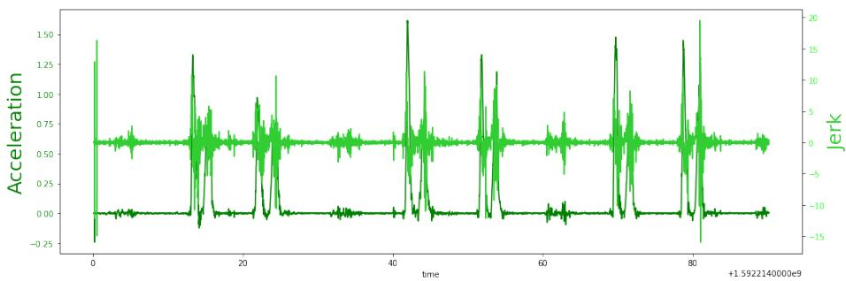

# 通过分类与平滑度分析简化自动神经康复

Asma Bensalah1[0000−0002−2405−9811], Alicia Fornés1[0000−0002−9692−5336], Cristina Carmona-Duarte2[0000−0002−4441−6652], and Josep Lladós1[0000−0002−4533−4739]

1 Computer Vision Center, Computer Science Department, Universitat Autònoma de Barcelona, Spain {abensalah, afornes, josep}@cvc.uab.es 2 Universidad de Las Palmas de Gran Canaria, Spain {cristina.carmona}@ulpgc.es

摘要. 在中风后患者的康复阶段评估其运动质量至关重要，因为目前并不存在适用于所有患者的标准中风康复方案。事实上，康复方案基本上取决于患者的功能独立性及其在康复疗程中的进展情况。为应对这一挑战并使神经康复流程更加高效，我们提出了一种自动评估流程，该流程首先通过浅层深度学习架构识别患者的运动，然后使用急动度（jerk）度量及相关度量来评估运动质量。本研究的一个特别之处在于所使用的数据集具有临床相关性，因为其中的运动灵感来自Fugl-Meyer——一种广泛应用于中风患者的上肢临床评估量表。我们的研究表明：在平滑度方面检测健康人与患者运动之间的差异是可行的；此外，我们还能够就患者在康复疗程中的进展情况得出结论，这些结论与临床医生对每个病例的发现相吻合。

关键词：神经康复 · 上肢 · 运动分类 · 运动平滑度 · 深度学习 · 急动度

## 1 引言

神经系统疾病会导致认知与运动功能的损伤。其中，脑卒中（stroke）幸存者尤其可能在一侧肢体上出现运动功能缺陷。这些功能缺损通过康复训练加以应对，以使患者的功能独立性获得部分或完全恢复 [1]。在这一阶段，核心挑战之一是对患者病情演变的评估。事实上，脑卒中后患者的显著进步往往出现在最初数周，也就是神经可塑性增强的关键期（critical window）[2]。在此之后，非线性的恢复曲线会渐近趋于稳定。鉴于上述原因，在该关键时段内的治疗时机与治疗强度均应加以优化。因此，必须持续而准确地监测患者的进展，以便在关键期结束前最大化其恢复效果。长期以来，通行的做法是采用特定的临床量表 [3]。在实践中，患者的运动功能通常每十天评估一到两次。因此，这种方法的不足之处在于：一旦患者离开康复训练室，其病情演变便无法得到评估。事实上，能够最真实反映患者功能独立性的是其在日常生活活动中的表现。

应对这一局限的一种途径是使评估过程自动化，以帮助临床医生高效地评估患者。

在实现自动化时会出现诸多问题：首先，需要在长达数小时的连续记录中确定运动的性质；其次，要找出哪些指标能够最好地刻画运动质量。

为应对上述问题，我们提出了一种用于自动评估患者运动的框架。该框架包含两部分：

– 第一部分通过一个浅层深度学习架构，将运动分类为四个关键的运动类别；

第二部分是基于急动度（jerk）度量的评估模块，用以揭示患者与健康个体信号之间的差异，并估计患者在不同治疗阶段之间的病情演变。与其他现有需要更多存储空间与计算资源的运动学算法（由于其运动学参数较多）[4]相比，急动度更易于在嵌入式设备中实现。

在本文余下部分中，我们在第 2 节给出相关工作概述，然后在第 3 节描述所提出的分类深度学习架构。在第 4 节中，我们概述运动平滑度的测量方法。接着，我们在第 5 节描述实验设置。然后，我们在第 6 节给出结果与发现。

## 2 相关工作

在信号中定位一段序列的目的是从信号中检索出与给定查询相关的部分或其全部。根据查询的性质，会产生许多序列定位任务 [5][6][7]。若信号由一种或多种不同模态组成，而查询是动作、活动、运动或手势，则我们面对的就是一项人类活动识别（Human Activity Recognition, HAR）任务。

HAR 极大地受益于深度学习的蓬勃发展。HAR 已通过多种模态得以实现：RGB 图像 [8]、骨架 [9]、加速度 [10]、Wi-Fi [11]……

加速度是一种被广泛使用的动作识别模态，原因在于它是一种非侵入式的感知方法，因此不存在隐私限制问题。通过加速度进行 HAR 是可行的，因为人类通常以定性相同的方式完成同一动作 [12]。HAR 既可以使用传统学习算法来实现，例如支持向量机 [13]、k 近邻 [14]，也可以采用深度学习模型，如卷积神经网络（Convolutional Neural Networks, CNN）[15]、循环神经网络（Recurrent Neural Networks, RNNs）[16] 或长短期记忆网络（Long Short-Term Memory, LSTM）[17]。根据文献 [18]，22% 的 HAR 研究致力于健康应用。

另一方面，对于已识别动作（尤其是针对脑卒中患者）的评估而言，如何获取运动平滑度指标以及哪种度量能最佳地描述它，目前尚无普遍共识 [19]。其中一个原因是对动作质量背后的神经生理学理解仍很模糊，以上肢动作为例便是如此 [20]。根据文献 [21]，针对脑卒中患者平滑度的研究主要分为五类：与轨迹相关的度量 [22]、与速度相关的度量 [23][24]、与加速度相关的度量 [25][26]、与急动度（jerk）相关的度量 [27] 以及其他度量 [28]。如上所述，HAR 任务已以多种方式得到解决，动作质量评估问题亦是如此。在本工作中，鉴于可用数据较少，我们选择了浅层深度学习架构用于 HAR；此外，我们还探索使用急动度（jerk）度量来评估患者的动作质量。

## 3 动作分类

我们的灵感来自 Supratak 提出的模型 [29]，该模型旨在应对多导睡眠监测（Polysomnography）领域的挑战，而多导睡眠监测是评估睡眠质量的途径之一 [30]。传统上，多导睡眠监测由一组专家完成，他们使用睡眠分期评分对所记录的数据进行标注。

为缓解前述局限，该架构在流水线中引入了数据增强模块，并减少了信号处理步骤。

## 3.1 网络架构

模型以原始加速度信号的若干时段（epoch）作为输入（见图 1）。我们将动作划分为四个关键动作类别：M1、M2、M3、M4。模型的第一个组件由四个 CNN 层组成，旨在从原始信号中提取时不变特征。如图 2 所示，在第一个 CNN 层和最后一个 CNN 层之后分别引入了一个最大池化（max-pool）层以及一个 dropout（dropout）层。第二个组件设计用于学习原始信号中的时间依赖关系（即序列学习）。这一组件通过一个 LSTM 层后接一个 dropout 层实现，二者共同构成一个单向循环神经网络（RNN）。该单向 RNN 旨在学习时间转移规则。LSTM 的单向性使得前向传播被省略，从而减少了超参数的数量和计算资源的开销。

由于我们的数据集是均衡的，因此将所有类别的加权交叉熵损失权重均设为 1。此外，为了应对数据稀缺问题，我们在每个训练周期（epoch）对原始数据执行数据增强。数据增强通过沿时间轴平移信号来实现，平移范围取时段持续时间的一个特定区间。该模型使用 Sleep-EDF 数据集 [31] 进行预训练。

## 4 运动平滑度（Movement smoothness）

Following the description of the classification architecture, we present the movements' smoothness measurements next. Quantifying a movement quality can be performed in many ways. Measuring the position relative to time, is one of them. Velocity $\overrightarrow { v }$ (equation 1), acceleration $\scriptstyle { \overrightarrow { a } }$ (equation 2), jerk $\vec { j }$ (equation 3) and snap $\vec { s }$ (equation $^ { 4 ) }$ are respectively the first, second, third and fourth derivative of the trajectory $\vec { x }$ with respect to time, are the most widespread used measuring quantities [32]. Those are the same measures used by the human body to manage its balance. More specifically, this is handled by the sensorial functions of the vestibular system that provides information such as body position together with gravity direction [33]. If an object is in motion, it experiences velocity. When velocity is not constant, the object is said to have an acceleration which is not equal to zero. If acceleration is varying over time, then emerges a sensation of jerkiness of the movement. Since attention was brought back to jerk in [34], it has had many applications in the science and technology fields [35] [36] [37]. Jerk should always take into account when vibrations occur, also whenever an abrupt transition happens [35]. For example, jerk is considered when designing railways to ensure a smooth motion whenever train changes from a straight line to a curved one, equally when ensuring that an industrial tool fails too soon because of fast acceleration changes.

在介绍完分类架构的描述之后，接下来我们介绍运动平滑度的测量方法。量化运动质量可以通过多种方式实现。其中一种方式是测量位置随时间的变化关系。速度 $\overrightarrow { v }$（公式 1）、加速度 $\scriptstyle { \overrightarrow { a } }$（公式 2）、急动度（jerk）$\vec { j }$（公式 3）以及急动度的导数 snap $\vec { s }$（公式 4）分别是轨迹 $\vec { x }$ 对时间的一阶、二阶、三阶和四阶导数，也是目前使用最为广泛的测量量 [32]。人体同样使用这些度量来维持平衡。更具体而言，这一过程由前庭系统的感觉功能负责处理，该系统提供诸如身体位置以及重力方向等信息 [33]。若物体处于运动状态，则具有速度。当速度并非恒定时，该物体被认为具有非零的加速度。当加速度随时间变化时，便会产生运动不平顺（jerkiness）的感觉。自从文献 [34] 重新关注急动度之后，它已在科学技术领域获得了诸多应用 [35][36][37]。当发生振动以及任何突然的过渡时，都必须考虑急动度 [35]。例如，在铁路设计中需要考虑急动度，以确保列车从直线段过渡到曲线段时运动平稳，同样在评估因加速度急剧变化而导致工业工具过早失效时也是如此。

When analysing a human movement by looking at its acceleration, it is axis orientation dependent. A small rotation of the wrist while recording data can result in a lot of noise in an axis acceleration. Hence, in this work, we focus on jerk as a movement quality measure, in particular, as a smoothness indicator. Ultimately, jerk is easier to implement in a an embedded device, unlike other existing kinematic algorithms that need more space due to the number of kinematic parameters.

在通过加速度来分析人体运动时，结果依赖于坐标轴的朝向。在数据采集过程中，手腕的微小转动都可能给某一轴向的加速度带来大量噪声。因此，在本研究中，我们聚焦于急动度，将其作为运动质量的度量，特别是作为平滑度指标。与其他由于运动学参数较多而需要更大存储空间的现有运动学算法不同，急动度最终更易于在嵌入式设备中实现。

$$
{ \vec { v } } ( t ) = { \frac { \mathrm { d } { \vec { x } } ( t ) } { \mathrm { d } t } }\tag{1}
$$

$$
{ \vec { \alpha } } ( t ) = { \frac { \mathrm { d } { \vec { v } } ( t ) } { \mathrm { d } t } }\tag{2}
$$

$$
{ \vec { j } } ^ { } ( t ) = { \frac { \mathrm { d } { \vec { a } } ( t ) } { \mathrm { d } t } }\tag{3}
$$

$$
{ \vec { s } } ( t ) = { \frac { \mathrm { d } { \vec { j } } ( t ) } { \mathrm { d } t } }\tag{4}
$$

## 5 Setup

## 5.1 Dataset

## 5 实验设置

## 5.1 数据集

所使用的数据集是作为 3D kinematics for remote patient monitoring（RPM3D）项目3 的一部分而记录的，该项目旨在为脑卒中患者构建一条自动化处理流水线。一个针对脑卒中患者与健康受试者的数据集以及一个分类基线已被发布 [38]。脑卒中患者与健康个体在每只手佩戴一块智能手表。健康个体仅记录一次，而脑卒中患者则在四次不同的会话中进行记录。患者各会话之间的时间间隔为一到两周。最初，为了评估脑卒中患者的上肢运动功能，每周或每十天进行一次评估。评估脑卒中患者感觉运动障碍最为人所知的量表是 Fugl-Meyer 评估量表 [39]。鉴于此，作者们受 Fugl-Meyer 动作的启发，构建了其关键动作集合 $\mathcal { M } _ { i } , i \in [ 1 , 4 ]$，具体如下：

– 动作 $\mathcal { M } _ { 1 }$：肩关节伸/屈。

– 动作 $\mathcal { M } _ { 2 } \colon$ 肩关节外展。

– 动作 $\mathcal { M } _ { 3 } \colon$ 肩关节外/内旋。

– 动作 $\mathcal { M } _ { 4 } \colon$ 肘关节屈/伸

实验场景 实验在两种不同的设置下进行：一种受限场景 L1 与一种非受限场景 L2。描述如下：

场景 L1：它表示一种受限场景，其中个体依次执行四个关键动作 $\mathcal { M } _ { i } \colon$ 首先用优势手执行一次，其次用非优势手执行一次，最后用双手执行一次。

– 场景 L2：它表示非受限场景，由一系列关键动作 $\mathcal { M } _ { i }$ 以及一组其他非目标动作 $\mathcal { R } _ { j } ,$ $j \in [ 1 , 1 9 ]$ 组成。$\mathcal { R } _ { i }$ 动作是一些常见的日常活动列表，例如：喝水、坐到椅子上等。这些动作以随机顺序执行。

## 5.2 处理流水线

我们首先将动作分类为四个主要类别：M1、M2、M3、M4（肩关节伸/屈、肩关节外展、肩关节外/内旋、肘关节屈/伸）。然后，我们针对一个代表执行一次动作若干次的信号计算 jerk 值，如图 3 所示，以考察该动作的整体加速度模式。

  
图 3：一名健康个体重复执行动作的加速度与 jerk。

之后，我们针对前述信号的一个较小片段（即一段被良好分割的动作）计算 jerk，以获得更精确的平滑度估计。

## 6 结果

以下结果与 L1 动作的分类及其平滑度分析相关。

## 6.1 分类

在实验中，数据按 80% 用于训练、20% 用于测试进行划分。测试准确率平均达到 77,01%。我们在某些轮次（epoch）中观察到准确率下降，我们认为这是由于训练数据集规模较小所致。

## 6.2 平滑度（Smoothness）

在表 1 中，我们给出了健康个体和患者沿 x 轴执行良好分割的运动（movement）所对应的急动度（jerk）值相关信息。从理论上讲，健康个体的急动度值应低于患者，因为健康个体在执行运动时具有更强的能力，能够以更平滑的方式完成动作，因此其运动抖动更少（参见图 4）[21]。

  
图 4：患者与健康个体执行同一运动时的急动度值。

从表 1 中可以观察到，对于 M2、M3、M4 确实呈现这种规律。例如，就运动 M3 而言，患者的急动度均值绝对值是健康受试者急动度均值绝对值的 0.7 倍。同时，表 1 中呈现的趋势是，对于 M1、M2、M3 和 M4 这四个运动，健康群体的急动度最大值均大于患者的急动度最大值。急动度表示加速度的变化量。从这一角度出发，为了更深入地理解运动的平滑度，我们采用了与急动度相关的度量，这些度量是基于急动度的绝对值计算得到的。在本工作中，我们重点关注平方急动度（squared jerk）度量。表 2 展示了平方急动度度量的均值、最大值和最小值。需要注意的是，表 1 所反映的趋势是健康个体的急动度均值较低，这与理论前提一致，即运动越抖动、不平滑，急动度值就越高。因此，患者的急动度值应更高。然而，对于平方急动度均值而言，情况并非如此。表 2 中呈现的整体模式是健康群体的平方急动度均值高于患者。我们认为，这可能与患者信号比健康个体信号更嘈杂有关，因为患者的动作较慢，因此患者信号包含更多的波峰和更多的累积噪声（参见图 5）。

表 1：患者与健康个体沿 x 轴的急动度度量。

<table><tr><td rowspan=2 colspan=1></td><td rowspan=1 colspan=6>加加速度度量（Jerk Measure）</td></tr><tr><td rowspan=1 colspan=2>均值（Mean）</td><td rowspan=1 colspan=2>最大值（Max）</td><td rowspan=1 colspan=2>最小值（Min）</td></tr><tr><td rowspan=1 colspan=1>x 轴</td><td rowspan=1 colspan=1>健康人</td><td rowspan=1 colspan=1>患者</td><td rowspan=1 colspan=1>健康人</td><td rowspan=1 colspan=1>患者</td><td rowspan=1 colspan=1>健康人</td><td rowspan=1 colspan=1>患者</td></tr><tr><td rowspan=1 colspan=1>M1</td><td rowspan=1 colspan=1>0,00500712</td><td rowspan=1 colspan=1>-0,006998</td><td rowspan=1 colspan=1>497,99</td><td rowspan=1 colspan=1>145,54</td><td rowspan=1 colspan=1>-1,96E+02</td><td rowspan=1 colspan=1>-138,99182</td></tr><tr><td rowspan=1 colspan=1>M2</td><td rowspan=1 colspan=1>-0,0004051</td><td rowspan=1 colspan=1>-0,001621</td><td rowspan=1 colspan=1>157,56</td><td rowspan=1 colspan=1>69,46</td><td rowspan=1 colspan=1>-186,062127</td><td rowspan=1 colspan=1>-152,652</td></tr><tr><td rowspan=1 colspan=1>M3</td><td rowspan=1 colspan=1>-0,0023341</td><td rowspan=1 colspan=1>0,0016529</td><td rowspan=1 colspan=1>102,74</td><td rowspan=1 colspan=1>84,58</td><td rowspan=1 colspan=1>-1,27E+02</td><td rowspan=1 colspan=1>-62,973556</td></tr><tr><td rowspan=1 colspan=1>M40,</td><td rowspan=1 colspan=1>000311410,000</td><td rowspan=1 colspan=1>6176</td><td rowspan=1 colspan=1>161,04</td><td rowspan=1 colspan=1>107,14</td><td rowspan=1 colspan=1>-1,50E+02</td><td rowspan=1 colspan=1>-114,20477</td></tr></table>

  
图 5：健康人与患者的信号对比。

表 2：患者与健康人在 x 轴方向的平方加加速度度量。

<table><tr><td rowspan=2 colspan=1></td><td rowspan=1 colspan=6>平方急动度度量（Squared Jerk Measure）</td></tr><tr><td rowspan=1 colspan=2>均值（Mean）</td><td rowspan=1 colspan=2>最大值（Max）</td><td rowspan=1 colspan=2>最小值（Min）</td></tr><tr><td rowspan=1 colspan=1>轴（axis）</td><td rowspan=1 colspan=1>xHealthy</td><td rowspan=1 colspan=1>患者（Patient）</td><td rowspan=1 colspan=1>健康（Healthy）</td><td rowspan=1 colspan=1>患者（Patient）</td><td rowspan=1 colspan=1>健康（Healthy）</td><td rowspan=1 colspan=1>患者（Patient）</td></tr><tr><td rowspan=1 colspan=1>M1</td><td rowspan=1 colspan=1>19,96</td><td rowspan=1 colspan=1>7,65</td><td rowspan=1 colspan=1>247993,61</td><td rowspan=1 colspan=1>21182,96</td><td rowspan=1 colspan=1>8,93E-12</td><td rowspan=1 colspan=1>2,22E-12</td></tr><tr><td rowspan=1 colspan=1>M2</td><td rowspan=1 colspan=1>18,11</td><td rowspan=1 colspan=1>5,76</td><td rowspan=1 colspan=1>34619,12</td><td rowspan=1 colspan=1>23302,63</td><td rowspan=1 colspan=1>08</td><td rowspan=1 colspan=1>,42E-10</td></tr><tr><td rowspan=1 colspan=1>M3</td><td rowspan=1 colspan=1>14,40</td><td rowspan=1 colspan=1>3,75</td><td rowspan=1 colspan=1>16056,08</td><td rowspan=1 colspan=1>7153,85</td><td rowspan=1 colspan=1>3,55E-11</td><td rowspan=1 colspan=1>0</td></tr><tr><td rowspan=1 colspan=1>M4</td><td rowspan=1 colspan=1>26,19</td><td rowspan=1 colspan=1>4,48</td><td rowspan=1 colspan=1>25934,96</td><td rowspan=1 colspan=1>13042,73</td><td rowspan=1 colspan=1>8,93E-12</td><td rowspan=1 colspan=1>0</td></tr></table>

表 3、4、5、6 给出了四名患者（即患者 100、101、102、103）的平方急动度度量（squared jerk measure）信息。这些表展示了四名患者在四次治疗阶段（session）中沿 x 轴的演变情况。表 3 给出了患者 100 的平方急动度度量信息：均值、最大值和最小值。该患者在动作 M1 上的表现在第 3 阶段和第 4 阶段更好。图 6 显示，与第一次阶段相比，患者在第 3 阶段的 M1 动作的急动度更低。与此同时，患者 100 在第 3 阶段对动作 M3 和 M4 取得了最显著的改善。然而，动作 M2 的平方急动度均值在四个阶段中未呈现任何改善。

  
图 6：第 1 阶段和第 3 阶段中动作 M1 的平方急动度值——患者 100。

表 3：患者 100 在四个阶段中沿 x 轴的平方急动度度量。

<table><tr><td rowspan=2 colspan=1></td><td rowspan=1 colspan=12>患者 100（Patient 100）</td></tr><tr><td rowspan=1 colspan=4>平均值（Mean）</td><td rowspan=1 colspan=4>最大值（Max）</td><td rowspan=1 colspan=4>最小值（Min）</td></tr><tr><td rowspan=1 colspan=1>x 轴</td><td rowspan=1 colspan=1>第 1 次会话</td><td rowspan=1 colspan=1>第 2 次会话</td><td rowspan=1 colspan=1>第 3 次会话</td><td rowspan=1 colspan=1>第 4 次会话</td><td rowspan=1 colspan=1>第 1 次会话</td><td rowspan=1 colspan=1>第 2 次会话</td><td rowspan=1 colspan=1>第 3 次会话</td><td rowspan=1 colspan=1>第 4 次会话</td><td rowspan=1 colspan=1>第 1 次会话</td><td rowspan=1 colspan=1>第 2 次会话</td><td rowspan=1 colspan=1>第 3 次会话</td><td rowspan=1 colspan=1>第 4 次会话</td></tr><tr><td rowspan=1 colspan=1>M1</td><td rowspan=1 colspan=1>12,88</td><td rowspan=1 colspan=1>13,04</td><td rowspan=1 colspan=1>5,09</td><td rowspan=1 colspan=1>10,16</td><td rowspan=1 colspan=1>18882,36</td><td rowspan=1 colspan=1>12129,74</td><td rowspan=1 colspan=1>4166,802</td><td rowspan=1 colspan=1>1182,96</td><td rowspan=1 colspan=1>8,38E-091</td><td rowspan=1 colspan=1>,67E-08</td><td rowspan=1 colspan=1>1,75E-07</td><td rowspan=1 colspan=1>2,30E-09</td></tr><tr><td rowspan=1 colspan=1>M2</td><td rowspan=1 colspan=1>4,17</td><td rowspan=1 colspan=1>9,07</td><td rowspan=1 colspan=1>12,74</td><td rowspan=1 colspan=1>19,92</td><td rowspan=1 colspan=1>715,66</td><td rowspan=1 colspan=1>1246,53</td><td rowspan=1 colspan=1>23302,632</td><td rowspan=1 colspan=1>7364,52</td><td rowspan=1 colspan=1>9,35E-084</td><td rowspan=1 colspan=1>4,49E-088</td><td rowspan=1 colspan=1>,42E-10</td><td rowspan=1 colspan=1>1,88E-08</td></tr><tr><td rowspan=1 colspan=1>M3</td><td rowspan=1 colspan=1>9,16</td><td rowspan=1 colspan=1>6,25</td><td rowspan=1 colspan=1>4,65</td><td rowspan=1 colspan=1>8,28</td><td rowspan=1 colspan=1>3738,07</td><td rowspan=1 colspan=1>2385,56</td><td rowspan=1 colspan=1>976,07</td><td rowspan=1 colspan=1>7153,85</td><td rowspan=1 colspan=1>8,53E-102</td><td rowspan=1 colspan=1>,05E-105</td><td rowspan=1 colspan=1>,18E-09</td><td rowspan=1 colspan=1>3,94E-08</td></tr><tr><td rowspan=1 colspan=1>M4</td><td rowspan=1 colspan=1>6,28</td><td rowspan=1 colspan=1>30,45</td><td rowspan=1 colspan=1>4,80</td><td rowspan=1 colspan=1>7,14</td><td rowspan=1 colspan=1>1804,63</td><td rowspan=1 colspan=1>13042,73</td><td rowspan=1 colspan=1>1246,78</td><td rowspan=1 colspan=1>670,45</td><td rowspan=1 colspan=1>1,98E-081</td><td rowspan=1 colspan=1>,28E-081</td><td rowspan=1 colspan=1>,20E-08</td><td rowspan=1 colspan=1>0</td></tr></table>

至于患者 101（Patient 101）（见表 4），如图 7 所示，在四次康复会话过程中，平均平方急动度（mean squared jerk）值整体呈上升趋势。图中显示，在最后一次会话中，M4 动作的平滑度下降；但 M1 动作除外，与第一次会话相比，M1 动作的平均平方急动度值反而有所下降。

表 5 展示了患者 102 的数据，其中动作 M1、M2、M3 的平方急动度（squared jerk）均值持续下降，直到最后一次康复训练。相反，M1 的平方急动度均值在第二次训练之后便停止下降。

表 4：患者 101 在四次训练中沿 x 轴的平方急动度度量。

<table><tr><td rowspan=2 colspan=1></td><td rowspan=1 colspan=12>患者 101</td></tr><tr><td rowspan=1 colspan=4>均值</td><td rowspan=1 colspan=4>最大值</td><td rowspan=1 colspan=4>最小值</td></tr><tr><td rowspan=1 colspan=1>x 轴</td><td rowspan=1 colspan=1>第 1 次</td><td rowspan=1 colspan=1>第 2 次</td><td rowspan=1 colspan=1>第 3 次</td><td rowspan=1 colspan=1>第 4 次</td><td rowspan=1 colspan=1>第 1 次</td><td rowspan=1 colspan=1>第 2 次</td><td rowspan=1 colspan=1>第 3 次</td><td rowspan=1 colspan=1>第 4 次</td><td rowspan=1 colspan=1>第 1 次</td><td rowspan=1 colspan=1>第 2 次</td><td rowspan=1 colspan=1>第 3 次</td><td rowspan=1 colspan=1>第 4 次</td></tr><tr><td rowspan=1 colspan=1>M1</td><td rowspan=1 colspan=1>7,61</td><td rowspan=1 colspan=1>2,62</td><td rowspan=1 colspan=1>4,63</td><td rowspan=1 colspan=1>5,23</td><td rowspan=1 colspan=1>1357,01</td><td rowspan=1 colspan=1>445,53</td><td rowspan=1 colspan=1>581,59</td><td rowspan=1 colspan=1>968,97</td><td rowspan=1 colspan=1>1,64E-07</td><td rowspan=1 colspan=1>2,22E-12</td><td rowspan=1 colspan=1>4,59E-08</td><td rowspan=1 colspan=1>3,55E-11</td></tr><tr><td rowspan=1 colspan=1>M2</td><td rowspan=1 colspan=1>2,03</td><td rowspan=1 colspan=1>2,16</td><td rowspan=1 colspan=1>7,52</td><td rowspan=1 colspan=1>5,20</td><td rowspan=1 colspan=1>267,21</td><td rowspan=1 colspan=1>484,64</td><td rowspan=1 colspan=1>3781,94</td><td rowspan=1 colspan=1>1086,66</td><td rowspan=1 colspan=1>1,04E-07</td><td rowspan=1 colspan=1>1,05E-08</td><td rowspan=1 colspan=1>22,22E-08</td><td rowspan=1 colspan=1>2,82E-092</td></tr><tr><td rowspan=1 colspan=1>M3</td><td rowspan=1 colspan=1>2,14</td><td rowspan=1 colspan=1>4,05</td><td rowspan=1 colspan=1>3,21</td><td rowspan=1 colspan=1>8,03</td><td rowspan=1 colspan=1>406,89</td><td rowspan=1 colspan=1>2257,01</td><td rowspan=1 colspan=1>604,45</td><td rowspan=1 colspan=1>3965,67</td><td rowspan=1 colspan=1>6,13E-08</td><td rowspan=1 colspan=1>8,39E-09</td><td rowspan=1 colspan=1>4,69E-09</td><td rowspan=1 colspan=1>3,60E-08</td></tr><tr><td rowspan=1 colspan=1>M4</td><td rowspan=1 colspan=1>0,58</td><td rowspan=1 colspan=1>0,73</td><td rowspan=1 colspan=1>2,88</td><td rowspan=1 colspan=1>2,49</td><td rowspan=1 colspan=1>44,56</td><td rowspan=1 colspan=1>163,14</td><td rowspan=1 colspan=1>1068,82</td><td rowspan=1 colspan=1>1034,61</td><td rowspan=1 colspan=1>2,24E-09</td><td rowspan=1 colspan=1>1,52E-08|</td><td rowspan=1 colspan=1>8,85E-105</td><td rowspan=1 colspan=1>5,00E-10</td></tr></table>

Fig. 7: Squared jerk values for movement M4 in session 1 and 4- Patient 101.
图 7：患者 101 在第 1 次与第 4 次治疗中动作 M4 的平方急动度值。

It is clear that the three patients 100, 102, 103 have reached lower squared jerk means than those of their first sessions, for at least three movements.
很明显，在至少三个动作上，患者 100、102、103 的平方急动度均值都低于其首次治疗的水平。

How good is jerk as a smooth indicator? Overall, it is not trivial to compare the jerk values of healthy individuals to the ones of the patients owing to the way the patients performed the movements. In particular, when patients have dificulties to perform the movements in a consistent way, it implies that a simple comparison of healthy movements' jerk values and patients ones is not always conclusive. For example, in the case of movement M1, the jerk mean value is higher within healthy samples than the patient samples. Despite that, the mean squared jerk values provide interesting insights concerning the evolution of patients across the four sessions. Our conclusions do align with the clinicians' closures: most patients' smoothness improved when compared to the first session. Additionally, for patient 101, the patient that presented more motor function issues during the sessions, we observed the least improvement in terms of squared jerk mean values.
急动度作为平滑性指标的效果如何？总体而言，由于患者执行动作的方式不同，将健康人的急动度值与患者的急动度值进行比较并非易事。特别地，当患者难以以一致的方式执行动作时，简单地将健康人的急动度值与患者的急动度值进行比较并不总能得出明确结论。例如，在动作 M1 的情况下，健康样本的急动度均值高于患者样本。尽管如此，平方急动度均值仍为评估患者在四次治疗中的演变提供了有价值的洞见。我们的结论与临床医生的判断一致：与首次治疗相比，大多数患者的动作平滑性均有所改善。此外，对于患者 101——在治疗过程中出现最多运动功能障碍的那位患者——其在平方急动度均值方面的改善程度也是最小的。

Table 5: squared jerk measures for patient 102 across four sessions, along axis x.
表 5：患者 102 在四次治疗中沿 x 轴的平方急动度测量值。

<table><tr><td rowspan=2 colspan=1></td><td rowspan=1 colspan=12>患者 102</td></tr><tr><td rowspan=1 colspan=4>均值</td><td rowspan=1 colspan=4>最大值</td><td rowspan=1 colspan=4>最小值</td></tr><tr><td rowspan=1 colspan=1>x 轴</td><td rowspan=1 colspan=1>会话 1</td><td rowspan=1 colspan=1>会话 2</td><td rowspan=1 colspan=1>会话 3</td><td rowspan=1 colspan=1>会话 4</td><td rowspan=1 colspan=1>会话 1</td><td rowspan=1 colspan=1>会话 2</td><td rowspan=1 colspan=1>会话 3</td><td rowspan=1 colspan=1>会话 4</td><td rowspan=1 colspan=1>会话 1</td><td rowspan=1 colspan=1>会话 2</td><td rowspan=1 colspan=1>会话 3</td><td rowspan=1 colspan=1>会话 4</td></tr><tr><td rowspan=1 colspan=1>M1</td><td rowspan=1 colspan=1>4,27</td><td rowspan=1 colspan=1>1,18</td><td rowspan=1 colspan=1>4,82</td><td rowspan=1 colspan=1>7,09</td><td rowspan=1 colspan=1>5256,19</td><td rowspan=1 colspan=1>49,80</td><td rowspan=1 colspan=1>3829,05</td><td rowspan=1 colspan=1>7841,56</td><td rowspan=1 colspan=1>1,61E-08</td><td rowspan=1 colspan=1>2,90E-09</td><td rowspan=1 colspan=1>1,50E-08</td><td rowspan=1 colspan=1>8,84E-12</td></tr><tr><td rowspan=1 colspan=1>M2</td><td rowspan=1 colspan=1>2,89</td><td rowspan=1 colspan=1>4,61</td><td rowspan=1 colspan=1>2,21</td><td rowspan=1 colspan=1>1,78</td><td rowspan=1 colspan=1>473,36</td><td rowspan=1 colspan=1>2788,06</td><td rowspan=1 colspan=1>353,56</td><td rowspan=1 colspan=1>739,78</td><td rowspan=1 colspan=1>5,98E-09</td><td rowspan=1 colspan=1>4,09E-08</td><td rowspan=1 colspan=1>8,61E-108</td><td rowspan=1 colspan=1>3,77E-08</td></tr><tr><td rowspan=1 colspan=1>M3</td><td rowspan=1 colspan=1>1,03</td><td rowspan=1 colspan=1>1,56</td><td rowspan=1 colspan=1>1,03</td><td rowspan=1 colspan=1>0,58</td><td rowspan=1 colspan=1>88,71</td><td rowspan=1 colspan=1>405,24</td><td rowspan=1 colspan=1>117,23</td><td rowspan=1 colspan=1>81,77</td><td rowspan=1 colspan=1>1,26E-09</td><td rowspan=1 colspan=1>03</td><td rowspan=1 colspan=1>,21E-08</td><td rowspan=1 colspan=1>6,56E-096</td></tr><tr><td rowspan=1 colspan=1>M4</td><td rowspan=1 colspan=1>1,90</td><td rowspan=1 colspan=1>1,25</td><td rowspan=1 colspan=1>1,67</td><td rowspan=1 colspan=1>0,84</td><td rowspan=1 colspan=1>306,19</td><td rowspan=1 colspan=1>165,53</td><td rowspan=1 colspan=1>184,44</td><td rowspan=1 colspan=1>125,36</td><td rowspan=1 colspan=1>1,22E-08</td><td rowspan=1 colspan=1>1,77E-09</td><td rowspan=1 colspan=1>3,01E-08</td><td rowspan=1 colspan=1>2,59E-09</td></tr></table>

表 6：患者 103（Patient 103）在四个会话（session）中沿 x 轴的二阶跃度平方（squared jerk）度量。

<table><tr><td rowspan=2 colspan=1></td><td rowspan=1 colspan=12>患者 103</td></tr><tr><td rowspan=1 colspan=4>均值</td><td rowspan=1 colspan=4>最大值</td><td rowspan=1 colspan=4>最小值</td></tr><tr><td rowspan=1 colspan=1>x 轴</td><td rowspan=1 colspan=1>第 1 次会话</td><td rowspan=1 colspan=1>第 2 次会话</td><td rowspan=1 colspan=1>第 3 次会话</td><td rowspan=1 colspan=1>第 4 次会话</td><td rowspan=1 colspan=1>第 1 次会话</td><td rowspan=1 colspan=1>第 2 次会话</td><td rowspan=1 colspan=1>第 3 次会话</td><td rowspan=1 colspan=1>第 4 次会话</td><td rowspan=1 colspan=1>第 1 次会话</td><td rowspan=1 colspan=1>第 2 次会话</td><td rowspan=1 colspan=1>第 3 次会话</td><td rowspan=1 colspan=1>第 4 次会话</td></tr><tr><td rowspan=1 colspan=1>M1</td><td rowspan=1 colspan=1>8,57</td><td rowspan=1 colspan=1>16,17</td><td rowspan=1 colspan=1>9,97</td><td rowspan=1 colspan=1>9,47</td><td rowspan=1 colspan=1>2570,08</td><td rowspan=1 colspan=1>19318,73</td><td rowspan=1 colspan=1>2733,30</td><td rowspan=1 colspan=1>1991,19</td><td rowspan=1 colspan=1>2,35E-08</td><td rowspan=1 colspan=1>2,79E-08</td><td rowspan=1 colspan=1>5,36E-11</td><td rowspan=1 colspan=1>7,71E-08</td></tr><tr><td rowspan=1 colspan=1>M2</td><td rowspan=1 colspan=1>2,80</td><td rowspan=1 colspan=1>4,34</td><td rowspan=1 colspan=1>1,88</td><td rowspan=1 colspan=1>3,79</td><td rowspan=1 colspan=1>500,42</td><td rowspan=1 colspan=1>2143,84</td><td rowspan=1 colspan=1>222,50</td><td rowspan=1 colspan=1>1488,18</td><td rowspan=1 colspan=1>2,18E-07</td><td rowspan=1 colspan=1>1,73E-09</td><td rowspan=1 colspan=1>1,29E-09</td><td rowspan=1 colspan=1>4,98E-08</td></tr><tr><td rowspan=1 colspan=1>M3</td><td rowspan=1 colspan=1>1,66</td><td rowspan=1 colspan=1>2,14</td><td rowspan=1 colspan=1>1,86</td><td rowspan=1 colspan=1>1,34</td><td rowspan=1 colspan=1>1039,28</td><td rowspan=1 colspan=1>707,50</td><td rowspan=1 colspan=1>297,98</td><td rowspan=1 colspan=1>331,72</td><td rowspan=1 colspan=1>8,53E-09</td><td rowspan=1 colspan=1>2,33E-10</td><td rowspan=1 colspan=1>2,86E-08</td><td rowspan=1 colspan=1>3,82E-08</td></tr><tr><td rowspan=1 colspan=1>M4</td><td rowspan=1 colspan=1>3,18</td><td rowspan=1 colspan=1>4,12</td><td rowspan=1 colspan=1>2,11</td><td rowspan=1 colspan=1>2,52</td><td rowspan=1 colspan=1>4304,22</td><td rowspan=1 colspan=1>2560,54</td><td rowspan=1 colspan=1>1628,78</td><td rowspan=1 colspan=1>713,06</td><td rowspan=1 colspan=1>4,45E-108</td><td rowspan=1 colspan=1>,66E-09</td><td rowspan=1 colspan=1>3,60E-08</td><td rowspan=1 colspan=1>4,36E-01</td></tr></table>

## 7 结论

本文提出了一套面向卒中患者的全自动评估流水线，融合了深度学习模型与基于加加速度（jerk）度量的平滑度评估模块，该加加速度度量在受临床公认的功能性 Fugl-Meyer（Fugl-Meyer Assessment）量表启发所设计的运动上计算得出。尽管数据集规模较小，运动分类仍取得了良好准确率，这可能得益于对原始信号所执行的数据增强。与健康受试者相比，加加速度已被证明是评估卒中患者的有效度量，而平方加加速度（squared jerk）则能较好地反映患者在不同评估会话之间表现上的变异性。

与所有非图像或自然语言处理（NLP）相关的视觉与机器学习任务一样，本任务可用的数据十分有限。因此，未来的工作将聚焦于扩充可用数据，并探索更具鲁棒性的平滑度度量。

## 致谢

本工作部分得到了西班牙项目 RTI2018-095645-B-C21、加泰罗尼亚自治区政府 CERCA 项目（Generalitat de Catalunya）以及 FI 奖学金 AGAUR 2020 FI-SDUR 00497（由加泰罗尼亚自治区政府大学与研究秘书处（Secretaria d'Universitats i Recerca）及欧洲社会基金（Fons Social Europeu）共同资助）的支持。

## 参考文献

1. Bruce H. Dobkin. 60 - rehabilitation and recovery of the patient with stroke. In James C. Grotta, Gregory W. Albers, Joseph P. Broderick, Arthur L. Day, Scott E. Kasner, Eng H. Lo, Ralph L. Sacco, and Lawrence K.S. Wong, editors, *Stroke (Seventh Edition)*, pages 879–887.e2. Elsevier, Philadelphia, seventh edition edition, 2022.

2. Belén Ballester, Martina Maier, Armin Duf, Mónica Cameirão, Sergi Bermúdez i Badia, Esther Duarte, Ampar Cuxart, Susana Rodriguez, Rosa San Segundo, and Paul Verschure. 卒中后患者存在超过一年的关键恢复时间窗：一项临界时间窗口研究（A critical time window for recovery extends beyond one-year post-stroke）. *Journal of Neurophysiology*, 122, 05 2019.

3. Jackie Bosch, Lesly A. Pearce, Mike Sharma, Robert Mikulík, William N. Whiteley, Michelle Canavan, Robert G. Hart, and Martin J. O'Donnell. 一项国际卒中后人群的功能能力研究：全球日常活动标准评估（SAGEA）量表（Functional abilities of an international post-stroke population: Standard assessment of global everyday activities (SAGEA) scale）. *Journal of Stroke and Cerebrovascular Diseases*, 31(4):106329, 2022.

4. Jan Stenum, Cristina Rossi, and Ryan T. Roemmich. 基于二维视频与姿态估计的人体步态分析（Two-dimensional video-based analysis of human gait using pose estimation）. *PLOS Computational Biology*, 17(4):1–26, 04 2021.

5. Ewald van der Westhuizen, Herman Kamper, Raghav Menon, John Quinn, and Thomas Niesler. 低资源语言下无自动语音识别的高效关键词检出特征学习（Feature learning for efficient ASR-free keyword spotting in low-resource languages）. *Computer Speech & Language*, 71:101275–101275, 2022. 查询日期：2022-03-07 13:17:34。

6. Angelos Giotis. 基于监督与无监督表示的手写文档图像关键词检出（Keyword spotting in handwritten document images using supervised and unsupervised representations）. National Documentation Centre (EKT), 2021. 查询日期：2022-03-07 13:23:13。

7. Hang Pan, Lun Xie, and Zhiliang Wang. 时空卷积注意力网络用于宏表情与微表情区间检测。第一届面部微表情工作坊：面部表情生成与检测先进技术论文集，2021。检索日期：2022-03-15 13:24:42。

8. Elias Dritsas and Maria Trigka. 一种提取高效节能且对比度增强的RGB图像的方法。Sensors, 22(4), 2022。

9. Raphael Memmesheimer, Simon H¨aring, Nick Theisen, and Dietrich Paulus. Skeleton-DML：基于骨架的单样本动作识别的深度度量学习。发表于2022年IEEE/CVF冬季计算机视觉应用会议 (WACV)，第837–845页，2022年。

10. Congcong Zhou, Lilin Yang, Heng Liao, Bo Liang, and Xuesong Ye. 基于无线可穿戴表面肌电信号与加速度传感器的智能踝足矫形器踝足运动识别。Sensors and Actuators A: Physical, 331:113025, 2021。

11. Chenning Li, Manni Liu, and Zhichao Cao. WiHF：基于WiFi的手势与用户识别。IEEE Transactions on Mobile Computing, 21(2):757–768, 2022。

12. Hossein Rahmani, Mohammed Bennamoun, and Qiuhong Ke. 基于多种数据模态的人体动作识别：综述，2021年2月。

13. Slim Ben Chaabane, Mohammad Hijji, Rafika Harrabi, and Hassene Seddik. 基于统计特征与支持向量机分类器的人脸识别。Multimedia Tools and Applications, 2022。检索日期：2022-02-22 13:16:18。

14. Najeeb Ur Rehman Malik, Syed Abdul Rahman Abu Bakar, and Usman Ullah Sheikh. 基于OpenPose与KNN分类器的多视角人体动作识别系统。Lecture Notes in Electrical Engineering, 第890–895页，2022年。检索日期：2022-02-22 13:21:25。

15. Habib-Ur-Rehman Khalid, Ali Gorji, Andre Bourdoux, Sofie Pollin, and Hichem Sahli. 基于雷达的人体活动识别的多视角CNN-LSTM架构。IEEE Access, 第1–1页，2022年。检索日期：2022-02-23 12:56:18。

16. Qingchang Zhu, Zhenghua Chen, and Yeng Chai Soh. 一种用于人体活动识别的全新半监督深度学习方法。IEEE Transactions on Industrial Informatics, 15(7):3821–3830, 2019。

17. Jun-Yan He, Xiao Wu, Zhi-Qi Cheng, Zhaoquan Yuan, and Yu-Gang Jiang. DBLSTM：用于人体动作识别的密集连接双向长短期记忆网络。Neurocomputing, 444:319–331, 2021。

18. Neha Gupta. 人工智能框架下的人体活动识别：叙述性综述。Artificial Intelligence Review, 2022年1月。

19. Mohamed Irfan Mohamed Refai. 《Moving On：中风后远程运动测量》。博士论文，荷兰特温特大学 (University of Twente)，2021年。

20. Floor Buma, Joost Kordelaar, Mathijs Raemaekers, Erwin van Wegen, Nick Ramsey, and Gert Kwakkel. 脑激活与中风后上肢运动平滑度的关系。Experimental Brain Research, 234, 2016年7月。

21. B.L. Scheltinga. 中风康复期上肢运动平滑度的合适度量指标，2019年8月。

22. Matteo Bigoni, Silvia Baudo, Veronica Cimolin, Nicola Cau, Manuela Galli, Lucia Pianta, Elena Tacchini, Paolo Capodaglio, and Alessandro Mauro. 运动学能否为脑卒中后上肢康复的临床评估提供有意义的信息？个案报告。Journal of Physical Therapy Science, 28:2408–2413, 08 2016.

23. Brandon Rohrer, Susan Fasoli, Hermano Krebs, Richard Hughes, Bruce Volpe, Walter Frontera, Joel Stein, and Neville Hogan. 脑卒中恢复过程中运动平滑度的变化。The Journal of neuroscience : the official journal of the Society for Neuroscience, 22:8297–304, 10 2002.

24. Dario G Liebermann, Mindy F Levin, Joseph McIntyre, Patrice L Weiss, and Sigal Berman. 健康受试者与脑卒中患者手臂够物运动的关节路径碎片化及时空特征。见：IEEE 2010 年国际医学与生物学工程学会年会（EMBC）论文集，第 5242–5245 页。IEEE, 2010.

25. Oph´elie Pila, Christophe Duret, F.-X Laborne, Jean-Michel Gracies, N. Bayle, and Emilie Hutin. 脑卒中患者接受机器人辅助 3 个月训练后上肢指向任务运动学的改善模式。Journal of NeuroEngineering and Rehabilitation, 14, 10 2017.

26. Hisyam Abdul Rahman, Kang Khor, Yeong Fai, Eileen Su, and Leela Narayanan. iRest 在测量脑卒中患者手功能表现方面的潜力。Bio-Medical Materials and Engineering, 28:105–116, 03 2017.

27. Jozsef Laczko, Robert Scheidt, Lucia Simo, and D. Piovesan. 脑卒中后目标导向手臂运动中终点急动度分解所揭示的关节间协调缺陷。IEEE Transactions on Neural Systems and Rehabilitation Engineering, PP:1–1, 01 2017.

28. Mohamed Irfan, Mique Saes, Bouke Scheltinga, Joost Kordelaar, Johannes Bussmann, Peter Veltink, Jaap Buurke, Carel Meskers, Erwin van Wegen, Gert Kwakkel, and Bert-Jan BEIJNUM. 脑卒中后够物运动表现的平滑度指标。第 1 部分：如何选择？Journal of NeuroEngineering and Rehabilitation, 18, 10 2021.

29. Akara Supratak and Yike Guo. TinySleepNet：基于原始单通道脑电的高效睡眠分期深度学习模型。见：2020 年第 42 届 IEEE 医学与生物学工程学会国际年会（EMBC）论文集，第 641–644 页，2020.

30. Xuefei Wang, Yichao Zhou, and Chunxia Zhao. 基于边缘去趋势分形维数特征的健康组与失眠组心率分析。Tsinghua Science and Technology, 27(2):325–332, 2022.

31. B. Kemp, A.H. Zwinderman, B. Tuk, H.A.C. Kamphuisen, and J.J.L. Oberye. 一种睡眠依赖性神经反馈回路分析：脑电的慢波微连续性。IEEE Transactions on Biomedical Engineering, 47(9):1185–1194, 2000.

32. Jared Van Dam, Kyle Tanous, Matt Werner, and Joseph L. Gabbard. 在增强现实与虚拟现实中计算并分析角向头部加加速度：AR 提示设计对角向加加速度的影响. *Applied Sciences*, 11(21), 2021.

33. Silvia Maria Sobral Oliveira, Allan Mateus da Silva Limai, Carolina Veiga Pereira, Emily Macedo Mainardi, Gabrielle Woan Hua Seifert Wu, Isis Pinheiro Damasceno, Luciane Lobato Sobral Santos, Rodrigo Santiago Barbosa Rocha, Maryana Therumy Kabuki, and Larissa Salgado de Oliveira Rocha. 单侧前庭功能减退患者的平衡概念改变了平衡与生活质量. *Health Science Journal*, 15(5):1–5, 2021.

34. Steven H. Schot. 加加速度（Jerk）：加速度的时间变化率. *American Journal of Physics*, 46:1090–1094, 1978.

35. Hasti Hayati, David Eager, Ann-Marie Pendrill, and Hans Alberg. 科学与工程背景下的加加速度——一项系统性综述. *Vibration*, 3(4):371–409, 2020.

36. David Hostler, Jacqueline Schwob, Zachary J. Schlader, and Lora Cavuoto. 热应激在体力劳动期间增加运动加加速度. *Frontiers in Physiology*, 12, 2021.

37. Burkhard Alpers. 关于在线轨迹生成的快速加加速度、加速度与速度受限运动函数. *Robotics*, 10(1), 2021.

38. Asma Bensalah, Jialuo Chen, Alicia Forn´es, Cristina Carmona-Duarte, Josep Llad´os, and Miguel Angel Ferrer. 迈向使用智能手表对脑卒中患者上肢运动的自动评估. 载于：Alberto Del Bimbo、Rita Cucchiara、Stan Sclarof、Giovanni Maria Farinella、Tao Mei、Marco Bertini、Hugo Jair Escalante 与 Roberto Vezzani 主编，《模式识别。ICPR 国际研讨会与挑战赛》，第 476–489 页，Cham，2021。Springer International Publishing。

39. Tetsuharu Nakazono, Kayoko Takahashi, Yoshikazu Suzuki, Kosuke Mizuno, Yuko Nomura, Yoshimi Hiraga, Shuji Matsumoto, Kazutoshi Nishiyama, and Michinari Fukuda. Fugl-Meyer 下肢评定量表日文版的信度与效度. *Topics in Stroke Rehabilitation*, 0(0):1–8, 2021. PMID: 33724162.