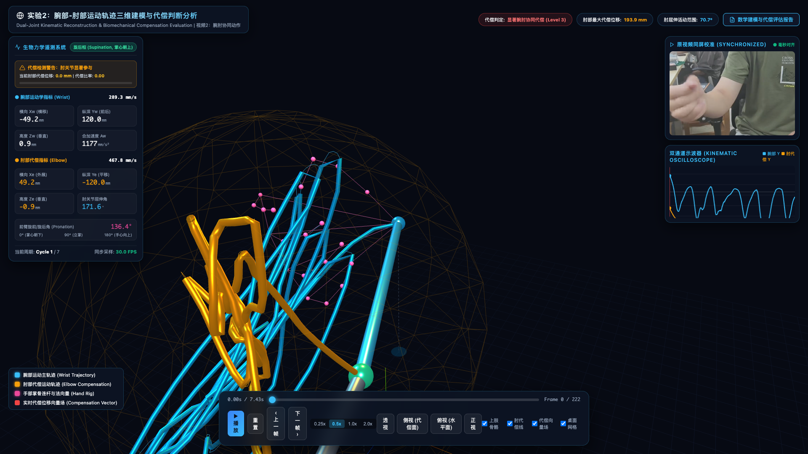
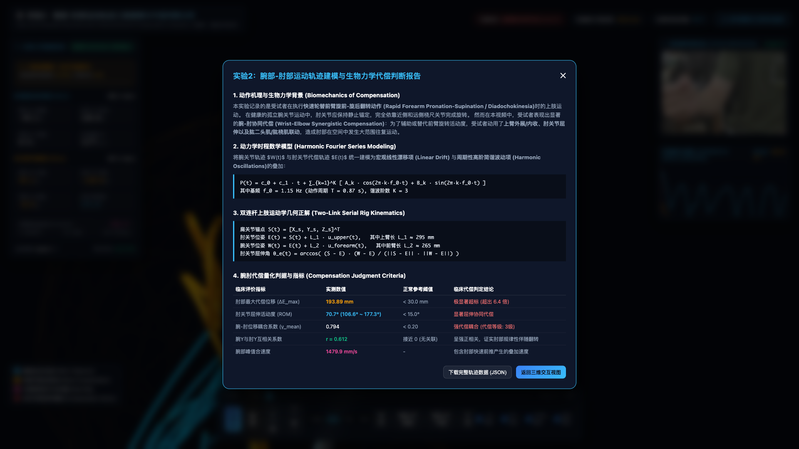

# 08_三维动作分析展示台

> **定位**：基于 Three.js 的上肢关节运动学轨迹三维重建、双关节协同运动与生物力学代偿判断可视化系统。
> **对标**：父项目 [`../01-摄像头/08_实时数控展示台`](../../01-摄像头/08_实时数控展示台/)
> **证据边界（2026-09-30修订）**：现有主要处理脚本使用RGB视频、MediaPipe模型坐标及肢段假设重建；本页数值、颜色和等级属于演示，不是D435i深度实测准确性、临床阈值或治疗建议。
> **真实验证入口**：[D435i四问任务包](../04_实验设计/D435i_四问任务包/README.md)。原片和现有派生数据本次不修改。

---

## 📸 界面展示效果

| 主交互界面 (3D 骨骼与双轨迹 + 遥测 HUD + 同步视频 + 示波器) | 模型报告弹窗（演示，非临床结论） |
|:---:|:---:|
|  |  |

---

## 🚀 快速启动

### 方式 1：双击启动 (macOS 用户推荐)
直接在 macOS访达 (Finder) 中双击运行本目录下的：
```bash
启动展示台.command
```

### 方式 2：终端命令行启动
```bash
cd /Users/xbpd/Projects/视觉位移判断/02-视觉动作分析/08_三维动作分析展示台
bash start.sh
```
脚本将自动启动后台 Python HTTP Web 服务并调起默认浏览器访问总览门户：
- **展示台中枢门户**：[http://localhost:8089/08_三维动作分析展示台/index.html](http://localhost:8089/08_三维动作分析展示台/index.html)
- **实验2·视频3（腕-肘-肩三关节协同代偿）**：[http://localhost:8089/08_三维动作分析展示台/04_腕肘肩协同代偿/](http://localhost:8089/08_三维动作分析展示台/04_腕肘肩协同代偿/)
- **实验2·视频2（腕部-肘部代偿判断分析）**：[http://localhost:8089/08_三维动作分析展示台/03_腕肘代偿分析/](http://localhost:8089/08_三维动作分析展示台/03_腕肘代偿分析/)
- **实验2·视频1（腕部主动运动与肘肩代偿初探）**：[http://localhost:8089/08_三维动作分析展示台/02_腕部代偿初探/](http://localhost:8089/08_三维动作分析展示台/02_腕部代偿初探/)
- **实验1·视频1（腕部单关节运动轨迹重建）**：[http://localhost:8089/08_三维动作分析展示台/01_腕部基线实验/](http://localhost:8089/08_三维动作分析展示台/01_腕部基线实验/)

---

## 📂 文件清单与架构说明

```
08_三维动作分析展示台/
├── index.html                               # 【门户】展示台统一导航总览主页
├── 启动展示台.command                       # macOS 双击一键启动脚本
├── start.sh                                 # POSIX 启动与自动端口分配脚本
├── README.md                                # 本说明文档
│
├── 01_腕部基线实验/                         # 【实验1·视频1】腕部运动轨迹三维建模基线系统
│   ├── index.html -> wrist_motion_visualization.html
│   ├── wrist_motion_visualization.html
│   ├── wrist_trajectory_data.js
│   └── wrist_trajectory_data.json
│
├── 02_腕部代偿初探/                         # 【实验2·视频1】腕部主动运动与肘肩代偿初探
│   ├── index.html -> wrist_compensation_visualization.html
│   ├── wrist_compensation_visualization.html
│   ├── wrist_exp2_data.js
│   └── wrist_exp2_data.json
│
├── 03_腕肘代偿分析/                         # 【实验2·视频2】腕肘代偿判断三维可视化主系统
│   ├── index.html -> wrist_elbow_compensation_visualization.html
│   ├── wrist_elbow_compensation_visualization.html
│   ├── wrist_elbow_trajectory_data.js
│   └── wrist_elbow_trajectory_data.json
│
├── 04_腕肘肩协同代偿/                       # 【实验2·视频3】腕-肘-肩三关节空间动力学与协同代偿
│   ├── index.html -> arm_compensation_visualization.html
│   ├── arm_compensation_visualization.html
│   ├── arm_compensation_data.js
│   └── arm_compensation_data.json
│
├── tools/                                   # 视觉关键点提取与代偿动力学解算脚本
│   ├── extract_wrist_elbow_kinematics.py
│   └── process_compensation_data.py
│
├── libs/                                    # 核心 JavaScript 依赖库
│   ├── three.min.js                         # Three.js 核心 3D 渲染引擎
│   └── OrbitControls.js                     # 轨道控制器 (支持拖拽/旋转/缩放)
│
├── assets/                                  # 界面效果预览截图
│   ├── 展示效果_主界面.png
│   └── 展示效果_代偿报告.png
│
├── _测试与过程文件/                          # 历史生成与补丁辅助脚本
│   ├── generate_html.py
│   └── update_visualizer.py
│
├── 07_资料库                               # 视频资源目录（实体目录，统一 NN_主题 命名）
```

---

## 🔬 数学模型与演示性指标（未通过人体验收）

下列毫米数值和肢段长度来自模型重建/演示假设，尚无本任务要求的同步真实深度与独立参考验证。公式可以用于研究和展示，不能把数值解释为已标定的人体真值。

### 1. 腕部时域谐波运动学模型
将腕关节的三维空间轨迹 $W(t) = [X_w(t), Y_w(t), Z_w(t)]^T$ 解耦为线性前移漂移项与周期性高阶简谐项：
$$W(t) = \mathbf{c}_0 + \mathbf{c}_1 t + \sum_{k=1}^3 \left[ \mathbf{A}_k \cos(2\pi k f_0 t) + \mathbf{B}_k \sin(2\pi k f_0 t) \right] + \mathbf{\epsilon}_w(t)$$
- 基频 $f_0 = 1.15\text{ Hz}$（周期 $T = 0.87\text{ s}$）
- 空间跨度：$X=80.3\text{ mm}, Y=346.0\text{ mm}, Z=248.8\text{ mm}$，空间累积路程 $3711.2\text{ mm}$

### 2. 双连杆上肢运动学几何正解
将人体上肢建模为受解剖学约束的双连杆机构（Two-Link Serial Rig）：
- 上臂骨干：肩 $S(t)$ 至 肘 $E(t)$，演示假设长度 $L_1 \approx 295\text{ mm}$
- 前臂骨干：肘 $E(t)$ 至 腕 $W(t)$，演示假设长度 $L_2 \approx 265\text{ mm}$
- 肘部几何夹角（伸直约180°，不是现行任务包中伸直0°的屈伸定义）：
  $$\alpha_e(t) = \arccos\left( \frac{(S(t) - E(t)) \cdot (W(t) - E(t))}{\|S(t) - E(t)\| \cdot \|W(t) - E(t)\|} \right)$$

同一数据要转换到现行肘屈伸约定需用 $\theta_e=\pi-\alpha_e$ 并统一单位；这只修正角度定义，不证明模型测量准确。

### 3. 模型派生对照（演示设置，未经临床标定）

| 指标 | 视频1模型结果 | 视频2模型结果 | 演示设置 | 可描述的模型现象 |
|---|---|---|---|---|
| **动作类型** | 前臂旋前-旋后演示 | 翻转伴肘部摆动演示 | - | 不是本版FE/RU真实角度验收 |
| **肘部最大位移** | $< 18\text{ mm}$ | **$193.89\text{ mm}$** | $< 30\text{ mm}$ | 超出演示界限约6.4倍，不是临床正常界限 |
| **肘部几何夹角范围** | $< 12^\circ$ | **$70.7^\circ$ ($106.6^\circ \sim 177.3^\circ$)** | $< 15^\circ$ | 模型夹角变化，不是独立标定的人体角度 |
| **腕肘位移耦合系数** | $< 0.12$ | **$0.794$** | $< 0.20$ | 相关/耦合特征，不证明代偿成因或严重度 |
| **腕Y与肘Y互相关** | $r \approx 0.08$ | **$r = 0.612$** | 接近0 | 模型时序相关，不等于临床归因 |
| **界面等级标签** | Normal | Level 3 | 演示标签 | 不构成诊断或治疗建议 |

---

## 🖥️ 核心交互系统功能

1. **三维虚拟舞台 (Center 3D Stage)**：
   - 青蓝色流光管道（腕部主轨迹） + 琥珀色代偿管道（肘部代偿轨迹）；
   - 动态发光上肢骨骼链（肩-肘-腕），肘关节球随实时代偿程度自适应变色（绿 $\to$ 黄 $\to$ 红）；
   - 21点完整手掌网格与实时法向量箭头；
   - 实时代偿位移虚线向量场（从起始参考锚点指向当前肘部）；
   - 半透明代偿包络球体与投影阴影。
2. **左侧模型遥测 HUD**：
   - 回放动作相位指示器（旋前相 / 旋后相 / 转换过渡相）；
   - 演示仪表盘与模型比例指示，不作临床告警；
   - 腕部与肘部模型 $(X, Y, Z)$ 坐标、线速度、合加速度及肘部几何夹角。
3. **右侧同屏回放与双通道示波器**：
   - 原视频画中画（PIP Video）按回放帧时间轴对齐，不代表已标定的跨设备毫秒同步；
   - 双通道运动学示波器实时绘制**腕部纵深位移 (Cyan)** 与 **肘部代偿位移 (Amber)** 时序曲线。
4. **控制台与视角切换**：
   - 播放/暂停、逐帧微调（‹ 上一帧 / 下一帧 ›）、重置、0.25x~2.0x 变速；
   - 一键视角切换：透视、侧视（代偿矢状面）、俯视、正视；
   - 图层开关：上肢骨骼、肘代偿线、代偿向量场、桌面网格。
