# 基于 NMS 求解器信息 ANN 模型与迁移学习的踝关节力矩预测

Longbin Zhang（张龙彬）, Xueyu Zhu（朱雪雨）, Elena M. Gutierrez-Farewik, and Ruoli Wang（王若力）

摘要——在本研究中，我们结合了一种由神经肌肉骨骼（neuromusculoskeletal，NMS）求解器驱动的人工神经网络（混合 ANN，hybrid-ANN）模型与基于关节角度和肌肉肌电信号的迁移学习方法来预测踝关节力矩。混合 ANN 是一种通过两类特征进行增强的人工神经网络：1）实验测量数据——肌肉信号和关节角度；2）从底层 NMS 求解器中提取的具有信息量的物理特征，例如各肌肉力和关节力矩。我们在受试者内和受试者间两种测试中研究了混合 ANN 模型在力矩预测方面的精度，并将其与基线模型（NMS 和标准 ANN）进行了对比。针对每个预测模型，我们基于不同速度下的步态数据和踝关节等速背屈/跖屈运动数据，研究了七种不同情形。此外，我们还在受试者间模型中集成了迁移学习方法，通过将先前受试者学到的知识迁移到新受试者，从而在训练数据有限时提高关节力矩预测的精度。我们的结果表明，将具有信息量的 NMS 特征集成到标准 ANN 模型中可以获得更高的精度，尤其是在受试者间情形下；总体而言，混合 ANN 模型的关节力矩预测精度高于基线模型，尤其在采用迁移学习技术后的受试者间预测中表现最为突出。我们展示了在不同预测场景下，将基于物理的 NMS 模型与标准 ANN 模型相结合并配合迁移学习技术的潜力。该方法在按需辅助外骨骼控制策略设计等应用中具有广阔的前景，能够将用户的生理性关节力矩纳入考量。

关键词——神经肌肉骨骼模型，神经网络，泛化能力，迁移学习。

## I. 引言

外骨骼（exoskeleton）因其有望帮助运动障碍患者恢复丧失的运动功能而得到了广泛研究 [1]、[2]、[3]。在外骨骼辅助康复训练过程中，使用者的主动参与对于促进神经肌肉恢复至关重要 [4]、[5]。因此，外骨骼控制策略最重要的特性之一是：外骨骼能否提供合适的辅助力矩，以适应使用者残余的肌肉功能 [6]。近年来，将使用者的力矩能力纳入辅助设计中的外骨骼控制策略研究呈现指数级增长，因为该方法能够鼓励其主动参与以促进运动功能恢复 [7]。

在预测关节力矩的方法中，基于物理的方法较为常见。例如，Durandau 等人 [8] 研究了一种实时肌电图 (EMG) 驱动的神经肌肉骨骼 (NMS) 模型，用以建立从 EMG 信号到完整人体机械关节力矩输出的转换关系。该方法能够鲁棒地同时计算 13 个肌腱单元中的力和 3 个关节力矩（膝关节伸肌/屈肌、踝关节跖屈/背屈以及距骨下旋前/旋后肌）。EMG 驱动的 NMS 模型通常需要领域知识来显式建模变量之间的关系，例如肌肉主动和被动力-长度关系、肌肉力-速度关系，以及关节角度-肌腱运动学关系。通常，构建/校准这些模型涉及复杂的步骤，因而十分耗费人力和时间。此外，基于物理的 NMS 模型仅能对关节动力学进行粗略估计，且 EMG 信号的质量可能受到串扰和传感器放置位置的影响。其他研究，例如 EMG 辅助的 NMS 模型，已通过结合肌腱参数优化进行了研究，以进一步提升模型预测精度，从而获得能够更好地跟踪测量关节力矩的估计肌肉激发信号 [9], [10]。然而，在实时预测中获取调整后的参数仍然是一个具有挑战性的问题。

人工神经网络（Artificial Neural Network, ANN）因其功能特性和近似精度，已被广泛用于预测关节力矩。ANN 由多层计算单元组成，将每个节点视为人工神经元，从而模拟大脑中的人体神经元突触系统，具备处理复杂非线性信息的能力 [11]、[12]、[13]、[14]。Pena 等人 [15] 将 ANN 作为神经肌肉骨骼（Neuromusculoskeletal, NMS）模型的替代方法，用于估计主动膝关节矫形器控制策略中肌电（EMG）与力矩之间的映射关系。他们发现，与 NMS 模型相比，基于 ANN 的模型具有更高的预测精度。ANN 无疑被认为是识别变量之间关系及输出结果或在数据中搜索既定模式的强大工具。然而，ANN 是一个黑箱模型，不具备变量间潜在机制的概念，因此可能无法为训练分布之外的数据提供可靠预测 [16]，尤其是在训练数据量和变化有限的情况下。为了发挥其优势，最近的一些研究已将神经网络融入基于物理的模型中，以增强模型的预测能力并促进神经肌肉骨骼建模，应用领域广泛。Zhang 等人 [17] 构建了一个神经网络，利用从光谱重建求解器中提取的信息特征来建模胶体量子点光谱仪的光谱。他们证明，混合模型具有更好的重建精度和鲁棒性，这得益于求解器所提供的信息特征。在最近的一篇综述论文中，Saxby 等人 [18] 提出了如何将基于物理的仿真与来自大数据（Big Data）的机器学习方法相结合，以促进神经肌肉骨骼建模，并建议将个性化神经肌肉骨骼模型特征与大数据/机器学习方法相结合用于未来研究。受此启发，我们近期在步态和等速运动中的踝关节力矩预测中，将来自 NMS 模型的信息特征融入到标准 ANN 中 [19]。我们在受试者内（intra-subject）预测中的结果表明，与 NMS 模型和标准 ANN 相比，组合模型总体上对关节力矩的预测效果更佳，证明了将基于物理的 NMS 求解器中的信息特征融入标准 ANN 具有显著优势。然而，模型在受试者间（inter-subject）预测中的泛化性能尚未进一步研究。

在肢体关节力矩预测中，跨被试模型生成通常是一项具有挑战性的任务。神经肌肉骨骼（NMS）模型必须首先通过个体实验测试进行校准，以获取个性化参数，如最优肌纤维长度、最大等长力和肌腱松弛长度；然后才能使用该个性化模型来估算肌肉力和关节力矩。因此，可以预期 NMS 模型在跨被试预测中的泛化能力较差。相比之下，人工神经网络（ANN）的泛化能力主要取决于网络规模，前提是有足够的训练数据和充分的训练。然而，当训练数据有限时，当数据超出训练分布时，泛化能力通常会面临性能下降的问题 [16]。

近年来，迁移学习已被用于改善泛化能力，尤其是在数据有限的情况下 [20]、[21]。Jayaram 等人 [22] 提出了一种用于脑机接口的迁移学习框架，可应用于基于脑电图信号的任意期望的时空特征空间。他们的结果表明，该方法在处理会话间（inter-session）和被试间（inter-subject）变异性方面优于其他可比方法。Karri 等人 [23] 对在 ImageNet 数据库上预训练的卷积神经网络 GoogLeNet 模型进行了微调，以提高其识别具有病理特征的光学相干断层扫描图像的预测能力。这些作者展示了 GoogLeNet 对图像分类的适应性，通过使用更少的训练数据实现更快收敛。通过利用从先前经验/数据上预训练的神经网络中获取的知识，可以使用相对较少的样本获得性能良好的新神经网络。因此，迁移学习技术是改善跨被试模型中关节力矩预测泛化能力的一种潜在方法。

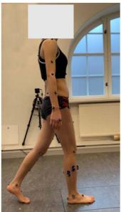  
(a)

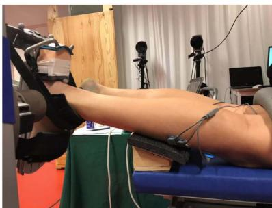  
(b)  
图 1. 实验。(a) 步态；(b) 等速踝关节背屈/跖屈运动。

本工作的目的是研究 NMS 求解器引导的 ANN 在被试内和跨被试预测中的踝关节力矩预测精度。由于某些被试的训练数据通常可能有限，我们采用了迁移学习技术，利用从先前经验中获取的知识来进一步提高模型的预测精度，特别是针对跨被试预测。

## II. 方法

## A. 实验设置

10名健康受试者（性别：4女/6男；年龄：26±3岁；体重：70.4±11.5 kg；身高：175.1±8.5 cm）通过熟人及同事招募而来。瑞典伦理审查机构（Swedish Ethical Review Authority）批准了本研究（Dnr. 2016/286-32），所有受试者均签署了书面知情同意书。所有受试者被要求完成三种特定运动，分别为行走、等速踝关节跖屈和等速踝关节背屈。在行走过程中，分别以自选速度、慢速和快速记录实验数据（图1）。等速踝关节运动（跖屈和背屈）以两种不同的速度进行：60°/s和90°/s。受试者右腿的腓肠肌内侧头（gastrocnemius medialis, GM）、胫骨前肌（tibialis anterior, TA）和比目鱼肌（soleus, SOL）的表面肌电信号（Noraxon Inc., AZ, USA）以3000 Hz采集，电极放置遵循欧洲表面肌电推荐标准 [24]。

在步态实验中，每个受试者被指示以自选速度 $( 1 . 1 3 \pm 0 . 0 9 \mathrm { m } / \mathrm { s } )$ 行走，然后根据设为100拍/分钟的节拍器同步步频（慢速，1.08±0.07 m/s）以及120拍/分钟（快速，$1 . 3 3 \pm 0 . 0 8 \mathrm { m / s } )$，沿着一段9米长的测力跑道行走。每个速度下至少收集3次具有有效测力台数据的试次。每次试次中的一个完整站立相周期后续用于模型校准/训练。标志点轨迹由3D运动捕捉系统（200 Hz, Qualisys，瑞典哥德堡）测量，标志点按照Plug-in Gait模型（插件式步态模型）[25]、[26] 放置在受试者身上。行走过程中的地面反作用力（GRFs）使用测力台（Kistler，瑞士温特图尔）以3000 Hz测量。在等速踝关节运动期间，每个受试者被要求在20°跖屈至15°背屈的范围内，以最大努力连续五次进行背屈和跖屈，期间运动和关节力矩由测力计（5000 Hz, IsoMed 2000，德国Hemau）记录。

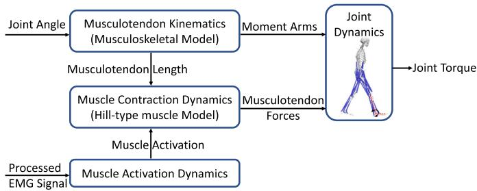  
图2. NMS模型示意图，由四个组件构成：肌肉激活动力学利用采集的肌电信号计算肌肉激活水平；肌肉收缩动力学通过基于Hill的肌肉模型计算肌腱力；肌腱运动学计算每个肌腱单元的肌腱长度和力臂；最后，关节动力学组件计算关节力矩。

## B. 数据处理

EMG进行带通滤波（30–300 Hz）、整流、低通滤波（6 Hz），并归一化至所有运动试验中的最大EMG值 [4], [9], [27]。在等速运动任务中，对测量的踝关节角度和力矩应用低通零相位巴特沃斯滤波器（6 Hz）；在步态中，对标记点轨迹和地面反力（GRFs）应用相同的滤波器 [28], [29], [30]。步态中的踝关节角度和力矩通过肌肉骨骼建模系统（OpenSim v3.3，SimTK，斯坦福，美国）计算，采用由缩放、逆运动学和逆动力学组成的通用流程 [27]。我们使用在特定受试者上采集的标记点轨迹来拟合其人体测量学参数，将通用肌肉骨骼模型（OpenSim Gait2354）缩放为受试者特定模型。然后，将缩放后的肌肉骨骼模型作为应用工具，以记录的标记点轨迹和GRFs作为输入，重建三维关节运动学和动力学。关节角度通过逆运动学计算，通过最小化实验标记点与模型上相应虚拟标记点之间的距离 [31]。关节力矩通过逆动力学计算，通过求解运动动力学方程 [32]。

## C. 关节力矩预测模型

1) **NMS模型**：本研究使用了由Pizzolato等人 [10] 开发的开源EMG驱动NMS模型（CEINMS），该模型由肌腱运动学、肌肉收缩动力学、肌肉激活动力学和关节动力学组成（图2）[33]。

肌肉激活动力学组件利用采集的EMG计算肌肉激活。EMG $e(t)$ 与神经激活 $u ( t )$ 之间的关系可由公式 (1) 表示 [34]。

$$
u ( t ) = \alpha \cdot e ( t - \tau ) - \beta _ { 1 } \cdot u ( t - 1 ) - \beta _ { 2 } \cdot u ( t - 2 )\tag{1}
$$

其中 $\alpha$ 是肌肉增益参数；$\beta _ { 1 }$ 和 $\beta _ { 2 }$ 是递归参数；为获得稳定解，$\alpha , \beta _ { 1 }$ 和 $\beta _ { 2 }$ 需满足以下约束关系 [10] [34] [35]：$\beta _ { 1 } = C _ { 1 } + C _ { 2 } , \beta _ { 2 } = C _ { 1 } \cdot C _ { 2 }$，其中 $\left| C _ { 1 } \right| < 1 , \left| C _ { 2 } \right| < 1$，且 $\alpha - \beta _ { 1 } - \beta _ { 2 } = 1$。$\tau$ 是机电延迟。肌肉激活 $a ( t )$ 与神经激活之间的关系可由公式 (2) 表示：

$$
a ( t ) = \frac { e ^ { B u ( t ) } - 1 } { e ^ { B } - 1 }\tag{2}
$$

其中 $B$ 是形状因子 [9], [35]。

肌肉收缩动力学组件通过基于Hill型肌肉模型计算肌腱力。每个肌腱单元（MTU）的力 $F$ 可由公式 (3) 表示：

$$
F = F _ { 0 } ^ { m } [ F _ { a } ( l ) \cdot F _ { v } ( v ) \cdot a + F _ { p } ( l ) + d _ { a } \cdot v ] c o s ( \psi )\tag{3}
$$

其中，$F_{0}^{m}$ 为肌肉最大等长力；$l$ 为肌纤维长度；$v$ 为肌纤维收缩速度；$F_{a}(l)$ 表示主动力-长度关系，$F_{p}(l)$ 描述被动力-长度关系，$F_{v}(v)$ 表示力-速度关系；$d_{a}$ 为肌肉阻尼参数；$\psi$ 为肌纤维羽状角。

肌肉肌腱运动学组件用于计算肌肉肌腱单元的力臂和肌肉肌腱长度。最后，通过关节动力学组件预测关节力矩。

在 NMS 模型标定过程中，对每位受试者进行受试者特异性 MTU（肌肉肌腱单元）参数辨识。这些参数（包括最优肌纤维长度、肌腱松弛长度、形状因子 $B$、强度系数以及系数 $C_{1}$ 和 $C_{2}$）通过在标定过程中最小化估计关节力矩与实测关节力矩之间的误差进行优化。标定参数及边界条件的设定参考了 Pizzolato 等人 [10] 的建议。每个 MTU 的最优肌纤维长度 $l_{0}^{m}$ 和肌腱松弛长度 $l_{s}^{t}$ 被约束在其默认值的 15% 范围内。形状因子 $B$ 被约束在 $(3, 0)$ 范围内。系数 $C_{1}$ 和 $C_{2}$ 被约束在 $(1, 1)$ 范围内。强度系数被约束在 $(0.5, 2.5)$ 范围内，用于缩放肌肉最大等长力。

2) ANN 模型：接下来，我们构建了一个标准 ANN（人工神经网络）模型，使用与 NMS 模型相同的实验输入（即 EMG 信号和关节角度，如图 3 所示）来估计踝关节力矩。如上所述，标准 ANN 技术是一种纯数据驱动方法，在遇到未见过的运动时其预测精度可能较低 [36]。为提高标准 ANN 模型的泛化能力，我们利用更具信息量的特征——由基于物理的 NMS 求解器计算得到的各肌肉力及踝关节力矩，构建了混合 ANN 模型（图 3）。

标准 ANN 和混合 ANN 均包含输入层、$n$ 个隐藏层和输出层。在输入方面，标准 ANN 由四个实验输入特征组成，分别为踝关节角度和三个肌肉 EMG 信号。在此基础上，混合 ANN 额外增加了四个输入特征：踝关节力矩以及由基于物理的 NMS 求解器计算的三个肌肉力。在受试者内预测中使用两个隐藏层，而在不使用迁移学习的跨受试者预测中使用四个隐藏层。最后，由输出层估计踝关节力矩。

  
图 3. 标准 ANN 模型和混合 ANN 模型的架构。对于标准 ANN 和混合 ANN 模型，输入均为相同的实验测量数据，即三块肌肉的肌电信号（EMG）和踝关节角度。对于混合 ANN 模型，额外加入了基于物理的神经肌肉骨骼（NMS）模型计算得到的特征，即肌肉力和关节力矩，从而将 NMS 模型中更具信息量的特征引入标准 ANN 模型。隐含层共 n 层（受试者内预测使用两个隐含层；不使用迁移学习的受试者间预测使用四个隐含层），并在输出层预测踝关节力矩。

3) 迁移学习：在两种 ANN 模型的受试者间预测中，均采用了迁移学习技术，以通过使用从先前经验/受试者 $( S _ { 1 } , S _ { 2 } , . . . , S _ { p } )$ 获得的知识/信息对模型进行预训练，学习结构相似性，并将所获得的知识迁移到新的受试者（图 4）。我们从预训练模型中提取除输出层以外的各层，然后将其共享给目标受试者（$S_t$）的模型；在目标模型中新增一个隐含层和一个输出层；然后利用来自新受试者的数据/信息，对所新增的两个层的权重进行训练，同时对其余层的权重进行微调。

4) ANN 模型的超参数调优：我们采用"由粗到精"的随机搜索方法 [37] 来确定 ANN 模型的超参数。训练过程中，损失函数为估计踝关节力矩与实际踝关节力矩之间的均方误差（mse）。批量大小设为 20。权重初始化采用 Xavier 初始化，偏置初始化为零。受试者内预测选择两个隐含层，受试者间预测选择四个隐含层。每个隐含层包含十个神经元，激活函数为 tanh。优化器选用 Adam（学习率为 $1 0 ^ { - 3 }$）。对于迁移学习技术，学习率调优为 $1 0 ^ { - 4 }$，微调阶段的学习率为 $1 0 ^ { - 5 }$。我们通过迭代 4000 个 epoch 获得最优模型，并在连续 200 个 epoch 损失不再下降时采用早停（early stop）技术终止训练。

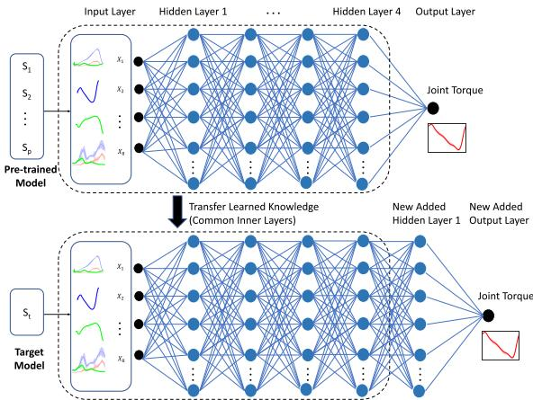  
图 4. 在 ANN 模型的受试者间预测中采用的迁移学习技术。预训练模型包含从先前经验/受试者 $( S _ { 1 } , S _ { 2 } , . . . , S _ { p } )$ ) 获得的知识。从预训练模型中提取除输出层以外的各层/知识，并将其迁移到目标受试者 $( S _ { t } )$ 的模型中。在目标模型中新增一个隐含层和一个输出层，然后利用来自新用户的信息/数据对目标模型进行重新训练。

## D. 评估框架

研究了在两种预测模型场景下 NMS（神经肌肉骨骼模型）、标准 ANN（人工神经网络）和混合 ANN（hybrid-ANN）的踝关节力矩估计精度：受试者内（intra-subject）预测和受试者间（inter-subject）预测。在受试者间预测中，还研究了将迁移学习（transfer learning）技术引入两种 ANN 模型所带来的益处，并将 ANN 模型在受试者内预测中的预测结果与 NMS 模型进行了比较。对于每个预测模型，研究了七种不同的情况：$G a i t _ { f a s t } , G a i t _ { s e l f }$ $G a i t _ { s l o w } ,$、IsokP90、IsokP60、IsokD90 和 $I s o k _ { D 6 0 }$。有关不同情况的详细描述，请参见图 5。混合 ANN 中的 NMS 模型按照第 II C(a) 节中描述的校准过程进行了校准。令人担忧的是，NMS 模型校准的需求可能会限制所提出的混合 ANN 模型的广泛应用。因此，我们研究了采用未校准 NMS 的混合 ANN 模型在应用迁移学习技术的受试者间预测中的预测精度（如附录所示）。

**受试者内预测**：模型分别使用每种运动的数据进行校准/训练，并对每位用户（$( S _ { 1 } , S _ { 2 } , . . . , S _ { 1 0 } )$）在不同速度下的同类型运动进行单独测试。更具体而言，我们以某一种速度下的步态数据校准/训练模型，并在其余步态速度下进行测试；等速踝关节运动的情况也是如此。对于 ANN 模型的训练，使用两次试验作为训练数据，一次试验作为验证数据。

为了比较模型在受试者内和受试者间预测中的精度，我们复现了先前报道的受试者内预测结果 [19]。

**受试者内预测**：

a) 不使用迁移学习：与受试者内预测类似，包含了七种情况。ANN 模型针对除一个受试者外的多个受试者的每种运动进行训练（留一交叉验证方法），然后在剩余新受试者的同类型运动上进行测试，再对每个受试者迭代此过程。

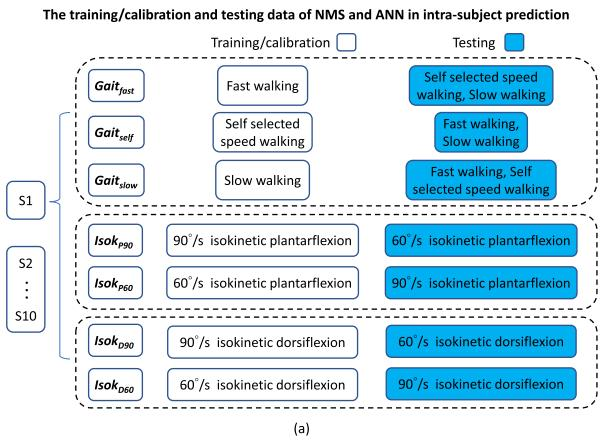

# 受试间预测中 ANN 模型的训练与测试数据

**图 5.** (a) 受试内（intra-subject）预测中，七种不同情况下 NMS 和 ANN 模型的训练/校准与测试数据；(b) 受试间（inter-subject）预测中，七种不同情况下 ANN 模型的训练与测试数据。受试内预测：对于每种情况，使用不同的运动来校准（NMS）或训练（ANN）模型。模型通过分别使用每种运动的数据进行校准/训练，然后在每位用户（$S_{1}, S_{2}, \ldots, S_{10}$）的不同速度的同类型运动上进行测试。无迁移学习的受试间预测：模型针对除一名受试者之外的多名受试者的每种运动进行训练（留一交叉验证方法），然后在剩余新受试者的同类型运动上进行测试，之后对每位受试者依次迭代。有迁移学习的受试间预测：模型针对除一名受试者之外的多名用户的每种运动进行预训练，并通过公共结构共享给新用户。然后使用新受试者同种运动的数据对模型进行再训练（即来自新受试者的数据量较少），并在新受试者不同速度的同类型运动上进行测试，之后对每位受试者依次迭代。

b) **有迁移学习的情况**：ANN 模型针对除一名受试者之外的多名受试者的每种运动进行预训练，并通过公共结构共享给新受试者。然后使用新受试者同种运动的数据对模型进行再训练（即来自新受试者的数据量较少），并在新受试者不同速度的同类型运动上进行测试，之后对每位受试者依次迭代。

各模型的预测精度通过归一化均方根误差（Normalized Root Mean Square Error, NRMSE）$E_{NRMS}$ 进行评估，其定义为估计踝关节力矩与实际踝关节力矩之间的均方根误差（Root Mean Square Error, RMS）$E_{RMS}$ 相对于相应运动中实际踝关节力矩变化范围的归一化值：

$$
E_{R M S} = \sqrt { \frac { 1 } { N } \sum _ { i = 1 } ^ { N } ( y _ { p , i } - y _ { i } ) ^ { 2 } } \tag{4}
$$

$$
E _ { N R M S } = \frac { E _ { R M S } } { \left( y _ { m a x } - y _ { m i n } \right) } \times 1 0 0 \% \tag{5}
$$

其中 $y_{p, i}$ 和 $y_{i}$ 分别为时间步 $i$ 处的估计踝关节力矩和实际/测量踝关节力矩；$y_{max}$ 和 $y_{min}$ 分别为相应运动中测量关节力矩 $y_{i}$ 的最大值和最小值。

采用 Shapiro-Wilk 检验（夏皮罗–威尔克检验）检查数据分布的正态性（显著性水平 $p < 0.05$）。对于非正态分布的数据，采用带 Bonferroni 校正（邦费罗尼校正）的 Wilcoxon 符号秩检验（威尔科克森符号秩检验）来研究三种方法预测所得 NRMSE 之间的差异（显著性水平 $p < 0.05$）。

## III. 结果

## A. 受试者内预测

总体而言，与 NMS 和标准 ANN 相比，混合 ANN 模型观察到了更小的 NRMSE（图 6）。

在所有校准/训练动作中，混合 ANN 预测的精度显著高于 NMS。（自选速度行走：$p = 0 . 0 2$，快速步行：$p = 0 . 0 2$，慢速步行：$p = 0 . 0 5$，等速跖屈 90◦/s：$p =$ $0 . 0 4$，等速跖屈 60◦/s：$p = 0 . 0 2$，等速背屈 $9 0 ^ { \circ } / \mathrm { s } { : } p = 0 . 0 2$，等速背屈 $6 0 ^ { \circ } / \mathrm { s } ; p = 0 . 0 2$）

在测试动作中，与 NMS 相比，混合 ANN 通常具有更好的力矩预测精度，仅有一个例外（图 7）。在 $G a i t _ { s e l f }$ 情况下，对于一名受试者的快速和慢速行走，混合 ANN 模型的预测精度低于 NMS 模型（图 6）。

与标准 ANN 相比，混合 ANN 并不总是表现出更优的预测精度。值得注意的是，在某些测试动作中，标准 ANN 模型预测的力矩与实际力矩的一致性较差，劣于其他两种模型，例如 $G a i t _ { s e l f }$ 情况下的慢速行走 $( \mathrm { F i g . } 7 B _ { 3 } )$、Isok$_{P90}$ 情况下的等速跖屈 60◦/s $( \mathrm { F i g . } 7 D _ { 2 } )$ 以及 $I s o k _ { P 6 0 }$ 情况下的等速跖屈 90◦/s $( \mathrm { F i g . } 7 E _ { 1 } )$。

NMS 模型估计的力矩轨迹有时在周期开始处显示出偏移，而实测力矩中不存在这种偏移。在 ANN 模型预测的力矩中未观察到这种偏移（例如图 7 中的 $A _ { 1 }$ 和 $A _ { 3 }$）。

## B. 跨受试者预测

1) 不使用迁移学习：总体而言，ANN 模型的力矩预测精度低于受试者特异性 NMS 模型（图 8(a) 和图 9），其中混合 ANN 的预测精度高于标准 ANN 模型。在所有校准/训练动作中，标准 ANN 的预测精度显著低于 NMS。（慢速步行：$p = 0 . 0 2$，自选速度行走：$p = 0 . 0 2$，快速步行：$p = 0 . 0 2$，等速跖屈 90◦/s：$p =$ 0.02，等速跖屈 $6 0 ^ { \circ } / \mathrm { s } \colon p = 0 . 0 2$，等速背屈 $9 0 ^ { \circ } / \mathrm { s } { : } p = 0 . 0 3$，等速背屈 $6 0 ^ { \circ } / \mathrm { s } ; p = 0 . 0 2$）在测试动作中，标准 ANN 的预测精度通常低于 NMS 和混合 ANN 模型。

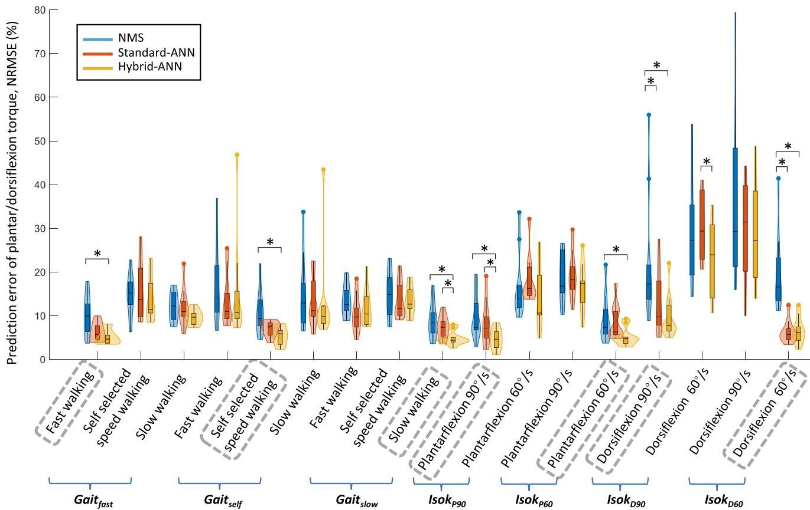  
图 6. 在受试者内预测的所有情况中，七种运动下估计踝关节力矩与实测踝关节力矩之间的 NRMSE，以小提琴图（violin plot）形式展示。每个小提琴图结合了箱线图（box plot）与核密度图（kernel density plot）。箱线图显示了 NRMSE 的最小值、下四分位数、中位数、上四分位数和最大值。然后叠加核密度图以显示 NRMSE 的分布情况，其中小提琴图较宽的部分表示 NRMSE 取该值的概率较高，较窄的部分表示概率较低。经 Bonferroni 校正的 Wilcoxon 符号秩检验（Wilcoxon signed-rank tests）显示两个模型之间存在显著差异，以 * 表示。对于每种情况，作为校准/训练数据的运动用灰色虚线框圈出，其余为测试数据。

2) 使用迁移学习时：总体而言，使用迁移学习时，两个 ANN 模型的预测精度均显著提高，其中 standard-ANN（标准 ANN）在某些运动中的精度低于其他两个模型，例如在自选步速行走 $G a i t _ { f a s t }$ 情况下（图 10 $A _ { 2 }$）、等速跖屈 60°/s $I s o k _ { P 9 0 }$ 情况下（图 10 $D _ { 2 }$）以及等速跖屈 90°/s $I s o k _ { P 6 0 }$ 情况下（图 10 $E _ { 1 }$）。

在 $G a i t _ { f a s t }$、$G a i t _ { s e l f }$ 和 $G a i t _ { s l o w }$ 情况下，hybrid-ANN（混合 ANN）模型总体上优于其他两个模型（图 8(b)）。与 NMS 模型相比，在相同的训练/校准运动中发现了显著更高的预测精度，例如在快速行走（$p = 0 . 0 3$）和自选速度行走（$p = 0 . 0 2$）中，以及在慢速行走（$p = 0 . 1 1$）中虽不显著但也较高。值得注意的是，在 $G a i t _ { s e l f }$ 情况下，standard-ANN 模型在测试的慢速行走中表现出与实际力矩吻合最差的峰值跖屈力矩（图 10 $A _ { 2 }$）。

当使用 $I s o k _ { P 9 0 }$ 和 $I s o k _ { P 6 0 }$ 情况进行训练/校准时（图 8(b)），hybrid-ANN 模型在所有等速跖屈运动中具有最高的预测精度。与 NMS 相比，在相同的训练/校准等速跖屈 60°/s 中发现了显著性差异（$p = 0 . 0 2$），而在 90°/s（$p = 0 . 0 7$）中虽不显著但也较好。

在 $I s o k _ { D 9 0 }$ 和 $I s o k _ { D 6 0 }$ 情况下，与 NMS 相比，hybrid-ANN 在相同的训练/校准运动中的预测精度显著更高（90°/s：$p = 0 . 0 2$，60°/s：$p = 0 . 0 2$；图 8(b)），而在测试的等速背屈运动中虽不显著但也更好。总体而言，ANN 模型通常优于 NMS 模型（图 10）。

## IV. 讨论（DISCUSSION）

在本研究中，我们使用一种 NMS 求解器信息驱动的 ANN（混合 ANN，hybrid-ANN）结合迁移学习技术来估计踝关节力矩。除了实验信号外，混合 ANN 模型还在标准 ANN 的基础上增加了基于物理的 NMS 信息特征，即各肌肉力和踝关节力矩。具体而言，我们研究了所提出的混合模型在关节力矩预测中的准确性，并在受试者内（intra-subject）和跨受试者（inter-subject）预测中，将其与两个基线模型（标准 ANN 和 NMS）进行比较。在跨受试者预测中，我们采用了迁移学习技术以提高力矩预测精度。总体而言，我们发现混合 ANN 的力矩预测精度高于 NMS 和标准 ANN，尤其是在采用迁移学习技术后的跨受试者预测中。

  
图 7. 在受试者内预测中，所有情形下各模型预测的与实测的踝关节力矩轨迹的一个示例。对于每个情形，用作标定/训练数据的动作以灰色虚线框圈出，其余为测试数据。

EMG 驱动的神经肌肉骨骼（Neuromusculoskeletal, NMS）模型和人工神经网络（Artificial Neural Network, ANN）模型都是关节力矩估计中常用的方法，每种方法在不同预测场景下各有优势和局限性。与 NMS 模型相比，标准 ANN 模型具有强大的近似能力 [15]、[36]，但由于其是黑盒模型，仅基于训练动作研究输入与输出之间的关系，因此在面对未见过的动作时可能精度较低 [4]、[38]。在此背景下，本研究的一个目标是结合 NMS 和神经网络模型各自的优势；在先前的研究 [19] 中，我们提出了一种混合 ANN（hybrid-ANN），将 NMS 求解器中的物理特征集成到标准 ANN 中，并在受试者内预测中初步证明该混合模型在关节力矩估计上比单独使用的 NMS 和标准 ANN 都更为准确。然而，针对关节力矩预测的受试者间模型仍然具有挑战性。因此，在本研究中，我们将 NMS 求解器信息驱动的 ANN 模型与迁移学习相结合，以进一步提高踝关节力矩在受试者内和受试者间预测中的精度。我们发现，混合 ANN 模型总体上比 NMS 和标准 ANN 模型预测更为准确。我们将此归因于以下事实：生理特征（即混合 ANN 模型内部计算的个体肌肉力）是关节力矩估计中的主导中间分量，这符合关节动力学结构（图 2）。因此，将这些生理特征融入标准 ANN 模型可提升其预测精度，尤其是在面对未见过的动作时。例如，在 $Gait_{self}$ 案例的受试者内预测中，与混合 ANN 和 NMS 模型相比，标准 ANN 模型在测试未见过的动作（慢速步行）时精度最低（图 $7B_3$），特别是在站立末期峰值跖屈力矩附近。峰值附近较大的偏差可能是由于训练后的标准 ANN 模型对肌电信号变化和步行速度更为敏感，而来自其他速度的测试数据可能超出了训练模型的数据分布范围。

## A. 受试者内预测

在受试者内预测中，值得注意的是，当测量力矩在周期开始时接近零时，NMS 模型会预测出一些小偏差，例如图 8 中的 $A _ { 2 }$、$D _ { 2 }$ 和 $E _ { 1 }$。这可能是因为在 NMS 模型校准过程中，最优肌纤维长度、最大等长力和肌腱松弛长度等校准参数是通过最小化整个运动周期内预测力矩与实际力矩之间的误差来进行优化的。当测量力矩接近零而 EMG 幅值非零时，特别是在快速行走过程中，NMS 校准优化器可能难以找到一个既能同时满足初始近零力矩又能在整个周期内总体误差较小的最优解。此外，在 NMS 模型中，计算每个 MTU（肌肉-肌腱单元）的肌肉神经激活需要前两个时间步的神经激活（式 (1)）。在周期开始时，前两个神经激活值不可用，因此使用前两个时间步的 EMG 信号进行近似；这也可能导致预测力矩的初始偏差。然而，混合 ANN 模型在很大程度上消除了这种初始力矩偏差，可以将其视为从基于 NMS 的关节力矩预测到测量力矩的校正映射。这主要是因为混合 ANN 模型具有额外的组成部分：通过添加神经网络进一步训练更好的模型，以最小化测量关节力矩与预测关节力矩之间的误差。

无迁移学习的受试者间预测  
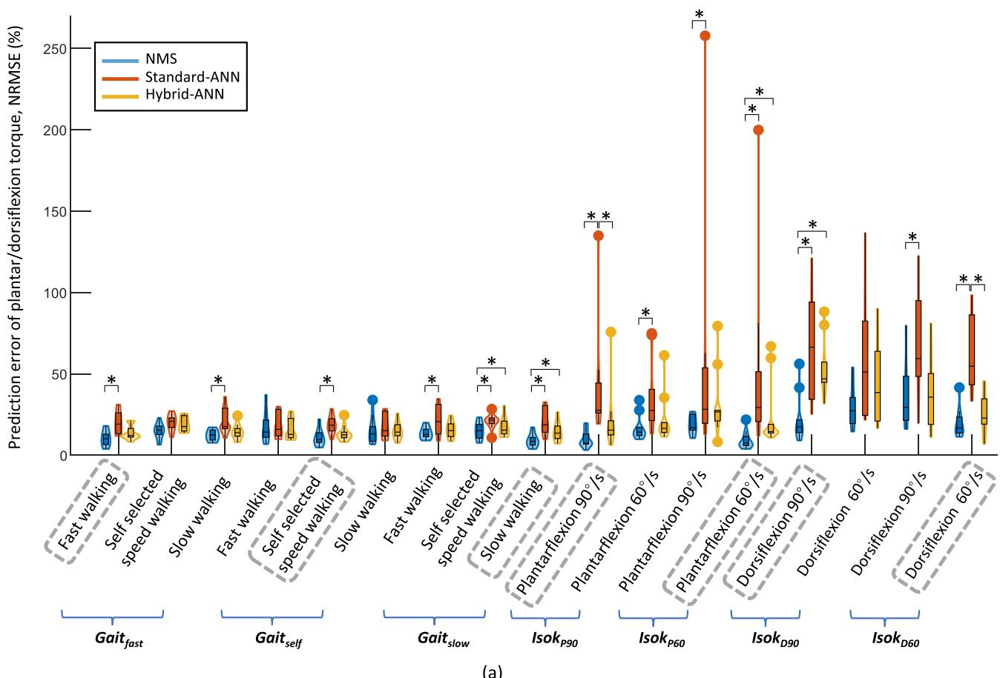

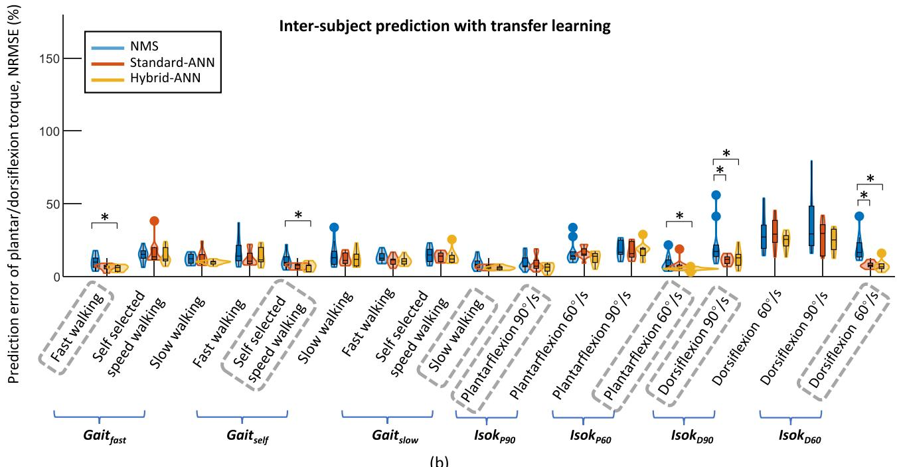  
(b)  
图 8. 在受试者间预测的所有情况下，七种运动中估计踝关节力矩与测量踝关节力矩之间的 NRMSE（归一化均方根误差）：(a) 无迁移学习和 (b) 有迁移学习。每个小提琴图结合了箱线图和核密度图。箱线图显示了 NRMSE 的最小值、下四分位数、中位数、上四分位数和最大值。然后添加核密度图以展示 NRMSE 的分布，其中小提琴图较宽的部分代表较高的概率，较窄的部分代表较低的概率。根据带有 Bonferroni 校正的 Wilcoxon 符号秩检验，两个模型之间的显著差异用  表示。对于每种情况，用作校准/训练数据的运动用灰色虚线框圈出，其余为测试数据。

  
图 9. 在无迁移学习的受试者间预测的所有情况下，模型预测与测量踝关节力矩轨迹的一个示例。对于每种情况，用作校准/训练数据的运动用灰色虚线框圈出，其余为测试数据。

值得注意的是，在受试者内预测中，标准 -ANN 在一名受试者的 $G a i t _ { s e l f }$ 情况下表现较差（测试于快速和慢速步行时，图 6）。其原因可能在于 hybrid-ANN 模型采用了由 NMS 求解器所得到的肌肉力和关节力矩作为输入特征。然而，在某些情况下，NMS 模型所预测的力矩质量较差。因此，它向 hybrid-ANN 模型提供了信息量不足甚至具有误导性的输入特征，对其预测精度产生了负面影响。NMS 模型在某些测试动作中预测较差并不令人意外，因为在标定动作与测试动作之间可能存在不同的肌肉协调模式。在未来的工作中，我们建议采用具有不确定性量化特征的替代神经网络模型，例如贝叶斯神经网络（Bayesian neural network），它能够首先识别某种情形，从而指导训练数据的扩充，以重新训练一个稳健的模型 [39]。

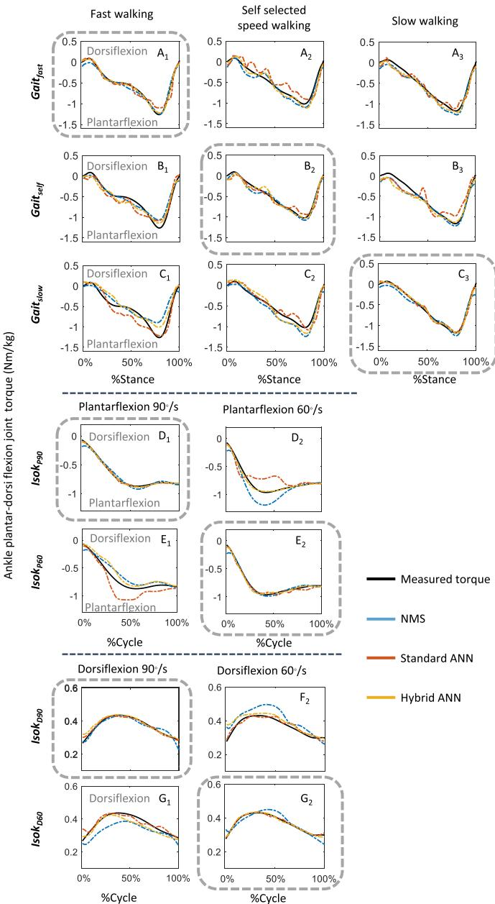  
图 10. 在采用迁移学习的受试者间预测中，所有情况下各模型所预测的踝关节力矩轨迹与实测力矩轨迹的一个示例。对于每种情况，用作标定/训练数据的动作以灰色虚线框圈出，其余为测试数据。

## B. 受试者间预测

如预期的那样，在未采用迁移学习的情况下，无论使用哪种 ANN 模型，受试者间力矩预测的总体精度均低于受试者内预测。在没有迁移学习的情况下，hybrid-ANN 和标准 ANN 均使用来自以往经验/受试者的数据进行训练，但未包含新受试者的数据。因此，可以预期其力矩预测精度低于使用新受试者数据进行标定的受试者特异性 NMS 模型。此外，可以预期肌肉协调模式在不同受试者之间会有所差异 [40]、[41]；因此，如果训练过程中缺乏新受试者的信息，特别是当包含其他受试者的训练数据集不够丰富时，标准 ANN 模型可能缺乏足够的泛化能力。然而，一个有趣的发现是，尽管 ANN 模型预测的力矩总体上不如受试者特异性 NMS 模型精确，但 hybrid-ANN 预测的力矩比标准 ANN 更准确（图 9）。这主要是因为 hybrid-ANN 模型包含了更多相关的输入特征，即来自 NMS 求解器的单块肌肉力和关节力矩，比标准 ANN 更具优势，从而能够利用 NMS 求解器的鲁棒性和可靠性。

迁移学习技术是跨被试交叉验证方法中一种常用的方法，旨在提高神经网络的泛化能力，它通过将源域（先前被试）中获得的知识/信息应用于目标域（新参与者），可以防止上述性能泄漏[16]。在本研究中，我们将迁移学习技术引入到跨被试运动过程中的关节力矩预测的人工神经网络模型中。我们发现，在所有情况下，迁移学习都显著提高了力矩预测精度。例如，在 $Gait_{fast}$ 情况下，不使用迁移学习时，两个 ANN 模型预测的力矩与实测力矩相比存在较大偏差（图 9 A、A$_3$），但使用迁移学习后，两个 ANN 模型预测的力矩精度大幅提升（图 10 A$_1$、A$_2$ 和 A$_3$）。另一个例子是，在某个被试的 $(Gait_{self})$ 情况下，混合 ANN 模型不使用迁移学习时预测精度较差，而应用迁移学习后得到改善，甚至优于被试内预测（图 6 与图 8(b) 对比）。这一提升可能是因为预训练模型中共享相似性/结构中的权重视为了新用户的模型初始权重。据报道，初始权重会影响模型的预测精度，即初始权重越接近最优解，模型的预测精度就越好[42]、[43]。

## C. 局限性

需要指出的是，我们选择经典类型的人工神经网络（ANN），是因为它在关节力矩预测中凭借其功能性和近似精度而被广泛应用 [15]、[44]、[45]。其他具有不同结构的人工神经网络（例如长短期记忆（LSTM）网络）可能会产生不同的结果。尽管 LSTM 网络由于其记忆结构能够在一段时间内记忆模式，但我们在混合 ANN 模型中所引入的 NMS 模型也具有类似的功能，如式 (1) 所述；NMS 模型也具有某种记忆，因为它利用了肌腱单元（MTU）神经激活前两个时间步的信息。此外，LSTM 网络通常需要更多的数据进行训练，这在本研究中限制了其应用，因为我们使用的数据集规模较小。本研究的目标是探讨基于物理的 NMS 与 ANN 的组合模型能否在个体内（intra-subject）和个体间（inter-subject）的力矩预测中提高踝关节力矩的预测精度。不同类型的神经网络可在未来的工作中进一步分析。

关于执行时间，混合 ANN 是 NMS 模型和标准 ANN 的组合，其执行时间主要由 NMS 模型所需的时间决定。ANN 前向计算的在线执行时间成本可以忽略不计。正如 Sartori 等人 [45] 在先前研究中指出的，实时 EMG 驱动的 NMS 模型的平均延迟约为 35 ms。因此，混合 ANN 模型仍可应用于实时场景。然而，本研究仍存在若干局限性。本研究仅使用比目鱼肌（SOL）、腓肠肌（GM）和胫骨前肌（TA）的激活信号以及踝关节跖屈和背屈角度来估计踝关节力矩。而髋关节和膝关节在日常活动中同样发挥重要作用，并会影响双关节肌的肌腱动力学。所提出的基于 NMS 求解器的 ANN 模型在髋关节和膝关节上的力矩预测性能有待进一步验证。

## V. 结论（CONCLUSION）

在这项工作中，我们使用基于 NMS（神经肌肉骨骼）求解器信息的人工神经网络（ANN），以实验测得的关节角度和肌肉肌电信号（EMG）作为输入，估计了步态运动以及等速踝关节背屈和跖屈运动过程中的踝关节力矩。除了关节角度和 EMG 信号之外，混合 ANN 模型还通过从底层 NMS 求解器中提取的具有信息量的物理特征（即各肌肉力和关节力矩）来增强标准 ANN。我们将迁移学习技术集成到跨被试预测中，通过将先前多个经验/被试获取的知识/信息迁移到新被试，以学习结构上的相似性。我们的结果表明，基于 NMS 求解器信息的 ANN 比 NMS 模型和标准 ANN 模型都能更准确地估计力矩，证明了将基于物理的 NMS 求解器所提供的具有信息量的特征纳入标准 ANN 具有潜在优势。此外，在应用迁移学习后，特别是在跨被试预测中，混合 ANN 在准确性和鲁棒性方面均优于标准 ANN 和 NMS 模型。所提出的结合迁移学习的混合 ANN 由于能够融合多用户的生理关节力矩信息，在外骨骼康复控制策略的设计方面显示出巨大的应用潜力。

## 附录

## A. 基于未标定 NMS 模型的迁移学习

我们研究了采用未标定 NMS 的混合 ANN 模型在结合迁移学习技术进行跨被试预测时的预测精度，并将其与针对每个被试进行标定的 NMS 模型在被试内预测中的预测精度进行了比较（图 11）。

总体而言，在使用迁移学习的情况下，采用未标定 NMS 的混合 ANN 模型的预测精度优于 NMS 模型（图 11）。在 Case $G a i t _ { f a s t }$ 的快速行走 $( p = 0 . 0 2 )$ 中、Case $G a i t _ { s e l f }$ 的快速行走 $( p = 0 . 0 2 )$ 和自选速度行走 $( p = 0 . 0 1 )$ 中，以及等速背屈 $9 0 ^ { \circ } / \mathrm { s } \left( p < 0 . 0 1 \right)$ 中观察到了显著差异，用于

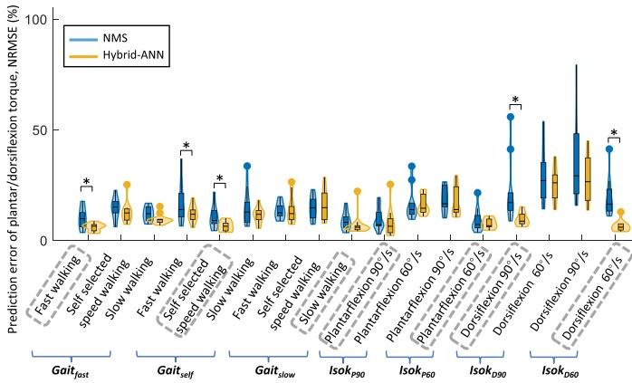

图11. 在使用迁移学习技术的跨被试预测中，采用未校准NMS的混合ANN模型在七种运动下，估计踝关节力矩与测量踝关节力矩之间的NRMSE，并将其预测精度与针对每位被试进行校准的NMS模型在被试内预测中的表现进行了比较。箱线图显示了NRMSE的最小值、下四分位数、中位数、上四分位数和最大值。然后添加核密度图以显示NRMSE的分布，其中小提琴图较宽的部分表示NRMSE概率较高，较窄的部分表示概率较低。根据Wilcoxon符号秩检验，两个模型之间的显著差异以标注。对于每种情况，用作校准/训练数据的运动用灰色虚线框圈出，其他为测试数据。

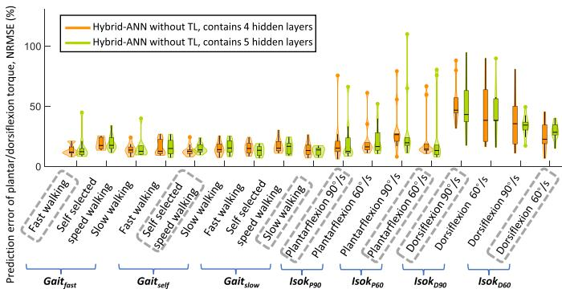

图12. 在不使用迁移学习的跨被试预测中，所有情况下七种运动期间估计踝关节力矩与测量踝关节力矩之间的NRMSE，作为4层与5层隐藏层的比较。每个小提琴图结合了箱线图和核密度图。箱线图显示了NRMSE的最小值、下四分位数、中位数、上四分位数和最大值。然后添加核密度图以显示NRMSE的分布，其中小提琴图较宽的部分表示NRMSE概率较高，较窄的部分表示概率较低。对于每种情况，用作校准/训练数据的运动用灰色虚线框圈出，其他为测试数据。

情况 $I s o k _ { D 9 0 }$，以及在60°/s的等速背屈情况下 $( p < 0 . 0 1 )$ 见于 $I s o k _ { D 6 0 }$

## B. 不使用迁移学习的跨被试预测中混合ANN模型的隐藏层数选择

在不使用迁移学习的跨被试预测中，我们在混合ANN模型中采用了4个隐藏层。一个值得关注的问题是，使用迁移学习和不使用迁移学习的两种混合ANN模型应当具有相同的隐藏层数。然而，我们的目标是研究在跨被试预测中采用迁移学习所带来的益处，并遵循常规的迁移学习流程：从预训练模型加载权重，然后微调最后几个新添加的层 [18]。考虑到这一问题，我们对不含迁移学习的混合ANN模型设置了5个隐藏层的情景，使其与含迁移学习的混合ANN模型中的隐藏层数相同。预测精度相近，不含迁移学习且分别包含4个和5个隐藏层的混合ANN模型之间未发现显著差异（图12）。由于4个隐藏层比5个隐藏层更易于训练，因此在不使用迁移学习的模型中我们采用了4个隐藏层。

## REFERENCES

[1] B. Chen 等人，"下肢外骨骼机器人的最新进展与挑战，" *J. Orthopaedic Transl.*，第 5 卷，第 26–37 页，2016 年。

[2] Z. Li, B. Huang, Z. Ye, M. Deng 和 C. Yang，"基于导纳控制的机器人外骨骼物理人机交互，" *IEEE Trans. Ind. Electron.*，第 65 卷，第 12 期，第 9614–9624 页，2018 年 12 月。

[3] M. Zhang, A. McDaid, A. J. Veale, Y. Peng 和 S. Q. Xie，"具有关节空间力分布的并联踝关节康复机器人自适应轨迹跟踪控制，" *IEEE Access*，第 7 卷，第 85812–85820 页，2019 年。

[4] M. Sartori, D. G. Lloyd 和 D. Farina，"面向个性化神经康复技术的神经数据驱动肌肉骨骼建模，" *IEEE Trans. Biomed. Eng.*，第 63 卷，第 5 期，第 879–893 页，2016 年 5 月。

[5] S. Yao, Y. Zhuang, Z. Li 和 R. Song，"基于 EMG 驱动肌肉骨骼模型的踝关节外骨骼自适应导纳控制，" *Front. Neurorobot.*，第 12 卷，2018 年，文章编号 16。

[6] Y. Huang, R. Song, A. Argha, A. V. Savkin, B. G. Celler 和 S. W. Su，"通过切换机制对人体三维运动意图的连续描述，" *IEEE Trans. Neural Syst. Rehabil. Eng.*，第 28 卷，第 1 期，第 277–286 页，2020 年 1 月。

[7] S. Y. A. Mounis, N. Z. Azlan 和 F. Sado，"基于受试者功能能力的上肢康复按需辅助控制策略，" *Meas. Control*，第 52 卷，第 9/10 期，第 1354–1361 页，2019 年。

[8] G. Durandau, D. Farina 和 M. Sartori，"由肌电图驱动的鲁棒实时肌肉骨骼建模，" *IEEE Trans. Biomed. Eng.*，第 65 卷，第 3 期，第 556–564 页，2018 年 3 月。

[9] H. X. Hoang, C. Pizzolato, L. E. Diamond 和 D. G. Lloyd，"神经肌肉参数的受试者特异性校准使神经肌肉骨骼模型能够估计健康成年人中生理上合理的髋关节接触力，" *J. Biomech.*，第 80 卷，第 111–120 页，2018 年。

[10] C. Pizzolato 等人，"CEINMS：一个用于研究不同神经控制方案对动态运动任务中肌肉激发与关节力矩预测影响的工具箱，" *J. Biomech.*，第 48 卷，第 14 期，第 3929–3936 页，2015 年。

[11] M. Imran 和 S. A. Alsuhaibani，"用于糖尿病视网膜病变分类的神经模糊推理模型，" 载于《*Intelligent Data Analysis for Biomedical Applications*》（生物医学应用的智能数据分析）。美国纽约：Elsevier，2019 年，第 147–172 页。

[12] H. S. Haeberle 等人，"人工智能与机器学习在下肢关节置换术中的应用综述，" *J. Arthroplasty*，第 34 卷，第 10 期，第 2201–2203 页，2019 年。

[13] J.-G. Lee 等人，"医学影像中的深度学习：总体概述，" *Korean J. Radiol.*，第 18 卷，第 4 期，第 570–584 页，2017 年。

[14] H. Su, Y. Hu, H. R. Karimi, A. Knoll, G. Ferrigno 和 E. De Momi，"基于改进循环神经网络的远程运动中心约束机械臂控制：实验结果，" *Neural Netw.*，第 131 卷，第 291–299 页，2020 年。

[15] G. G. Pena、L. J. Consoni、W. M. dos Santos 和 A. A. Siqueira，"应用于主动膝关节矫形器的最优肌电驱动自适应阻抗控制可行性研究"，《机器人与自主系统》，第 112 卷，第 98–108 页，2019 年。

[16] E. Soleimani 和 E. Nazerfard，"基于生成对抗网络的人体活动识别系统中的跨被试迁移学习"，《神经计算》，第 426 卷，第 26–34 页，2021 年。

[17] J. Zhang、X. Zhu 和 J. Bao，"用于胶体量子点光谱仪光谱重建的求解器感知神经网络"，《光学快报》，第 28 卷，第 22 期，第 33656–33672 页，2020 年。

[18] D. J. Saxby 等，"支持个性化神经肌肉骨骼建模的机器学习方法"，《生物力学与机械生物学建模》，第 19 卷，第 4 期，第 1169–1185 页，2020 年。

[19] L. Zhang、X. Zhu、E. M. G. Farewik 和 R. Wang，"基于神经肌肉骨骼求解器感知神经网络模型的踝关节动态关节力矩估计"，载于《第六届 IEEE 国际先进机器人与机电一体化会议论文集》，2021 年，第 75–80 页。

[20] K. Weiss、T. M. Khoshgoftaar 和 D. Wang，"迁移学习综述"，《大数据杂志》，第 3 卷，第 1 期，第 1–40 页，2016 年。

[21] T. Wang、Y. Chen、M. Zhang、J. Chen 和 H. Snoussi，"基于内部迁移学习的小数据集人体动作识别性能改进"，《IEEE Access》，第 5 卷，第 17627–17633 页，2017 年。

[22] V. Jayaram、M. Alamgir、Y. Altun、B. Scholkopf 和 M. Grosse-Wentrup，"脑机接口中的迁移学习"，《IEEE 计算智能杂志》，第 11 卷，第 1 期，第 20–31 页，2016 年 2 月。

[23] S. P. K. Karri、D. Chakraborty 和 J. Chatterjee，"基于迁移学习的光学相干断层扫描图像分类：糖尿病性黄斑水肿与干性老年性黄斑变性"，《生物医学光学快报》，第 8 卷，第 2 期，第 579–592 页，2017 年。

[24] H. J. Hermens 等，《欧洲表面肌电推荐意见》。荷兰恩斯赫德：埃德斯研究与发展出版社，1999 年。

[25] M. P. Kadaba、H. Ramakrishnan 和 M. Wootten，"平地行走过程中下肢运动学的测量"，《骨科研究杂志》，第 8 卷，第 3 期，第 383–392 页，1990 年。

[26] R. B. Davis III、S. Ounpuu、D. Tyburski 和 J. R. Gage，"步态分析数据采集与简化技术"，《人体运动科学》，第 10 卷，第 5 期，第 575–587 页，1991 年。

[27] C. Pizzolato、M. Reggiani、L. Modenese 和 D. Lloyd，"基于 OpenSim 的下肢实时逆运动学与逆动力学"，《生物力学与生物医学工程中的计算方法》，第 20 卷，第 4 期，第 436–445 页，2017 年。

[28] D. A. Winter、H. G. Sidwall 和 D. A. Hobson，"运动学中噪声的测量与降低"，《生物力学杂志》，第 7 卷，第 2 期，第 157–159 页，1974 年。

[29] E. Kristianslund、T. Krosshaug 和 A. J. Van den Bogert，"低通滤波对逆动力学关节力矩的影响：对损伤预防的启示"，《生物力学杂志》，第 45 卷，第 4 期，第 666–671 页，2012 年。

[30] A. Mantoan, C. Pizzolato, M. Sartori, Z. Sawacha, C. Cobelli, and M. Reggiani, "Motonms: A matlab toolbox to process motion data for neuromusculoskeletal modeling and simulation," *Source Code Biol. Med.*, vol. 10, no. 1, pp. 1–14, 2015.

[31] T.-W. Lu and J. O'connor, "Bone position estimation from skin marker co-ordinates using global optimisation withjoint constraints," *J. Biomech.*, vol. 32, no. 2, pp. 129–134, 1999.

[32] M. G. Pandy, "Computer modeling and simulation of human movement," *Annu. Rev. Biomed. Eng.*, vol. 3, no. 1, pp. 245–273, 2001.

[33] M. Sartori, M. Reggiani, D. G. Lloyd, and E. Pagello, "A neuromusculoskeletal model of the human lower limb: Towards EMG-driven actuation of multiple joints in powered orthoses," in *Proc. IEEE Int. Conf. Rehabil. Robot.*, 2011, pp. 1–6.

[34] D. G. Lloyd and T. F. Besier, "An EMG-driven musculoskeletal model to estimate muscle forces and knee joint moments in vivo," *J. Biomech.*, vol. 36, no. 6, pp. 765–776, 2003.

[35] T. S. Buchanan, D. G. Lloyd, K. Manal, and T. F. Besier, "Neuromusculoskeletal modeling: Estimation of muscle forces and joint moments and movements from measurements of neural command," *J. Appl. Biomech.*, vol. 20, no. 4, pp. 367–395, 2004.

[36] L. Zhang, Z. Li, Y. Hu, C. Smith, E. M. G. Farewik, and R. Wang, "Ankle joint torque estimation using an EMG-driven neural network model and an artificial neural network model," *IEEE Trans. Automat. Sci. Eng.*, vol. 18, no. 2, pp. 564–573, Apr. 2021.

[37] J. Bergstra and Y. Bengio, "Random search for hyper-parameter optimization," *J. Mach. Learn. Res.*, vol. 13, no. 2, pp. 281–305, 2012.

[38] M. Ezati, B. Ghannadi, and J. McPhee, "A review of simulation methods for human movement dynamics with emphasis on gait," *Multibody Syst. Dyn.*, vol. 47, no. 3, pp. 265–292, 2019.

[39] Y. Kwon, J.-H. Won, B. J. Kim, and M. C. Paik, "Uncertainty quantification using bayesian neural networks in classification: Application to biomedical image segmentation," *Comput. Statist. Data Anal.*, vol. 142, 2020, Art. no. 106816.

[40] A. De Rugy, G. E. Loeb, and T. J. Carroll, "Muscle coordination is habitual rather than optimal," *J. Neurosci.*, vol. 32, no. 21, pp. 7384–7391, 2012.

[41] S. Safavynia, G. Torres-Oviedo, and L. Ting, "Muscle synergies: Implications for clinical evaluation and rehabilitation of movement," *Top. Spinal Cord Inj. Rehabil.*, vol. 17, no. 1, pp. 16–24, 2011.

[42] T. T. Dao, "From deep learning to transfer learning for the prediction of skeletal muscle forces," *Med. Biol. Eng. Comput.*, vol. 57, no. 5, pp. 1049–1058, 2019.

[43] G. E. Hinton and R. R. Salakhutdinov, "Reducing the dimensionality of data with neural networks," *Sci.*, vol. 313, no. 5786, pp. 504–507, 2006.

[44] M. E. Hahn, "Feasibility ofestimating isokinetic knee torque using a neural network model," *J. Biomech.*, vol. 40, no. 5, pp. 1107–1114, 2007.

[45] M. Jali 等, "基于人工神经网络技术的上肢康复设备表面肌电信号关节力矩估计模型," 载于《先进计算机与通信工程技术》(Advanced Computer and Communication Engineering Technology). 德国柏林: Springer, 2015, 页 671–682.