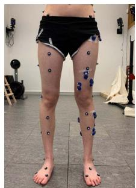
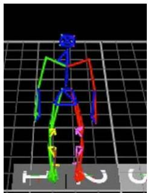
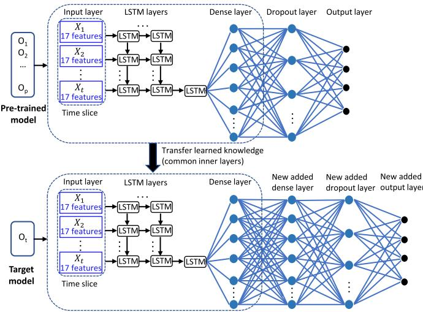
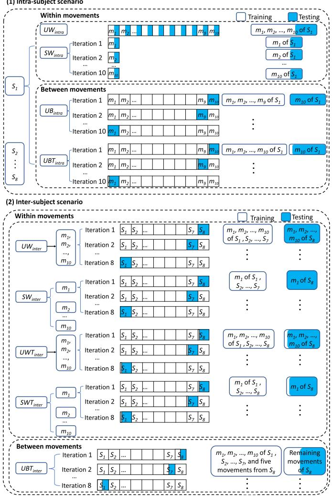
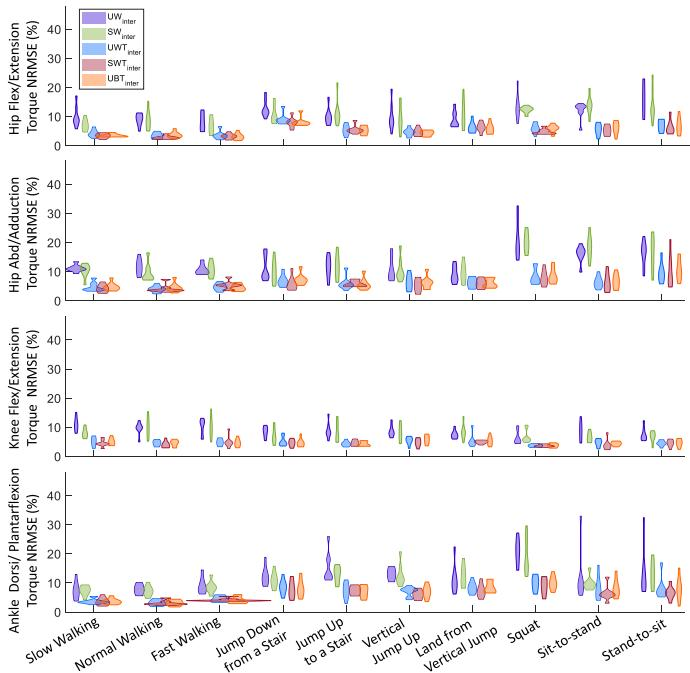
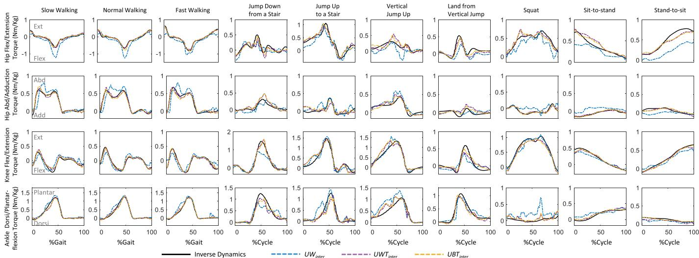

# 基于 LSTM 神经网络和迁移学习的下肢关节力矩预测

Longbin Zhang、Davit Soselia、Ruoli Wang 和 Elena M. Gutierrez-Farewik

— 在运动过程中估计关节力矩可在多种场景下提供重要信息，例如评估运动员训练效果、医疗干预效果，或分析辅助器具使用者的残余肌肉力量。在这种情况下，使用可穿戴传感器在日常活动中估计关节力矩的能力日益受到关注。本研究采用长短期记忆（LSTM）神经网络和迁移学习，预测了十种日常活动中的下肢关节力矩。LSTM 模型以肌肉肌电信号和下肢关节角度作为输入，预测髋关节屈伸、髋关节内收外展、膝关节屈伸以及踝关节背屈跖屈的力矩。我们在受试者内（intra-subject）和跨受试者（inter-subject）两种场景下研究了 LSTM 模型预测力矩的性能，每种场景又进一步分为任务内（intra-task）和跨任务（inter-task）测试。我们观察到，在受试者内测试中，无论采用统一模型还是十个独立模型，LSTM 模型均能以相对较低的误差（均方根误差 0.14 Nm/kg，归一化均方根误差 ≤ 8.7%）准确预测各种活动中的下肢关节力矩。此外，在跨任务和跨受试者测试中采用了迁移学习技术，通过在多个受试者和/或任务上对模型进行预训练，并将所学知识迁移到目标任务/受试者，从而进一步提高 LSTM 模型的泛化能力。特别是在跨受试者测试中，仅使用新受试者的少量动作数据进行训练，即可在多种运动中准确预测关节力矩。

— LSTM（长短期记忆网络）、逆向动力学、时间序列、泛化能力、迁移学习。

## I. 引言

OINT 力矩是一项重要的生物力学参数，因为它能提供关于神经运动

Manuscript received August 6, 2021; revised December 17, 2021 and February 1, 2022; accepted February 28, 2022. Date of publication March 3, 2022; date of current version March 17, 2022. This work was supported in part by the Promobilia Foundation under Grant 18200, Grant 18014, Grant 18202, Grant 19302, and Grant 21302; and in part by the Swedish Research Council under Grant 2018-00750 and Grant 2018-04902. (Corresponding author: Elena M. Gutierrez-Farewik.)

This work involved human subjects or animals in its research. Approval of all ethical and experimental procedures and protocols was granted by the Swedish Ethical Review Authority (Dnr. 2020-02311).

Longbin Zhang 和 Davit Soselia 隶属于瑞典斯德哥尔摩 100 44 皇家理工学院（KTH Royal Institute of Technology）工程力学系（Department of Engineering Mechanics）KTH MoveAbility 实验室（KTH MoveAbility Laboratory）和 KTH BioMEx 中心（KTH BioMEx Center）。Ruoli Wang 和 Elena M. Gutierrez-Farewik 隶属于瑞典斯德哥尔摩 100 44 皇家理工学院工程力学系 KTH MoveAbility 实验室和 KTH BioMEx 中心，同时也隶属于瑞典斯德哥尔摩 171 77 卡罗林斯卡学院（Karolinska Institutet）妇女与儿童健康系（Department of Women's and Children's Health）（电子邮箱：lanie@kth.se）。

Digital Object Identifier 10.1109/TNSRE.2022.3156786 运动过程中的控制机制[1]、[2]。预测关节力矩的能力在诸多应用中具有重要价值，例如运动员训练评估[3]、[4]，手术效果评价[5]–[7]，以及在主动外骨骼或假肢控制器设计中的应用[8]–[10]。运动过程中的关节力矩通常通过多体逆动力学方法计算，利用在装备仪器的运动捕捉实验室中采集的三维运动学数据和地面反作用力数据。尽管该方法通常被认为是计算关节力矩的"金标准"，但它需要专用实验室、基于标记点的人体生物力学模型，以及在装有测力传感器平台上完成的运动。因此，该方法在实时关节力矩估计以及实验室外环境中的应用十分有限。

近年来，基于肌电图（Electromyography, EMG）驱动的神经肌肉骨骼（neuromusculoskeletal, NMS）建模和深度学习已成为基于 EMG 信号输入进行实时关节力矩预测的两种主流方法[11]–[13]。在最近的一项研究中，我们比较了分别由 NMS 模型和人工神经网络（artificial neural networks, ANNs）估计的步态和等速运动中的踝关节力矩[14]。我们的结果表明，当在多样化的试验集上进行训练时，ANN 模型能够更准确地预测踝关节力矩。然而，在该研究中，EMG 信号仅在比目鱼肌（soleus）、胫骨前肌（tibialis anterior）和腓肠肌内侧头（gastrocnemius medialis）中采集；因此，输入仅限于这三个 EMG 信号以及踝关节运动学数据，且仅涵盖步态和等速踝关节运动。此外，EMG 驱动的 NMS 模型通常需要特定的校准程序，并构建不同变量之间的复杂关系，例如肌肉激发-激活关系、肌力-长度关系、肌力-速度关系以及关节角度-肌腱单元运动学关系。因此，使用 NMS 模型往往耗时耗力。作为另一种选择，深度学习模型提供了一种方法，能够在多层次输入上提取特征，并在大量多样化试验集上预测关节角度和 EMG 等输入与关节力矩等输出之间的复杂关系。

在深度学习模型中，长短期记忆（LSTM）网络已被报道为时间序列预测中最有效且最稳健的方法之一 [15]–[18]。LSTM 网络能够通过增加记忆结构来选择性地记忆表示某一时间跨度的模式 [19]。该记忆结构可以利用门控机制在时间步之间更新信息，从而决定哪些信息需要记忆、哪些需要丢弃以及哪些需要输出。Kim 等人 [20] 使用 LSTM 网络基于肌电（EMG）信号对手腕关节的力矩和位置进行了估计，取得了较高的一致性。Siu 等人 [21] 实现了一个 LSTM 网络，用于在站立、行走、跑步和冲刺过程中基于 EMG 和加速度计信号估计踝关节力矩。他们的结果表明，预测误差随运动速度的增加而增大，冲刺时误差最大，站立或行走时误差最小。尽管 LSTM 网络在关节力矩预测方面取得了进展，但有关在多个下肢关节和自由度（DOFs）中进行力矩预测的研究仍然较少。

关节力矩预测模型的泛化能力同样备受关注。简而言之，泛化模型在面对来自新的、未曾训练过情境中的未见数据时，其性能会下降。例如，Su 等人 [22] 提出了一种 LSTM 模型来预测未来多个时间窗口内的步态轨迹和步态相位，并报告该模型在受试者间（inter-subject）测试中性能下降。为了克服这一局限，近年来人们广泛研究了迁移学习技术以提升 LSTM 的泛化能力。迁移学习是一种机器学习技术，它利用以往经验/任务中共享的知识来提升其他不同但相关任务中的性能。Soleimani 等人 [23] 在最近的一项研究中提出了一种带有跨受试者（intersubject）知识迁移的生成对抗网络，用于人体活动识别。他们报告他们所提出的模型在超过 66% 的实验中优于其他最先进的方法，且所需的训练数据更少，从而可作为一种预训练模型，应用于那些无法采集和标注足够数据以重新训练模型的新受试者。通过利用来自多个先前受试者的知识，可以使用相对较少的样本训练出一个性能良好的新神经网络。然而，该方法的有效性尚未在多关节、多自由度的力矩预测中得到验证，也尚未在跨不同受试者和日常任务的场景下加以研究。

本研究的目标因此分为三个方面：(1) 使用基于单一动作和多种动作的 EMG（肌电图）和运动学数据训练的 LSTM（长短期记忆）神经网络，预测髋关节屈/伸（F/E）、髋关节外展/内收（Ab/Ad）、膝关节屈/伸以及踝关节背屈/跖屈（D/P）力矩；(2) 评估 LSTM 模型在受试者之间和任务之间的泛化能力；以及 (3) 探讨迁移学习策略是否能够通过利用先前经验所获得的知识来提升预测性能。

## II. 方法

## A. 数据采集

八名健康成年人（4 女/4 男，（平均值±标准差）年龄 29±4 岁；体重 65.2±17.8 千克；身高 168.1±9.4 厘米）参与了本研究。所有受试者均提供了书面知情同意。数据采集在瑞典斯德哥尔摩的 KTH MoveAbility Lab 进行，研究已获得地区伦理委员会批准（Dnr. 2020-02311）。每名受试者被要求完成十种动态试验：慢速行走、正常行走、快速行走、从 15 厘米台阶上跳下、跳上 15 厘米台阶、垂直跳跃起跳、垂直跳跃落地、深蹲、坐起站立以及站立坐下。动作的顺序是随机化的。在实验过程中，每种动作（即本研究中所谓的"任务"）至少重复十次。

EMG 信号使用 13 个 EMG 发射器（aktos nano, myon, Schwarzenberg, Switzerland）单侧记录。所选侧腿是随机的。根据欧洲表面 EMG 推荐标准 [24]，将表面 EMG 电极放置（图 1.(a)）于以下肌肉：比目鱼肌（SOL）、腓骨长肌（PL）、胫骨前肌（TA）、腓肠肌内侧头（GM）、腓肠肌外侧头（GL）、股直肌（RF）、股内侧肌（VM）、股外侧肌（VL）、股二头肌（BF）、半腱肌（ST）、臀大肌（GLMA）、臀中肌（GLME）和阔筋膜张肌（TFL）。EMG 信号以 1000 Hz 的采样率进行记录，随后进行带通滤波（30-300 Hz）、整流、低通滤波（6 Hz），并归一化为所有试验中记录到的最大处理后 EMG 值。

  
(a)

  
(b)  
图 1. (a) 标记点和 EMG 传感器放置位置；(b) 基于所捕获标记点位置的运动学模型。

2) 逆运动学与逆动力学：使用三维运动捕捉系统（V16, Vicon, Oxford, UK）记录标记轨迹，标记放置遵循 CGM2.3 标记集协议（图 1. (a)）[25]。标记位置以 100 Hz 采样。在静态试验中，根据采集的标记数据建立刚体段模型（图 1. (b)）。通过求解加权均方根问题以最小化模型标记与实测标记之间的距离，采用逆运动学计算关节角度。地面反作用力（GRFs）使用三块测力台（AMTI, MA, USA）以 1000 Hz 采样。关节运动学与动力学数据采用四阶零相位滞后 Butterworth 滤波器（截止频率 6 Hz）进行低通滤波 [26]–[28]。通过求解运动方程，采用逆动力学方法计算关节力矩 [29]（式 (1)）

$$
M ( \mathbf { q } ) \ddot { \mathbf { q } } + \mathbf { C } ( \mathbf { q } , \dot { \mathbf { q } } ) + \mathbf { G } ( \mathbf { q } ) + R ( \mathbf { q } ) \mathbf { F } ^ { \mathbf { m t } } + \mathbf { F _ { e } } = 0\tag{1}
$$

式中，$\mathbf{q}$、$\dot{\mathbf{q}}$、$\ddot{\mathbf{q}}$ 分别为广义位置、速度和加速度向量；$M ( \mathbf { q } )$ 为质量矩阵，$M ( \mathbf { q } ) { \ddot { \mathbf { q } } }$ 为惯性力与力矩向量；$\mathbf { C } ( \mathbf { q } , \dot { \mathbf { q } } )$ 为向心力与科里奥利力及力矩向量；$\mathbf { G } ( \mathbf { q } )$ 为重力与重力力矩向量；$R ( \mathbf { q } )$ 为肌肉力臂矩阵；$\mathbf { F } ^ { \mathbf { m t } }$ 为肌腱力向量，$R ( \mathbf { q } ) \mathbf { F } ^ { \mathbf { m t } }$ 为肌腱力矩向量；${\mathbf { F } _ { e } }$ 为外力与外力矩向量（即本文中的地面反作用力）。

  
图 2. 基于 LSTM 神经网络的关节力矩预测概述。髋屈/伸、髋外展/内收、膝屈/伸以及踝背屈/跖屈的关节力矩通过多任务训练的统一模型或通过十个针对单一任务分别训练的独立模型进行预测。EMG 信号与关节角度从三维运动分析中获取，经预处理后作为 LSTM 神经网络的输入数据。对于每个 LSTM 神经网络，将时间序列输入数据转换为时间片数据。每个时间片包含五个时间步，每个时间步包含十七个特征，其中十三个为肌肉 EMG 信号，另一为关节角度。模型包含 $n$ 个 LSTM 层（受试者内场景中，单任务 $n=2$，多任务 $n=3$；跨受试者场景中，单任务 $n=3$，多任务 $n=4$），其后连接一个全连接层和一个 Dropout 层。关节力矩在输出层进行预测。

## B. LSTM 神经网络

LSTM 神经网络采用与 EMG 驱动 NMS 模型相同的输入进行构建，即肌电信号和关节角度（图 2）[30]。肌电信号和关节角度通过三维运动分析采集并预处理，然后用作 LSTM 神经网络的输入数据。对于每个 LSTM 神经网络，时间序列输入数据被转换为时间切片数据。每个时间切片包含多个时间步，每个时间步具有十七个特征，包括十三路肌肉 EMG 信号和四个关节角度。模型包含 $n$ 个 LSTM 层（主体内场景下，单任务时 $n = 2$，多任务时 $n = 3$；跨主体场景下，单任务时 $n = 3$，多任务时 $n = 4$），其后依次连接一个全连接层（dense layer）和一个 dropout 层。全连接层将 LSTM 层的输出整合后用于回归任务——关节力矩预测，而 dropout 层用于防止神经网络过拟合 [31]。最终，关节力矩在输出层进行预测。

## C. 迁移学习

为了提升预测性能，在跨任务/跨主体场景中采用了迁移学习方法（图 3），即通过在多个主体/任务 $( O _ { 1 } , O _ { 2 } , \ldots , O _ { p } )$ 上对模型进行预训练以学习结构相似性，并将学到的知识迁移到目标任务/主体。正如 Molnar 等人 [32] 和 Brownlee 等人 [33] 所述，深度神经网络在隐藏层/中间层学习高层次的复杂特征，这些特征由输入层提取的低层次特征组合而成，而靠近输出层的层则在回归/分类任务的语境下对所提取的特征进行解释。因此，在迁移学习技术中，通常建议替换靠近输出层的层，然后复用预训练模型并将其整合到全新的模型中。受此启发，在本研究中，我们提取预训练模型中除最后两层之外的所有层，并将它们迁移到目标主体或任务的模型 $( O _ { t } )$ 中。在目标模型中，我们添加了一个全连接层、一个 dropout 层和一个输出层，然后使用目标任务/主体的数据训练新增层的权重，并对其他层的权重进行微调。该微调技术是迁移学习中的一个可选步骤，能够通过将预训练特征逐步适配到新数据，从而潜在地获得有意义的性能提升 [34]。

  
图3. 跨任务和跨被试测试中采用迁移学习的LSTM（Long Short-Term Memory，长短期记忆网络）神经网络架构。我们从预训练模型中提取最后两层以外的层（来自先前被试或任务的信息，$O _ { 1 } , O _ { 2 } , \ldots , O _ { p }$），并将其迁移到目标模型（ ）。在目标模型中，我们添加了一个全连接层、一个Dropout层和一个输出层，然后用来自目标被试或任务的数据训练这些新层。

## D. LSTM神经网络的超参数调优

LSTM模型的超参数通过"由粗到精"随机搜索[35]确定。批量大小（batch size）设为50。选择Xavier权重初始化器与零偏置初始化器。被试内测试中，单任务情况下使用两个LSTM层，多任务情况下使用三个LSTM层。跨被试测试中，单任务情况下使用三个LSTM层，多任务情况下使用四个LSTM层。在全连接层中，单任务情况下使用64个神经元，多任务情况下使用128个神经元。Dropout率设为0.4。每个LSTM层包含50个神经元，采用tanh激活函数。训练时的损失函数为预测关节转矩与实测关节转矩之间的均方误差。采用Adam优化器，默认学习率为$1 0 ^ { - 3 }$。在迁移学习方法中，微调（fine-tuning）阶段学习率调至$1 0 ^ { - 4 }$和$1 0 ^ { - 5 }$。最优模型训练4000个轮次（epoch），若连续50个轮次预测性能未提升则提前停止。

图 4. 受试者内和受试者间 $( \check { S _ { 1 } } , \bar { S _ { 2 } } , \dots , \bar { S _ { 8 } } )$ 场景下的训练和测试数据。每个场景进一步划分为任务内（同一动作 $m _ { 1 } , m _ { 2 } , \dots , m _ { 1 0 }$ 内部）和任务间（不同动作之间）测试。对于每种测试，通过使用不同的采集动作来训练模型，研究了不同的情形。受试者内场景包含四种情形：动作内统一模型 $( U W _ { i n t r a } )$、动作内独立模型 $( S W _ { i n t r a } )$、动作间统一模型 $( U B _ { i n t r a } )$、结合迁移学习的动作间统一模型 $( U B T _ { i n t r a } )$。受试者间场景包含五种情形：动作内统一模型 $( U W _ { i n t e r } )$、动作内独立模型 $( S W _ { i n t e r } )$、结合迁移学习的动作内统一模型 $( U W T _ { i n t e r } )$、结合迁移学习的动作内独立模型 $( S W T _ { i n t e r } )$、结合迁移学习的动作间统一模型 $( U B T _ { i n t e r } )$。

## E. 评估方案

在受试者内和受试者间两种场景下，研究了 LSTM 模型的下肢关节力矩预测性能。每个场景进一步划分为任务内（同一动作内）和任务间（不同动作之间）测试。此外，还研究了跨任务和跨受试者添加迁移学习带来的收益（图 4）。对于每种测试，通过使用不同的采集动作来训练模型，研究了不同的情形。所有情形的详细说明见图 4。

1) 受试者内场景：

动作内统一模型 $( U W _ { i n t r a } )$：使用十个动作的全部数据训练模型。包含七层。

动作内独立模型 $( S W _ { i n t r a } )$：分别使用每个动作的数据训练独立模型。包含六层。

$U W _ { i n t r a }$ 和 $S W _ { i n t r a }$ 均使用 80% 的数据进行训练，并在剩余 20% 的数据上进行测试。

动作间统一模型 $( U B _ { i n t r a } )$：使用除一个动作之外（留一法）的多个动作的数据训练模型，并在剩余的"新"动作上进行测试。包含七层。

结合迁移学习的动作间统一模型 $( U B T _ { i n t r a } )$：使用 $U B _ { i n t r a }$ 方法得到的预训练模型作为新动作的先验信息；然后使用新动作的数据重新训练模型，并在剩余的"新"动作上进行测试。包含八层。

2) 受试者间场景：

动作内统一模型 $(U W_{inter})$：使用十个动作的全部数据训练的模型；模型从多名被试（除一名外）的数据训练，并在剩余的"新"被试上进行测试。包含八层。

动作内独立模型 $(S W_{inter})$：使用每个动作的数据分别训练独立的模型。模型从多名被试（除一名外）的数据训练，并在剩余的"新"被试上进行测试。包含七层。

动作内统一模型结合迁移学习 $(U W T_{inter})$：使用 $U W_{inter}$ 方法的预训练模型作为新被试的先验信息；然后使用新被试相同动作的数据重新训练模型，并在"新"被试相同动作的剩余试次上进行测试。包含九层。

动作内独立模型结合迁移学习 $(S W T_{inter})$：使用 $S W_{inter}$ 方法的预训练模型作为新被试的先验信息；然后使用新被试相同动作的数据重新训练模型，并在"新"被试相同动作的剩余试次上进行测试。包含九层。

动作间统一模型结合迁移学习 $(U B T_{inter})$：与 $U W T_{inter}$ 方法类似，但仅使用新被试五个动作的数据重新训练模型，并在"新"被试的剩余动作上进行测试。包含九层。

当预测误差较低时，认为预测精度较高。每个 LSTM 模型模型预测误差由预测值（由 LSTM 预测）与测量值（由逆动力学计算）的关节力矩之间的均方根误差（RMSE）计算得出，并按身体质量归一化。此外，

  
图 5. 小提琴图 [37]，展示了在受试者内部场景下，十个动作期间预测关节力矩与测量关节力矩（按身体质量归一化）的 RMSE 分布，包含四种情况：动作内统一模型 $(U W_{intra})$、动作内独立模型 $(S W_{intra})$、动作间统一模型 $(U B_{Intra})$，以及动作间统一模型结合迁移学习 $(U B T_{intra})$。\* 表示基于 Wilcoxon 符号秩检验（经 Bonferroni 多重比较校正）两种情况之间存在显著差异。

使用 Wilcoxon 符号秩检验（经 Bonferroni 多重比较校正）[36] 来检验不同模型预测的力矩之间的预测误差差异（$p < 0.05$ 显著性水平）。归一化均方根误差（NRMSE）也按 RMSE 除以不同动作期间测量关节力矩的极差来计算。对每名被试计算 RMSE 和 NRMSE，然后取八名被试的中位值。

## III. 结果

## A. 受试者内测试

总体而言，在全部十个动作中，统一模型 $UW_{intra}$ 与独立模型 $SW_{intra}$ 在同一动作内的预测误差相近（Fig. 5 和 Fig. 6）。然而，在大多数动作中，即下台阶、下上台阶、垂直跳起、从垂直跳落地以及蹲起，跨动作的统一模型 $UB_{intra}$ 的预测误差显著高于 $UW_{intra}$ 和 $SW_{intra}$。在 $UW_{intra}$、$SW_{intra}$ 和 $UB_{intra}$ 三种情况下，预测的关节力矩（Fig. 7）都与行走动作中测得的力矩吻合良好，而在其他动作中，相同动作内训练的模型（$UW_{intra}$ 和 $SW_{intra}$）的预测结果通常优于跨动作训练的模型（$UB_{intra}$）。

$UW_{intra}$ 和 $SW_{intra}$ 中训练的模型（Fig. 5 和 Fig. 6）能够准确预测关节力矩，误差相对较低（RMSE ≤ 0.14 Nm/kg，NRMSE ≤ 8.7%），尤其是在行走动作中（髋关节屈伸（RMSE ≤ 0.08 Nm/kg，NRMSE ≤ 3.6%）、髋关节外展内收（RMSE ≤ 0.07 Nm/kg，NRMSE ≤ 4.9%）、膝关节屈伸（RMSE ≤ 0.07 Nm/kg，NRMSE ≤ 5.7%）以及踝关节背屈跖屈（RMSE ≤ 0.07 Nm/kg，NRMSE ≤ 4.1%））。$UB_{intra}$ 的预测误差（RMSE ≤ 0.29 Nm/kg，NRMSE ≤ 18.4%）高于 $UW_{intra}$ 和 $SW_{intra}$。在蹲起动作中，$UB_{intra}$ 中训练的模型在髋关节屈伸（RMSE：0.18 Nm/kg，NRMSE：13.6%）、髋关节外展内收（RMSE：0.10 Nm/kg，NRMSE：18.2%）以及踝关节背屈跖屈（RMSE：0.13 Nm/kg，NRMSE：18.4%）上的误差较高。

**Fig. 6.** 小提琴图，展示在受试者内场景下，十个动作中预测关节力矩与实测关节力矩之间归一化均方根误差（NRMSE）的分布，包含四种情况：动作内统一模型 $(UW_{intra})$、动作内独立模型 $(SW_{intra})$、跨动作统一模型 $(UB_{Intra})$，以及结合迁移学习的跨动作统一模型 $(UBT_{intra})$。NRMSE 定义为以该动作中实测力矩百分比形式表示的 RMSE。

在所有情况下的不同动作关节力矩预测中（Fig. 6），行走动作的模型预测误差相对较低（NRMSE ≤ 9.2%）。

当使用迁移学习训练 $U B T _ { i n t r a }$ 时，训练后的模型整体上比 $U B _ { i n t r a }$ 更好地预测关节力矩，即具有相对较低的归一化误差 $\mathrm { ( R M S E _ { \lambda } \le }$ 0.17 Nm/kg，$\mathrm { N R M S E } \le 9 . 1 \%$，图 5 和图 6)，并且与测量的力矩吻合度更好（图 7）。

## B. 受试者间测试

在动作内测试统一的 $U W _ { i n t e r }$ 和单独的 $S W _ { i n t e r }$ 模型时（图 8 和图 9），预测误差相对较高 $( U W _ { i n t e r }$：RMSE 0.24 Nm/kg，NRMSE 21%；$S W _ { i n t e r }$：RMSE 0.25 Nm/kg，$\mathrm { N R M S E } \le 1 9 . 5 \% )$，高于受试者内场景下的误差。具体而言，在深蹲（squat）动作中，髋关节外展/内收（hip Ab/Ad）的预测误差较高（NRMSE $U W _ { i n t e r }$：19.4%；$S W _ { i n t e r }$：19.5%），踝关节背屈/跖屈（ankle D/P）力矩的误差也较高 $( U W _ { i n t e r } \colon 2 1 \% ; S W _ { i n t e r } \colon 1 6 . 5 \% )$；在站到坐（stand-to-sit）动作中，髋关节屈/伸（hip F/E）$( U W _ { i n t e r } \colon 1 5 . 1 \% ; S W _ { i n t e r } \colon 1 2 . 7 \% )$ 和髋关节外展/内收（hip Ab/Ad）$( U W _ { i n t e r }$：16 $. 8 \% ; S W _ { i n t e r } \colon 1 7 . 5 \% )$ 误差较高；在坐到站（sit-to-stand）动作中，髋关节屈/伸（hip F/E）$( U W _ { i n t e r } \colon 1 3 . 4 \% ; S W _ { i n t e r } \colon 1 3 . 8 \% )$ 和髋关节外展/内收（hip Ab/Ad）$( U W _ { i n t e r }$：$1 6 . 7 \% ; S W _ { i n t e r } \colon 1 8 . 7 \%$ ) 误差较高，这些误差均高于其他动作中其他关节力矩的误差。

图 7. 在受试者内场景下，十个动作中测量的（通过逆动力学计算）和通过模型估计的关节力矩的一个示例试次，包含四种情况：动作内统一模型 $( U W _ { i n t r a } )$、动作内单独模型 $( S \bar { W } _ { i n t r a } )$、动作间统一模型 $( U B _ { I n t r a } )$，以及使用迁移学习的动作间统一模型 $( U B T _ { i n t r a } )$  
  
图 8. 小提琴图（Violin plots），展示了在受试者间场景下，十个动作中预测关节力矩与测量关节力矩之间 RMSE（按体重归一化）在受试者间的分布，包含五种情况：(a) 动作间单独模型 $( S W _ { i n t e r } )$ 和使用迁移学习的动作间单独模型 $( S W T _ { i n t e r } )$，(b) 动作间统一模型 $( U W _ { i n t e r } )$、使用迁移学习的动作间统一模型 $( U W T _ { i n t e r } )$，以及使用迁移学习的动作间统一模型 $( U B \dot { T } _ { i n t e r } )$。表示两种情况之间基于 Wilcoxon 符号秩检验（Wilcoxon signed-rank test）并经 Bonferroni 多重比较校正后的显著性差异。

与 $SW_{inter}$ 相比，$SWT_{inter}$（使用了迁移学习）以显著更低的误差预测关节力矩（髋关节屈/伸：RMSE ≤0.13 Nm/kg，$\begin{array} { r } { \mathrm { N R M S E } ~ \leq ~ 8 . 0 \% ; } \end{array}$ 髋关节外展/内收：$\mathbf { A b / A d } \colon$ RMSE ≤0.08 Nm/kg，≤ 7.8%；膝关节屈/伸：RMSE ${ \leq } 0 . 1 1$ $\begin{array} { r } { \mathrm { { N m } / \mathrm { { k g } } , } \leq 5 . 0 \% ; } \end{array}$ 踝关节背屈/跖屈：RMSE 0.14 Nm/kg，≤ 9.4%，图 8 (a)）。

与 $\begin{array} { r l } { \mathrm { t o } } & { { } U W _ { i n t e r } } \end{array}$（未使用迁移学习）相比，$UWT_{inter}$ 和 $UBT_{inter}$（均使用了迁移学习）以显著更低的误差预测关节力矩（$UWT_{inter}$：RMSE 0.15 Nm/kg，$\begin{array} { r c l } { \mathrm { N R M S E } } & { \leq } & { 1 0 . 1 \% ; } \end{array}$

  
图 9. 小提琴图，描绘了在受试者间（inter-subject）场景下，跨受试者在十个运动中预测与实测关节力矩之间的归一化均方根误差（NRMSE）的分布，包含五种情况：运动内统一模型 $( U W _ { i n t e r } )$、运动内独立模型 $( S W _ { i n t e r } )$、基于迁移学习的运动内统一模型 $( \dot { U } W \bar { T } _ { i n t e r } )$、基于迁移学习的运动内独立模型 $( S W T _ { i n t e r } )$，以及基于迁移学习的运动间统一模型 $( \bar { U } \bar { B } \bar { T } _ { i n t e r } )$。NRMSE 定义为以该运动期间实测关节力矩百分比表示的 RMSE。

$U B T _ { i n t e r } ;$：RMSE ≤0.14 Nm/kg，$\mathrm { N R M S E } ~ \leq ~ 9 . 9 \%$），且与实测力矩具有更好的一致性（图 10）。$U W T _ { i n t e r }$（使用所有运动进行再训练）与 $U B T _ { i n t e r }$（使用五个运动的子集进行再训练）之间的预测误差无显著差异（图 8 (b)）。

## IV. 讨论

在本研究中，我们采用 LSTM（长短期记忆）神经网络和迁移学习，对十种不同运动中踝关节和膝关节在矢状面的力矩，以及髋关节在矢状面和冠状面的力矩进行了预测。我们评估了 LSTM 模型在跨任务和跨被试预测力矩时的泛化能力，并研究了采用迁移学习技术——利用从先前任务和/或被试中提取的信息——是否能提升其泛化性能。我们发现，在被试内测试中，通过由多个任务训练的统一模型或由单个任务分别训练的十个独立模型，LSTM 模型均能准确预测各种活动期间的下肢关节力矩。然而，当跨任务和跨被试泛化时，关节力矩预测性能下降。为此，我们采用迁移学习，显著提升了预测精度，从而改善了 LSTM 模型的泛化能力。特别是在跨被试测试中，仅利用"新"被试的少量运动数据，即可实现关节力矩的准确预测。我们的研究结果，特别是关于如何利用少量运动输入训练可泛化模型的发现，能够为仅有极少量运动输入可用情况下的模型训练提供有价值的指导，因此在主动假肢或外骨骼的控制策略设计、运动员训练的实时评估以及手术效果评价等应用中展现出广阔的应用前景。

在 ANN（人工神经网络）中，LSTM（长短期记忆）神经网络已被频繁用于预测关节力矩和生物力学应用中的其他序列数据，作为一种无模型方法，可替代 EMG（肌电图）驱动的 NMS（神经肌肉骨骼）模型，将 EMG 信号映射到关节力矩以用于实时应用。与 NMS 模型相比，LSTM 网络将 EMG 与关节力矩之间的关系进行映射，而无需显式建模不同生理变量之间的关系，例如肌肉激发-激活关系、肌力-长度关系以及关节角度-肌腱运动学关系。此外，NMS 模型通常是针对特定受试者的，通常建议使用实验数据进行校准，以获得受试者特定的 NMS 参数，例如最佳肌纤维长度和肌腱松弛长度，随后可使用该受试者特定的模型进一步估算关节力矩 [9]、[30]、[38]。由于 NMS 是受试者特定的，很少有研究调查它们在不同受试者之间的泛化能力。然而，如果需要研究这些受试者特定的关系，那么基于 NMS 模型的方法显然更为合适。在我们之前的研究 [14] 中，我们使用 NMS 模型和基于 ANN 的方法估算了步态和等速运动中的踝关节力矩。我们的结果表明，当 ANN 模型能够在多样化的运动试验集上进行训练时，能够更好地预测踝关节力矩。因此，如果要将深度学习算法用于预测关节力矩，则有必要定义能够最大化预测精度的指导原则。在本文中，我们在不同情况下构建了不同的 LSTM 网络，以预测解剖平面中多个关节的关节力矩，并研究了它们在不同运动和受试者之间的泛化能力。

LSTM（长短期记忆网络）模型在受试者内测试（$U W _ { i n t r a }$ 和 $S W _ { i n t r a }$，图 5）中，无论是由多个任务训练得到的单一模型，还是由每个单一任务分别训练得到的十个独立模型，都能以相对较低的误差（$( \mathrm { R M S E } ~ \leq ~ 0 . 1 4$ Nm/kg，$\mathrm { N R M S E } \le 8 . 7 \%$）准确预测多个关节力矩。这两个模型均使用与训练时相同运动类型的未见过的"新"试验进行测试。一般来说，当使用相同的运动训练和测试模型时，深度学习通常可以表现出良好的预测性能。所构建的具有多层和多神经元的 LSTM 模型能够选择性地在一段时间内记忆模式，并可提取 EMG（肌电图）信号与关节力矩之间的复杂非线性关系，从而在相同运动类型的未见试验中准确预测力矩，无论网络是由单一模型组成还是由十个独立模型组成。Xiong 等人 [39] 的一项近期研究也使用带 5-6 个 EMG 信号的前馈 ANN（人工神经网络）准确预测了髋关节屈/伸、髋关节外展/内收、膝关节屈/伸和踝关节背屈/跖屈力矩（NRMSE 7.9%）。然而，该研究测试的运动仅为四种不同速度下的步行，且模型仅在受试者内场景下进行了研究。在我们的研究中，我们在类似场景下获得了更高的力矩预测精度（步行运动中，髋关节 F/E NRMSE 为 3.6%；髋关节 Ab/Ad NRMSE 为 4.9%；膝关节 F/E $\mathrm { N R M S E } \le 5 . 7 \% ;$；踝关节 D/P NRMSE 为 4.1%），并在受试者间以及十个运动/任务间评估了模型的泛化能力。Pizzolato 等人 [30] 提出的基于 EMG 驱动的 NMS（神经肌肉骨骼）模型能够准确预测膝关节 F/E 和踝关节 D/P 力矩（RMSE 分别为 0.18 Nm/kg 和 0.24 Nm/kg），但在步行运动中预测髋关节 F/E 力矩的精度稍低（RMSE 为 0.39 Nm/kg）。具体而言，该模型低估了站立相后半段的髋关节屈曲力矩，这可能归因于无法获取深层肌肉髂腰肌（iliopsoas）的表面 EMG 数据。在我们的研究中，LSTM 模型在步行运动中各关节之间的预测精度没有明显差异（hip F/E RMSE ≤ 0.08 Nm/kg；hip $\mathrm { { A b / A d } } \le 0 . 0 7$ Nm/kg；knee F/E RMSE 0.07 Nm/kg；ankle $\mathrm { D } / \mathrm { P } \le 0 . 0 7$ Nm/kg）。在 Pizzolato 等人 [30] 的同一研究中，他们进一步提出了一种 EMG 辅助的 NMS 模型，该模型采用静态优化（static optimization）合成无法通过实验获取的 EMG 信号，并允许对肌肉激发进行调整以更好地跟踪关节力矩。该方法提高了深层肌肉活动显著的关节的力矩预测精度。尽管 EMG 辅助模型的预测精度有所提高，尤其是在髋关节（hip F/E RMSE 为 0.07 Nm/kg），但其优化过程较为耗时，因此目前尚不适合实时应用。

  
图 10. 在某一受试者中，通过逆动力学测量的与预测的关节力矩的示例结果，包括髋关节屈/伸、髋关节外展/内收、膝关节屈/伸以及踝关节背屈/跖屈，涵盖所有十个动作；在跨受试者（inter-subject）场景下包含三种情况：跨动作的均匀模型（$U W_{inter}$）、带迁移学习的跨动作均匀模型（$U W T_{inter}$）以及带迁移学习的跨动作间均匀模型（$U B \dot{T}_{inter}$）。

正如所预期的那样，在不引入迁移学习的情况下，LSTM（长短期记忆网络）在受试者内（intra-subject）场景的跨任务测试（$U B_{intra}$，图 5）以及跨受试者（inter-subject）场景的受试者内测试（$U W_{inter}$ 和 $S W_{inter}$，图 8）中泛化能力较差。在没有迁移学习的情况下，LSTM 模型仅使用来自先前受试者/任务的信息进行训练，而没有来自新受试者/任务的任何数据。这种性能下降并不令人意外，因为不同任务和受试者之间的肌肉协调模式可能存在很大差异 [40]、[41]。传统神经网络通常在一个共同假设下表现良好，即训练数据和测试数据具有相同的特征空间和分布。然而，当分布不同时，由于领域数据的差异，预测结果很可能会退化。例如，在跨任务测试中，在深蹲动作中观察到相对较高的预测误差（NRMSE ≤ 18.4%，$U B_{intra}$，图 6），而在步行运动中则发现误差较低（NRMSE ≤ 9.2%，$U B_{intra}$，图 6）。我们将此发现归因于深蹲动作中的肌肉协调模式与其他动作相比差异更大，而同一速度下的步态与其他速度下的步态相比，肌肉协调模式的差异较小。需要特别注意的是，在跨受试者测试中，深蹲动作中也观察到了更高的预测误差。不同的受试者可能使用不同的深蹲技术。Slater 等人 [42] 的一项先前研究表明，在额状面和矢状面上对齐方式不同的深蹲会导致显著不同的肌肉激活模式。因此，由于某些任务和受试者之间的肌肉协调模式不同，如果没有至少一些来自新受试者或任务的训练数据，可能就无法实现良好的泛化能力。

为了提升神经网络的泛化能力，迁移学习是一种广泛应用于跨被试或跨任务验证的常用方法。迁移学习的灵感来源于这样一个事实：人类若先前学习过类似的知识，能够更快地学习新任务，尤其是在数据有限的情况下 [43]。Kian 等人 [44] 最近的一项研究指出，肌电驱动的神经肌肉骨骼（neuromuscular-skeleton, NMS）模型标定的有效性具有任务依赖性，并建议使用多种对比性的任务来获得最准确且生理相关的肌腱和肌电-激活参数。然而，对于残障人士而言，执行多种任务很可能非常困难。在需要大量数据的情况下——例如为运动障碍患者采集数据——迁移学习尤为有益，因为从新的被试/动作收集如此大量的数据既昂贵又耗时，甚至可能难以实现。引入迁移学习后，关节力矩的预测性能在所有情况下均显著提升。例如，深蹲动作中，在跨任务（NRMSE 18.4%，$U B _ { i n t r a }$，图 6）和跨被试（21.0%，$U W _ { i n t e r }$ 和 $S W _ { i n t e r }$，图 9）场景下的最大预测误差，在加入迁移学习后分别降低至 8.7%（$U B T _ { i n t r a }$，图 6）和 9.6%（$U W T _ { i n t e r }$、$S W T _ { i n t e r }$ 和 $U B T _ { i n t e r }$，图 9）。值得注意的是，泛化模型在跨被试 $U W T _ { i n t e r }$（在所有动作上重新训练）和 $U B T _ { i n t e r }$（在 5 个动作的子集上重新训练）场景下均能以相似的精度预测关节力矩，表明在更少的动作类型上训练时模型的泛化能力并未受到削弱。这可能归因于基于先前被试和任务的预训练模型中共享的相似性，该模型被用作训练新被试模型的起点。起点会影响所训练神经网络的性能——更接近目标解的初始权重将带来更好的网络预测性能 [45]、[46]。简而言之，在跨被试/跨任务场景中融入迁移学习后，长短期记忆网络（Long Short-Term Memory, LSTM）模型能够以更少的代价为新被试准确预测关节力矩，从而在无法获取大量训练数据的情况下提升了其可行性。

虽然本研究仅考察了髋关节、膝关节和踝关节的矢状面力矩以及髋关节额状面力矩，但我们的工作流程可进一步应用于不同应用场景中的其他关节及其他自由度。例如，预测行走过程中变向时的髋关节内/外旋力矩 [47]，以及在评估患者特异性代价函数 [7] 或实时评估以预防前交叉韧带损伤 [48] 过程中的膝关节外展/内收力矩，都是值得关注的研究方向。

本研究存在一些局限性。我们用于评估预测精度的主要结果指标，是预测力矩相对于由实验动作捕捉与逆动力学计算所得"真值"力矩的计算误差。虽然低误差无疑应当成为预测模型的目标，但预测误差出现的时间点会对外骨骼控制产生重大影响；例如，摆动相与支撑相期间出现的预测误差可能带来不同的实际后果。此外，不准确的预测力矩将改变使用者的动力学响应，进一步增加实现稳定步态的难度。这些都应当成为未来研究的主题，才能最终实现实际应用。我们仅采用 LSTM 神经网络来预测关节力矩。虽然我们的目标是利用不同训练后的 LSTM 模型来预测关节力矩，并改善和评估其在不同任务与受试者之间的泛化能力，但其他类型的神经网络或许能够取得更高的预测精度，这值得进一步研究。此外，在 $U B T _ { i n t e r }$ 中，我们仅使用新受试者的五个动作来重新训练 LSTM 模型，以预测该受试者未参与训练的动作。后续可开展敏感性分析，以确定用于重新训练模型的最优动作数量与具体类型，从而在提高可行性的同时不牺牲预测精度。此外，可以考虑根据每位受试者的身高对坐-起和站-坐过程中的椅子高度进行标准化，并兼顾不同受试者的下蹲技巧，因为这些技巧会导致不同的肌肉激活模式 [42]。此外，本研究招募的受试者在年龄和整体健康状况方面相对同质。未来研究有必要采用在年龄与神经肌肉功能方面分布更广的受试者群体。

## V. 结论

在本文中，我们使用 LSTM（长短期记忆）神经网络和迁移学习，预测了多种不同运动过程中踝关节和膝关节在矢状面内的力矩，以及髋关节在矢状面和额状面内的力矩。我们的结果表明，在受试者内（intra-subject）场景下——即两种模型都用与训练时相同运动类型的未见"新"试验数据进行测试——基于全部十种运动训练的单一统一模型和每种运动单独训练的十个 LSTM 模型，都能以较低的预测误差准确预测下肢关节力矩。采用迁移学习进一步提高了 LSTM 跨任务和跨受试者的泛化能力，即使仅使用"新"受试者中较小的一个运动子集进行再训练也是如此。关于如何构建具有良好泛化能力的 LSTM 模型的详细信息，可以为在不同数据稀缺场景下训练神经网络提供有用的指导，因此在从外骨骼控制到干预措施的实时评估等应用领域中具有广阔的前景。

## 参考文献

[1] R. F. Zernicke 和 J. L. Smith，"运动神经控制的生物力学见解"，载于《生理学手册》（*Handbook of Physiology*）。美国纽约：牛津大学出版社（Oxford Univ. Press），1996 年，第 293–330 页。

[2] Y. Liu、S.-M. Shih、S.-L. Tian、Y.-J. Zhong 和 L. Li，"垂直跳跃过程中利用人工神经网络预测的下肢关节力矩"，《生物力学杂志》（*J. Biomech.*），第 42 卷，第 7 期，第 906–911 页，2009 年 5 月。

[3] G. D. Myer、K. R. Ford、O. P. Palumbo 和 T. E. Hewett，"神经肌肉训练改善女性运动员的表现及下肢生物力学"，《力量与训练研究杂志》（*J. Strength Conditioning Res.*），第 19 卷，第 1 期，第 51–60 页，2005 年 2 月。

[4] A. J. Harrison、S. P. Keane 和 J. Coglan，"短跑与耐力运动员的力-速度关系及拉伸-缩短周期功能"，《力量与训练研究杂志》（*J. Strength Conditioning Res.*），第 18 卷，第 3 期，第 473–479 页，2004 年 8 月。

[5] J. A. Reinbolt、R. T. Haftka、T. L. Chmielewski 和 B. J. Fregly，"用于预测步态相关疾病治疗后效果的计算框架"，《医学工程与物理学》（*Med. Eng. Phys.*），第 30 卷，第 4 期，第 434–443 页，2008 年 5 月。

[6] G. Lenaerts 等，"受试者特异性髋关节几何形状影响步态过程中预测的髋关节接触力"，《生物力学杂志》（*J. Biomech.*），第 41 卷，第 6 期，第 1243–1252 页，2008 年。

[7] B. J. Fregly、J. A. Reinbolt 和 T. L. Chmielewski，"评估患者特异性成本函数以预测步态过程中足部路径对膝关节内收力矩的影响"，《生物力学与生物医学工程中的计算方法》（*Comput. Methods Biomech. Biomed. Eng.*），第 11 卷，第 1 期，第 63–71 页，2008 年 2 月。

[8] C. Pizzolato 等，"基于神经肌肉骨骼建模的假肢用于脊髓损伤后的功能恢复"，《神经机器人学前沿》（*Frontiers Neurorobotics*），第 13 卷，第 1–10 页，2019 年 12 月。

[9] M. Sartori, G. Durandau, S. Došen, 和 D. Farina, "基于实时神经肌肉骨骼建模的腕手假肢多自由度鲁棒同步肌电控制," *J. Neural Eng.*, 卷 15, 号 6, 2018年12月, 文章编号 066026.

[10] S. Yao, Y. Zhuang, Z. Li, 和 R. Song, "基于肌电驱动肌肉骨骼模型的踝关节外骨骼自适应导纳控制," *Frontiers Neurorobotics*, 卷 12, 号 16, 页 1–12, 2018年4月.

[11] G. Durandau, D. Farina, 和 M. Sartori, "由肌电图驱动的鲁棒实时肌肉骨骼建模," *IEEE Trans. Biomed. Eng.*, 卷 65, 号 3, 页 556–564, 2018年3月.

[12] M. Sartori, D. G. Llyod, 和 D. Farina, "面向个性化神经康复技术的神经数据驱动肌肉骨骼建模," *IEEE Trans. Biomed. Eng.*, 卷 63, 号 5, 页 879–893, 2016年5月.

[13] M. Ezati, B. Ghannadi, 和 J. McPhee, "人体运动动力学仿真方法评述：着重于步态," *Multibody Syst. Dyn.*, 卷 47, 号 3, 页 265–292, 2019年11月.

[14] L. Zhang, Z. Li, Y. Hu, C. Smith, E. M. G. Farewik, 和 R. Wang, "基于肌电驱动神经肌肉骨骼模型和人工神经网络模型的踝关节力矩估计," *IEEE Trans. Autom. Sci. Eng.*, 卷 18, 号 2, 页 564–573, 2021年4月.

[15] A. Choi, H. Jung, 和 J. H. Mun, "基于单惯性传感器的神经网络估计步行过程中的质心-压力中心倾斜角," *Sensors*, 卷 19, 号 13, 页 1–12, 2019年.

[16] H. Su, Y. Hu, H. R. Karimi, A. Knoll, G. Ferrigno, 和 E. D. Momi, "改进的基于循环神经网络的远程运动中心约束机械臂控制：实验结果," *Neural Netw.*, 卷 131, 页 291–299, 2020年11月.

[17] Z. Li, Y. Xia, D. Wang, D.-H. Zhai, C.-Y. Su, 和 X. Zhao, "基于神经网络的几何未知约束网络化三方遥操作控制," *IEEE Trans. Cybern.*, 卷 46, 号 5, 页 1051–1064, 2016年5月.

[18] B. Wu, J. Zhong, 和 C. Yang, "应用于社交机器人的基于视觉的手势预测框架," *IEEE/CAA J. Autom. Sinica*, 卷 9, 号 3, 页 510–519, 2022年3月.

[19] S. Hochreiter 和 J. Schmidhuber, "长短期记忆," *Neural Comput.*, 卷 9, 号 8, 页 1735–1780, 1997年.

[20] D. Kim 等, "基于肌电图同时估计交互环境中的关节角度和力矩," 见于 *Proc. IEEE Int. Conf. Robot. Autom. (ICRA)*, 2020年5月, 页 3818–3824.

[21] H. C. Siu, J. Sloboda, R. J. McKindles, 和 L. A. Stirling, "基于表面肌电图和加速度计的步行过程中踝关节力矩估计," 见于 *Proc. 8th IEEE RAS/EMBS Int. Conf. Biomed. Robot. Biomechatronics (BioRob)*, 2020年11月, 页 80–87.

[22] B. Su 和 E. M. Gutierrez-Farewik, "基于长短期记忆网络的步态轨迹与步态相位预测," *Sensors*, 卷 20, 号 24, 页 1–17, 2020年.

[23] E. Soleimani and E. Nazerfard，"基于生成对抗网络的人体活动识别系统跨被试迁移学习，" *Neurocomputing*，第 426 卷，第 26–34 页，2021 年 2 月。

[24] H. J. Hermens 等，"表面肌电图的欧洲建议，" *Roessingh Res. Dev.*，第 8 卷，第 2 期，第 13–54 页，1999 年。

[25] F. Leboeuf, R. Baker, A. Barré, J. Reay, R. Jones 和 M. Sangeux，"传统步态模型——一个重现过去但面向未来的开源实现，" *Gait Posture*，第 69 卷，第 235–241 页，2019 年 3 月。

[26] D. A. Winter, H. G. Sidwall 和 D. A. Hobson，"运动学中运动学变量的测量与降噪，" *J. Biomech.*，第 7 卷，第 2 期，第 157–159 页，1974 年 3 月。

[27] A. Mantoan, C. Pizzolato, M. Sartori, Z. Sawacha, C. Cobelli 和 M. Reggiani，"MOtoNMS：一个用于神经肌肉骨骼建模与仿真的运动数据处理 MATLAB 工具箱，" *Source Code Biol. Med.*，第 10 卷，第 1 期，第 1–14 页，2015 年 12 月。

[28] T. R. Derrick, A. J. van den Bogert, A. Cereatti, R. Dumas, S. Fantozzi 和 A. Leardini，"关于人体运动分析中间段力与力矩报告的国际生物力学学会（ISB）建议，" *J. Biomech.*，第 99 卷，第 1–10 页，2020 年 1 月。

[29] M. G. Pandy，"人体运动的计算机建模与仿真，" *Annu. Rev. Biomed. Eng.*，第 3 卷，第 1 期，第 245–273 页，2001 年。

[30] C. Pizzolato 等，"CEINMS：一个用于研究不同神经控制方案对动态运动任务中肌肉激发与关节力矩预测影响的工具箱，" *J. Biomech.*，第 48 卷，第 14 期，第 3929–3936 页，2015 年 11 月。

[31] N. Srivastava, G. Hinton, A. Krizhevsky, I. Sutskever 和 R. Salakhutdinov，"Dropout：一种防止神经网络过拟合的简单方法，" *J. Mach. Learn. Res.*，第 15 卷，第 1 期，第 1929–1958 页，2014 年 1 月。

[32] C. Molnar，*可解释机器学习：构建可解释黑箱模型指南*。阿联酋阿布扎比：Lulu，2020 年。

[33] J. Brownlee，*计算机视觉深度学习：Python 中的图像分类、目标检测与人脸识别*。澳大利亚维多利亚州佛蒙特：Machine Learning Mastery，2019 年。

[34] H.-C. Shin 等，"用于计算机辅助检测的深度卷积神经网络：CNN 架构、数据集特征与迁移学习，" *IEEE Trans. Med. Imag.*，第 35 卷，第 5 期，第 1285–1298 页，2016 年 5 月。

[35] J. Bergstra 和 Y. Bengio，"超参数优化的随机搜索，" *J. Mach. Learn. Res.*，第 13 卷，第 2 期，第 1–25 页，2012 年。

[36] R. Woolson，"Wilcoxon 符号秩检验，" *Wiley Encyclopedia Clin. Trials*，第 1–3 页，2007 年 3 月。

[37] P. Morel，"Gramm：MATLAB 中的图形语法绘图工具，" *J. Open Source Softw.*，第 3 卷，第 23 期，第 1–4 页，2018 年。

[38] H. X. Hoang、C. Pizzolato、L. E. Diamond 和 D. G. Lloyd，"Subject-specific calibration of neuromuscular parameters enables neuromusculoskeletal models to estimate physiologically plausible hip joint contact forces in healthy adults，" *J. Biomech.*，第 80 卷，第 111–120 页，2018 年 10 月。

[39] B. Xiong 等人，"Intelligent prediction of human lower extremity joint moment: An artificial neural network approach，" *IEEE Access*，第 7 卷，第 29973–29980 页，2019 年。

[40] A. de Rugy、G. E. Loeb 和 T. J. Carroll，"Muscle coordination is habitual rather than optimal，" *J. Neurosci.*，第 32 卷，第 21 期，第 7384–7391 页，2012 年 5 月。

[41] S. Safavynia、G. Torres-Oviedo 和 L. Ting，"Muscle synergies: Implications for clinical evaluation and rehabilitation of movement，" *Topics Spinal Cord Injury Rehabil.*，第 17 卷，第 1 期，第 16–24 页，2011 年 7 月。

[42] L. V. Slater 和 J. M. Hart，"Muscle activation patterns during different squat techniques，" *J. Strength Conditioning Res.*，第 31 卷，第 3 期，第 667–676 页，2017 年。

[43] K. Weiss、T. M. Khoshgoftaar 和 D. Wang，"A survey of transfer learning，" *J. Big Data*，第 3 卷，第 1 期，第 1–40 页，2016 年。

[44] A. Kian 等人，"The effectiveness of EMG-driven neuromusculoskeletal model calibration is task dependent，" *J. Biomech.*，第 129 卷，第 1–6 页，2021 年 12 月。

[45] T. T. Dao，"From deep learning to transfer learning for the prediction of skeletal muscle forces，" *Med. Biol. Eng. Comput.*，第 57 卷，第 5 期，第 1049–1058 页，2019 年。

[46] G. E. Hinton 和 R. R. Salakhutdinov，"Reducing the dimensionality of data with neural networks，" *Science*，第 313 卷，第 5786 期，第 504–507 页，2006 年。

[47] W. Yamazaki 和 Y. Tanino，"Gender differences in joint torque focused on hip internal and external rotation during a change in direction while walking，" *J. Phys. Therapy Sci.*，第 29 卷，第 12 期，第 2160–2164 页，2017 年。

[48] G. D. Myer、J. L. Brent、K. R. Ford 和 T. E. Hewett，"Real-time assessment and neuromuscular training feedback techniques to prevent anterior cruciate ligament injury in female athletes，" *Strength Conditioning J.*，第 33 卷，第 3 期，第 21–35 页，2011 年。