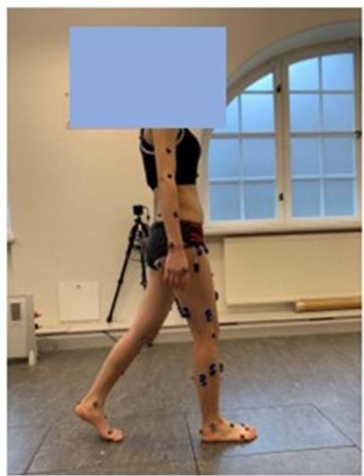
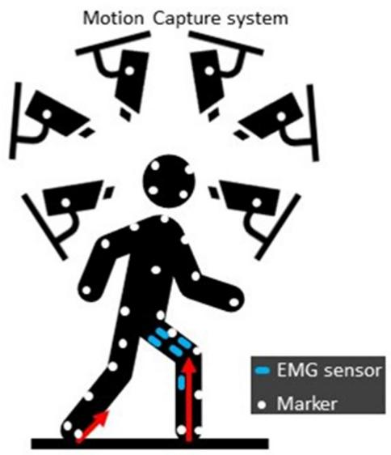
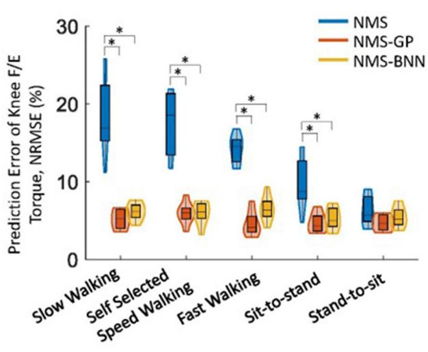
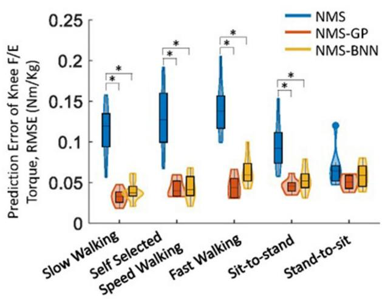
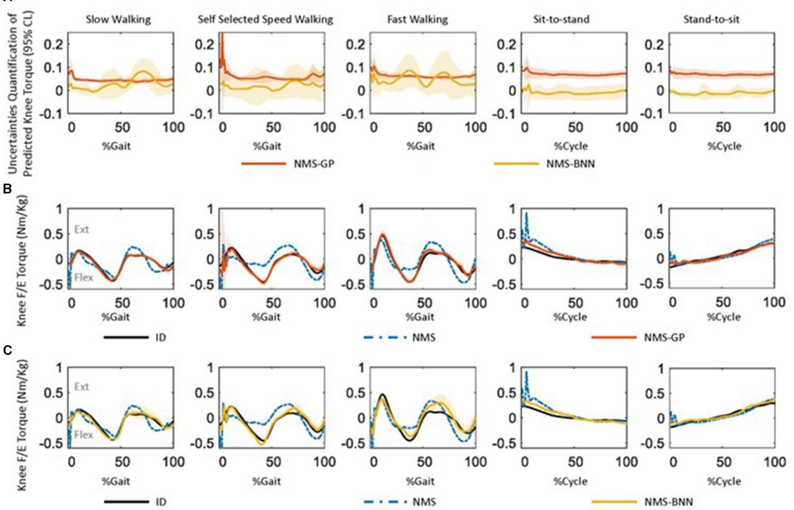
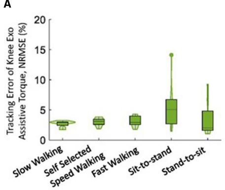
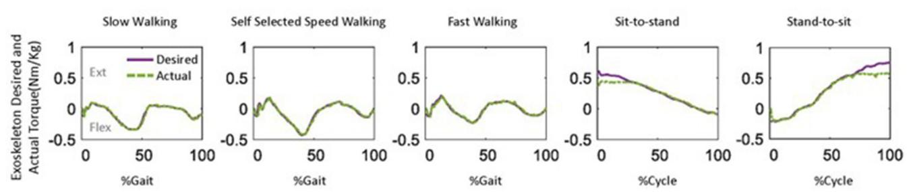

检查更新

## 开放获取

Alois C. Knoll, Technical University of Munich, Germany

Yisen Huang,   
The Chinese University of Hong Kong, China   
Keli Shen,   
National Institute of Advanced Industrial   
Science and Technology (AIST), Japan

Elena M. Gutierrez-Farewik lanie@kth.se

收稿日期 2023年7月6日   
接受日期 2023年8月11日   
发表日期 2023年8月30日

引用   
Zhang L, Zhang X, Zhu X, Wang R and   
Gutierrez-Farewik EM (2023)   
Neuromusculoskeletal model-informed   
machine learning-based control of a knee exoskeleton with uncertainties quantification. Front. Neurosci.   
doi: 10.3389/fnins,2023.1254088

## 版权

© 2023 Zhang, Zhang, Zhu, Wang and Gutierrez-Farewik. 本文为开放获取文章，基于 Creative Commons Attribution License (CC BY) 条款发布。在遵循学术惯例、注明原作者及版权持有者、并引用本文发表于本刊的前提下，允许在任何其他平台使用、传播或复制本文。严禁任何不遵守上述条款的使用、传播或复制行为。

# 基于神经肌肉骨骼模型驱动的机器学习膝关节外骨骼控制与不确定性量化

Longbin Zhang1, Xiaochen Zhang1, Xueyu Zhu2, Ruoli Wang1 and Elena M. Gutierrez-Farewik1\*

1KTH MoveAbility Lab, Department of Engineering Mechanics, KTH Royal Institute of Technology, Stockholm, Sweden, 2Department of Mathematics, University of Iowa, Iowa City, IA, United States

引言：近年来，将用户自身力矩能力纳入考量范围的外骨骼辅助策略研究兴趣日益增长。然而，用户预测的力矩能力往往包含来自各种来源的不确定性，可能会对外骨骼-用户界面的安全性产生重大影响。

方法：为应对这一挑战，本文提出了一种适用于膝关节外骨骼的自适应控制框架，该框架利用肌肉肌电（EMG）信号和关节运动学信息。该框架基于神经肌肉骨骼（NMS, neuromusculoskeletal）求解器驱动的贝叶斯神经网络（NMS-BNN），预测用户的膝关节屈伸力矩及其置信区间，以量化不确定性。预测力矩以指定的置信水平通过 TCP/IP 流控制外骨骼提供的辅助力矩。此外，还将 NMS-BNN 模型的性能与高斯过程（NMS-GP）模型进行了比较。

结果：我们的研究结果表明，NMS-BNN（神经肌肉骨骼贝叶斯神经网络）和 NMS-GP（神经肌肉骨骼高斯过程）模型均能以较低误差准确预测膝关节扭矩，性能优于传统的 NMS（神经肌肉骨骼）模型。在 NMS-BNN 和 NMS-GP 模型中，均观察到每个运动开始时以及自选速度步行中支撑末期和摆动末期的不确定性较高。膝关节外骨骼以较低误差提供了所需的辅助扭矩，不过与自选步行速度相比，快速步行支撑末期的辅助扭矩较低。

讨论：本研究开发的框架能够以可量化不确定性的方式预测膝关节屈伸扭矩，并向用户提供自适应辅助扭矩。这对按需提供辅助并注重外骨骼-用户界面安全性的外骨骼开发具有重大潜力。

##

机器学习、数据驱动生物力学模型、逆动力学、神经肌肉骨骼建模、不确定性量化

## 1. 引言

外骨骼在增强运动能力以及助力脑卒中（stroke）、脑性瘫痪（cerebral palsy）和脊髓损伤（spinal cord injury, SCI）等运动障碍人群的神经肌肉康复方面具有巨大潜力（Sartori et al., 2016; Li et al., 2019, 2021; Liu et al., 2019; Zhang et al., 2019）。外骨骼辅助康复训练涉及使用控制算法，旨在提升使用者的肌力、神经可塑性和运动能力（Fujii et al., 2017）。这些控制策略可分为三类：被动控制（passive control）、触发式被动控制（triggered passive control）和按需辅助控制（assist-as-needed control）（Marchal-Crespo and Reinkensmeyer, 2009; Meng et al., 2015; Proietti et al., 2016）。被动控制是指一种由外骨骼主导的技术，它引导使用者遵循来自健康人群的预定轨迹或辅助力/力矩。在该过程中使用者是被动的，并不主动控制外骨骼。此类控制常用于治疗初期，以使肢体重新适应运动。触发式被动控制是被动控制的一种变体，由使用者启动外骨骼的辅助。一旦激活，使用者再次处于被动状态，外骨骼沿预定轨迹运动。该模式常用于将脑机接口（brain-machine interface, BMI）融入控制过程，为四肢瘫痪（tetraplegia）等不可逆损伤患者提供辅助（Proietti et al., 2016）。按需辅助控制（亦称为"使用者主导"控制或"主动控制"）使使用者能够借助外骨骼完成日常任务。外骨骼基于使用者的能力及产生力矩的意图提供辅助，旨在促进神经可塑性和使用者自主性。该主动控制技术通常应用于具有残余运动功能（residual motor function）的个体（Chen et al., 2016; Durandau et al., 2017; Li et al., 2018; Yao et al., 2018）。本文主要聚焦于主动控制技术，即通过外骨骼辅助来补充使用者不足的肌肉贡献。基于使用者运动意图提供力矩辅助需要对运动功能进行精确且稳健的解码，这可以通过采集潜在的神经肌肉活动来实现，例如脑信号、神经信号以及肌电图（electromyography, EMG）信号。EMG 信号能够捕捉肌肉的电兴奋活动，是预测关节力矩的常用方法，因为它易于获取，并能提供有关人体运动的关键见解（Sartori et al., 2018; Huang et al., 2019; Mounis et al., 2019）。

关节力矩预测在助力外骨骼康复的控制中至关重要，目前通常通过两种方法实现：基于物理的神经肌肉骨骼（NMS）建模和人工神经网络（ANN）（Pizzolato 等，2015、2019；Zhang 等，2020、2021）。为了提高预测精度，近年来研究人员已将 ANN 集成到 NMS 模型中。在我们最近的研究（Zhang 等，2022）中，开发了一种基于 NMS 求解器信息的 ANN 模型，通过将 NMS 模型提取的特征与标准 ANN 相结合，基于步态和等速运动期间测量的关节角度和肌肉肌电（EMG）信号来估计踝关节力矩。该混合模型总体上比单独的 NMS 模型或标准 ANN 模型更准确，但在步态过程中对一名受试者的预测性能仍然较差，这可能是由于从 NMS 模型中纳入了信息量较少或具有误导性的输入特征所致。这凸显了在安全高效的人机交互中对关节力矩预测的不确定性进行量化的必要性；准确估计关节力矩对于确定外骨骼提供适当辅助水平至关重要。

贝叶斯神经网络（BNN）是一种成熟的、可用于带不确定性预测的 ANN 类型，在安全高效的外骨骼控制中具有巨大潜力（Cursi 等，2021；Wei 等，2021；Zhong 等，2021）。与传统 ANN（Cao 等，2022b；Hu 等，2022）不同，BNN 通过引入概率分布来表示预测不确定性，并提供指示不同结果可能性的概率分布（Cursi 等，2021）。这一特性使 BNN 在生物力学、气象学和机器人技术等多个领域的决策中非常有用。例如，Zhong 等（2021）开发了一种基于 BNN 的框架，用于预测下肢假肢的环境上下文。量化后的预测不确定性可有助于制定上下文识别策略，从而增强可靠的决策、高效的传感器融合，并改进各种应用中智能系统的设计。另一种常用的带不确定性预测技术是高斯过程（GP）（Chen 等，2013；Yun 等，2014；Maritz 等，2018；Guo 等，2019；Cao 等，2022a）。GP 将输出建模为具有均值和协方差参数的高斯分布，其中不确定性通过协方差来表示。例如，Liang 等（2021）开发了一种 GP 模型，用于根据行走和跑步运动期间的 EMG 信号估计膝关节角度及其不确定性。由于 BNN 和 GP 都能够估计预测不确定性，因此在安全高效的人机交互背景下对二者进行比较是值得关注的。

本研究的目标是开发一种基于神经肌肉骨骼系统（NMS）不确定性信息的自适应控制框架，用于膝关节外骨骼。该框架旨在准确预测用户膝关节屈/伸（F/E）的生理力矩，同时量化估计的不确定性水平。为实现这一目标，采用了 NMS 求解器为机器学习模型提供信息，机器学习模型随后根据不确定性水平调整辅助力度。另一个目标是比较由 NMS 求解器信息驱动的贝叶斯神经网络（NMS-BNN）模型与由 NMS 求解器信息驱动的高斯过程（NMS-GP）模型在预测及其不确定性方面的表现。

## 2. 方法

我们基于 NMS-BNN 模型开发了一种膝关节外骨骼自适应控制框架（图 1）。NMS-BNN 接受两类输入：(1) 实验测量数据——肌肉信号和关节角度；(2) 从底层 NMS 求解器提取的信息性物理特征，如单个肌肉力和关节力矩。NMS-BNN 输出膝关节力矩并以置信区间的形式进行不确定性量化。在指定置信水平下的预测力矩随后通过 TCP/IP 数据流用于控制膝关节外骨骼提供的辅助力矩。研究结果包含两个关键部分：(1) 对 NMS-BNN 模型预测精度和不确定性的分析，并与传统 NMS 模型和 NMS-GP 模型进行比较；(2) 对膝关节外骨骼提供辅助力矩的跟踪性能评估。

  
基于 NMS 求解器信息驱动的贝叶斯神经网络（NMS-BNN）模型的膝关节外骨骼自适应控制框架示意图。NMS-BNN 的输入包括观测到的肌肉信号和关节角度，以及从 NMS 求解器导出的物理特征（如单个肌肉力和关节力矩）。NMS-BNN 输出膝关节力矩并以置信区间的形式进行不确定性量化。在指定置信水平下的预测力矩随后通过 TCP/IP 数据流用于控制膝关节外骨骼提供的辅助力矩。

  
实验设置：受试者佩戴肌电（EMG）传感器和标记点，在配备运动测量仪器的实验室中进行运动。

## 2.1. 数据采集与处理

八名健康受试者（性别：4 女 / 4 男；身高：168.1 ± 9.4 厘米；体重：65.2 ± 17.8 千克；年龄：29 ± 4 岁）被招募参加实验。瑞典伦理审查机构（Swedish Ethical Review Authority）（Dnr. 2020-02311）批准了本研究，所有受试者均签署了知情同意书。所有参与者被要求完成五种运动类型（图 2），具体为慢速行走、正常行走、快速行走、坐-站转换和站-坐转换。实验过程中，每种运动重复至少十次，运动顺序随机化。

使用表面肌电系统（aktos nano，myon，瑞士施瓦岑贝格）以 1,000 Hz 采样率采集每位参与者随机选择的一条腿的股内侧肌（VM）、股外侧肌（VL）、股直肌（RF）、半腱肌（ST）、股二头肌（BF）、内侧腓肠肌（GM）和外侧腓肠肌（GL）的肌电信号。肌电信号通过以下方式进行后处理：带通滤波（30–300 Hz）、整流、低通滤波（6 Hz），并归一化为所有运动试验中的最大肌电值（Sartori 等, 2016；Pizzolato 等, 2017；Hoang 等, 2018）。

使用三维运动捕捉系统（V16，Vicon，英国牛津）以 100 Hz 采样率记录标记点轨迹，标记点放置基于 CGM2.3 模型（Leboeuf 等, 2019）。以 100 Hz 采样率通过三块测力板（AMTI，美国马萨诸塞州）测量地面反作用力（GRFs）。运动学通过逆向运动学计算，即求解加权最小二乘优化问题以最小化虚拟 $x _ { i }$ 与实测 $x _ { i } ^ { e x p }$ 标记点轨迹之间的差异（Lu 和 O'connor, 1999），公式 (1)。

$$
\operatorname* { m i n } _ { \boldsymbol q } ( \sum _ { i } ^ { N } \theta _ { i } \| \boldsymbol x _ { i } ^ { e x p } - \boldsymbol x _ { i } \| ^ { 2 } ) ,\tag{1}
$$

其中 q 表示模型的广义坐标，$\theta _ { i }$ 为第 i 个标记点的权重。动力学通过逆向动力学计算，在运动方程中求解关节力矩（Pandy, 2001）（公式 2），

$$
M ( \mathbf { q } ) \ddot { q } + C ( q , \dot { q } ) + \mathbf { G ( q ) } + R ( \mathbf { q } ) \mathbf { F } ^ { \mathbf { m t } } + \mathbf { F _ { e } } = 0\tag{2}
$$

其中 ${ \bf q } , \dot { q } , \ddot { q }$ 分别为广义位置、速度和加速度向量；$M ( \mathbf { q } )$ 为质量矩阵，$M ( \mathbf { q } ) \ddot { q }$ 为惯性力和惯性力矩向量；$C ( q , \dot { q } )$ 为离心力和科氏力及力矩向量；$\mathbf { G } ( \mathbf { q } )$ 为重力及力矩向量；$R ( \mathbf { q } )$ 为肌肉力臂矩阵；$\mathbf { F } ^ { \mathbf { m t } }$ 为肌腱力向量，$R ( \mathbf { q } ) \mathbf { F } ^ { \mathbf { m t } }$ 为肌腱力矩向量；$\mathbf { F _ { e } }$ 为外力和外力矩向量（即本文中的地面反作用力 GRFs）。采用四阶零相位低通巴特沃斯滤波器（截止频率 6 Hz）对关节运动学和动力学数据进行滤波（Winter et al., 1974; Mantoan et al., 2015; Derrick et al., 2020）。

## 2.2. EMG 驱动的神经肌肉骨骼模型

本研究使用的 EMG 驱动 NMS 模型为开源 CEINMS 模型（Pizzolato et al., 2015）（图 3）。该模型包含四个组成部分：肌腱运动学、肌肉激活动力学、肌肉收缩动力学和关节动力学关系（Sartori et al., 2011）。肌腱运动学部分计算力臂和肌腱长度，肌肉激活动力学部分基于可用的 EMG 信息计算肌肉激活。肌电激励 $e(t)$ 与神经激活 $u(t)$ 之间的关系由公式 (3) 表示（Lloyd and Besier, 2003）：

$$
u ( t ) = \alpha \cdot e ( t - \tau ) - \beta _ { 1 } \cdot u ( t - 1 ) - \beta _ { 2 } \cdot u ( t - 2 )\tag{3}
$$

其中 $\alpha$ 为肌肉增益参数，$\beta _ { 1 }$ 和 $\beta _ { 2 }$ 为递归参数 $[ \beta _ { 1 } = C _ { 1 } + C _ { 2 } , \beta _ { 2 } = C _ { 1 } \cdot C _ { 2 } ,$，满足 $| C _ { 1 } | < 1 , | C _ { 2 } | < 1$ 且 $\alpha - \beta _ { 1 } - \beta _ { 2 } = 1$ 以保证稳定解（Lloyd and Besier, 2003; Buchanan et al., 2004; Pizzolato et al., 2015）]，$\tau$ 为机电延迟。肌肉激活 $a(t)$ 由公式 (4) 描述：

$$
a ( t ) = { \frac { e ^ { A u ( t ) } - 1 } - 1 } }\tag{4}
$$

其中 $A$ 为形状因子（Buchanan et al., 2004; Hoang et al., 2018）。

肌肉收缩动力学部分采用 Hill 型肌肉模型计算肌肉力，由公式 (5) 表示：

$$
F = F _ { 0 } ^ { m } [ F _ { a l } ( l ) \cdot F _ { \nu } ( \nu ) \cdot a + F _ { p l } ( l ) + d _ { p } \cdot \nu ] c o s ( \theta )\tag{5}
$$

其中 $F _ { 0 } ^ { m }$ 是肌肉的最大等长收缩力，$F _ { a l } ( l )$ 描述主动肌力与肌纤维长度 $l$ 之间的关系，$F _ { p l } ( l )$ 描述被动肌力与肌纤维长度之间的关系，$F _ { \nu } ( \nu )$ 描述肌肉力与肌纤维收缩速度 $\nu$ 之间的关系，$\theta$ 是肌纤维的羽状角，$d _ { p }$ 是肌肉阻尼参数。

最后，关节动力学分量通过将肌肉力与力矩臂相乘来计算关节力矩。

参数按照 Pizzolato 等人（2015）的方法进行了标定，最佳肌纤维长度和肌腱松弛长度在初始值的 15% 范围内进行调整，系数 $C _ { 1 }$ 和 $C _ { 2 }$ 限制在 1 到 1 之间，参数 A 的取值范围限定在 $( - 3 , 0 )$。最大等长收缩力通过使用范围在 0.5 到 2.5 之间的强度系数确定。优化过程旨在最小化标定过程中预测关节力矩与实际关节力矩（通过逆动力学计算得到）之间的误差。该优化任务通过采用模拟退火算法来实现，该算法迭代地优化参数值。算法的执行一直持续到目标函数值的平均变化量达到 $1 0 ^ { - 5 }$ 的容差水平为止。

## 2.3. NMS-BNN 模型

NMS-BNN 模型由一个输入神经层、3 个隐藏层和一个输出神经层组成。输入 $\begin{array} { r l } { \mathbf { x } } & { { } = } \end{array}$ $[ x _ { 1 } , x _ { 2 } , \ldots , x _ { m } ] ^ { T }$，其中 $m = 2 1$，通过两类特征进行增强（图 4）：(1) 来自三维运动捕捉系统的肌肉肌电（EMG）信号和关节运动学数据（膝关节屈/伸角度），以及 (2) 来自底层 NMS 求解器的物理特征，如肌肉力和 NMS 力矩，通过提供关于被建模系统的更多信息来提高模型的准确性。每个隐藏层包含 40 个神经元。带不确定性边界的膝关节力矩估计值在输出层确定。

在 BNN 中，权重被视为概率分布，而非像标准神经网络中那样的单点估计值（图 4）。这些分布用于反映权重和预测中的不确定性。权重的后验概率 $P ( W | X )$ 通过贝叶斯定理按如下方式计算（公式 6）：

  
肌电图（EMG）驱动神经肌肉骨骼模型（neuromusculoskeletal model）的示意结构，包含四个组成部分：肌腱运动学组件用于计算肌腱长度（musculotendon lengths）和肌肉力臂（moment arms）；肌肉激活动力学组件利用 EMG 信息计算肌肉激活度；肌肉收缩动力学组件基于 Hill 型肌肉模型，利用肌腱长度和肌肉激活度预测肌腱力；最后，关节动力学组件以肌腱力和肌肉力臂作为输入计算关节力矩。

  
NMS-BNN 模型架构。NMS-BNN 模型由一个输入神经网络层、3 个隐藏层和一个输出神经网络层组成。输入 $\mathbf { x } = [ x _ { 1 } , x _ { 2 } , \ldots , x _ { m } ] ^ { T }$（其中 $m = 2 1$）通过两类特征进行增强：(1) 来自三维运动捕捉系统的肌肉 EMG 信号和关节运动学数据；(2) 来自底层 NMS 求解器的物理特征，如肌肉力和 NMS 力矩，以通过提供更多关于被建模系统的信息来提高模型的精度。每个隐藏层包含 40 个神经元。膝关节力矩的估计值及其不确定性边界在输出层中确定。权重被视为概率分布，而非标准神经网络中的单点估计。这些分布用于反映权重和预测中的不确定性。

$$
P ( W | X ) = { \frac { P ( X | W ) P ( W ) } { P ( X ) } }\tag{6}
$$

其中，X 为数据，$P(X|W)$ 表示给定权重 W 时数据的似然，$P(W)$ 为权重的先验概率。

分母 $P(X)$ 表示数据的概率，通过对所有可能的权重值上数据的似然和权重的先验概率进行积分获得，如式 (7) 所示：

$$
P ( X ) = \int P ( X \vert W ) P ( W ) d W\tag{7}
$$

本研究中使用了由 Kronheim 等人（2022）开发的 BNN 软件包 TensorBNN。BNN 模型的超参数采用"由粗到细"的随机搜索方法（Bergstra 和 Bengio, 2012）确定。训练过程中，采用均方误差作为损失函数，批量大小（batch size）设为 32。网络包含三个隐藏层，每个隐藏层包含 40 个神经元，激活函数采用 tanh。采用标准差为 0.1 的高斯似然函数。在采样之前，使用 AMSGrad 优化器对模型进行预训练，学习率分别为 0.01、0.001 和 0.0001，耐心值（patience）为 10。为了获得神经网络参数后验密度的点云，使用了哈密顿蒙特卡洛（Hamiltonian Monte Carlo, HMC）采样来计算似然函数。HMC 是一种马尔可夫链蒙特卡洛方法，它利用由神经网络参数后验密度推导出的虚拟势能函数。数值近似采用蛙跳法（leapfrog method）进行，蛙跳步数和步长决定了到达下一个候选点的距离。HMC 超参数采样器的步数保持不变，而步长则根据预烧期（burn-in period）80% 期间样本的接受率，采用对偶平均（Dual-Averaging）算法进行自适应调整。值得注意的是，选择合适的步数和步长可能具有挑战性，TensorBNN 集成了参数适配器算法以自动优化这些参数（Wang 等人, 2013; Kronheim 等人, 2022）。

## 2.4. NMS-GP 模型

NMS-GP 模型使用与 NMS-BNN 模型相同的输入数据，包括实验获取的肌肉信号和关节运动学，以及从底层 NMS 求解器提取的肌肉力和 NMS 力矩等物理特征。NMS-GP 模型 $f(\mathbf{x})$ 由均值函数 $\mu(\mathbf{x})$ 和协方差函数 $k(\mathbf{x}, \mathbf{x'})$ 确定，如公式 (8) 所示（Rasmussen, 2004）。

$$
f ( \mathbf { x } ) \sim G P ( \mu ( \mathbf { x } ) , k ( \mathbf { x } , \mathbf { x ^ { ' } } ) )\tag{8}
$$

其中，均值函数 $\mu(\mathbf{x})$ 提供了模型在给定输入处的期望值估计，而协方差函数（也称为核函数）则量化了两个输入之间的相似性。高斯过程模型提供了多种核函数来捕捉数据的底层结构。其中，径向基函数核（RBF）由于其平滑性和无限可微性而被广泛使用，如公式 (9) 所示，

$$
k ( \mathbf { x } , \mathbf { x } ^ { \prime } ) = \exp ( - \frac { | \mathbf { x } - \mathbf { x } ^ { \prime } | ^ { 2 } } { 2 l ^ { 2 } } )\tag{9}
$$

其中，$l$ 控制核函数的长度尺度，$| \mathbf{x} - \mathbf{x}' |$ 是输入 $\mathbf{x}$ 和 $\mathbf{x}'$ 之间的欧氏距离。

另一个常用的核函数是 Matern 核，它是 RBF（径向基函数）核的推广，其定义如公式 (10) 所示：

$$
k ( \mathbf x , \mathbf x ^ { \prime } ) = \frac { 2 ^ { 1 - \nu } } { \Gamma ( \nu ) } \left( \frac { \sqrt { 2 \nu } } l | \mathbf x - \mathbf x ^ { \prime } | \right) ^ { \nu } K _ { \nu } \left( \frac { \sqrt { 2 \nu } } l | \mathbf x - \mathbf x ^ { \prime } | \right)\tag{10}
$$

其中 ν 决定了核函数的平滑度，$K _ { \nu }$ 是修正贝塞尔函数（Bessel function），Γ(ν) 是 Gamma 函数，l 控制核函数的尺度。

在对数据中的噪声进行建模时，常用白噪声核（White Noise Kernel），如公式 (11) 所示：

$$
k ( \mathbf { x } , \mathbf { x } ^ { \prime } ) = \sigma ^ { 2 } \delta ( \mathbf { x } - \mathbf { x } ^ { \prime } )\tag{11}
$$

其中 $\sigma ^ { 2 }$ 是噪声方差参数，决定了噪声的幅度，$\delta ( { \bf x } - { \bf x } ^ { \prime } )$ 是狄拉克 δ 函数（Dirac delta function）。该函数在 $\mathbf { x } = \mathbf { x } ^ { \prime }$ 时取值为 1，否则为 0，从而保证核函数仅在输入空间的对角线上非零。

线性核（Linear Kernel）是另一种广泛使用的核函数，用于建模输入变量与输出变量之间的线性关系。其具体形式如公式 (12) 所示：

$$
k ( \mathbf { x } , \mathbf { x } ^ { \prime } ) = \sigma ^ { 2 } \mathbf { x } ^ { T } \mathbf { x } ^ { \prime }\tag{12}
$$

其中 $\sigma ^ { 2 }$ 表示方差参数。

在高斯过程建模中，组合使用不同的核函数能够提升模型的性能。为此，我们在大量测试的基础上，选取了 Matern 核、白噪声核与线性核的组合，以获得最精确的预测结果。其中，Matern 核用于捕捉非线性模式，白噪声核用于描述测量误差与不确定性，线性核则用于建模输入变量与输出变量之间的线性关系。训练过程中对长度尺度（length scale）、信号方差、噪声方差等超参数进行了优化，以提升模型的性能。在 Matern 核中，我们将 ν 设为 3/2，长度尺度约束在 (0.01, 200) 范围内，方差约束在 $( 1 0 ^ { - 3 }$, $10^5$) 范围内。类似地，白噪声核的噪声方差约束在 (0.03, 100) 之间，线性核的方差范围为 $( 1 0 ^ { - 3 }$, $10^5$)。

## 2.5. 膝关节外骨骼

膝关节外骨骼硬件由驱动单元（Gen.1，Maxon，瑞士）、3D 打印的大腿-小腿框架以及大腿绑带和小腿绑带（Orliman 94260，西班牙）组成。驱动单元配备一台无刷直流电机（EC90 flat）、一个每转 4,096 计数分辨率的 MILE 编码器、一个带有 18 位 SSI 绝对编码器的三级行星齿轮箱，以及一个 EPOS4 位置控制器。驱动单元能够提供 54 Nm 的连续转矩，以及在 20% 占空比下的 120 Nm 最大转矩。该系统可由 10 至 50 V 范围内的直流电源供电，驱动速度最高可达 22 rpm。

## 2.6. 评估方案

## 2.6.1. 关节力矩预测

针对 NMS、NMS-GP 和 NMS-BNN 模型对膝关节力矩的预测精度进行了研究。同时分析了 NMS-GP 和 NMS-BNN 模型预测力矩的不确定性。在以下五种情况下比较了预测精度和不确定性量化结果：$G a i t _ { s l o w } , G a i t _ { s e l f } , G a i t _ { f a s t } ,$ SitToStand 和 StandToSit，每种运动均使用各自的数据单独进行训练。NMS-GP 和 NMS-BNN 模型使用 80% 的数据进行训练，并在剩余数据上进行评估；而 NMS 模型使用每种运动的三个试验进行校准，并在与 NMS-GP 和 NMS-BNN 模型相同的数据上进行测试。每次试验的输入数据包含约 100 个时间序列数据点和 21 个维度。

  
NMS、NMS-GP 和 NMS-BNN 模型在五种日常活动中估计膝关节力矩与实测/实际膝关节力矩之间的 NRMSE 分布在受试者间的分布情况。小提琴图通过核密度图描绘了 NRMSE 的概率分布，箱线图则表示 NRMSE 的最小值、下四分位数、中位数、上四分位数和最大值。任意两个模型之间的显著性差异以星号（\*）表示，基于配对 t 检验（针对正态分布数据）或 Wilcoxon 符号秩检验（针对非正态分布数据），并进行 Bonferroni 校正。

评估了两项预测误差指标：归一化均方根误差（NRMSE，E ）和均方根误差（RMSE，ERMS）。较低的预测误差表明较高的预测精度。NRMSE 通过将预测力矩与实际力矩之间的 RMSE 除以相应运动中所观测到的关节力矩变化范围来计算：

$$
E _ { R M S } = \sqrt { \frac { 1 } { N } \sum _ { n = 1 } ^ { N } ( y _ { P , n } - y _ { n } ) ^ { 2 } }\tag{13}
$$

$$
E _ { N R M S } = \frac { E _ { R M S } } { ( y _ { m a x } - y _ { m i n } ) } \times 1 0 0 \%\tag{14}
$$

其中 $y_n$ 和 $y_{P,n}$ 分别为测量/实际力矩和预测力矩；$y_{min}$ 和 $y_{max}$ 分别为相应运动中测量力矩的最小值和最大值。对每位受试者计算 RMSE 和 NRMSE，并取八位受试者的平均值。结果部分给出 RMSE 和 NRMSE 的平均值。

采用 Shapiro-Wilk 检验（显著性水平 $p < 0.05$）评估数据分布的正态性。为确定三种方法所估计的 NRMSE 和 RMSE 之间的差异，使用配对 t 检验（用于正态分布数据）或 Wilcoxon 符号秩检验（用于非正态分布数据）进行两两比较，均采用 Bonferroni 校正，显著性水平为 $p < 0.05$。

  
五种日常活动中，NMS、NMS-GP 和 NMS-BNN 模型下受试者估计力矩与测量/实际膝关节力矩之间 RMSE 的分布。小提琴图（violin plot）通过核密度图描绘 NRMSE 的概率分布，箱线图表示 NRMSE 的最小值、下四分位数、中位数、上四分位数和最大值。任意两个模型之间的显著性差异以星号（\*）表示，基于配对 t 检验（正态分布数据）或 Wilcoxon 符号秩检验（非正态分布数据），并应用 Bonferroni 校正。

NMS-GP 和 NMS-BNN 模型预测力矩的不确定性采用 95% 置信水平（confidence level, CL）进行量化，即所建模函数的真实值有 95% 的概率落在预测区间内。较高的不确定性值表示对预测值的置信度较低。

## 2.6.2. 外骨骼辅助力矩跟踪性能

我们还使用 NRMSE 和 RMSE（膝关节外骨骼所提供的期望力矩与实际力矩之间）这两个指标，评估自适应控制框架在五种日常活动中所提供的膝关节外骨骼辅助力矩的跟踪性能。自适应控制框架所提供的膝关节力矩辅助水平 $A_L$ 由 NMS-BNN 模型量化的不确定性 U 调节/确定，如下式所示：

$$
A _ { L } = \left\{ \begin{array} { l l } { 0 . 8 } & { \mathrm { i f ~ } U < 0 . 0 5 } \\ { 0 . 6 } & { \mathrm { i f ~ } 0 . 0 5 \le U < 0 . 1 } \\ { 0 . 4 } & { \mathrm { i f ~ } 0 . 1 \le U < 0 . 1 5 } \\ { 0 . 3 } & { \mathrm { i f ~ } 0 . 1 5 \le U < 0 . 2 } \\ { 0 . 1 } & { \mathrm { i f ~ } U \ge 0 . 2 } \end{array} \right.\tag{15}
$$

A  
(A) NMS-GP 和 NMS-BNN 模型在五种日常活动中跨受试者预测膝关节力矩的不确定性量化，以所有受试者的均值 ± 1 个标准差表示。不确定性采用 95% 置信水平进行量化，意味着真实值有 95% 的概率落在预测区间内。较高的不确定性值表示预测的置信度较低。(B) 一个示例，展示通过逆动力学（ID）测量的膝关节屈/伸力矩（Nm/kg）以及 NMS 和 NMS-GP 模型在五种日常活动中的预测值。NMS-GP 模型中的标准差突出了相对于期望均值的不确定性。(C) 展示一个由 NMS-BNN 模型预测的膝关节屈/伸力矩示例，并与 (B) 中相同的 ID 和 NMS 模型的示例进行比较。NMS-BNN 模型中的标准差同样突出了相对于期望均值的不确定性。  

A  

B  
  
膝关节外骨骼在五种日常活动中由自适应控制框架提供的辅助力矩的跟踪误差，以 (A) 归一化均方根误差（NRMSE）和 (B) 均方根误差（RMSE）表示。小提琴图通过核密度图展示了预测误差的概率分布，箱线图描绘了预测误差的最小值、第一四分位数、中位数、第三四分位数和最大值。

## 3. 结果

## 3.1. 关节力矩预测

总体而言，NMS-BNN 和 NMS-GP 模型均能准确预测膝关节力矩，误差相对较低（RMSE：NMS-GP ≤ 0.05 Nm/kg，NMS-BNN ≤ 0.07 Nm/kg；NRMSE：NMS-GP ≤ 5.9%，NMS-BNN ≤ 6.8%）。这些误差显著低于 NMS 模型（RMSE：0.14 Nm/kg，NRMSE：≤ 18.3%。图 5、图 6）。

除了 StandToSit（站立到坐下）情况外，NMS-GP 和 NMS-BNN 模型的 NRMSE 预测误差在所有情况下均显著低于 NMS 模型（$Gait_{slow}$：$p < 0.01$ 和 $p < 0.01$；$Gait_{self}$：$p < 0.01$ 和 $p < 0.01$；$Gait_{fast}$：$p < 0.01$ 和 $p < 0.01$；SitToStand（坐到站）：$p < 0.01$ 和 $p < 0.01$；StandToSit：$p = 0.08$ 和 $p = 1.45$；图 5）。在 RMSE 中也观察到了类似的结论。

在 NMS 模型预测的五种情况的 NRMSE 中，StandToSit 情况的 NRMSE 最低（7.2%）。在 StandToSit 情况下，NMS、NMS-GP 和 NMS-BNN 模型之间未观察到显著差异（NMS：7.2%，NMS-GP：≤ 5.5%；NMS-BNN：≤ 6.8%）。

NMS-GP 和 NMS-BNN 模型在每个运动开始时对预测膝关节力矩都具有相对较大的不确定性，尤其是在 $Gait_{self}$ 情况下（图 7A）。在 NMS-GP 模型中，$Gait_{self}$ 情况下的站立末期和摆动末期观察到较高的不确定性。另一方面，NMS-BNN 模型在所有步速下的站立末期、摆动初期和摆动末期都具有较高的不确定性。

NMS 模型预测的力矩与实测力矩的一致性较差，相比 NMS-GP 和 NMS-BNN 模型（图 7B、C）。在每个运动开始时，NMS 模型观察到相对较大的偏置（offset）。

## 3.2. 外骨骼辅助力矩跟踪性能

总体而言，膝关节外骨骼以相对较低的误差准确地提供了所需的辅助力矩（RMSE：0.06 Nm/kg，$\mathrm{NRMSE:} \leq 5.6\%$，图 8）。在五种运动中，步行运动的 NRMSE 在所有受试者中分布均匀，而在坐-立和立-坐运动中各出现了一个离群点。坐-立运动在五种运动中具有最高的跟踪误差。

总体而言，膝关节外骨骼实际提供的辅助力矩与期望力矩匹配良好（图 9）。然而，需要注意的是，在坐-立运动开始时提供的力矩有限。此外，与自选速度步行相比，在快速步行的站立末期观察到的辅助力矩相对较低。

## 4. 讨论

我们开发了一种基于 NMS-BNN 的膝关节外骨骼自适应控制框架，使用肌肉 EMG 信号和关节运动学。我们还将 NMS-BNN 模型带不确定性的预测结果与 NMS-GP 模型的预测结果进行了比较。我们观察到 NMS-BNN 和 NMS-GP 模型均能以较低的误差准确预测膝关节力矩，性能优于传统的 NMS 模型，这表明将 NMS 特征整合到机器学习模型中具有优势。然而，在每个运动开始时以及自选速度步行的站立末期和摆动末期，两个模型（NMS-BNN 和 NMS-GP）都观察到较高的不确定性。膝关节外骨骼准确地提供了期望的辅助力矩，误差相对较低。与自选步行速度相比，在快速步行的站立末期观察到的力矩水平较低。辅助力矩的水平根据 NMS-BNN 预测中的不确定性来确定和调整，从而提高了外骨骼-使用者接口的安全性。

将用户的生理关节力矩纳入外骨骼控制策略近年来已成为可能，并在改善任务表现和康复效果方面具有巨大潜力。在常见的关节力矩预测技术中，EMG 驱动的 NMS 模型需要专业能力和复杂的校准过程，而机器学习模型虽然更易于使用，但被视为黑箱模型（Hoang 等，2018；Ezati 等，2019；Soleimani 和 Nazerfard，2021）。为了提高预测精度，研究者已将人工神经网络（ANN）集成到 NMS 模型中，从而结合两种方法的优势。然而，确保外骨骼控制的安全性和效率也至关重要，尤其是在使用预测力矩作为外骨骼输入时。为此，本研究将 NMS 与具有不确定性量化能力的机器学习模型相结合，用于关节力矩预测。如前所述，BNN 和 GP 模型均能提供带有相关不确定性的预测结果。其中，BNN 模型通过引入贝叶斯方法来量化预测中的不确定性，而 GP 模型则基于高斯过程，为预测提供带有不确定性的概率模型。在本研究中，我们还对 NMS-BNN 和 NMS-GP 模型的不确定性预测结果进行了比较。我们发现 NMS-BNN 和 NMS-GP 模型都能以较低的误差准确预测膝关节力矩（RMSE：NMS-GP $\leq 0.05$ Nm/kg，NMS-BNN $\leq 0.07$ Nm/kg；NRMSE：NMS-GP $\leq 5.9\%$，NMS-BNN $6.8\%$），并且优于传统 NMS 模型（RMSE $\leq 0.14$ Nm/kg，NRMSE $18.3\%$）。该结果归因于机器学习层的加入，通过最小化实测关节力矩与预测关节力矩之间的误差对模型进行进一步训练。

NMS-BNN 或 NMS-GP 模型所提供的不确定性量化，可为外骨骼控制器决策提供有价值的数据，从而有望提升外骨骼与用户交互过程中的安全性。例如，我们在 NMS-BNN 和 NMS-GP 模型中都观察到每个运动开始时的不确定性较高（图 7）。这可能是由于从 NMS 模型继承的物理特性所致，该特性在每个运动起始阶段表现出明显的偏移。在 NMS 模型中，需要每个肌腱单元（MTU）前两个时间步的神经激活值来计算肌肉神经激活（Zhang 等，2022）。在每个步态周期的起始阶段，这两个过去的神经激活值尚无法获得，只能利用前两个时间步的 EMG 信号进行近似估计，这可能导致预测力矩在初始阶段出现偏差。此外，在自选速度行走条件下，NMS-BNN 和 NMS-GP 模型在站立末期和摆动末期均观察到较高的不确定性。这可能归因于步态中站立相与摆动相之间的过渡转换。

  
膝关节外骨骼（knee exoskeleton）在五项日常活动中所提供的期望辅助力矩与实际辅助力矩的一个范例。

膝关节外骨骼准确地提供了期望的辅助力矩（assistive torque），误差相对较低（RMSE：0.06 Nm/kg，NRMSE：5.6%，图 8）。辅助力矩是通过电机中的电流控制（current control）来实现的，这是一种被广泛使用的闭环控制技术（Zhang 等人，2018；Azocar 等人，2020；Nuckols 等人，2021）。电流控制系统旨在即使在电机转速与负载条件变化的情况下，仍能保持电机中电流的恒定。通过电流控制可实现对电机转矩输出的精确控制，但精度可能会受电流传感质量以及控制环路响应速度等因素的影响。为了估计输出转矩，控制系统将测得的电流作为反馈，因为电流与电机所产生的转矩成正比（Azocar 等人，2020）。这使控制系统能够确定所产生的转矩大小，并据此对外骨骼进行调整。我们观察到，与自选步速行走相比，快速行走在站立末期的辅助力矩水平较低（图 9）。这种差异可能是由于快速行走中存在更多的不确定性，根据我们的控制策略（公式 15），这些不确定性导致所分配的辅助力矩水平反而较低。值得注意的是，在坐起（sit-to-stand）和坐下（stand-to-sit）动作中观察到了一个异常值（图 8）。该偏差可能归因于外骨骼在坐起动作开始时以及坐下动作结束时的转矩容量有限（图 9）。

本研究旨在通过实施一种基本的电流控制策略来评估 NMS-BNN 框架的可行性。目标是评估该框架的整体可行性。然而，未来有必要研究更先进的控制技术，例如阻抗控制。当前的电流控制策略可能导致辅助力矩不够平滑。因此，在未来的研究中，我们建议采用改进的控制策略，同时考虑预测的不确定性以及预测力矩的最近点，以增强平滑性并改善用户-外骨骼的交互界面。此外，虽然本研究聚焦于膝关节，但需要指出的是，该方法同样可以适配并扩展到其他关节。另外，值得提及的是，系统所能产生的最大力矩为 54 Nm，这可能也会影响辅助力矩的平滑性。因此，在未来的控制策略中应予以考虑。需要指出的是，本研究并未涉及在真实用户上测试基于 NMS-BNN 的自适应框架在实际应用中的性能。进一步的研究对于解决该问题并确定该框架的实用性至关重要。

## 5. 结论

在本研究中，我们针对一款膝关节外骨骼提出了一种基于 NMS-BNN 的自适应控制框架，该框架使用肌肉 EMG 信号和关节运动学信息。NMS-BNN 模型将传统 NMS 模型与现代机器学习技术相结合，并包含不确定性量化。所提出的框架还测量预测中的不确定性，并将其纳入控制设计中，以确保外骨骼-用户交互界面的安全性。我们还将 NMS-BNN 模型的性能与同样预测不确定性的 NMS-GP 模型进行了比较。关于如何将传统模型与具有不确定性的机器学习模型相结合所提供的详细信息，能够为外骨骼控制策略的设计提供有益的指导。

## 数据可用性声明

支持本文结论的原始数据将由作者提供，不会施加不当保留。

## 伦理声明

涉及人类参与者的研究已获得瑞典伦理审查机构（Swedish Ethical Review Authority）的批准。所有研究均按照当地法律法规及机构要求开展。参与者已签署书面知情同意书以参与本研究。本文中任何可能识别身份的图片或数据的发表均已获得相关个人的书面知情同意。

## 作者贡献

LZ：概念化、数据管理、形式分析、调查研究、方法论、软件开发、验证、可视化、撰写—原稿、撰写—审阅与编辑。XZha：撰写—审阅与编辑、形式分析、方法论、调查研究。XZhu：研究方法、督导、撰写—审阅与编辑。RW：研究方法、督导、撰写—审阅与编辑。EG-F：概念化、数据管理、经费获取、方法论、项目管理、资源支持、督导、撰写—审阅与编辑。

## 资助

我们衷心感谢 Promobilia 基金会（A22078、18014、21302 和 18200）、瑞典研究

Azocar, A. F., Mooney, L. M., Duval, J. F., Simon, A. M., Hargrove, L. J., and Rouse, E. J. (2020). Design and clinical implementation of an open-source bionic leg. *Nat. Biomed. Eng.* 4, 941–953. doi: 10.1038/s41551-020-00619-3

Bergstra, J., and Bengio, Y. (2012). Random search for hyper-parameter optimization. *J. Mach. Learn. Res.* 13, 1–25.

## 参考文献

Buchanan, T. S., Lloyd, D. G., Manal, K., and Besier, T. F. (2004). Neuromusculoskeletal modeling: estimation of muscle forces and joint moments and movements from measurements of neural command. *J. Appl. Biomech.* 20, 367–395. doi: 10.1123/jab.20.4.367

Cao, H., Chen, G., Li, Z., Feng, Q., Lin, J., and Knoll, A. (2022a). Eficient grasp detection network with Gaussian-based grasp representation for robotic manipulation. *IEEE/ASME Trans. Mechatron.* 28, 1384–1394. doi: 10.1109/TMECH.2022.3224314

Cao, H., Chen, G., Li, Z., Hu, Y., and Knoll, A. (2022b). Neurograsp: multimodal neural network with Euler region regression for neuromorphic vision-based grasp pose estimation. *IEEE Trans. Instrument. Meas.* 71, 1–11. doi: 10.1109/TIM.2022.3179469

Chen, B., Ma, H., Qin, L.-Y., Gao, F., Chan, K.-M., Law, S.-W., et al. (2016). Recent developments and challenges of lower extremity exoskeletons. *J. Orthopaed. Transl.* 5, 26–37. doi: 10.1016/j.jot.2015.09.007

本文中表达的所有观点仅为作者本人观点，并不一定代表其所属机构、出版商、编辑或审稿人的观点。本文所评估的任何产品或制造商所提出的任何主张，均未获得出版商的保证或认可。

Chen, N., Qian, Z., Nabney, I. T., and Meng, X. (2013). Wind power forecasts using Gaussian processes and numerical weather prediction. *IEEE Trans. Power Syst.* 29, 656–665. doi: 10.1109/TPWRS.2013.2282366

Cursi, F., Modugno, V., Lanari, L., Oriolo, G., and Kormushev, P. (2021). Bayesian neural network modeling and hierarchical MPC for a tendon-driven surgical robot with uncertainty minimization. *IEEE Robot. Automat. Lett.* 6, 2642–2649. doi: 10.1109/LRA.2021.3062339

Derrick, T. R., van den Bogert, A. J., Cereatti, A., Dumas, R., Fantozzi, S., and Leardini, A. (2020). ISB 关于人体运动分析中节间力和力矩报告的建议. *J. Biomech.* 99, 1–10. doi: 10.1016/j.jbiomech.2019.109533

Durandau, G., Farina, D., and Sartori, M. (2017). 由肌电图驱动的鲁棒实时肌肉骨骼建模. *IEEE Trans. Biomed. Eng.* 65, 556–564. doi: 10.1109/TBME.2017.2704085

Ezati, M., Ghannadi, B., and McPhee, J. (2019). 人体运动动力学仿真方法综述——侧重于步态. *Multibody Syst. Dyn.* 47, 265–292. doi: 10.1007/s11044-019-09685-1

## 出版商说明

Fujii, K., Abe, T., Kubota, S., Marushima, A., Kawamoto, H., Ueno, T., et al. (2017). 用于胸椎后纵韧带骨化患者术后训练的自主驱动外骨骼混合辅助肢体（HAL）：病例报告. *J. Spinal Cord Med.* 40, 361–367. doi: 10.1080/10790268.2016.1142056

委员会（2018-04902 和 2018-00750），以及西蒙斯基金会（504054）。

Guo, H., Meng, Z., Huang, Z., Kang, L. W., Chen, Z., Meghjani, M., et al. (2019). "基于高斯过程调节风险地图的安全路径规划," in *2019 IEEE/RSJ 国际智能机器人与系统会议 (IROS)* (Macau: IEEE), 2044–2051.

作者声明，本研究在不存在任何可被视为潜在利益冲突的商业或财务关系的情况下开展。

## 利益冲突

Hoang, H. X., Pizzolato, C., Diamond, L. E., and Lloyd, D. G. (2018). 神经肌肉参数的受试者特异性校准使神经肌肉骨骼模型能够在健康成年人中估计生理学上合理的髋关节接触力. *J. Biomech.* 80, 111–120. doi: 10.1016/j.jbiomech.2018.08.023

Hu, Y., Chen, G., Li, Z., and Knoll, A. (2022). 用于稳定非线性动力系统的自然进化策略机器人策略改进. *IEEE Trans. Cybernet.* 53, 4002–4014. doi: 10.1109/TCYB.2022.3192049

Huang, Y., Song, R., Argha, A., Savkin, A. V., Celler, B. G., and Su, S. W. (2019). 通过切换机制连续描述人体三维运动意图. *IEEE Trans. Neural Syst. Rehabil. Eng.* 28, 277–286. doi: 10.1109/TNSRE.2019.2949203

Kronheim, B., Kuchera, M. P., and Prosper, H. B. (2022). Tensorbnn：使用 TensorFlow 进行神经网络的贝叶斯推断. *Comput. Phys. Commun.* 270, 1–8. doi: 10.1016/j.cpc.2021.108168

Leboeuf, F., Baker, R., Barré, A., Reay, J., Jones, R., and Sangeux, M. (2019). 传统步态模型——重现过去、面向未来的开源实现. *Gait Post.* 69, 235–241. doi: 10.1016/j.gaitpost.2019.04.015

Li, Z., Huang, B., Ye, Z., Deng, M., and Yang, C. (2018). 基于导纳控制的机器外骨骼物理人机交互. *IEEE Trans. Indus. Electron.* 65, 9614–9624. doi: 10.1109/TIE.2018.2821649

Li, Z., Li, G., Wu, X., Kan, Z., Su, H., and Liu, Y. (2021). 基于人类协作操作模型的双臂外骨骼非对称协作控制. *IEEE Trans. Cybern.* 52, 12126–12139. doi: 10.1109/TCYB.2021.3113709

Li, Z., Yuan, Y., Luo, L., Su, W., Zhao, K., Xu, C., et al. (2019). 基于脑/肌混合信号驱动的可穿戴步行外骨骼增强爬楼梯活动中的运动能力. *IEEE Trans. Med. Robot. Bionics* 1, 218–227. doi: 10.1109/TMRB.2019.2949865

Liang, J., Shi, Z., Zhu, F., Chen, W., Chen, X., and Li, Y. (2021). 基于高斯过程自回归的 sEMG 信号关节角度预测. *Front. Public Health* 9, 685596. doi: 10.3389/fpubh.2021.685596

Liu, Z., Zhong, B., Zhong, W., Guo, K., and Zhang, M. (2019). "机器人辅助踝关节韧带康复的一种新轨迹确定方法," in *2019 41st Annual International Conference of the IEEE Engineering in Medicine and Biology Society* (Berlin: IEEE), 5390–5393.

Lloyd, D. G., and Besier, T. F. (2003). 一种肌电驱动骨骼肌模型用于体内肌肉力量和膝关节力矩估计. *J. Biomech.* 36, 765–776. doi: 10.1016/S0021-9290(03)00010-1

Lu, T.-W., and O'connor, J. (1999). 基于关节约束全局优化的骨骼位置从皮肤标记坐标估计. *J. Biomech.* 32, 129–134.

Mantoan, A., Pizzolato, C., Sartori, M., Sawacha, Z., Cobelli, C., and Reggiani, M. (2015). MOtoNMS：一个用于神经肌肉骨骼建模与仿真的运动数据处理 MATLAB 工具箱. *Source Code Biol. Med.* 10, 1–14. doi: 10.1186/s13029-015-0044-4

Marchal-Crespo, L., and Reinkensmeyer, D. J. (2009). 神经损伤后机器人运动训练控制策略综述. *J. Neuroeng. Rehabil.* 6, 1–15. doi: 10.1186/1743-0003-6-20

Maritz, J., Lubbe, F., and Lagrange, L. (2018). 贝叶斯框架下能量测量与验证的高斯过程回归实用指南. *Energies* 11, 1–12. doi: 10.3390/en11040935

Meng, W., Liu, Q., Zhou, Z., Ai, Q., Sheng, B., and Xie, S. S. (2015). 机器人辅助下肢康复机构与控制策略的最新进展. *Mechatronics* 31, 132–145. doi: 10.1016/j.mechatronics.2015.04.005

Mounis, S. Y. A., Azlan, N. Z., and Sado, F. (2019). 基于受试者功能能力的上肢康复按需辅助控制策略. *Meas. Control* 52, 1354–1361. doi: 10.1177/0020294019866844

Nuckols, R. W., Lee, S., Swaminathan, K., Orzel, D., Howe, R. D., and Walsh, C. J. (2021). 基于多用途步行过程中实测肌肉动力学的软体外服辅助个性化. *Sci. Robot.* 6, 1–11. doi: 10.1126/scirobotics.abj1362

Pandy, M. G. (2001). 人体运动的计算机建模与仿真. *Annu. Rev. Biomed. Eng.* 3, 245–273. doi: 10.1146/annurev.bioeng.3.1.245

Pizzolato, C., Lloyd, D. G., Sartori, M., Ceseracciu, E., Besier, T. F., Fregly, B. J., et al. (2015). CEINMS: a toolbox to investigate the influence of diferent neural control solutions on the prediction of muscle excitation and joint moments during dynamic motor tasks. J. Biomech. 48, 3929–3936. doi: 10.1016/j.jbiomech.2015.09.021

Pizzolato, C., Reggiani, M., Modenese, L., and Lloyd, D. (2017). Real-time inverse kinematics and inverse dynamics for lower limb applications using opensim. Comput. Methods Biomech. Biomed. Eng. 20, 436–445. doi: 10.1080/10255842.2016.1240789

Pizzolato, C., Saxby, D. J., Palipana, D., Diamond, L. E., Barrett, R. S., Teng, Y. D., et al. (2019). Neuromusculoskeletal modeling-based prostheses for recovery after spinal cord injury. Front. Neurorobot. 13, 97. doi: 10.3389/fnbot.2019.00097

Proietti, T., Crocher, V., Roby-Brami, A., and Jarrasse, N. (2016). Upper-limb robotic exoskeletons for neurorehabilitation: a review on control strategies. IEEE Rev Biomed. Eng. 9, 4–14. doi: 10.1109/RBME.2016.2552201

Rasmussen, C. E. (2004). Gaussian processes in machine learning. Adv. Lectures Mach. Learn. 3176, 63–71. doi: 10.1007/978-3-540-28650-9\_4

Sartori, M., Durandau, G., Došen, S., and Farina, D. (2018). Robust simultaneous myoelectric control of multiple degrees of freedom in wrist-hand prostheses by real-time neuromusculoskeletal modeling. J. Neural Eng. 15, 1–15. doi: 10.1088/1741-2552/aae26b

Sartori, M., Lloyd, D. G., and Farina, D. (2016). Neural data-driven musculoskeletal modeling for personalized neurorehabilitation technologies. IEEE Trans. Biomed. Eng. 63, 879–893. doi: 10.1109/TBME.2016.25 38296

Sartori, M., Reggiani, M., Lloyd, D. G., and Pagello, E. (2011). "A neuromusculoskeletal model of the human lower limb: towards EMG-driven actuation of multiple joints in powered orthoses," in 2011 IEEE International Conference on Rehabilitation Robotics (Zürich: IEEE), 1–6.

Soleimani, E., and Nazerfard, E. (2021). Cross-subject transfer learning in human activity recognition systems using generative adversarial networks. Neurocomputing 426, 26–34. doi: 10.1016/j.neucom.2020.10.056

Wang, Z., Mohamed, S., and Freitas, N. (2013). "Adaptive Hamiltonian and Riemann manifold Monte Carlo," in International Conference on Machine Learning (Georgia: PMLR), 1462–1470.

Wei, W., Kaiming, Y., Yu, Z., Yuyang, Q., Chenhui, W., and Min, L. (2021). Walking speed estimation from a wearable insole pressure system embedded with an accelerometer using Bayesian neural network. J. Eng. Sci. Med. Diagnost. Ther. 4, 1–7. doi: 10.1115/1.4049964

Winter, D. A., Sidwall, H. G., and Hobson, D. A. (1974). Measurement and reduction of noise in kinematics of locomotion. J. Biomech. 7, 157–159.

Yao, S., Zhuang, Y., Li, Z., and Song, R. (2018). Adaptive admittance control for an ankle exoskeleton using an emg-driven musculoskeletal model. Front. Neurorobot. 12, 16. doi: 10.3389/fnbot,2018.00016

Yun, Y., Kim, H.-C., Shin, S. Y., Lee, J., Deshpande, A. D., 和 Kim, C. (2014). 基于高斯过程回归的步态运动学预测统计方法. *J. Biomech.* 47, 186–192. doi: 10.1016/j.jbiomech.2013.09.032

Zhang, L., Li, Z., Hu, Y., Smith, C., Farewik, E. M. G., 和 Wang, R. (2020). 基于肌电驱动神经肌肉骨骼模型和人工神经网络模型的踝关节力矩估计. *IEEE Trans. Automat. Sci. Eng.* 18, 564–573. doi: 10.1109/TASE.2020.3033664

Zhang, L., Zhu, X., Farewik, E. M. G., 和 Wang, R. (2021). "基于神经肌肉骨骼求解器驱动神经网络模型的踝关节动态力矩估计," 发表于 *2021 6th IEEE International Conference on Advanced Robotics and Mechatronics (ICARM)* (重庆: IEEE), 75–80.

Zhang, L., Zhu, X., Gutierrez-Farewik, E. M., 和 Wang, R. (2022). 基于NMS求解器驱动人工神经网络模型与迁移学习的踝关节力矩预测. *IEEE J. Biomed. Health Inform.* 26, 5895–5906. doi: 10.1109/JBHI.2022.3207313

Zhang, M., McDaid, A., Veale, A. J., Peng, Y., 和 Xie, S. Q. (2019). 具有关节空间力分布的并联踝关节康复机器人自适应轨迹跟踪控制. *IEEE Access* 7, 85812–85820. doi: 10.1109/ACCESS.2019.292 5182

Zhang, T., Tran, M., 和 Huang, H. (2018). 具有平衡能力的髋关节外骨骼设计与实验验证用于行走辅助. *IEEE/ASME Trans. Mechatron.* 23, 274–285. doi: 10.1109/TMECH.2018.279 0358

Zhong, B., Silva, R. L., Li, M., Huang, H., 和 Lobaton, E. (2021). 下肢假肢环境上下文预测及其不确定性量化. *IEEE Trans. Automat. Sci. Eng.* 18, 458–470. doi: 10.1109/TASE.2020.2993399