# 基于肌电驱动神经肌肉骨骼模型与 LSTM 网络的关节力矩估计

Longbin Zhang、Davit Soselia、Ruoli Wang 和 Elena M. Gutierrez-Farewik

摘要——使用可穿戴传感器准确预测关节力矩对于设计按需辅助外骨骼控制器至关重要，该控制器可辅助肌肉产生的力矩并确保任务顺利完成。本文利用神经肌肉骨骼（NMS）模型和长短期记忆（LSTM）网络，从日常活动中的肌电图（EMG）和运动学数据估计踝关节背屈/跖屈、膝关节屈/伸、髋关节屈/伸以及髋关节外展/内收力矩。用于模型标定和训练的真值关节力矩通过采集运动数据的逆向动力学获得。本文提出了一种基于特征相似度对运动进行聚类的方法，并评估了其改善 NMS 和 LSTM 模型估计精度的能力。我们在三种情况下比较了 NMS 和 LSTM 模型的力矩估计精度：合并模型（Pooled）、个体模型（Individual）和聚类模型（Clustered）。合并模型使用全部 10 种运动的数据来标定或训练一个模型，个体模型使用每种单独运动的数据，聚类模型使用每个聚类的数据。个体、聚类和合并 LSTM 模型都具有相对较高的关节力矩估计精度。个体和聚类 NMS 模型具有同样良好的估计性能，而合并模型可能过于通用，无法满足所有运动模式。虽然聚类方法在某些运动中改善了 NMS 模型的估计精度，但对 LSTM 神经网络的影响相对较小，因为后者本身已经具有较高的估计精度。本研究为按需辅助外骨骼控制器的设计提供了实用指导，针对不同应用场景给出了模型选择建议，并具有增强可穿戴外骨骼功能、改善运动障碍患者康复和辅助效果的潜力。

关键词——神经网络、关节力矩预测、神经肌肉骨骼建模、聚类分析、数据驱动生物力学模型

## I. 引言

由于外骨骼在促进残疾人运动方面的潜力日益受到关注，例如用于辅助运动障碍患者的神经肌肉康复，其相关研究越来越多 [1]。许多近期研究探讨了外骨骼在神经康复训练中通过整合用户生物信号（如肌电图 EMG（electromyography））的反馈回路来刺激神经肌肉恢复的潜力 [2]、[3]。例如，Durandau 等人 [4] 开发了一种基于 EMG 的控制器，通过计算用户的关节力矩来确定外骨骼的辅助水平，使不完全性脊髓损伤或脑卒中后患者能够主动控制外骨骼到达目标位置。因此，整合用户力矩能力的外骨骼控制策略研究正呈指数级增长。由于 EMG 信号能够适应用户的肌肉功能，并鼓励用户主动参与，从而促进运动恢复，因此合适的辅助力矩通常基于用户的 EMG 信号进行预测。这种通常被称为 "assist-as-needed"（按需辅助）的控制策略必须充分辅助肌肉产生的力矩，以确保用户成功完成预期任务。实现用户力矩的准确预测是达成这一目标的第一步。

为了预测关节力矩，神经肌肉骨骼（neuromusculoskeletal, NMS）建模和人工神经网络（artificial neural networks, ANN）是两种常见的方法，每种方法都有各自的优缺点 [5]–[7]。我们最近的研究 [8] 是首次在步态和等速运动中比较基于物理的 NMS 模型与多层感知机（multilayer perceptron, MLP）模型在踝关节力矩估计性能上的差异的研究。我们强调了 NMS 方法的实用性，它利用领域知识来复现从肌电信号（EMG）到肌腱力和关节力矩的转换过程。然而，按照复杂的步骤建立和校准模型可能非常耗时，而且需要注意的是，基于物理的 NMS 模型仅能提供关节动力学的近似估计。此外，肌电信号的质量可能会受到串扰和传感器精确定位等问题的影响。MLP 模型可以更好地估计关节力矩，但需要多样化的训练数据。MLP 是一种经典且简单的神经网络，不包含时间序列或记忆信息。然而，其他神经网络结构的力矩预测与 NMS 模型的比较尚未得到充分研究。长短期记忆网络（LSTM）被报道为时间序列预测中最稳健且最有效的方法 [9]–[11]，它能够通过将记忆结构融入网络来选择性地记忆与某段时间相对应的模式。这些记忆结构能够通过门控机制在各时间步之间更新信息，选择输出、遗忘和记忆的内容。类似的记忆结构也包含在基于物理的 NMS 模型中，该模型使用了前两个时间步的肌肉单元（MTU）神经激活信息。因此，比较基于物理的 NMS 模型和 LSTM 网络是很有意义的。尽管基于物理的 NMS 和 LSTM 模型在关节力矩估计方面取得了进展，但使用 NMS 和 LSTM 模型并行地针对日常活动中下肢多自由度（DOFs）的力矩估计研究仍然有限。

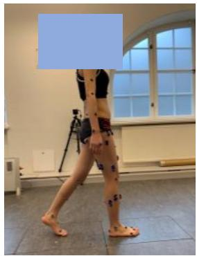

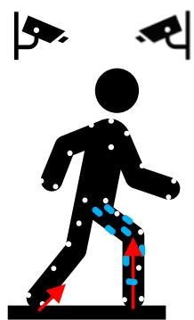  
图 1. 实验装置

聚类方法已被应用于对患有和未患运动障碍者的步态和运动模式进行分类 [12]–[14]，对非病理群体的肌肉激活水平进行分类 [15]，以及对前交叉韧带损伤率相同的运动员的力矩模式进行分类 [16]。聚类分析是一种统计技术，用于根据特征相似性将观测值或模式分组到若干聚类中。Phinyomark 等人 [13] 将跑步运动学模式聚类为两个不同的组；他们的结果表明，跑步模式中的变异性观察可能归因于不同的步态策略。White 等人 [15] 应用聚类分析来识别步态过程中腹部和腰部肌肉的激活模式。在我们最近关于步态和等速运动中由 NMS 模型估计踝关节力矩的研究中 [8]，用一组多样化运动试验标定的 NMS 模型比每个都用特定运动标定的个体模型具有更低的预测精度。然而，为每个运动标定一个模型既耗时又在实时应用中不切实际。由此产生的一个关键问题是，在 EMG 驱动的 NMS 模型和 LSTM 模型中采用聚类方法进行标定，能否实现较高的关节力矩预测精度。

本研究的目标有两个：(1) 基于 EMG 信号和运动学，采用聚类方法的 NMS 和 LSTM 模型估计踝关节背屈/跖屈（D/P）、膝关节屈/伸（F/E）、髋关节屈/伸以及髋关节外展/内收（Ab/Ad）的力矩；(2) 比较聚类 NMS 模型与 LSTM 模型之间的预测性能。

## II. 方法

## A. 数据采集与数据处理

八名健康受试者（年龄：29±4 岁；性别：4 女/4 男；体重：65.2±17.8 kg；身高：168.1±9.4 cm）参与了本研究。本研究获得了瑞典伦理审查机构的批准（参考编号：Dnr. 2020-02311）。所有受试者均签署了书面知情同意书。所有受试者被要求完成十种运动类型，每种至少重复 10 次（图 1），具体包括正常行走、慢速行走、快速行走、站立至坐下、坐下至站立、下蹲、跳上 15 cm 台阶、跳下 15 cm 台阶、垂直向上跳跃以及从垂直跳跃落地。运动以随机顺序进行安排。

表面肌电信号（Surface EMG，Cometa aktos，意大利）被单侧放置于胫骨前肌（tibialis anterior，TA）、腓肠肌内侧头（gastrocnemius medialis，GM）、腓肠肌外侧头（gastrocnemius lateralis，GL）、比目鱼肌（soleus，SOL）、腓骨长肌（peroneus longus，PL）、股内侧肌（vastus medialis，VM）、股外侧肌（vastus lateralis，VL）、股直肌（rectus femoris，RF）、股二头肌（biceps femoris，BF）、半腱肌（semitendinosus，ST）、阔筋膜张肌（tensor fasciae latae，TFL）、臀中肌（gluteus medius，GLME）和臀大肌（gluteus maximus，GLMA），采样频率为 1000 Hz。所选腿侧为随机确定。原始肌电信号经过带通滤波（30–300 Hz）、整流、低通滤波（6 Hz）处理，并归一化至所有记录试验中的最大肌电值 [5]、[17]、[18]。

三维运动捕捉系统（100 Hz，V16，Vicon，英国牛津）用于采集标记点轨迹，标记点按照 CGM2.3 标记点集模型放置 [19]。三块力板（1000 Hz，AMTI，美国马萨诸塞州）用于记录地面反作用力。

通过求解加权最小二乘问题进行逆运动学计算，以最小化模型化 $x _ { i }$ 与实测 $\boldsymbol { x } _ { i } ^ { e x p }$ 标记点轨迹之间的误差，从而估计环节和关节运动学 [20]（式 (1)）。模型化标记点位置与实测标记点位置（CGM2.3 标记点集模型）放置于同一解剖位置。

$$
\operatorname* { m i n } _ { \boldsymbol { q } } ( \sum _ { i } ^ { N } \theta _ { i } \| \boldsymbol { x } _ { i } ^ { e x p } - \boldsymbol { x } _ { i } \| ^ { 2 } ) ,\tag{1}
$$

其中 $q$ 为模型的广义坐标，$\theta _ { i }$ 为第 i 个标记点的权重。

通过逆动力学计算动力学参数（具体而言即关节力矩）；这些参数被视为关节力矩的真值，用于模型标定或训练。动力学参数通过求解运动方程计算 [21]（式 (2)），

$$
M ( \mathbf { q } ) \ddot { \mathbf { q } } + \mathbf { C } ( \mathbf { q } , \dot { \mathbf { q } } ) + \mathbf { G } ( \mathbf { q } ) + R ( \mathbf { q } ) \mathbf { F } ^ { \mathbf { m t } } + \mathbf { F } _ { \mathbf { e } } = 0\tag{2}
$$

其中 ${ \bf q } , \dot { \bf q } , \ddot { \bf q }$ 分别表示广义位置、速度和加速度向量；$M ( \mathbf { q } ) \ddot { \mathbf { q } }$ 表示惯性力和力矩，$M ( \mathbf { q } )$ 表示质量矩阵；$\mathbf { C } ( \mathbf { q } , \dot { \mathbf { q } } )$ 表示向心力和科里奥利力及力矩；$\mathbf G ( \mathbf q )$ 表示重力及力矩；$R ( \mathbf { q } )$ 表示肌肉力臂；$\mathbf { F ^ { m t } }$ 表示肌腱力向量，$R ( \mathbf { q } ) \mathbf { F } ^ { \mathbf { m t } }$ 表示肌腱力矩向量；$\mathbf { F _ { e } }$ 表示外力及力矩。关节运动学和动力学参数采用四阶零延迟巴特沃斯低通滤波器（6 Hz）进行滤波 [22]–[24]。

## B. 关节力矩预测模型

NMS 模型和 LSTM 神经网络均用于估计踝关节背屈/跖屈（dorsiflexion/plantarflexion, D/P）、膝关节屈/伸（flexion/extension, F/E）、髋关节屈/伸（F/E）和髋关节外展/内收（abduction/adduction, Ab/Ad）力矩，仅使用 13 路 EMG 信号和关节运动学作为输入（图 2）。关节运动学数据包括踝关节 D/P、膝关节 F/E、髋关节 F/E 和髋关节 Ab/Ad 的关节角度。

(a) NMS 模型

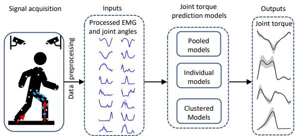  
图 2. 使用不同 NMS 和 LSTM 模型进行关节力矩估计的示意图。关节力矩通过三类模型进行估计：由所有运动校准/训练的 Pooled（汇总）模型、由单一运动校准/训练的 Individual（个体）模型，以及由单一聚类校准/训练的 Clustered（聚类）模型。NMS 和 LSTM 模型的输入为 EMG 信号和关节角度，这些数据由三维运动捕捉系统采集并进行后处理。

本研究采用开源的 EMG 驱动的 NMS 模型（CEINMS）[25]（图 3(a)），该模型包括肌肉激活动力学、肌腱运动学、肌肉收缩动力学和关节动力学四个部分 [26]。其中，肌肉激活动力学部分用于根据 EMG 数据计算肌肉激活度。EMG 激励信号 $e(t)$ 与神经激活信号 $u(t)$ 之间的关系如公式 (3) 所示 [27]：

$$
u ( t ) = \alpha \cdot e ( t - d ) - \beta _ { 1 } \cdot u ( t - 1 ) - \beta _ { 2 } \cdot u ( t - 2 )\tag{3}
$$

式中，$\alpha$ 表示肌肉增益变量；$d$ 对应于机电延迟（electromechanical delay）。$\beta _ { 1 }$ 和 $\beta _ { 2 }$ 为递归变量，并被约束为 $\beta _ { 1 } = C _ { 1 } + C _ { 2 } , \beta _ { 2 } = C _ { 1 } \cdot C _ { 2 }$，其中 $\left| C _ { 1 } \right| < 1 , \left| C _ { 2 } \right| < 1$，且 $\alpha - \beta _ { 1 } - \beta _ { 2 } = 1$，以保证得到稳定解 [25] [27] [28]。肌肉激活度 $a(t)$ 可由公式 (4) 表示：

$$
a ( t ) = { \frac { e ^ { A u ( t ) } - 1 } { e ^ { A } - 1 } }\tag{4}
$$

式中，$A$ 为形状因子（shape factor）[18], [28]。

肌腱运动学部分用于计算肌腱长度和肌肉力臂。肌肉力通过基于 Hill 型肌肉模型的肌肉收缩动力学部分确定。肌肉力 $F$ 可由公式 (5) 表示：

$$
F = F _ { 0 } ^ { m } [ F _ { a l } ( l ) \cdot F _ { v } ( v ) \cdot a + F _ { p l } ( l ) + d _ { p } \cdot v ] c o s ( \theta )\tag{5}
$$

式中，$F_0^m$ 表示肌肉的最大等长收缩力；$l$ 为肌纤维长度；$F_{al}(l)$ 描述肌肉主动力与肌纤维长度之间的关系；$v$ 为肌纤维收缩速度；$F_v(v)$ 表示肌肉力与肌纤维收缩速度之间的关系；$F_{pl}(l)$ 表示肌肉被动力与肌纤维长度之间的关系；$\theta$ 为肌纤维羽状角（pennation angle），$d_p$ 表示肌肉阻尼系数。

最后，关节动力学部分用于根据肌肉力和肌肉力臂计算关节力矩。

EMG 驱动的 NMS 模型中的参数校准按照 Pizzolato 等人 [25] 的建议进行。对于每位参与者，最佳肌纤维长度 $l _ { 0 } ^ { m }$ 和肌腱松弛长度 $l _ { s } ^ { t }$ 的边界设置为初始值 ±15% 的范围内。参数 A 被限制在区间 (−3, 0) 内，而系数 $C _ { 1 }$ 和 $C _ { 2 }$ 的边界设置为 (−1, 1)。为了校准最大等长力，采用了一个强度系数，其边界范围为 0.5 到 2.5。这些参数通过应用模拟退火算法来确定，该算法在校准全过程中最小化了估算关节力矩与实测关节力矩（由逆动力学计算得到）之间的差异。模拟退火算法设置为在目标函数值的平均变化小于指定的容差 $1 0 ^ { - 5 }$ 之前持续运行。

  
图 3. (a) NMS 模型结构示意图，包含四个部分：(1) 肌肉激活动力学部分，利用 EMG 数据计算肌肉激活度；(2) 肌腱运动学部分，用于计算肌腱长度和力臂；(3) 肌肉收缩动力学部分，用于计算肌肉力；以及 (4) 关节动力学部分，用于计算关节力矩。(b) LSTM 网络模型结构示意图。LSTM 网络的输入与 NMS 模型的输入相同，即关节角度和 EMG 信号。时间序列输入被转换为时间片数据以输入到下一层 LSTM。之后，依次添加 LSTM 层、全连接层（dense layer）和 dropout 层。最终，输出层预测关节力矩。

## (b) LSTM 网络

使用与 NMS 模型相同的输入数据，即 EMG 信号和关节角度，构建了 LSTM 网络以估计关节力矩（图 3 (b)）[25]。时间序列输入被转换为时间片数据以输入到下一层 LSTM。之后，依次添加 LSTM 层、全连接层和 dropout 层。Dropout 层用于避免过拟合，而全连接层利用 LSTM 层的中间输出，在整个回归阶段辅助关节力矩的估计 [29]。最终，输出层预测关节力矩。

为了寻找 LSTM 网络的超参数，我们采用了"由粗到细"随机搜索方法 [30]。权重初始化采用 Xavier 方法，偏置设为零，批量大小（batch size）选为 50。每个 LSTM 层配置 50 个神经元，并使用 tanh 激活函数。全连接层（dense layer）选用了 64 个神经元。 dropout 层的 dropout 率设为 0.4。在整个训练过程中，损失函数定义为预测关节力矩与实测关节力矩之间的均方误差。Adam 优化器的学习率设为 $1 0 ^ { - 3 }$。最优模型共训练 4000 个 epoch；但若预测精度在连续 50 个 epoch 内没有提升，则提前停止训练。

## C. 聚类方法

以肌电信号和关节角度作为输入，我们采用 t 分布随机近邻嵌入（t-distributed stochastic neighbor embedding, t-SNE）[31] 聚类方法以降低数据维度。随后，我们使用 K-means 算法 [32] 将不同运动类型划分为 K 个不同的簇。

t-SNE 是一项非常有价值的技术，它能够将高维数据转换到低维空间，同时保持数据的局部结构。假设 $\mathbf { x } _ { i }$ 和 $\mathbf { x } _ { j }$ 表示高维空间中的两个数据点。它们的相似度定义为 $p _ { j | i }$，由下式给出：

$$
p _ { j | i } = \frac { \exp ( - | | \mathbf { x } _ { i } - \mathbf { x } _ { j } | | ^ { 2 } / 2 \sigma _ { i } ^ { 2 } ) } { \sum _ { k \neq i } \exp ( - | | \mathbf { x } _ { i } - \mathbf { x } _ { k } | | ^ { 2 } / 2 \sigma _ { i } ^ { 2 } ) }\tag{6}
$$

其中 $\sigma _ { i }$ 表示以 $\mathbf { x } _ { i }$ 为中心的高斯分布的方差。

t-SNE 算法通过梯度下降法最小化上述两个分布之间的 Kullback-Leibler 散度，记为 $C$，如式 (7) 所示：

$$
C = \sum _ { i } \sum _ { j } p _ { j | i } \log { \frac { p _ { j | i } } { q _ { j | i } } }\tag{7}
$$

## D. 评估方案

我们在三种情况下研究了 NMS 模型和 LSTM 模型的下肢关节力矩预测精度：合并（Pooled）模型、个体（Individual）模型和聚类（Clustered）模型。我们比较了在聚类模型中 NMS 与 LSTM 的预测精度。

• **合并模型（n = 1）**：使用全部十种运动数据的 80% 来训练一个合并 LSTM 模型。同时，合并 NMS 模型使用每种包含运动的单个试验进行校准，随后在与 LSTM 模型相同的数据集上进行评估。具体而言，80% 的数据对应于用于模型训练的 10 次试验中的 8 次。

• **个体模型 (n = 10)**：使用每个动作数据的 80% 来训练十个独立的 LSTM 模型。同时，NMS 模型使用每个动作的三次试验进行校准，并在与 LSTM 模型相同的数据集上进行评估。

• **聚类模型 (n = 3)**：使用每个聚类数据的 80% 来训练三个聚类 LSTM 模型。同时，NMS 模型使用每个聚类的两次试验进行校准，并在与 LSTM 模型相同的数据集上进行评估。

采用归一化均方根误差 (NRMSE) $E_{NRMS}$ 来评估每个模型的估计误差；估计误差越低，认为估计精度越高。NRMSE 定义为估计力矩与实测/实际力矩之间的均方根误差 $E_{RMS}$，并按相应动作中关节力矩的观测范围进行归一化：

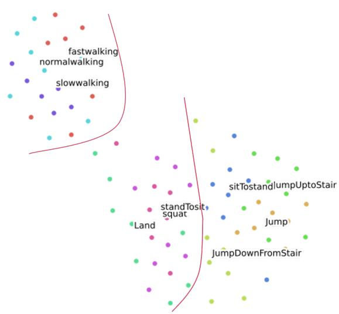  
图 4. 使用 t-分布随机邻域嵌入 (t-SNE) 算法在二维空间中识别出的 $K = 3$ 个聚类的示意图。

$$
\begin{array}{c c l } \displaystyle E_{R M S} & = & \displaystyle \sqrt { \frac { 1 } { N } \sum _ { n = 1 } ^ { N } ( y _ { e , n } - y _ { n } ) ^ { 2 } } \end{array} \tag{8}
$$

$$
E_{N R M S} = \frac { E_{R M S} } { \left( y_{m a x} - y_{m i n} \right) } \times 1 0 0 \% \tag{9}
$$

其中 $y_{e,n}$ 和 $y_n$ 分别表示估计力矩和实测/实际力矩；$y_{max}$ 和 $y_{min}$ 分别为相应动作中实际力矩的最大值和最小值。为评估数据分布的正态性，进行了 Shapiro-Wilk 检验（显著性水平 $p < 0.05$）。随后，对三种方法预测的 NRMSE 进行两两比较。对服从正态分布的数据采用配对 t 检验，对不服从正态分布的数据采用 Wilcoxon 符号秩检验，两种检验均应用 Bonferroni 校正（显著性水平 $p < 0.05$）。

## III. 结果

## A. 动作聚类

t-SNE 算法结合 K-means 在十种动作中识别出三个聚类。t-SNE 算法降低了数据维度，从而可在二维空间中实现可视化（图 4）。随后，K-means 将每个动作的样本分为三个聚类：$K_1$ 包含正常行走 (normal walking)、慢速行走 (slow walking) 和快速行走 (fast walking)；$K_2$ 由由站到坐 (stand-to-sit)、纵跳落地 (land from vertical jump) 和深蹲 (squat) 组成；$K_3$ 包括由坐到站 (sit-to-stand)、纵跳起跳 (vertical jump up)、跳上 15 厘米台阶 (jump up to a 15-cm stair) 以及从 15 厘米台阶跳下 (jump down from a 15-cm stair)。采用动作样本的中位数位置，根据相关性将其分配到相应的聚类中。K-means 中聚类数 K 的选择以及每个聚类的命名均通过目视检查确定，以确保动作分组的意义性和可解释性。

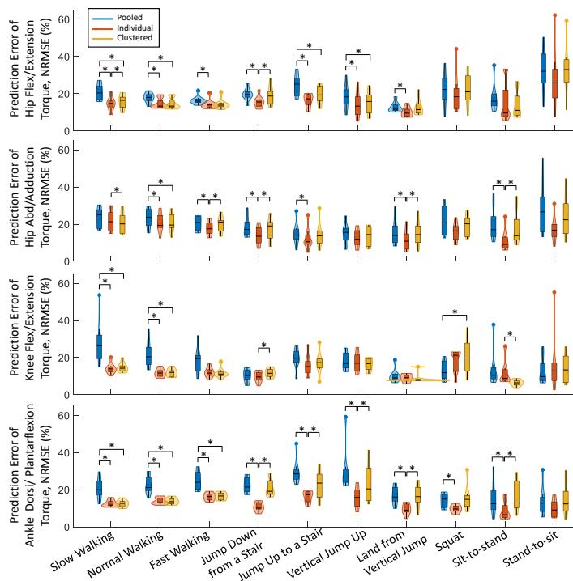  
图 5. 在十种运动中，参与者在 NMS 模型下预测力矩与实际力矩之间的 NRMSE 分布：Pooled（汇总模型）、Individual（个体模型）和 Clustered（聚类模型），以小提琴图（violin plot）形式展示。每个小提琴图均包含核密度图与箱线图。核密度图展示了 NRMSE 的概率分布；箱线图表示 NRMSE 的最小值、下四分位数、中位数、上四分位数和最大值。∗ 表示通过两两比较确定两个模型之间存在显著差异。

## B. NMS 模型

总体而言，在步行运动和纵跳起跳（vertical jump up）中，Individual 模型与 Clustered 模型的估计精度相近。在大多数运动中（即步行运动、坐起（sit-to-stand）、纵跳起跳和跳上台阶），Pooled 模型的估计精度远低于 Clustered 模型和 Individual 模型（图 5）。

在不同速度的步态中，Individual 模型与 Clustered 模型对踝关节背屈/跖屈（D/P）关节力矩的预测精度显著高于 Pooled 模型（图 5，慢走：$p < 0 . 0 1$ 和 $p = 0 . 0 1$；正常步速：$p < 0 . 0 1$ 和 $p \ < \ 0 . 0 1$；快走：$p ~ < ~ 0 . 0 1$ 和 $p ~ < ~ 0 . 0 1$）。在不同速度步态的踝关节 D/P 力矩预测中，相较于 Individual 模型和 Clustered 模型，Pooled 模型低估了峰值跖屈。此外，所有三种模型均预测出了摆动期内的跖屈偏移量（图 6）。在其他运动中，相较于 Pooled 模型，Individual 模型在纵跳起跳（$p = 0 . 0 4$）、跳上台阶（$p = 0 . 0 4$）、跳下台阶（$p < 0 . 0 1$）和深蹲（squat，$p = 0 . 0 5$）上表现出显著更高的估计精度，Clustered 模型也有一定程度的提升，但差异并不显著。

Individual 模型与 Clustered 模型对膝关节屈/伸（F/E）关节力矩的预测精度相对高于 Pooled 模型（图 5），具体体现在不同速度的步态（NRMSE：$P o o l e d \le 2 6 . 7 \%$、Individual $\leq 1 3 . 9 \%$、Clustered $\leq 14.3\%$）、跳上台阶（NRMSE：$P o o l e d \leq ~ 1 9 . 7 \%$、Individual $\leq ~ 1 5 . 2 \%$、Clustered $\leq ~ 1 7 . 3 \%$）以及坐起动作（NRMSE：$P o o l e d \leq 1 0 . 5 \%$、$I n d i v i d u a l \ \leq \ 8 . 8 \%$、$C l u s t e r e d \ \leq \ 6 . 8 \%$）中。与 Clustered 模型和 Individual 模型不同，Pooled 模型在不同速度步态的预摆动—摆动初期阶段高估了膝关节伸展力矩，并在坐起动作中低估了膝关节伸展力矩（图 6）。所有模型均未能预测出深蹲过程中平滑的膝关节伸展力矩，而 Individual 模型也未能准确预测由站到坐（stand-to-sit）动作中的膝关节伸展力矩。

在所有运动中，个体模型和聚类模型对髋关节屈/伸和髋关节外展/内收的关节力矩估计精度整体上低于膝关节屈/伸和踝关节背屈/跖屈：髋关节屈/伸力矩（十项运动的中位数 NRMSE：个体模型 14.4%；聚类模型 16.1%）和髋关节外展/内收力矩（个体模型 14.9%，聚类模型 19.3%），而膝关节屈/伸为（个体模型 12.2%，聚类模型 12.7%），踝关节背屈/跖屈为（个体模型 11.0%，聚类模型 15.5%）。在踝关节背屈/跖屈关节力矩预测中，汇总模型的预测精度低于其余三个关节（中位数 NRMSE 为 20.6%），其余三个关节分别为膝关节屈/伸 14.4%、髋关节屈/伸 18.9% 和髋关节外展/内收 18.9%。

值得注意的是，在深蹲和站立至坐下过程中（图 5），个体模型在膝关节屈/伸力矩上的平均预测精度低于汇总模型和聚类模型，但在个体模型中观察到了具有高预测误差的离群点。此外，与平滑配对不同，个体模型预测的膝关节屈/伸和髋关节屈/伸力矩与实测力矩的一致性较差，而汇总模型和聚类模型则与实测力矩吻合较好（图 6）。

## C. 长短期记忆网络模型

总体而言，三种模型（汇总模型、个体模型和聚类模型，图 7）的估计精度相似，并且估计的关节力矩在十项运动中均与实际力矩吻合良好（图 8）。

在不同关节的力矩预测模型中（图 7），汇总模型、个体模型和聚类模型均能较为准确地估计关节力矩，误差相对较低（髋关节屈/伸 NRMSE：汇总模型 $\leq 8 . 4 \%$ ，个体模型 ≤ 9.2%，聚类模型 ≤ 8.2%；髋关节外展/内收：汇总模型 $\leq ~ 9 . 3 \%$ ，个体模型 $\leq ~ 8 . 9 \%$ ，聚类模型 $\begin{array} { r l } { \leq } & { { } 8 . 6 \% ; } \end{array}$ 膝关节屈/伸：汇总模型 $\leq ~ 5 . 5 \%$ 个体模型 $\leq 6 . 0 \% ,$ 聚类模型 $\leq 6 . 1 \% ;$ 踝关节背屈/跖屈：汇总模型 $\ \leq \ 9 . 4 \%$ ，个体模型 $\leq 8 . 5 \%$ ，聚类模型 ≤ 9.0%），尤其在步态运动中表现最佳（踝关节背屈/跖屈 NRMSE：$\leq 4 . 2 \%$ ；膝关节屈/伸 $\le 6 . 1 \% \ ;$ 髋关节屈/伸 $\leq 3 . 8 \% $ ；髋关节外展/内收 $\leq 5 . 7 \% )$

## D. 神经肌肉骨骼模型与长短期记忆网络聚类模型的比较

总体而言，与神经肌肉骨骼聚类模型相比，长短期记忆网络聚类模型的力矩预测在所有关节和运动测试中均显示出与通过逆动力学计算的力矩更优的一致性（图 9）；十项运动的中位数 NRMSE 在髋关节屈/伸：神经肌肉骨骼 16.1%，长短期记忆网络 4.9%，在髋关节外展/内收：神经肌肉骨骼 19.3%，长短期记忆网络 4.7%，在踝关节背屈/跖屈：神经肌肉骨骼 15.5%，长短期记忆网络 $6 . 7 \%$ 。类似地，长短期记忆网络模型得到的膝关节屈/伸力矩与通过逆动力学计算的力矩的一致性显著优于神经肌肉骨骼模型

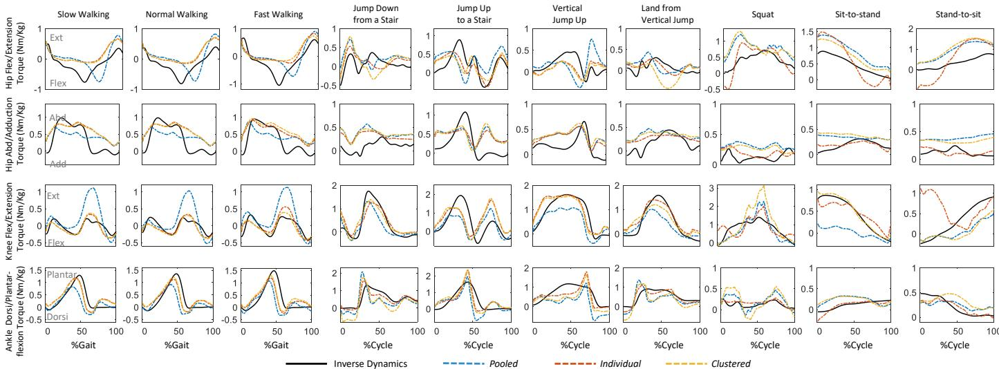  
图 6. 在十项运动中通过三种神经肌肉骨骼模型（汇总模型、个体模型和聚类模型）测量的和预测的力矩的一个示例试验。

$$
( p = 0 . 1 6 ) .
$$

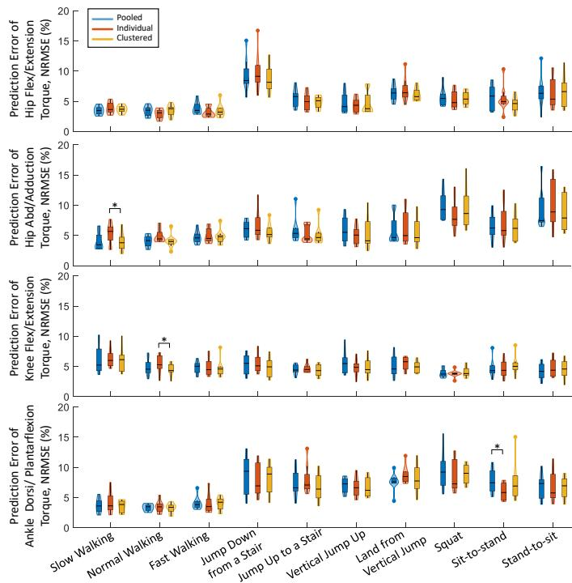
Fig. 7. LSTM模型中预测力矩与实际力矩之间在参与者进行十个动作时的NRMSE分布：汇总（Pooled）、个体（Individual）和聚类（Clustered），以小提琴图（violin plots）展示。每个小提琴图包含核密度图（kernel density plot）和箱线图（box plot）。核密度图展示了NRMSE的概率分布；箱线图标注了NRMSE的最小值、下四分位数、中位数、上四分位数和最大值。∗表示通过两两比较（pairwise comparisons）确定两个模型之间存在显著差异。

在大多数动作中，包括慢速步行 $( p < 0.01 )$、正常步行 $( p < 0.01 )$、快速步行 $( p = 0.01 )$、从台阶跳下 $( p < 0.01 )$、跳上台阶 $( p < 0.01 )$、垂直跳起 $( p < 0.01 )$、从垂直跳跃落地 $( p < 0.01 )$、深蹲 $( p = 0.03 )$ 以及站立到坐下 $( p < 0.01 )$ 时，一种方法显著优于另一种；对于坐起到站立动作，前者在一定程度上（尽管不显著）具有更好的一致性。

## IV. 讨论（Discussion）

我们使用两种常用的预测方法——EMG驱动的神经肌肉骨骼（Neuromusculoskeletal, NMS）模型和LSTM神经网络——估算了踝关节、膝关节和髋关节矢状面力矩，以及髋关节冠状面力矩，覆盖十个动作，并评估了基于特征相似性对动作进行分组的聚类（Cluster）方法是否能比基于个体（Individual）或汇总（Pooled）动作的模型提高预测精度。我们观察到，对于LSTM神经网络模型，聚类方法的预测精度并未高于个体或汇总模型；三种方法预测的力矩均与逆动力学（inverse dynamics）结果高度一致。总体而言，NMS模型的预测精度低于LSTM模型。在NMS模型中，聚类方法在部分动作中的预测精度确实高于汇总模型。个体模型与聚类模型的预测性能相近，而汇总模型的预测精度最低。据我们所知，本研究是首个在日常活动中同时采用NMS模型和LSTM神经网络，并结合聚类方法开展多个下肢关节力矩预测的研究。

一个有趣的发现是，聚类方法并未提升 LSTM 神经网络的预测精度，但在部分运动中提升了 NMS 池化模型的预测精度。聚类 NMS 模型与个体 NMS 模型的关节力矩预测精度相近，但池化模型的预测精度较低，并且在不同速度的步态中预测出了更高的峰值膝关节伸展力矩和更低的峰值踝关节跖屈力矩（图 6）。这证实了以下观点：同一聚类内的运动具有相似的协调模式，NMS 模型能够捕捉这些特征以获得更好的预测精度。在 Pooled、Individual 和 Clustered 三类 NMS 模型中，肌腱单元参数（如肌腱松弛长度、最佳肌纤维长度、形状因子和强度系数）是利用不同运动类型的试验数据进行标定的。在标定过程中，通过最小化所有标定试验中估计力矩与实测力矩之间的误差来优化这些参数。因此，标定后的 Pooled NMS 可能过于通用，无法满足所有运动模式的拟合需求。这些发现的实际意义在于：在某些应用中，为每种运动分别创建并训练个体 NMS 模型可能并不现实；对运动进行聚类有助于构建更可行的工作流程，并且优于将所有运动混为一谈的池化方法。

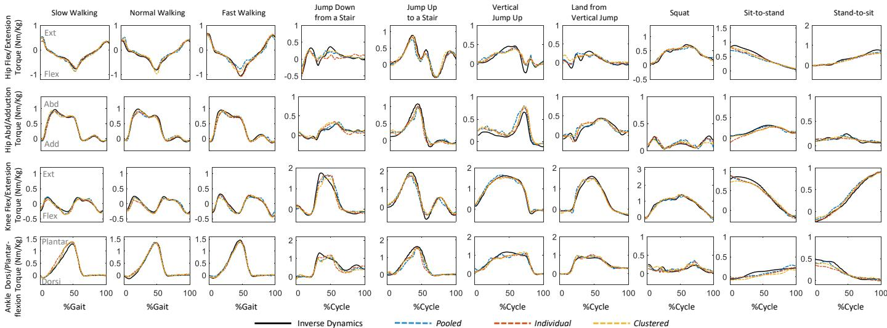

图 8. 在十种运动中，通过三种 LSTM 模型（Pooled、Individual 和 Clustered）预测力矩与实测力矩的一个示例试验。  
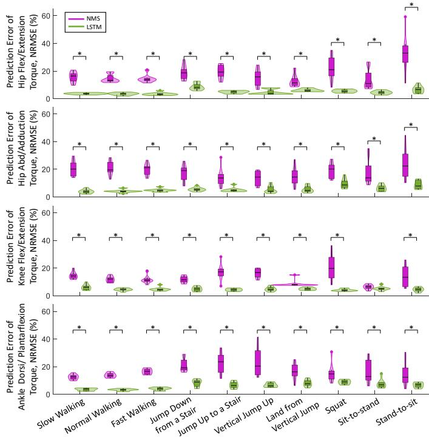  
图 9. NMS 与 LSTM Clustered 模型中，受试者在十种运动下预测力矩与实际力矩之间 NRMSE 的分布，以小提琴图（violin plot）形式呈现。每个小提琴图包含核密度图与箱线图。核密度图展示了 NRMSE 的概率分布；箱线图标示了 NRMSE 的最小值、下四分位数、中位数、上四分位数和最大值。∗ 表示经两两比较后两个模型之间存在显著差异。

相比之下，Individual（个体）和 Pooled（合并）LSTM 模型已经具有非常高的力矩预测准确度，聚类方法在准确度上既没有明显提高也没有明显降低。所有 LSTM 模型均使用与训练数据同类动作中未见过的"新"数据进行评估。通常，当使用同类数据进行模型训练和评估时，深度学习通常会展现出优异的预测性能。所设计的 LSTM 网络具有多个神经元和层，能够选择性地记忆对应于特定时间间隔的模式，并能够识别肌电数据与关节力矩之间复杂的非线性关联。因此，无论网络是由 Pooled、Clustered（聚类）还是 Individual 模型构成，LSTM 网络都能够准确地估计同类动作中未见"新"数据上的关节力矩。

需要注意的是，Individual 和 Clustered NMS 模型在髋关节屈/伸（hip F/E）和髋关节外展/内收（hip Ab/Ad）力矩上的预测误差通常高于膝关节屈/伸（knee F/E）和踝关节背屈/跖屈（ankle D/P）。其中一个原因可能在于实验采集髋关节周围分层且位置较深的肌肉表面肌电信号较为困难。这一发现与 Pizzolato 等人 [25] 的研究一致，他们将矢状面髋关节力矩预测准确度较低以及被低估的现象归因于难以从髂腰肌（iliopsoas）获取可靠的表面肌电信号。同样值得注意的是，虽然逆动力学（inverse dynamics）通常被认为是计算关节力矩的"金标准"，但其结果也可能并非完全准确，尤其是在较近端的关节上。在逆动力学方法中，关节中心的估计至关重要，因为它用于计算肌肉的力臂，并作为关节旋转的参考点。然而，准确估计髋关节中心通常被认为比估计膝关节和踝关节中心更具挑战性，因为髋关节位置更深，且更难以通过生物力学模型进行表征。同样重要的是需要指出，在 stand-to-sit（站立到坐立）动作中，与 Pooled 和 Clustered 模型相比，Individual 模型在髋关节屈/伸和膝关节屈/伸力矩上观察到了预测误差较大的离群点。这可能归因于 Individual 标定模型中的过拟合现象，其中输入的微小差异会导致输出产生较大的差异。因此，在使用 Individual 模型时，需要警惕过拟合问题。

LSTM 模型在所有运动测试中的力矩预测值都更接近通过逆动力学（inverse dynamics）计算得到的值，而 NMS 模型的预测精度则相对较低。在 LSTM 网络中，每个节点被视为一个人工神经元，模拟大脑中的人类神经突触系统。这赋予了 LSTM 网络理解复杂和非线性信息的强大能力。然而，它将输入与输出之间的相关性学习视为一个黑箱，并不显式建模生理变量之间的关系，例如关节角度–肌腱运动学关系、肌力–长度关系以及肌力–速度关系。因此，只有指定输出适合用于估计。尽管 NMS 模型的预测精度低于 LSTM 模型，但它能够分析并识别受试者特异性的肌腱参数和关系。因此，对于需要获取受试者特异性肌腱参数和关系的应用场景而言，基于 NMS 模型的解决方案显然更为合适。将 NMS 模型所定义的关系与神经网络结构相结合的模型，可能兼具比其任一衍生模型更高的预测精度，以及明确的肌腱属性和关系所带来的优势 [7], [33], [34]。因此，在未来的工作中，探索将 NMS 特征与 LSTM 模型相结合的物理信息神经网络（physics-informed neural network）方法以增强神经网络方法的外推能力，是一项值得深入研究的方向。

如上所述，获取关节力矩的真值并非易事。通过逆动力学估算的关节力矩并非身体内实际关节力矩的直接测量。我们通过结合运动学求解运动方程（式 (2)）来实现逆动力学方法。运动学（关节角度）通过逆运动学方法获得，该方法求解加权最小二乘问题，以最小化建模标志点轨迹与实测标志点轨迹之间的误差。这种方法可能因测量误差和建模误差而导致动力学不一致，从而产生不符合肌肉动力学规律的关节力矩 [35], [36]。尽管存在这些局限性，通过逆动力学方法计算的关节力矩目前仍是在动态任务中最接近真实关节力矩的估算值。同样值得注意的是，NMS 模型与 LSTM 模型的训练过程不可直接比较，特别是在以下方面：Pooled NMS 模型仅使用每种运动的一个试次进行训练，而 LSTM 则使用 80% 的数据进行训练。Pooled NMS 模型的部分预测误差可能归因于肌电（EMG）和动力学测量的变异性。同样地，其在 Individualized 模型中的性能提升也可能归因于训练数据的差异。

虽然我们在本研究中尚未评估 LSTM（长短期记忆网络）的实时计算成本，但由于其仅需要进行前向计算[37]–[39]，理论上能够以较低的计算成本实时预测关节力矩。需要注意的是，对于单个受试者，应当仅使用一个经过标定的 NMS（神经肌肉骨骼）模型，且该模型应尽可能覆盖较宽范围的力-长度曲线。理想情况下，应当识别出能够覆盖完整范围的运动子集，但本研究的主要目标并非实现这一点。我们将所有运动都纳入了标定过程，正如 Pooled（池化）模型所示，其效果应与使用子集类似。然而，我们观察到了不理想的性能表现，这可能是由于缺少其他实验测量（如肌纤维长度和羽状角），而这些参数对于标定肌肉-肌腱参数至关重要。在动态运动过程中测量这些参数具有挑战性，并且 Pooled 模型可能不适合用于捕捉所有的肌肉协同模式。我们的主要目标是获得一个能够高精度预测关节力矩的模型，为此，我们探索了多种数学方法，包括分别标定不同模型、对模型进行聚类以及对模型进行池化。我们还将这些方法与 LSTM 模型进行了比较。尽管这可能与物理视角并不完全一致，但从数学角度来看，这是一种获得更优训练模型的实用方法。

虽然我们的目标是获得一个能够高精度预测关节力矩的模型，但这些模型尚未在实际场景（尤其是外骨骼控制）中得到应用。还需要进一步的工作，例如选择合适的 EMG（肌电）和运动学数据采集方法/传感器，根据应用需求训练模型，以及针对实时处理对模型进行优化。所开发的模型随后需要集成到外骨骼的控制系统中，以对关节运动提供按需辅助（assist-as-needed）支持。我们的研究为在不同场景下选择合适的模型提供了指导，这有望改善外骨骼的控制策略，并增强可穿戴外骨骼的功能。

我们在此仅研究了一种 NMS 模型和一种机器学习方法（即 LSTM），应在该背景下理解本研究的发现。其他 NMS 模型乃至当前所用 NMS 中不同的参数和复杂程度（例如机电延迟和肌腱类型）仍有待进一步研究。此外，还可以评估其他具有复杂架构的机器学习模型，例如卷积神经网络。实验方案的某些方面可能会影响研究结果的普适性，例如在涉及坐姿的测试中根据每位受试者的身高调整椅高。此外，尽管我们为所有受试者提供了标准化的指令，但受试者在执行例如深蹲和跳跃等动作时仍可能存在细微的动作技巧差异，从而可能导致肌肉激活模式的差异。此外，本研究仅涉及健康个体，而主要关注的对象——外骨骼用户——主要由存在运动障碍的人群构成。同时，健康受试者在年龄和整体身体状况方面总体上较为同质。

## V. 结论（CONCLUSION）

在本研究中，我们使用基于物理学的 NMS 模型和结合聚类方法的 LSTM 神经网络，预测了在多种不同动作中踝关节、膝关节和髋关节矢状面的力矩以及髋关节额状面的力矩。聚类方法并未能进一步提升 LSTM 神经网络的预测精度（其精度已经较高），但在部分动作的 NMS Pooled 模型中提升了预测精度。在 NMS 模型中，Individual 模型和 Clustered 模型具有相近的预测性能，而 Pooled 模型可能过于通用，难以满足所有动作模式。在无法为每个动作单独建立 NMS 模型的应用场景中，聚类动作方法可作为 Pooled 动作模型的一种良好替代方案。一般而言，对基于物理学的神经肌肉骨骼模型和神经网络模型在多个下肢自由度以及多种动作中预测力矩的详细性能对比，可为特定情境下首选预测模型的范式提供有价值的指导，因此通过考虑用户的生理关节力矩贡献，在诸如按需辅助外骨骼控制等应用中具有广阔的应用前景。

## REFERENCES

[1] Z. Li, G. Li, X. Wu, Z. Kan, H. Su, and Y. Liu, "Asymmetric cooperation control of dual-arm exoskeletons using human collaborative manipulation models," *IEEE Transactions on Cybernetics*, vol. 52, no. 11, pp. 12 126–12 139, 2021.

[2] D. Coyle, "Neural network based auto association and time-series prediction for biosignal processing in brain-computer interfaces," *IEEE Computational Intelligence Magazine*, vol. 4, no. 4, pp. 47–59, 2009.

[3] P. B. Jephil, P. Acharaya, L. Xu, K. Guo, H. Yu, M. Watsford, S. Rong, and S. Su, "Estimation of ankle joint torque and angle based on semg signal for assistive rehabilitation robots," in *Biomedical Signal Processing*. Springer, 2020, pp. 31–47.

[4] G. Durandau, D. Farina, G. Asín-Prieto, I. Dimbwadyo-Terrer, S. Lerma-Lara, J. L. Pons, J. C. Moreno, and M. Sartori, "Voluntary control of wearable robotic exoskeletons by patients with paresis via neuromechanical modeling," *Journal of Neuroengineering and Rehabilitation*（神经工程与康复杂志）, vol. 16, no. 1, p. 91, 2019.

[5] M. Sartori, D. G. Lloyd, and D. Farina, "Neural data-driven musculoskeletal modeling for personalized neurorehabilitation technologies," *IEEE Transactions on Biomedical Engineering*（IEEE 生物医学工程汇刊）, vol. 63, no. 5, pp. 879–893, 2016.

[6] C. Pizzolato, D. J. Saxby, D. Palipana, L. E. Diamond, R. S. Barrett, Y. D. Teng, and D. G. Lloyd, "Neuromusculoskeletal modeling-based prostheses for recovery after spinal cord injury," *Frontiers in Neurorobotics*（神经机器人学前沿）, vol. 13, pp. 1–10, 2019.

[7] M. Ezati, B. Ghannadi, and J. McPhee, "A review of simulation methods for human movement dynamics with emphasis on gait," *Multibody System Dynamics*（多体系统动力学）, vol. 47, no. 3, pp. 265–292, 2019.

[8] L. Zhang, Z. Li, Y. Hu, C. Smith, E. M. G. Farewik, and R. Wang, "Ankle joint torque estimation using an emg-driven neuromusculoskeletal model and an artificial neural network model," *IEEE Transactions on Automation Science and Engineering*（IEEE 自动化科学与工程汇刊）, vol. 18, no. 2, pp. 564–573, 2020.

[9] Y.-F. Chen, R. Fu, J. Wu, J. Song, R. Ma, Y.-C. Jiang, and M. Zhang, "Continuous bimanual trajectory decoding of coordinated movement from eeg signals," *IEEE Journal of Biomedical and Health Informatics*（IEEE 生物医学与健康信息学杂志）, vol. 26, no. 12, pp. 6012–6023, 2022.

[10] Y. Hu, G. Chen, Z. Li, and A. Knoll, "Robot policy improvement with natural evolution strategies for stable nonlinear dynamical system," *IEEE Transactions on Cybernetics*（IEEE 控制论汇刊）, vol. 53, no. 6, pp. 4002–4014, 2022.

[11] L. Zhang, D. Soselia, R. Wang, and E. M. Gutierrez-Farewik, "Lower-limb joint torque prediction using lstm neural networks and transfer learning," *IEEE Transactions on Neural Systems and Rehabilitation Engineering*（IEEE 神经系统与康复工程汇刊）, vol. 30, pp. 600–609, 2022.

[12] E. B. Simonsen and T. Alkjær, "The variability problem of normal human walking," *Medical Engineering & Physics*（医学工程与物理）, vol. 34, no. 2, pp. 219–224, 2012.

[13] A. Phinyomark, S. Osis, B. A. Hettinga, and R. Ferber, "Kinematic gait patterns in healthy runners: A hierarchical cluster analysis," *Journal of Biomechanics*（生物力学杂志）, vol. 48, no. 14, pp. 3897–3904, 2015.

[14] S. Kinsella and K. Moran, "Gait pattern categorization of stroke participants with equinus deformity of the foot," *Gait & Posture*（步态与姿势）, vol. 27, no. 1, pp. 144–151, 2008.

[15] S. G. White and P. J. McNair, "Abdominal and erector spinae muscle activity during gait: the use of cluster analysis to identify patterns of activity," *Clinical Biomechanics*（临床生物力学）, vol. 17, no. 3, pp. 177–184, 2002.

[16] H. B. Sigurðsson 和 K. Briem，"聚类分析成功识别出具有临床意义的膝关节外翻力矩模式：早期峰值频率反映了性别特异性的前交叉韧带损伤发生率"（Cluster analysis successfully identifies clinically meaningful knee valgus moment patterns: frequency of early peaks reflects sex-specific acl injury incidence），《实验骨科学杂志》（Journal of Experimental Orthopaedics），第 6 卷，第 1 期，第 1–12 页，2019 年。

[17] C. Pizzolato、M. Reggiani、L. Modenese 和 D. Lloyd，"使用 OpenSim 进行下肢应用的实时逆运动学和逆动力学"（Real-time inverse kinematics and inverse dynamics for lower limb applications using opensim），《生物力学与生物医学工程中的计算方法》（Computer Methods in Biomechanics and Biomedical Engineering），第 20 卷，第 4 期，第 436–445 页，2017 年。

[18] H. X. Hoang、C. Pizzolato、L. E. Diamond 和 D. G. Lloyd，"神经肌肉参数的受试者特异性标定使神经肌肉骨骼模型能够在健康成年人中估计生理学上合理的髋关节接触力"（Subjectspecific calibration of neuromuscular parameters enables neuromusculoskeletal models to estimate physiologically plausible hip joint contact forces in healthy adults），《生物力学杂志》（Journal of Biomechanics），第 80 卷，第 111–120 页，2018 年。

[19] F. Leboeuf、R. Baker、A. Barré、J. Reay、R. Jones 和 M. Sangeux，"常规步态模型——一个重现过去并为未来做准备的开源实现"（The conventional gait model, an open-source implementation that reproduces the past but prepares for the future），《步态与姿势》（Gait & Posture），第 69 卷，第 235–241 页，2019 年。

[20] T.-W. Lu 和 J. O'connor，"使用带关节约束的全局优化方法从皮肤标记坐标估计骨骼位置"（Bone position estimation from skin marker co-ordinates using global optimisation with joint constraints），《生物力学杂志》（Journal of Biomechanics），第 32 卷，第 2 期，第 129–134 页，1999 年。

[21] M. G. Pandy，"人体运动的计算机建模与仿真"（Computer modeling and simulation of human movement），《生物医学工程年度评论》（Annual Review of Biomedical Engineering），第 3 卷，第 1 期，第 245–273 页，2001 年。

[22] D. A. Winter、H. G. Sidwall 和 D. A. Hobson，"运动学中噪声的测量与降低"（Measurement and reduction of noise in kinematics of locomotion），《生物力学杂志》（Journal of Biomechanics），第 7 卷，第 2 期，第 157–159 页，1974 年。

[23] A. Mantoan、C. Pizzolato、M. Sartori、Z. Sawacha、C. Cobelli 和 M. Reggiani，"MotoNMS：用于神经肌肉骨骼建模和仿真的运动数据处理 MATLAB 工具箱"（Motonms: A matlab toolbox to process motion data for neuromusculoskeletal modeling and simulation），《生物学与医学源代码》（Source Code for Biology and Medicine），第 10 卷，第 1 期，第 1–14 页，2015 年。

[24] T. R. Derrick、A. J. van den Bogert、A. Cereatti、R. Dumas、S. Fantozzi 和 A. Leardini，"国际生物力学学会（ISB）关于人体运动分析中间段力和力矩报告的建议"（Isb recommendations on the reporting of intersegmental forces and moments during human motion analysis），《生物力学杂志》（Journal of Biomechanics），第 99 卷，第 1–10 页，2020 年。

[25] C. Pizzolato、D. G. Lloyd、M. Sartori、E. Ceseracciu、T. F. Besier、B. J. Fregly 和 M. Reggiani，"CEINMS：一个用于研究不同神经控制方案对动态运动任务中肌肉兴奋和关节力矩预测影响的工具箱"（Ceinms: A toolbox to investigate the influence of different neural control solutions on the prediction of muscle excitation and joint moments during dynamic motor tasks），《生物力学杂志》（Journal of Biomechanics），第 48 卷，第 14 期，第 3929–3936 页，2015 年。

[26] M. Sartori、M. Reggiani、D. G. Lloyd 和 E. Pagello，"人体下肢神经肌肉骨骼模型：迈向动力外骨骼中 EMG 驱动的多关节驱动"（A neuromusculoskeletal model of the human lower limb: Towards emg-driven actuation of multiple joints in powered orthoses），载于 2011 年 IEEE 国际康复机器人会议论文集（2011 IEEE International Conference on Rehabilitation Robotics），IEEE，2011 年，第 1–6 页。

[27] D. G. Lloyd 和 T. F. Besier，"一种 EMG 驱动的肌肉骨骼模型，用于在体估计肌肉力和膝关节力矩"（An emg-driven musculoskeletal model to estimate muscle forces and knee joint moments in vivo），《生物力学杂志》（Journal of Biomechanics），第 36 卷，第 6 期，第 765–776 页，2003 年。

[28] T. S. Buchanan, D. G. Lloyd, K. Manal, and T. F. Besier, "Neuromusculoskeletal modeling: estimation of muscle forces and joint moments and movements from measurements of neural command," *Journal of Applied Biomechanics*, vol. 20, no. 4, pp. 367–395, 2004.

[29] N. Srivastava, G. Hinton, A. Krizhevsky, I. Sutskever, and R. Salakhutdinov, "Dropout: a simple way to prevent neural networks from overfitting," *The Journal of Machine Learning Research*, vol. 15, no. 1, pp. 1929–1958, 2014.

[30] J. Bergstra and Y. Bengio, "Random search for hyper-parameter optimization," *Journal of Machine Learning Research*, vol. 13, no. 2, 2012.

[31] L. v. d. Maaten and G. Hinton, "Visualizing data using t-SNE," *Journal of Machine Learning Research*, vol. 9, no. Nov, pp. 2579–2605, 2008.

[32] L. Morissette and S. Chartier, "The k-means clustering technique: General considerations and implementation in Mathematica," *Tutorials in Quantitative Methods for Psychology*, vol. 9, no. 1, pp. 15–24, 2013.

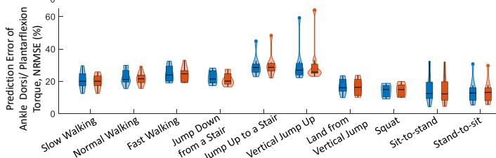

[33] L. Zhang, X. Zhu, E. M. Gutierrez-Farewik, and R. Wang, "Ankle joint torque prediction using an NMS solver informed-ANN model and transfer learning," *IEEE Journal of Biomedical and Health Informatics*, vol. 26, no. 12, pp. 5895–5906, 2022.

[34] D. J. Saxby, B. A. Killen, C. Pizzolato, C. Carty, L. Diamond, L. Modenese, J. Fernandez, G. Davico, M. Barzan, G. Lenton *et al.*, "Machine learning methods to support personalized neuromusculoskeletal modelling," *Biomechanics and Modeling in Mechanobiology*, vol. 19, no. 4, pp. 1169–1185, 2020.

[35] A. J. Van Den Bogert and A. Su, "A weighted least squares method for inverse dynamic analysis," *Computer Methods in Biomechanics and Biomedical Engineering*, vol. 11, no. 1, pp. 3–9, 2008.

[36] A. D. Kuo, "A least-squares estimation approach to improving the precision of inverse dynamics computations," *Journal of Biomechanical Engineering*, pp. 148–159, 1998.

[37] S. Sharma and S. Sen, "Real-time structural damage assessment using LSTM networks: regression and classification approaches," *Neural Computing and Applications*, vol. 35, no. 1, pp. 557–572, 2023.

[38] Y. Du, Y. Yan, S. Chen, and Y. Hua, "Object-adaptive LSTM network for real-time visual tracking with adversarial data augmentation," *Neurocomputing*, vol. 384, pp. 67–83, 2020.

## 附录

## A. NMS 校准试验

有人可能会对汇集式 NMS 模型标定的准确性表示担忧，因为仅使用一次试验可能不够充分。然而，NMS 模型基于物理原理，并利用了特定于各类动作的肌腱参数和激活模式。因此，对于给定的动作类型，肌肉通常在相似的力-长度关系范围内被激活。基于 NMS 模型的物理结构，使用一次试验对其进行标定是足够的。我们也尝试了使用每种动作类型的两次试验对 NMS 模型进行标定，但发现这并未带来预测准确度的显著差异（图 A.1），同时标定时间却显著延长。因此，考虑到实际的标定时间以及 NMS 模型的物理结构，我们在汇集模型中未纳入来自同一动作类型的多次试验用于标定。

[39] H. Gao, C. Zhang, S. Pei, and X. Wu, "Lstm-based real-time signal quality assessment for blood volume pulse analysis," *Biomedical Optics Express*, vol. 14, no. 3, pp. 1119–1136, 2023.

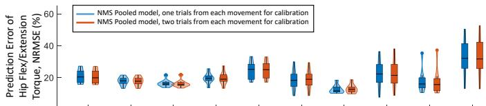

  
图 A.1. 在参与者十种动作下，NMS 汇集模型预测力矩与实际力矩之间 NRMSE 的分布，比较了标定时每种动作使用一次试验与两次试验的情况，以小提琴图呈现。每个小提琴图包含核密度图与箱线图。核密度图展示了 NRMSE 的概率分布。箱线图表示 NRMSE 的最小值、下四分位数、中位数、上四分位数和最大值。∗ 表示两个模型之间存在显著差异，由成对比较确定。