# 脑卒中后偏瘫中基于肌电约束与超声信息的肌腱参数估计

Longbin Zhang, Tom Van Wouwe, Shiyang Yan, and Ruoli Wang

摘要——脑卒中患者踝关节处的肌腱单元常出现继发性形态学和力学特性的改变。这些改变可能影响肌肉力量产生能力，并影响诸如行走等日常活动。本研究旨在通过基于实验肌电图（EMG）信号和实测肌纤维长度的直接配置最优控制方法求解肌肉冗余问题，估计脑卒中后受试者的特定肌腱参数。在七名脑卒中患者和七名健康对照者中，估计了腓肠肌、比目鱼肌和胫骨前肌的受试者特异性肌腱参数。我们发现，脑卒中组的最大等长力、肌腱刚度和最优纤维长度均显著低于对照组。我们还计算了肌肉激活和肌纤维长度的估计值与实验值之间的均方根误差。使用由肌肉冗余求解器估计的受试者特异性肌腱参数的肌肉骨骼模型，在肌肉激活和肌纤维长度估计方面优于采用缩放通用参数的结果。我们的研究结果还表明，肌肉冗余求解器能够估计出与实验测量值更一致的力产生行为的肌腱参数。这些脑卒中患者的肌腱参数具有生理学意义，可能为治疗和/或康复方案的制定提供启示。

关键词——肌肉骨骼建模，肌肉冗余求解器，直接配置，优化，肌纤维长度

## I. 引言

脑卒中经典上被认为是一种中枢神经系统细胞因脑血管突然破裂或阻塞所致的神经系统疾病 [1]。它是全球第二大死亡原因和第三大残疾原因 [2], [3]。脑卒中后，骨骼肌也可能经历继发性的结构和功能改变。踝关节周围的肌肉在脑卒中后常受到影响。例如，踝跖屈肌无力可能无法在站立相期间抵抗外部踝背屈力矩，从而导致胫骨失控前移。踝背屈肌无力则可能导致在摆动相难以实现足部充分离地 [4]–[6]。因此，对脑卒中后肌肉行为的定量和定性理解有助于制定个体化康复干预措施及开发辅助技术。

为了更好地理解肌肉的生物力学行为，使用 Hill 型肌肉模型的计算肌肉骨骼建模方法被广泛采用 [7]。三元素 Hill 型肌肉模型通常由串联弹性元件（SE）、收缩元件（CE）和并联弹性元件（PE）组成，分别描述单块肌肉的力-长度关系、力-速度关系以及肌腱力-长度关系。在 Hill 型肌肉模型中，包括最大等长力、最优肌纤维长度、肌腱松弛长度和肌腱刚度在内的多个肌腱参数，在将肌肉兴奋转化为肌肉力、进而表征运动过程中肌肉的力生成能力方面起着决定性作用 [8]。这些肌腱参数还提供了关于肌肉机制如何因各种条件而改变的重要信息。然而，这些参数往往难以在体内（in vivo）直接测量。通用肌腱参数可使用缩放后的肌肉骨骼模型进行估计，这些模型通常仅依赖于受试者的身高和/或体重。该缩放过程称为人体测量缩放（anthropometric scaling），它未考虑重要的受试者特异性信息，例如肌肉功能 [8]、[9]、年龄 [10] 和身体活动水平 [11]。为了研究病理条件下的患者或精英运动员的肌肉行为 [12]，亟需一种能够更准确地估计肌腱参数的方法，尤其是在受试者特异性应用中。

近年来，使用优化算法估计受试者特异性肌腱参数的兴趣日益增加。Modenese 等 [13] 将最小二乘优化技术与形态学缩放相结合，在保证生理一致性的前提下估计最优肌纤维长度和肌腱松弛长度。然而，仅基于来自开源 Living Human Digital Library（活体人类数字图书馆）数据集 [14] 的图像，估计了髋部肌肉的最优肌纤维长度和肌腱松弛长度。其他信息（如不同运动过程中受试者的肌肉兴奋、运动学和动力学信息）未被纳入考虑。Pizzolato 等 [15] 提出了一种校准的肌电图（electromyography, EMG）驱动的神经肌肉骨骼建模（calibrated EMG-informed neuromusculoskeletal modelling, CEINMS）

toolbox that included a subject-specific muscle-tendon parameter calibration process, i.e., maximum isometric force, optimal fiber length, and tendon slack length. Their EMGmodeling methods (CEINMS) have been applied to various pathological groups to predict muscle force and joint torque such as in individuals with Parkinson’s disease (帕金森病) [16] and post-stroke (脑卒中后) patients [17]. The calibration process proposed by Pizzolato et al., however, does not incorporate the experimental fiber length as a constraint. The muscle-tendon parameters and tendon stiffness therefore may not be wellcalibrated. Tendon stiffness plays a crucial role in the overall function of the muscle-tendon unit (MTU, 肌肉-肌腱单元), affecting both the viscoelastic properties of the tendon and the operational range of muscle fibers [18]. Notably, altered tendon stiffness has been observed in individuals post-stroke [19]–[21]. Investigating and quantifying tendon stiffness is essential for a comprehensive understanding of the muscle-tendon interplay during locomotion in post-stroke individuals, providing valuable insights into tailored rehabilitation strategies. Delabastita et al. [22] proposed a new approach to estimate muscle-tendon parameters by solving a dynamic optimization problem using combined information from ultrasound (超声) images and EMG data of the calf muscles, as well as joint torque from able-bodied individuals during walking. Their proposed muscle redundancy solver algorithm estimated calf muscle–tendon parameters in a good accordance with values reported in the literature, and also improved computation of muscle–tendon dynamic interaction during walking and highlighted the importance of individualizing calf muscle-tendon parameters. However, only the fiber length of gastrocnemius medialis (内侧腓肠肌) was estimated based on ultrasound images. In addition, their approach of normalizing EMG values to the maximum value during walking may not be applicable to pathological groups with impaired mobility, such as post-stroke patients in our study, who may not have independent walking or running ability. Furthermore, normalizing EMG signals with a free parameter can pose problems when estimating maximum isometric force. For instance, a weighting factor was applied to proportionally adjust the experimental EMG, enabling the generation of an equivalent amount of muscle force without altering the maximum isometric force. It could result in more uncertainty in the estimation of the maximum isometric force, which was a critical parameter in our study. Other EMG-driven modeling framework has also been applied in individuals post-stroke for muscle force and joint moment estimation [17], [23], wearable exoskeleton (可穿戴外骨骼) control strategy design [24]–[26], and joint kinematics prediction [27]. To the best of our knowledge, an EMG-driven modeling with Ultrasound informed optimization approach has not yet been applied to evaluate muscle-tendon parameters in post-stroke individuals.

本研究旨在在一个肌骨骼模型中评估脑卒中后个体（post-stroke individuals）肌肉-肌腱参数的潜在改变，以最佳地解释实验采集的肌电（EMG）数据和肌纤维长度。为此，将每位个体多项踝关节等长背屈与跖屈试验的实验数据合并到同一个最优控制问题中进行求解。

## II. 方法

## A. 实验装置与数据处理

七位脑卒中后受试者（年龄：$53.7 \pm 16.2$ 岁；性别：1 女 / 6 男；体重：$74.1 \pm 14.4$ kg；身高：$172.1 \pm 10.1$ cm）从当地一家康复诊所招募。纳入标准为：（1）脑卒中发生时间距纳入研究超过 6 个月；（2）三个月内未接受抗痉挛治疗；（3）不存在其他下肢损伤或疾病。七位健康受试者（年龄：$54.4 \pm 6.4$ 岁；性别：3 女 / 4 男；体重：$70.0 \pm 9.5$ kg；身高：$168.4 \pm 9.5$ cm）通过广告招募，作为对照组。瑞典伦理审查机构批准了本研究（Dnr. 2016/286-32），所有受试者均签署了知情同意书。脑卒中后受试者的数据集是先前研究 [9] 的一个子集。最初共招募了十一位脑卒中后受试者，其中三位中途退出，一位因图像质量较差而被排除数据。所有脑卒中后受试者在移动时均需要辅助器具：其中三人依赖轮椅，三位使用拐杖和踝足矫形器（AFO），一位仅使用 AFO。测量过程中，所有受试者均以舒适的半直立姿势坐立，膝关节屈曲 30°，脚部牢固固定于连接测力仪（IsoMed 2000，Hemau，德国）的脚踏板上（图 1）。初始位置时，踏板垂直于受试者胫骨；该位置被定义为踝关节旋转 0°。测试前，对每位受试者可用的关节活动范围（ROM）进行了评估，在测试活动范围内未发现不适。对照组和脑卒中后受试者均执行了若干最大自主收缩（MVC）任务。对照组在维持特定关节角度的情况下，对测力仪进行最大自主等长背屈和跖屈收缩。在这些收缩过程中，测力仪以 3000 Hz 的频率同步记录关节力矩和角度数据。为使踝关节屈伸功能轴与测力仪屈伸轴良好对位，我们遵循了先前研究 [28] 推荐的标准化程序。具体而言，使用激光指示装置将踝关节屈伸轴与测力仪轴对齐。实验在四个不同的踝关节角度下进行（5°背屈、0°、10°和 20°跖屈）。对于脑卒中后组，由于背屈方向的关节活动范围有限，七位受试者中有三位无法在 5° 背屈位完成 MVC，因此仅在三个角度位置进行了测量。测试过程中，研究人员全程给予口头鼓励。在每个角度下，受试者被要求执行持续 5 秒的背屈 / 跖屈 MVC，重复两次，重复间休息 30 秒。

肌肉激活（表面肌电图，3000 Hz，Noraxon Inc.，AZ，美国）数据采集自每位受试者一条腿的腓肠肌（GAS）、比目鱼肌（SOL）和胫骨前肌（TA），其中对照组为随机选取的一侧，脑卒中后组为偏瘫侧，电极放置遵循欧洲表面肌电图建议标准 [29]。原始肌电信号经过高通滤波（20–500 Hz）、整流、低通滤波（6 Hz）处理，然后归一化至所有最大自主收缩（MVC）试验中的最大肌电信号 [26]、[30]、[31]。测量得到的踝关节角度和力矩采用零相位 6 Hz 低通巴特沃斯滤波器进行处理 [32]–[34]。

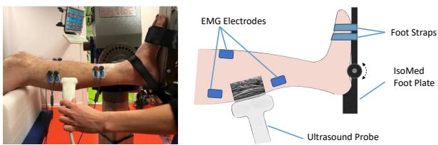  
图 1. 实验装置。所有受试者以舒适的半直立姿势就坐，膝关节屈曲 30°，足部牢固固定于连接测力仪的踏板上。实验过程中同时记录肌肉激活信号（通过肌电电极）和肌纤维长度（通过超声成像）。

GAS 或 SOL 的超声图像在跖屈 MVC 期间通过超声成像系统（Mindray M9，深圳，中国）配合 38 mm 宽线性探头（6–14 MHz）同步采集，TA 的超声图像在背屈 MVC 期间采集。肌纤维长度通过 UltraTrack [35] 自动追踪，然后仔细进行人工视觉检查以校正任何潜在的追踪误差。基于超声所追踪的肌肉，我们将运动划分为三种情况：$P F _ { G A S }$（测量 GAS 纤维长度的跖屈）、$P F _ { S O L }$（测量 SOL 纤维长度的跖屈）以及 DF（测量 TA 纤维长度的背屈）。

## B. 肌肉–肌腱参数估计

受试者特异性的肌肉–肌腱参数估计被构建为一个最优控制问题。针对每位受试者，针对一个肌肉骨骼模型（gait10musc18，OpenSim [36]、[37]）估计其肌肉–肌腱参数（最大等长力、最佳肌纤维长度、肌腱自由长度和肌腱刚度），以使不同等长收缩任务中的实验观测值与模拟行为之间的差异最小化。该模型（gait10musc18）被修改为仅包含足部和胫骨节段，以及驱动踝关节的肌肉：GAS、SOL 和 TA。每块肌肉采用 De Groote 等人 [38] 所述的带柔性肌腱的 Hill 型肌肉模型进行建模。

对于每位受试者，使用 OpenSim 缩放工具对修改后模型的肌肉骨骼几何进行缩放。对于健康对照组，我们依靠运动捕捉系统（Qualisys，瑞典哥德堡）捕获的可用解剖标志点位置来缩放腿部和足部尺寸。对于脑卒中后受试者，则基于人工测量的人体测量学长度进行缩放。缩放后的模型作为估计个体化肌腱参数 $\textbf { ( p ) } = \ [ l _ { M , o p t } , l _ { T S } , k _ { T } , F _ { m a x } ] )$ 的起点，通过求解以下最优控制问题实现：

$$
\operatorname* { m i n } _ { \mathbf { p } , e _ { 1 } ( t ) , \dots e _ { n _ { t r i a l s } } ( t ) , \tau _ { r e s } } J
$$

约束条件为

$$
\tau _ { e x p } = R \times F _ { T } + \tau _ { r e s }
$$

$$
\dot { e } = f _ { a c t } ( e , a )
$$

$$
\dot { F _ { T } } = f _ { m t } ( F _ { T } , a , q , \mathbf { p } )
$$

$$
c _ { p h y s i o l o g i c a l } ( F _ { T } , a , q , \mathbf { p } ) \geq 0
$$

该最优控制问题的状态变量为肌肉激活（a）和肌腱力 $( F _ { T } )$ 。控制变量为肌肉兴奋（e）和残余致动器力矩 $( \tau _ { r e s } )$ 。代价函数 $J$ 由四项加权和组成，在一次优化过程中对所有试验 $( n _ { t r i a l s } )$ 的三块肌肉进行求和。

$$
J = \sum _ { i = 1 } ^ { n _ { t r i a l s } } \quad w _ { E M G } J _ { E M G , i } + w _ { F L } J _ { F L , i } +
$$

其中 $w _ { E M G } = 1 , w _ { F L } = 1 , w _ { e f f o r t } = 0 . 1$ ，$w _ { r e s } = 1 0$ 为初始权重因子。由于权重调整过程是针对每位受试者单独完成的以达到最佳性能，因此权重在不同受试者之间可能略有差异。为确定每个分量的最优权重，我们采用了基于先前文献 [22] 的权重调整方法。具体而言，首先可视化增大或减小某一项权重对代价函数中其余跟踪项的影响。然后选择能够在避免其他项增加的同时有效减小目标项的权重。

代价函数由一个 EMG 项组成：

$$
J _ { E M G } = \intop _ { t _ { 0 } } ^ { t _ { f } } ( e ^ { 2 } ( t ) - \hat { e } ^ { 2 } ( t ) ) d t
$$

用于衡量模拟肌肉兴奋 $e ( t )$ 与测得的归一化 EMG 信号 $\hat { e } ( t )$ 之间的差异。一个肌纤维长度项：

$$
J _ { F L } = \int _ { t _ { 0 } } ^ { t _ { f } } ( l _ { f } ^ { 2 } ( t ) - \hat { l } _ { f } ^ { 2 } ( t ) ) d t
$$

用于衡量模拟肌纤维长度 $l _ { f } ( t )$ 与测得肌纤维长度 $\hat { l } _ { f } ( t )$ 之间的差异。

一个用力项：

$$J_{e f f o r t} = \intop_{t_{0}}^{t_{f}} (e^{2}(t) + a^{2}(t))dt \tag{9}$$

用于正则化优化问题，以避免需要更多肌肉努力的冗余解，其中 $a(t)$ 为肌肉激活。

储备执行器项：

$$J_{r e s} = \intop_{t_{0}}^{t_{f}} \tau_{r e s}^{2}(t)dt \tag{10}$$

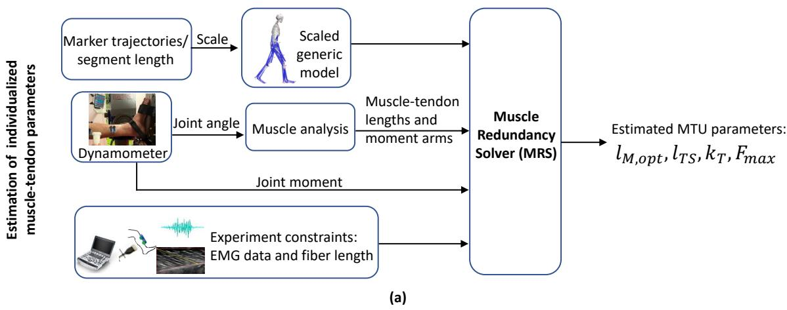

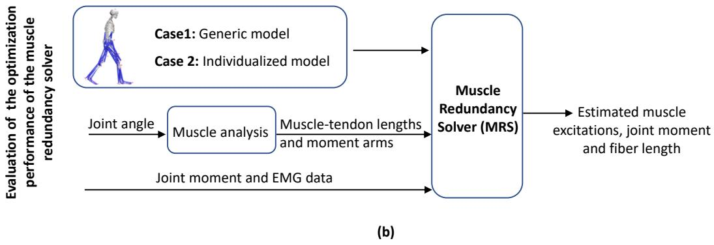  
图 2. (a) 使用肌肉冗余求解器进行个体化肌腱参数估计的概述。我们首先通过记录的静态标记轨迹或测量的腿长来缩放通用肌肉骨骼模型（gait10dof18musc），以拟合每个受试者的人体测量学特征。从测力计（dynamometer）测得的踝关节角度用作肌肉分析的输入，以计算每个肌腱单元的肌腱长度和力臂。在优化过程中，我们还基于实验测量添加了约束条件，这些约束为三块肌肉（GAS 腓肠肌、SOL 比目鱼肌、TA 胫骨前肌）的肌肉激发和纤维长度。然后我们通过最小化肌肉激活平方和以及最大化测量与模拟关节力矩、肌电信号（EMG）和肌纤维长度之间的一致性来求解肌腱参数。最后，我们获得了个体化的肌腱参数：最大等长收缩力 $F_{m a x}$、最优纤维长度 $l_{M, o p t}$、肌腱刚度 $k_{T}$ 和肌腱松弛长度 $l_{T S}$。(b) 通过交叉验证方法评估肌肉冗余求解器优化性能的概述。具体而言，75% 的试验用于标定以获得具有标定肌腱参数的个体化模型，然后在剩余的试验上进行测试。评估了两种情况（情况 1：通用模型；情况 2：个体化模型）。在情况 2 中，个体化模型的肌腱参数是使用肌肉冗余求解器优化得出的标定程序的输出，而情况 1 中通用模型的参数来自缩放的肌肉骨骼模型。在两种情况下，关节角度、关节力矩、肌电数据和通用/个体化肌肉骨骼模型均用作肌肉冗余求解器的输入。输出参数为追踪的肌肉激发、关节力矩和纤维长度。

表示一个添加到踝关节的储备致动器（reserve actuator），能够为踝关节肌肉提供额外的关节力矩。将此项纳入模型旨在提高优化问题的数值稳定性，并确保即使在所建模肌肉不足以产生测得关节力矩的情况下仍可获得可行解。在标定试验中，该项被赋予较大权重以确保其贡献可忽略不计。在评估过程中，储备致动器项用作衡量模型与实验数据之间失配程度的指标。

优化问题受到如下约束：肌肉产生的关节力矩与储备致动器力矩 $\left( \tau _ { r e s } \right)$ 之和等于由测力计测得的实验关节力矩 $( \tau _ { e x p } )$（式 2）。R 为力臂矩阵，描述了每块肌肉相对于踝关节的力臂，并取决于踝关节和膝关节角度 $( q )$ 。踝关节角度直接由测力计记录获取。在所有试验和受试者中，膝关节角度均恒定为 $3 0 ^ { \circ }$。

我们施加了文献 [38] 中所述的肌肉激发-激活动力学 $( f _ { a c t } )$ 和肌肉-肌腱动力学 $( f _ { m t } )$：

$$
\begin{array} { r l r } { \dot { e } } & { { } } & { = f _ { a c t } ( e , a ) } \end{array}\tag{11}
$$

$$
\begin{array} { r l } { \dot { F _ { T } } } & { { } = f _ { m t } ( F _ { T } , a , q , \mathbf { p } ) } \end{array}\tag{12}
$$

注意，估计参数作为输入出现在肌肉-肌腱动力学中。此外还施加了附加约束 $( c _ { p h y s i o l o g i c a l } ( F _ { T } , a , q , \mathbf { p } ) \ \geq \ 0 .$ ，式 (5)），以确保最优解在生理上是可行的：

• GAS、SOL 和 TA 的最优肌纤维长度分别约束在最大测量肌纤维长度的 40% 至 120% 之间 [22]。

• 由于 GAS 和 SOL 共同构成小腿三头肌（triceps surae）肌肉复合体并共享跟腱（achilles tendon），它们在最优肌纤维长度、肌腱松弛长度和肌腱刚度上的估计值与通用值之比被约束为相等。

• 激发和激活均约束在零到一之间。

(a)

(b)

我们采用直接配点法（direct collocation）将每个最优控制问题转录为一个大型稀疏非线性规划（NLP）。我们使用网格尺寸为 10 毫秒的梯形积分方案，并使用求解器 IPOPT 求解所得 NLP。所有梯度均通过自动微分计算，其中我们使用了 CasADi [39]。

## C. 估计参数的评估与数据分析

我们分析了 GAS、SOL 和 TA 在最大等长力、肌腱刚度、最佳肌纤维长度和肌腱松弛长度方面的组间差异。最佳肌纤维长度和肌腱松弛长度按身高进行了归一化处理。采用 Shapiro-Wilk 检验来检查数据分布的正态性（显著性水平为 $p < 0.05$）。对于正态分布的肌腱参数，采用双样本 t 检验；对于两组间非正态分布的数据，则采用 Mann-Whitney U 检验（显著性水平为 $p < 0.05$）。

我们通过比较有标定的肌肉-肌腱参数的模型与仅经过缩放的模型的预测性能，评估了通过 EMG 和 US 约束标定是否能提高模型的预测能力。这是通过使用肌肉冗余求解器进行交叉验证来实现的。评估了两种情况（情况 1：通用模型；情况 2：个性化模型；图 2(b)）。在情况 2 中，个性化模型的肌肉-肌腱参数是通过使用肌肉冗余求解器优化得到的标定过程获得的，而情况 1 中通用模型的参数则来自缩放后的肌肉骨骼模型。对两种情况预测的肌纤维长度、关节力矩和肌肉激活度进行了比较。具体而言，对每位受试者使用 75% 的试验来获得具有标定肌肉-肌腱参数的个性化模型，然后在剩余的试验上进行测试。每位受试者共有 12 个试验，但有三名卒中后受试者由于活动范围有限只有 9 个试验。对于两种情况，关节角度、关节力矩、EMG 数据以及通用或个性化的肌肉骨骼模型均作为输入提供给肌肉冗余求解器。值得注意的是，目标函数中未包含纤维长度追踪 $( J _ { F L } )$ 项。对个性化和通用模型预测的肌肉激活度、关节力矩和肌纤维长度与实验值之间的 RMSE 差异进行了检验。对于正态分布数据采用配对 t 检验，对于非正态分布数据采用 Wilcoxon 符号秩检验来确定显著性差异，显著性水平为 $( p < 0 . 0 5 )$ 。

## III. 结果

A. 肌肉冗余求解器优化性能评估

总体而言，个性化模型对卒中后组的肌肉-肌腱行为产生了更真实的预测。在健康对照组和卒中后组中，个性化模型在肌纤维长度和关节力矩估计方面的 RMSE 均低于通用模型（图 3-8）。

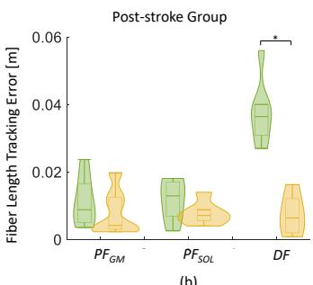

图3. 小提琴图展示了健康组和脑卒中后组在三种工况下，通过个性化模型和通用模型预测的腓肠肌（GAS）、比目鱼肌（SOL）和胫骨前肌（TA）纤维长度的预测均方根误差（RMSE）差异分布：$P F _ { G A S }$（跖屈，测量 GAS 纤维长度）、$P F _ { S O L }$（跖屈，测量 SOL 纤维长度）和 DF（背屈，测量 TA 纤维长度）。两种模型之间的显著差异用 ∗ 表示。  
  
图4. 一个通过通用模型和个性化模型在最大自主收缩（MVC）期间，健康组和脑卒中后组测量和预测纤维长度的示例。在此示例中，在跖屈 MVC 期间比较了腓肠肌（GAS）和比目鱼肌（SOL），而在背屈 MVC 期间比较了胫骨前肌（TA）。

对于纤维长度预测，个性化模型在 DF 工况下显示出显著较低的 RMSE，无论是在脑卒中后组 $( p \ < \ 0 . 0 1 )$ 还是对照组 $( p \ : = \ : 0 . 0 5 ;$ 图3）。虽然不具有统计学显著性，但在 $P F _ { G A S }$ 和 $P F _ { S O L }$ 工况下，两组（脑卒中后组：$P F _ { G A S } \colon p = 0 . 1 6$ 和 $P F _ { S O L } \colon p = 0 . 1 1$；对照组：$P F _ { G A S } \colon p = 0 . 3 7 .$ , P FSOL: $p = 0 . 0 7 ;$ 图3）的 RMSE 也略微较低。

对于肌肉激活预测，在脑卒中后组中，个性化模型在 $P F _ { G A S }$ 和 DF 工况下所有肌肉的 RMSE 均显著较低 $( P F _ { G A S } \colon \mathbf { G A S } { \mathrel { : } } p =$ 0.02，SOL: $p = 0 . 0 3$ ，TA: $p = 0 . 0 5$ ；DF：GAS: $p =$ $0 . 0 5 , \ \mathrm { S O L } { : p } = 0 . 0 5$ ，$\mathrm { T A } { : } p = 0 . 0 2$ ；图5(b)、(d) 和 (f))。此外，在 $P F _ { S O L }$ 工况下，GAS $( p = 0 . 0 3$ ，图5(b)) 和 SOL $( p = 0 . 0 3 ,$ 图5(d)) 观察到显著差异。虽然不具有统计学显著性，但在 TA $\left( p = 0 . 0 8 , \mathrm { F i g } . \textbf { 5 } ( \mathrm { f } ) \right)$ 中也观察到较低的 RMSE。然而，在对照组中，所有工况下均未观察到显著差异 $(\mathrm { F i g . ~ 5 ~ ( a ) , ~ ( c ) } .$ 和 (e))。

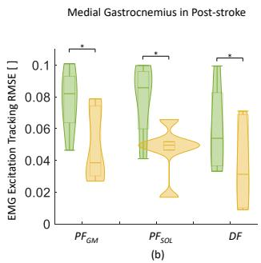

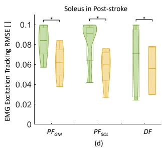

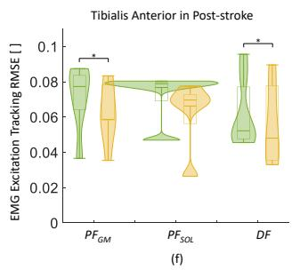  
图 5. 小提琴图展示了在健康组和脑卒中后组中，通过个体化模型和通用模型在三种情况下预测腓肠肌（gastrocnemius，GAS）、比目鱼肌（soleus，SOL）和胫骨前肌（tibialis anterior，TA）肌肉激发的 RMSE 分布：$P F _ { G A S }$（跖屈，测量 GAS 肌纤维长度）、$P \bar { F _ { S O L } }$（跖屈，测量 SOL 肌纤维长度）和 $D F$（背屈，测量 TA 肌纤维长度）。两种模型之间的显著差异用 ∗ 表示。

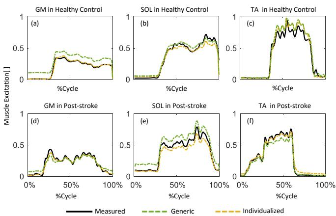  
图 6. 一个示例，展示了在健康组和脑卒中后组中通过通用模型和个体化模型预测的最大随意收缩（Maximum Voluntary Contraction，MVC）期间的肌肉激发测量值和预测值。在该示例中，比较了跖屈 MVC 期间的腓肠肌（GAS）和比目鱼肌（SOL），同时比较了背屈 MVC 期间的胫骨前肌（TA）。

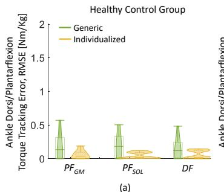

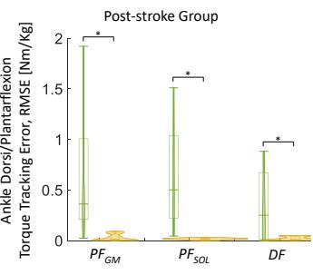

图 7. 小提琴图展示了在健康组和脑卒中后组中，通过个体化模型和通用模型在三种情况下预测踝关节背屈/跖屈力矩的 RMSE 分布：$P F _ { G A S }$（跖屈，测量 GAS 肌纤维长度）、$P \bar { F } _ { S O L }$（跖屈，测量 SOL 肌纤维长度）和 $D F$（背屈，测量 TA 肌纤维长度）。两种模型之间的显著差异用 ∗ 表示。  
  
图 8. 一个示例，展示了在健康组和脑卒中后组中通过通用模型和个体化模型预测的最大随意收缩（MVC）期间在三种情况下的踝关节背屈/跖屈力矩测量值和预测值：$P F _ { G A S }$（跖屈，测量 GAS 肌纤维长度）、$P F _ { S O L }$（跖屈，测量 SOL 肌纤维长度）和 $D F$（背屈，测量 TA 肌纤维长度）。

对于关节力矩预测，个体化模型在脑卒中后组的所有情况下均显示出显著低于通用模型的 RMSE 值（$P F _ { G A S } \colon p \ < \ 0 . 0 1$，$P F _ { S O L } { : } p = 0 . 0 2$，$D F \colon p = 0 . 0 3$）。在对照组中，尽管统计上不显著，但所有情况下的 RMSE 值也均较低（$P F _ { G A S } \colon p = 0 . 0 9$，$P F _ { S O L } \colon p = 0 . 0 5$，$D F \colon p = 0 . 1 0$；图 7）。

## B. 估计的肌肉-肌腱参数

总体而言，脑卒中后组估计的最大等长力、最佳肌纤维长度和肌腱刚度均明显低于对照组（图 9）。

卒中后组中 GAS、SOL 和 TA 的估计最大等长力分别为体重的 $0.5 \pm 0.2\%$、$1.0 \pm 0.3\%$ 和 $1.0 \pm 0.5\%$。这些数值均显著低于对照组（GAS：$3.8 \pm 1.3\%$ BW，$p < 0.01$；SOL：$7.9 \pm 2.7\%$ BW，$p < 0.01$；TA：$4.9 \pm 0.8\%$ BW，$p < 0.01$；图 9 (a)）。

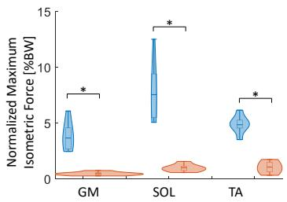

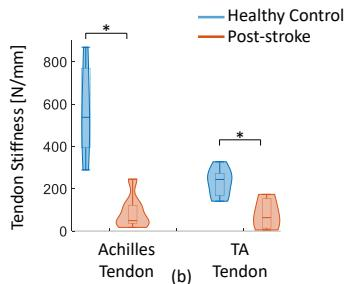

(a)  
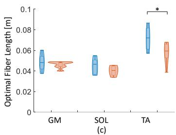

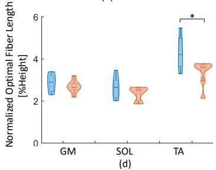

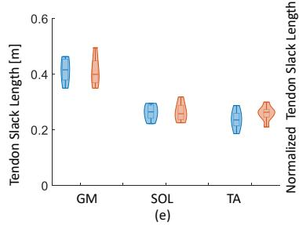

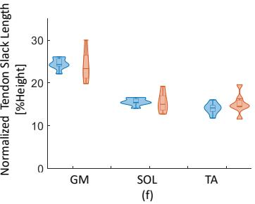  
图 9. 小提琴图（Violin plots）展示了对照组与卒中后组中腓肠肌（GAS）、比目鱼肌（SOL）和胫骨前肌（TA）估计肌腱参数的分布：(a) 归一化最大等长力（按体重（BW）归一化），(b) 肌腱刚度，(c) 最佳肌纤维长度，(d) 归一化最佳肌纤维长度（按身高归一化），(e) 肌腱 slack 长度，(f) 归一化肌腱 slack 长度（按身高归一化）。\* 表示两组之间存在显著差异。

卒中后组中 TA 的估计最佳肌纤维长度显著低于对照组（$57.6 \pm 10.2$ mm vs. $71.7 \pm 11.3$ mm，$p = 0.03$，图 9 (c)）。虽然未达到统计学显著水平，但在卒中后组中同样观察到了 GAS 和 SOL 的估计最佳肌纤维长度更短的趋势（GAS：$46.1 \pm 3.3$ mm vs. $48.4 \pm 7.9$ mm，$p = 0.48$；SOL：$40.4 \pm 4.8$ mm vs. $44.3 \pm 7.8$ mm，$p = 0.30$）。归一化最佳肌纤维长度（按身高归一化）的趋势与最佳肌纤维长度一致（图 9 (d)）。

两组之间的肌腱 slack 长度未发现显著差异（卒中后组 vs. 健康对照组：GAS $41.0 \pm 5.2$ mm vs. $41.3 \pm 4.4$ mm，SOL $26.4 \pm 3.3$ mm vs. $26.3 \pm 2.8$ mm，TA $25.9 \pm 2.8$ mm vs. $23.8 \pm 3.4$ mm；GAS：$p = 0.98$，SOL：$p = 0.98$，TA：$p = 0.29$；图 9 (e)）。归一化肌腱 slack 长度（按身高归一化）的趋势也与肌腱 slack 长度一致（图 9 (f)）。卒中后组中跟腱（Achilles tendon）和 TA 肌腱的刚度分别为 $89 \pm 79$ N/mm 和 $79 \pm 71$ N/mm；这些数值同样显著小于对照组（跟腱：$564 \pm 220$ N/mm，$p < 0.01$；TA 肌腱：$230 \pm 67$ N/mm，$p < 0.01$；图 9 (b)）。

  
(a)

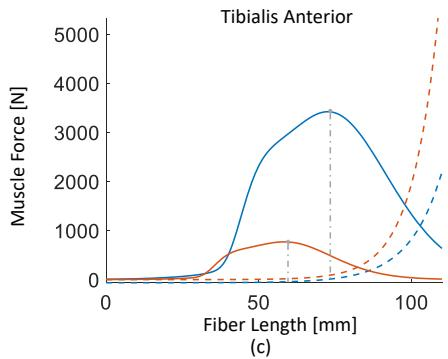  
图 10. 对照组和脑卒中后组腓肠肌（GAS）、比目鱼肌（SOL）和胫骨前肌（TA）的主动（实线）和被动（虚线）肌力-长度关系（基于 Hill 型模型推导）。灰色虚线表示最大等长力发生在最佳肌纤维长度处。

与对照组相比，脑卒中后组的主动肌力-长度曲线发生左移，三块肌肉的最大等长力和最佳肌纤维长度均显著降低（图 10）。

## IV. 讨论

在本研究中，我们采用直接配点优化方法求解肌肉冗余问题，估算了脑卒中后患者与健康对照者主要踝关节背屈/跖屈肌的个体特异性肌肉-肌腱参数。所提出的优化算法基于实验 EMG 信号以及通过超声（US）图像测量的肌纤维长度，将肌肉激活与肌肉动力学纳入考量。我们发现，脑卒中后组的最大等长力、肌腱刚度以及最佳肌纤维长度均显著低于对照组。此外，我们证明了利用 EMG、超声和肌力测试数据，通过直接配点优化方法对肌肉-肌腱参数进行个性化设定，可显著改善肌肉骨骼模型的个体特异性，由此生成的运动仿真比缩放后的通用模型更真实，且与实验数据的匹配度更高。与现有方法相比，我们所开发的直接配点优化算法结合独特的实验数据集展现出多方面的优势：其一，它能够将不同类型的试验整合到单一优化过程中，从而获得更具真实性和生理一致性的参数估计；此外，该算法不仅给出了决定肌力产生能力的关键肌肉-肌腱参数（如最佳肌纤维长度、肌腱松弛长度和肌腱刚度），还给出了最大等长力，这对理解和治疗脑卒中后运动功能障碍具有重要意义。据我们所知，这是首个在踝关节跖屈与背屈最大随意收缩（MVC）运动中，结合实验 EMG 信号和肌纤维长度约束，对脑卒中后患者的 GAS、SOL 和 TA 肌肉-肌腱参数进行评估的工作。同时，所提出的肌肉-肌腱参数优化框架被进一步扩展，适用于不需要具备独立行走和跑步能力的病理群体。因此，我们的方法有望推广至其他运动功能障碍人群，从而为揭示肌肉-肌腱力学特性以及指导未来康复策略提供有价值的参考。

## A. 肌肉冗余求解器优化性能评估

与仅仅缩放肌肉-肌腱参数相比，采用经过校准的肌肉-肌腱参数的个性化肌肉骨骼模型在大多数情况下显著改善了仿真值与实测值之间在肌纤维长度、肌肉激发以及关节力矩方面的一致性。个性化肌肉-肌腱校准的获益在中风后群体中更为显著。例如，中风后群体显著不同的力矩预测（图 7 (b)）很可能源于其最大等长力显著低于健康对照组（图 9 (a)）。因此，使用未经校准 MTU（muscle-tendon unit，肌肉-肌腱单元）参数的通用模型不仅难以获得准确的估计，也无法真实地刻画肌肉-肌腱行为。此外，与健康对照组不同，在大多数情况下，采用经过校准的肌肉-肌腱参数能够显著改善中风后群体的 EMG（electromyography，肌电图）激发预测（图 5 (b)、(d) 和 (f)）。这可能归因于中风后个体常出现协同收缩以维持稳定性 [40]。然而，优化算法最小化的是肌肉力代价函数，即肌肉激发平方和的积分，因此协同收缩对优化解而言并不有利。在未来的研究中，应进一步探索将协同收缩纳入代价函数，以便更好地模拟运动障碍患者的肌肉-肌腱行为，因为这些人群中可能出现协同收缩的情形。

在本研究中，采用直接配点法（direct collocation method）将寻找最能解释实验观测的肌肉-肌腱参数的最优控制问题构建为非线性规划问题。与其他优化方法相比，配点法通常具有更高的计算效率；因此，已在多项研究中被用于探讨肌肉冗余问题。Groote 等 [38] 首次提出直接配点法，将其作为解决男性受试者步行过程中肌肉冗余问题的鲁棒且计算高效的方法。该方法也被用于估计健康受试者膝关节驱动器的个体特异性肌肉-肌腱参数 [41]。Delabastita 等 [22] 进一步结合运动捕捉、超声图像和小腿肌肉的肌电（EMG）数据，在青年和老年人步态过程中估计其肌肉-肌腱参数。然而，在其优化过程中并未纳入个体化最大等长收缩力。然而，在模拟受试者力量时，通常建议在肌肉骨骼模型中对最大等长收缩力进行调整，因为受试者的力量水平很可能偏离人群平均水平，例如病患群体或精英运动员 [12]。在本研究中，我们结合独特的实验测量方案与直接配点法，对运动功能缺陷个体（即脑卒中后个体）的肌肉-肌腱参数变化进行更为全面的评估。

## B. 估计的肌肉-肌腱参数

肌肉-肌腱参数是运动障碍人群研究中常被考察的参数，旨在更好地理解肌肉-肌腱单元在运动过程中的力学行为。基于我们的仿真结果，与对照组相比，脑卒中后组的跖屈肌和背屈肌的最优肌纤维长度更短、最大等长收缩力更低、肌腱刚度更小。然而，肌腱松弛长度未观察到显著差异。这些参数具有明确的生理含义，决定了 Hill 型肌肉模型中的肌肉激发-力关系。它们在临床解读中也具有相关性和信息量，例如，这些参数能够为个性化康复方案的制定提供关键信息。

Active muscle force generation capacity could be remarkably affected after stroke. We found that post-stroke individuals exhibited significantly reduced maximum isometric force compared to controls. Maximum isometric force is defined as the peak force a muscle can produce while maintaining a constant length. The common method for estimating an individual muscle’s maximum isometric force is to multiply the physiological cross-sectional area (PCSA, 生理横截面积) with the specific tension (比张力) [42]. However, directly estimating the maximum isometric force experimentally could be very challenging and resource-demanding. Rather, maximal isometric torque is often reported [43], [44]. However, it can not reflect the potential differences among synergistic muscles. Therefore, an optimization technique incorporating feasible experimental measurements could be a good solution for estimating the maximum isometric force of the individual muscle. We found that the estimated maximum isometric force of GAS (腓肠肌, Gastrocnemius), SOL (比目鱼肌, Soleus), and TA (胫骨前肌, Tibialis Anterior) were all much weaker in post-stroke individuals and were only 13.9%, 13.9%, and 22.4% of the control group. Very few studies have investigated the maximum isometric force of ankle muscles in post-stroke individuals in vivo. Our findings are in line with previous studies reporting reduced MVC (最大随意收缩, Maximal Voluntary Contraction) torque in plantarflexors [45] and dorsiflexors [46]. Optimal fiber length is another essential parameter influencing the active force generation during dynamic muscle contraction. To the best of our knowledge, only one study investigated the alteration of the optimal fiber length on ankle plantarflexors in post-stroke individuals. Gao et. al [47] reported a shorter optimal fiber length (33.2 ± 3.2 mm) in the gastrocnemius in post-stroke individuals than healthy controls $( 4 7 . 4 \pm  2 . 7$ mm). They established the muscle-active force relationship by curve-fitting scattered data points for each subject during submaximal MVC measurements. Based on our simulation, the optimal fiber lengths were found unexpectedly shorter not only in plantar-flexors but also in ankle dorsiflexion. Further investigation is needed for clarification. In addition, maximal isometric force and optimal fiber length essentially determine the force - length profile of an individual muscle (Fig. 10). Evaluating the individualized force - length relationship yields the possibility to assess the selective weakness at particular muscle length (joint angle) as well as the optimal movement range after stroke, which can provide valuable information for effective strength training intervention.

肌腱刚度是影响整个肌肉-肌腱单元（muscle-tendon unit, MTU）功能的重要力学特征，它决定了肌腱的功能特性以及肌肉纤维的工作范围 [18]。肌腱刚度通常表现为在趾区（toe region）具有较低的刚度，而在线性区（linear region）具有较高的刚度。近年来，线性区的肌腱刚度通常通过基于超声成像的方法进行研究。我们之前的研究在被动拉伸过程中考察了健康受试者跟腱的腓肠肌（GAS）侧和比目鱼肌（SOL）侧的刚度，发现两个亚区的刚度相似 [28]。然而，由于关节构型和假设条件的差异，在体研究常常报告难以相互比较的结果。例如，先前的研究在体测定了年轻健康成人（170 ± 37 N/mm）和年长健康成人（141 ± 48 N/mm）的跟腱刚度，其方法是将 10% 到 80% 最大随意等长收缩（maximal voluntary isometric contractions, MVC）区间内的肌肉力–肌肉长度伸长关系作为斜率 [48]。Khair 等 [49] 的另一项研究则基于肌腱伸长–力曲线在 50% MVC 处的切线，报告了跟腱断裂非手术治疗一年后患者未受伤侧的跟腱刚度（486.5 ± 210.2 N/mm）。此外，肌腱刚度还可以通过计算建模与仿真方法进行估计，这种方法对在体测量方法和测量条件的依赖性较低。Delabastita 等 [22] 最近的一项研究采用直接配点最优模拟方法（direct collocation optimal simulation method），估计了年轻成人（215.2 ± 61.4 N/mm）和年长成人（202.4 ± 62.9 N/mm）在步行过程中的跟腱刚度。在本研究中，我们实施了同样的直接配点最优方法，估算了脑卒中后组和对照组的跟腱与胫骨前肌（tibialis anterior, TA）肌腱刚度（脑卒中后组 vs. 健康对照组：跟腱 89 ± 79 N/mm vs. 564 ± 220 N/mm；TA 肌腱 79 ± 71 N/mm vs. 230 ± 67 N/mm）。我们在脑卒中后组观察到的肌腱顺应性更高的结果与先前关于跟腱的临床观察相符 [19]、[50]、[51]。例如，Zhao 等 [19] 通过在跖屈肌 MVC 期间追踪肌腱伸长并测量踝关节力矩，在脑卒中后人群中观察到了顺应性更高的跟腱。

本研究存在若干局限性。在本研究中，我们采用 MVC 试验中的最大值对 EMG 进行归一化，而非使用行走和跑步等动态运动中的最大值。我们承认 MVC 等长试验不一定能够真实地反映肌肉的最大激活水平。在动态运动过程中，某些肌肉的 EMG 信号可能会超过等长 MVC 试验中所记录的峰值 [52]、[53]。然而，在最近的一项研究中，研究者探讨了三种 EMG 归一化方法，即"等长 MVC"、"等速 $\mathbf { M V } { \boldsymbol { \mathbf { C } } } ^ {  }$"以及"考虑关节活动度和速度的等速 MVC"，对脑卒中患者的肌肉激活以及主动肌–拮抗肌共激活指数的影响 [54]。该研究发现三种归一化方法之间未观察到显著差异，因此得出结论：等长 MVC 归一化方法适用于脑卒中受试者。鉴于我们的研究对象为缺乏独立行走或跑步能力、活动能力受损的受试者，我们假设在等长 MVC 期间所获得的 EMG 数据能够合理地近似真实的最大 EMG 信号。尽管如此，仍值得注意的是，本文所采用的归一化方法可能会影响肌腱模型参数的估计值，因此需要在未来的研究中进一步加以评估。此外，我们仅对肌腱力–伸长（Force–Elongation）关系的线性段进行了建模，未纳入 Toe 区。这可能会增加体内计算所得肌腱刚度与模型估计值之间的差异 [22]。采用非线性肌腱模型所开展的进一步研究可能会提供更准确的刚度估计。值得一提的是，在评估肌肉冗余求解器的优化性能时，仅在脑卒中组中观察到了显著差异。虽然在对照组和脑卒中组中，与通用模型相比，个体化模型的肌纤维长度和关节力矩估计的 RMSE 均较低，但在肌肉激活方面该差异并不明显。这一差异可能归因于样本量有限，也可能表明传统的常规缩放模型仍适用于健康人群。未来有必要开展更大样本量的进一步研究。

另一个局限性在于，约束优化过程中仅使用了实验测得的肌纤维长度和 EMG（肌电图）信号。由于羽状角（pennation angle）存在较大的角度变异 [9]，尤其是卒中后群体，我们未将其纳入考虑。例如，由于卒中后肌肉流变学特性的改变，必须增大超声测量中的探头压力以获得更好的肌肉显像，这可能导致较大的角度变异。先前的研究也表明，与其他参数相比，在基于肌肉骨骼模型的肌力估计中，羽状角是影响最小的参数 [55]–[58]。因此，值得进一步探讨的是：纳入可靠的羽状角测量是否能提高 MTU（肌肉-肌腱单元）参数估计的鲁棒性。此外，深入分析将超声测量整合到 EMG 驱动模型的标定流程中对肌肉-肌腱参数估计的影响，对于卒中后个体具有重要价值。

此外，神经与肌肉两方面的改变均可能导致卒中后受试者的肌力下降。尽管我们的肌肉骨骼建模与优化框架通过使用归一化的 EMG 数据约束肌肉激活，从而在一定程度上考虑了神经驱动，但仍需认识到：确定是否存在神经驱动下降，仍需要更深入的研究以及额外的实验测量。从肌肉建模的角度来看，"最大等长收缩力"这一参数可能潜在地包含关于神经驱动变化的信息。然而，必须谨慎对待该参数，避免过度解读。

需要注意的是，我们的研究仅关注踝关节屈伸关节，这是由于研究兴趣的特定领域所限。不过，我们的肌腱参数估计框架可以在所需情况下迁移到其他可获得实验数据的关节。具体来说，我们纳入了三个关键的踝关节背屈/跖屈肌肉，即腓肠肌（GAS）、比目鱼肌（SOL）和胫骨前肌（TA）。在实验装置中，我们将腓肠肌内侧头（GM）和腓肠肌外侧头（GL）视为一个整体进行考虑，因为它们在解剖学和功能上具有相似性 [59]、[60]，从而避免了对它们进行单独分析。这一决定旨在减轻实验装置的额外复杂性，尤其是针对中风后受试者。如果对 GL 进行单独测量（例如通过超声），可能由于需要额外的最大自主收缩（MVC）试验以及采集时间延长，导致中风后受试者产生疲劳。我们认为，使用包含更多肌肉的肌肉骨骼模型所获收益极为有限。我们选择了 Gait10muscle18 模型，这是 gait2392 [61]–[63] 的简化版本。该模型具有 10 个自由度和 9 块主要肌肉，包括 GAS、SOL 和 TA，并使用与 gait2392 相同的 Hill 型肌肉模型。此外，如前所述，GM 和 GL 的合并与我们的实验设置相匹配。此外，由于胫骨后肌体积小且位置较深，难以获取其肌电（EMG）和超声数据，因此未将其纳入模型。尽管 Distefano [64] 此前曾报道腓肠肌和比目鱼肌是主要的踝关节跖屈肌，其他跖屈肌仅贡献剩余跖屈肌力的 7%，但我们承认，排除较小的肌肉可能导致对 GAS 和 SOL 肌腱单元最大等长力的高估。

需要指出的是，腓肠肌是一块跨越踝关节和膝关节的双关节肌肉。虽然纳入膝关节甚至髋关节力矩的估计可能会提高腓肠肌激活估计的准确性。然而，在当前使用测力计的实验装置中这并不可行。此外，校准过程中膝关节的位置也可能影响腓肠肌的肌腱参数。尽管这些参数主要由肌肉的结构和解剖学特征决定，但纳入更多的膝关节角度设置将有助于对结果进行更真实的优化。未来研究可以探讨不同膝关节角度的影响，以更全面地理解膝关节位置与肌腱校准之间的关系。此外，在未来工作中扩大分析规模以纳入更大的受试者群体也是可取的。

## V. 结论

我们基于实验性肌电（EMG）信号和实测的肌纤维长度，通过求解肌肉冗余问题，估计了脑卒中后个体腓肠肌（gastrocnemius）、比目鱼肌（soleus）和胫骨前肌（tibialis anterior）的受试者特异性肌肉-肌腱参数。所提出的直接配置法在匹配实验数据方面表现良好，与实验测量结果之间的一致性证明了这一点。基于我们的仿真结果，脑卒中后组在跖屈肌和背屈肌中均表现出更短的最优纤维长度、更小的最大等长力以及更柔顺的肌腱。所估计的肌肉-肌腱参数具有生理学意义和临床相关性。我们的研究进一步证明，将可行的实验测量与直接配置优化方法相结合，是量化运动功能受损个体肌肉-肌腱参数变化的一种更为全面的方法；而仅依靠实验性体内方法很难评估这些变化。

## 致谢

我们感谢 G. Valentina Pennati、O. Tarassova 和 A. Arndt 在实验设置和数据收集方面提供的支持。

## 参考文献

[1] R. L. Sacco, S. E. Kasner, J. P. Broderick, L. R. Caplan, J. Connors, A. Culebras, M. S. Elkind, M. G. George, A. D. Hamdan, R. T. Higashida et al., "An updated definition of stroke for the 21st century: a statement for healthcare professionals from the american heart association/american stroke association," *Stroke*, vol. 44, no. 7, pp. 2064–2089, 2013.

[2] V. L. Feigin, M. Brainin, B. Norrving, S. Martins, R. L. Sacco, W. Hacke, M. Fisher, J. Pandian, and P. Lindsay, "World stroke organization (wso): Global stroke fact sheet 2022," *International Journal of Stroke*, vol. 17, no. 1, pp. 18–29, 2022.

[3] J. Kim, T. Thayabaranathan, G. A. Donnan, G. Howard, V. J. Howard, P. M. Rothwell, V. Feigin, B. Norrving, M. Owolabi, J. Pandian et al., "Global stroke statistics 2019," *International Journal of Stroke*, vol. 15, no. 8, pp. 819–838, 2020.

[4] A. E. Chisholm, S. D. Perry, and W. E. McIlroy, "Correlations between ankle–foot impairments and dropped foot gait deviations among stroke survivors," *Clinical Biomechanics*, vol. 28, no. 9-10, pp. 1049–1054, 2013.

[5] B. Chen, B. Zi, Y. Zeng, L. Qin, and W.-H. Liao, "Ankle-foot orthoses for rehabilitation and reducing metabolic cost of walking: Possibilities and challenges," *Mechatronics*, vol. 53, pp. 241–250, 2018.

[6] P. Levinger, D. T. Lai, H. B. Menz, A. D. Morrow, J. A. Feller, J. R. Bartlett, N. R. Bergman, and R. Begg, "Swing limb mechanics and minimum toe clearance in people with knee osteoarthritis," *Gait & Posture*, vol. 35, no. 2, pp. 277–281, 2012.

[7] S. A. Ross, N. Nigam, and J. M. Wakeling, "A modelling approach for exploring muscle dynamics during cyclic contractions," *PLoS Computational Biology*, vol. 14, no. 4, pp. 1–18, 2018.

[8] K. M. Kearney、J. B. Harley 和 J. A. Nichols，"利用人工神经网络与模拟侧捏数据对肌肉参数进行分类"，*PLOS ONE*，第 16 卷，第 9 期，第 1–16 页，2021 年。

[9] C. Korting、M. Schlippe、S. Petersson、G. V. Pennati、O. Tarassova、A. Arndt、T. Finni、K. Zhao 和 R. Wang，"脑卒中后存活者的体内肌肉形态比较：基于超声成像与扩散张量成像"，*Scientific Reports*（《科学报告》），第 9 卷，第 1 期，第 1–11 页，2019 年。

[10] D. G. Thelen、L. A. Wojcik、A. B. Schultz、J. A. Ashton-Miller 和 N. B. Alexander，"在向前跌倒中通过快速跨步恢复平衡的年龄差异"，*The Journals of Gerontology Series A: Biological Sciences and Medical Sciences*（《老年学杂志 A 辑：生物科学与医学科学》），第 52 卷，第 1 期，第 M8–M13 页，1997 年。

[11] W. F. Brechue 和 T. Abe，"去脂体重积累与骨骼肌结构在力量举运动表现中的作用"，*European Journal of Applied Physiology*（《欧洲应用生理学杂志》），第 86 卷，第 4 期，第 327–336 页，2002 年。

[12] F. Heinen、S. N. Sørensen、M. King、M. Lewis、M. E. Lund、J. Rasmussen 和 M. de Zee，"基于实验获取的受试者特异性力矩曲线对 Hill 型肌肉骨骼模型的肌腱单元参数估计"，*Journal of Biomechanical Engineering*（《生物力学工程杂志》），第 141 卷，第 6 期，第 061005 页，2019 年。

[13] L. Modenese、E. Ceseracciu、M. Reggiani 和 D. G. Lloyd，"采用优化技术估计缩放及受试者特异性肌肉骨骼模型的肌腱参数"，*Journal of Biomechanics*（《生物力学杂志》），第 49 卷，第 2 期，第 141–148 页，2016 年。

[14] M. Viceconti、G. Clapworthy 和 S. V. S. Jan，"虚拟生理人——欧洲计算人体建模倡议"，*The Journal of Physiological Sciences*（《生理科学杂志》），第 58 卷，第 441–446 页，2008 年。

[15] C. Pizzolato、D. G. Lloyd、M. Sartori、E. Ceseracciu、T. F. Besier、B. J. Fregly 和 M. Reggiani，"CEINMS：一个用于研究不同神经控制方案对动态运动任务中肌肉激发与关节力矩预测影响的工具箱"，*Journal of Biomechanics*（《生物力学杂志》），第 48 卷，第 14 期，第 3929–3936 页，2015 年。

[16] M. Romanato、F. Spolaor、C. Beretta、F. Fichera、A. Bertoldo、D. Volpe 和 Z. Sawacha，"使用 EKSO GT® 外骨骼对帕金森病患者训练效果的定量评估：一项随机单盲临床试验"，*Contemporary Clinical Trials Communications*（《当代临床试验通讯》），第 28 卷，第 100926 页，2022 年。

[17] K. Choudhury，"脑卒中受试者特异性 HD-EMG 驱动的肌肉骨骼建模"，硕士学位论文，特温特大学（University of Twente），2019 年。

[18] J. Peltonen、N. J. Cronin、L. Stenroth、T. Finni 和 J. Avela，"体内跟腱的粘弹性特性"，*SpringerPlus*，第 2 卷，第 1 期，第 1–8 页，2013 年。

[19] H. Zhao、Y. Ren、E. J. Roth、R. L. Harvey 和 L.-Q. Zhang，"脑卒中后比目鱼肌与腓肠肌肌束及跟腱的并发缺陷"，*Journal of Applied Physiology*（《应用生理学杂志》），第 118 卷，第 7 期，第 863–871 页，2015 年。

[20] C. M. Nelson, V. Marchese, K. Rock, R. M. Henshaw 和 O. Addison，"肌肉结构改变：骨肉瘤保肢术后患者的相关性综述（Alterations in muscle architecture: a review of the relevance to individuals after limb salvage surgery for bone sarcoma）"，*Frontiers in Pediatrics*，第 8 卷，第 292 页，2020 年。

[21] J. N. Liang 和 K.-Y. Ho，"慢性卒中后偏瘫患者跟腱形态改变：一例病例报告（Altered achilles tendon morphology in individuals with chronic post-stroke hemiparesis: a case report）"，*BMC Medical Imaging*，第 20 卷，第 1 期，第 1–5 页，2020 年。

[22] T. Delabastita, M. Afschrift, B. Vanwanseele 和 F. De Groote，"基于超声的最优参数估计改善行走中小腿肌肉-肌腱相互作用的评估（Ultrasound-based optimal parameter estimation improves assessment of calf muscle–tendon interaction during walking）"，*Annals of Biomedical Engineering*，第 48 卷，第 2 期，第 722–733 页，2020 年。

[23] Q. Shao, D. N. Bassett, K. Manal 和 T. S. Buchanan，"基于肌电驱动的模型估计卒中患者肌肉力和关节力矩（An emg-driven model to estimate muscle forces and joint moments in stroke patients）"，*Computers in Biology and Medicine*，第 39 卷，第 12 期，第 1083–1088 页，2009 年。

[24] N. Lotti, M. Xiloyannis, G. Durandau, E. Galofaro, V. Sanguineti, L. Masia 和 M. Sartori，"软质可穿戴手臂外骨骼的自适应模型肌电控制：可穿戴机器人控制的新一代（Adaptive model-based myoelectric control for a soft wearable arm exosuit: A new generation of wearable robot control）"，*IEEE Robotics & Automation Magazine*，第 27 卷，第 1 期，第 43–53 页，2020 年。

[25] G. Durandau, D. Farina, G. Asín-Prieto, I. Dimbwadyo-Terrer, S. Lerma-Lara, J. L. Pons, J. C. Moreno 和 M. Sartori，"瘫痪患者通过神经力学建模对可穿戴机器人外骨骼的自主控制（Voluntary control of wearable robotic exoskeletons by patients with paresis via neuromechanical modeling）"，*Journal of Neuroengineering and Rehabilitation*，第 16 卷，第 1–18 页，2019 年。

[26] M. Sartori, D. G. Llyod 和 D. Farina，"用于个性化神经康复技术的神经数据驱动肌肉骨骼建模（Neural data-driven musculoskeletal modeling for personalized neurorehabilitation technologies）"，*IEEE Transactions on Biomedical Engineering*，第 63 卷，第 5 期，第 879–893 页，2016 年。

[27] L. Li, K. Tong, X. Hu, L. Hung 和 T. Koo，"将超声测量的肌肉-肌腱参数纳入个体特异性肌电驱动模型以模拟卒中后患者的自主肘屈曲（Incorporating ultrasound-measured musculotendon parameters to subject-specific emg-driven model to simulate voluntary elbow flexion for persons after stroke）"，*Clinical Biomechanics*，第 24 卷，第 1 期，第 101–109 页，2009 年。

[28] R. Wang, S. Yan, M. Schlippe, O. Tarassova, G. V. Pennati, F. Lindberg, C. Korting, A. Destro, L. Yang, B. Shi 等，"人体内侧腓肠肌与比目鱼肌肌腱单元的被动力学特性（Passive mechanical properties of human medial gastrocnemius and soleus musculotendinous unit）"，*BioMed Research International*，第 2021 卷，2021 年。

[29] H. J. Hermens, B. Freriks, R. Merletti, D. Stegeman, J. Blok, G. Rau, C. Disselhorst-Klug 和 G. Hagg，"欧洲表面肌电图推荐标准（European recommendations for surface electromyography）"，*Roessingh Research and Development*，第 8 卷，第 2 期，第 13–54 页，1999 年。

[30] C. Pizzolato, M. Reggiani, L. Modenese 和 D. Lloyd，"基于 OpenSim 的下肢实时逆运动学与逆动力学（Real-time inverse kinematics and inverse dynamics for lower limb applications using opensim）"，*Computer Methods in Biomechanics and Biomedical Engineering*，第 20 卷，第 4 期，第 436–445 页，2017 年。

[31] H. X. Hoang, C. Pizzolato, L. E. Diamond 和 D. G. Lloyd，"受试者特异性神经肌肉参数标定使神经肌肉骨骼模型能够估计健康成年人生理学上合理的髋关节接触力，" *Journal of Biomechanics*，第 80 卷，第 111–120 页，2018 年。

[32] D. A. Winter, H. G. Sidwall 和 D. A. Hobson，"运动学中步行运动噪声的测量与降低，" *Journal of Biomechanics*，第 7 卷，第 2 期，第 157–159 页，1974 年。

[33] E. Kristianslund, T. Krosshaug 和 A. J. Van den Bogert，"低通滤波对逆向动力学所得关节力矩的影响：对损伤预防的启示，" *Journal of Biomechanics*，第 45 卷，第 4 期，第 666–671 页，2012 年。

[34] A. Mantoan, C. Pizzolato, M. Sartori, Z. Sawacha, C. Cobelli 和 M. Reggiani，"MotoNMS：一个用于处理神经肌肉骨骼建模与仿真运动数据的 Matlab 工具箱，" *Source Code for Biology and Medicine*，第 10 卷，第 1 期，第 1–14 页，2015 年。

[35] D. J. Farris 和 G. A. Lichtwark，"UltraTrack：B 模式超声图像序列中肌束半自动追踪软件，" *Computer Methods and Programs in Biomedicine*，第 128 卷，第 111–118 页，2016 年。

[36] S. L. Delp, F. C. Anderson, A. S. Arnold, P. Loan, A. Habib, C. T. John, E. Guendelman 和 D. G. Thelen，"OpenSim：用于创建和分析运动动态仿真的开源软件，" *IEEE Transactions on Biomedical Engineering*，第 54 卷，第 11 期，第 1940–1950 页，2007 年。

[37] A. Seth, J. L. Hicks, T. K. Uchida, A. Habib, C. L. Dembia, J. J. Dunne, C. F. Ong, M. S. DeMers, A. Rajagopal, M. Millard 等人，"OpenSim：通过模拟肌肉骨骼动力学与神经肌肉控制来研究人类和动物运动，" *PLoS Computational Biology*，第 14 卷，第 7 期，第 1–20 页，2018 年。

[38] F. De Groote, A. L. Kinney, A. V. Rao 和 B. J. Fregly，"用于求解肌肉冗余问题的直接配点最优控制问题公式化方法评估，" *Annals of Biomedical Engineering*，第 44 卷，第 10 期，第 2922–2936 页，2016 年。

[39] J. A. Andersson, J. Gillis, G. Horn, J. B. Rawlings 和 M. Diehl，"CasADi：一个用于非线性优化与最优控制的软件框架，" *Mathematical Programming Computation*，第 11 卷，第 1–36 页，2019 年。

[40] C. G. Canning, L. Ada 和 N. J. O'Dwyer，"与脑卒中后灵巧性丧失相关的异常肌肉激活特征，" *Journal of the Neurological Sciences*，第 176 卷，第 1 期，第 45–56 页，2000 年。

[41] A. Falisse, S. Van Rossom, I. Jonkers 和 F. De Groote，"基于肌电信号驱动的膝关节驱动器受试者特异性 Hill 模型肌肉–肌腱参数最优估计，" *IEEE Transactions on Biomedical Engineering*，第 64 卷，第 9 期，第 2253–2262 页，2016 年。

[42] A. Bheemreddy, A. Friederich, L. Lombardo, R. J. Triolo 和 M. L. Audu，"脊髓损伤后躯干与髋部肌肉总最大等长收缩力输出的估计，" *Medical & Biological Engineering & Computing*，第 58 卷，第 4 期，第 739–751 页，2020 年。

[43] P. S. Lum, C. Patten, D. Kothari, and R. Yap, "速度对卒中后偏瘫最大力矩产生的影响," 《肌肉与神经：美国电诊断医学协会官方期刊》（Muscle & Nerve: Official Journal of the American Association of Electrodiagnostic Medicine），卷 30，号 6，页 732–742，2004。

[44] P. H. McCrea, J. J. Eng, and A. J. Hodgson, "卒中后双臂力矩产生的时间和幅值均受损," 《肌肉与神经：美国电诊断医学协会官方期刊》（Muscle & Nerve: Official Journal of the American Association of Electrodiagnostic Medicine），卷 28，号 1，页 46–53，2003。

[45] C. S. Klein, D. Brooks, D. Richardson, W. E. McIlroy, and M. T. Bayley, "在慢性卒中存活者中，自主激活失败对跖屈肌无力的贡献大于拮抗肌共激活与肌肉萎缩," 《应用生理学杂志》（Journal of Applied Physiology），卷 109，号 5，页 1337–1346，2010。

[46] A. Bani-Ahmed, "上运动神经元病变踝关节管理中延长肌肉牵伸的证据：康复相关考量——一项系统综述," 《卒中康复专题》（Topics in Stroke Rehabilitation），卷 26，号 2，页 153–161，2019。

[47] F. Gao and L.-Q. Zhang, "卒中后腓肠肌收缩特性改变," 《应用生理学杂志》（Journal of Applied Physiology），卷 105，号 6，页 1802–1808，2008。

[48] L. Stenroth, J. Peltonen, N. J. Cronin, S. Sipila, and T. Finni, "体内跟腱特性与小腿三头肌肌肉结构的增龄性差异," 《应用生理学杂志》（Journal of Applied Physiology），卷 113，号 10，页 1537–1544，2012。

[49] M. K. Ra'ad, L. Stenroth, N. J. Cronin, A. Reito, J. Paloneva, and T. Finni, "非手术治疗跟腱断裂后 1 年肌腱形态力学特性," 《临床生物力学》（Clinical Biomechanics），页 105568，2022。

[50] C. P. Dias, B. Freire, N. B. A. Goulart, C. Dias De Castro, F. D. A. Lemos, J. Becker, A. Arndt, and M. A. Vaz, "痉挛性卒中存活者跟腱力学特性受损：一项观察性研究," 《卒中康复专题》（Topics in Stroke Rehabilitation），卷 26，号 4，页 261–266，2019。

[51] C.-L. Kuo and G.-C. Hu, "卒中后痉挛：流行病学、病理生理学与治疗综述," 《国际老年医学杂志》（International Journal of Gerontology），卷 12，号 4，页 280–284，2018。

[52] G. A. Mirka, "肌电归一化误差的量化," 《人体工效学》（Ergonomics），卷 34，号 3，页 343–352，1991。

[53] S. M. Suydam, K. Manal, and T. S. Buchanan, "将肌电图归一化至弹道式任务而非等长或等速任务的优势," 《应用生物力学杂志》（Journal of Applied Biomechanics），卷 33，号 3，页 189–196，2017。

[54] A. Chalard, M. Belle, E. Montane, P. Marque, D. Amarantini, and D. Gasq, "主动肘关节伸展期间肌电归一化方法对肌肉激活与拮抗肌-主动肌共收缩指数的影响：对卒中后受试者的实践意义," 《肌电与运动学杂志》（Journal of Electromyography and Kinesiology），卷 51，页 1–7，2020。

[55] C. Y. Scovil 和 J. L. Ronsky，"Hill 型肌肉模型对模型参数扰动的敏感性，" *Journal of Biomechanics*，第 39 卷，第 11 期，第 2055–2063 页，2006 年。

[56] Z. Chen 和 D. W. Franklin，"下肢模型中的肌腱参数：简化、不确定性及肌力估计敏感性，" *Annals of Biomedical Engineering*，第 51 卷，第 6 期，第 1147–1164 页，2023 年。

[57] C. N. Maganaris，"人体骨骼肌力矩-角度特性的预测模型：在踝关节肌肉中的应用与验证，" *Journal of Theoretical Biology*，第 230 卷，第 1 期，第 89–98 页，2004 年。

## 附录

A. 健康对照组和脑卒中后组的最大自主收缩（MVC）力矩

[58] F. E. Zajac，"肌肉和肌腱：特性、模型、缩放及其在生物力学和运动控制中的应用，" *Critical Reviews in Biomedical Engineering*，第 17 卷，第 4 期，第 359–411 页，1989 年。

[59] A. G. Cresswell、W. Loscher 和 A. Thorstensson，"腓肠肌长度对小腿三头肌力矩产生和肌电活动的影响，" *Experimental Brain Research*，第 105 卷，第 283–290 页，1995 年。

[60] M. Cibulka、A. Wenthe、Z. Boyle、D. Callier、A. Schwerdt、D. Jarman 和 M. J. Strube，"不同足部位置下内外侧腓肠肌肌肉活动的变化，" *International Journal of Sports Physical Therapy*，第 12 卷，第 2 期，第 233–241 页，2017 年。

[61] S. L. Delp、J. P. Loan、M. G. Hoy、F. E. Zajac、E. L. Topp 和 J. M. Rosen，"用于研究骨科手术的基于交互式图形学的下肢模型，" *IEEE Transactions on Biomedical Engineering*，第 37 卷，第 8 期，第 757–767 页，1990 年。

[62] F. C. Anderson 和 M. G. Pandy，"三维垂直跳跃的动态优化求解方法，" *Computer Methods in Biomechanics and Biomedical Engineering*，第 2 卷，第 3 期，第 201–231 页，1999 年。

[63] G. T. Yamaguchi 和 F. E. Zajac，"用于表征膝关节伸展机制的膝关节平面模型，" *Journal of Biomechanics*，第 22 卷，第 1 期，第 1–10 页，1989 年。

[64] V. Distefano，"踝关节和足的解剖学与生物力学，" *Athletic Training*，第 16 卷，第 1 期，第 43–47 页，1981 年。

## 表 I

在三种情况下，健康组和脑卒中后组受试者在四个角度位置（5°背屈、0°、10°和 20°跖屈）下进行最大自主收缩（MVC）时踝关节背屈（+）/跖屈（-）力矩（Nm/kg）的平均值和标准差（SD）：$P F _ { G A S }$（使用实测 GAS 肌纤维长度的跖屈）、$P F _ { S O L }$（使用实测 SOL 肌纤维长度的跖屈）和 DF（使用实测 TA 肌纤维长度的背屈）。

<table><tr><td rowspan="2">力矩（标准差）情况</td><td colspan="3">健康对照</td><td colspan="3">脑卒中后</td></tr><tr><td>$PF_{GAS}$</td><td>$PF_{SOL}$</td><td>$_DF$</td><td>$PF_{GAS}$</td><td>$PF_{SOL}$</td><td>DF</td></tr><tr><td>5°背屈</td><td>-1.47 (0.37)</td><td>-1.61 (0.51)</td><td>0.48 (0.15)</td><td>-0.27 (0.22)</td><td>-0.29 (0.23)</td><td>0.02 (0.01)</td></tr><tr><td>0°跖屈</td><td>-1.48 (0.29)</td><td>-1.58 (0.33)</td><td>0.49 (0.19)</td><td>-0.19 (0.16)</td><td>-0.23 (0.17)</td><td>0.02 (0.02)</td></tr><tr><td>10°跖屈</td><td>-1.13 (0.36)</td><td>-1.09 (0.31)</td><td>0.52 (0.23)</td><td>-0.13 (0.11)</td><td>-0.11 (0.12)</td><td>0.03 (0.04)</td></tr><tr><td>20°跖屈</td><td>-0.87 (0.31)</td><td>-0.89 (0.31)</td><td>0.52 (0.18)</td><td>-0.10 (0.10)</td><td>-0.06 (0.10)</td><td>0.04 (0.06)</td></tr></table>